# Topic Structure & Style Guidelines for AI Agents

This guide defines the authoritative repository architecture, curriculum structure, visual design system, and technical writing standards for authoring or expanding any engineering topic/track in this knowledge base. All future AI agents and contributors must strictly adhere to these specifications.

---

## 1. Directory Tree & Architecture

Each engineering track must reside in a dedicated root directory containing **strictly 10 numbered core curriculum modules (`01_` through `10_`)**, a **master study guide & index**, and—where interview questions exist—a **`frequently_asked_questions/`** directory containing **scenario-based interview guides** (strictly matching core topics 1:1):

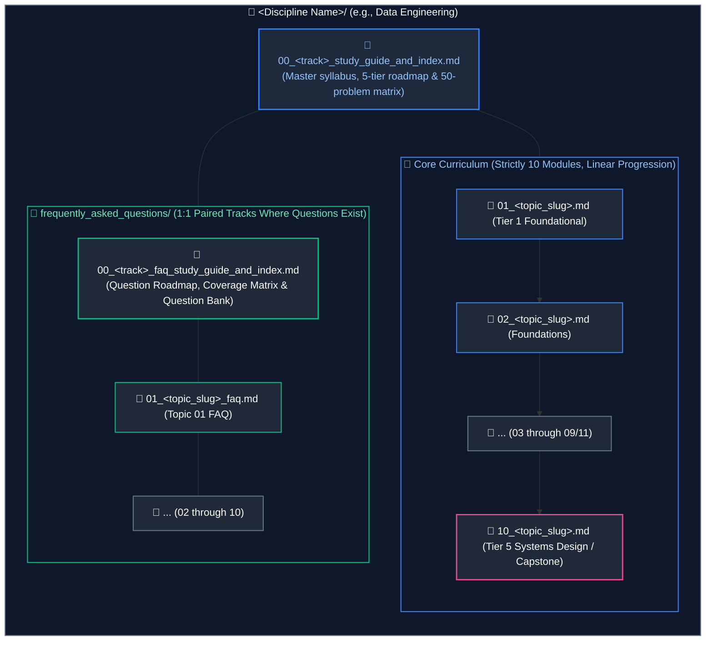

### 1.1 Standard File Naming & Organization Rules
1. **Core Curriculum Modules:** Two-digit zero-padded numbers `01_` through `10_` followed by a snake_case topic slug (e.g., `01_core_java_and_oop.md`). All engineering tracks consolidate domain knowledge into strictly 10 comprehensive modules.
2. **Master Track Index:** `00_<track_slug>_study_guide_and_index.md` (e.g., `00_de_study_guide_and_index.md`, `00_java_study_guide_and_index.md`).
3. **1:1 Topic-to-FAQ Pairing & Consistent Numeric Prefixes:**
   - Every scenario question file in `frequently_asked_questions/` must directly correspond 1:1 to its base curriculum topic and share the exact same numeric prefix (e.g. `01_sql_and_advanced_querying.md` pairs with `frequently_asked_questions/01_sql_and_advanced_querying_faq.md`).
   - Suffix for FAQ scenario files is strictly `_faq.md` (e.g., `01_sql_and_advanced_querying_faq.md`, `02_java_collections_and_generics_faq.md`).
4. **No Placeholders Mandate:**
   - Never create empty, stub, or placeholder FAQ files or directories where questions do not exist or are insufficient.
   - If a track or topic has no questions, omit the FAQ directory or file entirely. For instance, tracks without question dumps retain 0 FAQ files, and tracks with partial questions only feature FAQ files for topics with real questions.
5. **FAQ Master Study Guide & Question Bank:** `00_<track_slug>_faq_study_guide_and_index.md` (Unifies syllabus roadmap, Topic Guides & Coverage Overview matrix, and the complete master bank of interview questions organized by module and difficulty tier. Standalone `*_interview_questions.md` files are not created; questions are cataloged directly within the FAQ study guide).

---

## 2. Core Curriculum Module Specification (`01_*.md` to `10_*.md`)

Every core module must follow a uniform, sequential structure:

### 2.1 Header & Overview
```markdown
# NN. <Topic Title>

A comprehensive, production-grade guide to <scope summary>, covering <key subtopics>, memory and hardware mechanics, production patterns, and troubleshooting playbooks tailored for <Target Roles>.

---
```

### 2.2 Hero Architecture Diagram
Place the top-level architectural overview diagram **immediately after the overview paragraph and before the Table of Contents**:

```markdown
## Architectural Overview: <Architecture Name>

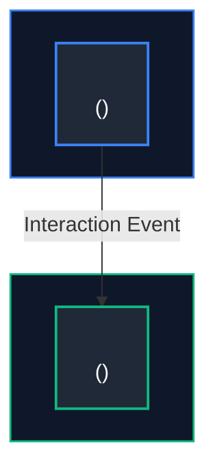
---
```

### 2.3 Table of Contents
Strictly numbered with verified GitHub markdown anchors:

```markdown
## Table of Contents
1. [<Major Section 1>](#2-mandatory-content-pillars-for-every-section)
   - [1.1 <Subsection 1>](#11-standard-file-naming-organization-rules)
   - [1.2 <Subsection 2>](#26-subsections-blueprint-1-through-8)
2. [<Major Section 2>](#2-mandatory-content-pillars-for-every-section)
...
9. [Summary Comparison & Engineering Reference Matrix](#9-summary-comparison--engineering-reference-matrix)
10. [References & Further Reading](#10-references--further-reading)

---
```

### 2.4 Pedagogical Depth & Learning Resource Standards (Fresh Learning Resource vs. Revision Material)

> [!IMPORTANT]
> **The Fresh Learning Resource Mandate:**
> Curriculum guides must never be written as terse bullet-point cheat-sheets, high-level summaries, or brief revision notes. Every file must serve as an authoritative, self-contained educational textbook and comprehensive production reference manual. A reader should be able to learn the concepts from first principles for the very first time without needing external tutorials, while simultaneously acquiring the granular production insights expected of a staff/principal engineer.

#### 1. Dual-Audience Depth: Beginner Accessibility & Senior Engineering Rigor
Every core module and subsection must cater seamlessly to two distinct engineering cohorts:
- **For Beginners & Junior Engineers (Foundational Accessibility):**
  - **First-Principles Framing:** Begin every concept with intuitive mental models and real-world analogies before introducing technical jargon or low-level mechanics.
  - **Explain the "Why":** Never present a tool, syntax, or architectural pattern in a vacuum. Always explain what fundamental problem it was designed to solve, and what architectural pain points or hardware bottlenecks plagued earlier approaches.
  - **Demystify Jargon:** Define all acronyms, domain terms, and runtime mechanics explicitly upon first introduction (e.g., explain what an IPC socket, write amplification, or safepoint actually means before discussing its optimization).
  - **Progressive Complexity Unfolding:** Sequence the instruction progressively: Conceptual Intuition $\rightarrow$ Core Architectural Abstraction $\rightarrow$ Concrete Syntax & Practical API Usage $\rightarrow$ Low-Level Engine Internals & Failure Modes.
- **For Senior & Staff-Level Engineers (Production Rigor & Low-Level Mechanics):**
  - **Under-the-Hood Internals:** Dive deep into memory layouts (stack vs. heap allocation, compressed OOPs, off-heap buffers, memory fragmentation, compaction algorithms), CPU scheduling, cache lines (L1/L2/L3 false sharing), OS/kernel interactions (syscalls, page faults, buffer pools, epoll/kqueue), and SIMD vectorization.
  - **Real-World Edge Cases & Failure Modes:** Address distributed anomalies, network partitions, split-brain scenarios, data skew, cascading timeouts, GC stop-the-world pauses, out-of-order event arrivals, and backpressure collapse.
  - **Trade-Off Cartography:** Quantify engineering trade-offs (e.g., CAP/PACELC implications, read vs. write throughput, memory consumption vs. CPU utilization, latency percentiles at $p95$, $p99$, $p99.9$).

#### 2. Mandatory Content Pillars for Every Section
Every numbered major section and subsection must systematically deliver:
1. **Exhaustive Prose Explanations:** Detailed, thorough narrative text explaining the conceptual architecture and operational mechanics. Never truncate explanations with shorthand phrases like "etc.", "and so on", "similarly for other cases", or "left as an exercise for the reader".
2. **Visual & Architectural Diagrams:** Dedicated Mermaid diagrams or structured Markdown tables illustrating dataflow, component topology, or state lifecycles directly adjacent to technical explanations.
3. **Production-Grade, Non-Trivial Code Snippets:** Realistic, syntactically complete code (strictly no synthetic `foo/bar`, `doSomething()`, or empty placeholder `TODO` stubs). Every code block must feature granular, line-by-line inline comments explaining the technical rationale, concurrency protections, and performance trade-offs.
4. **Concrete Real-World Enterprise Scenarios:** Industrial examples drawn from high-scale environments (e.g., e-commerce order checkout state machines, financial transaction ledgers, distributed IoT telemetry streams, multi-tenant SaaS schema isolation).

---

### 2.5 Cross-File Consistency & Non-Degrading Verbosity Mandate

> [!WARNING]
> **Eliminating "Agent Fatigue" and Context Degradation:**
> When authoring multi-module curricula, AI agents often demonstrate "verbosity decay"—providing extensive, 2,000-word explanations with rich diagrams for Modules 01–03, but degrading into brief, superficial summaries and bullet points by Modules 08–10. This degradation is strictly forbidden.

1. **The File-Independence Principle:**
   - Every file (from `01_*.md` to `10_*.md` in core modules, and `01_*.md` to `10_*.md` in FAQ tracks) must be approached as a completely independent, fresh, standalone guide.
   - Never assume that because a concept appears in a later module, it can be treated casually or summarized tersely.
2. **Equal Depth Across the Entire Curriculum:**
   - Modules 08 through 10 (which cover advanced distributed architectures, cloud platforms, streaming engines, and enterprise system designs) must receive the exact same or even greater depth, prose length, code complexity, and diagram density as Modules 01 through 03.
   - Treat each file equally as a fresh, high-value resource. The reader may access Module 10 directly via search without ever reading Module 01.
3. **Uniform Section Coverage:**
   - Every core module must completely execute sections `# 1.` through `# 8.`, followed by `# 9. Summary Comparison & Engineering Reference Matrix`, and mandatory final `# 10. References & Further Reading`. Topic-level FAQ links are embedded directly after each corresponding topic within the module rather than grouping all question links at the end of the file. No section may be omitted or collapsed into a single cursory paragraph.

---

### 2.6 Subsections Blueprint (`# 1.` through `# 8.`)
Every numbered major section (`# 1.`) and subsection (`### 1.1`) must contain:
1. **Low-Level Theory & Runtime Mechanics:** Explain engine internals, memory layout, CPU scheduling, buffer pools, or byte-level structures.
2. **Visual & Structural Representation:** Rich Mermaid diagrams (e.g., flowcharts, sequence, state, or class diagrams) or structured Markdown tables for memory layouts and state matrices. (Raw text ASCII diagrams, ASCII tables, and ASCII trees are strictly prohibited).
3. **Production Implementation:**
   - Real-world, non-trivial code (no placeholder `TODO` or synthetic `foo/bar`).
   - Detailed inline comments explaining each line and rationale.
4. **Key Points & Edge-Case Mitigation:**
   - Defensive engineering patterns and boundary hazards.
   - Strategic GitHub alerts:
     - `> [!CAUTION]` for data corruption, memory leaks, or concurrency bugs.
     - `> [!IMPORTANT]` for architectural invariants or contracts.
     - `> [!TIP]` for performance optimizations.
5. **Cross-References:** Explicit Markdown links to companion modules (e.g., `see [04. Database Internals](04_database_internals_and_distributed_systems.md#anchor)`).
6. **Topic-Level FAQ Links (When Companion FAQ Exists):**
   - Immediately after each corresponding topic section or subsection, embed links to relevant scenario-based interview questions using a dedicated GitHub alert block:
     ```markdown
     > [!TIP]
     > **Deep-Dive Interview Scenario(s):**
     > - [Q<N>. <Question Title>](frequently_asked_questions/NN_<slug>_faq.md#q<n>-<anchor>)
     ```
   - This provides immediate context for real-world interview scenarios directly adjacent to the foundational theory, rather than deferring all questions to a grouped section at the end of the file.

### 2.7 Code Block Integrity & Anti-Corruption Mandate

> [!CAUTION]
> **The Zero Code Block Corruption Mandate:**
> Under no circumstances should Markdown structural formatting—such as horizontal rules (`---`), Markdown heading markers (`#`, `##`, `###`), alert blockquotes (`> [!TIP]`, `> [!IMPORTANT]`), or HTML tags—be injected inside programming code blocks (```` ```python ````, ```` ```bash ````, ```` ```yaml ````, ```` ```sql ````, ```` ```java ````).
>
> 1. **Code Comment Purity:** Comments inside code blocks must remain native language comments (e.g., `# Step 1:` in Python/Bash/YAML, `// Step 1:` in Java/Go/C++, `-- Step 1:` in SQL). Never prepend `\n---\n\n#` to code comments. Doing so causes fatal `SyntaxError` breaks, invalidates YAML multi-document parsing, crashes execution, and causes Markdown parsers to treat inline comments as H1/H2 document headings.
> 2. **Alert Block Placement:** Interview scenario alert blocks (`> [!TIP]`) must always reside in the prose flow directly before or after a code snippet, never nested within code blocks.
> 3. **Syntax Verifiability:** All code examples must be syntactically valid and runnable in their respective languages without requiring manual sanitization.

---

### 2.8 Heading Sequencing & Table of Contents Anchor Conventions

1. **Deterministic Linear Progression:**
   - Section numbers in core modules must advance sequentially from `# 1.` through `# 8.` (or `# N.`), followed by `# N+1. Summary Comparison & Engineering Reference Matrix` (or `Summary & Production Engineering Takeaways`) and mandatory final `# N+2. References & Further Reading`.
   - Never introduce artificial heading leaps or phantom sections caused by unescaped code comments.
2. **GitHub-Flavored Markdown Anchor Normalization:**
   - Table of Contents entries must strictly resolve to valid headings.
   - When generating anchors:
     - Backtick characters (`` `code` ``) are stripped, but enclosed underscores (e.g. `__slots__`, `row_number`) are preserved.
     - Punctuation characters (`.`, `,`, `(`, `)`, `&`, `|`, etc.) are stripped, and whitespace sequences collapse to single hyphens.
     - Punctuation-only tokens inside parentheses (e.g. `(`&&`, `||`)`) produce trailing double hyphens (`--`) after whitespace collapsing and punctuation stripping.
     - Always verify TOC anchors against document headings using automated link verification.

---

### 2.9 Closing Sections (Mandatory)

> [!CAUTION]
> **Strict Prohibition of End-of-File Checklists & Duplicate Dividers:**
> Never add a checklist (e.g. `- [ ]` checkboxes, "Self-Assessment Checklist", or "Verification Checklist" sections) at the end of files. Instead, synthesize the core principles into an authoritative **Summary Comparison & Engineering Reference Matrix** or **Summary & Production Engineering Takeaways**, immediately followed by the mandatory **References & Further Reading** section. Duplicate horizontal dividers (`---\n\n---`) or trailing dividers at the end of files are strictly prohibited.

Every guide across the repository must conclude with the following sequence:
1. **Summary Section (`# N. Summary Comparison & Engineering Reference Matrix` or `# N. Summary & Production Engineering Takeaways`):**
   - Provide a comprehensive, senior-level synthesis of key concepts, production invariants, and architectural trade-offs using structured bullet points or narrative paragraphs (whatever best suits the domain).
   - For comparative modules, include a multi-dimensional comparison table of key features, complexity, latency percentiles, and operational rules.
   - **Strictly no checkbox lists (`- [ ]`) or self-assessment checklist questionnaires.**
2. **References & Further Reading Section (`# N+1. References & Further Reading`):**
   - Mandatory in every module without exception.
   - Curated Markdown links to authoritative sources: official engine/framework documentation, RFCs, ISO/ANSI standards, academic research papers, and seminal engineering books (e.g., Martin Kleppmann, Ralph Kimball).

---

## 3. Master Study Guide & Index Specification (`00_*_study_guide_and_index.md`)

Each track root must contain a master curriculum guide containing:

### 3.1 5-Tier Chronological Mermaid Roadmap
Modules strictly follow linear numbering across 5 tiers (strictly 10 modules total, 2 modules per tier):
* **Tier 1 (Modules 01–02):** Core Languages & Low-Level Foundations
* **Tier 2 (Modules 03–04):** Storage Engines, Architecture & Data Modeling
* **Tier 3 (Modules 05–06):** Core Frameworks, Runtimes & Execution Engines
* **Tier 4 (Modules 07–08):** Ingestion, Caching, Streaming & Persistence
* **Tier 5 (Modules 09–10):** Distributed Systems, Cloud, Ops & System Design

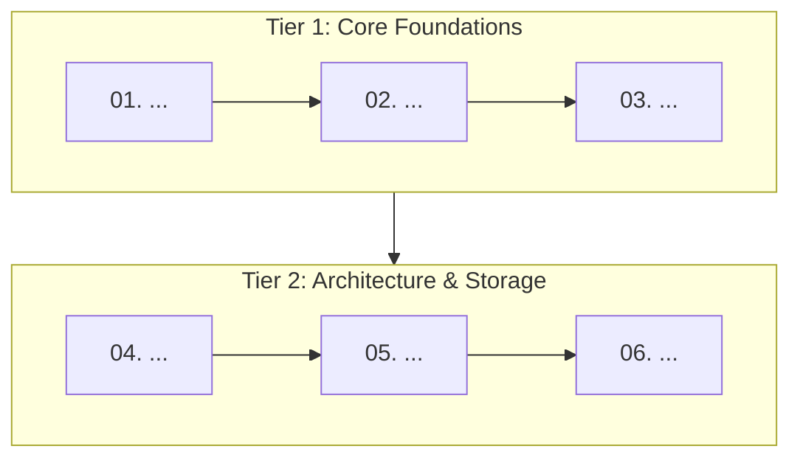

### 3.2 Curriculum Coverage Table
| Study Order | Guide File | Conceptual Domain | Corresponding Interview Guide | Key Topics & Production Scenarios Covered |
| :---: | :--- | :--- | :--- | :--- |
| **01** | [`01_...md`](01_...md) | ... | [`01_...md`](frequently_asked_questions/01_...md) | ... |

### 3.3 50-Problem Production-Solution Cross-Reference Index
A canonical matrix mapping 50 real-world production failures to their solutions and exact file anchors:
| Problem | Canonical Solution | Module Reference |
| :--- | :--- | :--- |
| **Data Skew / OOM** | Key salting & AQE partition coalescing | [`08_...md`](08_...md#anchor) |

### 3.4 Practical Interview Track Overview
Summary links to all scenario files within `frequently_asked_questions/`.

---

## 4. Interview FAQ Track & Question Bank Specification

The `frequently_asked_questions/` directory combines scenario deep-dives with a unified master study guide and question bank. Separate raw question files (e.g. `*_interview_questions.md`) must not be created; all questions are cataloged directly within the track's master FAQ guide.

### 4.1 FAQ Master Study Guide & Question Bank (`00_<track>_faq_study_guide_and_index.md`)

Each FAQ track root must contain a master syllabus and unified question bank containing:
1. **Header & Context:** Scope summary connecting scenarios to real-world production engineering.
2. **Recommended Chronological Study Order:** Multi-tier Mermaid flowchart (`flowchart TD` or `flowchart LR`) illustrating the linear progression across foundational, framework, and distributed architecture tracks.
3. **Topic Guides & Coverage Overview Table (Proportional Legibility & Formatting Mandate):**
   - **Balanced Row Height & Width:** Every row must maintain balanced proportions (~3–4 lines tall across all columns) to prevent distorted rows where some columns are stretched out horizontally while others form excessively tall vertical towers.
   - **Balanced File Link Wrapping:** Long filenames in `Guide File` and `Corresponding Base Concepts` must be wrapped into **at most 2 balanced lines** at natural word boundaries/underscores (e.g., ``[`01_machine_learning_`<br/>`and_deep_learning_faq.md`](...)``). Short filenames (e.g. `01_sql_and_advanced_querying_faq.md`) must remain on a single line.
   - **Base Concepts Compaction:** Multiple base concepts must be separated by a single `<br/>` without blank lines or excessive multi-line splitting.
   - **Structured Thematic Bullets for Scenarios:** The `Key Topics & Grouped Scenarios` column must **never** contain an unformatted, 1,000-character run-on paragraph. It must be organized into 2–3 structured thematic bullet points (e.g., `• **Foundations:** ...<br/>• **Architecture:** ...<br/>• **Production Triage:** ...`), keeping each bullet line concise and readable.
4. **Master Topic Directory & Difficulty Matrix:** Summary breakdown of questions per module across difficulty tiers (`Easy`, `Medium`, `Hard`, `Expert`), with wrapped companion guide links.
5. **Master Question Bank Sections (`## 01 – ...` to `## NN – ...`):**
   - Complete, permanent collection of questions partitioned by topic module.
   - Every question entry includes its difficulty rating badge (e.g. `**[Easy]**`, `**[Medium]**`, `**[Hard]**`, `**[Expert]**`) and a verified direct anchor link to its deep-dive solution in the companion scenario module (`→ [Solution](NN_*_faq.md#anchor)`).

### 4.2 Scenario FAQ Module Specification (`frequently_asked_questions/NN_*_faq.md`)

### 4.2.1 Header & Clustered TOC
```markdown
# NN. <Topic Title>: Interview Questions & Deep-Dive Solutions

A comprehensive, production-grade guide answering real-world <Topic> interview scenarios.

---

## Table of Contents & Question Mapping

1. **<Thematic Cluster 1>**
   - [Q1. <Question Title>](#nn-topic-title-interview-questions-deep-dive-solutions)
   - [Q2 & Q3. <Grouped Question Title>](#nn-topic-title-interview-questions-deep-dive-solutions)
...
---
```

### 4.2.2 Standard Question Entry Blueprint
```markdown
### Q<N>. <Question Title>
*(If questions are grouped: Grouped together: <Reason for grouping>)*  
**Topic Covered:** <Domain & Core Mechanism>  
**Question:** <Full verbatim question>

#### Definition & Core Concepts
<In-depth theoretical explanation of how the engine/runtime processes this under the hood.>

#### Visual Flow
<Mermaid flowchart or sequence diagram depicting state flow, failure mode, or lifecycle.>

#### Production Implementation / Code Solution
```<language>
// Production code with edge-case handling and inline comments
```
- **Time Complexity:** $O(...) $
- **Space Complexity:** $O(...) $

#### Engineering Implications & Production Pitfalls
1. **<Anti-Pattern / Hazard>:** <Why naive solutions fail in high-throughput production.>
2. **<Interview Talking Point>:** <Key trade-off or nuance that demonstrates senior expertise.>
```

### 4.2.3 FAQ Pedagogical Depth & Cross-Question Consistency Mandate

1. **Comprehensive Deep-Dive Solutions vs. Brief Interview Tips:**
   - FAQ solutions must never be summarized into two-sentence soundbites, generic definitions, or high-level bullet lists.
   - Every question entry must represent an exhaustive, production-grade masterclass providing:
     - Intuitive foundational concepts and runtime mechanics clear enough for a junior engineer.
     - Production failure triage, concurrency hazards, and hardware/OS trade-offs required by staff/principal interviewers.
     - A dedicated, dark-mode-styled Mermaid diagram or structured Markdown table illustrating the underlying mechanism.
     - Fully functional, syntactically complete code solutions with edge-case handling and line-by-line inline rationale comments.
     - Explicit $O(...)$ time and space complexity annotations.
     - Deep engineering implications, production anti-patterns, and nuanced interview talking points.
2. **Strict Non-Degrading Verbosity Across All Questions:**
   - Maintain uniform depth, prose density, and code completeness from Question 1 through to the final question in the file.
   - Never taper off in depth or omit visual diagrams and code blocks for later questions in the file.

---

## 5. Diagram Selection, Visual Modality & Design System

All visual artifacts throughout the repository must adhere to a strict visual design system: semantic diagram selection, dark-mode-first color palette, balanced widescreen geometry, and pragmatic modality choices. Contributors and AI agents must never default to generic flowcharts for items that have specialized, expressive diagram primitives, nor should they blindly force text-heavy tabular data into diagram boxes.

### 5.1 Diagram Types & Semantic Selection Matrix

| Content / Domain Type | Recommended Mermaid Syntax | Visual Convention | Rationale & Strict Rule |
| :--- | :--- | :---: | :--- |
| **System & Hardware Architectures** | `flowchart TD` | Top-to-Bottom | Subgraphs representing memory areas (Stack, Heap, Metaspace) or infrastructure boundaries (VPC, Subnets). |
| **Data Pipelines & Ingestion Streams** | `flowchart LR` | Left-to-Right | Source $\rightarrow$ Bronze $\rightarrow$ Silver $\rightarrow$ Gold dataflow progression. |
| **Diagnostic & Troubleshooting Trees** | `flowchart TD` | Top-to-Bottom | Conditional Yes/No branching decision trees for production failure triage. |
| **Directory & File Structures** | **TreeView** (`flowchart TD`) | Top-to-Bottom | **Mandatory:** Never use ASCII trees (`├──`, `└──`). Use TreeView with `📁` and `📄` node badges. |
| **Entity, Task & Resource Lifecycles** | `stateDiagram-v2` | State Machine | Thread, Pod, JPA Entity, Airflow Task, TCP socket, and Circuit Breaker states (`[*] --> State`). |
| **OOP Design Patterns & Hierarchies** | `classDiagram` | Top-to-Bottom / Left-to-Right | GoF patterns, SOLID abstractions, interface realizations (`<|..`), and inheritance (`<|--`). |
| **Relational & Dimensional Schemas** | `erDiagram` | Crow's Foot | Database tables, PK/FK attributes, Star/Snowflake schemas, and cardinalities (`||--o{`). |
| **Protocols, Sagas & Tool Calling** | `sequenceDiagram` | Chronological | Multi-actor request/response, OAuth2/TLS handshakes, Saga 2PC, and LLM Tool dispatching. |
| **Architectural Trade-Off Spaces** | `quadrantChart` | 2D Cartography | CAP/PACELC theorems, vector index latency vs recall, cost vs latency evaluations. |
| **GitOps & Branching Strategies** | `gitGraph` | Branch Tree | Trunk-based development, release tags, canary promotion, and PR merge flows. |
| **Historical & Paradigm Evolutions** | `timeline` | Chronological Eras | Evolution of architectures (SysOps $\rightarrow$ DevOps $\rightarrow$ Platform; Java LTS releases). |
| **Domain Mental Maps & Syllabi** | `mindmap` | Radiant Tree | Broad domain taxonomies, syllabus mental maps, and high-level cheat-sheets. |

---

### 5.2 Visual Modality Decision Matrix: Markdown Tables vs. Mermaid Diagrams (Pragmatic Selection Rule)

> [!IMPORTANT]
> **The Principle of Selective Modality (Avoiding Blind Mermaid Usage):**
> Do **NOT** use Mermaid diagrams for everything blindly. Diagrams excel at conveying flow, spatial topology, state lifecycles, and relational hierarchies. However, forcing multi-attribute text comparisons, parameter references, or tabular specifications into Mermaid boxes creates bloated, unreadable, and unwieldy diagrams. Choose the presentation format that maximizes clarity, scannability, and informational density.

| Use Case / Content Type | Optimal Modality | Format Specification | Key Rationale |
| :--- | :---: | :--- | :--- |
| **Multi-Attribute Feature Comparison** | **Markdown Table** | GitHub-Flavored Markdown table with bold column headers and aligned cells | High text density; comparing multiple technologies or algorithms across identical criteria (e.g., Latency, Complexity, Use Cases) is far easier to scan in a clean table than in diagram boxes. |
| **Pros & Cons / Trade-Off Analysis** | **Markdown Table** | Multi-column table (`| Dimension | Approach A | Approach B | Trade-Off Rationale |`) | Allows detailed prose explanations without visual distortion or text clipping. |
| **API, Flag & Configuration Reference** | **Markdown Table** | 4-column table (`| Parameter | Type | Default | Operational Impact |`) | Compact reference structure with uniform scanning. |
| **Summary Comparison Matrix** | **Markdown Table** | Section 9 Engineering Reference Matrix | Standardized end-of-module reference matrix. |
| **Directory & Folder Hierarchies** | **Mermaid TreeView** | `flowchart TD` with `📁` and `📄` node badges and styled branches | Provides clear spatial visual hierarchy of packages and file structures without raw ASCII. |
| **Sequential Pipelines & Ingestion Streams** | **Mermaid Flowchart** | `flowchart LR` or `flowchart TD` (Wrapped Multi-Stage) | Explicitly depicts directional stage transitions, buffers, and data hand-offs. |
| **Component & Network Architecture** | **Mermaid Flowchart** | `flowchart TD` with subgraphs for layers/boundaries | Visualizes infrastructure perimeters (VPC, Subnets, Memory regions, Microservices). |
| **State Lifecycles & Failure Triage** | **Mermaid State Diagram** | `stateDiagram-v2` with semantic class styling | Formal state machine modeling with valid transition triggers and terminal states. |
| **OOP Contracts & Design Patterns** | **Mermaid Class Diagram** | `classDiagram` with interface realizations and members | Visualizes GoF patterns, inheritance, and dependency injection contracts. |
| **Relational & Dimensional Schemas** | **Mermaid ER Diagram** | `erDiagram` with crow's foot cardinalities and attributes | Depicts PK/FK constraints, star schemas, and entity cardinalities. |
| **Distributed Protocols & Message Passing** | **Mermaid Sequence Diagram** | `sequenceDiagram` with dark theme `init` and actor `box` boundaries | Captures chronological request/response cycles, handshakes, and saga compensations. |
| **2D Trade-Off Landscapes** | **Mermaid Quadrant Chart** | `quadrantChart` with dark theme `init` and quadrant labels | Visualizes architectural spectrums (e.g., Consistency vs. Availability, Latency vs. Recall). |
| **Chronological & Paradigm Evolutions** | **Mermaid Timeline** | `timeline` with dark theme `init` and era tags | Displays historical progression across technology epochs and LTS releases. |

### 5.3 Prohibition of "Card Wrapping" (Text-in-a-Box) & Diagram Quality Mandates

> [!CAUTION]
> **Strict Prohibition of "Card Wrapping" / Pseudo-Diagrams:**
> Wrapping paragraphs of definitions, feature summaries, pros/cons, or parameter lists inside disconnected Mermaid flowchart boxes (`flowchart TD` / `flowchart LR`) with **zero interconnecting edges or purely decorative linear arrows** is strictly forbidden throughout the entire repository. A diagram that contains only text in boxes with no flow is not a diagram; it is text masquerading as visual art.

#### 1. The 4 Criteria for Diagram Justification
A Mermaid diagram is permitted **only** if it satisfies at least one of the following structural requirements:
1. **Directional Flow & Pipelining:** Explicit multi-stage transitions where data or execution transforms from Stage A to Stage B to Stage C (e.g., AST $\rightarrow$ Logical Plan $\rightarrow$ Physical Plan $\rightarrow$ Machine Code).
2. **Spatial Topology & Physical Memory/Hardware Boundaries:** Physical or logical containment and interaction across hardware boundaries (e.g., CPU Registers $\rightarrow$ Volatile RAM $\rightarrow$ OS `fsync()` Barrier $\rightarrow$ Non-Volatile NVMe SSD; Kubernetes Pod $\rightarrow$ Node $\rightarrow$ Cluster Network).
3. **Multi-Actor Message Passing & Protocols:** Chronological request/response cycles, handshakes, and distributed consensus across distinct actors over time (must use `sequenceDiagram`).
4. **Finite State Transitions:** Explicit state machines with valid trigger events and guard conditions (must use `stateDiagram-v2`).

#### 2. Mandatory Modality Decision Rules
- **Multi-Attribute Comparisons Must Be Tables:** When comparing 2 or more options across multiple dimensions (e.g., Execution Engines: Volcano vs. Vectorized vs. JIT; Compaction: STCS vs. LCS; Storage: Row vs. Column), you **must** use a GitHub-Flavored Markdown table. Never use Mermaid boxes to compare technology features.
- **Taxonomies & Classification Lists Must Be Tables:** Lists of variants (e.g., 4 physical access paths, 6 SCD types, 4 floating-point formats, 3 DI styles) belong in structured Markdown reference tables.
- **Zero Diagram-Table Duplication:** Never place a Mermaid diagram directly adjacent to a Markdown table that lists the exact same entities, attributes, or definitions. If a diagram accompanies a table, the diagram must illustrate the physical dataflow or structural architecture, while the table details the multi-dimensional specifications.
- **Hardware & Failure Boundaries Must Show Real Boundaries:** When illustrating concepts like ACID Guarantees, WAL Persistence, or Crash Recovery, diagrams must not be abstract boxes labeled A, C, I, D. They must explicitly map the **Volatile Domain** (RAM, CPU, Buffer Pool, Lock Table) vs. the **Non-Volatile Domain** (Disk, WAL, Undo log), showing the physical boundary, `fsync` barriers, and crash-recovery rollback flows.

---

### 5.4 Universal Zero-ASCII Rule & Visual Refactoring Standard

> [!CAUTION]
> **The Universal Zero-ASCII Rule:**
> Raw text ASCII representations of any kind are strictly prohibited throughout the entire repository. This includes:
> 1. **No ASCII Directory Trees:** Characters like `├──`, `└──`, and `│` must be refactored into visual **Mermaid TreeView** diagrams (`flowchart TD`).
> 2. **No ASCII Tables:** Bordered text boxes using `+---+---+`, `|===|===|`, or custom monospace table art must be refactored into standard **GitHub Flavored Markdown tables**.
> 3. **No ASCII Architecture / Flow Boxes:** Text-based block diagrams (e.g., `[Client] ---> [API Gateway] ---> [DB]`) must be refactored into dark-mode-styled **Mermaid flowcharts**.
> 4. **No ASCII Memory / Byte Maps:** Monospace memory block illustrations (e.g., `[ 8B Mark Word | 4B Klass Pointer ]`) must be refactored into structured **Markdown tables** (detailing Offset, Field Name, Bit/Byte Size, and Semantics) or styled **Mermaid layout subgraphs**.

#### Thoughtful Visual Refactoring (No Blind Replacements)
When inspecting legacy content or existing notes:
- **Do not blindly convert ASCII art into the wrong format:**
  - Before modifying an ASCII block, analyze the nature of the underlying data:
    - If the ASCII block represents a **tabular comparison or feature matrix**, refactor it into a **Markdown table**, NOT a bloated Mermaid flowchart.
    - If the ASCII block represents a **folder structure, file listing, or package hierarchy**, refactor it into a **Mermaid TreeView** diagram.
    - If the ASCII block represents a **lifecycle, state progression, or status flow**, refactor it into a **`stateDiagram-v2`**.
    - If the ASCII block represents an **architectural dataflow or component interaction**, refactor it into an appropriately proportioned **Mermaid flowchart** or **sequence diagram**.
---

### 5.5 Standard Hex Color Palette & Semantic Roles Across All Diagram Types

Every diagram in the repository must be visually styled according to the dark-mode semantic hex palette. Never leave any diagram type unstyled with default gray/white rendering.

#### Core Hex Color Reference
- **Container / Boundary Fill:** `#0f172a` (Deep Slate / Navy)
- **Node / Entity Fill:** `#1e293b` (Slate-800)
- **Text / Typography:** `#ffffff` (White), `#94a3b8` (Muted Slate), `#fde68a` (Amber note text)
- **Primary / Active Accent:** `#3b82f6` (Blue)
- **Success / Healthy / Operational Accent:** `#10b981` (Emerald)
- **Warning / Intermediate / Trial Accent:** `#f59e0b` (Amber)
- **Error / Tripped / Blocked Accent:** `#ef4444` (Red)
- **Control Plane / Orchestration / Metadata Accent:** `#8b5cf6` (Purple)
- **Ingestion / Streaming / Network Accent:** `#06b6d4` (Cyan)

#### Universal Syntax Rules by Diagram Type

1. **Flowcharts (`flowchart TD` / `flowchart LR`):**
   - Use `style NodeId fill:#1e293b,stroke:#<hex>,stroke-width:2px,color:#fff`
   - Use `style SubgraphId fill:#0f172a,stroke:#<hex>,stroke-width:1.5px,color:#<hex>`
2. **State Diagrams (`stateDiagram-v2`):**
   - Declare semantic classes:
     ```text
     classDef operational fill:#1e293b,stroke:#10b981,stroke-width:2px,color:#ffffff
     classDef warning fill:#1e293b,stroke:#f59e0b,stroke-width:2px,color:#ffffff
     classDef error fill:#1e293b,stroke:#ef4444,stroke-width:2px,color:#ffffff
     classDef transient fill:#1e293b,stroke:#3b82f6,stroke-width:2px,color:#ffffff
     classDef terminal fill:#1e293b,stroke:#8b5cf6,stroke-width:2px,color:#ffffff
     ```
   - Bind states to classes: `class Closed operational`, `class Open error`, `class HalfOpen warning`
3. **Class Diagrams (`classDiagram`):**
   - Style concrete classes: `style ConcreteClass fill:#1e293b,stroke:#3b82f6,stroke-width:2px,color:#ffffff`
   - Style interfaces: `style InterfaceName fill:#0f172a,stroke:#10b981,stroke-width:2px,color:#ffffff`
   - Style client/service facades: `style ServiceClass fill:#1e293b,stroke:#8b5cf6,stroke-width:2px,color:#ffffff`
4. **Sequence Diagrams (`sequenceDiagram`):**
   - Inject the dark theme initialization directive:
     ```text
     %%{init: {'theme': 'dark', 'themeVariables': { 'actorBkg': '#1e293b', 'actorBorder': '#3b82f6', 'actorTextColor': '#ffffff', 'signalColor': '#93c5fd', 'signalTextColor': '#ffffff', 'noteBkgColor': '#1e293b', 'noteBorderColor': '#f59e0b', 'noteTextColor': '#fde68a', 'activationBkgColor': '#3b82f6', 'sequenceNumberColor': '#ffffff' }}}%%
     ```
   - Wrap participant groups in architectural perimeter boxes:
     ```text
     box rgba(15, 23, 42, 0.8) Client Perimeter
         actor User
     end
     box rgba(30, 41, 59, 0.8) Service Tier
         participant Orch as Orchestrator
     end
     ```
5. **Entity-Relationship Diagrams (`erDiagram`):**
   - Inject the dark theme initialization directive:
     ```text
     %%{init: {'theme': 'dark', 'themeVariables': { 'attributeBackgroundColorOdd': '#1e293b', 'attributeBackgroundColorEven': '#0f172a', 'entityBackgroundColor': '#1e293b', 'entityBorderColor': '#3b82f6', 'entityTextColor': '#ffffff' }}}%%
     ```
6. **Quadrant Charts (`quadrantChart`):**
   - Inject the dark theme initialization directive:
     ```text
     %%{init: {'theme': 'dark', 'themeVariables': { 'quadrant1Fill': '#1e293b', 'quadrant2Fill': '#0f172a', 'quadrant3Fill': '#1e293b', 'quadrant4Fill': '#0f172a', 'quadrantPointFill': '#3b82f6', 'quadrantPointTextFill': '#ffffff', 'quadrantTitleFill': '#ffffff', 'quadrantAxisTextFill': '#93c5fd', 'quadrantInternalBorderStrokeFill': '#334155', 'quadrantExternalBorderStrokeFill': '#475569' }}}%%
     ```
7. **Timelines (`timeline`):**
   - Inject the dark theme initialization directive:
     ```text
     %%{init: {'theme': 'dark', 'themeVariables': { 'timelineColor': '#3b82f6', 'cScale0': '#1e293b', 'cScale1': '#1e3a8a', 'cScale2': '#064e3b', 'cScaleLabel0': '#ffffff', 'cScaleLabel1': '#ffffff', 'cScaleLabel2': '#ffffff' }}}%%
     ```

---

### 5.6 TreeView Diagram Standard (Hierarchical & Directory Trees)

> [!IMPORTANT]
> **TreeView Enforcement for Filesystem & Hierarchies:** Raw text ASCII file trees (`├──`, `└──`) or indented bulleted lists for directory structures are strictly prohibited throughout the entire repository. All directory hierarchies and project trees must be rendered using visual Mermaid TreeView diagrams with folder and file node badges.

#### TreeView Formatting Conventions:
1. Outer directory containers must use `subgraph` with a folder prefix: `subgraph RootDir ["📁 <dirname>/"]`.
2. Folder nodes inside the tree must use `📁 <name>/` with a bold category descriptor.
3. File nodes must use `📄 <filename>` with a secondary one-line description: `📄 main.tf<br/>(Shared infrastructure definitions)`.
4. Connect parent directories to child nodes with solid lines: `RootDir --> FileNode`.

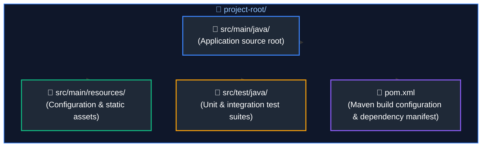

---

### 5.7 Typography, Labeling & Node Geometry Rules

1. **Two-Line Labeling Pattern:**
   Every significant node in a flowchart must feature a bold title followed by a `<br/>` with concise secondary metadata (memory size, mechanism, or responsibility):
   ```text
   RefVar["Object Reference Variable<br/>(4 bytes compressed OOP)"]
   MarkWord["Mark Word (8 bytes)<br/>Hashcode, GC Age, Biased/Lock Flags"]
   Catalyst["Catalyst Optimizer<br/>(Analysis -> Logical -> Physical -> CodeGen)"]
   ```
2. **Link Annotations:**
   - Solid transition: `A --> B`
   - Annotated interaction: `A -->|"Points to Heap Address"| B`
   - Weak / Metadata / Logical link: `A -.->|"Internal value ref"| B`
   - Always enclose link text in double quotes (`-->|"Label"|`) to avoid Mermaid parsing syntax errors.

3. **Strict Prohibition of Multi-Point / Bulleted Lists Inside Node Boxes:**
   Never include bullet points (`•`, `&bull;`, `-`, `*`), numbered item lists (`1.`, `2.`), or multi-item lists inside Mermaid diagram node boxes. Packing multi-point lists into boxes clutters visual diagrams, distorts node geometry, and degrades readability.
   - **The Clean Two-Line Node Standard:** Flowchart nodes must maintain a clean, compact layout:
     ```text
     NodeId["<b>Heading Title</b><br/>(Concise summary of mechanism, responsibility, or state)"]
     ```
   - **Concise Paragraph / Summary Rule:** If contextual detail is necessary beyond the heading, express it as a single concise, fluid phrase or parenthetical summary (e.g., `(Memory overhead, single-socket multiplexing, and zero context switching)`), never as separate bullet points or multi-line lists.
   - **Detail Placement:** If exhaustive multi-point lists, parameter breakdowns, or diagnostic checklists are needed, place them in the companion Markdown narrative or a structured Markdown table directly following the diagram—never inside diagram shapes.

---

### 5.8 Widescreen Layout & Proportion Standards (Anti-Tower / Anti-Shrink System)

To prevent unreadable, excessively tall, or shrunken diagrams in markdown viewers and preview engines, all flowcharts must adhere to strict aspect-ratio and geometry rules. Diagram proportions should target a balanced **16:9 to 4:3** envelope.

#### 1. The Core Anti-Patterns
- **Anti-Tower Rule (Monolithic Vertical Stacks):** Never chain 5 or more sequential nodes in a single straight vertical line (`flowchart TD` with no horizontal grouping). This creates an excessively tall, narrow pillar that wastes horizontal screen space and requires endless vertical scrolling.
- **Anti-Shrink Rule (Monolithic Horizontal Ribbons):** Never chain 5 or more sequential stages in a single straight horizontal line (`flowchart LR`). Markdown engines scale the entire diagram SVG to fit the viewport width; 5+ horizontal nodes cause severe downscaling, rendering typography tiny and unreadable.
- **Artificial Chaining Rule:** Never use arrows (`-->`) between items that have no causal or chronological sequence (e.g., taxonomies, independent pillars, or distinct comparison modes). Chaining independent items misleads readers and produces artificial towers.

---

#### 2. Pattern A: Connected Sequential Flows (The S-Curve & Wrapped Multi-Phase Standard)
When a continuous process or execution pipeline has 5 to 10 sequential steps, it **must wrap to the next line** using an **S-pattern (serpentine)** or a **balanced multi-phase layout**:

- **Outer Structure:** `flowchart TD` to stack the phases/rows cleanly.
- **Row/Phase Flow:** Group consecutive steps (typically 3 to 4 nodes) into balanced subgraphs with `direction LR`.
- **Inter-Row Transition:** Connect the final node of Row 1 downward to the first node of Row 2 (`R1_End --> R2_Start`).
- **Serpentine Option:** For unbroken streams, bend from right-to-left or drop cleanly with an annotated transition down to the next row.

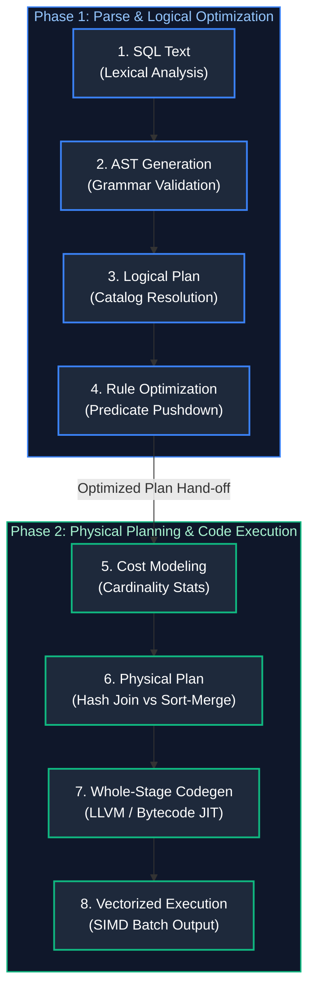

---

#### 3. Pattern B: Contrasting Modes & Comparison Flows (Side-by-Side vs. Stacked Rows)
When illustrating comparisons (e.g., L4 vs L7 proxies, With Index vs Without Index, Clustered vs Non-Clustered, Before vs After Key Salting):

1. **Side-by-Side Layout (`flowchart LR` with `direction TB`):**
   - Use when each paradigm represents an architectural tier or vertical tree.
   - Place each paradigm into its own distinct subgraph.
   - Anchor both subgraphs from a common root node or place them adjacent in `flowchart LR`.

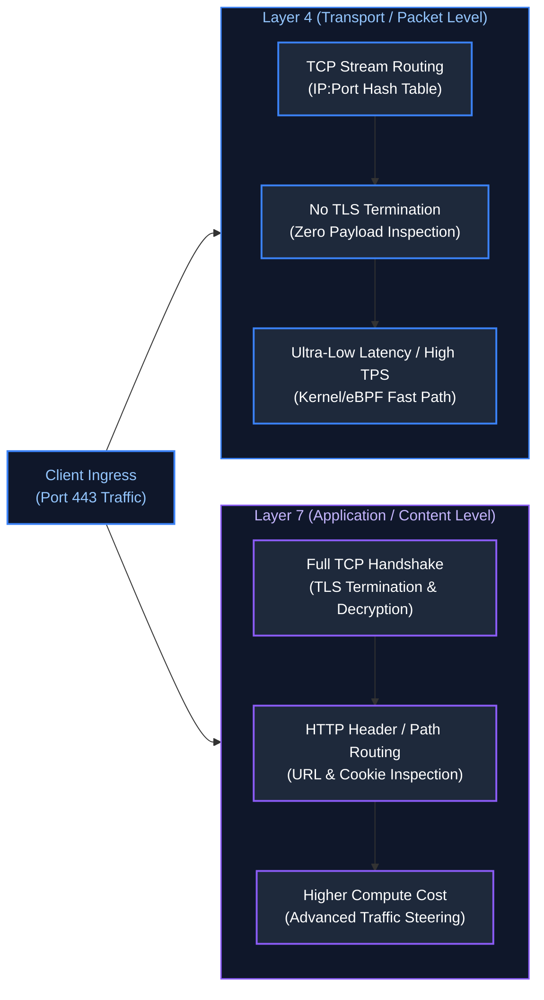

2. **Stacked Horizontal Comparison Rows (`flowchart TD` with `direction LR`):**
   - Use when each contrasting scenario contains an internal horizontal data pipeline (e.g., Predicate Pushdown vs Full Scan, `reduceByKey` vs `groupByKey`).
   - Outer chart uses `flowchart TD` to place the comparison rows one after another.
   - Each comparison subgraph declares `direction LR` to display its pipeline horizontally.

```mermaid
flowchart TD
    subgraph BadCase ["Without Pushdown: Full Disk Scan & Engine Filtering"]
        direction LR
        B1["Storage Layer<br/>(Read 100M Rows from Disk)"] -->|"Full 100M Rows I/O"| B2["Engine Memory Buffer<br/>(Massive Deserialization)"]
        B2 -->|"WHERE Filter Evaluated"| B3["Final Result<br/>(1,000 Matched Rows)"]
    end

    subgraph GoodCase ["With Predicate Pushdown: Storage-Level Pruning"]
        direction LR
        G1["Storage Layer<br/>(Evaluate Parquet Stats)"] -->|"Prune 99.9% Row Groups"| G2["Engine Memory Buffer<br/>(Read Only 1,000 Rows)"]
        G2 -->|"Zero Extra Filtering"| G3["Final Result<br/>(1,000 Matched Rows)"]
    end

    style BadCase fill:#0f172a,stroke:#ef4444,stroke-width:1.5px,color:#fca5a5
    style GoodCase fill:#0f172a,stroke:#10b981,stroke-width:1.5px,color:#a7f3d0
    style B1 fill:#1e293b,stroke:#ef4444,stroke-width:2px,color:#fff
    style B2 fill:#1e293b,stroke:#ef4444,stroke-width:2px,color:#fff
    style B3 fill:#1e293b,stroke:#ef4444,stroke-width:2px,color:#fff
    style G1 fill:#1e293b,stroke:#10b981,stroke-width:2px,color:#fff
    style G2 fill:#1e293b,stroke:#10b981,stroke-width:2px,color:#fff
    style G3 fill:#1e293b,stroke:#10b981,stroke-width:2px,color:#fff
```

---

#### 4. Pattern C: Architectural Boundaries & Memory Failure Domains (Layered Physical Topologies)
When mapping physical system boundaries, crash domains, or storage engine guarantees (e.g., ACID transactions across hardware failure boundaries, buffer pool flushing, crash recovery):

- **The Strict Rule:** Do NOT use disconnected text cards or 2x2 definition boxes. A diagram must illustrate the **physical and architectural boundaries** and the explicit data movement across them.
- **Physical Boundary Layering:** Group components into physical domains (e.g., `Volatile Domain` vs `Non-Volatile Persistence Subsystem`) separated by explicit barrier nodes (e.g., OS `fsync()` barrier).
- **Edge Directionality:** Show active reads, writes, synchronous WAL commits, and asynchronous background flushes across the boundary.

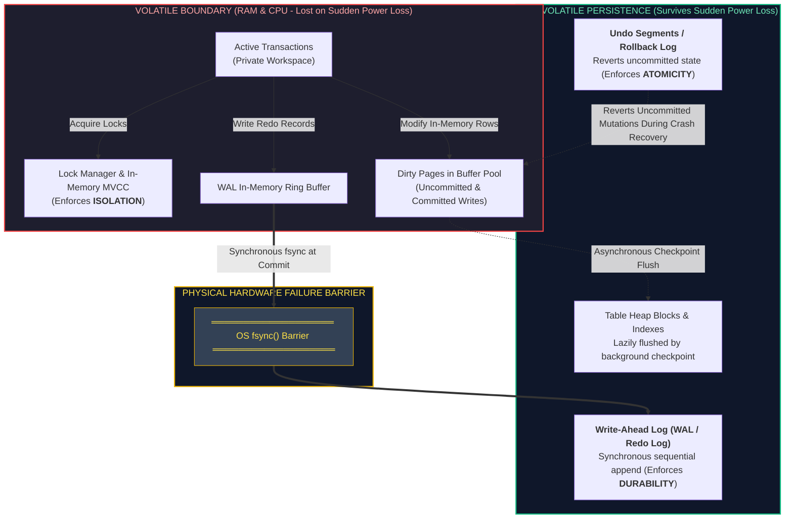

---

### 5.9 Concrete Reference Examples for Specialized Diagram Types

#### Example 1: State Machine & Resource Lifecycle (`stateDiagram-v2`)
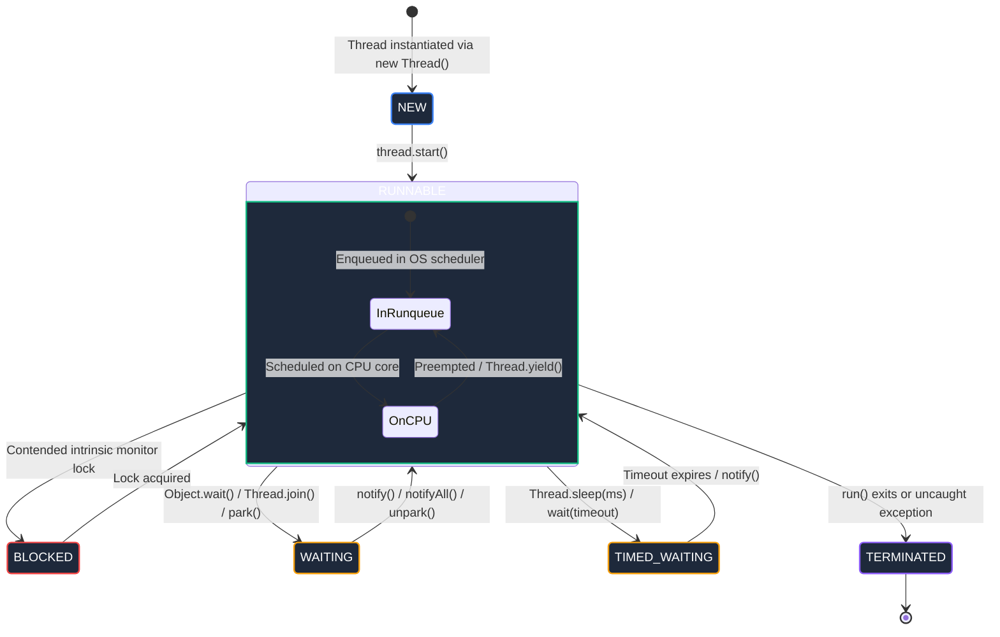

#### Example 2: OOP Design Pattern & SOLID Contracts (`classDiagram`)
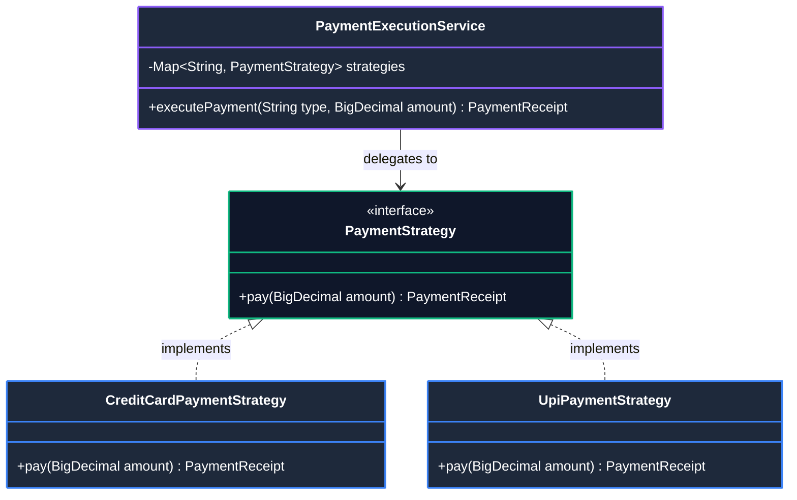

#### Example 3: Relational & Dimensional Schemas (`erDiagram`)
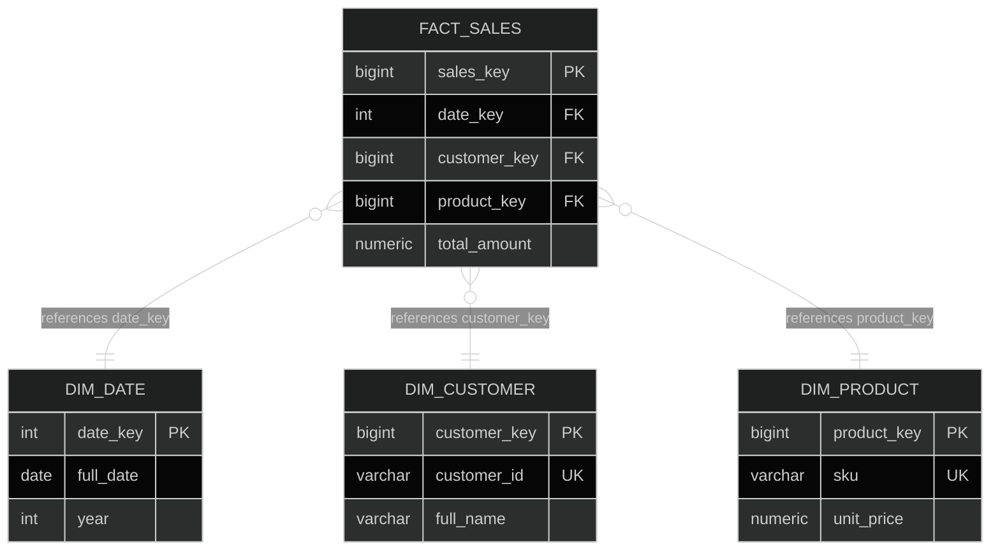

#### Example 4: Distributed Protocols & Interactions (`sequenceDiagram`)
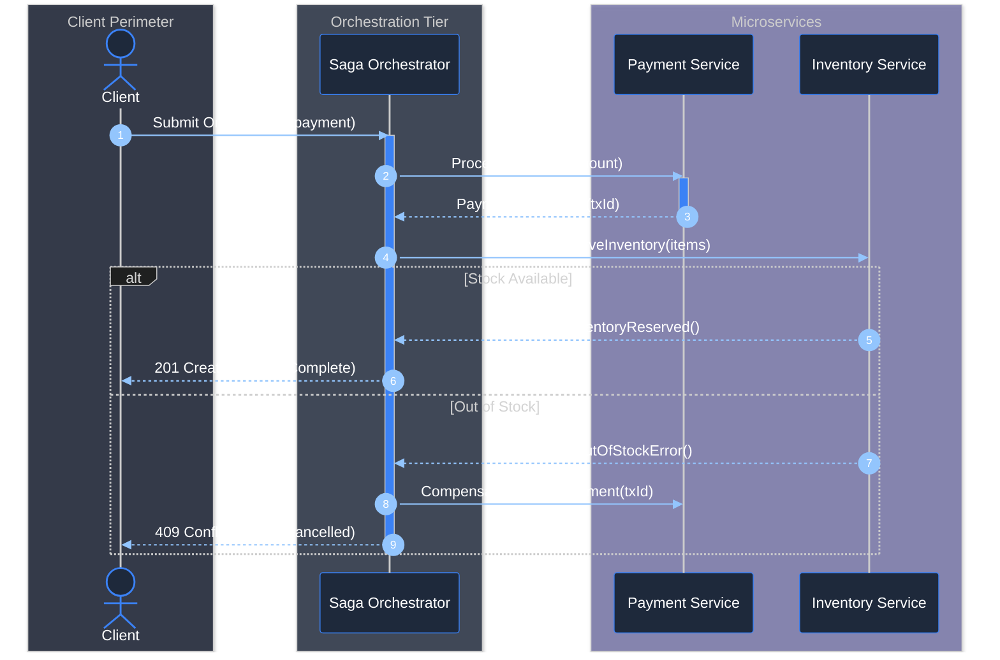

#### Example 5: Architectural Trade-Off Landscapes (`quadrantChart`)
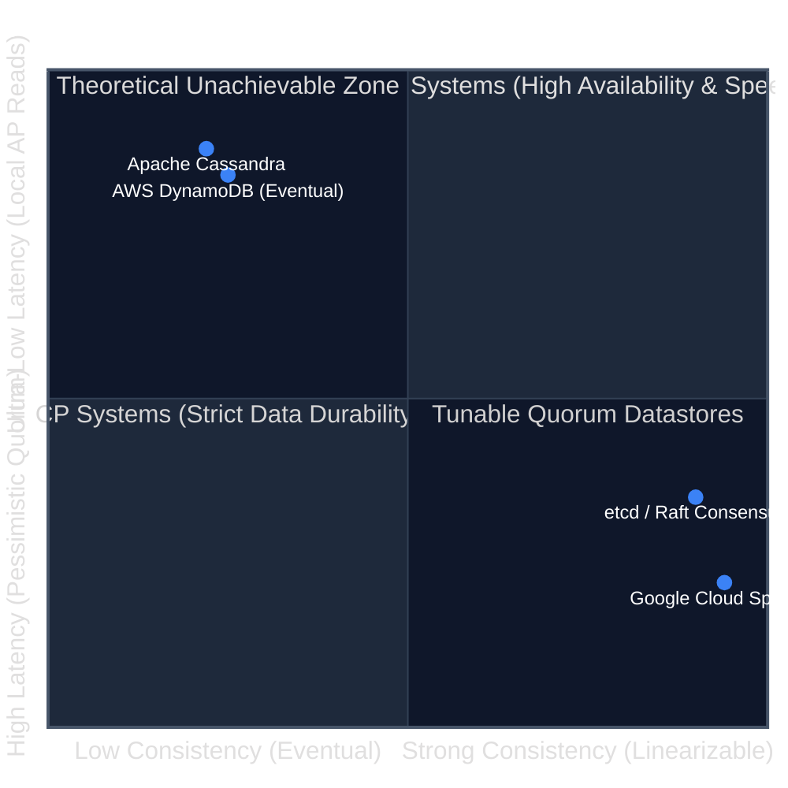

#### Example 6: Historical & Paradigm Evolution (`timeline`)
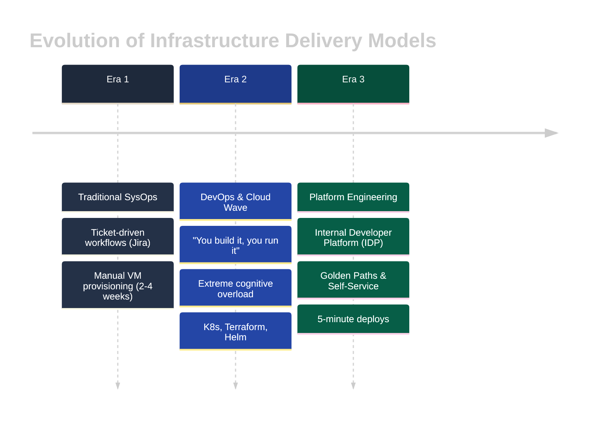

---

## 6. Pre-Commit Verification Checklist for Future Agents

Before marking any new topic or track complete, verify:
- [ ] Strictly 10 core curriculum files (`01_` to `10_`) in the track root, numbered in strict reading order.
- [ ] `00_<track>_study_guide_and_index.md` contains the 5-tier roadmap, curriculum table, and 50-problem matrix.
- [ ] **1:1 Topic-to-FAQ Parity:** Where interview questions exist, scenario FAQ files match core topics 1:1 with identical numeric prefixes (`NN_*.md` ↔ `frequently_asked_questions/NN_*_faq.md`).
- [ ] **No Placeholders Mandate:** No empty or stub FAQ directories/files exist where questions are absent or insufficient. Tracks without questions retain 0 FAQ files.
- [ ] **Topic-to-FAQ Links:** Each core topic concluding section contains `# N+1. Interview Questions & Deep-Dive FAQ References` linking to corresponding FAQ questions (only when companion FAQ exists), without modifying or duplicating FAQ content.
- [ ] Subdirectory is named `frequently_asked_questions/` (lowercase snake_case).
- [ ] `frequently_asked_questions/00_<track>_faq_study_guide_and_index.md` exists with an interview study roadmap, legible wrapped tables, and complete question bank (no standalone `*_interview_questions.md` files).
- [ ] Topic Guides & Coverage Overview table in the FAQ study guide uses `<br/>` soft wraps on long file links so other columns retain adequate horizontal space.
- [ ] FAQ files use concise slugs followed by the mandatory `_faq.md` suffix (e.g., `01_core_java_and_oop_faq.md`, `01_sql_and_advanced_querying_faq.md`).
- [ ] Hero architecture diagram appears **before** the Table of Contents in each core guide.
- [ ] **Pedagogical Depth (Fresh Learning Resource Standard):** Written as an authoritative, first-principles textbook/resource rather than terse revision notes. Fully elaborated for beginners (clear definitions, explaining the "why", progressive disclosure) with rigorous low-level internals, failure modes, and hardware/OS mechanics for experienced engineers.
- [ ] **Non-Degrading Cross-File Consistency:** Every module is treated as completely fresh and standalone. Later modules (Modules 08–10) and questions maintain the exact same (or greater) depth, word count, code detail, and diagram density as early modules. No verbosity decay or agent fatigue across files.
- [ ] **Universal Zero-ASCII Rule:** Zero ASCII directory trees (`├──`, `└──`), zero ASCII tables (`+---+`), zero ASCII box architecture diagrams, and zero ASCII memory maps throughout the entire file.
- [ ] **Pragmatic Modality Selection:** Markdown tables are used for multi-attribute comparisons, trade-off matrices, and reference parameters; Mermaid diagrams are purposefully used for structural, sequential, and relational flows (no blind Mermaid overuse).
- [ ] **TreeView Enforcement:** All directory and folder structures use Mermaid TreeView (`flowchart TD` with `📁` and `📄` badges).
- [ ] **Specialized Diagram Enforcement:** Lifecycles and state transitions use `stateDiagram-v2`; OOP design patterns use `classDiagram`; relational and star schemas use `erDiagram`; multi-actor distributed protocols use `sequenceDiagram`; trade-off comparisons use `quadrantChart`; paradigm evolutions use `timeline`.
- [ ] **Multi-Diagram Visual Styling Standard:** All diagram types must follow dark-mode semantic styling. No diagram may be left plain or bland:
  - `flowchart`: `style NodeId fill:#1e293b,stroke:...`
  - `stateDiagram-v2`: `classDef` + `class StateName className`
  - `classDiagram`: `style ClassName fill:#1e293b,stroke:...`
  - `sequenceDiagram`: dark theme `init` directive + architectural `box rgba(...)` layers
  - `erDiagram`: dark theme `init` directive with slate/navy attributes
  - `quadrantChart` & `timeline`: dark theme `init` directive with custom quadrant and track fills
- [ ] Diagrams avoid monolithic vertical towers (5+ nodes in linear `flowchart TD`) and squished single-line horizontal streams (5+ nodes in `flowchart LR`); multi-step workflows adhere to the Hybrid Multi-Stage pattern (`flowchart TD` with `direction LR` subgraphs).
- [ ] Code blocks contain step-by-step inline comments; complexities use KaTeX ($O(1)$, $O(N)$).
- [ ] All intra-repository links (`[text](file.md#anchor)`) resolve without broken anchors.
- [ ] **Zero Code Block Corruption:** No Markdown dividers (`---`), Markdown headings (`#`, `##`), or alert blocks (`> [!TIP]`) appear inside programming code blocks. Code blocks contain valid syntax and compile/parse cleanly.
- [ ] **TOC Anchor Integrity:** Every link in the Table of Contents resolves without broken anchors, following GitHub anchor normalization rules (backtick removal, underscore preservation, trailing hyphens).
- [ ] **Cross-File Link Integrity:** All cross-file links in study guides and curriculum modules resolve to existing files and valid anchors.
- [ ] **No End-of-File Checklists (Summary & References Enforcement):** Ensure the file does NOT conclude with a checklist or `- [ ]` checkboxes. The guide must conclude with an authoritative summary in points or structured paragraphs (`Summary & Production Engineering Takeaways` or `Summary Comparison & Engineering Reference Matrix`) followed by a comprehensive, link-verified `References & Further Reading` section.


