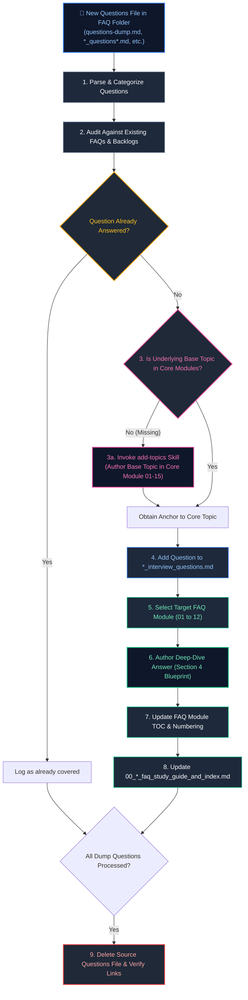

# Add Questions Skill

This skill defines the authoritative, production-grade operational protocol for discovering, auditing, answering, cross-linking, and indexing interview questions from any question dump or staging file (e.g., `questions-dump.md`, `question_dump.md`, `*_question*.md`, `*_questions*.md`, `new_questions.md`) placed inside a `frequently_asked_questions/` directory of any engineering track (e.g., `Java Backend Engineering/frequently_asked_questions/`, `Data Engineering/frequently_asked_questions/`, etc.).

It strictly enforces that every question is grounded in an underlying base topic documented in the core curriculum modules (`01_` through `15_`), is cataloged in the track's raw question backlog (`*_interview_questions.md`), is authored with staff-level rigor in the scenario FAQ modules adhering to `AGENTS.md`, and is bidirectionally linked and indexed.

---

## Architectural Workflow: Questions Ingestion Lifecycle



---

## Table of Contents
1. [Trigger Conditions & Flexible Filename Matching](#1-trigger-conditions--flexible-filename-matching)
2. [Step-by-Step Execution Protocol](#2-step-by-step-execution-protocol)
   - [Step 1: Ingestion & Question Decomposition](#step-1-ingestion--question-decomposition)
   - [Step 2: Deduplication & Coverage Audit](#step-2-deduplication--coverage-audit)
   - [Step 3: Base Topic Verification & Ingestion (Prerequisite Enforcement)](#step-3-base-topic-verification--ingestion-prerequisite-enforcement)
   - [Step 4: Raw Question Backlog Update (*_interview_questions.md)](#step-4-raw-question-backlog-update-_interview_questionsmd)
   - [Step 5: FAQ Module Selection & Placement](#step-5-faq-module-selection--placement)
   - [Step 6: Deep-Dive Solution Authoring (Section 4 Blueprint)](#step-6-deep-dive-solution-authoring-section-4-blueprint)
   - [Step 7: Table of Contents & Index Synchronization](#step-7-table-of-contents--index-synchronization)
   - [Step 8: Post-Ingestion Verification & Cleanup](#step-8-post-ingestion-verification--cleanup)
3. [Summary Comparison & Engineering Reference Matrix](#3-summary-comparison--engineering-reference-matrix)
4. [Quality Assurance Checklist](#4-quality-assurance-checklist)

---

## 1. Trigger Conditions & Flexible Filename Matching

Activate this skill when:
- A new file matching any of the following patterns is created or detected under a `frequently_asked_questions/` directory:
  - `questions-dump.md`, `questions_dump.md`, `question-dump.md`, `question_dump.md`
  - `*_question.md`, `*_questions.md`, `*question*.md`, `*questions*.md`
  - `new_questions.md`, `add_questions.md`, `raw_questions.md`
- A user prompts to "add questions", "integrate questions dump", or "process questions file".

> [!CAUTION]
> **Canonical Backlog Protection Rule:**
> The permanent question backlog file `<track_slug>_interview_questions.md` (e.g., `java_backend_interview_questions.md`, `data_engineering_interview_questions.md`) and numbered scenario modules `01_*_faq.md` through `12_*_faq.md` are permanent repository assets.
> **NEVER** treat `<track_slug>_interview_questions.md` as a staging or dump file! It must never be deleted!

---

## 2. Step-by-Step Execution Protocol

### Step 1: Ingestion & Question Decomposition
1. Locate and read the detected questions file in `frequently_asked_questions/`.
2. Extract each individual question:
   - Full verbatim question text and scenario context.
   - Conceptual domain and technical sub-discipline.
   - Low-level engine mechanism tested (e.g., MVCC conflict, lock striping, vector distance metrics, rebalance storm).

### Step 2: Deduplication & Coverage Audit
1. Audit `<track_slug>_interview_questions.md`.
2. Audit `00_<track_slug>_faq_study_guide_and_index.md`.
3. Audit the scenario modules: `01_*_faq.md` through `10_*_faq.md` (or `12_*_faq.md`).
4. If already comprehensively covered, mark satisfied and skip duplicate authoring.

### Step 3: Base Topic Verification & Ingestion (Prerequisite Enforcement)

> [!IMPORTANT]
> **Base Topic Prerequisite Rule:**
> An interview question must never exist without its theoretical foundation in the core curriculum. If the underlying mechanism is not documented in Modules `01_` through `15_`, the base topic MUST be added to the core curriculum first.

1. **Verify Core Curriculum Presence:**
   - Search the track's master curriculum guide (`00_<track_slug>_study_guide_and_index.md`) and modules `01_` through `15_`.
2. **If Underlying Base Topic is Missing:**
   - Invoke the `add-topics` skill protocol.
   - Determine which core module (`01_`–`15_`) the topic belongs to.
   - Insert the topic into the appropriate section (`# 1.` to `# 8.`) following the **Zero-Append Mandate**.
   - Provide dual-audience depth, dark-mode Mermaid diagram, and production code.
   - Update that core module's TOC and `# 9. Summary Comparison & Engineering Reference Matrix`.
   - Update `00_<track_slug>_study_guide_and_index.md`.
3. **Capture Base Topic Link:**
   - Record the anchor link: `../<module_file>.md#<topic-anchor>`.

### Step 4: Raw Question Backlog Update (`*_interview_questions.md`)
1. Open the raw questions file: `<track_slug>_interview_questions.md`.
2. Locate the matching thematic category/section.
3. Append or insert the question under that section, maintaining clean Markdown numbering.

### Step 5: FAQ Module Selection & Placement
1. Identify the target scenario FAQ module: `01_*_faq.md` through `12_*_faq.md` based on domain.
2. Locate the matching thematic cluster in the FAQ file.
3. Determine question number `Q<N>` and position within that cluster.

### Step 6: Deep-Dive Solution Authoring (Section 4 Blueprint)
Author each question solution adhering strictly to `AGENTS.md` Section 4:

```markdown
### Q<N>. <Question Title>
*(If questions are grouped: Grouped together: <Reason for grouping>)*  
**Topic Covered:** <Domain & Core Mechanism>  
**Question:** <Full verbatim question>

#### Definition & Core Concepts
<In-depth theoretical explanation of how the engine/runtime processes this under the hood. Dual-audience depth: clear conceptual mental model for juniors, memory layout and kernel syscalls for staff engineers.>

#### Visual Flow
<Mermaid flowchart, sequenceDiagram, or stateDiagram-v2 depicting state flow, failure mode, or lifecycle in Dark Mode palette. Strictly ZERO ASCII.>

#### Production Implementation / Code Solution
```<language>
// Production code with complete syntax, concurrency guards, and line-by-line inline comments
```
- **Time Complexity:** $O(...) $
- **Space Complexity:** $O(...) $

#### Engineering Implications & Production Pitfalls
1. **<Anti-Pattern / Hazard>:** <Why naive solutions fail in high-throughput production (e.g., false sharing, starvation, connection leak).>
2. **<Interview Talking Point>:** <Staff-level trade-off nuance demonstrating production experience.>

#### Core Curriculum Cross-Reference
*Deep-dive theoretical reference: See [<Module Name>: <Topic Name>](../<module_file>.md#<anchor>)*
```

### Step 7: Table of Contents & Index Synchronization
1. **FAQ Module TOC:**
   - Update `## Table of Contents & Question Mapping` in the edited `NN_*_faq.md` with the new question title and verified anchor.
2. **Master FAQ Index (`00_<track_slug>_faq_study_guide_and_index.md`):**
   - Update the question matrix, domain cluster mapping, or scenario table to include the newly added question, linking directly to its FAQ file anchor.
3. **Master Track Index (`00_<track_slug>_study_guide_and_index.md`):**
   - If a new base topic was authored in Step 3, confirm `00_<track_slug>_study_guide_and_index.md` has the new topic in its coverage table.

### Step 8: Post-Ingestion Verification & Cleanup
1. **Integrity Validation:**
   - Confirm all anchors resolve correctly.
   - Confirm cross-module link to the base topic in `../NN_*.md` is valid.
   - Confirm Mermaid syntax and Dark-Mode styling (`fill:#0f172a,stroke:#3b82f6,...`).
   - Confirm Zero-ASCII compliance.
2. **Automatic Source File Deletion:**
   - Permanently delete the source staging/dump file from `frequently_asked_questions/` (never touching `<track_slug>_interview_questions.md`).
3. **Summary Notification:**
   - Report processed questions, base topics verified/added, modified files, and updated anchors to the user.

---

## 3. Summary Comparison & Engineering Reference Matrix

| Step | Strict Invariant | Failure Mode to Avoid |
| :--- | :--- | :--- |
| **Source Detection** | Support flexible naming (`*_questions*.md`, `questions-dump.md`, etc.) | Rigidly searching for only one hardcoded filename |
| **Backlog Protection** | Never delete or overwrite `<track>_interview_questions.md` | Treating the permanent backlog file as a dump file |
| **Base Topic Check** | Core curriculum module MUST cover the underlying topic first | Answering an interview question whose base concept is missing from core modules |
| **Raw Backlog** | Catalog in `*_interview_questions.md` | Forgetting to add the question to the track backlog |
| **FAQ Module Blueprint** | Follow Section 4 structure with dark Mermaid & production code | Giving two-line brief answers or skipping diagrams |
| **Cross-Referencing** | Link question directly to base topic in `../NN_*.md` | Unlinked FAQ questions |
| **Index Synchronization** | Update both `00_*_faq_study_guide_and_index.md` and TOC | Stale or unmapped question entries |
| **Cleanup** | Automatically delete the source questions file | Leaving processed dump files behind |

---

## 4. Quality Assurance Checklist

- [ ] Source questions file detected and parsed.
- [ ] Confirmed source file is NOT `<track_slug>_interview_questions.md`.
- [ ] Question analyzed for core mechanical invariant.
- [ ] Base topic verified in core curriculum module (`01_`–`15_`) (authored via `add-topics` if missing).
- [ ] Raw question added to `<track_slug>_interview_questions.md`.
- [ ] Placed in correct thematic cluster in `NN_*_faq.md`.
- [ ] Exhaustive `Definition & Core Concepts` explaining low-level engine internals.
- [ ] Dark-mode Mermaid diagram included (Zero-ASCII rule strictly enforced).
- [ ] Production-grade code snippet with line-by-line comments (no synthetic stubs).
- [ ] Explicit $O(...)$ time and space complexity stated.
- [ ] Engineering implications and staff-level interview talking points provided.
- [ ] Clickable link to the base topic in the core curriculum module.
- [ ] FAQ file TOC updated.
- [ ] `00_<track_slug>_faq_study_guide_and_index.md` synchronized.
- [ ] Source questions file deleted after verified completion.

