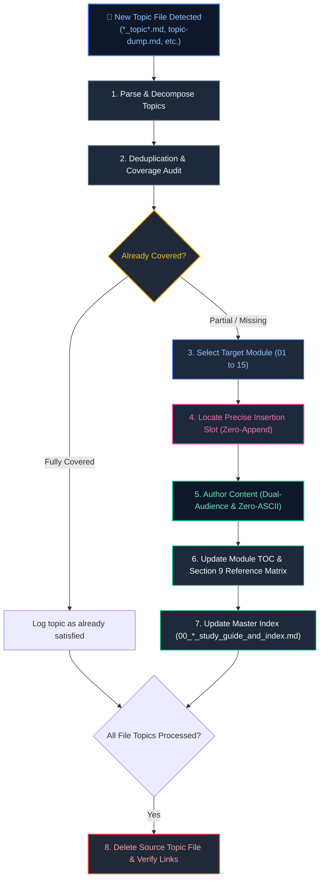

# Add Topics Skill

This skill defines the authoritative, production-grade operational protocol for discovering, analyzing, and ingesting raw technical topics from any topic dump or staging file (e.g., `topic-dump.md`, `topic_dump.md`, `*_topic*.md`, `*_topics*.md`, `new_topics.md`) placed within any engineering discipline directory (e.g., `Java Backend Engineering/`, `Data Engineering/`, `Python Backend Engineering/`, `Cloud Engineering/`, `AI Engineering/`).

It guarantees that every newly added topic is thoroughly audited against existing curriculum modules, integrated at its optimal logical position (strictly honoring the **Zero-Append Mandate**), authored to production-grade pedagogical standards, cross-referenced, indexed, and cleanly cleaned up.

---

## Architectural Workflow: Topic Discovery & Placement Lifecycle



---

## Table of Contents
1. [Trigger Conditions & Flexible Filename Matching](#1-trigger-conditions--flexible-filename-matching)
2. [Step-by-Step Execution Protocol](#2-step-by-step-execution-protocol)
   - [Step 1: Ingestion & Topic Breakdown](#step-1-ingestion--topic-breakdown)
   - [Step 2: Curriculum Coverage & Deduplication Audit](#step-2-curriculum-coverage--deduplication-audit)
   - [Step 3: Target Module & Slot Selection (Zero-Append Mandate)](#step-3-target-module--slot-selection-zero-append-mandate)
   - [Step 4: Pedagogical Content Authoring](#step-4-pedagogical-content-authoring)
   - [Step 5: Table of Contents & Cross-Reference Updates](#step-5-table-of-contents--cross-reference-updates)
   - [Step 6: Master Track Index Synchronization](#step-6-master-track-index-synchronization)
   - [Step 7: Verification & Post-Ingestion Cleanup](#step-7-verification--post-ingestion-cleanup)
3. [Summary Comparison & Engineering Reference Matrix](#3-summary-comparison--engineering-reference-matrix)
4. [Quality Assurance Checklist](#4-quality-assurance-checklist)

---

## 1. Trigger Conditions & Flexible Filename Matching

Activate this skill when:
- A new file matching any of the following patterns is created or detected under any engineering discipline folder (e.g., `Java Backend Engineering/`, `Data Engineering/`, etc.):
  - `topic-dump.md`, `topic_dump.md`, `topics_dump.md`
  - `*_topic.md`, `*_topics.md`, `*topic*.md`, `*topics*.md`
  - `new_topics.md`, `add_topics.md`, `raw_topics.md`
- A user prompts to "add topics", "integrate new topics", "process topic dump", or points to a file containing raw topics.
- Invoked programmatically by the `add-questions` skill when an interview question tests an underlying base concept that is not yet documented in the core curriculum (`01_` through `15_`).

> [!NOTE]
> Canonical track files (such as `00_<track>_study_guide_and_index.md` or numbered modules `01_` through `15_`) are permanent curriculum files and must never be treated as staging/dump files.

---

## 2. Step-by-Step Execution Protocol

### Step 1: Ingestion & Topic Breakdown
1. Locate and read the detected topic file in the track directory.
2. Decompose raw points into structured topic units:
   - Topic title and conceptual scope.
   - Target runtime, engine, library, API, or architectural pattern.
   - Core invariants, low-level mechanics, and intended technical depth.

### Step 2: Curriculum Coverage & Deduplication Audit
1. Inspect the track's master index (`00_<track_slug>_study_guide_and_index.md`) and candidate module files (`01_` through `15_`).
2. Search across existing modules for the concept:
   - **Fully Covered:** Topic is already thoroughly documented with theoretical mechanics, dark-mode Mermaid diagram, and production code snippet. Mark as redundant and log to the final report.
   - **Partially Covered:** High-level summary or brief mention exists, but lacks engine internals, memory layout, production code, or failure triage. Mark for in-place enrichment.
   - **Uncovered:** Completely missing. Mark for full authoring and insertion.

### Step 3: Target Module & Slot Selection (Zero-Append Mandate)

> [!CAUTION]
> **The Zero-Append Mandate:**
> Never append new topics to the bottom of the file or after Section 9 / Section 10!
> Every topic must be woven naturally into the chronological complexity flow within `# 1.` through `# 8.`.

1. **Select the Module (01 to 15):**
   - Follow the 5-tier architecture defined in `AGENTS.md`:
     - **Tier 1 (01–03):** Core Languages & Low-Level Foundations
     - **Tier 2 (04–06):** Storage Engines, Architecture & Data Modeling
     - **Tier 3 (07–09):** Core Frameworks, Runtimes & Execution Engines
     - **Tier 4 (10–12):** Ingestion, Caching, Streaming & Persistence
     - **Tier 5 (13–15):** Distributed Systems, Cloud, Ops & System Design
2. **Select the Section or Subsection:**
   - Scan existing sections `# 1.` through `# 8.`.
   - If an existing section covers this domain, insert as a new numbered subsection (e.g. `### 3.4 ...`) in proper progression.
   - If it forms a major new theme, insert as a new numbered section before `# 9. Summary Comparison & Engineering Reference Matrix`, renumbering subsequent sections sequentially.

### Step 4: Pedagogical Content Authoring
Author content adhering strictly to `AGENTS.md`:

1. **Dual-Audience Depth:**
   - **Junior / Foundational:** Intuitive mental model, real-world analogies, explicit definition of acronyms/terms, clear explanation of "Why" (what problems earlier solutions faced).
   - **Senior / Staff:** Memory layout (stack/heap, off-heap buffers, fragmentation), CPU scheduling/cache lines, OS/kernel interactions (syscalls, page faults, epoll/kqueue), failure modes, and quantitative latency/throughput percentiles ($p95$, $p99$).
2. **Visual & Architectural Diagrams (Strict Zero-ASCII Rule):**
   - Strictly NO ASCII trees or boxes (`├──`, `[A] --> [B]`).
   - Use dedicated dark-mode styled Mermaid diagrams:
     ```mermaid
     flowchart TD
         subgraph Region ["Component Perimeter"]
             NodeA["Component Name<br/>(Specification / State)"]
         end
         style Region fill:#0f172a,stroke:#3b82f6,stroke-width:1.5px,color:#93c5fd
         style NodeA fill:#1f2937,stroke:#3b82f6,stroke-width:2px,color:#fff
     ```
3. **Production-Grade Code Snippets:**
   - Fully working, syntactically complete code (no `foo/bar`, `doSomething()`, or empty `TODO` stubs).
   - Line-by-line inline comments explaining thread safety, memory boundaries, and error handling.
4. **Defensive Patterns & Strategic Alerts:**
   - `> [!CAUTION]` for data loss, memory leaks, concurrency hazards.
   - `> [!IMPORTANT]` for architectural contracts and runtime invariants.
   - `> [!TIP]` for performance optimizations and tuning flags.

### Step 5: Table of Contents & Cross-Reference Updates
1. **Module TOC (`## Table of Contents`):**
   - Update the numbered list of sections/subsections with verified GitHub anchors.
2. **Section 9 Reference Matrix:**
   - Update `# 9. Summary Comparison & Engineering Reference Matrix` to include the new topic's architectural trade-offs, complexity, and operational rules.
3. **Section 10 References:**
   - Add authoritative external links (official docs, RFCs, JSRs) to `# 10. References & Further Reading`.

### Step 6: Master Track Index Synchronization
Update `00_<track_slug>_study_guide_and_index.md`:
1. **Section 2 Curriculum Coverage Table:**
   - In the row for the target module, append the new topic name with anchor into the **Key Topics & Production Scenarios Covered** column.
2. **Section 4 Problem-Solution Matrix:**
   - If the topic resolves a notable production failure or performance bottleneck, update or add an entry in the 50-problem cross-reference matrix mapping to the exact file anchor.

### Step 7: Verification & Post-Ingestion Cleanup
1. **Integrity Validation:**
   - Verify anchor links match headers.
   - Confirm all Mermaid diagrams render cleanly without syntax errors.
   - Confirm zero ASCII trees or ASCII boxes exist.
2. **Automatic Source File Deletion:**
   - Once all edits and index updates are verified, permanently delete the source staging/dump file (e.g. `topic-dump.md`, `*_topic*.md`).
3. **Summary Notification:**
   - Report integrated topics, target files, section slots, and updated anchors to the user.

---

## 3. Summary Comparison & Engineering Reference Matrix

| Operational Phase | Strict Invariant | Failure Mode to Avoid |
| :--- | :--- | :--- |
| **Ingestion** | Parse atomic concepts before editing; match flexible filenames | Modifying files before comprehensive coverage audit |
| **Placement** | Integrate within `# 1.` to `# 8.` | Appending to end of file or after Section 9/10 |
| **Visuals** | Dark-mode Mermaid diagrams | Using ASCII art, ASCII trees (`├──`), or plain text boxes |
| **Code** | Production code with inline rationale comments | Synthetic placeholder code (`foo/bar`, `TODO`) |
| **TOC & Indexes** | Synchronize module TOC & `00_*_study_guide_and_index.md` | Broken anchors or unindexed topics |
| **Cleanup** | Automatically delete the source topic file upon completion | Leaving stale unprocessed dump files |

---

## 4. Quality Assurance Checklist

- [ ] Source topic file detected and parsed.
- [ ] All topics audited against existing modules.
- [ ] Appropriate target module (`01_` to `15_`) selected based on the 5-Tier syllabus.
- [ ] Topic placed logically inside `# 1.` through `# 8.` (Zero-Append Mandate satisfied).
- [ ] Dual-audience depth delivered (beginner accessibility + staff-level runtime mechanics).
- [ ] Dark-mode Mermaid diagram included (Zero-ASCII verified).
- [ ] Production-grade code snippet included with line-by-line comments.
- [ ] Strategic alerts (`[!CAUTION]`, `[!IMPORTANT]`, `[!TIP]`) applied.
- [ ] Module Table of Contents (`## Table of Contents`) updated with valid anchors.
- [ ] Module Section 9 Comparison Matrix updated.
- [ ] Strictly no end-of-file checklists (`- [ ]`); module concludes with summary points/paragraphs followed by references.
- [ ] Master track index (`00_*_study_guide_and_index.md`) curriculum table updated.
- [ ] Source topic file deleted after verified completion.

