# Topic Structure & Style Guidelines for AI Agents

This guide defines the authoritative repository architecture, curriculum structure, visual design system, and technical writing standards for authoring or expanding any engineering topic/track in this knowledge base. All future AI agents and contributors must strictly adhere to these specifications.

---

## 1. Directory Tree & Architecture

Each engineering track must reside in a dedicated root directory containing exactly **15 numbered core curriculum modules**, a **master study guide & index**, and a **`frequently_asked_questions/`** directory containing **10 to 12 scenario-based interview guides**:

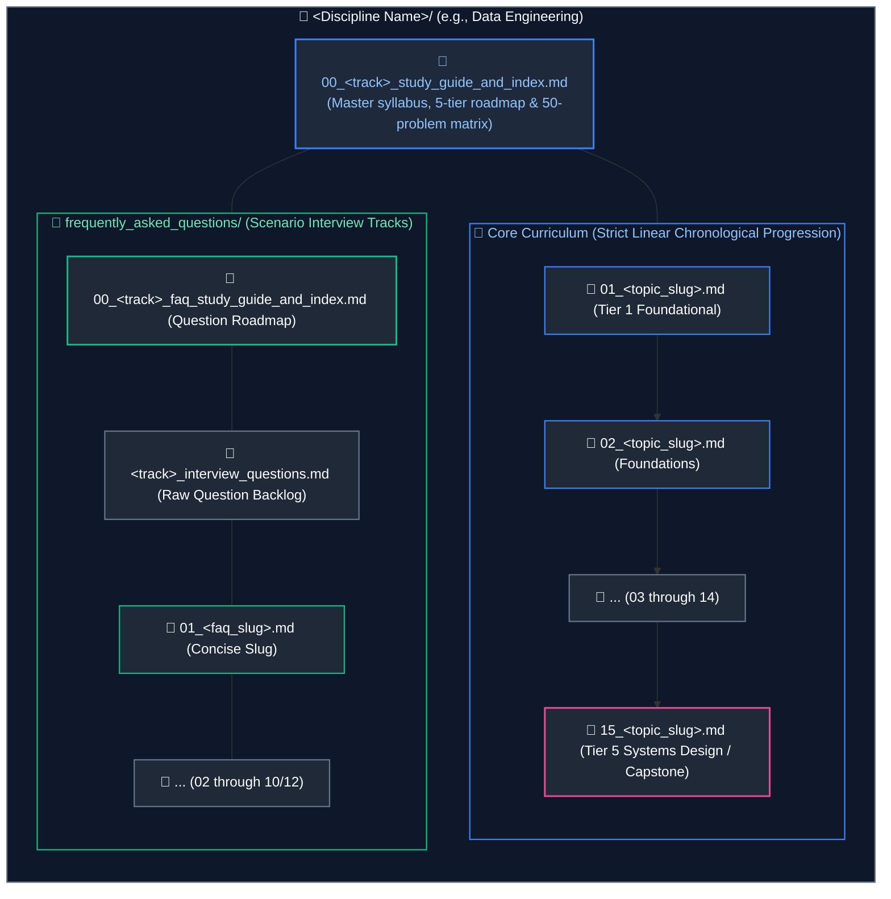

### 1.1 Standard File Naming Rules
1. **Core Curriculum Modules:** Two-digit zero-padded numbers `01_` through `15_` followed by a snake_case topic slug (e.g., `01_core_java_and_oop.md`).
2. **Master Track Index:** `00_<track_slug>_study_guide_and_index.md` (e.g., `00_de_study_guide_and_index.md`, `00_java_study_guide_and_index.md`).
3. **FAQ Directory:** Exactly `frequently_asked_questions/` (all lowercase snake_case).
4. **FAQ Master Index:** `00_<track_slug>_faq_study_guide_and_index.md`.
5. **Raw Question Source File:** `<track_slug>_interview_questions.md` (e.g., `data_engineering_interview_questions.md`, `java_backend_interview_questions.md` — never use spaces).
6. **FAQ Scenario Modules:** Numbered `01_` through `10_` (or `12_`) using **concise slugs** (e.g., `01_core_java_oop_and_algorithms.md`, `02_collections_framework.md`). Do **not** append redundant `_interview_questions_and_answers.md` suffixes.

---

## 2. Core Curriculum Module Specification (`01_*.md` to `15_*.md`)

Every core module must follow a uniform, sequential structure:

### 2.1 Header & Overview
```markdown
# NN. <Topic Title>

A comprehensive, production-grade guide to <scope summary>, covering <key subtopics>, memory and hardware mechanics, production patterns, and troubleshooting playbooks tailored for <Target Roles>.

---
```

### 2.2 Hero Architecture Diagram
Place the top-level architectural overview diagram **immediately after the overview paragraph and before the Table of Contents**:

```markdown
## Architectural Overview: <Architecture Name>

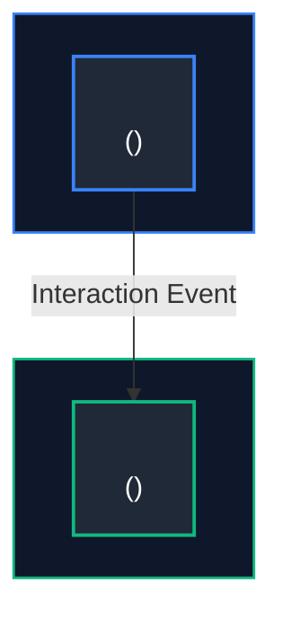
---
```

### 2.3 Table of Contents
Strictly numbered with verified GitHub markdown anchors:

```markdown
## Table of Contents
1. [<Major Section 1>](#1-major-section-1)
   - [1.1 <Subsection 1>](#11-standard-file-naming-rules)
   - [1.2 <Subsection 2>](#12-subsection-2)
2. [<Major Section 2>](#2-major-section-2)
...
9. [Summary Comparison & Engineering Reference Matrix](#9-summary-comparison--engineering-reference-matrix)
10. [References & Further Reading](#10-references--further-reading)

---
```

### 2.4 Subsections Blueprint (`# 1.` through `# 8.`)
Every numbered major section (`# 1.`) and subsection (`### 1.1`) must contain:
1. **Low-Level Theory & Runtime Mechanics:** Explain engine internals, memory layout, CPU scheduling, buffer pools, or byte-level structures.
2. **Visual / Memory Representation:** ASCII memory layouts or Mermaid state/sequence diagrams for complex interactions.
3. **Production Implementation:**
   - Real-world, non-trivial code (no placeholder `TODO` or synthetic `foo/bar`).
   - Detailed inline comments explaining each line and rationale.
4. **Key Points & Edge-Case Mitigation:**
   - Defensive engineering patterns and boundary hazards.
   - Strategic GitHub alerts:
     - `> [!CAUTION]` for data corruption, memory leaks, or concurrency bugs.
     - `> [!IMPORTANT]` for architectural invariants or contracts.
     - `> [!TIP]` for performance optimizations.
5. **Cross-References:** Explicit Markdown links to companion modules (e.g., `see [04. Database Internals](04_database_internals_and_performance.md#anchor)`).

### 2.5 Closing Sections (Mandatory)
Every core guide must conclude with:
1. **`# 9. Summary Comparison & Engineering Reference Matrix`:** A multi-dimensional comparison table of key features, complexity, and production rules.
2. **`# 10. References & Further Reading`:** Markdown links to authoritative sources (official documentation, JSRs, RFCs, Baeldung).

---

## 3. Master Study Guide & Index Specification (`00_*_study_guide_and_index.md`)

Each track root must contain a master curriculum guide containing:

### 3.1 5-Tier Chronological Mermaid Roadmap
Modules must strictly follow linear numbering across tiers:
* **Tier 1 (Modules 01–03):** Core Languages & Low-Level Foundations
* **Tier 2 (Modules 04–06):** Storage Engines, Architecture & Data Modeling
* **Tier 3 (Modules 07–09):** Core Frameworks, Runtimes & Execution Engines
* **Tier 4 (Modules 10–12):** Ingestion, Caching, Streaming & Persistence
* **Tier 5 (Modules 13–15):** Distributed Systems, Cloud, Ops & System Design

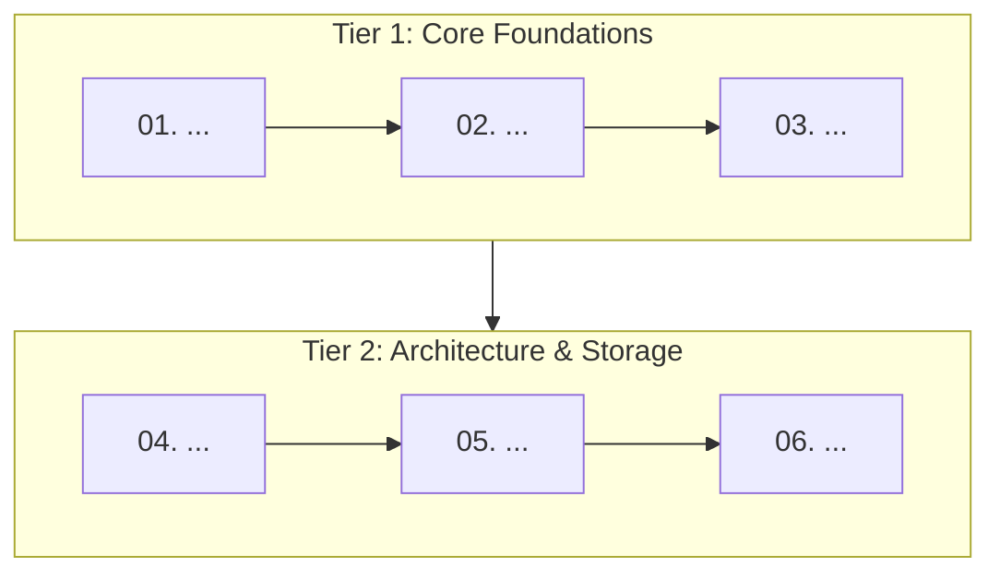

### 3.2 Curriculum Coverage Table
| Study Order | Guide File | Conceptual Domain | Corresponding Interview Guide | Key Topics & Production Scenarios Covered |
| :---: | :--- | :--- | :--- | :--- |
| **01** | [`01_...md`](01_...md) | ... | [`01_...md`](frequently_asked_questions/01_...md) | ... |

### 3.3 50-Problem Production-Solution Cross-Reference Index
A canonical matrix mapping 50 real-world production failures to their solutions and exact file anchors:
| Problem | Canonical Solution | Module Reference |
| :--- | :--- | :--- |
| **Data Skew / OOM** | Key salting & AQE partition coalescing | [`08_...md`](08_...md#anchor) |

### 3.4 Practical Interview Track Overview
Summary links to all scenario files within `frequently_asked_questions/`.

---

## 4. Interview FAQ Guide Specification (`frequently_asked_questions/NN_*.md`)

### 4.1 Header & Clustered TOC
```markdown
# NN. <Topic Title>: Interview Questions & Deep-Dive Solutions

A comprehensive, production-grade guide answering real-world <Topic> interview scenarios.

---

## Table of Contents & Question Mapping

1. **<Thematic Cluster 1>**
   - [Q1. <Question Title>](#q1-question-title)
   - [Q2 & Q3. <Grouped Question Title>](#q2--q3-grouped-question-title)
...
---
```

### 4.2 Standard Question Entry Blueprint
```markdown
### Q<N>. <Question Title>
*(If questions are grouped: Grouped together: <Reason for grouping>)*  
**Topic Covered:** <Domain & Core Mechanism>  
**Question:** <Full verbatim question>

#### Definition & Core Concepts
<In-depth theoretical explanation of how the engine/runtime processes this under the hood.>

#### Visual Flow
<Mermaid flowchart or sequence diagram depicting state flow, failure mode, or lifecycle.>

#### Production Implementation / Code Solution
```<language>
// Production code with edge-case handling and inline comments
```
- **Time Complexity:** $O(...) $
- **Space Complexity:** $O(...) $

#### Engineering Implications & Production Pitfalls
1. **<Anti-Pattern / Hazard>:** <Why naive solutions fail in high-throughput production.>
2. **<Interview Talking Point>:** <Key trade-off or nuance that demonstrates senior expertise.>
```

---

### 5. Diagram Selection & Visual Design System

All diagrams throughout the repository use **Mermaid** with a strict, dark-mode-first color palette, semantic diagram type selection, and visual layout standard. Contributors and AI agents must never default to generic flowcharts for items that have specialized, expressive diagram primitives.

### 5.1 Diagram Types & Semantic Selection Matrix

| Content / Domain Type | Recommended Mermaid Syntax | Visual Convention | Rationale & Strict Rule |
| :--- | :--- | :---: | :--- |
| **System & Hardware Architectures** | `flowchart TD` | Top-to-Bottom | Subgraphs representing memory areas (Stack, Heap, Metaspace) or infrastructure boundaries (VPC, Subnets). |
| **Data Pipelines & Ingestion Streams** | `flowchart LR` | Left-to-Right | Source $\rightarrow$ Bronze $\rightarrow$ Silver $\rightarrow$ Gold dataflow progression. |
| **Diagnostic & Troubleshooting Trees** | `flowchart TD` | Top-to-Bottom | Conditional Yes/No branching decision trees for production failure triage. |
| **Directory & File Structures** | **TreeView** (`flowchart TD`) | Top-to-Bottom | **Mandatory:** Never use ASCII trees (`├──`, `└──`). Use TreeView with `📁` and `📄` node badges. |
| **Entity, Task & Resource Lifecycles** | `stateDiagram-v2` | State Machine | Thread, Pod, JPA Entity, Airflow Task, TCP socket, and Circuit Breaker states (`[*] --> State`). |
| **OOP Design Patterns & Hierarchies** | `classDiagram` | Top-to-Bottom / Left-to-Right | GoF patterns, SOLID abstractions, interface realizations (`<|..`), and inheritance (`<|--`). |
| **Relational & Dimensional Schemas** | `erDiagram` | Crow's Foot | Database tables, PK/FK attributes, Star/Snowflake schemas, and cardinalities (`||--o{`). |
| **Protocols, Sagas & Tool Calling** | `sequenceDiagram` | Chronological | Multi-actor request/response, OAuth2/TLS handshakes, Saga 2PC, and LLM Tool dispatching. |
| **Architectural Trade-Off Spaces** | `quadrantChart` | 2D Cartography | CAP/PACELC theorems, vector index latency vs recall, cost vs latency evaluations. |
| **GitOps & Branching Strategies** | `gitGraph` | Branch Tree | Trunk-based development, release tags, canary promotion, and PR merge flows. |
| **Historical & Paradigm Evolutions** | `timeline` | Chronological Eras | Evolution of architectures (SysOps $\rightarrow$ DevOps $\rightarrow$ Platform; Java LTS releases). |
| **Domain Mental Maps & Syllabi** | `mindmap` | Radiant Tree | Broad domain taxonomies, syllabus mental maps, and high-level cheat-sheets. |

---

### 5.2 Standard Hex Color Palette & Semantic Roles Across All Diagram Types

Every diagram in the repository must be visually styled according to the dark-mode semantic hex palette. Never leave any diagram type unstyled with default gray/white rendering.

#### Core Hex Color Reference
- **Container / Boundary Fill:** `#0f172a` (Deep Slate / Navy)
- **Node / Entity Fill:** `#1e293b` (Slate-800)
- **Text / Typography:** `#ffffff` (White), `#94a3b8` (Muted Slate), `#fde68a` (Amber note text)
- **Primary / Active Accent:** `#3b82f6` (Blue)
- **Success / Healthy / Operational Accent:** `#10b981` (Emerald)
- **Warning / Intermediate / Trial Accent:** `#f59e0b` (Amber)
- **Error / Tripped / Blocked Accent:** `#ef4444` (Red)
- **Control Plane / Orchestration / Metadata Accent:** `#8b5cf6` (Purple)
- **Ingestion / Streaming / Network Accent:** `#06b6d4` (Cyan)

#### Universal Syntax Rules by Diagram Type

1. **Flowcharts (`flowchart TD` / `flowchart LR`):**
   - Use `style NodeId fill:#1e293b,stroke:#<hex>,stroke-width:2px,color:#fff`
   - Use `style SubgraphId fill:#0f172a,stroke:#<hex>,stroke-width:1.5px,color:#<hex>`
2. **State Diagrams (`stateDiagram-v2`):**
   - Declare semantic classes:
     ```text
     classDef operational fill:#1e293b,stroke:#10b981,stroke-width:2px,color:#ffffff
     classDef warning fill:#1e293b,stroke:#f59e0b,stroke-width:2px,color:#ffffff
     classDef error fill:#1e293b,stroke:#ef4444,stroke-width:2px,color:#ffffff
     classDef transient fill:#1e293b,stroke:#3b82f6,stroke-width:2px,color:#ffffff
     classDef terminal fill:#1e293b,stroke:#8b5cf6,stroke-width:2px,color:#ffffff
     ```
   - Bind states to classes: `class Closed operational`, `class Open error`, `class HalfOpen warning`
3. **Class Diagrams (`classDiagram`):**
   - Style concrete classes: `style ConcreteClass fill:#1e293b,stroke:#3b82f6,stroke-width:2px,color:#ffffff`
   - Style interfaces: `style InterfaceName fill:#0f172a,stroke:#10b981,stroke-width:2px,color:#ffffff`
   - Style client/service facades: `style ServiceClass fill:#1e293b,stroke:#8b5cf6,stroke-width:2px,color:#ffffff`
4. **Sequence Diagrams (`sequenceDiagram`):**
   - Inject the dark theme initialization directive:
     ```text
     %%{init: {'theme': 'dark', 'themeVariables': { 'actorBkg': '#1e293b', 'actorBorder': '#3b82f6', 'actorTextColor': '#ffffff', 'signalColor': '#93c5fd', 'signalTextColor': '#ffffff', 'noteBkgColor': '#1e293b', 'noteBorderColor': '#f59e0b', 'noteTextColor': '#fde68a', 'activationBkgColor': '#3b82f6', 'sequenceNumberColor': '#ffffff' }}}%%
     ```
   - Wrap participant groups in architectural perimeter boxes:
     ```text
     box rgba(15, 23, 42, 0.8) Client Perimeter
         actor User
     end
     box rgba(30, 41, 59, 0.8) Service Tier
         participant Orch as Orchestrator
     end
     ```
5. **Entity-Relationship Diagrams (`erDiagram`):**
   - Inject the dark theme initialization directive:
     ```text
     %%{init: {'theme': 'dark', 'themeVariables': { 'attributeBackgroundColorOdd': '#1e293b', 'attributeBackgroundColorEven': '#0f172a', 'entityBackgroundColor': '#1e293b', 'entityBorderColor': '#3b82f6', 'entityTextColor': '#ffffff' }}}%%
     ```
6. **Quadrant Charts (`quadrantChart`):**
   - Inject the dark theme initialization directive:
     ```text
     %%{init: {'theme': 'dark', 'themeVariables': { 'quadrant1Fill': '#1e293b', 'quadrant2Fill': '#0f172a', 'quadrant3Fill': '#1e293b', 'quadrant4Fill': '#0f172a', 'quadrantPointFill': '#3b82f6', 'quadrantPointTextFill': '#ffffff', 'quadrantTitleFill': '#ffffff', 'quadrantAxisTextFill': '#93c5fd', 'quadrantInternalBorderStrokeFill': '#334155', 'quadrantExternalBorderStrokeFill': '#475569' }}}%%
     ```
7. **Timelines (`timeline`):**
   - Inject the dark theme initialization directive:
     ```text
     %%{init: {'theme': 'dark', 'themeVariables': { 'timelineColor': '#3b82f6', 'cScale0': '#1e293b', 'cScale1': '#1e3a8a', 'cScale2': '#064e3b', 'cScaleLabel0': '#ffffff', 'cScaleLabel1': '#ffffff', 'cScaleLabel2': '#ffffff' }}}%%
     ```

---

### 5.3 TreeView Diagram Standard (The Zero-ASCII Rule)

> [!IMPORTANT]
> **The Zero-ASCII Directory Rule:** Raw text ASCII file trees (`├──`, `└──`) are strictly prohibited throughout the entire repository. All directory hierarchies must be rendered using visual Mermaid TreeView diagrams.

#### TreeView Formatting Conventions:
1. Outer directory containers must use `subgraph` with a folder prefix: `subgraph RootDir ["📁 <dirname>/"]`.
2. Folder nodes inside the tree must use `📁 <name>/` with a bold category descriptor.
3. File nodes must use `📄 <filename>` with a secondary one-line description: `📄 main.tf<br/>(Shared infrastructure definitions)`.
4. Connect parent directories to child nodes with solid lines: `RootDir --> FileNode`.

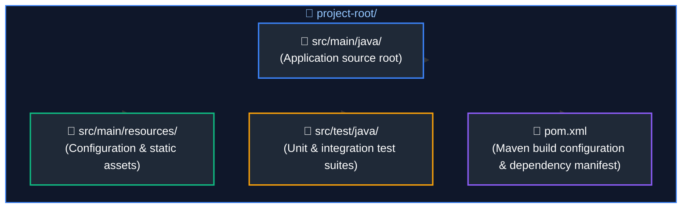

---

### 5.4 Typography, Labeling & Node Geometry Rules

1. **Two-Line Labeling Pattern:**
   Every significant node in a flowchart must feature a bold title followed by a `<br/>` with concise secondary metadata (memory size, mechanism, or responsibility):
   ```text
   RefVar["Object Reference Variable<br/>(4 bytes compressed OOP)"]
   MarkWord["Mark Word (8 bytes)<br/>Hashcode, GC Age, Biased/Lock Flags"]
   Catalyst["Catalyst Optimizer<br/>(Analysis -> Logical -> Physical -> CodeGen)"]
   ```
2. **Link Annotations:**
   - Solid transition: `A --> B`
   - Annotated interaction: `A -->|"Points to Heap Address"| B`
   - Weak / Metadata / Logical link: `A -.->|"Internal value ref"| B`
   - Always enclose link text in double quotes (`-->|"Label"|`) to avoid Mermaid parsing syntax errors.

---

### 5.5 Widescreen Layout & Proportion Standards (Anti-Tower / Anti-Shrink System)

To prevent unreadable, excessively tall, or shrunken diagrams in markdown viewers and preview engines, all flowcharts must adhere to strict aspect-ratio and geometry rules. Diagram proportions should target a balanced **16:9 to 4:3** envelope.

#### 1. The Core Anti-Patterns
- **Anti-Tower Rule (Monolithic Vertical Stacks):** Never chain 5 or more sequential nodes in a single straight vertical line (`flowchart TD` with no horizontal grouping). This creates an excessively tall, narrow pillar that wastes horizontal screen space and requires endless vertical scrolling.
- **Anti-Shrink Rule (Monolithic Horizontal Ribbons):** Never chain 5 or more sequential stages in a single straight horizontal line (`flowchart LR`). Markdown engines scale the entire diagram SVG to fit the viewport width; 5+ horizontal nodes cause severe downscaling, rendering typography tiny and unreadable.
- **Artificial Chaining Rule:** Never use arrows (`-->`) between items that have no causal or chronological sequence (e.g., taxonomies, independent pillars, or distinct comparison modes). Chaining independent items misleads readers and produces artificial towers.

---

#### 2. Pattern A: Connected Sequential Flows (The S-Curve & Wrapped Multi-Phase Standard)
When a continuous process or execution pipeline has 5 to 10 sequential steps, it **must wrap to the next line** using an **S-pattern (serpentine)** or a **balanced multi-phase layout**:

- **Outer Structure:** `flowchart TD` to stack the phases/rows cleanly.
- **Row/Phase Flow:** Group consecutive steps (typically 3 to 4 nodes) into balanced subgraphs with `direction LR`.
- **Inter-Row Transition:** Connect the final node of Row 1 downward to the first node of Row 2 (`R1_End --> R2_Start`).
- **Serpentine Option:** For unbroken streams, bend from right-to-left or drop cleanly with an annotated transition down to the next row.

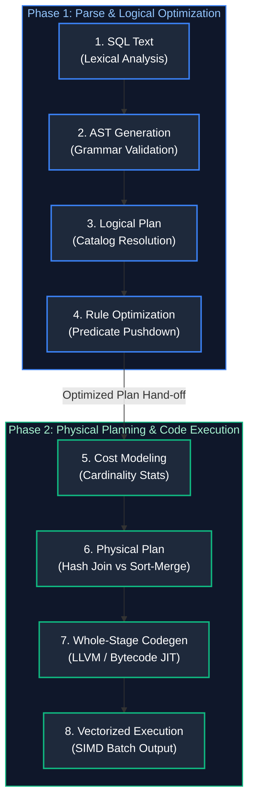

---

#### 3. Pattern B: Contrasting Modes & Comparison Flows (Side-by-Side vs. Stacked Rows)
When illustrating comparisons (e.g., L4 vs L7 proxies, With Index vs Without Index, Clustered vs Non-Clustered, Before vs After Key Salting):

1. **Side-by-Side Layout (`flowchart LR` with `direction TB`):**
   - Use when each paradigm represents an architectural tier or vertical tree.
   - Place each paradigm into its own distinct subgraph.
   - Anchor both subgraphs from a common root node or place them adjacent in `flowchart LR`.

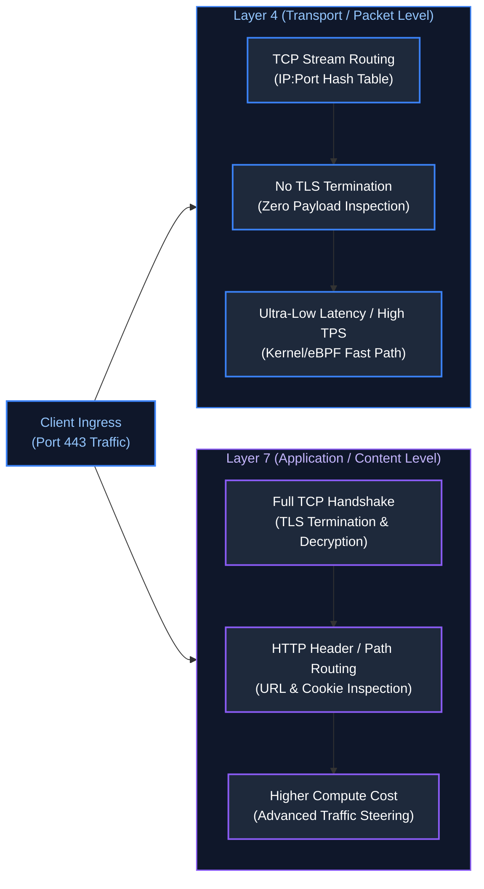

2. **Stacked Horizontal Comparison Rows (`flowchart TD` with `direction LR`):**
   - Use when each contrasting scenario contains an internal horizontal data pipeline (e.g., Predicate Pushdown vs Full Scan, `reduceByKey` vs `groupByKey`).
   - Outer chart uses `flowchart TD` to place the comparison rows one after another.
   - Each comparison subgraph declares `direction LR` to display its pipeline horizontally.

```mermaid
flowchart TD
    subgraph BadCase ["Without Pushdown: Full Disk Scan & Engine Filtering"]
        direction LR
        B1["Storage Layer<br/>(Read 100M Rows from Disk)"] -->|"Full 100M Rows I/O"| B2["Engine Memory Buffer<br/>(Massive Deserialization)"]
        B2 -->|"WHERE Filter Evaluated"| B3["Final Result<br/>(1,000 Matched Rows)"]
    end

    subgraph GoodCase ["With Predicate Pushdown: Storage-Level Pruning"]
        direction LR
        G1["Storage Layer<br/>(Evaluate Parquet Stats)"] -->|"Prune 99.9% Row Groups"| G2["Engine Memory Buffer<br/>(Read Only 1,000 Rows)"]
        G2 -->|"Zero Extra Filtering"| G3["Final Result<br/>(1,000 Matched Rows)"]
    end

    style BadCase fill:#0f172a,stroke:#ef4444,stroke-width:1.5px,color:#fca5a5
    style GoodCase fill:#0f172a,stroke:#10b981,stroke-width:1.5px,color:#a7f3d0
    style B1 fill:#1e293b,stroke:#ef4444,stroke-width:2px,color:#fff
    style B2 fill:#1e293b,stroke:#ef4444,stroke-width:2px,color:#fff
    style B3 fill:#1e293b,stroke:#ef4444,stroke-width:2px,color:#fff
    style G1 fill:#1e293b,stroke:#10b981,stroke-width:2px,color:#fff
    style G2 fill:#1e293b,stroke:#10b981,stroke-width:2px,color:#fff
    style G3 fill:#1e293b,stroke:#10b981,stroke-width:2px,color:#fff
```

---

#### 4. Pattern C: Categorical Taxonomies & Multi-Pillar Concepts (2x2 Grid & Deck Layout)
When mapping categorical concepts without sequential dependencies (e.g., ACID properties, Observability Pillars, Fact/Dimension table taxonomies, Cloud Service Models IaaS/PaaS/CaaS/FaaS):

- **The Rule:** Do NOT connect items sequentially in a straight vertical column or horizontal chain.
- **The 2x2 Grid Pattern:** Divide 4 concepts into two balanced subgraphs (`G1` and `G2`), each containing 2 items side-by-side or stacked.
- **The Multi-Pillar Deck Pattern:** For 3 to 5 independent pillars, connect a common root node to parallel vertical cards in `flowchart LR`.

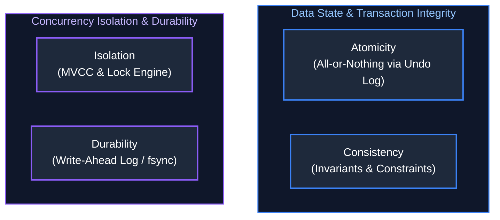

---

### 5.6 Concrete Reference Examples for Specialized Diagram Types

#### Example 1: State Machine & Resource Lifecycle (`stateDiagram-v2`)
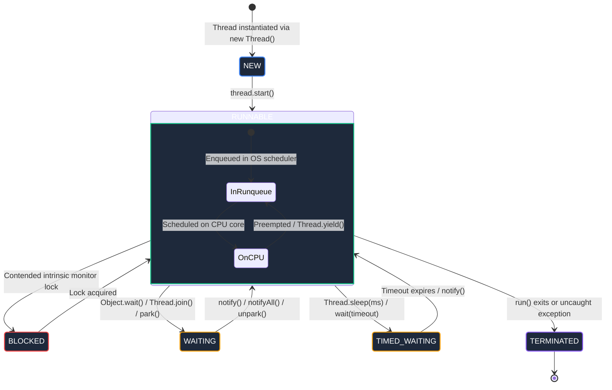

#### Example 2: OOP Design Pattern & SOLID Contracts (`classDiagram`)
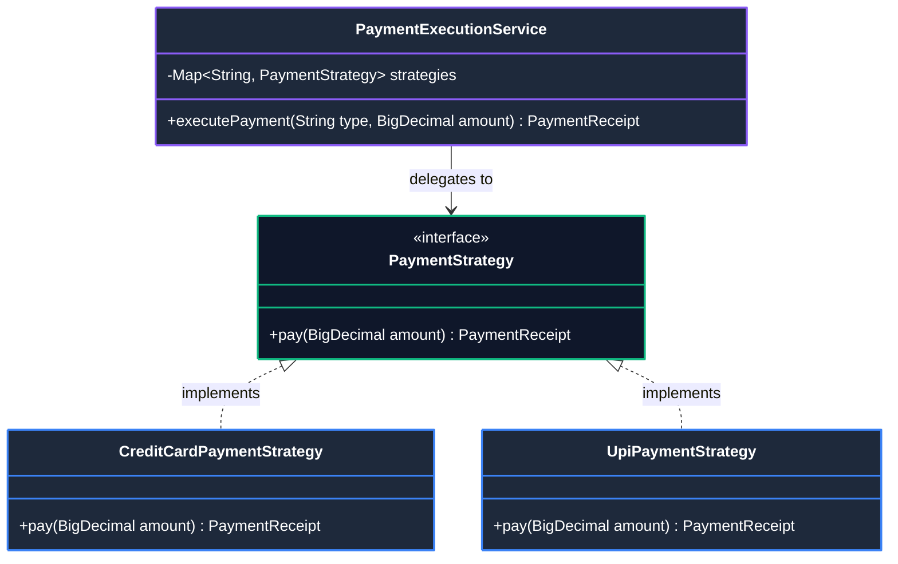

#### Example 3: Relational & Dimensional Schemas (`erDiagram`)
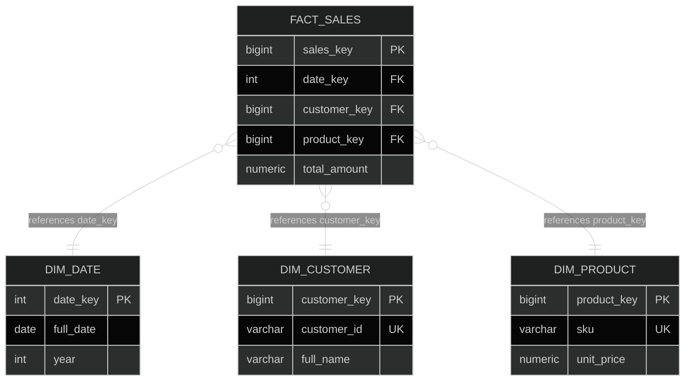

#### Example 4: Distributed Protocols & Interactions (`sequenceDiagram`)
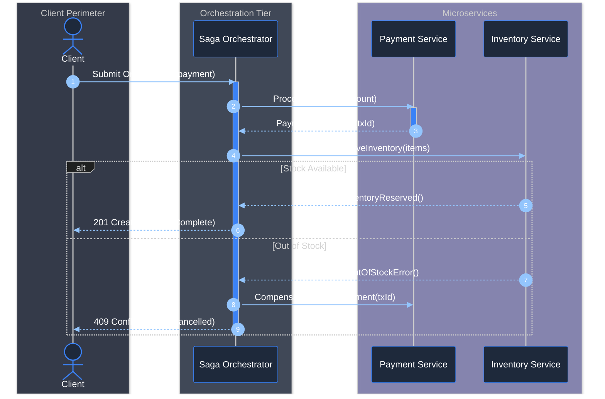

#### Example 5: Architectural Trade-Off Landscapes (`quadrantChart`)
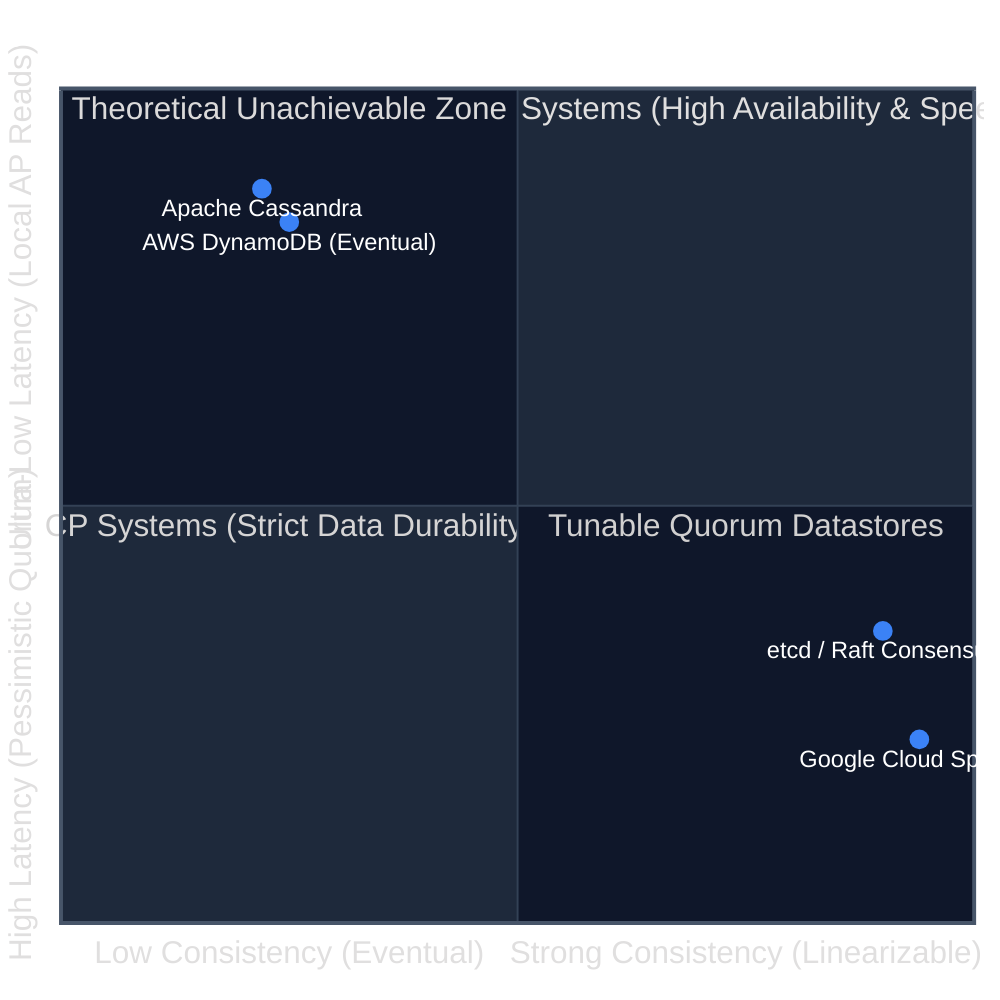

#### Example 6: Historical & Paradigm Evolution (`timeline`)
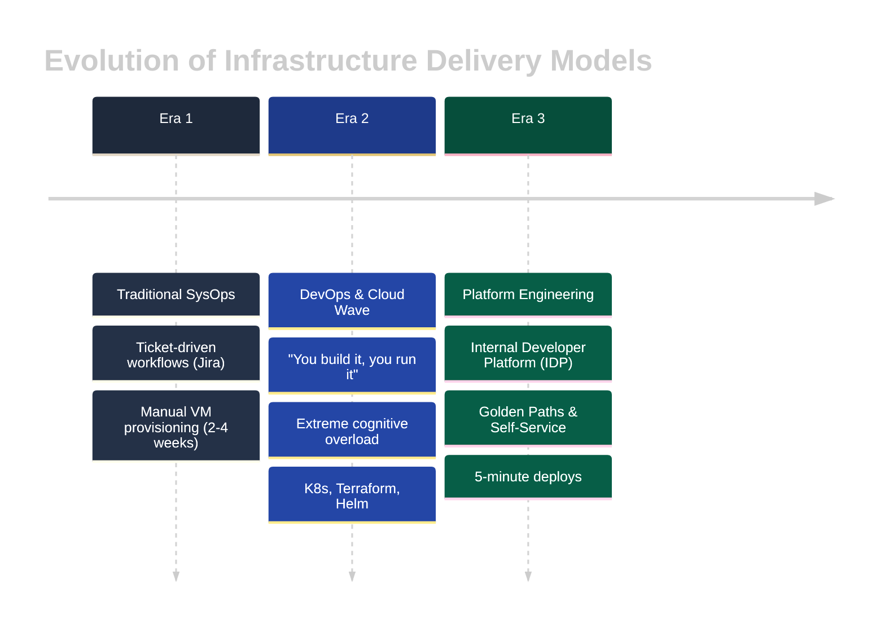

---

## 6. Pre-Commit Verification Checklist for Future Agents

Before marking any new topic or track complete, verify:
- [ ] Exactly 15 core curriculum files (`01_` to `15_`) in the track root, numbered in strict reading order.
- [ ] `00_<track>_study_guide_and_index.md` contains the 5-tier roadmap, curriculum table, and 50-problem matrix.
- [ ] Subdirectory is named `frequently_asked_questions/` (lowercase snake_case).
- [ ] `frequently_asked_questions/00_<track>_faq_study_guide_and_index.md` exists with an interview study roadmap.
- [ ] Raw question backlog is named `<track>_interview_questions.md` without spaces.
- [ ] FAQ files use concise slugs (e.g., `01_core_java_oop_and_algorithms.md`).
- [ ] Hero architecture diagram appears **before** the Table of Contents in each core guide.
- [ ] **Specialized Diagram Enforcement:** Lifecycles and state transitions use `stateDiagram-v2`; OOP design patterns use `classDiagram`; relational and star schemas use `erDiagram`; multi-actor distributed protocols use `sequenceDiagram`; trade-off comparisons use `quadrantChart`; paradigm evolutions use `timeline`.
- [ ] **Multi-Diagram Visual Styling Standard:** All diagram types must follow dark-mode semantic styling. No diagram may be left plain or bland:
  - `flowchart`: `style NodeId fill:#1e293b,stroke:...`
  - `stateDiagram-v2`: `classDef` + `class StateName className`
  - `classDiagram`: `style ClassName fill:#1e293b,stroke:...`
  - `sequenceDiagram`: dark theme `init` directive + architectural `box rgba(...)` layers
  - `erDiagram`: dark theme `init` directive with slate/navy attributes
  - `quadrantChart` & `timeline`: dark theme `init` directive with custom quadrant and track fills
- [ ] **Zero-ASCII Rule:** No raw text ASCII directory trees (`├──`, `└──`). All directory and folder structures must be rendered as Mermaid TreeView diagrams.
- [ ] Diagrams avoid monolithic vertical towers (5+ nodes in linear `flowchart TD`) and squished single-line horizontal streams (5+ nodes in `flowchart LR`); multi-step workflows adhere to the Hybrid Multi-Stage pattern (`flowchart TD` with `direction LR` subgraphs).
- [ ] Code blocks contain step-by-step inline comments; complexities use KaTeX ($O(1)$, $O(N)$).
- [ ] All intra-repository links (`[text](file.md#anchor)`) resolve without broken anchors.


