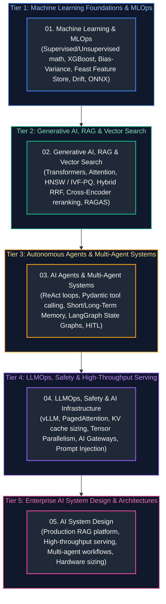

# AI Engineering Master Curriculum & Comprehensive Study Guide

This master guide provides the definitive, production-grade learning roadmap, conceptual index, and chronological study order for modern AI Engineering. The curriculum spans statistical machine learning foundations, production MLOps, vector search engines, Retrieval-Augmented Generation (RAG), autonomous cognitive agent loops, multi-agent collaboration, LLMOps, AI safety guardrails, GPU acceleration infrastructure, and enterprise AI system design.

Every guide includes formal architectural definitions, Mermaid topological diagrams, memory/hardware mechanics, production code implementations with detailed line-by-line commentary, edge-case mitigation, and production troubleshooting playbooks.

---

## Recommended Chronological Study Order

---

## Master Topic Guides & Curriculum Coverage Overview

| Study Order | Guide File | Conceptual Domain | Key Architectural Topics & Implementations Covered |
| :---: | :--- | :--- | :--- |
| **01** | [`01_machine_learning_and_ai_engineering.md`](01_machine_learning_and_ai_engineering.md) | **ML Foundations & Production MLOps** | Supervised vs unsupervised mathematics, loss functions, gradient descent, XGBoost, Random Forest, Bias-Variance tradeoff, ROC-AUC, Feast/Hopsworks feature stores, MLflow experiment tracking, Evidently AI data & concept drift detection, ONNX runtime graph optimization, and shadow/canary rollouts. |
| **02** | [`02_generative_ai_rag_and_vector_search.md`](02_generative_ai_rag_and_vector_search.md) | **Generative AI, Embeddings & RAG** | Transformer self-attention mechanics, tokenization, sampling parameters (temperature, top-p, top-k), HNSW & IVF-PQ vector indexing, Qdrant/pgvector, hybrid search with Reciprocal Rank Fusion (RRF), Cross-Encoder reranking, parent-child chunking, Graph RAG, and RAGAS metric evaluation. |
| **03** | [`03_ai_agents_and_multi_agent_systems.md`](03_ai_agents_and_multi_agent_systems.md) | **Cognitive Agents & Multi-Agent Orchestration** | ReAct (Reason, Act, Observe) cognitive loop, structured tool calling with Pydantic JSON schemas, agentic RAG query reformulation, working vs episodic memory stores, LangGraph cyclic state graphs, multi-agent supervisor routing, and Human-in-the-Loop (HITL) checkpoints. |
| **04** | [`04_llmops_safety_and_ai_infrastructure.md`](04_llmops_safety_and_ai_infrastructure.md) | **LLMOps, AI Safety & High-Throughput Serving** | Continuous LLM-as-a-Judge evaluation, prompt injection attack taxonomy and defensive boundaries, PII redaction (Presidio), LiteLLM / Portkey AI Gateways, Redis semantic caching, vLLM inference engine, PagedAttention virtual memory mapping, KV cache sizing, and Tensor Parallelism. |
| **05** | [`05_ai_system_design.md`](05_ai_system_design.md) | **AI System Design & Scale Architecture** | Trade-off triad, Time to First Token (TTFT) vs Inter-Token Latency (ITL) optimization, Enterprise RAG platform blueprint, High-throughput model serving blueprint, Multi-Agent operations blueprint, Continuous evaluation platform, 4-step interview framework, and GPU VRAM calculation cheat-sheet. |

---

## Production Problem-Solution Cross-Reference Index

The table below maps **canonical AI and LLM production problems** to their architectural solutions and corresponding curriculum chapters.

| Production Problem | Canonical Solution | Module Reference |
| :--- | :--- | :--- |
| **GPU Out of Memory (OOM)** | PagedAttention virtual memory allocation & KV cache right-sizing | [`04_llmops_safety_and_ai_infrastructure.md`](04_llmops_safety_and_ai_infrastructure.md#3-high-throughput-llm-serving-infrastructure) [`05_ai_system_design.md`](05_ai_system_design.md#6-hardware-sizing--back-of-the-envelope-estimation) |
| **High Time To First Token (TTFT)** | Prompt caching (Chunked Prefill) & Tensor Parallelism | [`04_llmops_safety_and_ai_infrastructure.md`](04_llmops_safety_and_ai_infrastructure.md#3-high-throughput-llm-serving-infrastructure) [`05_ai_system_design.md`](05_ai_system_design.md#1-the-ai-system-design-triad--core-trade-offs) |
| **Low Generation Throughput (ITL)** | Continuous batching (vLLM) & FP8/INT4 weight quantization | [`04_llmops_safety_and_ai_infrastructure.md`](04_llmops_safety_and_ai_infrastructure.md#3-high-throughput-llm-serving-infrastructure) |
| **KV Cache Fragmentation** | Page table non-contiguous memory management via PagedAttention | [`04_llmops_safety_and_ai_infrastructure.md`](04_llmops_safety_and_ai_infrastructure.md#3-high-throughput-llm-serving-infrastructure) |
| **Prompt Injection & Jailbreaks** | Multi-layer AI Gateway input classification & semantic delimiting | [`04_llmops_safety_and_ai_infrastructure.md`](04_llmops_safety_and_ai_infrastructure.md#2-ai-safety-guardrails--red-teaming) |
| **Sensitive Data / PII Leaks** | Synchronous regex & transformer-based redaction (Microsoft Presidio) | [`04_llmops_safety_and_ai_infrastructure.md`](04_llmops_safety_and_ai_infrastructure.md#2-ai-safety-guardrails--red-teaming) |
| **Sparse Term Misses in Dense Search** | Hybrid Dense + Sparse BM25 retrieval with Reciprocal Rank Fusion | [`02_generative_ai_rag_and_vector_search.md`](02_generative_ai_rag_and_vector_search.md#4-hybrid-search-sparse--dense-fusion) |
| **Low Precision / Relevance in Retrieval** | Two-stage retrieval with Cross-Encoder reranking | [`02_generative_ai_rag_and_vector_search.md`](02_generative_ai_rag_and_vector_search.md#5-reranking-strategies) |
| **Context Severing in Chunking** | Parent-Child hierarchical indexing & Semantic chunking | [`02_generative_ai_rag_and_vector_search.md`](02_generative_ai_rag_and_vector_search.md#2-document-chunking-strategies) |
| **Hallucinated Synthesis in RAG** | Groundedness verification & automated RAGAS faithfulness gates | [`02_generative_ai_rag_and_vector_search.md`](02_generative_ai_rag_and_vector_search.md#8-rag-evaluation-frameworks-ragas) |
| **Structured Output Schema Failures** | Strict JSON schema enforcement via Pydantic & Outlines / Instructor | [`03_ai_agents_and_multi_agent_systems.md`](03_ai_agents_and_multi_agent_systems.md#2-tool-calling--structured-outputs) |
| **Agent Infinite Reasoning Loops** | Explicit max recursion depth guards & cycle detection in StateGraph | [`03_ai_agents_and_multi_agent_systems.md`](03_ai_agents_and_multi_agent_systems.md#5-production-multi-agent-orchestration-frameworks) |
| **Destructive Agent Tool Execution** | Human-in-the-Loop (HITL) checkpoints & transactional dry-runs | [`03_ai_agents_and_multi_agent_systems.md`](03_ai_agents_and_multi_agent_systems.md#6-human-in-the-loop-hitl-patterns) |
| **Agent Context Window Bloat** | Episodic memory vectorization & rolling summary compaction | [`03_ai_agents_and_multi_agent_systems.md`](03_ai_agents_and_multi_agent_systems.md#4-agent-memory-architectures) |
| **LLM Provider Outages & Rate Limits** | Resilient AI Gateway with round-robin fallbacks & semantic caching | [`04_llmops_safety_and_ai_infrastructure.md`](04_llmops_safety_and_ai_infrastructure.md#4-enterprise-model-gateways--routing) |
| **Feature Store Skew / Data Leakage** | Point-in-time correct joins using Feast / Hopsworks feature tables | [`01_machine_learning_and_ai_engineering.md`](01_machine_learning_and_ai_engineering.md#3-production-mlops-architecture) |
| **Production Model Performance Drift** | Continuous statistical distribution monitoring (Evidently AI, PSI) | [`01_machine_learning_and_ai_engineering.md`](01_machine_learning_and_ai_engineering.md#3-production-mlops-architecture) |
| **High Model Inference Costs** | Semantic caching in Redis & dynamic small-model routing | [`04_llmops_safety_and_ai_infrastructure.md`](04_llmops_safety_and_ai_infrastructure.md#4-enterprise-model-gateways--routing) |
| **Evaluation Ground Truth Scarcity** | Synthetic test dataset generation & LLM-as-a-Judge panels | [`04_llmops_safety_and_ai_infrastructure.md`](04_llmops_safety_and_ai_infrastructure.md#1-llm-evaluation--observability) [`05_ai_system_design.md`](05_ai_system_design.md#5-blueprint-continuous-evaluation--data-flywheel-platform) |
| **Multi-Agent Coordination Deadlocks** | Supervisor architecture with strict state machine handoffs | [`03_ai_agents_and_multi_agent_systems.md`](03_ai_agents_and_multi_agent_systems.md#5-production-multi-agent-orchestration-frameworks) [`05_ai_system_design.md`](05_ai_system_design.md#4-blueprint-enterprise-multi-agent-customer-operations-platform) |

---

## Foundational Cross-Discipline Integration Links

The AI Engineering platform relies heavily on low-latency data pipelines, feature tables, distributed networks, and resilient microservices. Refer to the corresponding guides in sibling tracks:

- [Python for Data & AI Engineering](../Data%20Engineering/03_python_for_data_engineering.md) — Type hints, Pydantic data modeling, generators, asynchronous I/O, and chunked processing.
- [Database Internals & Storage Engines](../Data%20Engineering/04_database_internals_and_performance.md) — B-Trees, LSM-Trees, row vs columnar memory layouts, and indexing structures.
- [Distributed Systems & APIs](../Data%20Engineering/05_distributed_systems_and_apis.md) — CAP theorem, circuit breakers, rate limiters, and backpressure.
- [Databricks, Spark & Delta Lake](../Data%20Engineering/09_databricks_and_delta_lake.md) — Feature store tables, Delta Lake ACID logs, and PySpark distributed transformations.
- [Data Governance, Security & Lineage](../Data%20Engineering/14_data_governance_security_and_observability.md) — Fine-grained access control, column masking, and audit logging.
- [Microservices & Distributed Systems](../Java%20Backend/13_microservices_distributed_systems_system_design.md) — Resilience, circuit breakers, event-driven backbones, and system design.
- [Cloud Native, Containers & DevOps](../Java%20Backend/15_docker_kubernetes_cicd_cloud.md) — Multi-stage container packaging, Kubernetes probes, and autoscaling.
