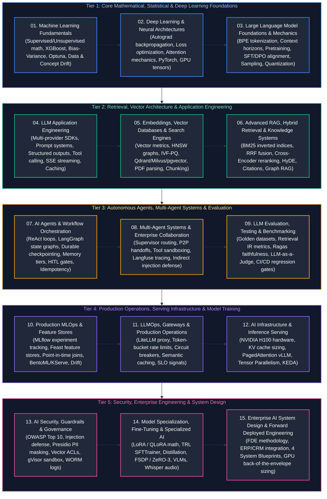

# 00. AI Engineering Master Curriculum & Comprehensive Study Guide

This master curriculum guide provides the authoritative, production-grade learning roadmap, conceptual index, and chronological reading order for modern AI Engineering. The curriculum spans statistical machine learning mathematics, deep learning neural architectures, Large Language Model (LLM) foundational physics, application engineering, vector databases, advanced hybrid RAG, autonomous cognitive agent loops, multi-agent enterprise collaboration, LLM evaluation benchmarks, production MLOps and LLMOps, high-throughput GPU serving infrastructure, AI security guardrails, model fine-tuning (LoRA/QLoRA), and enterprise AI system design.

Every guide includes formal architectural definitions, Mermaid dark-mode topological diagrams, memory/hardware mechanics, production code implementations with detailed line-by-line commentary, edge-case mitigation, and production troubleshooting playbooks.

---

## 5-Tier Chronological Mermaid Study Roadmap

---

## Master Topic Guides & Curriculum Coverage Overview

| Study Order | Guide File | Conceptual Domain | Key Architectural Topics & Implementations Covered |
| :---: | :--- | :--- | :--- |
| **01** | [`01_machine_learning_fundamentals.md`](01_machine_learning_fundamentals.md) | **Statistical ML & Theory** | Supervised vs. unsupervised math, classification/regression loss landscapes, bias-variance tradeoff, L1/L2/ElasticNet regularization, data leakage prevention, scikit-learn pipelines, precision/recall/F1/ROC-AUC/PR-AUC, stratified vs. temporal validation, Optuna Bayesian tuning, batch vs. online inference, and statistical data/model drift (KS-Test, PSI). |
| **02** | [`02_deep_learning_and_neural_architectures.md`](02_deep_learning_and_neural_architectures.md) | **Deep Learning & Transformers** | Computational graphs, reverse-mode autograd calculus, Cross-Entropy / Focal / InfoNCE losses, SGD vs. AdamW decoupled weight decay, token/positional embeddings, Rotary Position Embeddings (RoPE), Scaled Dot-Product Attention, MHA vs. GQA vs. MQA, PyTorch custom modules, AMP mixed precision, and GPU CUDA memory hierarchies. |
| **03** | [`03_llm_foundations_and_mechanics.md`](03_llm_foundations_and_mechanics.md) | **LLM Foundations & Alignment** | Byte-Pair Encoding (BPE) tokenization, byte-fallback, context horizons, RoPE scaling/YaRN, U-shaped attention curve ("Lost in the Middle"), next-token prediction, pretraining scaling laws, SFT instruction tuning, DPO vs. PPO alignment, sampling dynamics (temperature, top-k, top-p nucleus), hallucinations, hosted vs. open-weight models, and quantization physics (AWQ, GPTQ, FP8). |
| **04** | [`04_llm_application_engineering.md`](04_llm_application_engineering.md) | **Application Architecture & APIs** | Multi-provider SDK abstraction (OpenAI, Anthropic, Gemini), prompt engineering delimiter boundaries, few-shot in-context learning, grammar-constrained structured outputs (Pydantic v2, Outlines), tool/function calling protocols, SSE token streaming with FastAPI, async concurrency pools (`asyncio.gather`), token budgeting, exponential backoff with full jitter, and response caching. |
| **05** | [`05_embeddings_vector_databases_and_search.md`](05_embeddings_vector_databases_and_search.md) | **Embeddings & Vector Engines** | Vector similarity metrics (Cosine, Euclidean L2, Dot Product), Approximate Nearest Neighbor (ANN) search, IVF-PQ inverted file clustering and product quantization, HNSW multi-layer skip graphs ($M$, $efConstruction$, $efSearch$), PostgreSQL pgvector (HNSW vs IVFFlat), Qdrant in-graph filtering, layout-aware PDF parsing, table extraction, and chunking strategies (fixed, recursive, semantic, parent-child). |
| **06** | [`06_advanced_rag_and_retrieval_systems.md`](06_advanced_rag_and_retrieval_systems.md) | **Advanced RAG & Knowledge Systems** | BM25 sparse keyword search, inverted index posting lists, dense vs. sparse vs. hybrid retrieval, Reciprocal Rank Fusion (RRF), two-stage retrieval with Cross-Encoder reranking (BAAI/bge-reranker), query transformation (HyDE, multi-query expansion, step-back prompting), context assembly deduplication, verified citation provenance, CDC incremental reindexing, vector ACLs, and Graph RAG multi-hop traversal. |
| **07** | [`07_ai_agents_and_workflow_orchestration.md`](07_ai_agents_and_workflow_orchestration.md) | **Cognitive Agents & Workflows** | Autonomous ReAct loops vs. deterministic workflows, Plan-and-Solve task decomposition, Tree-of-Thought (ToT), Reflexion self-correction, cyclic state graphs in LangGraph, durable PostgreSQL checkpointer thread recovery, memory hierarchies (working vs. session vs. persistent episodic memory), rolling summarization, Human-in-the-Loop (HITL) interrupt gates, and idempotent tool execution. |
| **08** | [`08_multi_agent_systems_and_collaboration.md`](08_multi_agent_systems_and_collaboration.md) | **Multi-Agent Enterprise Systems** | Supervisor/orchestrator router architecture, peer-to-peer handoffs, hierarchical networks, shared blackboard state, least-privilege tool access scoping, ephemeral container sandboxing (Docker, gVisor), indirect prompt injection defense in untrusted tool data, distributed tracing with Langfuse and OpenInference, task-completion rate (TCR), and step efficiency metrics. |
| **09** | [`09_llm_evaluation_testing_and_benchmarking.md`](09_llm_evaluation_testing_and_benchmarking.md) | **Evaluation & Quality Benchmarks** | Golden ground-truth curation, synthetic test generation via Evol-Instruct, Information Retrieval metrics (Recall@k, Precision@k, MRR, NDCG@k), the RAG Triad (Context Relevance, Faithfulness, Answer Relevance), citation correctness audit, LLM-as-a-Judge architectures (pairwise vs. single-point), position/verbosity bias mitigation, Cohen's Kappa, bootstrap confidence intervals, and CI/CD evaluation automation. |
| **10** | [`10_production_mlops_and_feature_stores.md`](10_production_mlops_and_feature_stores.md) | **Production MLOps & Pipelines** | MLflow tracking & model registry stages, reproducible training pipelines, Kubeflow Pipelines containerized DAGs, Feast feature store architecture (Offline Parquet vs. Online Redis), point-in-time correctness ("as-of" time-travel joins), training-serving skew elimination, high-speed serving with BentoML and KServe, real-time drift profiling with Evidently AI, and automated canary deployments. |
| **11** | [`11_llmops_gateways_and_production_operations.md`](11_llmops_gateways_and_production_operations.md) | **LLMOps & Operational Gateways** | Immutable prompt versioning (GitOps), enterprise AI Gateways (LiteLLM, Portkey, Kong AI), token-bucket rate limiting algorithms, tenant-level token budgets, high-availability circuit breaker state machines, automatic model failover routing, Redis exact and semantic caching, queue-based background inference workers (Temporal/Celery), stream disconnect detection, the 4 Golden Signals (TTFT, ITL), and AI SLOs. |
| **12** | [`12_ai_infrastructure_and_inference_serving.md`](12_ai_infrastructure_and_inference_serving.md) | **AI Infrastructure & Serving Engines** | NVIDIA Hopper H100 GPU architecture, Tensor Cores, HBM3 bandwidth bottlenecks, KV cache memory dynamics and mathematical sizing, PagedAttention virtual memory mapping (vLLM, SGLang), continuous (in-flight) iteration batching, model quantization (FP8, INT4 AWQ, GPTQ), Megatron-LM Tensor Parallelism over NVLink, production Docker/CUDA containers, Kubernetes KEDA autoscaling, and capacity planning. |
| **13** | [`13_ai_security_guardrails_and_governance.md`](13_ai_security_guardrails_and_governance.md) | **AI Security & Governance** | OWASP Top 10 for LLMs, direct prompt injection & jailbreak taxonomy, indirect prompt injection via poisoned documents, session canary tokens, automated PII redaction with Microsoft Presidio, multi-tenant isolation, document-level vector ACLs with row-level security, sandboxed code execution with gVisor, sidecar vault secret management, NeMo Guardrails output verification, and immutable WORM audit logs. |
| **14** | [`14_model_finetuning_multimodal_and_specialized_ai.md`](14_model_finetuning_multimodal_and_specialized_ai.md) | **Fine-Tuning & Specialized AI** | Full fine-tuning memory physics (16x rule), Parameter-Efficient Fine-Tuning (PEFT), LoRA mathematical low-rank decomposition ($W_0 + \frac{\alpha}{r}BA$), QLoRA NormalFloat4 (NF4) and double quantization, Hugging Face TRL `SFTTrainer` pipelines, teacher-student knowledge distillation, PyTorch FSDP & DeepSpeed ZeRO-1/2/3 memory sharding, synthetic data generation, multimodal Vision-Language Models (VLMs), Whisper audio transcription, and two-tower recommendations. |
| **15** | [`15_enterprise_ai_system_design.md`](15_enterprise_ai_system_design.md) | **Enterprise AI System Design & FDE** | Forward Deployed Engineering (FDE) methodology, translating business requirements to probabilistic architectures, enterprise ERP/CRM integration (Salesforce, SAP, Jira), the AI System Design Triad trade-offs, Blueprint 1: Enterprise Hybrid RAG Platform, Blueprint 2: High-Throughput Serving Cluster, Blueprint 3: Autonomous Multi-Agent Operations with HITL, Blueprint 4: Continuous Evaluation Data Flywheel, quantitative back-of-the-envelope sizing, and the 4-step interview framework. |

---

## Production Problem-Solution Cross-Reference Index (50 Canonical Failures)

The table below maps the **50 canonical AI, LLM, and MLOps production failures** directly to their architectural solutions and corresponding curriculum chapters.

| Problem | Canonical Solution | Module Reference |
| :--- | :--- | :--- |
| **GPU Out-of-Memory (OOM)** | PagedAttention virtual memory paging & KV cache dynamic block allocation | [`12_ai_infrastructure_and_inference_serving.md`](12_ai_infrastructure_and_inference_serving.md#3-virtual-memory-for-llms-pagedattention--vllm) |
| **High Time-To-First-Token (TTFT)** | Prompt caching (Chunked Prefill) & Tensor Parallelism sharding | [`11_llmops_gateways_and_production_operations.md`](11_llmops_gateways_and_production_operations.md#7-observability--the-four-golden-signals-of-llms) [`12_ai_infrastructure_and_inference_serving.md`](12_ai_infrastructure_and_inference_serving.md#4-inference-dynamics-prefill-vs-decode--continuous-batching) |
| **Low Generation Throughput (ITL)** | Continuous (in-flight) batching & FP8 / INT4 weight quantization | [`12_ai_infrastructure_and_inference_serving.md`](12_ai_infrastructure_and_inference_serving.md#4-inference-dynamics-prefill-vs-decode--continuous-batching) |
| **KV Cache Memory Fragmentation** | Non-contiguous virtual memory page tables via PagedAttention | [`12_ai_infrastructure_and_inference_serving.md`](12_ai_infrastructure_and_inference_serving.md#3-virtual-memory-for-llms-pagedattention--vllm) |
| **Direct Prompt Injection** | Structured system delimiters, Canary tokens & Llama Guard classification | [`13_ai_security_guardrails_and_governance.md`](13_ai_security_guardrails_and_governance.md#2-prompt-injection-attacks--defensive-engineering) |
| **Indirect Prompt Injection** | Semantic isolation boundaries (`<untrusted_data>`) & output quarantining | [`08_multi_agent_systems_and_collaboration.md`](08_multi_agent_systems_and_collaboration.md#5-indirect-prompt-injection-via-untrusted-tool-outputs) [`13_ai_security_guardrails_and_governance.md`](13_ai_security_guardrails_and_governance.md#2-prompt-injection-attacks--defensive-engineering) |
| **PII / Sensitive Data Leaks** | Synchronous entity recognition & deterministic masking (Microsoft Presidio) | [`13_ai_security_guardrails_and_governance.md`](13_ai_security_guardrails_and_governance.md#3-pii-detection-redaction--data-leakage-prevention) |
| **Sparse Term Misses in Dense Search** | Hybrid dense + sparse BM25 retrieval with Reciprocal Rank Fusion (RRF) | [`06_advanced_rag_and_retrieval_systems.md`](06_advanced_rag_and_retrieval_systems.md#2-dense-vs-sparse-vs-hybrid-retrieval) |
| **Low Precision in Vector Search** | Two-stage retrieval pipeline with Cross-Encoder reranking | [`06_advanced_rag_and_retrieval_systems.md`](06_advanced_rag_and_retrieval_systems.md#3-two-stage-retrieval--cross-encoder-reranking) |
| **Severed Context in Chunking** | Parent-Child hierarchical indexing & layout-aware recursive chunking | [`05_embeddings_vector_databases_and_search.md`](05_embeddings_vector_databases_and_search.md#5-document-chunking-strategies--trade-offs) |
| **RAG Hallucinated Answers** | Strict grounding prompt directives & automated Ragas Faithfulness gates | [`06_advanced_rag_and_retrieval_systems.md`](06_advanced_rag_and_retrieval_systems.md#5-context-assembly-deduplication--grounded-generation) [`09_llm_evaluation_testing_and_benchmarking.md`](09_llm_evaluation_testing_and_benchmarking.md#3-generation-quality-metrics-faithfulness-relevance--completeness) |
| **Missing Citations / Attribution** | Bracketed citation enforcement `[1]` with sentence-level verification | [`06_advanced_rag_and_retrieval_systems.md`](06_advanced_rag_and_retrieval_systems.md#5-context-assembly-deduplication--grounded-generation) |
| **Structured Schema Parsing Failures** | Grammar-constrained logit decoding via native JSON Schema / Pydantic v2 | [`04_llm_application_engineering.md`](04_llm_application_engineering.md#3-grammar-constrained-decoding--structured-outputs) |
| **Agent Infinite Reasoning Loops** | Explicit recursion depth limiters, duplicate action guards & cycle checks | [`07_ai_agents_and_workflow_orchestration.md`](07_ai_agents_and_workflow_orchestration.md#8-production-diagnostics-infinite-recursion-loops--context-bloat) |
| **Destructive Agent Tool Actions** | Human-in-the-Loop (HITL) interrupt checkpoints & cryptographic approvals | [`07_ai_agents_and_workflow_orchestration.md`](07_ai_agents_and_workflow_orchestration.md#6-human-in-the-loop-hitl-checkpoints--approval-patterns) |
| **Agent Context Window Bloat** | Rolling summary compaction nodes & raw tool output stripping | [`07_ai_agents_and_workflow_orchestration.md`](07_ai_agents_and_workflow_orchestration.md#5-memory-systems-working-vs-short-term-vs-persistent-episodic-memory) |
| **Provider API Rate Limits (HTTP 429)** | Token-bucket rate limiting & exponential backoff with full jitter | [`04_llm_application_engineering.md`](04_llm_application_engineering.md#8-resilience-engineering-retries-backoff-rate-limits--caching) [`11_llmops_gateways_and_production_operations.md`](11_llmops_gateways_and_production_operations.md#3-rate-limiting-backpressure--token-budgeting) |
| **Upstream Provider Outages** | Resilient AI Gateway with dynamic circuit breaker failover routing | [`11_llmops_gateways_and_production_operations.md`](11_llmops_gateways_and_production_operations.md#4-high-availability-circuit-breakers--dynamic-model-fallbacks) |
| **Runaway API Token Costs** | Redis semantic caching with cosine threshold & small-model routing | [`04_llm_application_engineering.md`](04_llm_application_engineering.md#8-resilience-engineering-retries-backoff-rate-limits--caching) [`11_llmops_gateways_and_production_operations.md`](11_llmops_gateways_and_production_operations.md#5-caching-architectures-exact-hash-vs-semantic-vector-caching) |
| **Abandoned Streaming Waste** | Client disconnect detection (`is_disconnected()`) with immediate cancellation | [`11_llmops_gateways_and_production_operations.md`](11_llmops_gateways_and_production_operations.md#6-asynchronous-queue-based-inference--streaming-cancellation) |
| **Multi-Tenant Vector Data Leakage** | Single-stage in-graph vector filtering on `tenant_id` & database RLS | [`05_embeddings_vector_databases_and_search.md`](05_embeddings_vector_databases_and_search.md#6-metadata-extraction--single-stage-vector-filtering) [`13_ai_security_guardrails_and_governance.md`](13_ai_security_guardrails_and_governance.md#4-enterprise-access-control--multi-tenant-isolation) |
| **Multi-Agent Coordination Deadlocks** | Centralized Supervisor router pattern with strict turn escalation caps | [`08_multi_agent_systems_and_collaboration.md`](08_multi_agent_systems_and_collaboration.md#2-supervisor-orchestration--task-routing-in-langgraph) |
| **Insecure Agent Shell Execution** | Kernel-isolated microVM sandboxing (gVisor / Docker `--network none`) | [`08_multi_agent_systems_and_collaboration.md`](08_multi_agent_systems_and_collaboration.md#4-tool-permissions-least-privilege--sandboxed-execution) [`13_ai_security_guardrails_and_governance.md`](13_ai_security_guardrails_and_governance.md#5-sandboxing--secure-code-execution-architectures) |
| **Missing Ground-Truth for Evaluation** | Synthetic test dataset generation via Evol-Instruct complexity pipelines | [`09_llm_evaluation_testing_and_benchmarking.md`](09_llm_evaluation_testing_and_benchmarking.md#1-evaluation-dataset-engineering-golden-standards-vs-synthetic-generation) |
| **LLM Judge Position Bias** | Position-swapping bidirectional evaluation and multi-model consensus | [`09_llm_evaluation_testing_and_benchmarking.md`](09_llm_evaluation_testing_and_benchmarking.md#4-llm-as-a-judge-architectures--bias-mitigation) |
| **Silent Model Quality Regression** | Continuous CI/CD automated regression gates with bootstrap significance | [`09_llm_evaluation_testing_and_benchmarking.md`](09_llm_evaluation_testing_and_benchmarking.md#8-continuous-evaluation-in-cicd-ragas-deepeval-promptfoo) |
| **Multi-Lingual Token Inflation** | Byte-fallback tokenization & multi-lingual vocabulary tokenizers | [`03_llm_foundations_and_mechanics.md`](03_llm_foundations_and_mechanics.md#1-tokenization-theory--algorithms-bpe-wordpiece-sentencepiece) |
| **"Lost in the Middle" Retrieval Loss** | U-shaped attention optimization: place instructions at start, context at end | [`03_llm_foundations_and_mechanics.md`](03_llm_foundations_and_mechanics.md#2-context-windows-attention-horizons--lost-in-the-middle) |
| **Multi-Hop Fact Misses in Vector Search**| Graph RAG knowledge graph entity-relation extraction & path traversal | [`06_advanced_rag_and_retrieval_systems.md`](06_advanced_rag_and_retrieval_systems.md#8-graph-rag-knowledge-graphs--multi-hop-traversal) |
| **Post-Filtering Recall Collapse** | Single-stage in-graph filtered vector traversal (Qdrant / Milvus) | [`05_embeddings_vector_databases_and_search.md`](05_embeddings_vector_databases_and_search.md#6-metadata-extraction--single-stage-vector-filtering) |
| **PDF Column Interleaving** | Layout-aware bounding-box segmentation (PyMuPDF / Marker) | [`05_embeddings_vector_databases_and_search.md`](05_embeddings_vector_databases_and_search.md#4-document-parsing-ocr--table-extraction) |
| **Untracked Model & Prompt Changes** | Immutable GitOps prompt versioning & MLflow artifact tracking | [`10_production_mlops_and_feature_stores.md`](10_production_mlops_and_feature_stores.md#2-experiment-tracking--model-registries-with-mlflow) [`11_llmops_gateways_and_production_operations.md`](11_llmops_gateways_and_production_operations.md#1-llmops-foundations-configuration-prompt--model-versioning) |
| **Training-Serving Feature Skew** | Unified Feature Store (Feast) generating identical offline and online logic | [`10_production_mlops_and_feature_stores.md`](10_production_mlops_and_feature_stores.md#3-feature-stores-feast-architecture--offlineonline-consistency) |
| **Data Leakage in Feature Pipelines** | Scikit-learn Pipeline encapsulation fitted strictly on training split | [`01_machine_learning_fundamentals.md`](01_machine_learning_fundamentals.md#4-feature-engineering--data-leakage-prevention) |
| **Temporal Future Peeking Leakage** | Point-in-time ("as-of") joins and TimeSeriesSplit cross-validation | [`01_machine_learning_fundamentals.md`](01_machine_learning_fundamentals.md#6-cross-validation-protocols--hyperparameter-tuning) [`10_production_mlops_and_feature_stores.md`](10_production_mlops_and_feature_stores.md#3-feature-stores-feast-architecture--offlineonline-consistency) |
| **Production Model Performance Drift** | Continuous KS-Test and Population Stability Index (PSI) monitoring | [`01_machine_learning_fundamentals.md`](01_machine_learning_fundamentals.md#8-data-drift-vs-model-drift-mechanics) [`10_production_mlops_and_feature_stores.md`](10_production_mlops_and_feature_stores.md#7-continuous-monitoring-data-drift-concept-drift--evidently-ai) |
| **Catastrophic Forgetting in Fine-Tuning**| Parameter-Efficient Fine-Tuning (PEFT / LoRA) with frozen base weights | [`14_model_finetuning_multimodal_and_specialized_ai.md`](14_model_finetuning_multimodal_and_specialized_ai.md#1-full-fine-tuning-vs-parameter-efficient-fine-tuning-peft) |
| **Fine-Tuning Out of Memory (OOM)** | QLoRA (NormalFloat4 + double quantization + paged AdamW optimizers) | [`14_model_finetuning_multimodal_and_specialized_ai.md`](14_model_finetuning_multimodal_and_specialized_ai.md#2-lora--qlora-mathematical-foundations--physics) |
| **Edge Device Model Latency** | Knowledge distillation matching softened teacher logits into 3B model | [`14_model_finetuning_multimodal_and_specialized_ai.md`](14_model_finetuning_multimodal_and_specialized_ai.md#4-model-distillation-teacher-student-logit-matching) |
| **Distributed Training Communication Delay**| PyTorch FSDP / DeepSpeed ZeRO-3 sharding with NVLink collectives | [`14_model_finetuning_multimodal_and_specialized_ai.md`](14_model_finetuning_multimodal_and_specialized_ai.md#5-distributed-training-frameworks-fsdp--deepspeed-zero-123) |
| **Multimodal Alignment Degradation** | Two-stage projection cross-attention training (CLIP / SigLIP) | [`14_model_finetuning_multimodal_and_specialized_ai.md`](14_model_finetuning_multimodal_and_specialized_ai.md#7-multimodal-ai-systems-vision-speech--audio) |
| **Duplicate Ingestion Bloat** | SHA-256 document hashing & incremental CDC deletion queues | [`06_advanced_rag_and_retrieval_systems.md`](06_advanced_rag_and_retrieval_systems.md#6-incremental-indexing-document-deletion--access-control-acls) |
| **Toxic / Harmful Model Generations** | Llama Guard 3 input/output classifiers & NeMo Guardrails output rails | [`13_ai_security_guardrails_and_governance.md`](13_ai_security_guardrails_and_governance.md#7-output-validation--action-safeguards) |
| **Non-Idempotent Tool Side-Effects** | Redis distributed locking & cryptographic idempotency keys | [`07_ai_agents_and_workflow_orchestration.md`](07_ai_agents_and_workflow_orchestration.md#7-idempotency--safe-tool-execution) |
| **Regulatory Compliance Violations** | Cryptographically chained Write-Once-Read-Many (WORM) audit ledgers | [`13_ai_security_guardrails_and_governance.md`](13_ai_security_guardrails_and_governance.md#8-audit-trails-data-provenance--compliance-governance) |
| **Intermittent Network Tool Failures** | Tenacity exponential retry decorators with bounded jitter | [`04_llm_application_engineering.md`](04_llm_application_engineering.md#8-resilience-engineering-retries-backoff-rate-limits--caching) |
| **Vector Database Memory Exhaustion** | IVF-PQ product quantization & memory-mapped disk IO (mmap) | [`05_embeddings_vector_databases_and_search.md`](05_embeddings_vector_databases_and_search.md#7-vector-database-sizing-memory-estimation--sharding) |
| **Untrusted Tool Output Poisoning** | Explicit `<untrusted_tool_observation>` boundary fencing | [`08_multi_agent_systems_and_collaboration.md`](08_multi_agent_systems_and_collaboration.md#5-indirect-prompt-injection-via-untrusted-tool-outputs) |
| **Probabilistic Business Metric Gaps** | Decoupling probabilistic generation from deterministic database queries | [`15_enterprise_ai_system_design.md`](15_enterprise_ai_system_design.md#1-ai-forward-deployed-engineering-fde-methodology) |
| **Distributed Multi-Node Model Desync**| Tensor Parallelism over high-bandwidth NVLink interconnects | [`12_ai_infrastructure_and_inference_serving.md`](12_ai_infrastructure_and_inference_serving.md#6-distributed-serving-tensor-parallelism-vs-pipeline-parallelism) |

---

## Foundational Cross-Discipline Integration Links

The AI Engineering platform relies heavily on low-latency data pipelines, feature tables, distributed networks, and resilient microservices. Refer to the corresponding guides in sibling tracks:

- [Python for Data & AI Engineering](../Data%20Engineering/03_python_for_data_engineering.md) — Type hints, Pydantic data modeling, generators, asynchronous I/O, and chunked processing.
- [Database Internals & Storage Engines](../Data%20Engineering/04_database_internals_and_performance.md) — B+ Trees, LSM-Trees, row vs. columnar memory layouts, and indexing structures.
- [Distributed Systems & APIs](../Data%20Engineering/05_distributed_systems_and_apis.md) — CAP theorem, circuit breakers, rate limiters, and backpressure.
- [Databricks, Spark & Delta Lake](../Data%20Engineering/09_databricks_and_delta_lake.md) — Feature store tables, Delta Lake ACID logs, and PySpark distributed transformations.
- [Data Governance, Security & Lineage](../Data%20Engineering/14_data_governance_security_and_observability.md) — Fine-grained access control, column masking, and audit logging.
- [Microservices & Distributed Systems](../Java%20Backend%20Engineering/13_microservices_distributed_systems_system_design.md) — Resilience, circuit breakers, event-driven backbones, and system design.
- [Cloud Native, Containers & DevOps](../Java%20Backend%20Engineering/15_docker_kubernetes_cicd_cloud.md) — Multi-stage container packaging, Kubernetes probes, and autoscaling.
