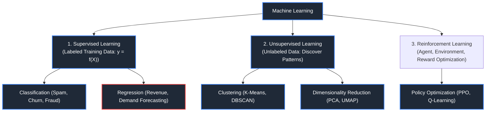
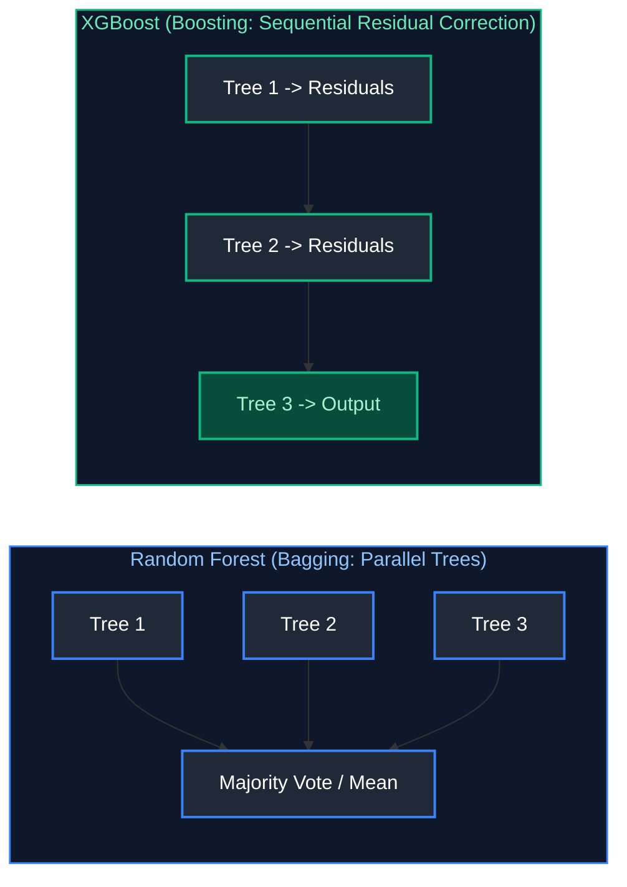
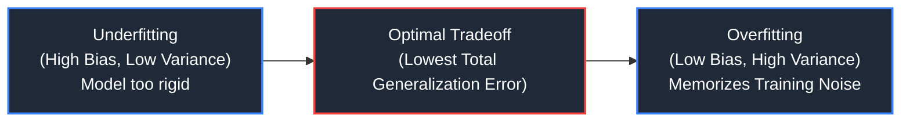
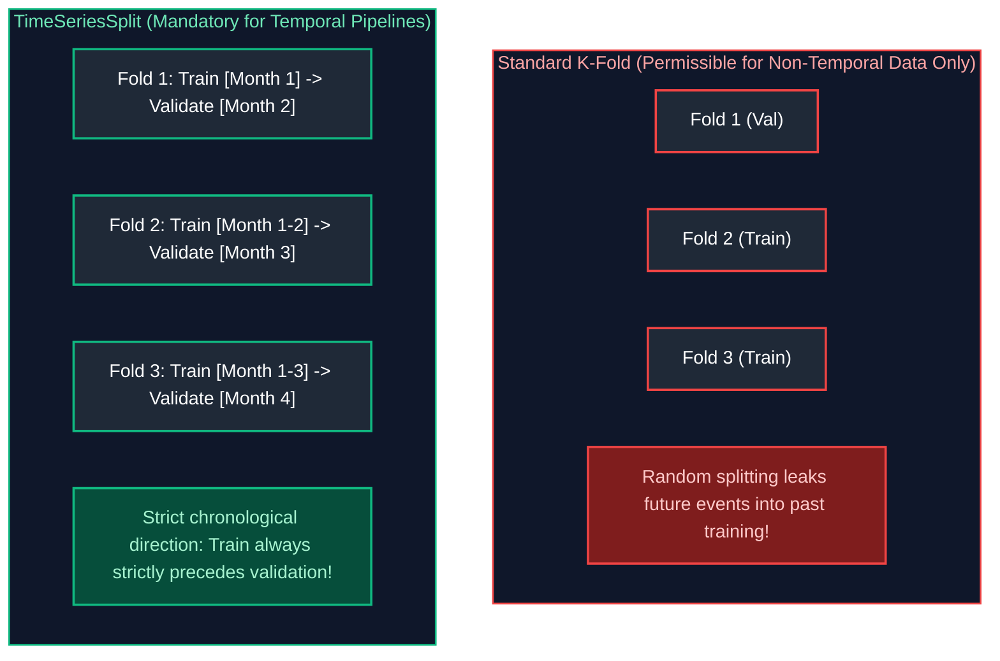
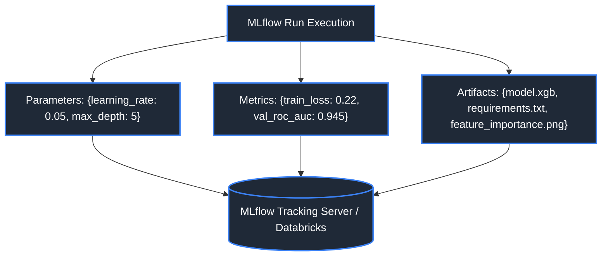
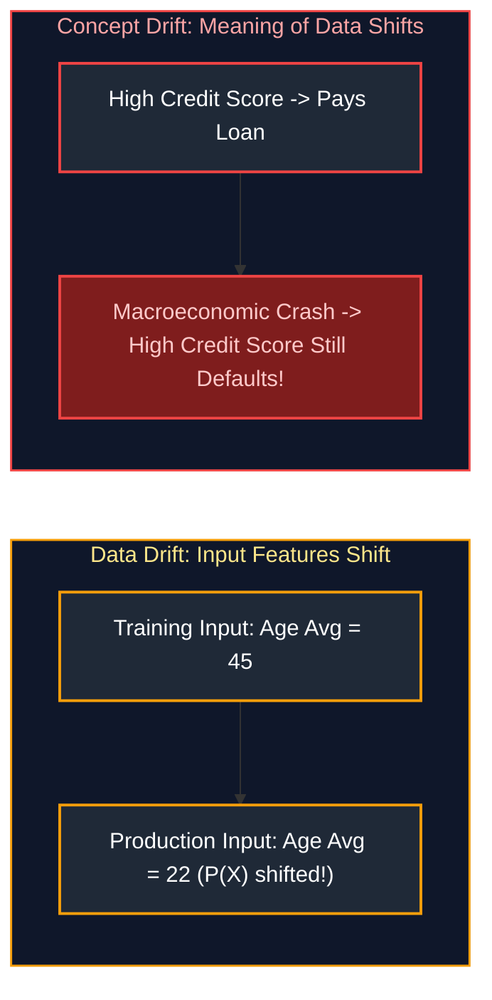
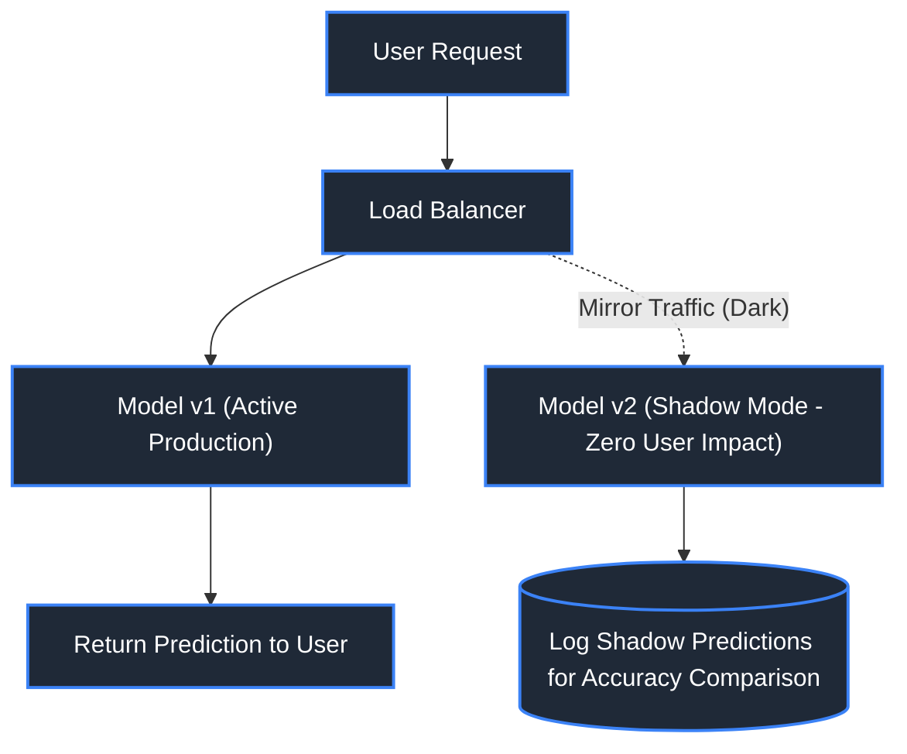

# 01. Machine Learning & AI Engineering

A comprehensive, production-grade guide to machine learning foundations, algorithms (XGBoost, Random Forest), Bias-Variance tradeoff, validation metrics (ROC-AUC, F1, RMSE), Feature Store architectures (Feast, Hopsworks), drift detection (Data Drift vs. Concept Drift with Evidently AI), Bayesian hyperparameter optimization (Optuna), temporal validation, and production ML deployment strategies (Shadow deployments, A/B testing).

---

## Table of Contents
1. [Machine Learning Fundamentals](#1-machine-learning-fundamentals)
   - [1.1 Machine Learning Taxonomy (Supervised, Unsupervised, Reinforcement)](#11-machine-learning-taxonomy)
   - [1.2 Classification vs Regression](#12-classification-vs-regression)
   - [1.3 Core Algorithms (Linear/Logistic Regression, Random Forest, XGBoost)](#13-core-algorithms)
   - [1.4 Overfitting, Underfitting & Bias-Variance Tradeoff](#14-overfitting-underfitting--bias-variance-tradeoff)
   - [1.5 Evaluation Metrics (Precision, Recall, F1, ROC-AUC, RMSE, MAE)](#15-evaluation-metrics)
   - [1.6 Data Splitting & Cross-Validation (K-Fold vs. TimeSeriesSplit)](#16-data-splitting--cross-validation-k-fold-vs-timeseriessplit)
   - [1.7 Feature Engineering & Transformation Pipelines](#17-feature-engineering--transformation-pipelines)
   - [1.8 Handling Class Imbalance (Cost-Sensitive Weighting & SMOTE)](#18-handling-class-imbalance-cost-sensitive-weighting--smote)
   - [1.9 Hyperparameter Optimization with Optuna](#19-hyperparameter-optimization-with-optuna)
2. [Production Machine Learning Engineering (MLOps)](#2-production-machine-learning-engineering-mlops)
   - [2.1 Feature Store Architecture (Offline vs Online Stores)](#21-feature-store-architecture)
   - [2.2 Model Training Pipelines & Artifact Versioning (MLflow)](#22-model-training-pipelines--artifact-versioning-mlflow)
   - [2.3 Batch Inference vs Real-Time Online Inference](#23-batch-inference-vs-real-time-online-inference)
   - [2.4 Model Serialization & High-Speed Serving (ONNX Runtime)](#24-model-serialization--high-speed-serving-onnx-runtime)
   - [2.5 Data Drift vs Concept Drift](#25-data-drift-vs-concept-drift)
   - [2.6 Drift Monitoring Frameworks (Evidently AI, PSI, KS-Test)](#26-drift-monitoring-frameworks-evidently-ai-psi-ks-test)
   - [2.7 Model Registry & Governance](#27-model-registry--governance)
   - [2.8 Shadow Deployments & Canary Releases for ML](#28-shadow-deployments--canary-releases-for-ml)

---

# 1. Machine Learning Fundamentals

---

### 1.1 Machine Learning Taxonomy



#### References
- [GeeksforGeeks: Supervised and Unsupervised Learning](https://www.geeksforgeeks.org/supervised-unsupervised-learning/)
- [DataCamp: Machine Learning Fundamentals](https://www.datacamp.com/tutorial/machine-learning-tutorial)

---

### 1.2 Classification vs Regression

- **Classification:** Predicts discrete categorical class labels ($y \in \{0, 1\}$ or $\{A, B, C\}$). Evaluated using Confusion Matrix, Precision, Recall, F1-Score, and ROC-AUC.
- **Regression:** Predicts continuous numeric quantities ($y \in \mathbb{R}$). Evaluated using RMSE, MAE, and $R^2$.

---

### 1.3 Core Algorithms

#### Algorithm Taxonomy & Real-World Selection
1. **Linear / Logistic Regression:** Fast, highly interpretable baseline parametric models. Best for regulatory credit scoring and linear benchmarks.
2. **Decision Trees & Random Forests:** Non-parametric bagging ensemble of parallel trees. Handles missing values, non-linear relationships, and feature collinearity without scaling.
3. **XGBoost / LightGBM / CatBoost:** Gradient Boosted Decision Trees (GBDT) that train trees sequentially, each optimizing the gradient of the loss function to correct residual errors. **The industry standard for tabular enterprise data.**



#### Code Example: Training an XGBoost Classifier with Scikit-Learn
```python
import xgboost as xgb
from sklearn.datasets import make_classification
from sklearn.model_selection import train_test_split
from sklearn.metrics import roc_auc_score, classification_report

# 1. Generate synthetic tabular churn dataset (5,000 customers, 10 behavioral features)
X, y = make_classification(
    n_samples=5000, 
    n_features=10, 
    n_informative=7, 
    n_classes=2, 
    weights=[0.85, 0.15],                                     # 15% minority class imbalance
    random_state=42
)

# 2. Partition dataset into 80% training and 20% validation splits
X_train, X_test, y_train, y_test = train_test_split(
    X, y, test_size=0.20, random_state=42, stratify=y         # Stratify preserves class ratio in test set
)

# 3. Instantiate and train optimized XGBoost Gradient Boosted Classifier
clf = xgb.XGBClassifier(
    n_estimators=150,                                        # Number of sequential gradient boosted trees
    max_depth=5,                                             # Depth of each tree (guards against overfitting)
    learning_rate=0.05,                                      # Step size shrinkage (eta)
    subsample=0.8,                                           # Randomly sample 80% rows per tree
    colsample_bytree=0.8,                                    # Randomly sample 80% features per tree
    scale_pos_weight=(0.85 / 0.15),                          # Balances gradient updates for minority class
    eval_metric="logloss",                                   # Loss function metric
    random_state=42
)
clf.fit(X_train, y_train)

# 4. Evaluate out-of-sample predictions
y_pred_proba = clf.predict_proba(X_test)[:, 1]               # Extract probabilities for positive class (churn=1)
auc = roc_auc_score(y_test, y_pred_proba)
print(f"XGBoost Test ROC-AUC: {auc:.4f}")
```

---

### 1.4 Overfitting, Underfitting & Bias-Variance Tradeoff

$$\text{Total Error} = \text{Bias}^2 + \text{Variance} + \text{Irreducible Noise}$$

- **High Bias (Underfitting):** Model is too simple to capture patterns (e.g. fitting linear regression on non-linear data). High training error and high test error.
- **High Variance (Overfitting):** Model memorizes noise in the training data (e.g. 50-deep unpruned decision tree). Low training error, but high validation error.



---

### 1.5 Evaluation Metrics

#### Classification Metrics (The Confusion Matrix)
| Metric | Formula | Business Use Case |
| :--- | :--- | :--- |
| **Precision** | $\frac{TP}{TP + FP}$ | When False Positives are costly (Spam filter: don't flag critical emails as spam). |
| **Recall (Sensitivity)**| $\frac{TP}{TP + FN}$ | When False Negatives are catastrophic (Fraud detection, disease diagnosis). |
| **F1-Score** | $2 \times \frac{P \times R}{P + R}$ | Harmonic mean; balances precision and recall on imbalanced datasets. |
| **ROC-AUC** | Area under TPR vs FPR curve | Evaluates discrimination across all classification thresholds. |

#### Regression Metrics
- **MAE (Mean Absolute Error):** $\frac{1}{N}\sum |y - \hat{y}|$. Robust to extreme outliers.
- **RMSE (Root Mean Squared Error):** $\sqrt{\frac{1}{N}\sum (y - \hat{y})^2}$. Heavily penalizes large outlier errors.

---

### 1.6 Data Splitting & Cross-Validation (K-Fold vs. TimeSeriesSplit)

In production data engineering, data often has a temporal dimension (timestamps). Using standard random K-Fold cross-validation on time-series records leaks future information into past training folds (**lookahead data leakage**).



#### Code Example: Temporal Cross-Validation
```python
from sklearn.model_selection import TimeSeriesSplit

# TimeSeriesSplit creates expanding training windows that respect causality
tscv = TimeSeriesSplit(n_splits=5)
for fold, (train_index, val_index) in enumerate(tscv.split(X)):
    print(f"Fold {fold + 1}: Train indices {train_index[0]} to {train_index[-1]} | Val indices {val_index[0]} to {val_index[-1]}")
```

---

### 1.7 Feature Engineering & Transformation Pipelines

```python
from sklearn.pipeline import Pipeline
from sklearn.compose import ColumnTransformer
from sklearn.preprocessing import StandardScaler, OneHotEncoder
from sklearn.ensemble import RandomForestClassifier

# Define column subgroups
numeric_columns = ["age", "account_balance", "session_duration"]
categorical_columns = ["signup_country", "device_type"]

# Build modular preprocessor
preprocessor = ColumnTransformer(
    transformers=[
        ("num", StandardScaler(), numeric_columns),           # Scale numeric features to zero mean, unit variance
        ("cat", OneHotEncoder(handle_unknown="ignore"), categorical_columns) # Encode categoricals safely
    ]
)

# Encapsulate preprocessing and model into an immutable scikit-learn Pipeline
ml_pipeline = Pipeline(
    steps=[
        ("preprocessor", preprocessor),
        ("classifier", RandomForestClassifier(n_estimators=100, random_state=42))
    ]
)
ml_pipeline.fit(X_train, y_train)
```

> [!NOTE]
> For high-performance feature extraction using Polars and PyArrow in Python, see [03. Python for Data Engineering](file:///Users/joydeep/Downloads/Data%20Engineering/03_python_for_data_engineering.md).

---

### 1.8 Handling Class Imbalance (Cost-Sensitive Weighting & SMOTE)

In production churn and fraud datasets, the positive class often represents less than $1\%$ of records.
- **Cost-Sensitive Learning:** Set `scale_pos_weight = count(negative) / count(positive)` in XGBoost/LightGBM. This penalizes mistakes on the minority class proportionally.
- **Synthetic Minority Over-sampling (SMOTE):** Generates synthetic minority instances along feature vectors between nearest neighbors.

---

### 1.9 Hyperparameter Optimization with Optuna

Optuna utilizes Bayesian optimization (Tree-structured Parzen Estimator - TPE) to intelligently sample hyperparameter combinations, converging on optimal validation scores far faster than exhaustive Grid Search.

```python
import optuna
import xgboost as xgb
from sklearn.metrics import roc_auc_score

def objective(trial: optuna.Trial) -> float:
    """Objective function evaluated by Optuna on each trial iteration."""
    # Define hyperparameter search distributions
    params = {
        "n_estimators": trial.suggest_int("n_estimators", 50, 300),
        "max_depth": trial.suggest_int("max_depth", 3, 9),
        "learning_rate": trial.suggest_float("learning_rate", 0.01, 0.2, log=True),
        "subsample": trial.suggest_float("subsample", 0.6, 1.0),
        "colsample_bytree": trial.suggest_float("colsample_bytree", 0.6, 1.0),
        "random_state": 42
    }
    
    # Train candidate model
    model = xgb.XGBClassifier(**params)
    model.fit(X_train, y_train)
    
    # Return validation metric to maximize
    preds = model.predict_proba(X_test)[:, 1]
    return roc_auc_score(y_test, preds)

# Create Bayesian optimization study maximizing ROC-AUC
study = optuna.create_study(direction="maximize")
study.optimize(objective, n_trials=20)
print("Best Hyperparameters:", study.best_params)
```

---

# 2. Production Machine Learning Engineering (MLOps)

---

### 2.1 Feature Store Architecture (Offline vs Online Stores)

A Feature Store manages the ingestion, storage, curation, and serving of machine learning features, guaranteeing **training-serving consistency (zero train-serve skew)**.

```mermaid
flowchart TD
    RawData[(Raw Data Lake / Stream)] --> Feast["Feature Store (Feast / Hopsworks / Databricks)"]
    
    subgraph StorageDuality ["Dual Storage Backends"]
        Feast --> Offline[(Offline Store: S3 Parquet / Snowflake)<br/>Batch Training & Historical Point-in-Time Joins]
        Feast --> Online[(Online Store: Redis / DynamoDB)<br/>Sub-10ms Low-Latency Inference Serving]
    end

    Offline --> TrainJob[Model Training Job]
    Online --> InferAPI[Real-Time FastAPI Model Inference API]

    style StorageDuality fill:#0f172a,stroke:#8b5cf6,stroke-width:1.5px,color:#c084fc

    style RawData fill:#1f2937,stroke:#3b82f6,stroke-width:2px,color:#fff
    style Feast fill:#1f2937,stroke:#8b5cf6,stroke-width:2px,color:#fff
    style Offline fill:#1f2937,stroke:#06b6d4,stroke-width:2px,color:#fff
    style Online fill:#1f2937,stroke:#10b981,stroke-width:2px,color:#fff
    style TrainJob fill:#1f2937,stroke:#06b6d4,stroke-width:2px,color:#fff
    style InferAPI fill:#1f2937,stroke:#10b981,stroke-width:2px,color:#fff
```

#### Point-in-Time Correctness (Time-Travel Joins)
Prevents **Data Leakage** during model training: when building training datasets, the feature store joins features as they existed *at the exact historical timestamp of the event*, ensuring future data is never leaked to past labels.

> [!NOTE]
> For physical storage formats like Parquet used in offline feature stores, see [07. File Formats & Storage](file:///Users/joydeep/Downloads/Data%20Engineering/07_file_formats_and_storage.md). For dimensional modeling and historical point-in-time joins, see [06. Data Architecture & Modeling](file:///Users/joydeep/Downloads/Data%20Engineering/06_data_architecture_and_modeling.md#283-scd-type-2-historical-versioning).

---

### 2.2 Model Training Pipelines & Artifact Versioning (MLflow)



#### Code Example: Complete Production MLflow Tracking Run
```python
import mlflow
import mlflow.xgboost
import xgboost as xgb
from sklearn.metrics import roc_auc_score

mlflow.set_tracking_uri("http://localhost:5000")
mlflow.set_experiment("Customer_Churn_Prediction")

with mlflow.start_run(run_name="xgboost_depth_5_lr_005") as run:
    params = {"max_depth": 5, "learning_rate": 0.05, "n_estimators": 150}
    mlflow.log_params(params)                                 # Log model configuration metadata
    
    # Train candidate model
    model = xgb.XGBClassifier(**params)
    model.fit(X_train, y_train)
    
    # Evaluate and log evaluation metrics
    val_preds = model.predict_proba(X_test)[:, 1]
    val_auc = roc_auc_score(y_test, val_preds)
    mlflow.log_metric("val_roc_auc", val_auc)                # Log scalar performance metric
    
    # Log model artifact with input schema signature
    mlflow.xgboost.log_model(
        xgb_model=model,
        artifact_path="churn_model",
        registered_model_name="Prod_Customer_Churn"           # Publishes directly to Model Registry
    )
    print(f"Logged MLflow run: {run.info.run_id} with AUC={val_auc:.4f}")
```

> [!NOTE]
> For managing MLflow on enterprise Lakehouses and Databricks workspaces, see [09. Databricks & Delta Lake](file:///Users/joydeep/Downloads/Data%20Engineering/09_databricks_and_delta_lake.md). For scheduling model training jobs on Airflow DAGs, see [12. Orchestration (Apache Airflow & dbt)](file:///Users/joydeep/Downloads/Data%20Engineering/12_orchestration_airflow_and_dbt.md).

---

### 2.3 Batch Inference vs Real-Time Online Inference

| Dimension | Batch Inference | Real-Time Online Inference |
| :--- | :--- | :--- |
| **Trigger** | Scheduled cron (Daily, Hourly) | Client HTTP/gRPC request |
| **Compute Engine**| Distributed Spark, DuckDB, Ray | Microservices: FastAPI, Triton Server |
| **Latency SLA** | Minutes to Hours | **10 - 50 Milliseconds** |
| **Cost** | Low (Ephemeral batch compute) | High (Always-on redundant servers) |

---

### 2.4 Model Serialization & High-Speed Serving (ONNX Runtime)

In low-latency production APIs, evaluating Python scikit-learn or XGBoost models incurs Python interpreter overhead. Exporting models to **ONNX (Open Neural Network Exchange)** allows running predictions via optimized C++ runtimes with SIMD acceleration.

```python
# Export trained model to ONNX format for sub-millisecond inference
import onnxruntime as rt
import numpy as np

# Load serialized ONNX session in production API
# session = rt.InferenceSession("churn_model.onnx")
# input_name = session.get_inputs()[0].name
# predictions = session.run(None, {input_name: X_test.astype(np.float32)})
```

---

### 2.5 Data Drift vs Concept Drift

- **Data Drift (Covariate Shift):** The distribution of input features changes over time, while the relationship to the target remains the same ($P(X)$ changes, $P(y|X)$ constant).
- **Concept Drift:** The statistical relationship between input features and target labels changes ($P(y|X)$ changes).



---

### 2.6 Drift Monitoring Frameworks (Evidently AI, PSI, KS-Test)

- **Population Stability Index (PSI):** Measures shift between training baseline and production distributions ($\text{PSI} > 0.2$ indicates severe drift $\rightarrow$ triggers automated retraining).
- **Kolmogorov-Smirnov (KS) Test:** Non-parametric test detecting continuous variable distribution drift.

```python
# Evidently AI data drift detection report
from evidently.report import Report
from evidently.metric_preset import DataDriftPreset

report = Report(metrics=[DataDriftPreset()])
report.run(reference_data=df_train, current_data=df_production)
report.save_html("drift_report.html")
```

---

### 2.7 Model Registry & Governance

Centralized catalog (MLflow Model Registry) providing approval workflows (`Development` $\rightarrow$ `Staging` $\rightarrow$ `Production`), cryptographic artifact hashing, and regulatory audit compliance.

---

### 2.8 Shadow Deployments & Canary Releases for ML



> [!NOTE]
> To understand how traditional machine learning feature engineering expands into vector embeddings, semantic retrieval, and Large Language Models, see [02. Generative AI, RAG & Vector Search](02_generative_ai_rag_and_vector_search.md).

---

## 3. References & Further Reading
- [XGBoost Official Documentation](https://xgboost.readthedocs.io/)
- [MLflow Official Documentation](https://mlflow.org/docs/latest/index.html)
- [Optuna Official Documentation](https://optuna.org/)
- [Feast Feature Store Documentation](https://docs.feast.dev/)
- [Evidently AI Documentation](https://docs.evidentlyai.com/)
