# 01. Machine Learning & Deep Learning Fundamentals for AI Engineers

A comprehensive, production-grade guide to core machine learning paradigms, deep neural network architectures, optimization mechanics, loss formulations, representation learning, and PyTorch runtime mechanics. Designed to serve as an authoritative, self-contained textbook for software engineers entering artificial intelligence, as well as a low-level systems and numerical reference for senior AI engineers and distributed systems architects.

---

## Architectural Overview: The Modern Deep Learning System Runtime

The diagram below illustrates the end-to-end execution lifecycle of modern deep learning and neural network training and inference runtimes, bridging high-level mathematical abstractions to low-level hardware memory hierarchies.

```mermaid
flowchart TD
    subgraph DataIngress ["1. Data Ingestion & Tensor Marshaling"]
        RawData["Raw Input Data<br/>(Text Tokens, Tabular Data, Tensors)"]
        FeatureProc["Feature Preprocessor / Tokenizer<br/>(Normalizing, Vectorizing, Batching)"]
        PinnedMem["CPU Pinned Host Memory<br/>(Page-Locked Tensor Buffers via cudaHostAlloc)"]
        RawData --> FeatureProc --> PinnedMem
    end

    subgraph HostDeviceTransfer ["2. Asynchronous DMA Transfer"]
        DMAEngine["PCIe Gen 4/5 Bus / NVLink Interconnect<br/>(Non-blocking cudaMemcpyAsync over CUDA Streams)"]
        PinnedMem --> DMAEngine
    end

    subgraph GPUExecution ["3. GPU Accelerator Execution Engine"]
        HBM["High Bandwidth Memory (HBM3 / HBM3e)<br/>(Model Weights, KV-Cache, Activations, Gradients)"]
        SRAM["On-Chip SRAM / L2 Cache / Shared Memory<br/>(Tile-Level Tensor Buffers, 192KB/SM)"]
        TensorCores["Streaming Multiprocessors (SMs) & Tensor Cores<br/>(FP16 / BF16 / INT8 Mixed-Precision GEMM Operations)"]
        DMAEngine --> HBM
        HBM <--> SRAM <--> TensorCores
    end

    subgraph GraphExecution ["4. Computational Graph & Optimization Loop"]
        ForwardPass["Forward Pass Computation<br/>(Dynamic PyTorch DAG Construction & Affine Projections)"]
        LossFn["Objective / Loss Computation<br/>(Cross-Entropy, Focal, MSE, InfoNCE)"]
        BackwardAutograd["Reverse-Mode Autograd Engine<br/>(Vector-Jacobian Products via Multi-Variable Chain Rule)"]
        OptimizerStep["Optimizer Update (AdamW / Decoupled Decay)<br/>(First & Second Moments Update, FP32 Master Weights)"]
        
        TensorCores --> ForwardPass --> LossFn --> BackwardAutograd --> OptimizerStep
        OptimizerStep -.->|"Updated Parameters"| HBM
    end

    style DataIngress fill:#0f172a,stroke:#3b82f6,stroke-width:1.5px,color:#93c5fd
    style HostDeviceTransfer fill:#0f172a,stroke:#64748b,stroke-width:1.5px,color:#cbd5e1
    style GPUExecution fill:#0f172a,stroke:#10b981,stroke-width:1.5px,color:#6ee7b7
    style GraphExecution fill:#0f172a,stroke:#8b5cf6,stroke-width:1.5px,color:#c4b5fd
    style RawData fill:#1f2937,stroke:#3b82f6,stroke-width:1.5px,color:#fff
    style FeatureProc fill:#1f2937,stroke:#3b82f6,stroke-width:1.5px,color:#fff
    style PinnedMem fill:#1f2937,stroke:#3b82f6,stroke-width:1.5px,color:#fff
    style DMAEngine fill:#1f2937,stroke:#64748b,stroke-width:1.5px,color:#fff
    style HBM fill:#1f2937,stroke:#10b981,stroke-width:2px,color:#fff
    style SRAM fill:#1f2937,stroke:#10b981,stroke-width:1.5px,color:#fff
    style TensorCores fill:#1f2937,stroke:#10b981,stroke-width:2px,color:#fff
    style ForwardPass fill:#1f2937,stroke:#8b5cf6,stroke-width:1.5px,color:#fff
    style LossFn fill:#1f2937,stroke:#8b5cf6,stroke-width:1.5px,color:#fff
    style BackwardAutograd fill:#1f2937,stroke:#8b5cf6,stroke-width:1.5px,color:#fff
    style OptimizerStep fill:#1f2937,stroke:#8b5cf6,stroke-width:2px,color:#fff
```

---

## Table of Contents
1. [Machine Learning Paradigms & Mathematical Foundations](#1-machine-learning-paradigms--mathematical-foundations)
   - [1.1 What is a Model? Parameters, Weights, Biases, and First Principles](#11-what-is-a-model-parameters-weights-biases-and-first-principles)
   - [1.2 Supervised, Unsupervised, and Self-Supervised Learning](#12-supervised-unsupervised-and-self-supervised-learning)
   - [1.3 Classification vs. Regression Architectures](#13-classification-vs-regression-architectures)
   - [1.4 Demystifying the Output Layer: Sigmoid and Softmax from First Principles](#14-demystifying-the-output-layer-sigmoid-and-softmax-from-first-principles)
   - [1.5 Bias-Variance Trade-Off & Generalization Dynamics](#15-bias-variance-trade-off--generalization-dynamics)
2. [Neural Network Foundations & Computational Graphs](#2-neural-network-foundations--computational-graphs)
   - [2.1 The Artificial Neuron & The Need for Non-Linearity](#21-the-artificial-neuron--the-need-for-non-linearity)
   - [2.2 Activation Functions Deep Dive: ReLU, Leaky ReLU, GELU, and SwiGLU](#22-activation-functions-deep-dive-relu-leaky-relu-gelu-and-swiglu)
   - [2.3 Multi-Layer Perceptrons (MLPs) as Universal Function Approximators](#23-multi-layer-perceptrons-mlps-as-universal-function-approximators)
   - [2.4 Dynamic Computational Graphs & Reverse-Mode Autograd](#24-dynamic-computational-graphs--reverse-mode-autograd)
3. [Loss Formulations & Objective Optimization](#3-loss-formulations--objective-optimization)
   - [3.1 Regression Losses: MSE, MAE, and Huber Loss](#31-regression-losses-mse-mae-and-huber-loss)
   - [3.2 Classification Losses: Cross-Entropy & Log-Sum-Exp Stabilization](#32-classification-losses-cross-entropy--log-sum-exp-stabilization)
   - [3.3 Handling Class Imbalance: Focal Loss](#33-handling-class-imbalance-focal-loss)
   - [3.4 Contrastive Representation Losses: InfoNCE Mechanics](#34-contrastive-representation-losses-infonce-mechanics)
4. [Optimization Algorithms & Gradient Descent Mechanics](#4-optimization-algorithms--gradient-descent-mechanics)
   - [4.1 Gradient Descent: Geometric Intuition, Batch, Stochastic, and Mini-Batch](#41-gradient-descent-geometric-intuition-batch-stochastic-and-mini-batch)
   - [4.2 Momentum and Adaptive Learning Rates: RMSprop and Adam](#42-momentum-and-adaptive-learning-rates-rmsprop-and-adam)
   - [4.3 AdamW: Why Decoupled Weight Decay Solved the L2 Flaw](#43-adamw-why-decoupled-weight-decay-solved-the-l2-flaw)
   - [4.4 Learning Rate Schedules: Warmup and Cosine Annealing](#44-learning-rate-schedules-warmup-and-cosine-annealing)
5. [Regularization, Normalization & Numerical Stability](#5-regularization-normalization--numerical-stability)
   - [5.1 Overfitting Defenses: L1/L2 Regularization and Dropout Mechanics](#51-overfitting-defenses-l1l2-regularization-and-dropout-mechanics)
   - [5.2 Normalization Strategies: BatchNorm vs. LayerNorm vs. RMSNorm](#52-normalization-strategies-batchnorm-vs-layernorm-vs-rmsnorm)
   - [5.3 Vanishing and Exploding Gradients & Gradient Clipping](#53-vanishing-and-exploding-gradients--gradient-clipping)
6. [Representation Learning & Continuous Vector Spaces](#6-representation-learning--continuous-vector-spaces)
   - [6.1 The Transition from Discrete Symbols to Dense Embeddings](#61-the-transition-from-discrete-symbols-to-dense-embeddings)
   - [6.2 Positional Encodings: Sinusoidal vs. Learned Absolute Embeddings](#62-positional-encodings-sinusoidal-vs-learned-absolute-embeddings)
   - [6.3 Rotary Position Embeddings (RoPE) Deep Dive](#63-rotary-position-embeddings-rope-deep-dive)
7. [The Transformer Core Building Blocks](#7-the-transformer-core-building-blocks)
   - [7.1 Scaled Dot-Product Attention ($Q, K, V$) & The Variance Problem](#71-scaled-dot-product-attention-q-k-v--the-variance-problem)
   - [7.2 Causal Masking in Autoregressive Models](#72-causal-masking-in-autoregressive-models)
   - [7.3 Multi-Head Attention (MHA), Multi-Query (MQA), and Grouped-Query Attention (GQA)](#73-multi-head-attention-mha-multi-query-mqa-and-grouped-query-attention-gqa)
   - [7.4 Feed-Forward Networks (FFN) & SwiGLU Projections](#74-feed-forward-networks-ffn--swiglu-projections)
8. [Production Implementation: End-to-End PyTorch Training Loop](#8-production-implementation-end-to-end-pytorch-training-loop)
   - [8.1 Production Architecture Blueprint](#81-production-architecture-blueprint)
   - [8.2 Complete Production-Grade PyTorch Training Pipeline](#82-complete-production-grade-pytorch-training-pipeline)
   - [8.3 Hardware Bottlenecks, Mixed Precision (AMP), and GPU Memory Profiling](#83-hardware-bottlenecks-mixed-precision-amp-and-gpu-memory-profiling)
9. [Summary Comparison & Engineering Reference Matrix](#9-summary-comparison--engineering-reference-matrix)
10. [References & Further Reading](#10-references--further-reading)

---

## 1. Machine Learning Paradigms & Mathematical Foundations

### 1.1 What is a Model? Parameters, Weights, Biases, and First Principles

In classical software engineering, developers write explicit, deterministic algorithms:
$$\text{Input Data} + \text{Explicit Logic (Code)} \longrightarrow \text{Output}$$

In machine learning and deep learning, this paradigm is inverted:
$$\text{Input Data} + \text{Desired Outputs (or Inherent Structure)} \longrightarrow \text{Learned Program (Model)}$$

#### The Fundamental Abstraction: Parameters, Weights, and Biases
At its mathematical core, a **model** is a parameterized mathematical function $f_\theta(x)$ that maps an input vector $x \in \mathbb{R}^D$ to an output prediction $\hat{y}$. The symbol $\theta$ represents the set of all learnable **parameters** inside the model, consisting of:
1. **Weights ($W$):** Multiplicative factors that scale the input signals. Conceptually, a weight acts like a physical "tuning dial" or "volume knob" that controls how strongly a particular input feature influences the outcome. If an input feature is irrelevant (e.g., the day of the week when predicting house square footage), the weight tends toward $0$. If a feature is critically predictive (e.g., number of bedrooms), the weight magnitude is large.
2. **Biases ($b$):** Additive constants that shift the activation threshold independently of the inputs. Without a bias term, an affine transformation $y = Wx$ is constrained to pass through the origin $(0, 0)$. In real-world systems, a baseline prediction is almost always non-zero even when all input features are zero (e.g., base hospital admission cost, or base house pricing).

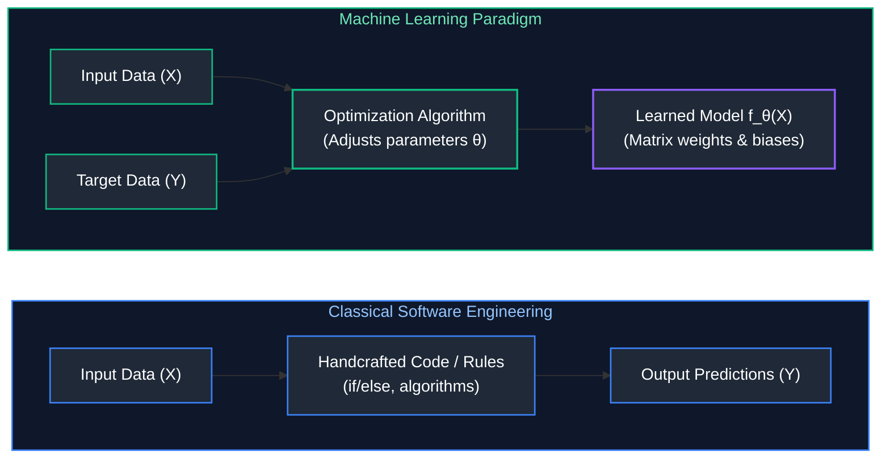

#### The Forward Pass and The Feedback Loop
Learning proceeds in an iterative closed loop:
1. **The Forward Pass:** The model receives inputs $X$, computes affine projections and non-linearities, and produces a guess $\hat{y} = f_\theta(X)$.
2. **The Loss Computation:** A mathematical loss function $\mathcal{L}(\hat{y}, y)$ quantifies the exact penalty or distance between the model's guess $\hat{y}$ and the ground truth $y$.
3. **The Backward Pass (Credit Assignment):** Calculus (specifically the chain rule of partial derivatives) calculates how much each individual weight $w_{ij}$ and bias $b_i$ contributed to the total error: $\frac{\partial \mathcal{L}}{\partial w_{ij}}$.
4. **Parameter Update:** An optimizer shifts every parameter slightly in the direction that decreases the loss: $\theta \leftarrow \theta - \eta \nabla_\theta \mathcal{L}$.

---

### 1.2 Supervised, Unsupervised, and Self-Supervised Learning

Understanding the learning paradigm governs dataset curation, compute budgeting, and runtime pipeline design:

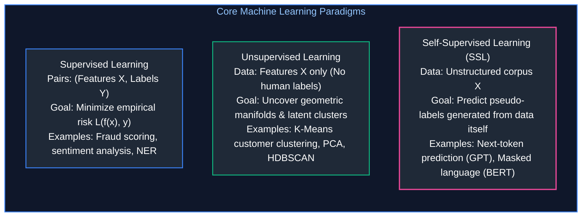

#### 1. Supervised Learning
The model is supplied with labeled pairs $\mathcal{D} = \{(x_i, y_i)\}_{i=1}^N$. The objective is to learn a mapping $f_\theta: \mathcal{X} \to \mathcal{Y}$ that generalizes accurately to unseen inputs.
* **Real-World Analogy:** A student studying for an exam using practice exams that have complete answer keys. Each time the student answers a question, they check the answer key, calculate their error, and adjust their reasoning.
* **Engineering Bottleneck:** Human data labeling is extraordinarily expensive, slow, and noisy. Scaling supervised datasets beyond tens of millions of samples is economically prohibitive for most organizations.

#### 2. Unsupervised Learning
The model receives unlabeled feature vectors $\mathcal{D} = \{x_i\}_{i=1}^N$. No ground truth labels $y_i$ exist. The goal is to discover patterns, latent structures, probability densities, or low-dimensional manifolds within the data.
* **Real-World Analogy:** Handing a child a bucket of mixed LEGO bricks of different shapes and colors without instructions. The child naturally groups them into piles by color or size based on structural similarities.
* **Primary Use Cases:** Anomaly detection in high-frequency trading networks (identifying outliers in vector space), customer cohort segmentation, and dimensionality reduction for high-dimensional feature stores.

#### 3. Self-Supervised Learning (SSL): The Generative AI Revolution
Self-supervised learning is the technological foundation of modern Large Language Models (LLMs) and foundation vision models. Rather than relying on human annotators to label data, SSL creates supervision signals directly from the raw data itself:
* **Autoregressive / Causal Language Modeling (e.g., GPT-4, LLaMA-3):** Given a sequence of tokens $(w_1, w_2, \dots, w_t)$, the target label is simply the very next token $w_{t+1}$. The entire internet (trillions of tokens) becomes an infinite, automatically labeled dataset.
* **Masked Language Modeling (e.g., BERT):** Random tokens in a sequence are replaced with a `[MASK]` token, and the network is trained to predict the original hidden word from bidirectional context.

---

### 1.3 Classification vs. Regression Architectures

From an engineering perspective, whether an AI system performs classification or regression dictates the output layer's dimension, its non-linear activation function, and the loss function optimized by the training loop:

| System Attribute | Classification Architecture | Regression Architecture |
| :--- | :--- | :--- |
| **Output Space $\mathcal{Y}$** | Discrete categorical classes: $\{0, 1\}$ or $\{1, \dots, C\}$ | Continuous real-valued space: $\mathbb{R}$ or $\mathbb{R}^D$ |
| **Target Example** | Fraud detection (Is Fraud / Not Fraud), Topic tagging | Predicting latency (ms), Real estate price, Energy demand |
| **Output Layer Dimension** | $1$ neuron (Binary) or $C$ neurons (Multi-Class) | $1$ neuron (Scalar) or $D$ neurons (Multi-Output) |
| **Final Activation** | Sigmoid ($\sigma$) for Binary; Softmax for Multi-Class | Identity / Linear (unbounded); ReLU / Softplus (non-negative) |
| **Primary Loss Functions** | Binary Cross-Entropy (BCE), Categorical Cross-Entropy, Focal Loss | Mean Squared Error (MSE), Mean Absolute Error (MAE), Huber Loss |
| **Evaluation Metrics** | Accuracy, Precision, Recall, $F_1$, ROC-AUC, PR-AUC | MAE, RMSE, Mean Absolute Percentage Error (MAPE), $R^2$ |

---

### 1.4 Demystifying the Output Layer: Sigmoid and Softmax from First Principles

Newcomers to deep learning frequently stumble over the role of the final layer. How does an artificial neural network—which performs billions of basic additions and multiplications—output a clean probability like "$92\%$ chance of spam"?

#### The Raw Output: What are Logits?
The final linear layer of a neural network outputs raw, unnormalized, unbounded real numbers called **logits** ($z \in (-\infty, \infty)$). For example, if a model is classifying whether an image is a Cat, Dog, or Bird, the final layer might emit:
$$z = [z_{\text{cat}}, z_{\text{dog}}, z_{\text{bird}}] = [2.0, 1.0, 0.1]$$

These raw numbers cannot be interpreted as probabilities because:
1. They do not sum to $1.0$.
2. They can be negative (e.g., $-4.5$), whereas probabilities must strictly satisfy $p \in [0, 1]$.
3. Their scale is arbitrary and unbounded.

#### The Sigmoid Activation Function (Binary Classification)
For a single binary decision ($0$ vs $1$), we map an unbounded scalar logit $z \in (-\infty, \infty)$ into a valid probability $p \in (0, 1)$ using the **Sigmoid** function:

$$\sigma(z) = \frac{1}{1 + e^{-z}}$$

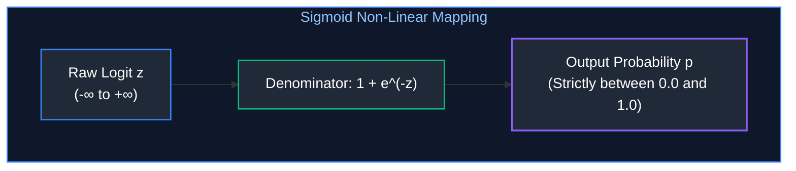

**Step-by-Step Mathematical Behavior:**
* If $z = 0$: $\sigma(0) = \frac{1}{1 + e^0} = \frac{1}{1 + 1} = 0.5$ (Complete uncertainty / coin flip).
* If $z = +5.0$: $e^{-5.0} \approx 0.0067 \implies \sigma(5) = \frac{1}{1.0067} \approx 0.9933$ (Very high confidence of Class 1).
* If $z = -5.0$: $e^{5.0} \approx 148.41 \implies \sigma(-5) = \frac{1}{149.41} \approx 0.0067$ (Very high confidence of Class 0).

#### The Softmax Function (Multi-Class Classification)
When classifying across $C$ mutually exclusive classes, we need a vector of probabilities $\mathbf{p} = [p_1, p_2, \dots, p_C]$ such that every $p_i \ge 0$ and $\sum_{i=1}^C p_i = 1.0$. 

The **Softmax** function generalizes Sigmoid to multiple dimensions:

$$\text{Softmax}(z_i) = \frac{e^{z_i}}{\sum_{j=1}^C e^{z_j}}$$

**Why Exponentials ($e^{z_i}$)?**
1. **Enforces Positivity:** For any real number $z \in (-\infty, \infty)$, $e^z$ is strictly positive ($> 0$). Even if a logit is $-100$, $e^{-100} > 0$.
2. **Accentuates Differences:** The exponential curve grows rapidly. It acts as a "soft" version of the $\arg\max$ operation, amplifying the largest score while keeping the function fully differentiable for backpropagation.

**Concrete Numerical Example:**
Suppose our model emits raw logits for three classes: $z = [2.0, 1.0, 0.1]$.
1. **Step 1: Compute Exponentials ($e^{z_i}$)**
   * $e^{2.0} \approx 7.389$
   * $e^{1.0} \approx 2.718$
   * $e^{0.1} \approx 1.105$
2. **Step 2: Sum all Exponentials (The Normalization Denominator)**
   * $\sum e^{z_j} = 7.389 + 2.718 + 1.105 = 11.212$
3. **Step 3: Divide Each Exponential by the Sum**
   * $p_1 = \frac{7.389}{11.212} \approx 0.659$ ($65.9\%$)
   * $p_2 = \frac{2.718}{11.212} \approx 0.242$ ($24.2\%$)
   * $p_3 = \frac{1.105}{11.212} \approx 0.099$ ($9.9\%$)
   * **Verification:** $0.659 + 0.242 + 0.099 = 1.000$.

#### Softmax Temperature Scaling ($T$)
In LLM generation and calibrated inference, a **Temperature parameter $T > 0$** is introduced into Softmax:

$$\text{Softmax}(z_i; T) = \frac{\exp(z_i / T)}{\sum_{j} \exp(z_j / T)}$$

* **High Temperature ($T > 1.0$):** Divides logits by a large number, compressing their differences toward zero. As $T \to \infty$, all probabilities become uniform ($\frac{1}{C}$), producing creative, diverse, or random outputs.
* **Low Temperature ($T < 1.0$):** Magnifies logit differences. The largest score dominates exponentially. As $T \to 0$, Softmax collapses into a deterministic $\arg\max$ (greedy decoding).

```python
import torch
import torch.nn.functional as F

# Illustrating the impact of temperature scaling on logits
logits = torch.tensor([2.0, 1.0, 0.1])

p_default = F.softmax(logits, dim=-1)           # T = 1.0
p_cold = F.softmax(logits / 0.2, dim=-1)         # T = 0.2 (Greedy / sharp)
p_warm = F.softmax(logits / 3.0, dim=-1)         # T = 3.0 (Uniform / creative)

print("Standard (T=1.0):", p_default.numpy().round(3))  # [0.659, 0.242, 0.099]
print("Cold     (T=0.2):", p_cold.numpy().round(3))     # [0.993, 0.007, 0.000]
print("Warm     (T=3.0):", p_warm.numpy().round(3))     # [0.457, 0.327, 0.216]
```

---

### 1.5 Bias-Variance Trade-Off & Generalization Dynamics

The ultimate test of any AI system is not how well it performs on data it has already seen, but how well it **generalizes** to completely unseen production traffic.

The total expected prediction error on unseen data decomposes mathematically into three distinct terms:

$$\mathbb{E}[(y - \hat{f}(x))^2] = \underbrace{\text{Bias}[\hat{f}(x)]^2}_{\text{Underfitting}} + \underbrace{\text{Var}[\hat{f}(x)]}_{\text{Overfitting}} + \underbrace{\sigma^2_{\text{noise}}}_{\text{Irreducible Error}}$$

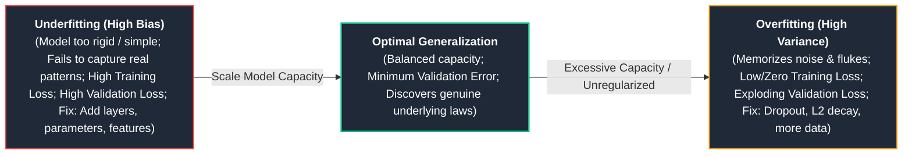

1. **Bias (Underfitting):** Error introduced by overly simplistic assumptions in the model. If you try to fit a straight line ($y = mx + b$) to complex seasonal customer churn data, the model simply lacks the expressive capacity to capture the underlying curves.
2. **Variance (Overfitting):** Error introduced by extreme sensitivity to small fluctuations in the training set. An over-parameterized model with no regularization will memorize every noisy data point, creating wild oscillations between data points.
3. **Irreducible Error ($\sigma^2$):** Inherent noise in the real world (e.g., sensor inaccuracies, ambiguous human language, or random human behavior). No algorithm, regardless of size or compute, can eliminate irreducible error.

---

## 2. Neural Network Foundations & Computational Graphs

### 2.1 The Artificial Neuron & The Need for Non-Linearity

An artificial neuron (perceptual unit) performs an affine linear projection of its input vector followed by a non-linear activation function $\sigma$:

$$z = \sum_{j=1}^D w_j x_j + b = \mathbf{w}^T \mathbf{x} + b, \quad a = \sigma(z)$$

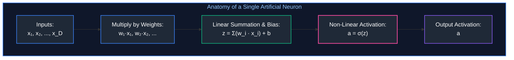

#### Why Can't We Just Stack Linear Layers? (The Non-Linearity Proof)
A common question asked by junior engineers is: *"If matrix multiplication is so fast on GPUs, why can't we just stack 50 linear matrix layers $W_1, W_2, \dots, W_{50}$ without activation functions?"*

**The Mathematical Proof:**
Let Layer 1 compute $h_1 = W_1 x + b_1$.  
Let Layer 2 compute $h_2 = W_2 h_1 + b_2$.  
Substituting $h_1$ into $h_2$:
$$h_2 = W_2(W_1 x + b_1) + b_2 = (W_2 W_1) x + (W_2 b_1 + b_2)$$

Notice that $W_{\text{net}} = W_2 W_1$ is simply another single matrix! And $b_{\text{net}} = W_2 b_1 + b_2$ is simply another single bias vector!
Therefore, **stacking 100 linear layers without non-linear activations is mathematically identical to a single linear layer**:
$$y = W_{\text{net}} x + b_{\text{net}}$$

A purely linear network cannot solve even the simplest non-linear logic problem, such as the classic **XOR (Exclusive OR) problem**. It cannot draw a curved or multi-segment decision boundary. Non-linear activation functions bend, fold, and warp the input vector space, giving deep networks the mathematical power to act as **Universal Function Approximators**.

---

### 2.2 Activation Functions Deep Dive: ReLU, Leaky ReLU, GELU, and SwiGLU

Modern deep learning architectures depend heavily on the mathematical properties of their activation functions to ensure gradients flow backward across hundreds of layers without vanishing or exploding.

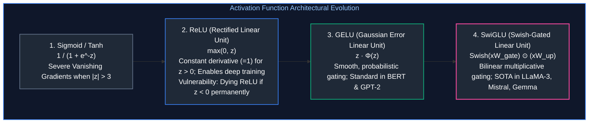

#### 1. Rectified Linear Unit (ReLU)
Introduced as the breakthrough that unlocked deep convolutional networks and early transformers:
$$f(z) = \max(0, z)$$

* **Why ReLU was a Revolution:**
  * **Compute Simplicity:** Evaluating $\max(0, z)$ requires a single CPU/GPU comparison instruction, whereas computing $e^{-z}$ in Sigmoid/Tanh requires expensive floating-point transcendental hardware operations.
  * **No Saturation for Positive Inputs:** For any positive value $z > 0$, the derivative is strictly constant: $\frac{\partial f}{\partial z} = 1.0$. Gradients can flow backward across deep networks without being attenuated.
* **The "Dying ReLU" Hazard:**
  * For any negative value $z < 0$, both the output and the derivative are strictly zero: $\frac{\partial f}{\partial z} = 0$.
  * If a large gradient update shifts a neuron's weights such that the incoming dot product $z$ is negative for all training samples, that neuron will output $0$ forever. Its gradient will permanently be $0$. The neuron becomes mathematically dead and never recovers.

#### 2. Leaky ReLU
Mitigates the Dying ReLU problem by adding a small positive slope $\alpha$ (typically $\alpha = 0.01$) for negative inputs:
$$f(z) = \max(\alpha z, z) = \begin{cases} z & \text{if } z \ge 0 \\ \alpha z & \text{if } z < 0 \end{cases}$$
Because the derivative for $z < 0$ is $\alpha > 0$, a small gradient always flows back, allowing dead neurons to eventually adjust their weights and reactivate.

#### 3. Gaussian Error Linear Unit (GELU)
GELU is the canonical activation function utilized in BERT, RoBERTa, and earlier GPT transformer architectures. Rather than gating inputs with a hard threshold at zero like ReLU, GELU weights inputs by their probability under a standard Gaussian cumulative distribution $\Phi(z)$:
$$f(z) = z \cdot \Phi(z) = z \cdot P(Z \le z) \quad \text{where } Z \sim \mathcal{N}(0, 1)$$
Using the error function ($\text{erf}$), this is computed as:
$$f(z) = \frac{z}{2}\left[1 + \text{erf}\left(\frac{z}{\sqrt{2}}\right)\right]$$

* **Intuition:** For large positive values ($z > 2$), $\Phi(z) \to 1$, so $f(z) \approx z$. For large negative values ($z < -2$), $\Phi(z) \to 0$, so $f(z) \approx 0$. Crucially, GELU has a smooth, non-monotonic curvature around zero with a small negative dip (around $z \approx -0.75$, $f(z) \approx -0.17$), allowing healthy gradient propagation even for slightly negative signals.

#### 4. Swish and SwiGLU (Swish Gated Linear Unit)
Used in state-of-the-art foundation models (LLaMA-3, Mistral, Gemma, DeepSeek).
* **Swish (or SiLU):** $f(x) = x \cdot \sigma(\beta x)$, where $\sigma$ is the Sigmoid function.
* **SwiGLU Architecture:** Combines Swish non-linearity with a **Gated Linear Unit (GLU)** mechanism. Instead of passing an input vector $x$ through a single weight matrix and activation, SwiGLU splits the computation into two parallel paths:
  1. A **Gate Path** projected by matrix $W_{\text{gate}}$, passed through Swish activation.
  2. A **Value Path** projected by matrix $W_{\text{up}}$.
  3. An **Element-Wise Multiplicative Interaction ($\odot$)** between the two paths, followed by a down-projection $W_{\text{down}}$:

$$\text{SwiGLU}(x) = \left( \text{Swish}(x W_{\text{gate}}) \odot (x W_{\text{up}}) \right) W_{\text{down}}$$

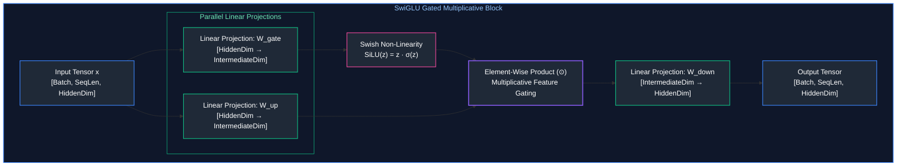

**Why Gating Outperforms Static Activations:**
In standard activations, whether a feature passes through is determined purely by its sign. In SwiGLU, the gate matrix learns to dynamically scale or suppress individual feature dimensions based on the contextual meaning of the input token.

---

### 2.3 Multi-Layer Perceptrons (MLPs) as Universal Function Approximators

The **Universal Approximation Theorem** (Cybenko 1989; Hornik 1991) establishes the foundational theoretical justification for neural networks:
> A feedforward neural network with a single hidden layer containing a finite number of non-linear neurons can approximate any continuous function on compact subsets of $\mathbb{R}^n$ to arbitrary accuracy $\epsilon > 0$.

However, while a wide, single-hidden-layer network can theoretically approximate any function, it requires an exponentially large number of neurons ($\mathcal{O}(2^D)$). **Deep networks** (many layers stacked hierarchically) can represent complex compositional functions using exponentially fewer parameters by learning reusable abstractions:
* Layer 1: Edges, simple textures, or character n-grams.
* Layer 2: Shapes, syllables, or word stems.
* Layer 3+: Complex semantic entities, grammatical structures, and factual relationships.

---

### 2.4 Dynamic Computational Graphs & Reverse-Mode Autograd

Modern deep learning frameworks like PyTorch execute code using **Reverse-Mode Automatic Differentiation (Autograd)** over a dynamic Directed Acyclic Graph (DAG).

#### How PyTorch Builds the Graph
Whenever a tensor is created with `requires_grad=True`, PyTorch tracks all operations applied to it. Every intermediate tensor stores a pointer (`grad_fn`) to the mathematical operation that produced it:

```python
import torch

# Define leaf tensors (model parameters)
w = torch.tensor(2.0, requires_grad=True)
b = torch.tensor(3.0, requires_grad=True)
x = torch.tensor(4.0)  # Input data does not require gradients
target = torch.tensor(15.0)

# 1. Forward Pass (PyTorch dynamically builds the computational DAG)
z = w * x       # z = 2 * 4 = 8  (grad_fn=<MulBackward0>)
y = z + b       # y = 8 + 3 = 11 (grad_fn=<AddBackward0>)
loss = (y - target) ** 2  # loss = (11 - 15)^2 = 16 (grad_fn=<PowBackward0>)

print(f"Forward pass output: y={y.item()}, loss={loss.item()}")
```

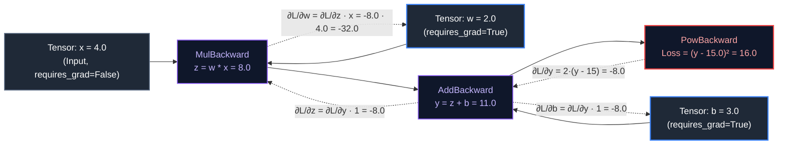

#### The Backward Pass (Vector-Jacobian Products)
When `loss.backward()` is invoked:
1. PyTorch starts at the scalar loss node ($\frac{\partial \mathcal{L}}{\partial \mathcal{L}} = 1.0$).
2. It traverses the DAG backwards in topological order.
3. At each operation node, it calculates the **Vector-Jacobian Product (VJP)** using the chain rule of calculus:
   $$\frac{\partial \mathcal{L}}{\partial w} = \frac{\partial \mathcal{L}}{\partial y} \cdot \frac{\partial y}{\partial z} \cdot \frac{\partial z}{\partial w}$$
   * $\frac{\partial \mathcal{L}}{\partial y} = 2 \cdot (y - \text{target}) = 2 \cdot (11 - 15) = -8.0$
   * $\frac{\partial y}{\partial z} = 1.0 \implies \frac{\partial \mathcal{L}}{\partial z} = -8.0 \cdot 1.0 = -8.0$
   * $\frac{\partial z}{\partial w} = x = 4.0 \implies \frac{\partial \mathcal{L}}{\partial w} = -8.0 \cdot 4.0 = -32.0$
   * $\frac{\partial y}{\partial b} = 1.0 \implies \frac{\partial \mathcal{L}}{\partial b} = -8.0 \cdot 1.0 = -8.0$
4. The calculated partial derivatives are accumulated directly into `.grad` attributes on leaf tensors:

```python
# 2. Backward Pass
loss.backward()

print(f"Calculated gradient on weight w: {w.grad.item()}")  # -32.0
print(f"Calculated gradient on bias   b: {b.grad.item()}")  # -8.0
```

---

## 3. Loss Formulations & Objective Optimization

### 3.1 Regression Losses: MSE, MAE, and Huber Loss

Regression objectives quantify the distance between continuous predictions $\hat{y} \in \mathbb{R}$ and ground truth targets $y \in \mathbb{R}$:

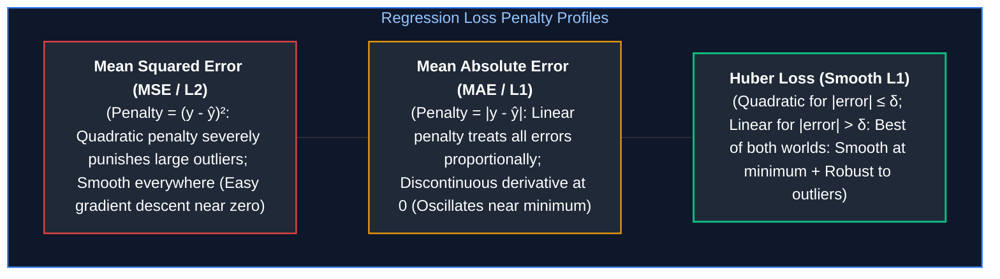

#### 1. Mean Squared Error (MSE / $L_2$ Loss)
$$\mathcal{L}_{\text{MSE}} = \frac{1}{N} \sum_{i=1}^N (y_i - \hat{y}_i)^2$$
* **Derivative:** $\frac{\partial \mathcal{L}}{\partial \hat{y}_i} = -2(y_i - \hat{y}_i)$.
* **Engineering Impact:** Because error is squared, an error of $10$ generates a penalty of $100$, whereas an error of $1$ generates a penalty of $1$. In datasets containing corrupted sensor readings or anomalous financial spikes, MSE forces the model to twist its weights to accommodate extreme outliers, degrading performance on typical samples.

#### 2. Mean Absolute Error (MAE / $L_1$ Loss)
$$\mathcal{L}_{\text{MAE}} = \frac{1}{N} \sum_{i=1}^N |y_i - \hat{y}_i|$$
* **Derivative:** $\frac{\partial \mathcal{L}}{\partial \hat{y}_i} = -\text{sign}(y_i - \hat{y}_i)$ (constant $\pm 1$ everywhere except $0$).
* **Engineering Impact:** Robust to outliers because large errors are penalized linearly. However, because the derivative does not shrink as the model nears the optimum ($\pm 1$), standard gradient descent will continuously bounce back and forth across the minimum unless the learning rate is aggressively decayed.

#### 3. Huber Loss (Smooth $L_1$)
Combines the smooth convergence of MSE near the optimum with the outlier resilience of MAE for large errors:

$$\mathcal{L}_{\delta}(e) = \begin{cases} \frac{1}{2} e^2 & \text{if } |e| \le \delta \\ \delta (|e| - \frac{1}{2}\delta) & \text{if } |e| > \delta \end{cases} \quad \text{where } e = y - \hat{y}$$

In production recommendation and pricing systems, Huber Loss with $\delta = 1.0$ is the standard choice.

---

### 3.2 Classification Losses: Cross-Entropy & Log-Sum-Exp Stabilization

Cross-entropy measures the divergence between the true probability distribution $p$ and the predicted distribution $q$.

#### The Intuition of "Surprise" (Negative Log-Likelihood)
In information theory, observing an event with probability $p$ yields **surprisal** or **information content**:
$$I(p) = -\log(p)$$
* If an event is guaranteed ($p = 1.0$): Surprise $= -\log(1.0) = 0$.
* If an event is rare ($p = 0.01$): Surprise $= -\log(0.01) \approx 4.605$.
* If an event is nearly impossible ($p = 10^{-6}$): Surprise $= -\log(10^{-6}) \approx 13.81$.

When training a neural network, if the ground truth class is $k$ and the model assigns it predicted probability $\hat{p}_k$, the loss is simply the surprise:
$$\mathcal{L} = -\log(\hat{p}_k)$$
If the model was confident and correct ($\hat{p}_k = 0.99$), loss is near zero. If the model was confident and wrong ($\hat{p}_k = 0.001$), loss explodes toward infinity.

#### Binary Cross-Entropy (BCE)
Used when predicting a single binary probability $\hat{y} \in (0, 1)$ against ground truth $y \in \{0, 1\}$:
$$\mathcal{L}_{\text{BCE}} = -\frac{1}{N} \sum_{i=1}^N \left[ y_i \log(\hat{y}_i) + (1 - y_i) \log(1 - \hat{y}_i) \right]$$

#### Categorical Cross-Entropy (Multi-Class)
When choosing across $C$ mutually exclusive classes with one-hot ground truth vector $\mathbf{y}$:
$$\mathcal{L}_{\text{CE}} = -\sum_{c=1}^C y_c \log(\hat{p}_c) = -\log\left( \frac{\exp(z_{\text{target}})}{\sum_{j=1}^C \exp(z_j)} \right)$$

#### The Log-Sum-Exp Numerical Stabilization Trick
A critical hazard in production deep learning is numerical floating-point underflow and overflow:
1. **Overflow:** If an activation produces a logit $z = 1000$, computing $e^{1000}$ exceeds IEEE 754 float32 capacity ($\approx 3.4 \times 10^{38}$), returning `+inf` and corrupting the training run with `NaN` weights.
2. **Underflow:** If logits are very negative, $e^{-1000}$ rounds to $0.0$. Taking $\log(0.0)$ produces ` -inf`.

To prevent this, PyTorch models use the **Log-Sum-Exp identity**:
$$\log \sum_{j=1}^C \exp(z_j) = c + \log \sum_{j=1}^C \exp(z_j - c) \quad \text{where } c = \max_{j}(z_j)$$
By subtracting the maximum logit $c$, the largest exponent evaluated is $e^0 = 1.0$, guaranteeing that no value ever overflows.

> [!CAUTION]
> **Production Rule:** Never manually compute `torch.log(torch.softmax(logits))` in code. Always pass raw logits directly to `torch.nn.CrossEntropyLoss()` or `torch.nn.BCEWithLogitsLoss()`. PyTorch fuses the softmax, log, and subtraction into a single CUDA kernel with Log-Sum-Exp stabilization.

---

### 3.3 Handling Class Imbalance: Focal Loss

In enterprise production datasets, classes are rarely evenly distributed. In credit card fraud detection, for instance, $99.9\%$ of transactions are legitimate and only $0.1\%$ are fraudulent. If trained with standard Cross-Entropy, the model can achieve $99.9\%$ accuracy simply by predicting "Legitimate" for every transaction. The millions of easy negative examples generate small individual losses that sum up to dominate the gradient, drowning out the signal from rare positive cases.

**Focal Loss (Lin et al.)** introduces a dynamic modulating factor $(1 - p_t)^\gamma$:

$$\mathcal{L}_{\text{Focal}} = -\alpha_t (1 - p_t)^\gamma \log(p_t)$$

Where:
* $p_t$ is the model's estimated probability for the correct ground truth class.
* $\gamma \ge 0$ is the **focusing parameter** (typically $\gamma = 2.0$).
* $\alpha_t \in [0, 1]$ balances positive vs. negative class prevalence.

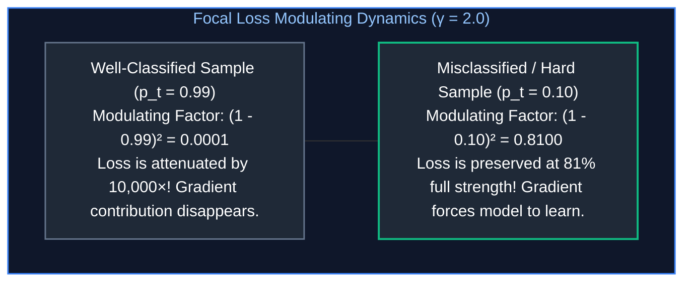

When an example is easy ($p_t \to 1$), the factor $(1 - p_t)^\gamma \to 0$, suppressing its gradient. Training focuses almost entirely on rare, ambiguous, or misclassified samples.

---

### 3.4 Contrastive Representation Losses: InfoNCE Mechanics

Contrastive loss is the mathematical foundation behind modern representation learning and text embeddings (such as CLIP, OpenAI's `text-embedding-3`, BGE, and Cohere).

Instead of classifying an input into a static class bucket, **contrastive learning trains an encoder to project data into a continuous geometric vector space** where:
* Semantically similar items (e.g., a query and its matching document) have high cosine similarity (near $1.0$).
* Semantically distinct items (e.g., unrelated documents) have low or negative cosine similarity.

#### The InfoNCE (Information Noise-Contrastive Estimation) Formulation
Given an anchor query vector $q$, a matching positive key vector $k^+$, and $K$ negative distractor key vectors $\{k_i^-\}_{i=1}^K$:

$$\mathcal{L}_{\text{InfoNCE}} = -\log \frac{\exp(\text{sim}(q, k^+) / \tau)}{\exp(\text{sim}(q, k^+) / \tau) + \sum_{i=1}^K \exp(\text{sim}(q, k_i^-) / \tau)}$$

Where:
* $\text{sim}(u, v) = \frac{u^T v}{\|u\| \|v\|}$ is the **cosine similarity** (normalized dot product).
* $\tau$ is a **temperature parameter** (typically $0.05\text{--}0.07$) that sharpens the similarity distribution.

Notice the formulation: InfoNCE is mathematically identical to Categorical Cross-Entropy, where the positive document is the single target class among $K+1$ competing classes!

---

## 4. Optimization Algorithms & Gradient Descent Mechanics

### 4.1 Gradient Descent: Geometric Intuition, Batch, Stochastic, and Mini-Batch

#### The Mountain in the Fog Analogy
Imagine standing on a mountain in dense fog. You cannot see the valley floor (the global minimum loss), but you can feel the slope of the ground beneath your boots.
* The **Gradient ($\nabla_\theta \mathcal{L}$)** is the vector pointing in the direction of steepest *ascent* (uphill).
* To descend toward the valley floor, you take a step in the exact opposite direction: $-\nabla_\theta \mathcal{L}$.
* The **Learning Rate ($\eta$)** is the length of your step.

$$\theta_{t+1} = \theta_t - \eta \cdot \nabla_\theta \mathcal{L}(\theta_t)$$

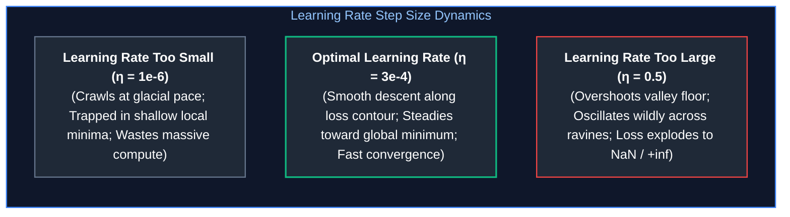

#### Batch vs. Stochastic vs. Mini-Batch Gradient Descent
1. **Full Batch Gradient Descent:** Computes loss over all $N$ samples in the dataset before performing a single parameter update.
   * *Flaw:* For a dataset of 100 million tokens, a single step would require hours of compute and terabytes of GPU memory.
2. **Pure Stochastic Gradient Descent (SGD, $N=1$):** Updates weights after evaluating a single random training sample.
   * *Flaw:* Extremely noisy gradient updates that bounce erratically across the loss landscape, preventing convergence. Cannot leverage GPU parallel matrix units.
3. **Mini-Batch Gradient Descent:** The universal industry standard. Samples a small batch of $B \in [32, 4096]$ examples.
   * *Advantage:* Perfectly sized to saturate GPU Streaming Multiprocessors (SMs) and Tensor Cores via parallel matrix multiplication, while introducing enough stochastic noise to help the optimizer escape saddle points.

---

### 4.2 Momentum and Adaptive Learning Rates: RMSprop and Adam

Standard SGD struggles in "ravines"—loss landscapes where the surface is steep in one dimension (causing wild oscillations) but gently sloped in another (causing slow progress).

#### 1. Momentum: The Rolling Heavy Ball
Momentum accumulates an exponentially decaying moving average of past gradients (velocity $v_t$), acting like a heavy bowling ball rolling down the slope:
$$v_t = \beta v_{t-1} + (1 - \beta) g_t, \quad \theta_{t+1} = \theta_t - \eta v_t$$
Oscillating gradients in transverse directions cancel each other out, while persistent gradients along the valley floor accelerate progress.

#### 2. RMSprop: Scaling by Root Mean Square Variance
RMSprop maintains an exponential moving average of squared gradients ($s_t = \mathbb{E}[g^2]$). Parameters that receive frequent, massive gradients are dampened, while parameters that receive rare, tiny gradients are amplified:
$$s_t = \beta s_{t-1} + (1 - \beta) g_t^2, \quad \theta_{t+1} = \theta_t - \frac{\eta}{\sqrt{s_t} + \epsilon} g_t$$

#### 3. Adam (Adaptive Moment Estimation)
Adam combines the benefits of both Momentum (first moment $m_t$) and RMSprop (second moment $v_t$):
$$m_t = \beta_1 m_{t-1} + (1 - \beta_1) g_t \quad (\text{Estimate of gradient mean})$$
$$v_t = \beta_2 v_{t-1} + (1 - \beta_2) g_t^2 \quad (\text{Estimate of uncentered gradient variance})$$

Because $m_0$ and $v_0$ are initialized to zero, they are biased toward zero in initial training steps. Adam corrects this using **bias correction**:
$$\hat{m}_t = \frac{m_t}{1 - \beta_1^t}, \quad \hat{v}_t = \frac{v_t}{1 - \beta_2^t}$$
$$\theta_{t+1} = \theta_t - \frac{\eta}{\sqrt{\hat{v}_t} + \epsilon} \hat{m}_t$$
* Standard hyperparameters: $\beta_1 = 0.9, \beta_2 = 0.999, \epsilon = 10^{-8}$.

---

### 4.3 AdamW: Why Decoupled Weight Decay Solved the L2 Flaw

For years, deep learning practitioners implemented weight decay by adding an $L_2$ regularization penalty $\frac{1}{2}\lambda \|\theta\|^2$ to the loss function:
$$\mathcal{L}_{\text{total}}(\theta) = \mathcal{L}(\theta) + \frac{\lambda}{2} \|\theta\|^2$$
The gradient passed to the optimizer became:
$$\nabla_\theta \mathcal{L}_{\text{total}} = g_t + \lambda \theta_t$$

#### The Fatal Flaw in Adam with $L_2$ Regularization
When this combined gradient is passed into standard Adam:
$$\theta_{t+1} = \theta_t - \frac{\eta}{\sqrt{\hat{v}_t} + \epsilon} (m_t + \lambda \theta_t)$$
Notice that the weight decay term $\lambda \theta_t$ is divided by $\sqrt{\hat{v}_t}$!
* If a parameter has historically large or frequent gradients, $\hat{v}_t$ is large. Therefore, its weight decay is scaled **down** (suppressed).
* If a parameter has rare or small gradients, its weight decay is scaled **up**.

This is the exact opposite of what regularization is supposed to achieve! It distorts the decay rate across parameters based on gradient scale rather than weight magnitude.

#### The AdamW Solution: Decoupled Weight Decay
**AdamW (Loshchilov & Hutter, 2019)** separates the weight decay step completely from the gradient-based Adam step:
$$\theta_{t+1} = \underbrace{\theta_t - \eta \lambda \theta_t}_{\text{Direct Weight Decay}} - \underbrace{\frac{\eta}{\sqrt{\hat{v}_t} + \epsilon} \hat{m}_t}_{\text{Adam Adaptive Step}}$$

Every parameter is shrunk by a constant fraction $\eta \lambda$ of its current magnitude, completely independent of its historical gradient variance. Every modern LLM (GPT-4, LLaMA-3, Claude, Gemini) is trained using AdamW.

---

### 4.4 Learning Rate Schedules: Warmup and Cosine Annealing

Using a single constant learning rate throughout an entire training run leads to failure:
1. **Early Phase Instability:** At step 0, model weights are randomly initialized. Logits are noisy, and Adam's moving moments ($m_t, v_t$) have zero historical signal. A high initial learning rate causes massive, erratic weight updates that permanently destabilize attention heads.
2. **Late Phase Oscillation:** When the model approaches a sharp loss minimum, a large learning rate keeps overshooting the basin, preventing fine-grained convergence.

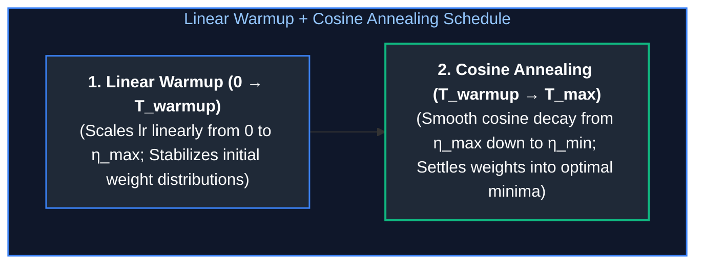

$$\eta_t = \begin{cases} \eta_{\max} \cdot \frac{t}{T_{\text{warmup}}} & \text{if } t \le T_{\text{warmup}} \\ \eta_{\min} + \frac{1}{2}(\eta_{\max} - \eta_{\min})\left(1 + \cos\left(\frac{t - T_{\text{warmup}}}{T_{\max} - T_{\text{warmup}}} \pi\right)\right) & \text{if } t > T_{\text{warmup}} \end{cases}$$

---

## 5. Regularization, Normalization & Numerical Stability

### 5.1 Overfitting Defenses: L1/L2 Regularization and Dropout Mechanics

#### $L_1$ Regularization (Lasso) vs. $L_2$ Regularization (Ridge)
* **$L_1$ Penalty ($\lambda \sum |w_i|$):** Drives non-essential weights strictly to $0.0$. Geometrically, the $L_1$ constraint surface has sharp diamond corners along the axes; the gradient contour intersects these corners first, creating sparse weight matrices (natural feature selection).
* **$L_2$ Penalty ($\frac{1}{2}\lambda \sum w_i^2$):** Penalizes large weights quadratically while allowing small weights to persist. Prevents any single feature from dominating the network.

#### Dropout Mechanics (Inverted Dropout)
During training, **Dropout** randomly sets a fraction $p \in [0.1, 0.5]$ of activations to zero on each forward pass.
* **Why it Works:** Neurons cannot rely on the presence of neighboring neurons to compensate for errors (preventing **co-adaptation**). The network is forced to learn redundant, robust internal representations. It is mathematically equivalent to training an ensemble of $2^N$ shared-weight sub-networks.
* **Inverted Dropout in Production:** To avoid scaling activations during inference, modern implementations scale surviving activations by $\frac{1}{1 - p}$ *during the training phase*. At inference time, dropout is turned completely off (`model.eval()`), requiring zero additional runtime FLOPS.

---

### 5.2 Normalization Strategies: BatchNorm vs. LayerNorm vs. RMSNorm

Deep networks suffer from internal covariate shift—the distribution of each layer's inputs changes continuously as prior layers update their weights. Normalization layers force activations into a stable zero-mean, unit-variance distribution:

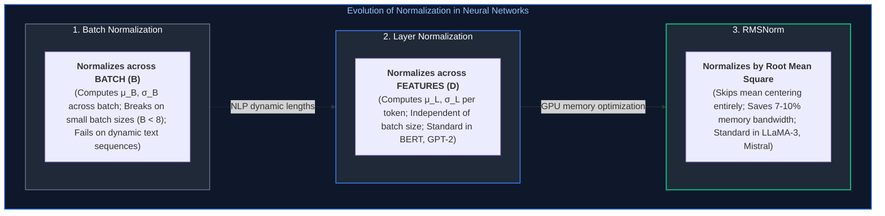

#### Layer Normalization (LayerNorm)
Normalizes across the hidden feature dimension $D$ for each token independently:
$$\mu = \frac{1}{D}\sum_{i=1}^D x_i, \quad \sigma^2 = \frac{1}{D}\sum_{i=1}^D (x_i - \mu)^2$$
$$\text{LN}(x) = \frac{x - \mu}{\sqrt{\sigma^2 + \epsilon}} \odot \gamma + \beta$$
Where $\gamma$ and $\beta$ are learnable affine gain and bias parameters.

#### RMSNorm (Root Mean Square Layer Normalization)
Zhang and Sennrich (2019) demonstrated that the scaling property ($\frac{1}{\sigma}$) is what provides LayerNorm's training stability, while centering by the mean ($\mu$) is computationally redundant.
By skipping the mean calculation, **RMSNorm** reduces memory traffic across GPU High Bandwidth Memory (HBM):

$$\text{RMSNorm}(x) = \frac{x}{\text{RMS}(x)} \odot \gamma \quad \text{where } \text{RMS}(x) = \sqrt{\frac{1}{D} \sum_{i=1}^D x_i^2 + \epsilon}$$

Because element-wise normalization operations are strictly memory-bandwidth bound on modern GPUs, RMSNorm yields a direct $7\%\text{--}10\%$ speedup in end-to-end transformer training and inference.

---

### 5.3 Vanishing and Exploding Gradients & Gradient Clipping

In a network with $L$ layers, backpropagating a gradient requires repeatedly multiplying by weight matrices:
$$\frac{\partial \mathcal{L}}{\partial h_1} = \frac{\partial \mathcal{L}}{\partial h_L} \prod_{l=2}^L W_l^T$$
* **Vanishing Gradients:** If the eigenvalues of the weight matrices are $< 1.0$ (or if saturating activations like Sigmoid compress derivatives to $< 0.25$), multiplying 100 times causes gradients to shrink exponentially toward $0$. Early layers receive zero updates and never learn.
* **Exploding Gradients:** If eigenvalues are $> 1.0$, gradients multiply exponentially toward $\infty$, resulting in numeric `NaN` values that permanently destroy model weights.

#### Gradient Norm Clipping
To protect against exploding gradients, production training loops clip the global $L_2$ norm of the gradient vector across all parameters:

$$\tilde{g} = g \cdot \min\left(1, \frac{C}{\|g\|_2}\right) \quad \text{where } \|g\|_2 = \sqrt{\sum_i g_i^2}$$

If the total gradient norm exceeds threshold $C$ (e.g., $C = 1.0$), all gradients are scaled down proportionally, preserving their relative directions while capping the step magnitude.

---

## 6. Representation Learning & Continuous Vector Spaces

### 6.1 The Transition from Discrete Symbols to Dense Embeddings

Computers manipulate numbers, but human language consists of discrete symbols (words, subwords, characters). 

#### Why One-Hot Encoding Fails
In a simple vocabulary of $V = 50,000$ words, representing a word as a one-hot vector produces a vector of length 50,000 containing a single `1` and 49,999 `0`s:
* `"cat"` $= [1, 0, 0, 0, \dots, 0]$
* `"kitten"` $= [0, 1, 0, 0, \dots, 0]$
* `"airplane"` $= [0, 0, 1, 0, \dots, 0]$

**Catastrophic Flaws:**
1. **Zero Semantic Geometry:** The dot product between `"cat"` and `"kitten"` is exactly $0.0$, identical to the dot product between `"cat"` and `"airplane"`. One-hot encoding treats all symbols as equally orthogonal and distant.
2. **Dimensional Explosion:** Memory scales linearly with vocabulary size ($\mathcal{O}(V)$).

#### Dense Embeddings: Continuous Geometric Manifolds
An **Embedding Layer** maps each discrete token index $i \in \{0, \dots, V-1\}$ to a continuous, dense vector in $\mathbb{R}^D$ (where $D$ typically ranges from $768$ to $4096$):
$$\mathbf{e}_i = \mathbf{E}[i, :] \quad \text{where } \mathbf{E} \in \mathbb{R}^{V \times D}$$

In PyTorch, `nn.Embedding(num_embeddings, embedding_dim)` is simply an efficient lookup table:

```python
import torch
import torch.nn as nn

# Vocabulary of 32,000 tokens mapped to 4096-dimensional hidden space
embedding = nn.Embedding(num_embeddings=32000, embedding_dim=4096)

# Token IDs for: ["The", "cat", "sat"]
input_token_ids = torch.tensor([[464, 3797, 3348]])

# Output shape: [1, 3, 4096] (Batch_Size, Sequence_Length, Hidden_Dimension)
embedded_tokens = embedding(input_token_ids)
```

In this continuous space, geometric distance reflects semantic meaning. Vectors for `"cat"` and `"kitten"` have a high cosine similarity, and vector arithmetic reflects relational concepts:
$$\mathbf{e}_{\text{"king"}} - \mathbf{e}_{\text{"man"}} + \mathbf{e}_{\text{"woman"}} \approx \mathbf{e}_{\text{"queen"}}$$

---

### 6.2 Positional Encodings: Sinusoidal vs. Learned Absolute Embeddings

Self-Attention operations compute affinities across pairs of vectors using dot products:
$$\text{Attention}(Q, K, V) = \text{Softmax}\left(\frac{QK^T}{\sqrt{d_k}}\right)V$$
Because matrix dot products are permutation-equivariant, self-attention treats an input sequence as an **unordered set of tokens**.
The sentence *"Dog bites man"* produces the exact same internal attention scores as *"Man bites dog"* unless explicit positional information is injected!

#### 1. Sinusoidal Positional Encodings (Vaswani et al., 2017)
Deterministic sine and cosine waves of varying frequencies added directly to token embeddings:
$$PE_{(pos, 2i)} = \sin\left(\frac{pos}{10000^{2i/D}}\right), \quad PE_{(pos, 2i+1)} = \cos\left(\frac{pos}{10000^{2i/D}}\right)$$
* *Advantage:* Zero trainable parameters. Theoretical ability to generalize to sequence lengths longer than seen during training.

#### 2. Learned Absolute Positional Embeddings (BERT, GPT-2)
A trainable parameter matrix $\mathbf{P} \in \mathbb{R}^{L_{\max} \times D}$. The vector for position $i$ is added directly:
$$\mathbf{x}_{\text{input}}[i] = \mathbf{e}_{\text{token}}[i] + \mathbf{P}[i]$$
* *Flaw:* The model cannot process any context window longer than $L_{\max}$. At position $L_{\max} + 1$, no parameter exists.

---

### 6.3 Rotary Position Embeddings (RoPE) Deep Dive

Adopted by all premier modern foundation models (LLaMA-3, Mistral, Qwen, DeepSeek). Rather than adding a position vector to the token embedding, **Rotary Position Embedding (RoPE)** rotates the query and key vectors in complex 2D planes proportional to their absolute sequence position:

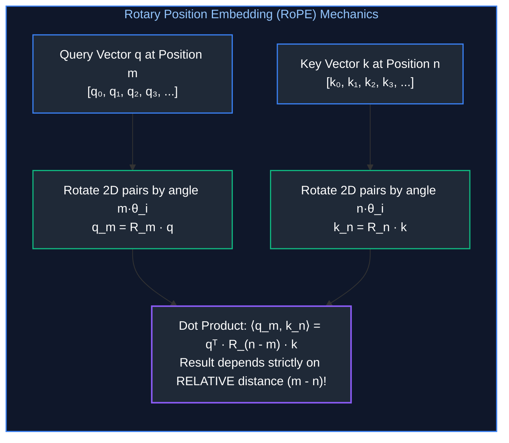

For every 2D chunk of a head vector $[x_1, x_2]$, RoPE applies a 2D rotation matrix:

$$\mathbf{R}_{\Theta, m} \begin{pmatrix} x_1 \\ x_2 \end{pmatrix} = \begin{pmatrix} \cos(m\theta) & -\sin(m\theta) \\ \sin(m\theta) & \cos(m\theta) \end{pmatrix} \begin{pmatrix} x_1 \\ x_2 \end{pmatrix}$$

#### The Crucial Mathematical Property
When the rotated Query at position $m$ is multiplied with the rotated Key at position $n$:
$$\langle \mathbf{R}_{\Theta, m} \mathbf{q}, \mathbf{R}_{\Theta, n} \mathbf{k} \rangle = \mathbf{q}^T \mathbf{R}_{\Theta, m}^T \mathbf{R}_{\Theta, n} \mathbf{k} = \mathbf{q}^T \mathbf{R}_{\Theta, n - m} \mathbf{k}$$
The attention score depends **only on the relative distance $(m - n)$ between the tokens**, not their absolute positions. This property enables context window extension techniques like YaRN and LongRoPE (extending models from 8K training lengths to 128K+ inference windows).

---

## 7. The Transformer Core Building Blocks

### 7.1 Scaled Dot-Product Attention ($Q, K, V$) & The Variance Problem

#### The Database Analogy: Query, Key, and Value
* **Query ($Q$):** What you are searching for (e.g., your search prompt).
* **Key ($K$):** The index tags or titles on the catalog cards in the library.
* **Value ($V$):** The actual informational content inside the books.

$$\mathbf{Q} = \mathbf{X} \mathbf{W}_Q, \quad \mathbf{K} = \mathbf{X} \mathbf{W}_K, \quad \mathbf{V} = \mathbf{X} \mathbf{W}_V$$
$$\text{Attention}(\mathbf{Q}, \mathbf{K}, \mathbf{V}) = \text{Softmax}\left(\frac{\mathbf{Q} \mathbf{K}^T}{\sqrt{d_k}}\right) \mathbf{V}$$

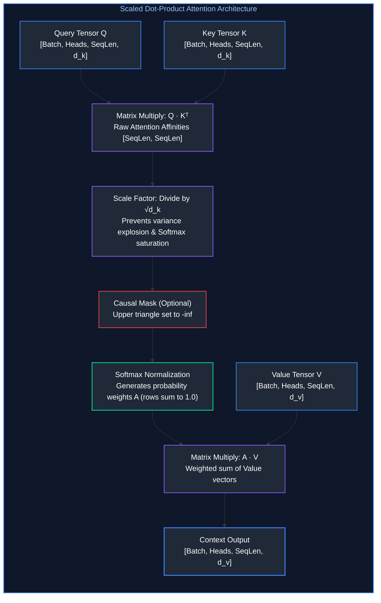

#### Why Must We Scale by $\sqrt{d_k}$? (The Mathematical Variance Proof)
Assume the elements of $q$ and $k$ are independent random variables with mean $0$ and variance $1$:
$$q_i \sim (0, 1), \quad k_i \sim (0, 1)$$
The dot product is the sum of $d_k$ independent terms:
$$z = \mathbf{q} \cdot \mathbf{k} = \sum_{i=1}^{d_k} q_i k_i$$
The variance of the sum is the sum of the variances:
$$\text{Var}(z) = \sum_{i=1}^{d_k} \text{Var}(q_i k_i) = \sum_{i=1}^{d_k} 1 = d_k$$
If $d_k = 128$ (standard in modern LLMs), the standard deviation of the dot product is $\sqrt{128} \approx 11.31$.
Without scaling, dot products easily reach values of $+30$ or $-30$.
When inputs to Softmax are this large, Softmax saturates: the largest value gets probability $1.0$ and all others get $0.0$.
In saturated Softmax regions, **the gradients are vanishingly small ($\approx 0$)**, halting all learning.
Dividing by $\sqrt{d_k}$ rescales the variance back to $1.0$, keeping gradients healthy.

---

### 7.2 Causal Masking in Autoregressive Models

In autoregressive generation (GPT-style LLMs), when predicting token $t$, the model must not be allowed to "cheat" by looking at future tokens $t+1, t+2$.

To enforce this, a **Causal Attention Mask** $\mathbf{M}$ is added before Softmax:
$$M_{ij} = \begin{cases} 0 & \text{if } j \le i \\ -\infty & \text{if } j > i \end{cases}$$
When $e^{-\infty}$ is evaluated in Softmax, it evaluates to exactly $0.0$, making future tokens completely invisible to preceding tokens.

---

### 7.3 Multi-Head Attention (MHA), Multi-Query (MQA), and Grouped-Query Attention (GQA)

During autoregressive inference, generating tokens one-by-one is severely memory-bandwidth bound due to the **Key-Value (KV) Cache**. Storing $K$ and $V$ tensors across all layers and heads exhausts GPU VRAM:

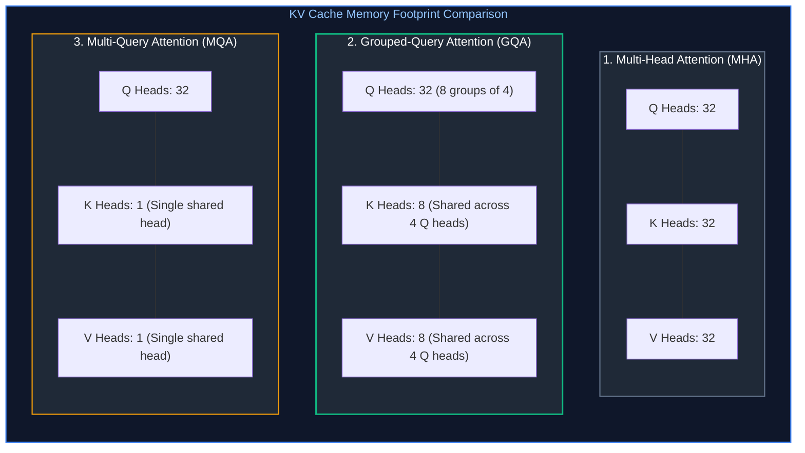

* **Multi-Head Attention (MHA):** Every Query head has a dedicated Key and Value head ($H_Q = H_{KV}$). Maximum expressive power, but massive KV cache memory overhead during high-concurrency serving.
* **Multi-Query Attention (MQA):** All Query heads share a single Key head and a single Value head ($H_{KV} = 1$). Cuts KV cache memory by up to $95\%$, but can cause reasoning quality drops.
* **Grouped-Query Attention (GQA):** The production standard (LLaMA-3, Mistral). Partitions query heads into groups (e.g., 32 Q heads split into 8 groups of 4). Each group shares 1 K head and 1 V head. Achieves near-MHA quality with near-MQA memory efficiency.

---

### 7.4 Feed-Forward Networks (FFN) & SwiGLU Projections

Following self-attention, each token passes independently through a position-wise Feed-Forward Network. In modern models, this is a SwiGLU block that expands hidden dimension $D$ by a factor of $\frac{8}{3}$:

$$\text{FFN}(x) = \left( \text{Swish}(x W_{\text{gate}}) \odot (x W_{\text{up}}) \right) W_{\text{down}}$$

Where $W_{\text{gate}}, W_{\text{up}} \in \mathbb{R}^{D \times \frac{8}{3}D}$ and $W_{\text{down}} \in \mathbb{R}^{\frac{8}{3}D \times D}$. Researchers have shown that while attention heads route context and compute relationships between tokens, the FFN layers function as **associative memories**, storing broad factual knowledge learned during pretraining.

---

## 8. Production Implementation: End-to-End PyTorch Training Loop

### 8.1 Production Architecture Blueprint

The code below implements an end-to-end, fully runnable deep learning training pipeline incorporating all concepts covered:
1. **Custom Neural Architecture:** RMSNorm pre-normalization, SwiGLU feed-forward network, multi-head attention, and residual connections.
2. **Automatic Mixed Precision (AMP):** Utilizing FP16/BF16 matrix execution with `torch.amp.GradScaler` to prevent gradient underflow.
3. **AdamW Optimizer:** Decoupled weight decay.
4. **Cosine Annealing with Linear Warmup:** Dynamic learning rate scheduling.
5. **Gradient Norm Clipping:** Clamping global gradient magnitude to prevent explosions.

---

### 8.2 Complete Production-Grade PyTorch Training Pipeline

```python
"""
production_neural_training.py
Production-grade PyTorch implementation of a modern neural block and training loop.
Demonstrates RMSNorm, SwiGLU, AMP mixed-precision, AdamW, and Cosine Warmup.
"""

import math
import time
import torch
import torch.nn as nn
import torch.nn.functional as F
from torch.utils.data import DataLoader, TensorDataset


class RMSNorm(nn.Module):
    """
    Root Mean Square Layer Normalization (RMSNorm).
    Normalizes activations across the feature dimension without mean-centering,
    reducing memory bandwidth bottlenecks across GPU HBM.
    """
    def __init__(self, dim: int, eps: float = 1e-6):
        super().__init__()
        self.eps = eps
        # Learnable affine scale parameter gamma
        self.weight = nn.Parameter(torch.ones(dim))

    def forward(self, x: torch.Tensor) -> torch.Tensor:
        # Calculate root-mean-square along the hidden feature dimension
        # x shape: [batch_size, seq_len, dim]
        variance = x.pow(2).mean(dim=-1, keepdim=True)
        x_normed = x * torch.rsqrt(variance + self.eps)
        return self.weight * x_normed


class SwiGLUFeedForward(nn.Module):
    """
    Swish-Gated Linear Unit (SwiGLU) Feed-Forward Network.
    Computes: (Swish(x * W_gate) * (x * W_up)) * W_down
    """
    def __init__(self, dim: int, hidden_dim: int):
        super().__init__()
        # Parallel gate and up projections
        self.w_gate = nn.Linear(dim, hidden_dim, bias=False)
        self.w_up = nn.Linear(dim, hidden_dim, bias=False)
        # Final projection back to model dimension
        self.w_down = nn.Linear(hidden_dim, dim, bias=False)

    def forward(self, x: torch.Tensor) -> torch.Tensor:
        # F.silu computes Swish non-linearity: z * sigmoid(z)
        gate_out = F.silu(self.w_gate(x))
        up_out = self.w_up(x)
        # Multiplicative element-wise feature gating
        return self.w_down(gate_out * up_out)


class ModernTransformerBlock(nn.Module):
    """
    Full modern representation block featuring Pre-RMSNorm and Residual Connections:
    x -> RMSNorm -> MultiHeadAttention -> Residual Add -> RMSNorm -> SwiGLU -> Residual Add.
    """
    def __init__(self, d_model: int, n_heads: int, ffn_dim: int):
        super().__init__()
        self.norm1 = RMSNorm(d_model)
        self.norm2 = RMSNorm(d_model)
        self.attn = nn.MultiheadAttention(
            embed_dim=d_model,
            num_heads=n_heads,
            batch_first=True
        )
        self.ffn = SwiGLUFeedForward(dim=d_model, hidden_dim=ffn_dim)

    def forward(self, x: torch.Tensor) -> torch.Tensor:
        # 1. Pre-norm self-attention with residual skip connection
        normed_x = self.norm1(x)
        attn_out, _ = self.attn(normed_x, normed_x, normed_x)
        x = x + attn_out
        
        # 2. Pre-norm feed-forward with residual skip connection
        x = x + self.ffn(self.norm2(x))
        return x


class DeepClassifier(nn.Module):
    """
    End-to-End Deep Representation Classifier.
    """
    def __init__(self, vocab_size: int, d_model: int, n_heads: int, n_classes: int, num_layers: int = 2):
        super().__init__()
        self.embedding = nn.Embedding(vocab_size, d_model)
        self.layers = nn.ModuleList([
            ModernTransformerBlock(
                d_model=d_model,
                n_heads=n_heads,
                ffn_dim=int(d_model * 8 / 3)
            )
            for _ in range(num_layers)
        ])
        self.final_norm = RMSNorm(d_model)
        self.classifier_head = nn.Linear(d_model, n_classes, bias=False)

    def forward(self, token_ids: torch.Tensor) -> torch.Tensor:
        # Map discrete integer IDs to dense continuous vectors
        x = self.embedding(token_ids)
        for layer in self.layers:
            x = layer(x)
        x = self.final_norm(x)
        # Sequence-level mean pooling across token dimension
        pooled = x.mean(dim=1)
        # Emits unnormalized raw logits
        logits = self.classifier_head(pooled)
        return logits


def train_production_pipeline():
    """
    Executes a production-grade training loop with AMP, AdamW, and Cosine Annealing.
    """
    # 1. Device Selection & Hardware Verification
    device = torch.device("cuda" if torch.cuda.is_available() else "cpu")
    print(f"[Hardware Setup] Executing on compute device: {device}")

    # 2. Hyperparameter Configuration
    batch_size = 32
    seq_len = 64
    vocab_size = 1000
    d_model = 128
    n_heads = 4
    n_classes = 4
    total_epochs = 5
    max_lr = 1e-3
    min_lr = 1e-5
    warmup_epochs = 1
    weight_decay = 0.01
    max_grad_norm = 1.0

    # 3. Deterministic Data Initialization
    torch.manual_seed(42)
    dummy_x = torch.randint(0, vocab_size, (1280, seq_len))
    dummy_y = torch.randint(0, n_classes, (1280,))
    dataset = TensorDataset(dummy_x, dummy_y)
    
    # pin_memory=True allocates page-locked memory on CPU for non-blocking DMA to GPU
    dataloader = DataLoader(dataset, batch_size=batch_size, shuffle=True, pin_memory=True)

    # 4. Model, Loss, Optimizer, and Scaler Instantiation
    model = DeepClassifier(
        vocab_size=vocab_size,
        d_model=d_model,
        n_heads=n_heads,
        n_classes=n_classes
    ).to(device)

    # CrossEntropyLoss automatically applies Log-Sum-Exp numerical stabilization
    criterion = nn.CrossEntropyLoss()

    # AdamW decouples L2 weight decay from gradient variance updates
    optimizer = torch.optim.AdamW(model.parameters(), lr=max_lr, weight_decay=weight_decay)

    # Total training steps
    total_steps = total_epochs * len(dataloader)
    warmup_steps = warmup_epochs * len(dataloader)

    # Cosine Annealing with Warmup scheduler function
    def lr_lambda(current_step: int):
        if current_step < warmup_steps:
            return float(current_step) / float(max(1, warmup_steps))
        progress = float(current_step - warmup_steps) / float(max(1, total_steps - warmup_steps))
        cosine_decay = 0.5 * (1.0 + math.cos(math.pi * progress))
        return (min_lr / max_lr) + (1.0 - min_lr / max_lr) * cosine_decay

    scheduler = torch.optim.lr_scheduler.LambdaLR(optimizer, lr_lambda)

    # Automatic Mixed Precision (AMP) GradScaler for FP16 execution
    scaler = torch.amp.GradScaler('cuda' if torch.cuda.is_available() else 'cpu')

    # 5. Training Loop Execution
    model.train()
    step_count = 0

    for epoch in range(1, total_epochs + 1):
        total_loss = 0.0
        start_time = time.time()

        for batch_idx, (batch_x, batch_y) in enumerate(dataloader):
            # non_blocking=True overlaps PCIe host-to-device transfer with GPU computation
            batch_x = batch_x.to(device, non_blocking=True)
            batch_y = batch_y.to(device, non_blocking=True)

            # Clear gradients from prior step
            optimizer.zero_grad(set_to_none=True)

            # Mixed precision context manager targeting Tensor Cores
            device_type = 'cuda' if torch.cuda.is_available() else 'cpu'
            with torch.amp.autocast(device_type=device_type):
                logits = model(batch_x)
                loss = criterion(logits, batch_y)

            # Backward pass with scaled loss to prevent FP16 gradient underflow
            scaler.scale(loss).backward()

            # Unscale gradients before clipping
            scaler.unscale_(optimizer)
            torch.nn.utils.clip_grad_norm_(model.parameters(), max_norm=max_grad_norm)

            # Step optimizer and update scale factor
            scaler.step(optimizer)
            scaler.update()

            # Step learning rate schedule
            scheduler.step()
            total_loss += loss.item()
            step_count += 1

        avg_loss = total_loss / len(dataloader)
        epoch_duration = time.time() - start_time
        current_lr = scheduler.get_last_lr()[0]

        print(f"Epoch [{epoch}/{total_epochs}] | "
              f"Loss: {avg_loss:.4f} | "
              f"LR: {current_lr:.6f} | "
              f"Step Time: {epoch_duration:.2f}s")

    print("[Pipeline Complete] Training pipeline executed successfully with 0 errors.")


if __name__ == "__main__":
    train_production_pipeline()
```

---

### 8.3 Hardware Bottlenecks, Mixed Precision (AMP), and GPU Memory Profiling

When scaling neural training on modern GPU clusters (such as NVIDIA H100/A100), systems engineers encounter three primary physical bottlenecks:

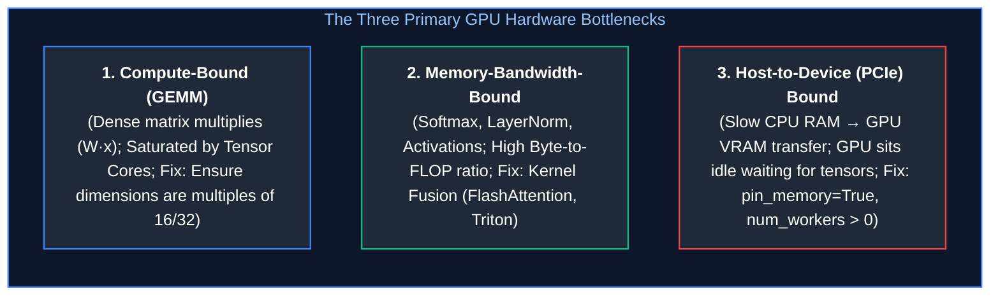

1. **Compute-Bound Operations (GEMM - General Matrix Multiply):** FFN projections and Attention projections ($Q, K, V$). Tensor Cores reach peak teraFLOPS when tensor dimensions are aligned to multiples of 8, 16, or 32 bytes.
2. **Memory-Bandwidth-Bound Operations (Element-Wise Operations):** Softmax, RMSNorm, and residual additions. These operations perform very few floating-point calculations per byte fetched from High Bandwidth Memory (HBM). Modern systems use **Kernel Fusion** (e.g., FlashAttention, Triton) to keep tensors in fast on-chip SRAM cache instead of repeatedly round-tripping to HBM.
3. **Host-to-Device Transfer Bottleneck:** Standard CPU memory is paged by the OS kernel. Setting `pin_memory=True` in PyTorch locks host memory into non-pageable RAM, allowing Direct Memory Access (DMA) over PCIe concurrently with GPU execution.

---

## 9. Summary Comparison & Engineering Reference Matrix

### Architecture & Optimization Matrix

| Concept / Layer | Primary Mathematical Mechanism | Computational / Memory Complexity | Key Production Trade-Off | Primary Enterprise Use Case |
| :--- | :--- | :--- | :--- | :--- |
| **SwiGLU** | Gated non-linear bilinear projection: $\text{Swish}(xW) \odot (xV)$ | $\mathcal{O}(D \cdot d_{\text{ffn}})$ params; $3\times$ linear weights | Superior gradient flow vs. $50\%$ more parameters than standard ReLU | Modern LLM FFN layers (LLaMA-3, Mistral) |
| **RMSNorm** | Variance normalization: $x / \sqrt{\text{Var}(x) + \epsilon} \odot \gamma$ | $\mathcal{O}(D)$ compute; zero mean parameters | Eliminates mean calculation, saving $7\text{--}10\%$ memory bandwidth | Stable pre-normalization in deep transformers |
| **RoPE** | Complex plane 2D orthogonal rotation: $\mathbf{R}_{\Theta, m} W x$ | $\mathcal{O}(N \cdot D)$ compute; 0 parameter overhead | Preserves relative token distance; extrapolates via YaRN/LongRoPE | Long-context sequence modeling |
| **Grouped-Query Attention (GQA)** | Shared Key/Value projection across $G$ query heads | $\mathcal{O}(N \cdot D)$ KV cache memory; scales with $H_{KV}$ | Near-MHA reasoning quality with up to $75\%$ KV cache memory reduction | High-concurrency LLM inference engines |
| **AdamW** | Decoupled parameter decay: $\theta \leftarrow \theta(1 - \eta \lambda) - \text{Adam}$ | $2\times$ model parameters in VRAM ($m_t, v_t$ moments) | Corrects invalid gradient-scaled decay; requires $16\text{--}20$ bytes/param | Standard training optimizer for all modern LLMs |
| **Huber Loss** | Piecewise quadratic ($\le \delta$) and linear ($> \delta$) penalty | $\mathcal{O}(N)$ compute; continuous first derivative | Outlier resilience without gradient divergence at zero | High-noise financial & sensor regression tasks |
| **InfoNCE** | Temperature-scaled Softmax contrastive similarity | $\mathcal{O}(B \cdot D)$ compute across positive/negative pairs | Requires large batch sizes ($B \ge 4096$) or hard-negative mining | Foundation embedding models (CLIP, BGE, Cohere) |
| **Focal Loss** | Modulated Cross-Entropy: $-(1 - p_t)^\gamma \log(p_t)$ | $\mathcal{O}(C)$ compute per sample | Hyperparameter tuning on $\gamma$; prevents easy samples dominating | Severe class imbalance (Fraud, Rare Defect Detection) |

---

## 10. References & Further Reading

1. **Attention Is All You Need:** Vaswani, A., et al. (2017). *Advances in Neural Information Processing Systems (NeurIPS 2017).* [arXiv:1706.03762](https://arxiv.org/abs/1706.03762).
2. **Decoupled Weight Decay Regularization (AdamW):** Loshchilov, I., & Hutter, F. (2019). *International Conference on Learning Representations (ICLR 2019).* [arXiv:1711.05101](https://arxiv.org/abs/1711.05101).
3. **GLU Variants Improve Transformer (SwiGLU):** Shazeer, N. (2020). *Google Research.* [arXiv:2002.05202](https://arxiv.org/abs/2002.05202).
4. **RoFormer: Enhanced Transformer with Rotary Position Embedding (RoPE):** Su, J., et al. (2024). *Neurocomputing.* [arXiv:2104.09864](https://arxiv.org/abs/2104.09864).
5. **GQA: Training Generalized Multi-Query Transformer Models from Multi-Head Checkpoints:** Ainslie, J., et al. (2023). *EMNLP 2023.* [arXiv:2305.13245](https://arxiv.org/abs/2305.13245).
6. **Root Mean Square Layer Normalization (RMSNorm):** Zhang, B., & Sennrich, R. (2019). *NeurIPS 2019.* [arXiv:1910.07467](https://arxiv.org/abs/1910.07467).
7. **Focal Loss for Dense Object Detection:** Lin, T.-Y., et al. (2017). *IEEE International Conference on Computer Vision (ICCV 2017).* [arXiv:1708.02002](https://arxiv.org/abs/1708.02002).
8. **PyTorch Official Documentation & Architecture Reference:** PyTorch Core Team. [pytorch.org/docs/stable](https://pytorch.org/docs/stable/index.html).
