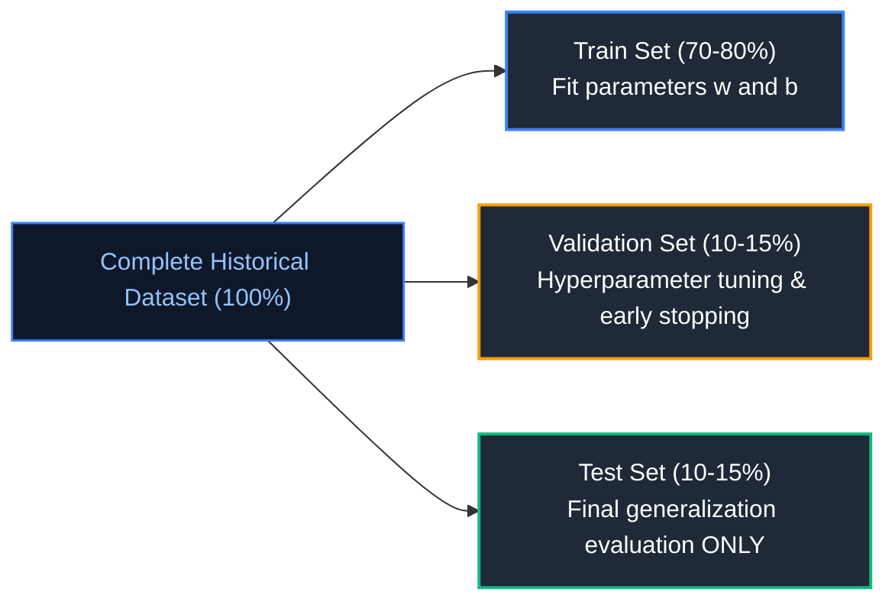
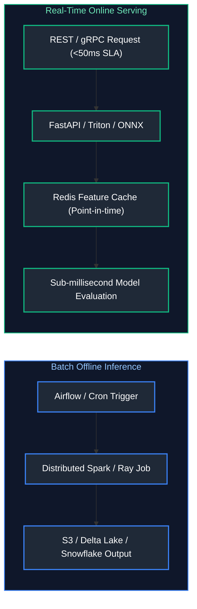

# 01. Machine Learning Fundamentals

A comprehensive, production-grade guide to statistical machine learning theory, core algorithms, bias-variance tradeoff, cross-validation protocols, feature engineering pipelines, evaluation metrics, and drift mechanics tailored for Machine Learning Engineers and AI Engineers.

---

## Architectural Overview: Machine Learning Lifecycle & Training Pipeline

```mermaid
flowchart TD
    subgraph DataIngestion ["1. Data Acquisition & Split"]
        RawData["Raw Feature Matrix X & Target y<br/>(Parquet / Database Tables)"]
        Split["Stratified / Temporal Split<br/>(Train 80% / Val 10% / Test 10%)"]
        RawData --> Split
    end

    subgraph FeatureEngineering ["2. Feature Pipeline (Fit on Train Only)"]
        Impute["Median / Mode Imputation<br/>(Zero data leakage)"]
        Encode["One-Hot & Target Encoding<br/>(High cardinality handling)"]
        Scale["Robust / Standard Scaler<br/>(Normalize feature variances)"]
        Impute --> Encode --> Scale
    end

    subgraph Modeling ["3. Model Fitting & Optimization"]
        Algo["Estimator: XGBoost / LightGBM<br/>(Objective function minimization)"]
        CV["K-Fold / Temporal Cross-Validation<br/>(Out-of-fold generalization)"]
        OptunaTune["Optuna Bayesian Tuning<br/>(Tree-structured Parzen Estimator)"]
        Algo --> CV --> OptunaTune
    end

    subgraph EvaluationGate ["4. Evaluation & Diagnostics"]
        Metrics["Validation Metrics<br/>(ROC-AUC, PR-AUC, F1-Score, Brier)"]
        DriftCheck["Baseline Feature Distribution<br/>(KS-Test & PSI references)"]
        Metrics --> DriftCheck
    end

    Split -->|"Training Set"| Impute
    Scale --> Algo
    OptunaTune --> Metrics

    style DataIngestion fill:#0f172a,stroke:#3b82f6,stroke-width:1.5px,color:#93c5fd
    style FeatureEngineering fill:#0f172a,stroke:#10b981,stroke-width:1.5px,color:#6ee7b7
    style Modeling fill:#0f172a,stroke:#f59e0b,stroke-width:1.5px,color:#fde68a
    style EvaluationGate fill:#0f172a,stroke:#8b5cf6,stroke-width:1.5px,color:#c084fc
    style RawData fill:#1f2937,stroke:#3b82f6,stroke-width:2px,color:#fff
    style Split fill:#1f2937,stroke:#3b82f6,stroke-width:2px,color:#fff
    style Impute fill:#1f2937,stroke:#10b981,stroke-width:2px,color:#fff
    style Encode fill:#1f2937,stroke:#10b981,stroke-width:2px,color:#fff
    style Scale fill:#1f2937,stroke:#10b981,stroke-width:2px,color:#fff
    style Algo fill:#1f2937,stroke:#f59e0b,stroke-width:2px,color:#fff
    style CV fill:#1f2937,stroke:#f59e0b,stroke-width:2px,color:#fff
    style OptunaTune fill:#1f2937,stroke:#f59e0b,stroke-width:2px,color:#fff
    style Metrics fill:#1f2937,stroke:#8b5cf6,stroke-width:2px,color:#fff
    style DriftCheck fill:#1f2937,stroke:#8b5cf6,stroke-width:2px,color:#fff
```



---

## Table of Contents
1. [Machine Learning Taxonomy: Supervised vs. Unsupervised](#1-machine-learning-taxonomy-supervised-vs-unsupervised)
   - [1.1 Mathematical Formulations](#11-mathematical-formulations)
   - [1.2 Algorithmic Paradigms](#12-algorithmic-paradigms)
2. [Classification vs. Regression Paradigms](#2-classification-vs-regression-paradigms)
   - [2.1 Classification Mechanics & Probability Calibration](#21-classification-mechanics-probability-calibration)
   - [2.2 Regression Objectives & Loss Landscapes](#22-regression-objectives-loss-landscapes)
3. [Dataset Partitioning, Overfitting, Underfitting & Regularization](#3-dataset-partitioning-overfitting-underfitting-regularization)
   - [3.1 Train, Validation, and Test Invariants](#31-train-validation-and-test-invariants)
   - [3.2 The Bias-Variance Tradeoff](#32-the-bias-variance-tradeoff)
   - [3.3 Mathematical Regularization: L1 (Lasso) vs. L2 (Ridge) vs. ElasticNet](#33-mathematical-regularization-l1-lasso-vs-l2-ridge-vs-elasticnet)
4. [Feature Engineering & Data Leakage Prevention](#4-feature-engineering-data-leakage-prevention)
   - [4.1 Leakage Vectors in Tabular & Temporal Pipelines](#41-leakage-vectors-in-tabular-temporal-pipelines)
   - [4.2 Scikit-Learn Pipelines & Transformers](#42-scikit-learn-pipelines-transformers)
5. [Evaluation Metrics: Precision, Recall, F1, ROC-AUC, PR-AUC](#5-evaluation-metrics-precision-recall-f1-roc-auc-pr-auc)
   - [5.1 Confusion Matrix & Threshold Dynamics](#51-confusion-matrix-threshold-dynamics)
   - [5.2 Cost-Sensitive Evaluation for Imbalanced Classes](#52-cost-sensitive-evaluation-for-imbalanced-classes)
6. [Cross-Validation Protocols & Hyperparameter Tuning](#6-cross-validation-protocols-hyperparameter-tuning)
   - [6.1 Stratified K-Fold vs. TimeSeriesSplit](#61-stratified-k-fold-vs-timeseriessplit)
   - [6.2 Bayesian Hyperparameter Optimization with Optuna](#62-bayesian-hyperparameter-optimization-with-optuna)
7. [Model Training vs. Inference Lifecycle](#7-model-training-vs-inference-lifecycle)
   - [7.1 Batch vs. Online Low-Latency Inference](#71-batch-vs-online-low-latency-inference)
   - [7.2 Model Serialization & ONNX Runtime Acceleration](#72-model-serialization-onnx-runtime-acceleration)
8. [Data Drift vs. Model Drift Mechanics](#8-data-drift-vs-model-drift-mechanics)
   - [8.1 Covariate Shift, Prior Probability Shift, and Concept Drift](#81-covariate-shift-prior-probability-shift-and-concept-drift)
   - [8.2 Statistical Drift Detection: KS-Test and PSI](#82-statistical-drift-detection-ks-test-and-psi)
9. [Summary Comparison & Engineering Reference Matrix](#9-summary-comparison-engineering-reference-matrix)
10. [References & Further Reading](#10-references-further-reading)

---

# 1. Machine Learning Taxonomy: Supervised vs. Unsupervised

### 1.1 Mathematical Formulations

In **Supervised Learning**, an algorithm learns an inductive mapping function $f: \mathcal{X} \rightarrow \mathcal{Y}$ from a dataset of $N$ input-output pairs $\mathcal{D} = \{(\mathbf{x}_i, y_i)\}_{i=1}^N$, where $\mathbf{x}_i \in \mathbb{R}^d$ represents a $d$-dimensional feature vector and $y_i$ is a target label. The objective is to find parameter vector $\mathbf{\theta}^*$ minimizing an empirical risk loss:

$$\mathbf{\theta}^* = \arg\min_{\mathbf{\theta}} \frac{1}{N} \sum_{i=1}^N \mathcal{L}(f(\mathbf{x}_i; \mathbf{\theta}), y_i) + \lambda \Omega(\mathbf{\theta})$$

where $\mathcal{L}$ is the task-specific loss function, $\Omega(\mathbf{\theta})$ is the regularization penalty, and $\lambda$ controls regularization strength.

In **Unsupervised Learning**, the target $y$ is absent. The algorithm discovers latent structures, densities, or representations from unlabeled inputs $\mathcal{D} = \{\mathbf{x}_i\}_{i=1}^N$. Canonical tasks include:
- **Clustering**: Grouping instances into disjoint partitions $\{C_1, \dots, C_k\}$ minimizing intra-cluster variance (e.g., K-Means: $\arg\min_S \sum_{j=1}^k \sum_{\mathbf{x} \in S_j} \|\mathbf{x} - \mathbf{\mu}_j\|^2$).
- **Dimensionality Reduction**: Projecting $\mathbf{x} \in \mathbb{R}^d$ to $\mathbf{z} \in \mathbb{R}^k$ ($k \ll d$) preserving maximum variance (PCA) or local topological neighborhoods (t-SNE, UMAP).
- **Density Estimation**: Learning the true underlying data distribution $p(\mathbf{x})$ (e.g., Gaussian Mixture Models, Normalizing Flows).

---

### 1.2 Algorithmic Paradigms

```text
+-----------------------------------------------------------------------------------------+
|                                MACHINE LEARNING PARADIGMS                                |
+------------------------------------+----------------------------------------------------+
| PARADIGM                           | CANONICAL ALGORITHMS & OBJECTIVES                  |
+------------------------------------+----------------------------------------------------+
| Supervised: Classification         | Logistic Regression, XGBoost, LightGBM, Random     |
|                                    | Forest, Support Vector Machines (SVM).             |
| Supervised: Regression             | Ridge, Lasso, ElasticNet, Gradient Boosted Trees,   |
|                                    | Multi-Layer Perceptrons.                           |
| Unsupervised: Clustering           | K-Means++, HDBSCAN, Agglomerative Hierarchical.    |
| Unsupervised: Dimension Reduction  | PCA (SVD decomposition), UMAP, t-SNE.              |
| Semi-Supervised                    | Pseudo-labeling, Consistency Regularization.       |
| Self-Supervised (Pretraining)      | Masked Language Modeling (BERT), Next-Token (GPT). |
+------------------------------------+----------------------------------------------------+
```

---

# 2. Classification vs. Regression Paradigms

### 2.1 Classification Mechanics & Probability Calibration

Binary classification maps inputs to discrete categorical classes $y \in \{0, 1\}$. Logistic Regression applies the Sigmoid activation $\sigma(z) = \frac{1}{1 + e^{-z}}$ to map a linear combination $\mathbf{w}^T \mathbf{x} + b$ to posterior class probability $P(y=1|\mathbf{x})$.

For multi-class classification ($y \in \{1, \dots, K\}$), the Softmax operator converts raw logits $\mathbf{z} \in \mathbb{R}^K$ into a normalized probability distribution:

$$P(y=k|\mathbf{x}) = \frac{e^{z_k}}{\sum_{j=1}^K e^{z_j}}$$

> [!IMPORTANT]
> Raw model output scores are rarely calibrated probabilities. Complex non-linear models like gradient boosted trees (GBDTs) and deep networks often output overconfident scores near 0 and 1. Use **Platt Scaling** (logistic regression on logits) or **Isotonic Regression** via `CalibratedClassifierCV` when probabilities directly drive downstream financial or triage thresholds.

---

### 2.2 Regression Objectives & Loss Landscapes

Regression maps continuous features to a scalar real target $y \in \mathbb{R}$. The choice of loss function radically impacts sensitivity to anomalies:

1. **Mean Squared Error (MSE / L2 Loss):**
   $$\mathcal{L}_{MSE}(y, \hat{y}) = \frac{1}{N}\sum_{i=1}^N (y_i - \hat{y}_i)^2$$
   - Differentiable everywhere; penalizes large errors quadratically.
   - Extremely vulnerable to outliers in training targets.

2. **Mean Absolute Error (MAE / L1 Loss):**
   $$\mathcal{L}_{MAE}(y, \hat{y}) = \frac{1}{N}\sum_{i=1}^N |y_i - \hat{y}_i|$$
   - Robust to outliers (models the conditional median).
   - Non-differentiable at $y = \hat{y}$ (requires subgradient methods).

3. **Huber Loss (Smooth Transition):**
   $$\mathcal{L}_\delta(y, \hat{y}) = \begin{cases} \frac{1}{2}(y - \hat{y})^2 & \text{for } |y - \hat{y}| \le \delta \\ \delta |y - \hat{y}| - \frac{1}{2}\delta^2 & \text{otherwise} \end{cases}$$
   - Quadratic for small errors, linear for errors exceeding $\delta$. Combines MSE smooth convergence with MAE robustness.

---

# 3. Dataset Partitioning, Overfitting, Underfitting & Regularization

### 3.1 Train, Validation, and Test Invariants



**Production Invariants:**
1. **The Test Set is Sacrosanct:** Never compute feature scalers, imputers, target encodings, or feature selection on the test set. The test set must be touched exactly once before sign-off.
2. **Temporal Order Preservation:** For time-series, log, or transaction datasets, random shuffling causes catastrophic temporal data leakage. Always use chronological cutoffs.

---

### 3.2 The Bias-Variance Tradeoff

The expected generalization error of an estimator decomposes into three fundamental components:

$$\mathbb{E}[(y - \hat{f}(\mathbf{x}))^2] = \text{Bias}[\hat{f}(\mathbf{x})]^2 + \text{Var}[\hat{f}(\mathbf{x})] + \sigma^2$$

- **Underfitting (High Bias):** The model is too simple to capture the underlying pattern (e.g., linear regression on quadratic phenomena). Training error is high, and test error is high.
- **Overfitting (High Variance):** The model memorizes training noise and idiosyncrasies (e.g., unconstrained decision tree of depth 50). Training error approaches 0, but test error skyrockets.
- **Irreducible Error ($\sigma^2$):** Inherent noise in the data collection process, measurement errors, and unobserved confounding variables.

---

### 3.3 Mathematical Regularization: L1 (Lasso) vs. L2 (Ridge) vs. ElasticNet

Regularization constrains the model parameter norm, discouraging complex parameter surfaces:

$$\mathcal{L}_{\text{ElasticNet}}(\mathbf{w}) = \mathcal{L}_0(\mathbf{w}) + \lambda_1 \sum_{j=1}^d |w_j| + \lambda_2 \sum_{j=1}^d w_j^2$$

- **L1 Regularization (Lasso, $\lambda_1 > 0, \lambda_2 = 0$):** Drives non-essential feature weights strictly to zero due to sharp diamond-shaped constraint boundaries at the axes. Serves as automatic feature selection.
- **L2 Regularization (Ridge, $\lambda_1 = 0, \lambda_2 > 0$):** Shrinks weights toward zero proportionally without setting them strictly to zero (spherical constraint boundary). Stabilizes collinear features.
- **ElasticNet:** Combines L1 and L2 penalties, resolving Lasso's limitation where it arbitrarily selects one feature from a cluster of correlated predictors.

---

# 4. Feature Engineering & Data Leakage Prevention

### 4.1 Leakage Vectors in Tabular & Temporal Pipelines

Data leakage occurs when information from outside the training dataset is inadvertently used to create the model.

```text
COMMON DATA LEAKAGE VECTORS IN ENTERPRISE SYSTEMS:
1. Global Preprocessing:
   Fitting StandardScaler() or SimpleImputer() on the entire dataset (Train + Test)
   before train_test_split.
2. Target Leakage:
   Including features that are only populated AFTER the target event occurs
   (e.g., including 'refund_processed_timestamp' when predicting 'churn_risk').
3. Group Leakage:
   Multiple rows from the same patient/user/entity split across train and test sets,
   allowing the model to memorize entity-specific traits rather than general patterns.
4. Temporal Future Peeking:
   Using rolling averages computed over a window extending into the future (t+1..t+7)
   rather than strictly lagging historical data (t-7..t-1).
```

---

### 4.2 Scikit-Learn Pipelines & Transformers

Here is a production-grade scikit-learn pipeline implementing strict column transformations, robust imputation, target encoding, and an XGBoost estimator with zero leakage:

```python
# ==============================================================================
# Production Scikit-Learn Leak-Free Feature Pipeline
# ==============================================================================
import numpy as np
import pandas as pd
from sklearn.model_selection import train_test_split
from sklearn.compose import ColumnTransformer
from sklearn.pipeline import Pipeline
from sklearn.impute import SimpleImputer
from sklearn.preprocessing import StandardScaler, OneHotEncoder
import xgboost as xgb
from sklearn.metrics import roc_auc_score, classification_report

# 1. Synthesize enterprise tabular dataset (Customer Churn simulation)
np.random.seed(42)
n_samples = 10000

data = pd.DataFrame({
    "account_tenure_months": np.random.exponential(scale=24, size=n_samples),
    "monthly_charges": np.random.normal(loc=70, scale=30, size=n_samples),
    "total_support_tickets": np.random.poisson(lam=2, size=n_samples),
    "contract_type": np.random.choice(["month-to-month", "one-year", "two-year"], size=n_samples, p=[0.5, 0.3, 0.2]),
    "payment_method": np.random.choice(["credit_card", "bank_transfer", "electronic_check"], size=n_samples),
})

# Generate ground-truth churn with controlled non-linear relationship
logit = (
    -0.05 * data["account_tenure_months"]
    + 0.02 * data["monthly_charges"]
    + 0.4 * data["total_support_tickets"]
    + (data["contract_type"] == "month-to-month").astype(int) * 0.8
    - 2.0
)
probabilities = 1.0 / (1.0 + np.exp(-logit))
data["churn"] = (np.random.rand(n_samples) < probabilities).astype(int)

# 2. Strict Partitioning BEFORE any feature transformation
X = data.drop(columns=["churn"])
y = data["churn"]

X_train, X_test, y_train, y_test = train_test_split(
    X, y, test_size=0.20, random_state=42, stratify=y
)

# 3. Categorize feature subsets
numeric_features = ["account_tenure_months", "monthly_charges", "total_support_tickets"]
categorical_features = ["contract_type", "payment_method"]

# 4. Construct leak-free sub-pipelines
numeric_transformer = Pipeline(steps=[
    ("imputer", SimpleImputer(strategy="median")),  # Median handles skewed distributions
    ("scaler", StandardScaler())                    # Mean=0, Variance=1
])

categorical_transformer = Pipeline(steps=[
    ("imputer", SimpleImputer(strategy="constant", fill_value="missing")),
    ("encoder", OneHotEncoder(handle_unknown="ignore", sparse_output=False))
])

# 5. ColumnTransformer encapsulates all feature branches
preprocessor = ColumnTransformer(transformers=[
    ("num", numeric_transformer, numeric_features),
    ("cat", categorical_transformer, categorical_features)
])

# 6. Compose full model pipeline
model_pipeline = Pipeline(steps=[
    ("preprocessor", preprocessor),
    ("classifier", xgb.XGBClassifier(
        n_estimators=200,
        max_depth=4,
        learning_rate=0.05,
        subsample=0.8,
        colsample_bytree=0.8,
        eval_metric="logloss",
        random_state=42
    ))
])

# 7. Fit exclusively on training data; evaluate on unseen test data
model_pipeline.fit(X_train, y_train)
y_pred_proba = model_pipeline.predict_proba(X_test)[:, 1]
y_pred = (y_pred_proba >= 0.5).astype(int)

print(f"Out-of-sample Test ROC-AUC: {roc_auc_score(y_test, y_pred_proba):.4f}")
print(classification_report(y_test, y_pred, digits=4))
```

- **Time Complexity:** Training: $O(M \cdot K \cdot D \cdot N \log N)$ where $M$ is trees, $K$ is features, $D$ is depth, $N$ is samples. Inference: $O(M \cdot D)$ per sample.
- **Space Complexity:** $O(M \cdot 2^D)$ to store tree split thresholds and leaves.

---

# 5. Evaluation Metrics: Precision, Recall, F1, ROC-AUC, PR-AUC

### 5.1 Confusion Matrix & Threshold Dynamics

Binary classification predictions against actual ground-truth yield four fundamental outcomes:
- **True Positives (TP):** Correctly predicted positive instances.
- **False Positives (FP) (Type I Error):** Negative instances incorrectly labeled positive.
- **False Negatives (FN) (Type II Error):** Positive instances incorrectly labeled negative.
- **True Negatives (TN):** Correctly predicted negative instances.

$$\text{Precision} = \frac{\text{TP}}{\text{TP} + \text{FP}}, \quad \text{Recall} = \frac{\text{TP}}{\text{TP} + \text{FN}}$$

$$F_1 = 2 \cdot \frac{\text{Precision} \cdot \text{Recall}}{\text{Precision} + \text{Recall}} = \frac{2\text{TP}}{2\text{TP} + \text{FP} + \text{FN}}$$

The general $F_\beta$ metric weights recall $\beta$ times as heavily as precision:
$$F_\beta = (1 + \beta^2) \frac{\text{Precision} \cdot \text{Recall}}{\beta^2 \text{Precision} + \text{Recall}}$$

---

### 5.2 Cost-Sensitive Evaluation for Imbalanced Classes

```text
+---------------------+---------------------------------------------------------------+
| METRIC              | PRODUCTION INTERPRETATION & USE CASE                          |
+---------------------+---------------------------------------------------------------+
| ROC-AUC             | Area under the True Positive Rate vs False Positive Rate      |
|                     | curve across all thresholds. Measures ranking quality.        |
|                     | CAUTION: Can be deceitfully high on heavily skewed datasets. |
| PR-AUC (Avg Prec)   | Area under the Precision-Recall curve. Highly sensitive to    |
|                     | positive class performance in extreme class imbalance         |
|                     | (e.g., fraud at 0.1% incidence rate).                         |
| Expected Cost / Loss| Assigns dollar costs to errors:                               |
|                     | Cost = (FP * Cost_FP) + (FN * Cost_FN). Optimizes threshold   |
|                     | directly against business profit.                             |
+---------------------+---------------------------------------------------------------+
```

> [!CAUTION]
> In severe class imbalance (e.g., 99.9% negative, 0.1% positive), a dummy model predicting all negatives achieves 99.9% accuracy and an ROC-AUC of ~0.50, but a PR-AUC of 0.001. Always prefer PR-AUC and cost-matrix threshold tuning over standard accuracy or ROC-AUC for fraud, cancer diagnosis, or security intrusion detection.

---

# 6. Cross-Validation Protocols & Hyperparameter Tuning

### 6.1 Stratified K-Fold vs. TimeSeriesSplit

- **Stratified K-Fold:** Partitions data into $K$ equal-sized folds while preserving the percentage of samples for each class across all folds. Used for non-temporal i.i.d. data.
- **TimeSeriesSplit (Walk-Forward Validation):** Essential for time-series data. Successive training sets are supersets of those that come before them, preserving strict temporal causality.

```text
TEMPORAL CROSS-VALIDATION (TimeSeriesSplit, 4 Folds):
Fold 1: [Train: Month 1-3] --------> [Validate: Month 4]
Fold 2: [Train: Month 1-4] -------------> [Validate: Month 5]
Fold 3: [Train: Month 1-5] ------------------> [Validate: Month 6]
Fold 4: [Train: Month 1-6] -----------------------> [Validate: Month 7]
```

---

### 6.2 Bayesian Hyperparameter Optimization with Optuna

Optuna uses Tree-structured Parzen Estimators (TPE) to model the objective probability distribution $P(\theta | y)$ and guide hyperparameter searches toward promising regions faster than brute-force Grid Search or Random Search:

```python
# ==============================================================================
# Bayesian Hyperparameter Optimization with Optuna & XGBoost
# ==============================================================================
import optuna
from sklearn.model_selection import StratifiedKFold, cross_val_score
import xgboost as xgb

# Suppress Optuna logging verbosity
optuna.logging.set_verbosity(optuna.logging.WARNING)

def objective(trial: optuna.Trial) -> float:
    # 1. Define hyperparameter search spaces
    params = {
        "n_estimators": trial.suggest_int("n_estimators", 100, 500, step=50),
        "max_depth": trial.suggest_int("max_depth", 3, 10),
        "learning_rate": trial.suggest_float("learning_rate", 0.01, 0.2, log=True),
        "subsample": trial.suggest_float("subsample", 0.6, 1.0),
        "colsample_bytree": trial.suggest_float("colsample_bytree", 0.6, 1.0),
        "reg_alpha": trial.suggest_float("reg_alpha", 1e-8, 10.0, log=True),
        "reg_lambda": trial.suggest_float("reg_lambda", 1e-8, 10.0, log=True),
        "random_state": 42,
        "eval_metric": "logloss"
    }

    classifier = xgb.XGBClassifier(**params)
    cv = StratifiedKFold(n_splits=5, shuffle=True, random_state=42)

    # 2. Evaluate out-of-fold ROC-AUC scores
    # (Transform X_train via preprocessor before running cross_val_score)
    X_train_proc = preprocessor.fit_transform(X_train)
    scores = cross_val_score(classifier, X_train_proc, y_train, cv=cv, scoring="roc_auc", n_jobs=-1)
    
    return float(np.mean(scores))

# 3. Create study and optimize
study = optuna.create_study(direction="maximize", sampler=optuna.samplers.TPESampler(seed=42))
study.optimize(objective, n_trials=30, timeout=120)

print(f"Best Out-of-Fold Cross-Validation ROC-AUC: {study.best_value:.4f}")
print("Optimal Hyperparameters:")
for k, v in study.best_params.items():
    print(f"  {k}: {v}")
```

---

# 7. Model Training vs. Inference Lifecycle

### 7.1 Batch vs. Online Low-Latency Inference



- **Batch Inference:** High throughput, high latency tolerance (hours). Processes millions of historical records overnight. Predictions are precalculated and stored in a database or feature table.
- **Online Inference:** Low throughput per request, ultra-low latency requirements ($p99 < 50\text{ms}$). Computes predictions dynamically on fresh user inputs, relying on real-time feature stores (e.g., Redis).

---

### 7.2 Model Serialization & ONNX Runtime Acceleration

Serializing models via Python's `pickle` introduces critical security vulnerabilities and Python GIL overhead in production. The Open Neural Network Exchange (**ONNX**) formats models as static computation graphs executed by highly optimized C++ runtimes (`onnxruntime`):

```python
# ==============================================================================
# Model Serialization to ONNX for High-Speed C++ Inference
# ==============================================================================
import onnxruntime as ort
import skl2onnx
from skl2onnx.common.data_types import FloatTensorType

# 1. Train base classifier on preprocessed features
X_train_proc = preprocessor.fit_transform(X_train).astype(np.float32)
trained_xgb = xgb.XGBClassifier(n_estimators=100, max_depth=4, random_state=42)
trained_xgb.fit(X_train_proc, y_train)

# 2. Define ONNX input shape specification (None allows dynamic batch sizes)
initial_type = [("float_input", FloatTensorType([None, X_train_proc.shape[1]]))]

# 3. Convert XGBoost model to ONNX graph format
onnx_model = skl2onnx.convert_sklearn(trained_xgb, initial_types=initial_type)
with open("churn_model.onnx", "wb") as f:
    f.write(onnx_model.SerializeToString())

# 4. Production low-latency inference using ONNX Runtime
session = ort.InferenceSession("churn_model.onnx", providers=["CPUExecutionProvider"])
input_name = session.get_inputs()[0].name

# Sample inference payload
test_sample = X_train_proc[:5].astype(np.float32)
onnx_predictions = session.run(None, {input_name: test_sample})

print("ONNX Output Labels:", onnx_predictions[0])
print("ONNX Probabilities:", onnx_predictions[1])
```

---

# 8. Data Drift vs. Model Drift Mechanics

### 8.1 Covariate Shift, Prior Probability Shift, and Concept Drift

```text
+------------------------+-------------------------------+--------------------------------+
| DRIFT TYPE             | MATHEMATICAL FORMULATION      | REAL-WORLD PRODUCTION EXAMPLE   |
+------------------------+-------------------------------+--------------------------------+
| Covariate Shift        | P(X) changes,                 | Demographic shift: new marketing|
| (Data Drift)           | P(Y|X) remains constant       | campaign attracts younger users|
|                        |                               | with different income profiles.|
| Prior Probability      | P(Y) changes,                 | Global pandemic causes default |
| Shift                  | P(X|Y) remains constant       | rates to increase across all   |
|                        |                               | credit brackets simultaneously.|
| Concept Drift          | P(Y|X) changes,               | Macroeconomic inflation: a     |
| (Model Decay)          | P(X) remains constant         | $100k salary no longer predicts|
|                        |                               | luxury car purchase propensity.|
+------------------------+-------------------------------+--------------------------------+
```

---

### 8.2 Statistical Drift Detection: KS-Test and PSI

1. **Kolmogorov-Smirnov (KS) Test:** Non-parametric test comparing the cumulative distribution functions (CDFs) of a continuous feature between a baseline reference period $F_{\text{ref}}(x)$ and current production traffic $F_{\text{prod}}(x)$:
   $$D = \sup_x |F_{\text{ref}}(x) - F_{\text{prod}}(x)|$$
   If the $p$-value falls below a significance threshold (e.g., $p < 0.05$), the feature has drifted significantly.

2. **Population Stability Index (PSI):** Quantifies distributional divergence by binning features into $B$ quantiles:
   $$\text{PSI} = \sum_{b=1}^B \left( \% \text{Actual}_b - \% \text{Expected}_b \right) \times \ln\left( \frac{\% \text{Actual}_b}{\% \text{Expected}_b} \right)$$
   - $\text{PSI} < 0.1$: No significant shift.
   - $0.1 \le \text{PSI} < 0.25$: Moderate shift; trigger inspection.
   - $\text{PSI} \ge 0.25$: Severe drift; trigger automated retraining alert.

---

# 9. Summary Comparison & Engineering Reference Matrix

| Algorithm / Paradigm | Theoretical Complexity (Train / Infer) | Strengths in Production | Primary Failure Mode & Hazard |
| :--- | :--- | :--- | :--- |
| **Logistic Regression** | Train: $O(N \cdot D)$, Infer: $O(D)$ | Fast, interpretable, naturally calibrated probabilities. | Underfitting non-linear feature interactions without manual polynomial expansion. |
| **Random Forest** | Train: $O(M \cdot N \log N \cdot K)$, Infer: $O(M \cdot D)$ | Resilient to outliers, minimal hyperparameter tuning, parallelizable. | Memory-heavy model serialization ($>1\text{GB}$), unable to extrapolate trends. |
| **XGBoost / LightGBM** | Train: $O(M \cdot K \cdot N)$, Infer: $O(M \cdot D)$ | State-of-the-art tabular accuracy, handles missing values natively. | Overfitting on small datasets; prone to uncalibrated probability predictions. |
| **K-Means Clustering** | Train: $O(I \cdot K \cdot N \cdot D)$, Infer: $O(K \cdot D)$ | Fast unsupervised partitioning, scalable to millions of rows. | Assumes spherical clusters of equal variance; sensitive to initialization. |
| **PCA** | Train: $O(D^3 + D^2 N)$, Infer: $O(D \cdot K)$ | Eliminates multicollinearity, orthogonal variance compression. | Assumes linear relationships; destroys direct interpretability of features. |

---

# 10. References & Further Reading

- [Scikit-Learn Official User Guide: Supervised Learning](https://scikit-learn.org/stable/supervised_learning.html)
- [XGBoost Documentation: Introduction to Boosted Trees](https://xgboost.readthedocs.io/en/stable/tutorials/model_intro.html)
- [Optuna: A Next-Generation Hyperparameter Optimization Framework](https://optuna.readthedocs.io/en/stable/)
- [ONNX Runtime: High Performance Cross-Platform Machine Learning](https://onnxruntime.ai/docs/)
- [Evidently AI: Open-source ML Monitoring and Drift Detection](https://docs.evidentlyai.com/)

