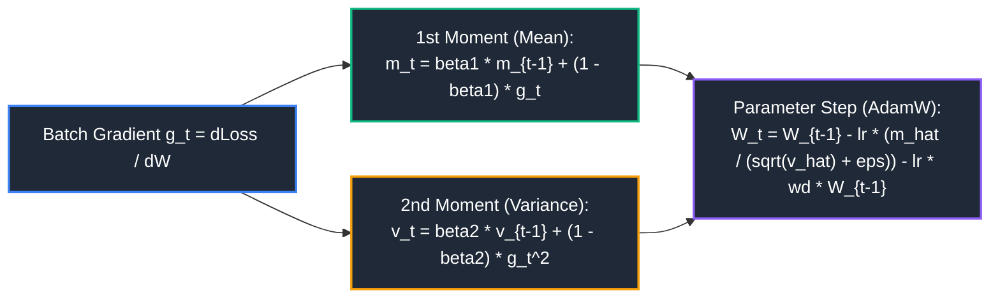
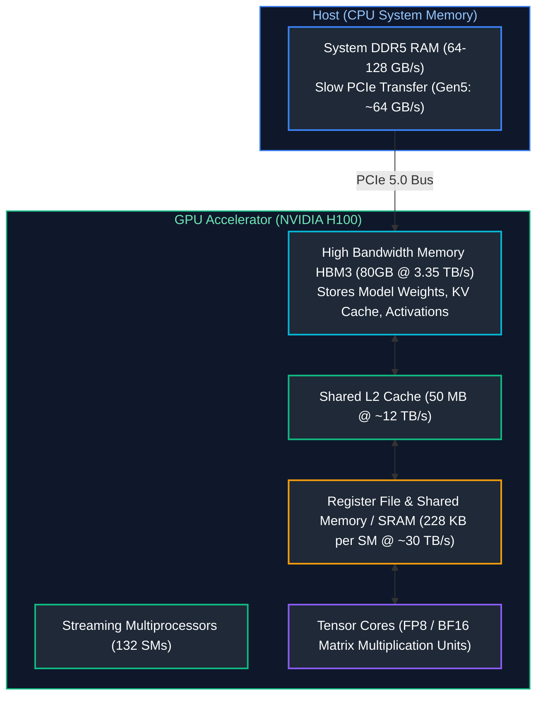

# 02. Deep Learning & Neural Architectures

A comprehensive, production-grade guide to deep learning theory, computational graphs, backpropagation calculus, loss optimization, representation learning, multi-head attention mechanisms, Transformer architectures, PyTorch runtime execution, and GPU tensor acceleration tailored for AI Engineers.

---

## Architectural Overview: Deep Learning Computational Graph & Transformer Flow

```mermaid
flowchart TD
    subgraph InputEmbeddings ["1. Representation & Embeddings"]
        Tokens["Input Token Indices (B, S)<br/>(LongTensor on Host Memory)"]
        EmbLayer["Token & Positional Embeddings<br/>(B, S, D) via Embedding Matrix W_e"]
        Tokens --> EmbLayer
    end

    subgraph AttentionEngine ["2. Scaled Dot-Product Multi-Head Attention"]
        QKV["Linear Projections: Q, K, V<br/>(W_q, W_k, W_v weight tensors)"]
        MatMulScores["Query-Key Dot Product<br/>Scores = (Q * K^T) / sqrt(d_k)"]
        MaskSoftmax["Causal Mask & Softmax<br/>Attention Weights A = softmax(Scores)"]
        ContextVal["Context Aggregation<br/>Head Output = A * V"]
        QKV --> MatMulScores --> MaskSoftmax --> ContextVal
    end

    subgraph FeedForwardNorm ["3. Non-Linear Projection & Residuals"]
        Res1["Residual Add & RMSNorm / LayerNorm<br/>Stabilize activation distributions"]
        FFN["MLP / SwiGLU Feed-Forward<br/>W_2 * (Swish(W_1 * x) * W_3 * x)"]
        Res2["Residual Add & Norm<br/>Gradient highway to earlier layers"]
        Res1 --> FFN --> Res2
    end

    subgraph OptimizationBackprop ["4. Backward Graph & Optimization"]
        Loss["Task Loss Function<br/>Cross-Entropy: -log P(y | x)"]
        Autograd["Reverse-Mode Autograd Graph<br/>dLoss / dW via Chain Rule"]
        Optimizer["AdamW Optimizer Update<br/>W = W - lr * (m_hat / (sqrt(v_hat) + eps) + wd * W)"]
        Loss --> Autograd --> Optimizer
    end

    EmbLayer --> QKV
    ContextVal --> Res1
    Res2 --> Loss

    style InputEmbeddings fill:#0f172a,stroke:#3b82f6,stroke-width:1.5px,color:#93c5fd
    style AttentionEngine fill:#0f172a,stroke:#10b981,stroke-width:1.5px,color:#6ee7b7
    style FeedForwardNorm fill:#0f172a,stroke:#f59e0b,stroke-width:1.5px,color:#fde68a
    style OptimizationBackprop fill:#0f172a,stroke:#8b5cf6,stroke-width:1.5px,color:#c084fc
    style Tokens fill:#1f2937,stroke:#3b82f6,stroke-width:2px,color:#fff
    style EmbLayer fill:#1f2937,stroke:#3b82f6,stroke-width:2px,color:#fff
    style QKV fill:#1f2937,stroke:#10b981,stroke-width:2px,color:#fff
    style MatMulScores fill:#1f2937,stroke:#10b981,stroke-width:2px,color:#fff
    style MaskSoftmax fill:#1f2937,stroke:#10b981,stroke-width:2px,color:#fff
    style ContextVal fill:#1f2937,stroke:#10b981,stroke-width:2px,color:#fff
    style Res1 fill:#1f2937,stroke:#f59e0b,stroke-width:2px,color:#fff
    style FFN fill:#1f2937,stroke:#f59e0b,stroke-width:2px,color:#fff
    style Res2 fill:#1f2937,stroke:#f59e0b,stroke-width:2px,color:#fff
    style Loss fill:#1f2937,stroke:#8b5cf6,stroke-width:2px,color:#fff
    style Autograd fill:#1f2937,stroke:#8b5cf6,stroke-width:2px,color:#fff
    style Optimizer fill:#1f2937,stroke:#8b5cf6,stroke-width:2px,color:#fff
```



---

## Table of Contents
1. [Neural Networks, Computational Graphs & Reverse-Mode Autograd](#1-neural-networks-computational-graphs-reverse-mode-autograd)
   - [1.1 Forward Pass & Computational Graphs](#11-forward-pass-computational-graphs)
   - [1.2 Reverse-Mode Automatic Differentiation & Backpropagation Calculus](#12-reverse-mode-automatic-differentiation-backpropagation-calculus)
2. [Loss Functions, Gradient Descent & Modern Optimizers](#2-loss-functions-gradient-descent-modern-optimizers)
   - [2.1 Loss Functions: Cross-Entropy vs. Focal vs. Contrastive](#21-loss-functions-cross-entropy-vs-focal-vs-contrastive)
   - [2.2 Gradient Descent Optimizers: SGD, Adam, AdamW](#22-gradient-descent-optimizers-sgd-adam-adamw)
3. [Embeddings & Representation Learning](#3-embeddings-representation-learning)
   - [3.1 Continuous Vector Representations & Lookup Mechanics](#31-continuous-vector-representations-lookup-mechanics)
   - [3.2 Positional Encodings: Sinusoidal vs. Learned vs. Rotary (RoPE)](#32-positional-encodings-sinusoidal-vs-learned-vs-rotary-rope)
4. [Attention Mechanisms: Scaled Dot-Product to Multi-Head Attention](#4-attention-mechanisms-scaled-dot-product-to-multi-head-attention)
   - [4.1 Scaled Dot-Product Attention Mathematical Formulation](#41-scaled-dot-product-attention-mathematical-formulation)
   - [4.2 Multi-Head Attention (MHA) vs. Multi-Query (MQA) vs. Grouped-Query (GQA)](#42-multi-head-attention-mha-vs-multi-query-mqa-vs-grouped-query-gqa)
5. [The Transformer Architecture: Encoders, Decoders & Hybrid Models](#5-the-transformer-architecture-encoders-decoders-hybrid-models)
   - [5.1 Encoder Models (BERT)](#5-the-transformer-architecture-encoders-decoders-hybrid-models)
   - [5.2 Causal Autoregressive Decoders (GPT, Llama)](#5-the-transformer-architecture-encoders-decoders-hybrid-models)
   - [5.3 Encoder-Decoder Sequence-to-Sequence (T5, Whisper)](#5-the-transformer-architecture-encoders-decoders-hybrid-models)
6. [PyTorch Fundamentals & Production Modeling](#6-pytorch-fundamentals-production-modeling)
   - [6.1 Tensors, Autograd, `nn.Module` and Custom Layers](#61-tensors-autograd-nnmodule-and-custom-layers)
   - [6.2 Production Training Loop with Mixed Precision (AMP)](#62-production-training-loop-with-mixed-precision-amp)
7. [GPU Memory, Tensors & Hardware Acceleration Mechanics](#7-gpu-memory-tensors-hardware-acceleration-mechanics)
   - [7.1 Tensor Precision: FP32, FP16, BF16, FP8](#71-tensor-precision-fp32-fp16-bf16-fp8)
   - [7.2 CUDA Memory Hierarchy & Kernel Launches](#72-cuda-memory-hierarchy-kernel-launches)
8. [Production Diagnostics: Vanishing/Exploding Gradients & Dead Neurons](#8-production-diagnostics-vanishingexploding-gradients-dead-neurons)
   - [8.1 Residual Connections & Pre-LN vs. Post-LN Architectures](#81-residual-connections-pre-ln-vs-post-ln-architectures)
   - [8.2 Gradient Clipping & Initialization Schemes](#82-gradient-clipping-initialization-schemes)
9. [Summary Comparison & Engineering Reference Matrix](#9-summary-comparison-engineering-reference-matrix)
10. [References & Further Reading](#10-references-further-reading)

---

# 1. Neural Networks, Computational Graphs & Reverse-Mode Autograd

### 1.1 Forward Pass & Computational Graphs

A neural network is an oriented, directed acyclic graph (DAG) of functional transformations. For an affine transformation layer with input $\mathbf{x} \in \mathbb{R}^{d_{in}}$, weight matrix $\mathbf{W} \in \mathbb{R}^{d_{out} \times d_{in}}$, and bias vector $\mathbf{b} \in \mathbb{R}^{d_{out}}$:

$$\mathbf{z} = \mathbf{W}\mathbf{x} + \mathbf{b}, \quad \mathbf{a} = \sigma(\mathbf{z})$$

where $\sigma(\cdot)$ is a non-linear activation function (such as ReLU, GELU, or SiLU/Swish). Without non-linear activations, composing $L$ successive linear layers collapses mathematically into a single linear transformation:

$$\mathbf{y} = \mathbf{W}_L(\dots(\mathbf{W}_2(\mathbf{W}_1 \mathbf{x} + \mathbf{b}_1) + \mathbf{b}_2)\dots) + \mathbf{b}_L = \mathbf{W}_{\text{eff}} \mathbf{x} + \mathbf{b}_{\text{eff}}$$

---

### 1.2 Reverse-Mode Automatic Differentiation & Backpropagation Calculus

Backpropagation calculates the gradient of a scalar scalar loss $\mathcal{L}$ with respect to all learnable network parameters $\mathbf{\theta}$ using the multivariate chain rule.

Given scalar loss $\mathcal{L}$, intermediate activation $\mathbf{z} = \mathbf{W}\mathbf{x} + \mathbf{b}$, and output $\mathbf{a} = \sigma(\mathbf{z})$:

$$\frac{\partial \mathcal{L}}{\partial \mathbf{W}} = \left( \frac{\partial \mathcal{L}}{\partial \mathbf{z}} \right) \mathbf{x}^T = \left( \frac{\partial \mathcal{L}}{\partial \mathbf{a}} \odot \sigma'(\mathbf{z}) \right) \mathbf{x}^T$$

$$\frac{\partial \mathcal{L}}{\partial \mathbf{b}} = \frac{\partial \mathcal{L}}{\partial \mathbf{z}} = \frac{\partial \mathcal{L}}{\partial \mathbf{a}} \odot \sigma'(\mathbf{z})$$

$$\frac{\partial \mathcal{L}}{\partial \mathbf{x}} = \mathbf{W}^T \left( \frac{\partial \mathcal{L}}{\partial \mathbf{z}} \right)$$

```text
REVERSE-MODE AUTOGRAD MEMORY MECHANICS:
Forward Pass:
  Stores intermediate activations x and z in GPU VRAM (Activation Memory).
Backward Pass:
  Traverses the computational graph in reverse topological order.
  Consumes stored activations to compute parameter gradients dL/dW and dL/db.
  Frees activation memory dynamically or via activation checkpointing.
```

---

# 2. Loss Functions, Gradient Descent & Modern Optimizers

### 2.1 Loss Functions: Cross-Entropy vs. Focal vs. Contrastive

1. **Categorical Cross-Entropy (Language Modeling Objective):**
   $$\mathcal{L}_{CE} = - \sum_{k=1}^K y_k \log(\hat{y}_k) = - \log \frac{e^{z_t}}{\sum_{j=1}^K e^{z_j}}$$
   where $z_t$ is the logit of the correct target token. In next-token prediction, this minimizes the negative log-likelihood of the ground-truth token stream.

2. **Focal Loss (Addressing Extreme Imbalance):**
   $$\mathcal{L}_{\text{Focal}} = - \alpha_t (1 - p_t)^\gamma \log(p_t)$$
   The focusing parameter $\gamma$ dynamically down-weights easy examples ($p_t \approx 1$), forcing the gradient to concentrate on hard, ambiguous misclassifications.

3. **InfoNCE / Contrastive Loss (Representation & Embedding Learning):**
   $$\mathcal{L}_{\text{InfoNCE}} = - \log \frac{\exp(\text{sim}(\mathbf{q}, \mathbf{k}_+) / \tau)}{\exp(\text{sim}(\mathbf{q}, \mathbf{k}_+) / \tau) + \sum_{j=1}^M \exp(\text{sim}(\mathbf{q}, \mathbf{k}_j^-) / \tau)}$$
   Pulls positive pairs $(\mathbf{q}, \mathbf{k}_+)$ close in Euclidean embedding space while repelling negative distractors $\mathbf{k}_j^-$. Scaled by temperature $\tau$.

---

### 2.2 Gradient Descent Optimizers: SGD, Adam, AdamW



**Why AdamW is the Gold Standard for LLMs:**
In standard Adam with L2 weight decay, weight regularization is added directly to gradient $g_t$. For parameters with large historical gradients, the second moment $v_t$ scales down the weight decay effect, neutralizing intended regularization. **AdamW (Decoupled Weight Decay)** subtracts weight decay directly from the parameter update step:

$$\mathbf{W}_t = \mathbf{W}_{t-1} - \eta \left( \frac{\hat{\mathbf{m}}_t}{\sqrt{\hat{\mathbf{v}}_t} + \epsilon} \right) - \eta \lambda \mathbf{W}_{t-1}$$

---

# 3. Embeddings & Representation Learning

### 3.1 Continuous Vector Representations & Lookup Mechanics

An embedding layer $\mathbf{E} \in \mathbb{R}^{V \times d}$ is an unconstrained lookup table mapping discrete vocabulary token IDs $i \in \{0, \dots, V-1\}$ to continuous dense vectors $\mathbf{e}_i \in \mathbb{R}^d$.
- In forward execution, `torch.nn.Embedding(V, d)(indices)` performs an $O(1)$ memory address dereference:
  $$\text{Address}(i) = \text{BasePtr} + i \cdot d \cdot \text{sizeof(dtype)}$$
- During backpropagation, gradients $\frac{\partial \mathcal{L}}{\partial \mathbf{E}}$ are sparse; only rows indexed during the batch receive gradient updates.

---

### 3.2 Positional Encodings: Sinusoidal vs. Learned vs. Rotary (RoPE)

Transformers are permutation-invariant by default. Positional encoding injects sequence order:

1. **Absolute Sinusoidal (Vaswani et al., 2017):**
   $$PE_{(pos, 2i)} = \sin\left(\frac{pos}{10000^{2i/d}}\right), \quad PE_{(pos, 2i+1)} = \cos\left(\frac{pos}{10000^{2i/d}}\right)$$
2. **Rotary Position Embeddings (RoPE - Su et al., Llama 2/3, Mistral):**
   Instead of adding position vectors to embeddings, RoPE rotates Query and Key representations in 2D coordinate planes by angle $m\theta_i$:
   $$\mathbf{R}_{\Theta, m}^d = \text{diag}(\mathbf{R}_{\theta_1, m}, \dots, \mathbf{R}_{\theta_{d/2}, m})$$
   $$\langle \mathbf{R}_{\Theta, m} \mathbf{q}_m, \mathbf{R}_{\Theta, n} \mathbf{k}_n \rangle = g(\mathbf{q}, \mathbf{k}, m - n)$$
   The inner product depends solely on **relative token distance** $(m - n)$, enabling robust context window extrapolation.

---

# 4. Attention Mechanisms: Scaled Dot-Product to Multi-Head Attention

### 4.1 Scaled Dot-Product Attention Mathematical Formulation

Given queries $\mathbf{Q} \in \mathbb{R}^{S_q \times d_k}$, keys $\mathbf{K} \in \mathbb{R}^{S_k \times d_k}$, and values $\mathbf{V} \in \mathbb{R}^{S_k \times d_v}$:

$$\text{Attention}(\mathbf{Q}, \mathbf{K}, \mathbf{V}) = \text{softmax}\left( \frac{\mathbf{Q}\mathbf{K}^T}{\sqrt{d_k}} + \mathbf{M} \right) \mathbf{V}$$

- **Scaling Factor $\frac{1}{\sqrt{d_k}}$:** For large head dimensions $d_k$, the dot product $\mathbf{q} \cdot \mathbf{k}$ grows in variance proportional to $d_k$. Without $\frac{1}{\sqrt{d_k}}$, dot products push Softmax inputs into regions with near-zero gradients (Softmax saturation), causing vanishing gradients.
- **Causal Mask $\mathbf{M}$:** Upper-triangular matrix with $-\infty$ above the main diagonal, preventing token $i$ from attending to future tokens $j > i$.

---

### 4.2 Multi-Head Attention (MHA) vs. Multi-Query (MQA) vs. Grouped-Query (GQA)

```mermaid
flowchart TD
    subgraph MHA ["Multi-Head Attention (MHA)"]
        Q1["Q Heads: 32"] --- K1["K Heads: 32"] --- V1["V Heads: 32"]
        MHA_Desc["Highest Quality, Largest KV Cache Footprint"]
    end

    subgraph GQA ["Grouped-Query Attention (GQA - Llama 3)"]
        Q2["Q Heads: 32"] --- K2["K Groups: 8"] --- V2["V Groups: 8"]
        GQA_Desc["Balanced Quality, 4x-8x Reduced KV Cache"]
    end

    subgraph MQA ["Multi-Query Attention (MQA)"]
        Q3["Q Heads: 32"] --- K3["K Head: 1"] --- V3["V Head: 1"]
        MQA_Desc["Fastest Serving, Minimal Memory, Slight Quality Loss"]
    end

    style MHA fill:#0f172a,stroke:#3b82f6,stroke-width:1.5px,color:#93c5fd
    style GQA fill:#0f172a,stroke:#10b981,stroke-width:1.5px,color:#6ee7b7
    style MQA fill:#0f172a,stroke:#f59e0b,stroke-width:1.5px,color:#fde68a
    style Q1 fill:#1f2937,stroke:#3b82f6,stroke-width:2px,color:#fff
    style K1 fill:#1f2937,stroke:#3b82f6,stroke-width:2px,color:#fff
    style V1 fill:#1f2937,stroke:#3b82f6,stroke-width:2px,color:#fff
    style Q2 fill:#1f2937,stroke:#10b981,stroke-width:2px,color:#fff
    style K2 fill:#1f2937,stroke:#10b981,stroke-width:2px,color:#fff
    style V2 fill:#1f2937,stroke:#10b981,stroke-width:2px,color:#fff
    style Q3 fill:#1f2937,stroke:#f59e0b,stroke-width:2px,color:#fff
    style K3 fill:#1f2937,stroke:#f59e0b,stroke-width:2px,color:#fff
    style V3 fill:#1f2937,stroke:#f59e0b,stroke-width:2px,color:#fff
```



---

# 5. The Transformer Architecture: Encoders, Decoders & Hybrid Models

```text
+-----------------------+-----------------------------+-------------------------------+
| ARCHITECTURE FAMILY   | CANONICAL EXAMPLES          | OPTIMAL PRODUCTION DOMAINS    |
+-----------------------+-----------------------------+-------------------------------+
| Encoder-Only          | BERT, RoBERTa, DeBERTa, BGE | Semantic Search, Document     |
| (Bidirectional)       | Embeddings, NER, Sentiment. | Embeddings, Classification.   |
| Decoder-Only          | GPT-4, Llama 3, Mistral,    | Text Generation, Conversational|
| (Causal Autoregressive)| Claude, DeepSeek-V3.       | AI, Code Synthesis, Agents.   |
| Encoder-Decoder       | T5, BART, Whisper, ByT5.    | Translation, Summarization,   |
| (Seq2Seq Cross-Attn)  |                             | Speech-to-Text Transcription. |
+-----------------------+-----------------------------+-------------------------------+
```

---

# 6. PyTorch Fundamentals & Production Modeling

### 6.1 Tensors, Autograd, `nn.Module` and Custom Layers

Below is a complete, production-grade implementation of a multi-head attention block with RMSNorm and SwiGLU feed-forward networks, built from fundamental PyTorch primitives:

```python
# ==============================================================================
# Production-Grade Transformer Block with RMSNorm & SwiGLU in PyTorch
# ==============================================================================
import math
import torch
import torch.nn as nn
import torch.nn.functional as F

class RMSNorm(nn.Module):
    """Root Mean Square Layer Normalization (Zhang & Sennrich, 2019).
    Faster than standard LayerNorm by omitting mean-centering calculation.
    """
    def __init__(self, dim: int, eps: float = 1e-6):
        super().__init__()
        self.eps = eps
        self.weight = nn.Parameter(torch.ones(dim))

    def forward(self, x: torch.Tensor) -> torch.Tensor:
        # Compute RMS along hidden dimension: sqrt(mean(x^2) + eps)
        variance = x.pow(2).mean(dim=-1, keepdim=True)
        return x * torch.rsqrt(variance + self.eps) * self.weight

class CausalSelfAttention(nn.Module):
    """Production Multi-Head Attention with scaled dot-product & causal masking."""
    def __init__(self, d_model: int, n_heads: int):
        super().__init__()
        assert d_model % n_heads == 0, "d_model must be divisible by n_heads"
        self.d_model = d_model
        self.n_heads = n_heads
        self.head_dim = d_model // n_heads

        # Joint linear projection for Q, K, V to minimize kernel launch overhead
        self.qkv_proj = nn.Linear(d_model, 3 * d_model, bias=False)
        self.out_proj = nn.Linear(d_model, d_model, bias=False)

    def forward(self, x: torch.Tensor) -> torch.Tensor:
        batch_size, seq_len, _ = x.shape

        # 1. Project input to Q, K, V in a single GEMM operation
        qkv = self.qkv_proj(x)  # Shape: (B, S, 3 * d_model)
        qkv = qkv.view(batch_size, seq_len, 3, self.n_heads, self.head_dim)
        qkv = qkv.permute(2, 0, 3, 1, 4)  # (3, B, n_heads, S, head_dim)
        q, k, v = qkv[0], qkv[1], qkv[2]

        # 2. Optimized PyTorch Scaled Dot-Product Attention (dispatches to FlashAttention on GPU)
        out = F.scaled_dot_product_attention(
            query=q,
            key=k,
            value=v,
            attn_mask=None,
            dropout_p=0.0,
            is_causal=True  # Automatically applies triangular causal mask
        )

        # 3. Concatenate heads and project back to model dimension
        out = out.permute(0, 2, 1, 3).contiguous().view(batch_size, seq_len, self.d_model)
        return self.out_proj(out)

class SwiGLUFeedForward(nn.Module):
    """Swish-Gated Linear Unit (Shazeer, 2020) used in modern LLMs (Llama 3)."""
    def __init__(self, d_model: int, hidden_dim: int):
        super().__init__()
        self.w1 = nn.Linear(d_model, hidden_dim, bias=False)
        self.w2 = nn.Linear(hidden_dim, d_model, bias=False)
        self.w3 = nn.Linear(d_model, hidden_dim, bias=False)

    def forward(self, x: torch.Tensor) -> torch.Tensor:
        # SwiGLU: W2 * (SiLU(W1 * x) * (W3 * x))
        return self.w2(F.silu(self.w1(x)) * self.w3(x))

class TransformerBlock(nn.Module):
    """Pre-LN Transformer Decoder Block with residual connections."""
    def __init__(self, d_model: int, n_heads: int, ffn_hidden_ratio: float = 3.5):
        super().__init__()
        hidden_dim = int(d_model * ffn_hidden_ratio)
        self.norm1 = RMSNorm(d_model)
        self.attn = CausalSelfAttention(d_model, n_heads)
        self.norm2 = RMSNorm(d_model)
        self.ffn = SwiGLUFeedForward(d_model, hidden_dim)

    def forward(self, x: torch.Tensor) -> torch.Tensor:
        # Pre-LN residual connections allow unimpeded gradient flow during backprop
        x = x + self.attn(self.norm1(x))
        x = x + self.ffn(self.norm2(x))
        return x
```

- **Time Complexity:** Attention: $O(B \cdot S^2 \cdot D)$; FFN: $O(B \cdot S \cdot D \cdot D_{ffn})$.
- **Space Complexity:** Parameters: $O(D^2 + D \cdot D_{ffn})$; Activation memory: $O(B \cdot S \cdot D)$ with FlashAttention.

---

### 6.2 Production Training Loop with Mixed Precision (AMP)

```python
# ==============================================================================
# Production Training Loop with Automatic Mixed Precision (AMP) & Gradient Clipping
# ==============================================================================
device = torch.device("cuda" if torch.cuda.is_available() else "cpu")
model = TransformerBlock(d_model=512, n_heads=8).to(device)

optimizer = torch.optim.AdamW(model.parameters(), lr=3e-4, weight_decay=0.01)
scaler = torch.amp.GradScaler("cuda", enabled=(device.type == "cuda"))

# Simulated batch of token representations
inputs = torch.randn(8, 64, 512, device=device)
targets = torch.randn(8, 64, 512, device=device)

model.train()
optimizer.zero_grad(set_to_none=True)  # Faster than zero_grad() by deallocating tensors

# Forward pass wrapped in autocast for FP16/BF16 execution on Tensor Cores
with torch.amp.autocast(device_type=device.type, dtype=torch.bfloat16):
    outputs = model(inputs)
    loss = F.mse_loss(outputs, targets)

# Scaled backward pass prevents underflow in lower precision gradients
scaler.scale(loss).backward()

# Unscale gradients prior to clipping norm
scaler.unscale_(optimizer)
torch.nn.utils.clip_grad_norm_(model.parameters(), max_norm=1.0)

# Optimizer step with dynamic scale factor update
scaler.step(optimizer)
scaler.update()

print(f"Training Step Completed. Batch Loss: {loss.item():.4f}")
```

---

# 7. GPU Memory, Tensors & Hardware Acceleration Mechanics

### 7.1 Tensor Precision: FP32, FP16, BF16, FP8

```text
+-----------+-------+------------+-----------+----------------------------------------+
| FORMAT    | BITS  | EXPONENT   | MANTISSA  | DYNAMIC RANGE & NUMERICAL STABILITY    |
+-----------+-------+------------+-----------+----------------------------------------+
| FP32      | 32    | 8 bits     | 23 bits   | Standard full precision. High memory.  |
| FP16      | 16    | 5 bits     | 10 bits   | Fast on V100/A100; prone to underflow. |
| BF16      | 16    | 8 bits     | 7 bits    | Matches FP32 dynamic range. Stable.    |
| FP8 (E4M3)| 8     | 4 bits     | 3 bits    | Hopper H100 inference/training format. |
+-----------+-------+------------+-----------+----------------------------------------+
```

> [!IMPORTANT]
> **BF16 (Bfloat16)** is the default format for modern LLM pretraining (Llama 3, Mistral). By retaining 8 exponent bits identical to FP32, it eliminates loss scale instability and gradient underflow without requiring complex dynamic loss scaling.

---

### 7.2 CUDA Memory Hierarchy & Kernel Launches

When training or running inference on NVIDIA GPUs, understanding memory bandwidth vs. compute bounds dictates architecture design:



- **Memory-Bound Operations:** Softmax, LayerNorm, Swish/GELU element-wise operations. Flops are low; time is dominated by reading/writing to HBM3 VRAM. FlashAttention solves this by tiling attention computation directly inside fast on-chip SRAM.
- **Compute-Bound Operations:** Large matrix multiplications ($Q K^T$, FFN linear projections). Tensor Cores run at near-peak utilization.

---

# 8. Production Diagnostics: Vanishing/Exploding Gradients & Dead Neurons

### 8.1 Residual Connections & Pre-LN vs. Post-LN Architectures

- **Post-LN (Original Attention Is All You Need):** $\mathbf{x}_{l+1} = \text{LayerNorm}(\mathbf{x}_l + \text{SubLayer}(\mathbf{x}_l))$. The normalization sits on the residual path, causing gradients to diminish near input layers. Requires delicate learning rate warmup schedules to prevent early divergence.
- **Pre-LN (Llama, GPT-3):** $\mathbf{x}_{l+1} = \mathbf{x}_l + \text{SubLayer}(\text{LayerNorm}(\mathbf{x}_l))$. The residual stream acts as an unadulterated "gradient highway," enabling immediate stable training at high learning rates.

---

### 8.2 Gradient Clipping & Initialization Schemes

```python
# Production Norm Clipping Rule:
# If ||g||_2 > max_norm, scale gradients by max_norm / ||g||_2
torch.nn.utils.clip_grad_norm_(model.parameters(), max_norm=1.0)
```

> [!CAUTION]
> Naive weight initialization with excessive variance causes outputs of deep networks to blow up exponentially ($O(\sigma^L)$), saturating activations. Always utilize **Xavier/Glorot Initialization** for symmetric activations (tanh) and **He/Kaiming Initialization** for rectifier activations (ReLU, GELU).

---

# 9. Summary Comparison & Engineering Reference Matrix

| Architecture / Mechanism | Compute Complexity | Memory Complexity | Production Rule of Thumb |
| :--- | :--- | :--- | :--- |
| **Standard Softmax Attention** | $O(S^2 \cdot D)$ FLOPs | $O(S^2)$ VRAM footprint | Avoid beyond sequence length 4,096; triggers GPU OOM due to $S \times S$ matrix. |
| **FlashAttention-2 / FlashAttention-3** | $O(S^2 \cdot D)$ FLOPs | $O(S \cdot D)$ VRAM footprint | Standard in all production serving/training. Fuses online softmax within SRAM. |
| **Multi-Head Attention (MHA)** | $O(S^2 \cdot D)$ FLOPs | $O(2 \cdot B \cdot S \cdot N_{heads} \cdot d_k)$ | Standard for training. In inference, KV cache consumes excessive VRAM. |
| **Grouped-Query Attention (GQA)** | $O(S^2 \cdot D)$ FLOPs | $O(2 \cdot B \cdot S \cdot G \cdot d_k)$ ($G \ll N_{heads}$) | Industry standard for modern LLMs (Llama 3). Reduces serving KV cache by 8x. |
| **RMSNorm** | $O(D)$ FLOPs | $O(1)$ parameter state | Prefer over LayerNorm. 15% faster due to omitting mean-centering pass. |

---

# 10. References & Further Reading

- [Attention Is All You Need (Vaswani et al., 2017)](https://arxiv.org/abs/1706.03762)
- [FlashAttention-2: Faster Attention with Better Parallelism and Work Partitioning (Dao, 2023)](https://arxiv.org/abs/2307.08691)
- [PyTorch Autograd: Reverse-Mode Automatic Differentiation Documentation](https://pytorch.org/docs/stable/notes/autograd.html)
- [RoFormer: Enhanced Transformer with Rotary Position Embedding (Su et al., 2021)](https://arxiv.org/abs/2104.09864)
- [GLU Variants Improve Transformer (Shazeer, 2020)](https://arxiv.org/abs/2002.05202)

