# 02. LLM Foundations & Transformer Model Architecture: Master Guide

A comprehensive, production-grade guide to foundation model architectures, next-token prediction mechanics, subword tokenization algorithms, Mixture-of-Experts (MoE) routing, prefill vs. decode inference runtime dynamics, Key-Value (KV) cache memory mathematics, sampling controls, test-time reasoning compute scaling, and systematic enterprise model selection. Designed for AI Engineers and Distributed Systems Architects requiring deep theoretical understanding paired with low-level systems precision.

---

## Architectural Overview: The End-to-End LLM Lifecycle & Inference Engine

The diagram below details the complete structural lifecycle of modern autoregressive Large Language Models, spanning pretraining and post-training alignment stages to the dual-phase inference execution runtime.

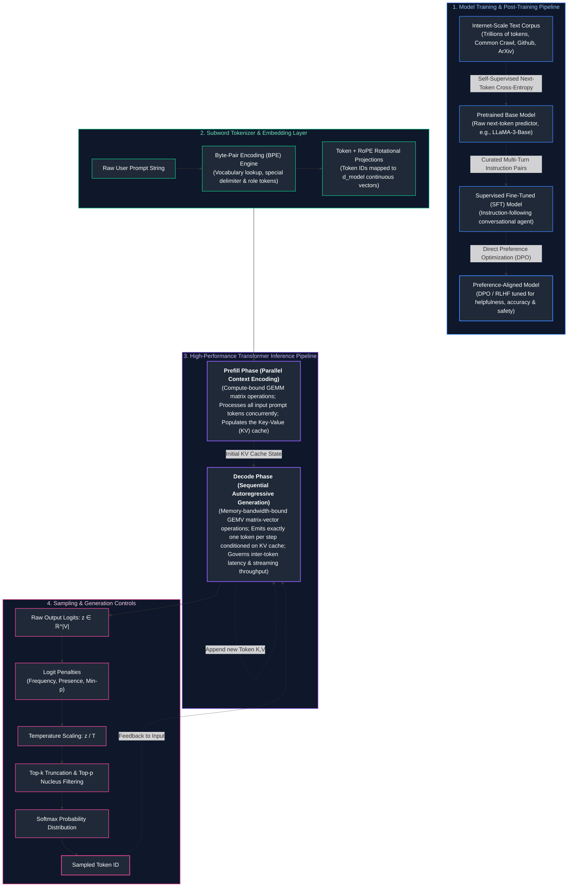

---

## Table of Contents
1. [The Next-Token Prediction Engine](#1-the-next-token-prediction-engine)
   - [1.1 Autoregressive Language Modeling Objectives & Mathematical Mechanics](#11-autoregressive-language-modeling-objectives--mathematical-mechanics)
   - [1.2 From Base Models to Aligned Assistants: Pretraining, SFT, and RLHF/DPO](#12-from-base-models-to-aligned-assistants-pretraining-sft-and-rlhfdpo)
   - [1.3 Emergent Capabilities, In-Context Learning (ICL), and World Models](#13-emergent-capabilities-in-context-learning-icl-and-world-models)
   - [1.4 Parametric Memory vs. Working Context Memory](#14-parametric-memory-vs-working-context-memory)
2. [Tokenization Mechanics & Token Economics](#2-tokenization-mechanics--token-economics)
   - [2.1 Why Characters and Words Fail: The Need for Subwords](#21-why-characters-and-words-fail-the-need-for-subwords)
   - [2.2 Byte-Pair Encoding (BPE) from Scratch: Step-by-Step Walkthrough](#22-byte-pair-encoding-bpe-from-scratch-step-by-step-walkthrough)
   - [2.3 WordPiece vs. SentencePiece & Byte-Fallback Handling](#23-wordpiece-vs-sentencepiece--byte-fallback-handling)
   - [2.4 Cross-Lingual Token Density, Code Formatting, and Financial Cost Amplification](#24-cross-lingual-token-density-code-formatting-and-financial-cost-amplification)
3. [Transformer Core: Dense vs. Mixture-of-Experts (MoE)](#3-transformer-core-dense-vs-mixture-of-experts-moe)
   - [3.1 Decoder-Only Architecture & The Industry Convergence](#31-decoder-only-architecture--the-industry-convergence)
   - [3.2 Mixture-of-Experts (MoE) Routing Mechanics](#32-mixture-of-experts-moe-routing-mechanics)
   - [3.3 Active vs. Total Parameter Footprints (Mixtral, DeepSeek-V3)](#33-active-vs-total-parameter-footprints-mixtral-deepseek-v3)
   - [3.4 The Routing Collapse Hazard & Auxiliary Load Balancing Losses](#34-the-routing-collapse-hazard--auxiliary-load-balancing-losses)
4. [The Lifecycle of an Inference Request](#4-the-lifecycle-of-an-inference-request)
   - [4.1 Prefill Phase vs. Decode Phase Deep Dive](#41-prefill-phase-vs-decode-phase-deep-dive)
   - [4.2 Latency Anatomy: Time to First Token (TTFT) vs. Inter-Token Latency (ITL)](#42-latency-anatomy-time-to-first-token-ttft-vs-inter-token-latency-itl)
   - [4.3 Compute-Bound GEMM vs. Memory-Bandwidth-Bound GEMV Regimes](#43-compute-bound-gemm-vs-memory-bandwidth-bound-gemv-regimes)
5. [Key-Value (KV) Caching & Memory Footprints](#5-key-value-kv-caching--memory-footprints)
   - [5.1 Why KV Caching is Mandatory: Eliminating Quadratic Recomputation](#51-why-kv-caching-is-mandatory-eliminating-quadratic-recomputation)
   - [5.2 Exact KV Cache Memory Sizing Formula](#52-exact-kv-cache-memory-sizing-formula)
   - [5.3 End-to-End Numerical Walkthrough: LLaMA-3-8B Serving Footprint](#53-end-to-end-numerical-walkthrough-llama-3-8b-serving-footprint)
   - [5.4 Impact of Context Growth on System Concurrency & VRAM Exhaustion](#54-impact-of-context-growth-on-system-concurrency--vram-exhaustion)
6. [Sampling Parameters & Generation Control](#6-sampling-parameters--generation-control)
   - [6.1 Softmax Logit Transformation & Temperature Scaling](#61-softmax-logit-transformation--temperature-scaling)
   - [6.2 Top-k Truncation & Top-p (Nucleus) Filtering Walkthrough](#62-top-k-truncation--top-p-nucleus-filtering-walkthrough)
   - [6.3 Min-p Sampling: The Dynamic Truncation Breakthrough](#63-min-p-sampling-the-dynamic-truncation-breakthrough)
   - [6.4 Frequency, Presence Penalties & Repetition Control](#64-frequency-presence-penalties--repetition-control)
7. [Reasoning Models & Test-Time Compute Scaling](#7-reasoning-models--test-time-compute-scaling)
   - [7.1 Thinking Tokens & Hidden Scratchpads (o1, DeepSeek-R1)](#71-thinking-tokens--hidden-scratchpads-o1-deepseek-r1)
   - [7.2 Test-Time Compute Scaling Laws vs. Pretraining Scaling Laws](#72-test-time-compute-scaling-laws-vs-pretraining-scaling-laws)
   - [7.3 Production Trade-Offs: When to Invest in Reasoning Budgets](#73-production-trade-offs-when-to-invest-in-reasoning-budgets)
8. [Production Implementation: High-Throughput Inference & KV Cache Sizer](#8-production-implementation-high-throughput-inference--kv-cache-sizer)
   - [8.1 Memory Sizing & Schedulability Engine Blueprint](#81-memory-sizing--schedulability-engine-blueprint)
   - [8.2 Complete Production-Grade Python Calculator](#82-complete-production-grade-python-calculator)
   - [8.3 The 8-Dimension Model Selection Framework](#83-the-8-dimension-model-selection-framework)
9. [Summary Comparison & Production Engineering Reference Matrix](#9-summary-comparison--production-engineering-reference-matrix)
10. [References & Further Reading](#10-references--further-reading)

> [!TIP]
> **Deep-Dive Interview Scenarios:**
> - [Q1. Explain the architecture of Transformer models and how data flows from tokenization to output logits.](frequently_asked_questions/02_llm_and_transformer_architecture_faq.md#q1-explain-the-architecture-of-transformer-models-and-how-data-flows-from-tokenization-to-output-logits)
> - [Q3. Walk me through what happens during pre-training vs fine-tuning of a foundation language model.](frequently_asked_questions/02_llm_and_transformer_architecture_faq.md#q3-walk-me-through-what-happens-during-pre-training-vs-fine-tuning-of-a-foundation-language-model)
> - [Q4. Why did the industry move from RNNs/LSTMs to transformers? What fundamental problem did attention solve?](frequently_asked_questions/02_llm_and_transformer_architecture_faq.md#q4-why-did-the-industry-move-from-rnnslstms-to-transformers-what-fundamental-problem-did-attention-solve)
> - [Q11. What happens during the pre-training phase of an autoregressive LLM under modern distributed parallelisms (Tensor, Pipeline, and ZeRO-3)?](frequently_asked_questions/02_llm_and_transformer_architecture_faq.md#q11-what-happens-during-the-pre-training-phase-of-an-autoregressive-llm-under-modern-distributed-parallelisms-tensor-pipeline-and-zero-3)
> - [Q12. Design an optimal speculative decoding architecture to accelerate LLM token generation by 2–3x without altering output probability distributions.](frequently_asked_questions/02_llm_and_transformer_architecture_faq.md#q12-design-an-optimal-speculative-decoding-architecture-to-accelerate-llm-token-generation-by-23x-without-altering-output-probability-distributions)
---

# 1. The Next-Token Prediction Engine

### 1.1 Autoregressive Language Modeling Objectives & Mathematical Mechanics

At its computational foundation, every Large Language Model (whether GPT-4, LLaMA-3, Claude, or DeepSeek) is an **autoregressive statistical probability estimator**. It does not possess consciousness, intentions, or feelings; it computes the conditional probability distribution over a discrete vocabulary $\mathcal{V}$ given a preceding sequence of tokens:

$$P(w_1, w_2, \dots, w_T) = \prod_{t=1}^T P(w_t \mid w_1, w_2, \dots, w_{t-1})$$

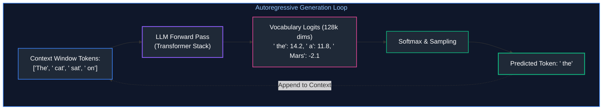

#### The Pretraining Objective: Cross-Entropy Loss
During pretraining across trillions of internet tokens (Common Crawl, GitHub, Wikipedia, books, scientific papers), the network parameters $\theta$ are updated to minimize the negative log-likelihood of observing the actual next token:

$$\mathcal{L}_{\text{LM}}(\theta) = -\sum_{t=1}^T \log P_\theta(w_t \mid w_{<t})$$

Where $w_{<t}$ denotes all previous tokens $(w_1, \dots, w_{t-1})$.

---

### 1.2 From Base Models to Aligned Assistants: Pretraining, SFT, and RLHF/DPO

A frequent point of confusion for beginners is the difference between a **Base Model** and an **Instruct / Chat Model**:

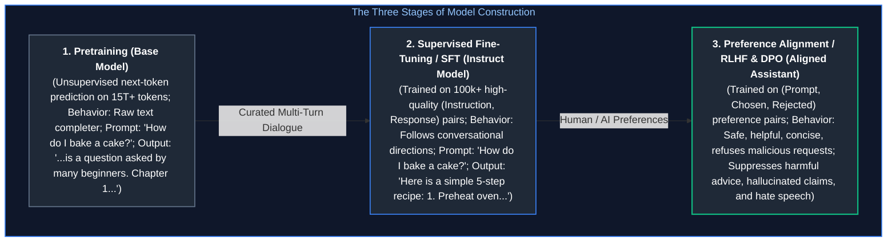

* **Base Model (e.g., LLaMA-3-8B-Base):** Has read the internet and acquired vast world knowledge, syntax, and coding semantics. However, it only knows how to *continue text*. If you prompt it with a question, it might output another question or complete the text as a forum thread.
* **Supervised Fine-Tuning (SFT):** The model is trained on curated demonstrations where humans formatted inputs as `User: <question>` and `Assistant: <helpful answer>`. The model learns the conversational "turn-taking" protocol.
* **Direct Preference Optimization (DPO) / Reinforcement Learning from Human Feedback (RLHF):** Aligns the model with human values. The model is given a prompt and two possible answers ($y_{\text{chosen}}$ vs. $y_{\text{rejected}}$). Mathematical optimization forces the probability of generating the helpful, honest, and harmless response higher while penalizing the unhelpful or toxic response.

---

### 1.3 Emergent Capabilities, In-Context Learning (ICL), and World Models

Why does predicting the next word produce an entity capable of writing Python scripts, translating French, passing the Bar exam, and diagnosing medical conditions?

#### The "Compression as Intelligence" Principle
To predict the very next token in a code snippet like:
```python
def binary_search(arr, target):
    low = 0
    high = len(arr) - 1
    while low <= high:
        mid = (low + high) // 2
        if arr[mid] == target:
            return mid
        elif arr[mid] < target:
            low = 
```
The model cannot simply memorize word co-occurrences. To accurately predict that the next token must be `mid + 1`, the model's internal attention heads and feed-forward layers must simulate the execution state of binary search, track variable scopes, and understand pointer logic. **Next-token prediction over internet-scale reasoning data forces the network to construct a compressed, internal functional model of the world.**

#### In-Context Learning (ICL)
Foundation models possess the unique capability of **In-Context Learning (Few-Shot Prompting)**: adapting to entirely new tasks simply by reading demonstrations inside their prompt context window, without updating any model weights $\theta$. The attention mechanism functions as a dynamic routing engine, identifying analogies across the prompt demonstrations and applying those operational rules to the final query.

---

### 1.4 Parametric Memory vs. Working Context Memory

Architecting enterprise AI systems requires distinguishing between two types of memory:

| Dimension | Parametric Memory (Model Weights) | Working Context Memory (The Prompt Window) |
| :--- | :--- | :--- |
| **Where it Lives** | Baked statically into GPU High Bandwidth Memory (HBM) | Fed dynamically into the attention mechanism at runtime |
| **Update Mechanism** | Extremely expensive full training or fine-tuning run | Instantaneous API call (millisecond latency) |
| **Knowledge Cutoff** | Fixed at the date pretraining concluded | Current up to the millisecond of the query |
| **Factual Reliability** | Prone to hallucinations on long-tail or proprietary facts | High precision; grounded directly in supplied documents |
| **Enterprise Best Practice** | Use for reasoning syntax, style, and general logic | Supply proprietary enterprise knowledge via RAG |

> [!IMPORTANT]
> **Production Invariant:** Treat the LLM as a **stateless reasoning engine operating over dynamic context**, NOT as a database. Always supply volatile business rules, customer profiles, and fresh facts via the context window.

---

# 2. Tokenization Mechanics & Token Economics

### 2.1 Why Characters and Words Fail: The Need for Subwords

Computers cannot process strings directly; they require numbers. But how should we segment raw text into discrete numeric symbols?

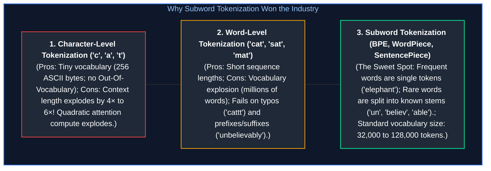

1. **Character-Level:** A 1,000-word essay requires ~5,000 character tokens. Because transformer self-attention scales quadratically ($\mathcal{O}(N^2)$), 5,000 character tokens consume $16\times$ more compute and memory than 1,200 subword tokens!
2. **Word-Level:** Natural languages have millions of distinct word variations. Storing an embedding matrix for 2 million words requires gigabytes of VRAM just for the lookup table, and any misspelled word (e.g., `kubernetes` vs `kubernets`) triggers an `[UNK]` (Unknown Token) error.
3. **Subword Tokenization:** Decomposes rare and compound words into reusable morphological fragments. Common words remain single tokens (`"database"` $\to$ `[database]`), while rare words are broken into pieces (`"microservices"` $\to$ `[micro, services]`).

---

### 2.2 Byte-Pair Encoding (BPE) from Scratch: Step-by-Step Walkthrough

**Byte-Pair Encoding (BPE)** is the canonical subword algorithm powering GPT-4, LLaMA-3, and Tiktoken.

#### The BPE Training Algorithm:
1. Initialize the vocabulary with all individual base characters (or bytes).
2. Segment all training words into individual characters, marking word boundaries with an end-of-word delimiter (e.g., `</w>`).
3. Iteratively count the frequency of all adjacent symbol pairs.
4. Merge the most frequent pair into a single new symbol and add it to the vocabulary.
5. Repeat steps 3–4 until the desired vocabulary size (e.g., 32,000 or 128,000) is reached.

#### Step-by-Step Concrete Numerical Example:
Suppose our training corpus contains the following word frequencies:
* `"low"`: 5 occurrences $\to$ `l o w </w>` (5)
* `"lower"`: 2 occurrences $\to$ `l o w e r </w>` (2)
* `"newest"`: 6 occurrences $\to$ `n e w e s t </w>` (6)
* `"widest"`: 3 occurrences $\to$ `w i d e s t </w>` (3)

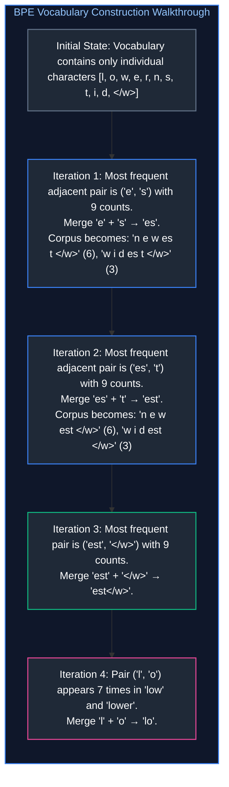

When this model later encounters a brand-new unseen word like `"lowest"`, it splits it into known vocabulary tokens: `['low', 'est</w>']`. It never produces an Out-Of-Vocabulary error!

---

### 2.3 WordPiece vs. SentencePiece & Byte-Fallback Handling

* **WordPiece (used in BERT):** Similar to BPE, but instead of merging the most *frequent* pair, it merges the pair that maximizes the **likelihood of the language model** (maximizing mutual information $\frac{P(AB)}{P(A)P(B)}$). WordPiece uses the `##` prefix to denote subword continuations (e.g., `["play", "##ing"]`).
* **SentencePiece (used in LLaMA, T5, Gemma):** Classical tokenizers assume whitespace separates words. This completely breaks down for languages like Chinese, Japanese, and Thai that do not use spaces between words. **SentencePiece treats the entire raw input string as a continuous stream of Unicode characters**, treating whitespace as a regular character (represented by `_` or ` `).
* **Byte-Level Fallback (Byte-Level BPE / BBPE):** If an input contains a rare emoji, foreign symbol, or corrupted character that was never observed in training, Byte-Level BPE falls back to raw individual UTF-8 bytes (0–255). This guarantees **zero `[UNK]` tokens under all circumstances**.

---

### 2.4 Cross-Lingual Token Density, Code Formatting, and Financial Cost Amplification

A critical production reality that directly affects latency, GPU memory, and API billing is **tokenization density**:

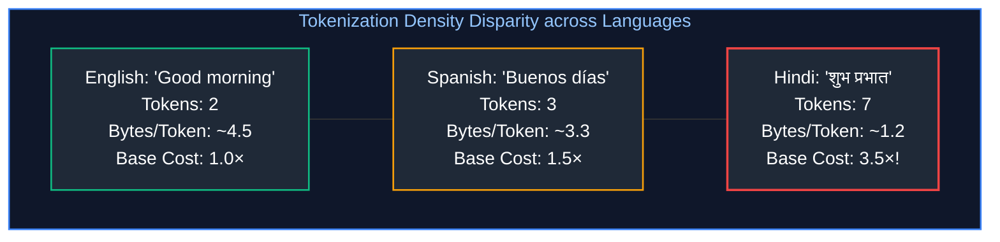

#### Why Does This Happen?
Modern LLM vocabularies are heavily biased toward English text (which constitutes 80%+ of internet training sets). Common English words are allocated single token IDs. Non-Latin scripts (Devanagari, Arabic, Cyrillic, Chinese) frequently require 2 to 4 tokens per individual word because they are fragmented into UTF-8 byte sequences!

**Production Consequences for Systems Architects:**
1. **Financial Cost:** An enterprise running customer support in Hindi or Arabic pays **$3\times\text{--}4\times$ more in API costs** for the exact same semantic conversation compared to English.
2. **Effective Context Window:** A 128k context window holds ~95,000 English words, but only ~25,000 words in Indic or Arabic languages.
3. **Generation Latency:** Generating an answer in a low-density language takes $3\times$ more decode steps, causing $3\times$ higher inter-token streaming latency.

> [!TIP]
> **Deep-Dive Interview Scenarios:**
> - [Q5. Why is self-attention more effective than recurrent connections for capturing long-range dependencies?](frequently_asked_questions/02_llm_and_transformer_architecture_faq.md#q5-why-is-self-attention-more-effective-than-recurrent-connections-for-capturing-long-range-dependencies)
> - [Q6. Explain positional encoding in Transformers: Why is it necessary, and how do sinusoidal encodings compare to RoPE and ALiBi?](frequently_asked_questions/02_llm_and_transformer_architecture_faq.md#q6-explain-positional-encoding-in-transformers-why-is-it-necessary-and-how-do-sinusoidal-encodings-compare-to-rope-and-alibi)
> - [Q8. How does masked language modeling (MLM) differ from causal language modeling (CLM)?](frequently_asked_questions/02_llm_and_transformer_architecture_faq.md#q8-how-does-masked-language-modeling-mlm-differ-from-causal-language-modeling-clm)

---

# 3. Transformer Core: Dense vs. Mixture-of-Experts (MoE)

### 3.1 Decoder-Only Architecture & The Industry Convergence

In the original 2017 transformer paper (*Attention Is All You Need*), the architecture featured an **Encoder-Decoder** topology (Encoder processes input, Decoder emits output, connected by cross-attention). 

Today, the entire generative AI industry (GPT-4, Claude, LLaMA-3, Mistral, DeepSeek) has standardized on **Decoder-Only** architectures:

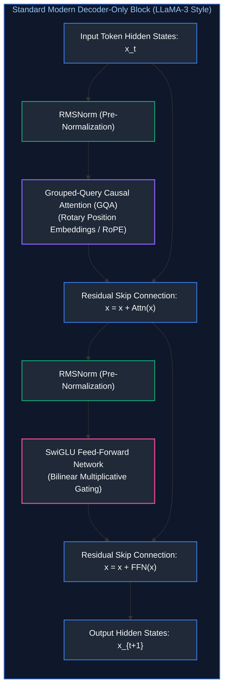

#### Why Decoder-Only Won:
1. **Autoregressive Simplicity:** Pretraining objective and inference execution are identical—next-token prediction.
2. **In-Context Efficiency:** Prompt tokens and generated tokens share the exact same Key-Value cache without requiring cross-attention cache synchronization.
3. **Hardware Scaling:** Removing cross-attention simplifies GPU kernel scheduling and maximizes Tensor Core GEMM efficiency.

---

### 3.2 Mixture-of-Experts (MoE) Routing Mechanics

In a standard **Dense model**, every single parameter in the neural network is activated for every single token processed. In a 70-billion-parameter dense model, all 70 billion parameters execute FLOPS on every word.

In a **Mixture-of-Experts (MoE)** architecture, the dense Feed-Forward Network (FFN) layer is replaced by multiple independent FFN blocks called **Experts** (e.g., 8, 16, or 64 experts), coordinated by a parameterized **Router (Gating Network)**:

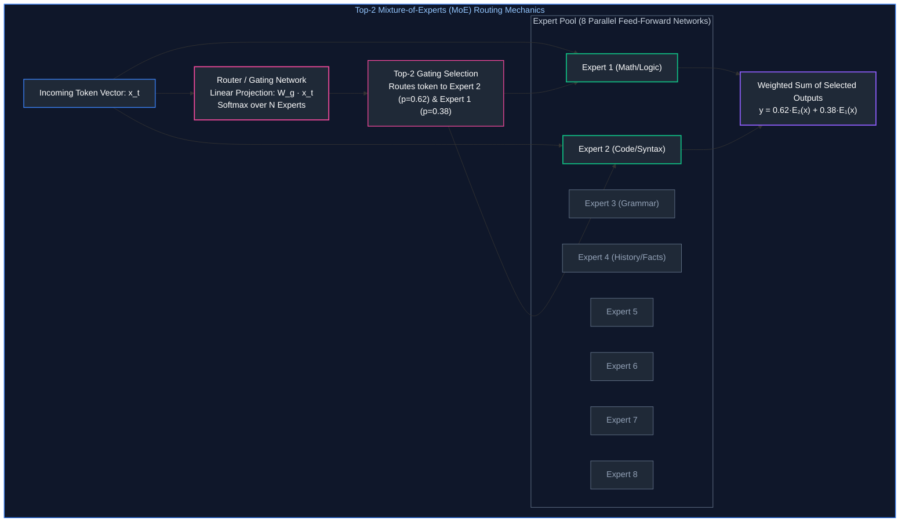

#### Mathematical Formulation:
Given input token $x$:
1. The router computes a routing score vector $H(x) = x \cdot W_g$, where $W_g \in \mathbb{R}^{D \times E}$ and $E$ is the number of experts.
2. The Top-$k$ experts are selected (typically $k=2$):
   $$\text{KeepTopK}(v, k)_i = \begin{cases} v_i & \text{if } v_i \text{ is in top } k \\ -\infty & \text{otherwise} \end{cases}$$
3. Softmax normalizes the chosen scores into routing weights:
   $$G(x) = \text{Softmax}(\text{KeepTopK}(H(x), k))$$
4. The final output is the dynamically weighted combination of the selected experts' outputs:
   $$y = \sum_{i \in \text{TopK}} G(x)_i \cdot E_i(x)$$

---

### 3.3 Active vs. Total Parameter Footprints (Mixtral, DeepSeek-V3)

The primary breakthrough of MoE is decoupling **model capacity** from **inference compute latency**:

* **Mixtral 8x7B:**
  * **Total Parameters:** $46.7\text{B}$ parameters. (Because self-attention and embeddings are shared, it is not $8 \times 7 = 56\text{B}$).
  * **Active Parameters Per Token:** Only $12.9\text{B}$ parameters!
  * **System Performance:** Generates tokens at the speed and compute cost of a 13B model, while matching the reasoning benchmarks of a 70B dense model.
* **DeepSeek-V3 (Fine-Grained MoE):**
  * Uses 256 fine-grained routed experts plus 1 shared expert.
  * Total Parameters: $671\text{B}$.
  * Active Parameters Per Token: Only $37\text{B}$ parameters!

> [!CAUTION]
> **VRAM vs. Compute Reality:** While an MoE model executes compute FLOPS only on its active parameters, **all total parameters must remain loaded in GPU VRAM** unless offloaded. Serving Mixtral 8x7B in FP16 requires ~94GB of VRAM (requiring two 80GB A100 GPUs), even though its compute requirements are equivalent to a single GPU!

---

### 3.4 The Routing Collapse Hazard & Auxiliary Load Balancing Losses

Without explicit regularization, MoE routers suffer from **Routing Collapse**:
* Early in training, a slight random weight initialization gives Expert 1 slightly higher scores than Expert 2.
* Expert 1 receives more tokens $\to$ Expert 1 updates its weights more $\to$ Expert 1 becomes more capable $\to$ The router sends even more tokens to Expert 1.
* Eventually, 2 out of 8 experts process 99% of all tokens, while the remaining 6 experts starve and contribute nothing. The model degrades into an expensive dense model.

To prevent this, production MoE training applies an **Auxiliary Load Balancing Loss** $\mathcal{L}_{\text{balance}}$:

$$\mathcal{L}_{\text{balance}} = \alpha \cdot E \sum_{i=1}^E f_i \cdot P_i$$

Where:
* $f_i$ is the fraction of tokens actually routed to expert $i$: $f_i = \frac{1}{T} \sum_{t=1}^T \mathbb{I}(\text{token } t \to \text{expert } i)$.
* $P_i$ is the average routing probability assigned to expert $i$: $P_i = \frac{1}{T} \sum_{t=1}^T G(x_t)_i$.
* $\alpha$ is a scaling hyperparameter (typically $0.01$).

Minimizing this loss penalizes unequal distribution, forcing the router to balance the load evenly across all available GPU expert workers.

> [!TIP]
> **Deep-Dive Interview Scenario:**
> - [Q2. What is the difference between encoder-only, decoder-only, and encoder-decoder models, and what are their typical use cases?](frequently_asked_questions/02_llm_and_transformer_architecture_faq.md#q2-what-is-the-difference-between-encoder-only-decoder-only-and-encoder-decoder-models-and-what-are-their-typical-use-cases)

---

# 4. The Lifecycle of an Inference Request

### 4.1 Prefill Phase vs. Decode Phase Deep Dive

Understanding the two distinct execution regimes of an LLM request is the most fundamental prerequisite for serving optimization, capacity planning, and latency debugging:

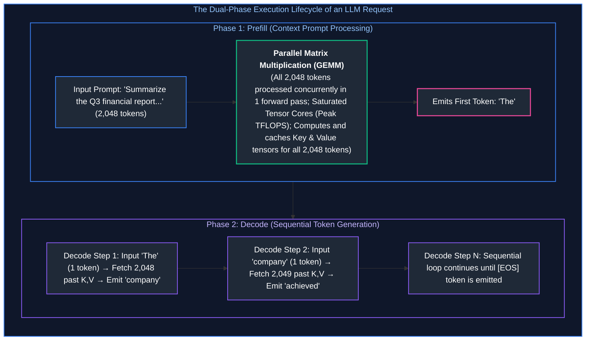

---

### 4.2 Latency Anatomy: Time to First Token (TTFT) vs. Inter-Token Latency (ITL)

Enterprise user experience is governed by two completely separate latency metrics:

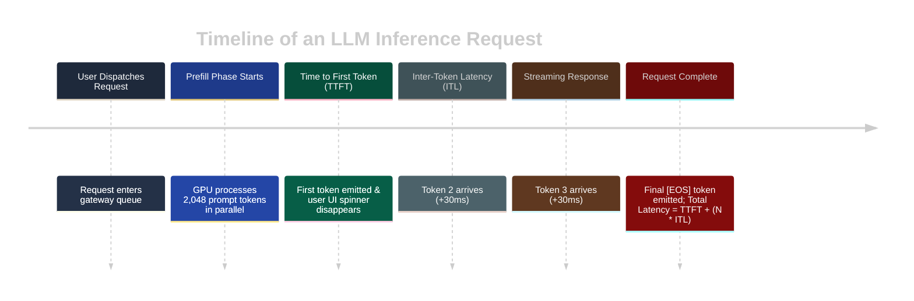

1. **Time to First Token (TTFT):** The duration from when the user hits "Send" until the first generated character streams to the screen. TTFT is dominated by the **Prefill Phase**. If the prompt is 50,000 tokens long, TTFT will be high (e.g., 2–5 seconds).
2. **Inter-Token Latency (ITL) / Time Per Output Token (TPOT):** The time between consecutive streaming tokens during the **Decode Phase** (typically 20ms to 40ms per token, equating to 25–50 tokens/sec).
3. **Total Latency Equation:**
   $$\text{Latency}_{\text{total}} = \text{TTFT} + (N_{\text{output\_tokens}} \times \text{ITL})$$

---

### 4.3 Compute-Bound GEMM vs. Memory-Bandwidth-Bound GEMV Regimes

Why does generating one token take almost as long as processing an entire prompt?

#### The Hardware Arithmetic Intensity Reality:
* **Arithmetic Intensity** is the ratio of compute floating-point operations (FLOPs) performed to bytes of memory transferred from GPU High Bandwidth Memory (HBM) to on-chip SRAM cache:
  $$\text{Arithmetic Intensity} = \frac{\text{FLOPs}}{\text{Bytes Transferred}}$$

| Inference Phase | Tensor Operation | Arithmetic Intensity | Hardware Bottleneck | GPU Utilization |
| :--- | :--- | :--- | :--- | :--- |
| **Prefill Phase** | Matrix-Matrix Multiply (GEMM) | High ($> 100\text{ FLOPs/byte}$) | **Compute-Bound:** Saturates Tensor Cores | $80\%\text{--}95\%$ |
| **Decode Phase** | Matrix-Vector Multiply (GEMV) | Glacially Low ($\approx 1\text{ FLOP/byte}$) | **Memory-Bandwidth-Bound:** Waits on HBM read | $< 5\%$ |

During the decode phase, to generate **a single token**, the GPU must read all 70 billion model weights (140GB in FP16) plus gigabytes of past Key-Value states from HBM into SRAM! The arithmetic calculation takes microseconds; the memory transfer takes tens of milliseconds. Modern inference servers (vLLM, TGI) use **Continuous Batching** to group multiple requests together, converting decode GEMV operations back into high-intensity GEMM batches.

---

# 5. Key-Value (KV) Caching & Memory Footprints

### 5.1 Why KV Caching is Mandatory: Eliminating Quadratic Recomputation

In autoregressive generation, each token generated attends to all previous tokens:

$$\text{Attention}(Q_t, K_{\le t}, V_{\le t}) = \text{Softmax}\left(\frac{Q_t K_{\le t}^T}{\sqrt{d_k}}\right) V_{\le t}$$

#### Without KV Caching (Naive Execution):
To generate token 101, you pass tokens $1\dots 100$ through the entire network to compute their Key and Value vectors.  
To generate token 102, you pass tokens $1\dots 101$ through the entire network again!  
Generating $N$ tokens requires recomputing attention over $\frac{N(N+1)}{2} = \mathcal{O}(N^2)$ states. Generating a 2,000-token answer would take minutes.

#### With KV Caching:
We compute the Key and Value vectors for past tokens **once**, and save them in GPU High Bandwidth Memory (the **KV Cache**). At step $t$, we compute $Q_t, K_t, V_t$ only for the single new token, append $K_t$ and $V_t$ to the cache, and compute attention:

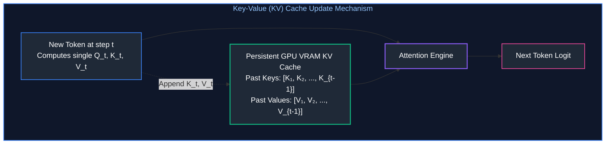

By caching past states, per-token generation complexity drops from quadratic $\mathcal{O}(N^2)$ to linear $\mathcal{O}(N)$ compute!

---

### 5.2 Exact KV Cache Memory Sizing Formula

While KV caching eliminates redundant compute, it introduces a severe physical constraint: **GPU VRAM consumption that grows linearly with sequence length and batch size.**

The exact memory footprint for storing the KV cache of a model is given by:

$$\text{Memory}_{\text{KV}} = 2 \times n_{\text{layers}} \times n_{\text{kv\_heads}} \times d_{\text{head}} \times b_{\text{elem}} \times S \times B$$

Where:
* $2$: Represents the two tensors cached (one for Keys, one for Values).
* $n_{\text{layers}}$: Total number of transformer layers in the model.
* $n_{\text{kv\_heads}}$: Number of Key-Value heads per layer (equals Query heads in MHA; equals $H_Q / \text{GroupSize}$ in GQA; equals $1$ in MQA).
* $d_{\text{head}}$: Hidden dimension of each individual attention head ($\frac{d_{\text{model}}}{n_{\text{q\_heads}}}$).
* $b_{\text{elem}}$: Bytes per floating-point element ($2$ bytes for FP16/BF16; $1$ byte for FP8).
* $S$: Total sequence length (prompt tokens + generated tokens).
* $B$: Concurrent batch size (number of parallel user requests).

---

### 5.3 End-to-End Numerical Walkthrough: LLaMA-3-8B Serving Footprint

Let's calculate the exact KV cache memory required to serve **LLaMA-3-8B-Instruct** under production load:

#### Architectural Parameters of LLaMA-3-8B:
* Layers ($n_{\text{layers}}$): $32$
* Model Dimension ($d_{\text{model}}$): $4096$
* Query Heads ($n_{\text{q\_heads}}$): $32$
* Head Dimension ($d_{\text{head}}$): $4096 / 32 = 128$
* Key-Value Heads ($n_{\text{kv\_heads}}$): $8$ (Uses Grouped-Query Attention!)
* Precision: BF16 ($b_{\text{elem}} = 2$ bytes)

#### Step 1: Memory Per Single Token
$$\text{Bytes Per Token} = 2 \times 32 \times 8 \times 128 \times 2 = 131,072\text{ bytes} = 128\text{ KB per token}$$

#### Step 2: Memory for a Single User with an 8,192-Token Conversation
$$\text{KV Cache Size} = 128\text{ KB/token} \times 8,192\text{ tokens} = 1,048,576\text{ KB} = 1.00\text{ GB per user!}$$

#### Step 3: High-Concurrency Enterprise Serving (Batch Size = 64)
$$\text{Total KV Cache} = 1.00\text{ GB/request} \times 64\text{ concurrent requests} = \mathbf{64.0\text{ GB of VRAM!}}$$

* **Model Weights Footprint:** $8\text{B parameters} \times 2\text{ bytes} = 16\text{ GB}$.
* **Total VRAM Required:** $16\text{ GB (Weights)} + 64\text{ GB (KV Cache)} = \mathbf{80\text{ GB}}$.
* **Hardware Sizing Conclusion:** To serve 64 concurrent users chatting with an 8k context window, a single 80GB NVIDIA A100/H100 GPU is **100% full**. At batch size 65, the server crashes with an Out-Of-Memory (OOM) error unless PagedAttention or quantization is employed!

---

### 5.4 Impact of Context Growth on System Concurrency & VRAM Exhaustion

Notice how KV cache scales with sequence length:

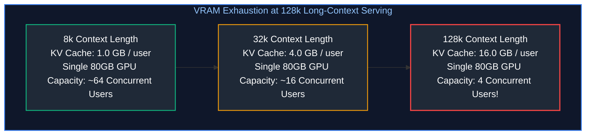

When an enterprise expands context from 8k to 128k tokens, the memory per user jumps by **$16\times$**. On the same GPU hardware, concurrency collapses from 64 simultaneous users down to just 4 users. Solving this memory crisis requires **Grouped-Query Attention (GQA)**, **PagedAttention (vLLM)**, and **FP8/INT4 KV Cache Quantization**.

> [!TIP]
> **Deep-Dive Interview Scenario:**
> - [Q7. How does multi-head attention improve a model's representation power compared to single-head attention?](frequently_asked_questions/02_llm_and_transformer_architecture_faq.md#q7-how-does-multi-head-attention-improve-a-models-representation-power-compared-to-single-head-attention)

---

# 6. Sampling Parameters & Generation Control

### 6.1 Softmax Logit Transformation & Temperature Scaling

The output of the transformer's final linear projection is a vector of unnormalized logits $\mathbf{z} \in \mathbb{R}^{|\mathcal{V}|}$. Sampling transforms these scores into a probability distribution:

$$P(w_i) = \frac{\exp(z_i / T)}{\sum_{j=1}^{|\mathcal{V}|} \exp(z_j / T)}$$

* **$T = 1.0$ (Default):** True model distribution.
* **$T \to 0$ (Greedy Decoding / Argmax):** The highest logit receives probability $1.0$. Outputs are completely deterministic and reproducible. Mandatory for coding, JSON entity extraction, and mathematical calculations.
* **$T > 1.0$ (Creative / High Entropy):** Logits are compressed together, raising the probability of rare and low-ranked words. Increases lexical variety and novelty at the risk of factual hallucination and incoherent reasoning.

---

### 6.2 Top-k Truncation & Top-p (Nucleus) Filtering Walkthrough

#### 1. Top-k Sampling
Restricts sampling strictly to the $k$ most probable tokens, setting all other logits to $-\infty$.
* *Problem with fixed $k$:* In flat distributions where 50 words are plausible, Top-$k$ ($k=5$) prematurely cuts off great candidates. In sharp distributions where only 1 word is valid (e.g., `def` followed by function name), Top-$k$ ($k=5$) forces 4 bad tokens into the candidate pool.

#### 2. Top-p (Nucleus) Sampling (Holtzman et al.)
Dynamically sizes the candidate pool based on cumulative probability mass $p \in (0, 1]$ (typically $p = 0.90$):

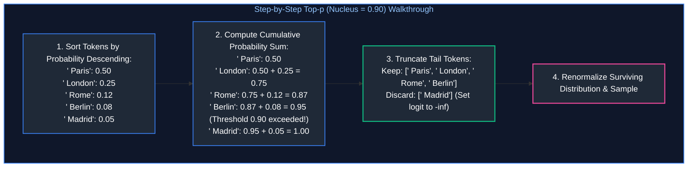

---

### 6.3 Min-p Sampling: The Dynamic Truncation Breakthrough

While Top-p is standard, **Min-p sampling** has emerged as a superior alternative in modern inference runtimes.

Instead of summing cumulative mass, Min-p sets a dynamic cutoff threshold proportional to the **highest single probability $P_{\max}$**:

$$\text{Threshold} = p_{\text{min}} \times P_{\max}$$

Any token with $P(w_i) < \text{Threshold}$ is pruned.
* **When the model is confident ($P_{\max} = 0.90$, $p_{\text{min}} = 0.05$):** Cutoff is $0.05 \times 0.90 = 0.045$. Only tokens with $>4.5\%$ probability survive. The candidate pool shrinks automatically to 1 or 2 tokens.
* **When the model is uncertain ($P_{\max} = 0.10$, $p_{\text{min}} = 0.05$):** Cutoff is $0.05 \times 0.10 = 0.005$. Dozens of plausible tokens survive.

Min-p dynamically adapts to model confidence far more effectively than static Top-p nucleus filtering.

---

### 6.4 Frequency, Presence Penalties & Repetition Control

Autoregressive models can enter degenerative infinite loops (repeating identical phrases or paragraphs):

$$\tilde{z}_i = z_i - (\text{presence\_penalty} \times \mathbb{I}(c_i > 0)) - (\text{frequency\_penalty} \times c_i)$$

Where $c_i$ is the count of times token $i$ has already appeared in the generated text:
* **Presence Penalty ($0.0$ to $2.0$):** A one-time flat penalty applied if a token has appeared at least once. Encourages the model to introduce novel concepts.
* **Frequency Penalty ($0.0$ to $2.0$):** A penalty that scales proportionally with the number of times a token appears. Directly suppresses word repetition.

---

# 7. Reasoning Models & Test-Time Compute Scaling

### 7.1 Thinking Tokens & Hidden Scratchpads (o1, DeepSeek-R1)

Traditional foundation models generate responses immediately upon reading the prompt. For complex logic, multi-step math, or architecture design, this "instant reaction" leads to reasoning failures because the model is forced to commit to a direction in token 1 without planning ahead.

**Reasoning Models (such as OpenAI o1, o3, and DeepSeek-R1)** utilize **Inference-Time Thinking Tokens**:

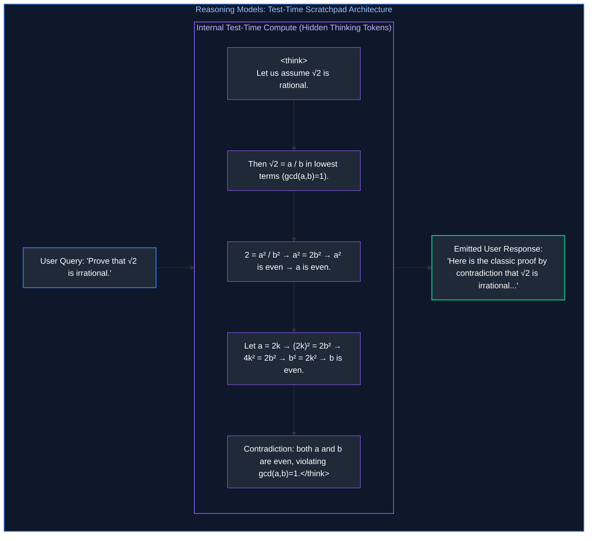

The model generates an internal Chain-of-Thought (CoT) inside an encapsulated `<think>` scratchpad. It evaluates alternative hypotheses, detects logical flaws in its own reasoning, backtracks, and corrects errors *before emitting the first visible user-facing token*.

---

### 7.2 Test-Time Compute Scaling Laws vs. Pretraining Scaling Laws

For years, the AI industry followed **Kaplan & Chinchilla Pretraining Scaling Laws**: to improve model intelligence, increase pretraining dataset size ($D$) and parameter count ($N$).

However, pretraining scaling is encountering physical ceilings (power grid limits, GPU cluster fabric limits, and exhaustion of human-written text). **Test-Time Compute Scaling Laws** provide an entirely new dimension of performance improvement:

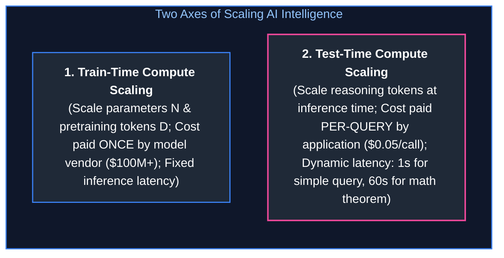

* Spending **1,000 reasoning tokens** at inference time allows an open-weights 7B/14B model (like DeepSeek-R1-Distill) to outperform a non-thinking 70B dense model on competitive programming (Codeforces) and olympiad mathematics (AIME).
* Compute is expended dynamically based on problem difficulty: a simple question uses 0 thinking tokens; an intricate distributed database design question spends 8,000 thinking tokens exploring trade-offs.

---

### 7.3 Production Trade-Offs: When to Invest in Reasoning Budgets

| Task Type | Recommended Architecture | Reasoning Budget Strategy |
| :--- | :--- | :--- |
| **Customer Support Chatbot** | Standard Instruct LLM (e.g., LLaMA-3-8B) | 0 thinking tokens; Minimize TTFT and maximize streaming tokens/sec. |
| **Document Classification / Entity Extraction** | Small Dense / SLM (e.g., Gemma-2-2B, Phi-3) | 0 thinking tokens; Low cost, ultra-fast deterministic decoding ($T=0$). |
| **SQL Generation over Complex Schemas** | Reasoning Model (e.g., DeepSeek-R1, o1-mini) | Medium thinking budget (~500–1,500 tokens) to plan joins and filters. |
| **Security Audit / Vulnerability Analysis** | Frontier Reasoning Model (e.g., o1, Claude 3.5 Sonnet) | Maximum thinking budget; Accuracy outweighs latency concerns completely. |

> [!TIP]
> **Deep-Dive Interview Scenario:**
> - [Q10. What causes attention computation to scale quadratically ($O(N^2)$) with context length, and how do FlashAttention and FlashAttention-2 achieve sub-quadratic I/O efficiency?](frequently_asked_questions/02_llm_and_transformer_architecture_faq.md#q10-what-causes-attention-computation-to-scale-quadratically-on2-with-context-length-and-how-do-flashattention-and-flashattention-2-achieve-sub-quadratic-io-efficiency)

---

# 8. Production Implementation: High-Throughput Inference & KV Cache Sizer

### 8.1 Memory Sizing & Schedulability Engine Blueprint

Below is a complete, production-grade Python systems tool for calculating:
1. **Model Weight Memory** across FP16, FP8, and INT4 precisions.
2. **KV Cache Footprints** across MHA, GQA, and MQA architectures.
3. **Hardware Capacity Limits** on standard enterprise GPUs (NVIDIA A100 80GB, H100 80GB, L40S 48GB).
4. **Maximum Concurrent Serving Limits** before triggering GPU Out-Of-Memory (OOM).

---

### 8.2 Complete Production-Grade Python Calculator

```python
"""
llm_hardware_kv_sizer.py
Production-grade hardware sizing and KV cache capacity planner for LLM serving.
Supports MHA, GQA, and MQA attention mechanisms with precision scaling.
"""

from dataclasses import dataclass
from typing import Dict, Any

@dataclass
class ModelSpec:
    name: str
    total_params_billions: float
    num_layers: int
    num_q_heads: int
    num_kv_heads: int
    head_dim: int
    default_context_len: int

# Canonical Foundation Model Architectural Specifications
CATALOG: Dict[str, ModelSpec] = {
    "llama-3-8b": ModelSpec(
        name="Meta LLaMA-3 8B",
        total_params_billions=8.03,
        num_layers=32,
        num_q_heads=32,
        num_kv_heads=8,      # Grouped-Query Attention (GQA)
        head_dim=128,
        default_context_len=8192
    ),
    "llama-3-70b": ModelSpec(
        name="Meta LLaMA-3 70B",
        total_params_billions=70.6,
        num_layers=80,
        num_q_heads=64,
        num_kv_heads=8,      # Grouped-Query Attention (GQA)
        head_dim=128,
        default_context_len=8192
    ),
    "mistral-7b": ModelSpec(
        name="Mistral 7B v0.1",
        total_params_billions=7.24,
        num_layers=32,
        num_q_heads=32,
        num_kv_heads=8,      # Grouped-Query Attention (GQA)
        head_dim=128,
        default_context_len=32768
    ),
    "legacy-gpt-13b": ModelSpec(
        name="Legacy MHA Model 13B",
        total_params_billions=13.0,
        num_layers=40,
        num_q_heads=40,
        num_kv_heads=40,     # Standard Multi-Head Attention (MHA)
        head_dim=128,
        default_context_len=4096
    )
}

class LLMHardwarePlanner:
    """
    Evaluates GPU VRAM allocation, KV cache growth, and concurrency limits.
    """
    def __init__(self, spec: ModelSpec):
        self.spec = spec

    def compute_weights_memory_gb(self, weight_bits: int = 16) -> float:
        """
        Calculates memory occupied by model parameters in GPU VRAM.
        Formula: (Parameters * (Bits / 8)) / 10^9
        """
        bytes_per_param = weight_bits / 8.0
        return (self.spec.total_params_billions * 1e9 * bytes_per_param) / (1024 ** 3)

    def compute_kv_cache_bytes_per_token(self, kv_bits: int = 16) -> int:
        """
        Calculates KV cache memory consumed by a single token in bytes.
        Formula: 2 (K & V) * n_layers * n_kv_heads * head_dim * bytes_per_element
        """
        bytes_per_elem = kv_bits / 8.0
        # 2 * Layers * KV_Heads * Head_Dim * Bytes
        return int(2 * self.spec.num_layers * self.spec.num_kv_heads * self.spec.head_dim * bytes_per_elem)

    def compute_user_kv_cache_gb(self, context_len: int, kv_bits: int = 16) -> float:
        """
        Calculates total KV cache memory for a single user request at context_len.
        """
        bytes_per_token = self.compute_kv_cache_bytes_per_token(kv_bits)
        total_bytes = bytes_per_token * context_len
        return total_bytes / (1024 ** 3)

    def evaluate_gpu_schedulability(
        self,
        gpu_vram_gb: float,
        target_concurrency: int,
        context_len: int,
        weight_bits: int = 16,
        kv_bits: int = 16,
        cuda_runtime_overhead_gb: float = 2.0
    ) -> Dict[str, Any]:
        """
        Evaluates whether a target concurrency batch size fits on a given GPU hardware setup.
        """
        weights_gb = self.compute_weights_memory_gb(weight_bits)
        per_user_kv_gb = self.compute_user_kv_cache_gb(context_len, kv_bits)
        total_kv_gb = per_user_kv_gb * target_concurrency
        total_required_gb = weights_gb + total_kv_gb + cuda_runtime_overhead_gb

        remaining_vram = gpu_vram_gb - (weights_gb + cuda_runtime_overhead_gb)
        max_possible_concurrency = int(remaining_vram // per_user_kv_gb) if remaining_vram > 0 else 0

        fits_on_hardware = total_required_gb <= gpu_vram_gb

        return {
            "model_name": self.spec.name,
            "weights_vram_gb": round(weights_gb, 2),
            "per_token_kv_bytes": self.compute_kv_cache_bytes_per_token(kv_bits),
            "per_user_kv_gb": round(per_user_kv_gb, 3),
            "total_kv_vram_gb": round(total_kv_gb, 2),
            "total_required_vram_gb": round(total_required_gb, 2),
            "available_gpu_vram_gb": gpu_vram_gb,
            "fits_on_hardware": fits_on_hardware,
            "max_supported_concurrency": max(0, max_possible_concurrency)
        }

def run_production_demo():
    print("=" * 80)
    print(" LLM SERVING & HARDWARE CAPACITY PLANNING REPORT")
    print("=" * 80)

    # Example 1: LLaMA-3-8B on an NVIDIA A100 80GB GPU
    planner_8b = LLMHardwarePlanner(CATALOG["llama-3-8b"])
    report_8b = planner_8b.evaluate_gpu_schedulability(
        gpu_vram_gb=80.0,
        target_concurrency=48,
        context_len=8192,
        weight_bits=16,
        kv_bits=16
    )

    print(f"\n[Hardware Scenario 1: {report_8b['model_name']} on 80GB A100]")
    print(f"  • Model Weights (FP16)      : {report_8b['weights_vram_gb']} GB")
    print(f"  • KV Cache Per User (8k ctx): {report_8b['per_user_kv_gb']} GB")
    print(f"  • Total KV for 48 Users     : {report_8b['total_kv_vram_gb']} GB")
    print(f"  • Total Memory Required     : {report_8b['total_required_vram_gb']} GB / 80.0 GB")
    print(f"  • Schedulable on 1x GPU?    : {report_8b['fits_on_hardware']}")
    print(f"  • Max Possible Concurrency  : {report_8b['max_supported_concurrency']} simultaneous requests")

    # Example 2: Legacy MHA Model comparison (Illustrating MHA vs GQA impact)
    planner_mha = LLMHardwarePlanner(CATALOG["legacy-gpt-13b"])
    report_mha = planner_mha.evaluate_gpu_schedulability(
        gpu_vram_gb=80.0,
        target_concurrency=48,
        context_len=4096,
        weight_bits=16,
        kv_bits=16
    )

    print(f"\n[Hardware Scenario 2: {report_mha['model_name']} (MHA Overhead)]")
    print(f"  • Model Weights (FP16)      : {report_mha['weights_vram_gb']} GB")
    print(f"  • KV Cache Per User (4k ctx): {report_mha['per_user_kv_gb']} GB  <-- (5x larger due to MHA!)")
    print(f"  • Total KV for 48 Users     : {report_mha['total_kv_vram_gb']} GB")
    print(f"  • Schedulable on 1x GPU?    : {report_mha['fits_on_hardware']} (OOM Hazard!)")
    print(f"  • Max Possible Concurrency  : {report_mha['max_supported_concurrency']} simultaneous requests")
    print("=" * 80)

if __name__ == "__main__":
    run_production_demo()
```

---

### 8.3 The 8-Dimension Model Selection Framework

When selecting a foundation model for enterprise production, evaluate options systematically across eight core dimensions:

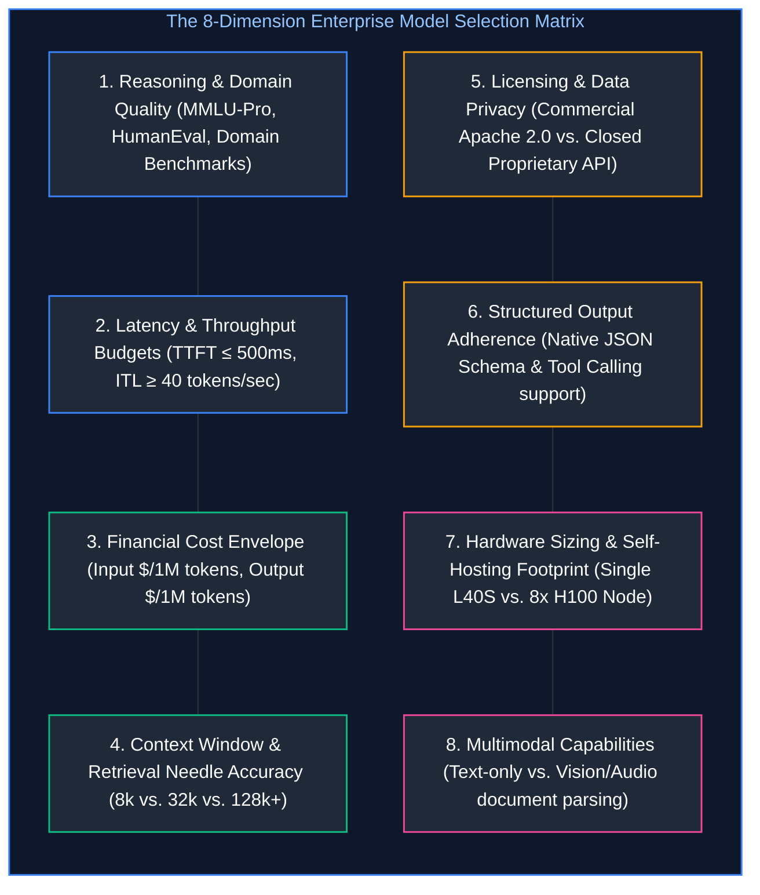

> [!TIP]
> **Deep-Dive Interview Scenario:**
> - [Q9. What is the KV Cache in Transformer inference, why does it consume massive VRAM, and how do Multi-Query (MQA) and Grouped-Query Attention (GQA) optimize it?](frequently_asked_questions/02_llm_and_transformer_architecture_faq.md#q9-what-is-the-kv-cache-in-transformer-inference-why-does-it-consume-massive-vram-and-how-do-multi-query-mqa-and-grouped-query-attention-gqa-optimize-it)

---

# 9. Summary Comparison & Production Engineering Reference Matrix

### Architecture & Runtime Reference Matrix

| Feature / Dimension | Standard Dense Transformer | Mixture-of-Experts (MoE) | Reasoning Model (CoT / Thinking) | Small Language Model (SLM) |
| :--- | :--- | :--- | :--- | :--- |
| **Exemplar Models** | LLaMA-3-8B/70B, Gemma-2-27B | Mixtral 8x7B, DeepSeek-V3 | OpenAI o1/o3, DeepSeek-R1 | Phi-3.5-mini, Gemma-2-2B |
| **Parameter Activation** | $100\%$ active on every token | $10\%\text{--}25\%$ active per token | Varies (often MoE or Dense base) | $100\%$ active (tiny footprint) |
| **Inference Compute Regime** | Fixed $\mathcal{O}(N)$ FLOPs per token | Low FLOPs per token | Dynamic test-time scaling | Ultra-low compute |
| **VRAM Footprint** | Scales directly with parameter count | High (All expert weights in VRAM) | High (Long CoT context window) | Minimal ($< 6\text{ GB}$ fits edge/mobile) |
| **TTFT Profile** | Fast to Moderate | Fast | Extended (1s to 60s thinking loop) | Near-instantaneous ($< 150\text{ms}$) |
| **Best Enterprise Use Case** | General conversational assistants | High-volume API gateways | Multi-step logic, code synthesis, math | On-device extraction, simple routing |

---

# 10. References & Further Reading

1. **Attention Is All You Need:** Vaswani, A., et al. (2017). *Advances in Neural Information Processing Systems (NeurIPS 2017).* [arXiv:1706.03762](https://arxiv.org/abs/1706.03762).
2. **LLaMA: Open and Efficient Foundation Language Models:** Touvron, H., et al. (2023). *Meta AI Research.* [arXiv:2302.13971](https://arxiv.org/abs/2302.13971).
3. **Mixtral of Experts:** Jiang, A. Q., et al. (2024). *Mistral AI.* [arXiv:2401.04088](https://arxiv.org/abs/2401.04088).
4. **DeepSeek-V3 Technical Report:** DeepSeek-AI Team (2024). *DeepSeek.* [arXiv:2412.19437](https://arxiv.org/abs/2412.19437).
5. **The Nucleus Sampling Breakthrough (The Curious Case of Neural Text Degeneration):** Holtzman, A., et al. (2020). *ICLR 2020.* [arXiv:1904.09751](https://arxiv.org/abs/1904.09751).
6. **SentencePiece: A simple and language independent subword tokenizer:** Kudo, T., & Richardson, J. (2018). *EMNLP 2018.* [arXiv:1808.06226](https://arxiv.org/abs/1808.06226).
7. **vLLM: Efficient Memory Management for Large Language Model Serving with PagedAttention:** Kwon, W., et al. (2023). *SOSP 2023.* [arXiv:2309.06180](https://arxiv.org/abs/2309.06180).
8. **DeepSeek-R1: Incentivizing Reasoning Capability in LLMs via Reinforcement Learning:** DeepSeek-AI Team (2025). [arXiv:2501.12948](https://arxiv.org/abs/2501.12948).
