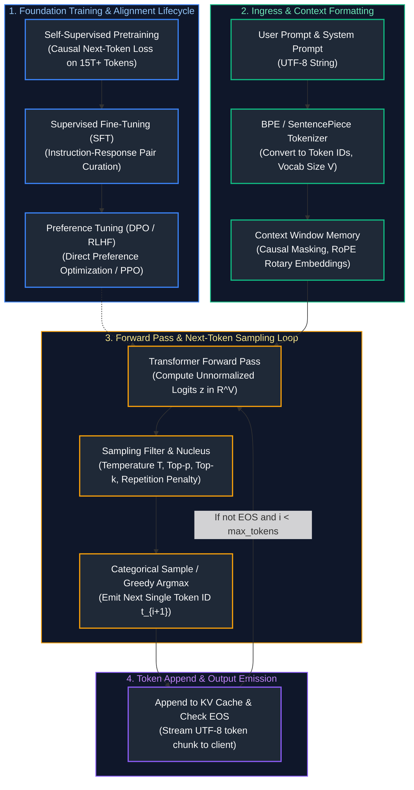
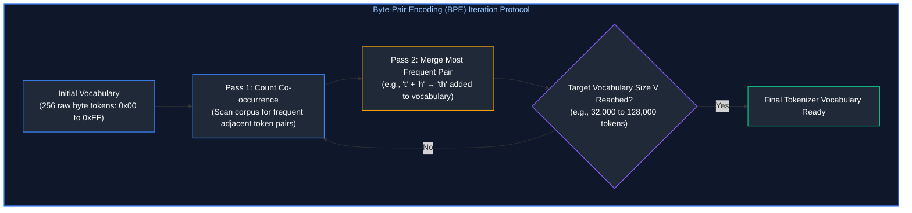
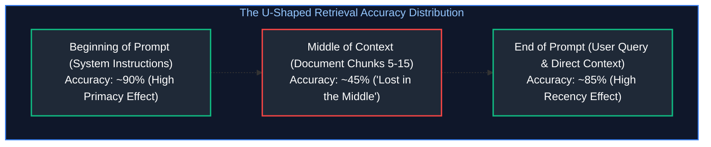
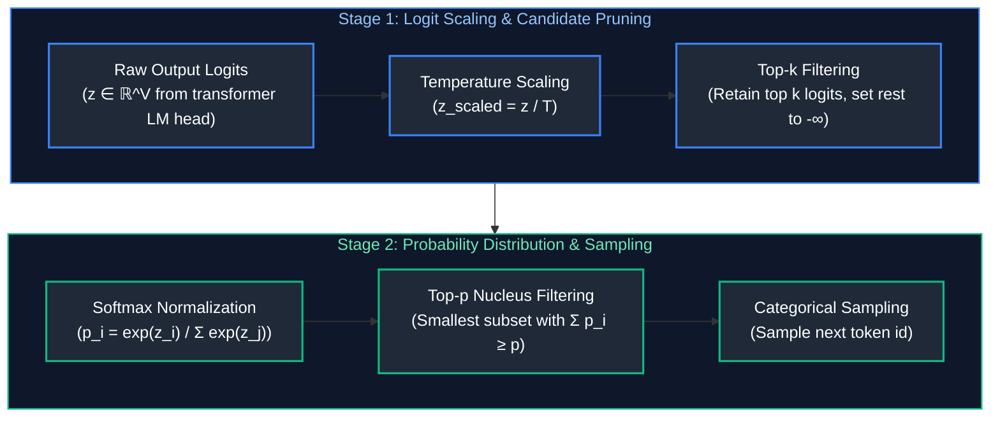

# 03. Large Language Model Foundations & Mechanics

A comprehensive, production-grade guide to Large Language Model (LLM) mathematical fundamentals, Byte-Pair Encoding (BPE) tokenization, autoregressive next-token prediction, context window dynamics, pretraining vs. instruction tuning, sampling mechanics, hallucinations, open-weight vs. hosted models, quantization physics, and Pareto frontier model selection tailored for AI Engineers.

---

## Architectural Overview: LLM Lifecycle & Autoregressive Generation Pipeline



---

## Table of Contents
1. [Tokenization Theory & Algorithms: BPE, WordPiece, SentencePiece](#1-tokenization-theory-algorithms-bpe-wordpiece-sentencepiece)
   - [1.1 Byte-Pair Encoding (BPE) Mechanics & Byte-Fallback](#11-byte-pair-encoding-bpe-mechanics-byte-fallback)
   - [1.2 Tokenizer Pitfalls: Leading Whitespace, Multi-Lingual Bloat & Numbers](#12-tokenizer-pitfalls-leading-whitespace-multi-lingual-bloat-numbers)
2. [Context Windows, Attention Horizons & "Lost in the Middle"](#2-context-windows-attention-horizons-lost-in-the-middle)
   - [2.1 Context Horizon Scaling (RoPE Interpolation & YaRN)](#21-context-horizon-scaling-rope-interpolation-yarn)
   - [2.2 The U-Shaped Attention Curve & Retrieval Placement Strategies](#22-the-u-shaped-attention-curve-retrieval-placement-strategies)
3. [Autoregressive Next-Token Prediction Mechanics](#3-autoregressive-next-token-prediction-mechanics)
   - [3.1 Logit Generation & The Vocabulary Projection Layer](#31-logit-generation-the-vocabulary-projection-layer)
   - [3.2 Pretraining Loss: Perplexity & Cross-Entropy](#32-pretraining-loss-perplexity-cross-entropy)
4. [Training & Alignment Continuum: Pretraining vs. SFT vs. RLHF/DPO](#4-training-alignment-continuum-pretraining-vs-sft-vs-rlhfdpo)
   - [4.1 Self-Supervised Pretraining & Scaling Laws](#21-context-horizon-scaling-rope-interpolation-yarn)
   - [4.2 Supervised Fine-Tuning (SFT) & Chat Templates](#4-training-alignment-continuum-pretraining-vs-sft-vs-rlhfdpo)
   - [4.3 Direct Preference Optimization (DPO) vs. PPO (RLHF)](#43-direct-preference-optimization-dpo-vs-ppo-rlhf)
5. [Inference Decoding & Sampling Hyperparameters](#5-inference-decoding-sampling-hyperparameters)
   - [5.1 Temperature Scaling, Top-k, Top-p (Nucleus Sampling)](#51-temperature-scaling-top-k-top-p-nucleus-sampling)
   - [5.2 Repetition Penalties, Frequency Penalties & Presence Penalties](#5-inference-decoding-sampling-hyperparameters)
6. [Hallucinations & Model Limitations: Epistemic vs. Aleatoric](#6-hallucinations-model-limitations-epistemic-vs-aleatoric)
   - [6.1 Root Causes: Knowledge Cutoff, Sycophancy & Probabilistic Compression](#61-root-causes-knowledge-cutoff-sycophancy-probabilistic-compression)
   - [6.2 Production Mitigation: Grounding, Self-Consistency & Chain-of-Verification](#62-production-mitigation-grounding-self-consistency-chain-of-verification)
7. [Hosted Frontier LLMs vs. Open-Weight Architectures](#7-hosted-frontier-llms-vs-open-weight-architectures)
   - [7.1 Architectural Decision Matrix](#71-architectural-decision-matrix)
   - [7.2 Total Cost of Ownership (TCO) & Privacy Trade-offs](#62-production-mitigation-grounding-self-consistency-chain-of-verification)
8. [Quantization Physics & Model Compression Fundamentals](#8-quantization-physics-model-compression-fundamentals)
   - [8.1 Post-Training Quantization (PTQ) vs. QAT](#81-post-training-quantization-ptq-vs-qat)
   - [8.2 Quantization Schemes: AWQ, GPTQ, GGUF, FP8](#82-quantization-schemes-awq-gptq-gguf-fp8)
9. [Summary Comparison & Engineering Reference Matrix](#9-summary-comparison-engineering-reference-matrix)
10. [References & Further Reading](#10-references-further-reading)

---

# 1. Tokenization Theory & Algorithms: BPE, WordPiece, SentencePiece

### 1.1 Byte-Pair Encoding (BPE) Mechanics & Byte-Fallback

LLMs do not process raw Unicode strings directly. A tokenizer converts text into a sequence of discrete integer token IDs. **Byte-Pair Encoding (BPE)** is a compression algorithm that iteratively merges the most frequent pairs of bytes/characters in a training corpus:



In modern tokenizers (`tiktoken`, Hugging Face `tokenizers`), **Byte-Fallback** ensures that any unknown Unicode character or emoji decomposes gracefully into UTF-8 constituent bytes, completely eliminating out-of-vocabulary (`<unk>`) token exceptions.

```python
# ==============================================================================
# Production Tokenization Inspection with tiktoken & Token-to-Byte Mapping
# ==============================================================================
import tiktoken

# 1. Instantiate the o200k_base tokenizer (GPT-4o)
tokenizer = tiktoken.get_encoding("o200k_base")

text_sample = "AI Engineering requires $100M infrastructure & multi-agent systems."

# 2. Encode string into integer token IDs
token_ids = tokenizer.encode(text_sample)
print(f"Original Text: '{text_sample}'")
print(f"Total Character Length: {len(text_sample)}")
print(f"Total Token Count: {len(token_ids)}")
print(f"Compression Ratio: {len(text_sample) / len(token_ids):.2f} chars/token\n")

# 3. Dissect individual token boundaries and byte representations
print(f"{'Token ID':<10} | {'Byte Sequence':<25} | {'Decoded Substring'}")
print("-" * 55)
for tid in token_ids:
    raw_bytes = tokenizer.decode_single_token_bytes(tid)
    decoded_str = raw_bytes.decode("utf-8", errors="replace")
    print(f"{tid:<10} | {str(raw_bytes):<25} | '{decoded_str}'")
```

---

### 1.2 Tokenizer Pitfalls: Leading Whitespace, Multi-Lingual Bloat & Numbers

1. **Leading Whitespace Sensitivity:** `" hello"` and `"hello"` produce different token IDs. Tokenizers typically prefix subwords with space tokens (e.g., `Ġhello`).
2. **Multi-Lingual Token Bloat:** Tokenizers trained predominantly on English text allocate single tokens to complex English words, but fragment non-Latin scripts (Hindi, Japanese, Arabic) into individual UTF-8 bytes (3 to 4 tokens per character), inflating API costs and latency by $3\times$ to $5\times$.
3. **Arithmetic Incompetence:** If number `"123456"` is tokenized unpredictably as `["12", "345", "6"]` or `["123", "456"]`, the transformer cannot align digit columns during internal autoregressive generation, causing basic arithmetic errors.

---

# 2. Context Windows, Attention Horizons & "Lost in the Middle"

### 2.1 Context Horizon Scaling (RoPE Interpolation & YaRN)

The maximum sequence length an LLM can process without catastrophic attention degradation is bounded by its pretraining positional horizon (e.g., 8,192 tokens).

To extend context horizons (e.g., from 8k to 128k tokens):
- **Linear RoPE Interpolation:** Scales rotary position frequencies by factor $\alpha = \frac{L_{new}}{L_{old}}$:
  $$\theta_i' = \frac{\theta_i}{\alpha}$$
  Compresses high-frequency dimensions, blurring short-range token relationships.
- **YaRN (Yet another RoPE extensioN):** Applies non-uniform interpolation: retains high-frequency dimensions uncompressed (preserving local grammatical resolution) while interpolating low frequencies (accommodating global long-range document context).

---

### 2.2 The U-Shaped Attention Curve & Retrieval Placement Strategies



> [!IMPORTANT]
> **Production Context Placement Rule:** Due to the "Lost in the Middle" phenomenon (Liu et al., 2023), always position critical mission instructions and few-shot exemplars at the **very top** (system prompt), and the **most relevant retrieved chunks immediately preceding the final user question** at the very bottom. Never place primary decision-making context in the middle of a 100k-token prompt.

---

# 3. Autoregressive Next-Token Prediction Mechanics

### 3.1 Logit Generation & The Vocabulary Projection Layer

For a model with hidden dimension $d$ and vocabulary size $V$ (e.g., $V = 128,256$ in Llama 3):
1. The final Transformer block outputs a continuous hidden state $\mathbf{h}_S \in \mathbb{R}^d$ for the current sequence position $S$.
2. The language model head projects $\mathbf{h}_S$ onto vocabulary logits $\mathbf{z} \in \mathbb{R}^V$ using weight matrix $\mathbf{W}_{\text{unembed}} \in \mathbb{R}^{V \times d}$:
   $$\mathbf{z} = \mathbf{W}_{\text{unembed}} \mathbf{h}_S$$
3. Softmax normalizes logits into categorical probabilities:
   $$P(w_{S+1} = k) = \frac{e^{z_k}}{\sum_{j=1}^V e^{z_j}}$$

---

### 3.2 Pretraining Loss: Perplexity & Cross-Entropy

During pretraining across corpus $\mathcal{W} = (w_1, \dots, w_N)$, the model minimizes autoregressive cross-entropy loss:

$$\mathcal{L} = - \frac{1}{N} \sum_{i=1}^N \log P(w_i | w_1, \dots, w_{i-1})$$

**Perplexity ($\text{PPL}$)** measures the effective branching factor:
$$\text{PPL} = \exp(\mathcal{L}) = \exp\left( - \frac{1}{N} \sum_{i=1}^N \log P(w_i | w_{<i}) \right)$$
A model with $\text{PPL} = 15$ predicts next tokens as accurately as if it were choosing uniformly among 15 plausible candidates at each step.

---

# 4. Training & Alignment Continuum: Pretraining vs. SFT vs. RLHF/DPO

| Stage | Dataset Type & Volume | Primary Objective |
| :--- | :--- | :--- |
| **1. Pretraining** | 10T – 20T tokens of web text, code, books, papers. | World knowledge acquisition, grammatical syntax, next-token reasoning. |
| **2. Supervised Fine-Tuning (SFT)** | 50k – 500k curated (prompt, golden response) dialogues. | Instruction-following, chat formatting, tool calling syntax. |
| **3. Preference Tuning (DPO / RLHF)** | 50k – 200k pairwise samples (prompt, chosen, rejected). | Safety alignment, helpfulness, tone calibration, anti-refusal behavior. |

### 4.3 Direct Preference Optimization (DPO) vs. PPO (RLHF)

In classical RLHF with Proximal Policy Optimization (PPO), a separate Reward Model $r_\psi(x, y)$ is trained, and an actor policy $\pi_\theta$ is updated via reinforcement learning against the reward model with a KL-divergence penalty against base policy $\pi_{\text{ref}}$.

**DPO (Rafailov et al., 2023)** mathematically proves that the reward can be represented directly through the policy itself, eliminating the reward model and complex RL instability:

$$\mathcal{L}_{\text{DPO}}(\pi_\theta; \pi_{\text{ref}}) = - \mathbb{E}_{(x, y_w, y_l)} \left[ \log \sigma \left( \beta \log \frac{\pi_\theta(y_w|x)}{\pi_{\text{ref}}(y_w|x)} - \beta \log \frac{\pi_\theta(y_l|x)}{\pi_{\text{ref}}(y_l|x)} \right) \right]$$

where $y_w$ is the preferred response and $y_l$ is the dispreferred response.

---

# 5. Inference Decoding & Sampling Hyperparameters



### 5.1 Temperature Scaling, Top-k, Top-p (Nucleus Sampling)

Below is an explicit Python implementation of the complete sampling filter pipeline operating on raw logits:

```python
# ==============================================================================
# Production Autoregressive Sampling Engine with Temperature, Top-k, Top-p
# ==============================================================================
import torch
import torch.nn.functional as F

def sample_next_token(
    logits: torch.Tensor,
    temperature: float = 0.7,
    top_k: int = 50,
    top_p: float = 0.90,
    repetition_penalty: float = 1.1,
    generated_tokens: list[int] | None = None
) -> int:
    """Production sampling algorithm matching vLLM / HuggingFace generation pipeline."""
    # 1. Apply repetition penalty to previously emitted tokens
    if generated_tokens and repetition_penalty != 1.0:
        for tid in set(generated_tokens):
            if logits[tid] < 0:
                logits[tid] = logits[tid] * repetition_penalty
            else:
                logits[tid] = logits[tid] / repetition_penalty

    # 2. Temperature scaling (T -> 0 behaves as deterministic greedy argmax)
    if temperature == 0.0:
        return int(torch.argmax(logits).item())
    
    scaled_logits = logits / temperature

    # 3. Top-k filtering: retain only the top k tokens, masking out the tail
    if top_k > 0:
        indices_to_remove = scaled_logits < torch.topk(scaled_logits, top_k)[0][..., -1, None]
        scaled_logits[indices_to_remove] = float("-inf")

    # 4. Softmax probability conversion
    probs = F.softmax(scaled_logits, dim=-1)

    # 5. Top-p (Nucleus) filtering: retain smallest set whose cumulative prob >= top_p
    if 0.0 < top_p < 1.0:
        sorted_probs, sorted_indices = torch.sort(probs, descending=True)
        cumulative_probs = torch.cumsum(sorted_probs, dim=-1)

        # Remove tokens with cumulative probability above threshold
        sorted_indices_to_remove = cumulative_probs > top_p
        # Shift mask right by 1 to keep the first token that crossed the threshold
        sorted_indices_to_remove[..., 1:] = sorted_indices_to_remove[..., :-1].clone()
        sorted_indices_to_remove[..., 0] = 0

        indices_to_remove = sorted_indices[sorted_indices_to_remove]
        probs[indices_to_remove] = 0.0
        probs = probs / torch.sum(probs)  # Re-normalize

    # 6. Multinomial categorical draw
    next_token_id = int(torch.multinomial(probs, num_samples=1).item())
    return next_token_id

# Example verification: simulated vocabulary logits (V = 10)
mock_logits = torch.tensor([2.0, 1.5, 0.1, -1.2, 5.0, 4.2, 0.0, -0.5, 3.1, 1.0])
sampled_id = sample_next_token(mock_logits, temperature=0.7, top_k=5, top_p=0.85)
print(f"Sampled Next Token ID: {sampled_id}")
```

---

# 6. Hallucinations & Model Limitations: Epistemic vs. Aleatoric

### 6.1 Root Causes: Knowledge Cutoff, Sycophancy & Probabilistic Compression

1. **Epistemic Uncertainty (Lack of Knowledge):** The model was never exposed to the specific factual entity during training (or the entity occurred fewer than 5 times in pretraining corpora). The model constructs a syntactically plausible completion based on statistical word associations.
2. **Aleatoric Uncertainty (Inherent Ambiguity):** The prompt admits multiple mutually incompatible factual answers depending on hidden context or timeframes.
3. **Sycophancy:** Instruction-tuned models are aligned to satisfy user premises. If a user asks *"Why did Leonardo da Vinci design the internet in 1500?"*, the model may acquiesce rather than push back, unless grounded with strict guardrails.

---

### 6.2 Production Mitigation: Grounding, Self-Consistency & Chain-of-Verification

```text
TACTICAL MITIGATION PROTOCOLS:
1. Retrieval Grounding: Inject external authoritative documents into prompt (RAG).
2. Constrained System Directives: "Answer exclusively based on the provided text.
   If the answer cannot be verified from the context, state 'INSUFFICIENT CONTEXT'."
3. Chain-of-Verification (CoVe):
   Step 1: Baseline generation.
   Step 2: Generate independent verification questions for each factual claim.
   Step 3: Answer verification questions against retrieved knowledge.
   Step 4: Synthesize verified final output.
4. Structured Logit Decoding: Force output into predefined JSON Schema (JSON mode).
```

---

# 7. Hosted Frontier LLMs vs. Open-Weight Architectures

### 7.1 Architectural Decision Matrix

| Dimension | Hosted Frontier APIs (GPT-4o, Claude 3.5, Gemini) | Open-Weight Models (Llama 3.1/3.3, Mistral, Qwen) |
| :--- | :--- | :--- |
| **Reasoning / Benchmark Capability** | Highest zero-shot reasoning and complex coding scores. | Matches frontier on domain-fine-tuned or targeted tasks. |
| **Time to Market** | Instant setup (API call). Zero infrastructure to run. | Requires infrastructure, serving engine, GPU cluster. |
| **Data Privacy & IP** | Third-party API transit; governed by enterprise DPA. | Air-gapped on-premise or private VPC; zero data leaks. |
| **Latency Predictability** | Prone to internet jitter & provider peak-hour queues. | Predictable, SLA-controlled dedicated GPU hardware. |
| **Cost at Scale** | High per-token costs at high concurrency (\$ >100M/mo). | Substantially lower marginal cost per token at saturation. |
| **Customization** | Limited to prompt/few-shot or API fine-tuning. | Full parameter fine-tuning, custom vocabularies, LoRA. |

---

# 8. Quantization Physics & Model Compression Fundamentals

### 8.1 Post-Training Quantization (PTQ) vs. QAT

Quantization converts high-precision floating-point weights (FP16/BF16: 2 bytes per parameter) into low-precision integers (INT8: 1 byte, INT4: 0.5 bytes) to reduce GPU VRAM and bandwidth requirements.

- **Affine Quantization Formula:**
  $$q = \text{round}\left( \frac{x}{S} \right) + Z, \quad \tilde{x} = S \cdot (q - Z)$$
  where $S$ is the scale factor and $Z$ is the zero-point integer offset.
- **Symmetric Quantization ($Z = 0$):**
  $$S = \frac{\max(|x|)}{2^{b-1} - 1}$$

---

### 8.2 Quantization Schemes: AWQ, GPTQ, GGUF, FP8

| Method | Weight / Activation Format | Advantages & Serving Engines |
| :--- | :--- | :--- |
| **GPTQ** | INT4 Weights / FP16 Activations (W4A16) | Layer-by-layer second-order Hessian optimization. High throughput on vLLM/TGI. |
| **AWQ** (Activation-aware) | INT4 Weights / FP16 Activations (W4A16) | Protects top 1% salient channels; superior perplexity retention on LLMs. |
| **FP8** (E4M3 / E5M2) | FP8 Weights / FP8 Activations (W8A8) | Supported natively on Hopper H100; zero perplexity drop with 2x speedup. |
| **GGUF** (llama.cpp) | INT2 to INT8 Mixed (k-quants) | Designed for CPU & Apple Silicon unified memory inference. |

> [!CAUTION]
> Naive INT4 quantization across all weights without activation-awareness (such as AWQ) breaks model coherence on complex math and multi-step reasoning. Always evaluate perplexity on Wikitext-2 and domain benchmarks before deploying quantized models to production.

---

# 9. Summary Comparison & Engineering Reference Matrix

| Model Class | Parameter Count | VRAM Requirement (FP16) | VRAM Requirement (INT4 AWQ) | Recommended Production Hardware |
| :--- | :--- | :--- | :--- | :--- |
| **Small (Llama-3.2-3B)** | 3.2 Billion | ~6.5 GB | ~2.5 GB | 1x NVIDIA RTX 4090 or T4 |
| **Mid (Llama-3.1-8B)** | 8.0 Billion | ~16 GB | ~5.5 GB | 1x NVIDIA A10G (24GB) or L4 |
| **Large (Llama-3.3-70B)**| 70.6 Billion | ~145 GB | ~40 GB | 1x-2x NVIDIA A100 (80GB) |
| **Frontier (Mixtral 8x22B)**| 141 Billion (39B active)| ~290 GB | ~85 GB | 2x-4x NVIDIA H100 (80GB) |

---

# 10. References & Further Reading

- [Tiktoken: Fast BPE Tokenizer in Rust and Python (OpenAI)](https://github.com/openai/tiktoken)
- [Lost in the Middle: How Language Models Use Long Contexts (Liu et al., 2023)](https://arxiv.org/abs/2307.03172)
- [Direct Preference Optimization: Your Language Model is Secretly a Reward Model (Rafailov et al., 2023)](https://arxiv.org/abs/2305.18290)
- [AWQ: Activation-aware Weight Quantization for LLM Compression and Acceleration (Lin et al., 2023)](https://arxiv.org/abs/2306.00978)
- [Llama 3 Model Architecture & Technical Overview (Meta AI, 2024)](https://ai.meta.com/research/publications/the-llama-3-herd-of-models/)

