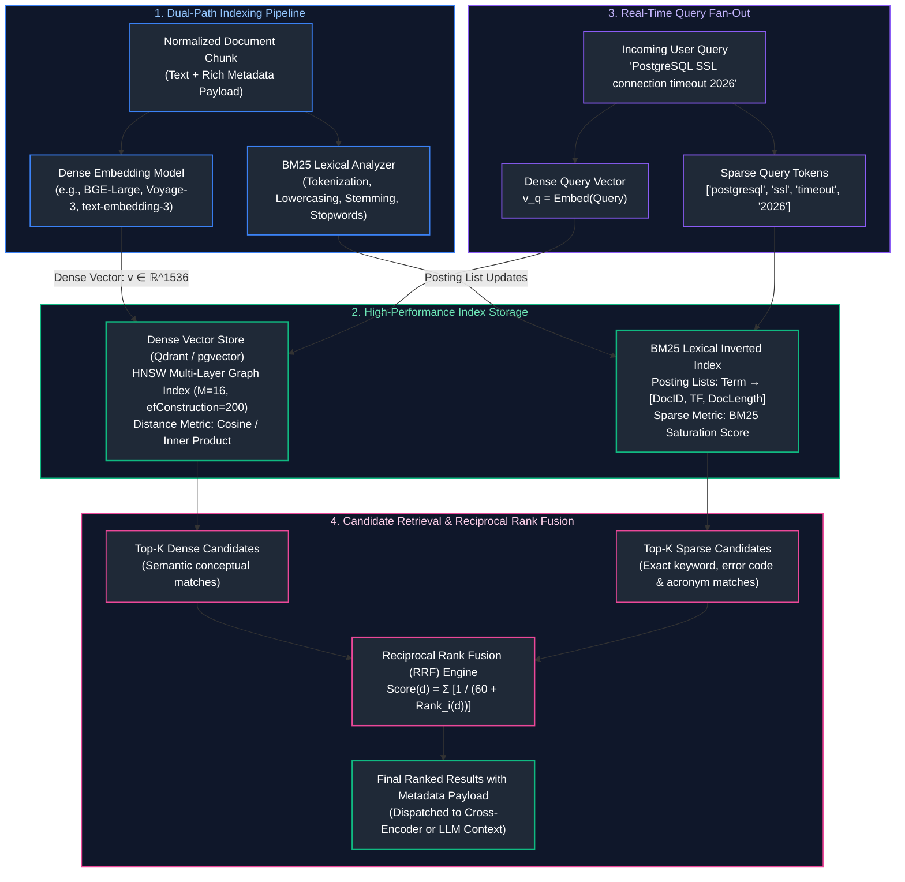
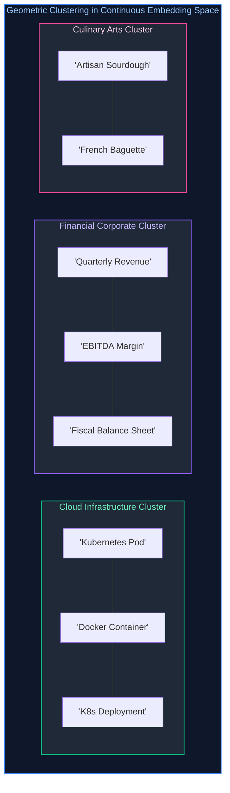
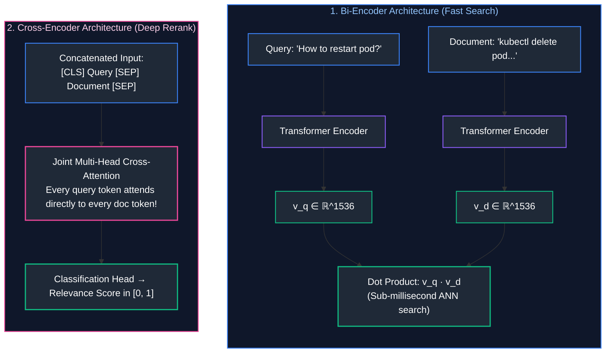
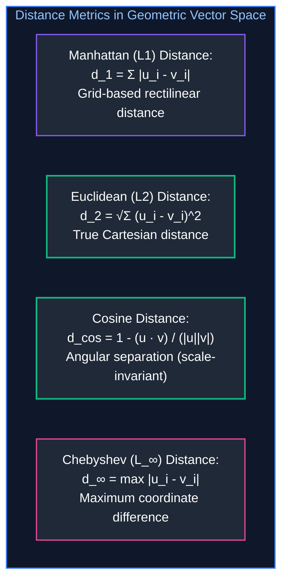
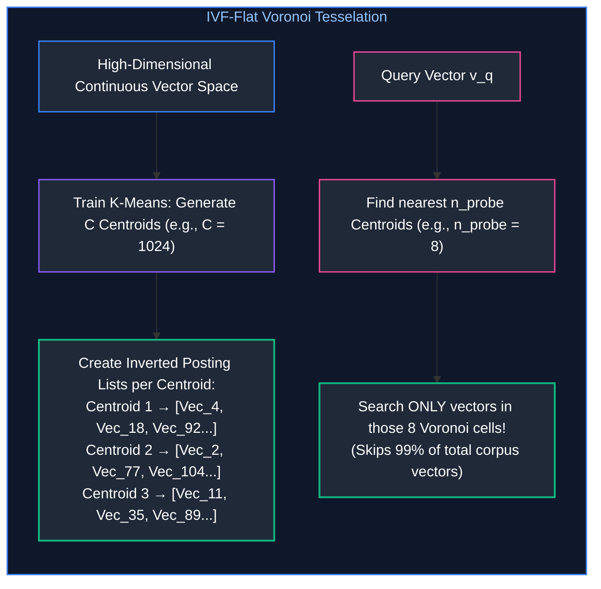
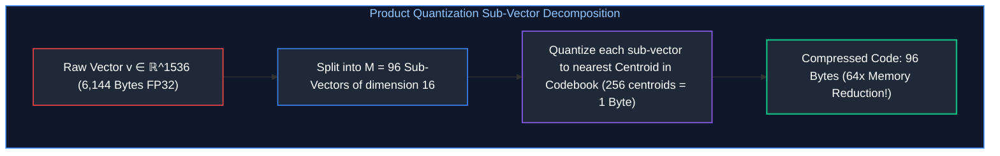
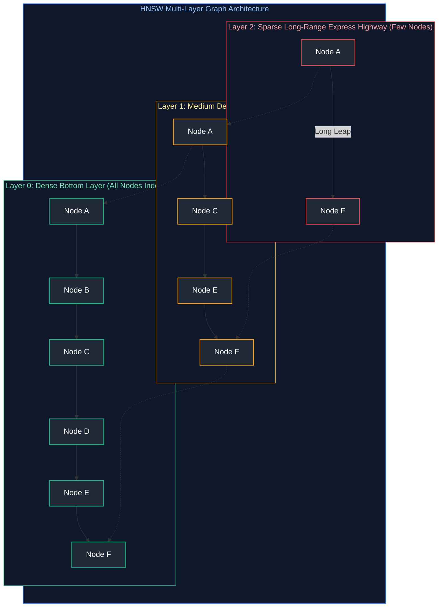
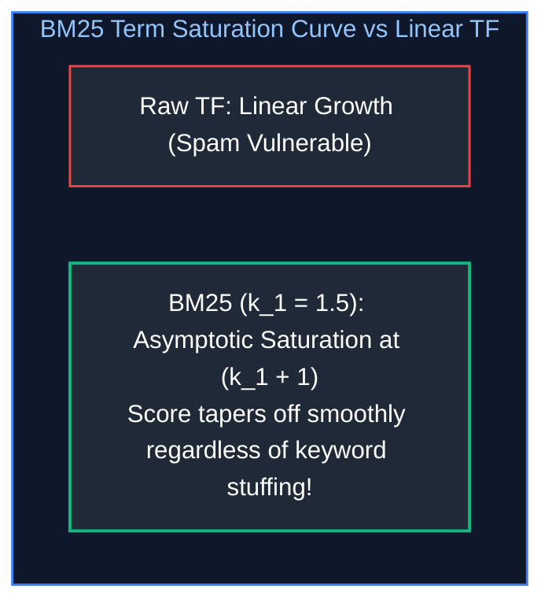

# 04. Embeddings, Vector Databases & Semantic Search

A comprehensive, production-grade guide to vector embeddings, geometric semantic spaces, mathematical distance metrics, exact bare-metal $k\text{NN}$ search, Approximate Nearest Neighbor (ANN) algorithms (IVF-Flat, Product Quantization, HNSW), production vector databases (pgvector, Qdrant), sparse lexical search (BM25), and hybrid retrieval via Reciprocal Rank Fusion (RRF). Tailored for AI Engineers, Search Infrastructure Architects, and Systems Practitioners.

---

## Architectural Overview: High-Scale Hybrid Search Engine Pipeline

The diagram below illustrates the end-to-end dataflow of a production hybrid search system, indexing raw document chunks into both dense vector indices (HNSW) and sparse inverted indices (BM25), then fusing candidate sets via Reciprocal Rank Fusion (RRF).



---

## Table of Contents
1. [Vector Embeddings & Semantic Geometry](#1-vector-embeddings--semantic-geometry)
   - [1.1 Continuous Representation of Natural Language: The Map Analogy](#11-continuous-representation-of-natural-language-the-map-analogy)
   - [1.2 Modern Embedding Architectures: Bi-Encoders vs. Cross-Encoders](#12-modern-embedding-architectures-bi-encoders-vs-cross-encoders)
   - [1.3 Pooling Strategies: CLS Token vs. Mean Pooling](#13-pooling-strategies-cls-token-vs-mean-pooling)
   - [1.4 The Incompatible Vector Space Law](#14-the-incompatible-vector-space-law)
2. [Mathematical Distance Metrics](#2-mathematical-distance-metrics)
   - [2.1 Cosine Similarity & Angular Distance](#21-cosine-similarity--angular-distance)
   - [2.2 Dot Product (Inner Product) Mechanics & SIMD Acceleration](#22-dot-product-inner-product-mechanics--simd-acceleration)
   - [2.3 Euclidean Distance ($L_2$) and the Metric Equivalence Proof](#23-euclidean-distance-l_2-and-the-metric-equivalence-proof)
   - [2.4 Metric Comparison Space: L1, L2, Cosine & Chebyshev](#24-metric-comparison-space-l1-l2-cosine--chebyshev)
3. [Exact Nearest Neighbor Search ($k\text{NN}$) from Scratch](#3-exact-nearest-neighbor-search-knn-from-scratch)
   - [3.1 The Computational Complexity of Brute-Force Search](#31-the-computational-complexity-of-brute-force-search)
   - [3.2 Memory Bandwidth Saturation & GEMV Bottlenecks](#32-memory-bandwidth-saturation--gemv-bottlenecks)
   - [3.3 Bare-Metal Python $k\text{NN}$ Implementation](#33-bare-metal-python-knn-implementation)
   - [3.4 Blind Spots of Pure Semantic Vector Search](#34-blind-spots-of-pure-semantic-vector-search)
4. [Approximate Nearest Neighbor (ANN) Indexing](#4-approximate-nearest-neighbor-ann-indexing)
   - [4.1 The Curse of Dimensionality & Sub-Linear Search](#41-the-curse-of-dimensionality--sub-linear-search)
   - [4.2 Inverted File Indexing (IVF-Flat) & Voronoi Cells](#42-inverted-file-indexing-ivf-flat--voronoi-cells)
   - [4.3 Product Quantization (IVF-PQ) & Vector Compression](#43-product-quantization-ivf-pq--vector-compression)
   - [4.4 Scalar Quantization (SQ8) vs. Product Quantization (PQ)](#44-scalar-quantization-sq8-vs-product-quantization-pq)
5. [Graph-Based Search: Hierarchical Navigable Small World (HNSW)](#5-graph-based-search-hierarchical-navigable-small-world-hnsw)
   - [5.1 Small World Networks & The 1D Skip-List Analogy](#51-small-world-networks--the-1d-skip-list-analogy)
   - [5.2 Multi-Layer Graph Construction Mechanics](#52-multi-layer-graph-construction-mechanics)
   - [5.3 Search Parameters: Sizing $M$, `efConstruction`, and `efSearch`](#53-search-parameters-sizing-m-efconstruction-and-efsearch)
   - [5.4 Heuristic Edge Selection & Graph Percolation Defense](#54-heuristic-edge-selection--graph-percolation-defense)
6. [Production Vector Databases (pgvector & Qdrant)](#6-production-vector-databases-pgvector--qdrant)
   - [6.1 Relational Integration with `pgvector`](#61-relational-integration-with-pgvector)
   - [6.2 Specialized High-Throughput Engines: Qdrant Architecture](#62-specialized-high-throughput-engines-qdrant-architecture)
   - [6.3 Metadata Payloads, Filtering Strategies & ACID Guarantees](#63-metadata-payloads-filtering-strategies--acid-guarantees)
7. [Sparse Lexical Search & Hybrid Retrieval](#7-sparse-lexical-search--hybrid-retrieval)
   - [7.1 Term Frequency, Inverted Indices & BM25 Mechanics](#71-term-frequency-inverted-indices--bm25-mechanics)
   - [7.2 Mathematical Derivation of Term Saturation ($k_1$) and Length Penalty ($b$)](#72-mathematical-derivation-of-term-saturation-k_1-and-length-penalty-b)
   - [7.3 Dense vs. Sparse Capability Trade-Offs](#73-dense-vs-sparse-capability-trade-offs)
   - [7.4 Reciprocal Rank Fusion (RRF) & Why Score Addition Fails](#74-reciprocal-rank-fusion-rrf--why-score-addition-fails)
8. [Production Implementation: End-to-End Hybrid Search Engine](#8-production-implementation-end-to-end-hybrid-search-engine)
   - [8.1 Hybrid Engine Architectural Blueprint](#81-hybrid-engine-architectural-blueprint)
   - [8.2 Complete Production-Grade Python Implementation](#82-complete-production-grade-python-implementation)
   - [8.3 Memory Sizing, Index Rebuilding & Drift Mitigation](#83-memory-sizing-index-rebuilding--drift-mitigation)
9. [Summary Comparison & Engineering Reference Matrix](#9-summary-comparison--engineering-reference-matrix)
10. [References & Further Reading](#10-references--further-reading)

---

## 1. Vector Embeddings & Semantic Geometry

### 1.1 Continuous Representation of Natural Language: The Map Analogy

In classical computer science, text is represented as discrete symbolic strings. In an inverted index or relational database, the words `"automobile"` and `"car"` are completely distinct strings. A query for `"car"` has zero lexical overlap with `"automobile"`.

#### The One-Hot Encoding Catastrophe:
To represent vocabulary symbols as vectors, early NLP used **One-Hot Vectors**:

$$\mathbf{v}_{\text{car}} = [1, 0, 0, \dots, 0]^T \in \mathbb{R}^{|V|}, \quad \mathbf{v}_{\text{automobile}} = [0, 1, 0, \dots, 0]^T \in \mathbb{R}^{|V|}$$

Where $|V|$ is vocabulary size ($\approx 50,000$). Because every word is orthogonal:

$$\mathbf{v}_{\text{car}} \cdot \mathbf{v}_{\text{automobile}} = 0$$

The inner product between synonyms is mathematically zero. The system possesses zero awareness that cars and automobiles represent identical concepts.

#### Dense Embeddings: Continuous Semantic Manifolds
An **Embedding Model** maps discrete textual strings into a dense continuous vector space of fixed dimensionality $D$ (typically $D \in [384, 1536, 3072]$):

$$f_{\theta}: \text{Text} \longrightarrow \mathbb{R}^D$$



Words, sentences, and paragraphs with similar semantic meanings map to coordinates that are geometrically close in $D$-dimensional Euclidean space. The system captures synonyms, analogies, and conceptual relationships naturally.

---

### 1.2 Modern Embedding Architectures: Bi-Encoders vs. Cross-Encoders

In production semantic search systems, neural ranking models are divided into two distinct architectural families:



* **Bi-Encoders:** Query and document are embedded independently. Document vectors are pre-computed at ingestion time. Search requires only evaluating inner products across pre-indexed vectors in sub-milliseconds.
* **Cross-Encoders:** Query and document are concatenated and processed jointly through all transformer layers. Every query token attends directly to every document token. Yields state-of-the-art precision, but is computationally expensive ($O((|q| + |d|)^2)$ FLOPs per pair), making it suitable only as a second-stage reranker over top candidates.

---

### 1.3 Pooling Strategies: CLS Token vs. Mean Pooling

Transformer encoders emit hidden states for every input token: $\mathbf{H} \in \mathbb{R}^{T \times D}$, where $T$ is the sequence length. To condense these $T$ token vectors into a single sentence vector $\mathbf{v} \in \mathbb{R}^D$, models employ two pooling mechanisms:

1. **`[CLS]` Token Pooling (BERT standard):** Uses the first special classification token vector:
   $$\mathbf{v} = \mathbf{H}_0$$
2. **Mean Pooling (Modern SOTA - BGE, E5, Sentence-Transformers):** Computes the element-wise average across all active non-padding token vectors:
   $$\mathbf{v} = \frac{\sum_{t=1}^T m_t \mathbf{H}_t}{\sum_{t=1}^T m_t}$$
   Where $m_t \in \{0, 1\}$ is the attention mask. Mean pooling captures distributed semantic nuances across the entire passage far more consistently than a solitary `[CLS]` token.

---

### 1.4 The Incompatible Vector Space Law

> [!CAUTION]
> **The Law of Incompatible Semantic Spaces:**
> Vectors generated by different embedding models (or different versions of the same model) **can never be compared against one another**.

If Document A is embedded using `text-embedding-ada-002` ($D=1536$) and Document B is embedded using `text-embedding-3-small` ($D=1536$), computing cosine similarity between them produces pure mathematical noise.
* Even though both vectors have identical dimension length ($1536$), the learned orthogonal coordinate axes are completely different.
* **Production Rule:** If an enterprise updates its embedding model from version 2 to version 3, the entire corpus must be completely re-embedded. Partial incremental upgrades across model versions corrupt the vector index.

---

## 2. Mathematical Distance Metrics

Selecting the appropriate distance metric is critical for search accuracy and hardware acceleration.

### 2.1 Cosine Similarity & Angular Distance

Cosine similarity measures the angle $\theta$ between two vectors in $D$-dimensional space, independent of their lengths:

$$\text{Cosine Similarity}(\mathbf{u}, \mathbf{v}) = \cos(\theta) = \frac{\mathbf{u} \cdot \mathbf{v}}{\|\mathbf{u}\|_2 \|\mathbf{v}\|_2} = \frac{\sum_{i=1}^D u_i v_i}{\sqrt{\sum_{i=1}^D u_i^2} \sqrt{\sum_{i=1}^D v_i^2}}$$

* $\cos(\theta) \in [-1, 1]$ (or $[0, 1]$ for non-negative embeddings).
* $\cos(\theta) = 1.0 \implies \mathbf{u}$ and $\mathbf{v}$ point in the exact same direction.
* $\cos(\theta) = 0.0 \implies \mathbf{u}$ and $\mathbf{v}$ are orthogonal (unrelated).
* **Cosine Distance:** $d_{\cos}(\mathbf{u}, \mathbf{v}) = 1 - \cos(\theta) \in [0, 2]$.

---

### 2.2 Dot Product (Inner Product) Mechanics & SIMD Acceleration

The dot product (inner product) is the sum of component-wise products:

$$\langle \mathbf{u}, \mathbf{v} \rangle = \mathbf{u} \cdot \mathbf{v} = \sum_{i=1}^D u_i v_i$$

Unlike cosine similarity, the dot product is sensitive to vector magnitudes:

$$\mathbf{u} \cdot \mathbf{v} = \|\mathbf{u}\|_2 \|\mathbf{v}\|_2 \cos(\theta)$$

#### Hardware SIMD Execution:
On modern CPUs, computing the dot product of two 1536-dimensional vectors is vectorized via SIMD (Single Instruction, Multiple Data):
* Using **AVX-512** (512-bit registers): 16 single-precision 32-bit floats are multiplied and accumulated in a single CPU clock cycle (`_mm512_fmadd_ps`).
* A 1536-dimensional dot product completes in only $1536 / 16 = 96$ vector CPU cycles!

---

### 2.3 Euclidean Distance ($L_2$) and the Metric Equivalence Proof

The Euclidean distance ($L_2$ norm) measures the straight-line Cartesian distance between two points:

$$d_{L_2}(\mathbf{u}, \mathbf{v}) = \|\mathbf{u} - \mathbf{v}\|_2 = \sqrt{\sum_{i=1}^D (u_i - v_i)^2}$$

#### The Mathematical Metric Equivalence Proof:
In production vector databases, all embedding vectors are commonly normalized to unit length prior to insertion:

$$\|\mathbf{u}\|_2 = 1.0, \quad \|\mathbf{v}\|_2 = 1.0$$

Expand the squared Euclidean distance:

$$\|\mathbf{u} - \mathbf{v}\|_2^2 = (\mathbf{u} - \mathbf{v}) \cdot (\mathbf{u} - \mathbf{v}) = \mathbf{u} \cdot \mathbf{u} - 2(\mathbf{u} \cdot \mathbf{v}) + \mathbf{v} \cdot \mathbf{v}$$

Since $\|\mathbf{u}\|_2^2 = \mathbf{u} \cdot \mathbf{u} = 1$ and $\|\mathbf{v}\|_2^2 = \mathbf{v} \cdot \mathbf{v} = 1$:

$$\|\mathbf{u} - \mathbf{v}\|_2^2 = 1 - 2(\mathbf{u} \cdot \mathbf{v}) + 1 = 2 - 2(\mathbf{u} \cdot \mathbf{v})$$

$$\|\mathbf{u} - \mathbf{v}\|_2 = \sqrt{2 - 2 \cos(\theta)}$$

$$\therefore \arg\min_{\mathbf{v}} \|\mathbf{u} - \mathbf{v}\|_2 \iff \arg\max_{\mathbf{v}} (\mathbf{u} \cdot \mathbf{v}) \iff \arg\max_{\mathbf{v}} \cos(\theta)$$

#### Production Architectural Takeaway:
When vectors are $L_2$-normalized:
1. Minimizing Euclidean distance, maximizing dot product, and maximizing cosine similarity produce **the exact same rank ordering**!
2. Dot product search eliminates expensive square root and division operations, compiling directly into single-instruction SIMD fused multiply-add (FMA) instructions.

---

### 2.4 Metric Comparison Space: L1, L2, Cosine & Chebyshev



---

## 3. Exact Nearest Neighbor Search ($k\text{NN}$) from Scratch

### 3.1 The Computational Complexity of Brute-Force Search

In exact $k$-Nearest Neighbors ($k\text{NN}$ / Flat Indexing), the search engine computes the exact distance between the query vector $\mathbf{q}$ and every single vector in the database corpus $\mathcal{D}$:

$$\text{Time Complexity} = \mathcal{O}(N \cdot D)$$

Where $N$ is the number of indexed documents and $D$ is the embedding dimensionality.
* If $N = 10,000,000$ documents and $D = 1536$:
  Every single query requires $10^7 \times 1536 \approx \mathbf{15.36\text{ billion floating-point operations}}$!
* Even with optimized SIMD parallelization, computing 15 billion FLOPS per query saturates memory bandwidth and introduces query latencies exceeding $800\text{ms}$. Exact search becomes computationally intractable at scale.

---

### 3.2 Memory Bandwidth Saturation & GEMV Bottlenecks

A common misconception is that exact vector search is compute-bound. In reality, brute-force vector search is strictly **Memory-Bandwidth Bound**:
* $10\text{ million}$ FP32 vectors of dimension $1536$ require:
  $$\text{Data Volume} = 10^7 \times 1536 \times 4\text{ bytes} \approx 61.44\text{ GB}$$
* To evaluate a single query, the CPU must stream all $61.44\text{ GB}$ from main memory through the CPU memory bus into L3 cache.
* On a server with dual DDR5 channels delivering $100\text{ GB/s}$ memory bandwidth:
  $$\text{Minimum Theoretical Latency} = \frac{61.44\text{ GB}}{100\text{ GB/s}} \approx \mathbf{614\text{ ms per query}}$$
* Even if the CPU had infinite compute cores, memory bandwidth physically limits throughput to fewer than 2 queries per second!

---

### 3.3 Bare-Metal Python $k\text{NN}$ Implementation

Below is a self-contained, bare-metal Python implementation of an exact $k\text{NN}$ search engine using standard-library mathematics:

```python
import math
from typing import List, Tuple

class ExactFlatKNN:
    """Exact brute-force kNN engine implementing L2 normalization and dot products."""

    def __init__(self, dimension: int):
        self.dimension = dimension
        self.vectors: List[List[float]] = []
        self.doc_ids: List[str] = []

    def insert(self, doc_id: str, vector: List[float]) -> None:
        # Enforce unit normalization on insertion
        norm = math.sqrt(sum(x * x for x in vector))
        unit_vec = [x / norm for x in vector] if norm > 0.0 else vector
        self.vectors.append(unit_vec)
        self.doc_ids.append(doc_id)

    def search(self, query: List[float], k: int = 5) -> List[Tuple[str, float]]:
        # Normalize query vector
        norm = math.sqrt(sum(x * x for x in query))
        q = [x / norm for x in query] if norm > 0.0 else query

        # Compute dot product across all vectors (O(N * D))
        scores = []
        for doc_id, vec in zip(self.doc_ids, self.vectors):
            dot = sum(a * b for a, b in zip(q, vec))
            scores.append((doc_id, dot))

        # Sort descending by similarity score
        scores.sort(key=lambda item: item[1], reverse=True)
        return scores[:k]
```

---

### 3.4 Blind Spots of Pure Semantic Vector Search

While vector search excels at high-level semantic generalization, it exhibits severe blind spots:
1. **Exact Alphanumeric Identifiers:** Product codes (`SKU-4921-X`), UUIDs, error codes (`ERR_5432_TIMEOUT`), and Git commit hashes do not possess rich semantic neighborhoods. Vector models treat them as random sub-word tokens.
2. **Negation Queries:** Queries containing explicit negative clauses (*"hotels with a pool but NOT in Miami"*) frequently fail because `"Miami"` creates high semantic activation in the geographic vector manifold.
3. **Acronyms and Rare Technical Terms:** Proprietary internal acronyms absent from pretraining data produce misleading vector matches.

---

## 4. Approximate Nearest Neighbor (ANN) Indexing

To overcome the $\mathcal{O}(N \cdot D)$ brute-force bottleneck, search engines trade a tiny fraction of accuracy ($1\%\text{--}5\%$ recall loss) for massive sub-linear speedups ($100\times\text{--}1,000\times$) using **Approximate Nearest Neighbor (ANN)** algorithms.

### 4.1 The Curse of Dimensionality & Sub-Linear Search

In low-dimensional spaces ($D \le 3$), spatial partition trees (such as $k$-d trees or R-trees) achieve sub-linear $\mathcal{O}(\log N)$ search by recursively bisecting space with bounding boxes.

#### The High-Dimensional Collapse:
As dimensionality $D$ increases into hundreds or thousands, the geometry of Euclidean space changes drastically:
* The volume of a $D$-dimensional hypersphere of radius $r$ inscribed within a hypercube of side $2r$ approaches zero:

$$\lim_{D \to \infty} \frac{\text{Vol}(\text{Ball}_D(r))}{\text{Vol}(\text{Cube}_D(2r))} = \lim_{D \to \infty} \frac{\pi^{D/2}}{\Gamma(D/2 + 1) 2^D} = 0$$

Almost all the volume of a high-dimensional cube concentrates at its outer corners! Consequently, every query bounding box overlaps with almost every spatial partition, causing $k$-d trees to degrade into full brute-force linear scans.

---

### 4.2 Inverted File Indexing (IVF-Flat) & Voronoi Cells

**IVF-Flat** partitions the continuous vector space into discrete clusters using $k$-means:



#### Search Complexity & Parameters:
* $n_{\text{list}}$: Number of clusters (centroids).
* $n_{\text{probe}}$: Number of nearest centroids evaluated during a query.
* **Complexity:** $\mathcal{O}(n_{\text{list}} \cdot D + n_{\text{probe}} \cdot \frac{N}{n_{\text{list}}} \cdot D) \ll \mathcal{O}(N \cdot D)$.

---

### 4.3 Product Quantization (IVF-PQ) & Vector Compression

Storing millions of raw FP32 vectors consumes enormous GPU/RAM memory:

$$\text{Memory}(10\text{M vectors}, D=1536) = 10^7 \times 1536 \times 4\text{ bytes} \approx \mathbf{61.44\text{ GB RAM}}$$

**Product Quantization (PQ)** compresses vectors by decomposing high-dimensional vectors into orthogonal sub-spaces:



* **Asymmetric Distance Computation (ADC):** At query time, the query vector is kept in full unquantized FP32 precision, while distances to compressed vectors are computed via fast table lookups.
* **Memory Impact:** Memory footprint drops from $61.44\text{ GB}$ down to **$\approx 960\text{ MB}$**, enabling billion-scale search on a single machine.

---

### 4.4 Scalar Quantization (SQ8) vs. Product Quantization (PQ)

| Compression Scheme | Quantization Mechanism | Compression Ratio | Precision Loss | Search Latency Impact |
| :--- | :--- | :---: | :---: | :--- |
| **Raw FP32** | 32-bit floating point | $1\times$ ($0\%$) | $0\%$ (Exact) | Baseline (Memory bus limited) |
| **Scalar Quantization (SQ8)** | Maps FP32 values into `int8` $[-128, 127]$ | $4\times$ ($75\%$) | $< 1\%$ Recall loss | $2\times\text{--}3\times$ faster (SIMD `int8` instructions) |
| **Product Quantization (PQ)** | Vector sub-space codebook indexing | $16\times\text{--}64\times$ ($95\%+$) | $3\%\text{--}8\%$ Recall loss | Sub-linear lookup table operations |

---

## 5. Graph-Based Search: Hierarchical Navigable Small World (HNSW)

**HNSW (Hierarchical Navigable Small World)** is universally recognized as the state-of-the-art approximate nearest neighbor algorithm, powering modern engines like Qdrant, Milvus, and pgvector.

### 5.1 Small World Networks & The 1D Skip-List Analogy

In a classical 1D **Skip-List**, sorted linked lists are stacked hierarchically:
* The highest layer contains sparse, long-range skip links that allow logarithmic $\mathcal{O}(\log N)$ jumps across the dataset.
* As the search approaches the target value, the pointer descends to denser lower layers to perform fine-grained localized navigation.



**HNSW generalizes the Skip-List to multi-dimensional geometric graphs:**
1. A node's maximum layer assignment is drawn from an exponential decay probability distribution:
   $$l = \lfloor -\ln(\text{uniform}(0, 1)) \cdot m_L \rfloor$$
2. The search begins at the entry point of the top layer, performs greedy routing toward the query vector, and drops down layer by layer.
3. At the dense base layer (Layer 0), the search executes a localized beam search to return the top-$k$ nearest neighbors.

---

### 5.2 Multi-Layer Graph Construction Mechanics

When inserting a new vector $\mathbf{v}$ into an HNSW index:
1. Determine its top layer $l$ using the exponential distribution.
2. From the top graph level down to level $l+1$, traverse greedily to find the closest entry point.
3. From level $l$ down to level $0$, at each layer, find the $efConstruction$ nearest neighbors and connect the new node to up to $M$ bidirectional neighbors.
4. If a neighbor already has $M_{\max}$ connections, apply the **Heuristic Neighbor Selection Rule** to prune redundant transitive edges and preserve clustering diversity.

---

### 5.3 Search Parameters: Sizing $M$, `efConstruction`, and `efSearch`

* **$M$ (Max edges per node, standard: $16\text{--}64$):** Controls graph connectivity and memory consumption. Higher $M$ improves recall on high-dimensional data at the cost of larger index size and slower indexing.
* **`efConstruction` (Search depth during build, standard: $100\text{--}400$):** Dictates index build quality. Higher values yield superior graph connectivity without affecting runtime query memory.
* **`efSearch` (Query beam search depth, standard: $40\text{--}200$):** Runtime query parameter. Increasing `efSearch` improves recall during a query at the direct cost of query latency.

---

### 5.4 Heuristic Edge Selection & Graph Percolation Defense

When selecting $M$ connections for a node, a naive approach simply picks the $M$ nearest neighbors.
* **The Clustering Flaw:** If 10 points cluster tightly in one corner, naive nearest selection connects the node to all 10 redundant points, failing to establish connections to the rest of the graph.
* **Heuristic Neighbor Selection:** Selects a candidate neighbor $e$ only if it is closer to the base node than to any already-selected neighbor. This enforces geometric diversity, creating long-range bridge edges that prevent graph partitioning and isolated islands.

---

## 6. Production Vector Databases (pgvector & Qdrant)

### 6.1 Relational Integration with `pgvector`

For applications already built on PostgreSQL, the `pgvector` extension allows storing and querying vector embeddings directly within relational tables:

```sql
-- Enable extension and create knowledge table with 1536-dim embeddings
CREATE EXTENSION IF NOT EXISTS vector;

CREATE TABLE corporate_knowledge_chunks (
    chunk_id UUID PRIMARY KEY DEFAULT gen_random_uuid(),
    document_title TEXT NOT NULL,
    tenant_id TEXT NOT NULL,
    department TEXT NOT NULL,
    chunk_text TEXT NOT NULL,
    embedding vector(1536) NOT NULL
);

-- Build high-performance HNSW index using cosine distance
CREATE INDEX idx_knowledge_embedding_hnsw 
ON corporate_knowledge_chunks 
USING hnsw (embedding vector_cosine_ops)
WITH (m = 16, ef_construction = 128);

-- Single-stage hybrid metadata query with cosine similarity
SELECT chunk_id, document_title, chunk_text,
       1 - (embedding <=> '[0.012, -0.045, ...]') AS cosine_similarity
FROM corporate_knowledge_chunks
WHERE tenant_id = 'tenant_corp_42'
  AND department IN ('engineering', 'security')
ORDER BY embedding <=> '[0.012, -0.045, ...]'
LIMIT 5;
```

---

### 6.2 Specialized High-Throughput Engines: Qdrant Architecture

When queries exceed thousands of requests per second (RPS) across tens of millions of vectors, dedicated vector search engines like **Qdrant** provide architectural advantages:
* **Written in Rust:** Zero-garbage-collection pauses, memory-mapped files (`mmap`), and SIMD hardware optimizations.
* **Payload-Based In-Graph Filtering:** Evaluates payload conditions (e.g., `tenant_id = 42`) **during** HNSW graph traversal using boolean bitsets, eliminating $k$-collapse.
* **Quantization On Disk:** Stores compressed scalar/product quantized vectors in RAM for graph traversal, while streaming original raw vectors from NVMe disk only for final top-$k$ reranking.

---

### 6.3 Metadata Payloads, Filtering Strategies & ACID Guarantees

In enterprise systems, vector search is never performed in isolation; it is always constrained by access control lists (ACLs), date filters, and tenant IDs:

| Filtering Strategy | Mechanism | Failure Mode / Performance Bottleneck |
| :--- | :--- | :--- |
| **Post-Filtering** | Run ANN search $\to$ Filter results against SQL metadata | **$k$-Collapse**: If the top-100 nearest neighbors belong to unauthorized tenants, all are discarded, returning zero results. |
| **Pre-Filtering** | Filter SQL metadata $\to$ Run brute-force scan over filtered subset | Inefficient when the filtered cohort contains millions of records; cannot use HNSW index. |
| **Single-Stage In-Graph** | Intersects HNSW graph expansion with a bitset filter of authorized IDs | **Optimal**: Evaluates graph transitions only across valid nodes; zero leakage and zero $k$-collapse. |

---

## 7. Sparse Lexical Search & Hybrid Retrieval

### 7.1 Term Frequency, Inverted Indices & BM25 Mechanics

**BM25 (Best Matching 25)** is the industry standard for lexical keyword retrieval:

$$\text{BM25\_Score}(D, Q) = \sum_{t \in Q} \text{IDF}(t) \cdot \frac{f(t, D) \cdot (k_1 + 1)}{f(t, D) + k_1 \cdot \left(1 - b + b \cdot \frac{|D|}{\text{avgdl}}\right)}$$

Where:
* $f(t, D)$ is the raw term frequency of token $t$ in document $D$.
* $|D|$ is the length of document $D$ in tokens, and $\text{avgdl}$ is the average document length across the corpus.
* $k_1$ (standard: $1.2\text{--}2.0$) controls **term frequency saturation**: as a term appears repeatedly, its marginal score addition saturates logarithmically.
* $b$ (standard: $0.75$) controls **document length normalization penalty**: prevents long, rambling documents from scoring higher simply by virtue of having more words.
* $\text{IDF}(t)$ is the Robertson-Spärck Jones Inverse Document Frequency:
  $$\text{IDF}(t) = \ln\left(\frac{N - n(t) + 0.5}{n(t) + 0.5} + 1.0\right)$$

---

### 7.2 Mathematical Derivation of Term Saturation ($k_1$) and Length Penalty ($b$)

In classical TF-IDF, term frequency scales linearly ($\text{TF} \propto f(t, D)$). If a keyword appears 50 times in a spam document, its score is 50 times higher than a concise document mentioning it once.



* **When $k_1 = 0$:** Term frequency is completely ignored; scoring behaves like a pure binary presence indicator.
* **When $k_1 \to \infty$:** Scoring approaches linear un-saturated term frequency.
* **Document Length Ratio:** $\frac{|D|}{\text{avgdl}}$ scales the saturation threshold. When $b=1.0$, the penalty is fully applied according to relative length; when $b=0.0$, document length normalization is completely disabled.

---

### 7.3 Dense vs. Sparse Capability Trade-Offs

| Capability Dimension | Dense Vector Search (Bi-Encoder HNSW) | Sparse Lexical Search (BM25 Inverted Index) |
| :--- | :--- | :--- |
| **Conceptual Generalization** | **Superior**: Matches `"automobile"` to `"car"`, `"salary"` to `"compensation"`. | **Zero**: Requires explicit token overlap or manual synonyms. |
| **Exact Product Code Matching** | **Fails**: Hallucinates semantic proximity on arbitrary strings. | **Absolute**: Matches exact tokens (`CVE-2024-3842`) instantly. |
| **Domain Portability** | Requires domain-specific embedding fine-tuning. | Universal zero-shot performance across any text corpus. |
| **Storage & RAM Overhead** | High (Gigabytes of RAM for vectors and HNSW graph edges). | Low (Compressed inverted index posting lists on disk). |

---

### 7.4 Reciprocal Rank Fusion (RRF) & Why Score Addition Fails

Why can't you simply add the dense cosine score and the sparse BM25 score together?

$$\text{Flawed Score Addition} = \text{CosineSim}(q, d) + \text{BM25}(q, d)$$

* Cosine similarity produces scores bounded in $[-1.0, 1.0]$.
* BM25 produces unbounded non-negative scores in $[0.0, \infty)$ depending on document length and term frequencies.
* Direct addition or linear scaling is unstable; a single high-scoring keyword match will completely overwhelm the dense vector score.

#### The Reciprocal Rank Fusion (RRF) Formula:
**RRF (Cormack et al., 2009)** completely ignores raw floating-point score values and fuses candidates based strictly on their **ordinal rank positions**:

$$\text{RRF\_Score}(d) = \sum_{m \in \{\text{Dense}, \text{Sparse}\}} \frac{1}{k + \text{Rank}_m(d)}$$

Where $\text{Rank}_m(d)$ is the 1-indexed position of document $d$ in system $m$ (1st, 2nd, 3rd, ...), and $k$ is a smoothing constant (standardly $k = 60$). RRF is completely scale-invariant, highly resilient to score anomalies, and requires zero manual hyperparameter tuning.

---

## 8. Production Implementation: End-to-End Hybrid Search Engine

### 8.1 Hybrid Engine Architectural Blueprint

Below is a complete, production-grade Python implementation of an enterprise Hybrid Search Engine featuring:
1. **Dense Vector Store:** In-memory unit-normalized dense vector index with pure Python cosine dot-product search.
2. **Sparse BM25 Index:** Tokenizer, term frequency saturation ($k_1 = 1.5$), document length normalization ($b = 0.75$), and Robertson-Spärck Jones IDF.
3. **Reciprocal Rank Fusion (RRF):** Fuses dense and sparse candidate streams into an authoritative ranking.

---

### 8.2 Complete Production-Grade Python Implementation

```python
"""
hybrid_search_engine.py
Complete, production-grade Hybrid Search Engine implemented using pure Python
standard library. Features Dense Vector Search, BM25 Lexical Inverted Indexing,
and Reciprocal Rank Fusion (RRF). Zero external dependencies required.
"""

import math
import re
from collections import Counter, defaultdict
from dataclasses import dataclass
from typing import Any, Dict, List, Optional, Set, Tuple


@dataclass
class DocumentRecord:
    """Document payload record storing content and enterprise metadata."""
    doc_id: str
    text: str
    metadata: Dict[str, Any]


class BM25LexicalIndex:
    """Production BM25 implementation with term saturation and length normalization."""

    def __init__(self, k1: float = 1.5, b: float = 0.75):
        self.k1 = k1
        self.b = b
        self.corpus_size = 0
        self.avg_doc_len = 0.0
        self.doc_lengths: Dict[str, int] = {}
        # Inverted index: term -> {doc_id: term_frequency}
        self.inverted_index: Dict[str, Dict[str, int]] = defaultdict(dict)

    def _tokenize(self, text: str) -> List[str]:
        # Extract alphanumeric words and lowercase
        return re.findall(r'\b[a-zA-Z0-9_\-]+\b', text.lower())

    def index_document(self, doc_id: str, text: str) -> None:
        tokens = self._tokenize(text)
        doc_len = len(tokens)
        self.doc_lengths[doc_id] = doc_len
        self.corpus_size += 1

        counts = Counter(tokens)
        for term, count in counts.items():
            self.inverted_index[term][doc_id] = count

        total_length = sum(self.doc_lengths.values())
        self.avg_doc_len = total_length / float(self.corpus_size)

    def search(self, query: str, top_k: int = 10) -> List[Tuple[str, float]]:
        query_terms = self._tokenize(query)
        scores: Dict[str, float] = defaultdict(float)

        for term in query_terms:
            if term not in self.inverted_index:
                continue

            posting_list = self.inverted_index[term]
            doc_freq = len(posting_list)

            # Robertson-Spärck Jones IDF
            idf = math.log((self.corpus_size - doc_freq + 0.5) / (doc_freq + 0.5) + 1.0)

            for doc_id, tf in posting_list.items():
                doc_len = self.doc_lengths[doc_id]
                numerator = tf * (self.k1 + 1.0)
                denominator = tf + self.k1 * (1.0 - self.b + self.b * (doc_len / self.avg_doc_len))
                scores[doc_id] += idf * (numerator / denominator)

        sorted_results = sorted(scores.items(), key=lambda x: x[1], reverse=True)
        return sorted_results[:top_k]


class DenseVectorStore:
    """Dense vector index with unit normalization and cosine dot-product search."""

    def __init__(self, dimension: int):
        self.dimension = dimension
        self.vectors: Dict[str, List[float]] = {}

    def _normalize(self, vector: List[float]) -> List[float]:
        norm = math.sqrt(sum(x * x for x in vector))
        if norm > 0.0:
            return [x / norm for x in vector]
        return vector

    def index_vector(self, doc_id: str, vector: List[float]) -> None:
        self.vectors[doc_id] = self._normalize(vector)

    def search(self, query_vector: List[float], top_k: int = 10) -> List[Tuple[str, float]]:
        q_norm = self._normalize(query_vector)
        scores: List[Tuple[str, float]] = []

        for doc_id, doc_vec in self.vectors.items():
            sim = sum(a * b for a, b in zip(q_norm, doc_vec))
            scores.append((doc_id, sim))

        scores.sort(key=lambda x: x[1], reverse=True)
        return scores[:top_k]


class EnterpriseHybridSearchEngine:
    """Orchestrates Dual-Path Indexing, Vector/Lexical Retrieval, and RRF Fusion."""

    def __init__(self, vector_dim: int):
        self.bm25 = BM25LexicalIndex()
        self.dense_store = DenseVectorStore(dimension=vector_dim)
        self.documents: Dict[str, DocumentRecord] = {}

    def index_record(self, doc_id: str, text: str, vector: List[float], metadata: Dict[str, Any]) -> None:
        record = DocumentRecord(doc_id=doc_id, text=text, metadata=metadata)
        self.documents[doc_id] = record
        self.bm25.index_document(doc_id, text)
        self.dense_store.index_vector(doc_id, vector)

    def search_hybrid(
        self,
        query_text: str,
        query_vector: List[float],
        top_k: int = 5,
        rrf_k: int = 60
    ) -> List[Dict[str, Any]]:
        # 1. Independent Candidate Retrieval
        sparse_hits = self.bm25.search(query_text, top_k=20)
        dense_hits = self.dense_store.search(query_vector, top_k=20)

        # 2. Reciprocal Rank Fusion Accumulation
        rrf_scores: Dict[str, float] = defaultdict(float)

        for rank, (doc_id, _) in enumerate(sparse_hits, start=1):
            rrf_scores[doc_id] += 1.0 / (rrf_k + rank)

        for rank, (doc_id, _) in enumerate(dense_hits, start=1):
            rrf_scores[doc_id] += 1.0 / (rrf_k + rank)

        # 3. Sort by RRF score descending
        fused_sorted = sorted(rrf_scores.items(), key=lambda x: x[1], reverse=True)[:top_k]

        results = []
        for doc_id, score in fused_sorted:
            doc = self.documents[doc_id]
            results.append({
                "doc_id": doc_id,
                "rrf_score": round(score, 5),
                "text": doc.text,
                "metadata": doc.metadata
            })
        return results


# =====================================================================
# VERIFICATION SUITE & HYBRID DEMONSTRATION
# =====================================================================

def run_hybrid_search_demonstration():
    print("=" * 80)
    print(" PRODUCTION HYBRID SEARCH ENGINE DEMONSTRATION (RRF)")
    print("=" * 80)

    # Initialize hybrid search engine with 4-dimensional semantic space
    engine = EnterpriseHybridSearchEngine(vector_dim=4)

    # Ingest representative documents
    engine.index_record(
        doc_id="DOC-1",
        text="PostgreSQL database connection pool exhausted with critical error ERR_5432.",
        vector=[0.9, 0.8, 0.1, 0.0],  # Close semantically to DB issues
        metadata={"service": "payment-db", "environment": "production"}
    )
    engine.index_record(
        doc_id="DOC-2",
        text="Redis distributed caching cluster high memory watermark eviction policy.",
        vector=[0.1, 0.2, 0.9, 0.1],  # Close to caching
        metadata={"service": "cache-service", "environment": "production"}
    )
    engine.index_record(
        doc_id="DOC-3",
        text="Troubleshooting database network latency and connection dropouts in cloud clusters.",
        vector=[0.85, 0.85, 0.15, 0.0],  # High semantic similarity to DOC-1
        metadata={"service": "shared-db", "environment": "staging"}
    )
    engine.index_record(
        doc_id="DOC-4",
        text="Baking traditional artisan sourdough bread using whole grain rye flour.",
        vector=[0.0, 0.0, 0.1, 0.9],  # Completely unrelated topic
        metadata={"service": "culinary", "environment": "test"}
    )

    # Execute Hybrid Query: Contains both exact error keyword and semantic phrase
    query_text = "How to resolve database timeout ERR_5432?"
    query_vector = [0.88, 0.82, 0.1, 0.0]  # Semantically aligns with database cluster

    results = engine.search_hybrid(query_text, query_vector, top_k=3)

    print(f"\nQuery Text: '{query_text}'\n")
    for rank, hit in enumerate(results, start=1):
        print(f"Rank {rank}: [{hit['doc_id']}] (RRF Score: {hit['rrf_score']})")
        print(f"  Snippet : {hit['text']}")
        print(f"  Metadata: {hit['metadata']}\n")
    print("=" * 80)


if __name__ == "__main__":
    run_hybrid_search_demonstration()
```

---

### 8.3 Memory Sizing, Index Rebuilding & Drift Mitigation

1. **Memory Budgeting for HNSW Indices:**
   $$\text{RAM}_{\text{total}} = N \times \left( (D \times 4\text{ bytes}) + (M \times 8\text{ bytes per edge}) + \text{Payload Metadata Overhead} \right)$$
   For $10\text{ million}$ vectors ($D=1536, M=32$): requires **$\approx 85\text{ GB}$ of active RAM** to hold the vectors and graph edges in memory.
2. **Embedding Drift Mitigation:** As embedding vendors update model versions (e.g., from v2 to v3), similarity distributions drift. Never perform partial index updates across model versions; maintain a dual-index blue/green deployment strategy during re-indexing migrations.

---

## 9. Summary Comparison & Engineering Reference Matrix

### 9.1 Vector Search & Lexical Indexing Reference Matrix

| Indexing Technology | Algorithmic Mechanism | Search Complexity | Build Time Complexity | RAM Memory Overhead | Optimal Enterprise Use Case |
| :--- | :--- | :--- | :--- | :--- | :--- |
| **Flat Index ($k\text{NN}$)** | Brute-force pairwise dot products | $\mathcal{O}(N \cdot D)$ | Instant ($\mathcal{O}(1)$) | $1.0\times$ (Raw vectors only) | Small datasets ($< 50\text{k}$ items), golden evaluation benchmarks |
| **IVF-Flat** | Centroid Voronoi clustering | $\mathcal{O}(n_{\text{probe}} \cdot \frac{N}{C} \cdot D)$ | Moderate ($k$-means clustering) | $1.05\times$ (Vectors + Centroid posting lists) | Large datasets ($1\text{M}\text{--}10\text{M}$ vectors) with batch updates |
| **Product Quantization (IVF-PQ)** | Sub-space byte quantization | Sub-linear with codebook lookups | High (Codebook training) | $0.05\times$ ($95\%$ memory compression!) | Billion-scale vector search on memory-bounded hardware |
| **HNSW** | Multi-layer navigable small world graph | $\mathcal{O}(\log N)$ | Extended ($\mathcal{O}(N \log N)$) | $1.5\times\text{--}2.0\times$ (Vectors + Graph edges) | SOTA default for low-latency ($< 10\text{ms}$) semantic search |
| **BM25 Lexical Index** | Inverted posting lists with length penalty | $\mathcal{O}(\text{query terms} \times \text{posting len})$ | Fast (Linear tokenization) | Disk-backed; tiny RAM | Exact part numbers, error codes, legal contracts |
| **Hybrid (RRF Fusion)** | Dual-path HNSW + BM25 | $\text{HNSW} + \text{BM25} + \mathcal{O}(K \log K)$ | Dual indexing paths | Sum of HNSW + BM25 | Production standard for enterprise RAG systems |

---

### 9.2 Key Production Engineering Invariants

1. **The Invariant of Metric Equivalence:** Always $L_2$-normalize embedding vectors prior to ingestion. This makes dot product search mathematically equivalent to cosine similarity while executing up to $4\times$ faster on SIMD hardware.
2. **Incompatible Space Invariant:** Never mix vectors from different embedding models or versions in the same index. Re-indexing must be complete and atomic.
3. **Single-Stage In-Graph Filtering:** Always evaluate metadata filters during HNSW graph traversal. Post-filtering causes catastrophic $k$-collapse; pre-filtering degrades to brute-force scans.
4. **Reciprocal Rank Fusion Over Score Addition:** Never sum raw BM25 scores and cosine scores directly. Use rank-based RRF ($k=60$) to achieve stable, scale-invariant hybrid retrieval.
5. **Memory Capacity Planning:** Budget at least 8.5 KB of RAM per 1536-dimensional vector when deploying uncompressed HNSW indices ($M=32$).

---

## 10. References & Further Reading

1. **Efficient and Robust Approximate Nearest Neighbor Search Using Hierarchical Navigable Small World Graphs (HNSW):** Malkov, Y. A., & Yashunin, D. A. (2018). *IEEE Transactions on Pattern Analysis and Machine Intelligence.* [arXiv:1603.09320](https://arxiv.org/abs/1603.09320).
2. **Product Quantization for Nearest Neighbor Search:** Jégou, H., Douze, M., & Schmid, C. (2011). *IEEE Transactions on Pattern Analysis and Machine Intelligence.* [hal.inria.fr/inria-00514462](https://hal.inria.fr/inria-00514462).
3. **The Probabilistic Relevance Framework: BM25 and Beyond:** Robertson, S., & Zaragoza, H. (2009). *Foundations and Trends in Information Retrieval.* [doi.org/10.1561/1500000019](https://doi.org/10.1561/1500000019).
4. **Reciprocal Rank Fusion Outperforms Condorcet and Individual Rank Learning Methods:** Cormack, G. V., Clarke, C. L., & Buettcher, S. (2009). *ACM SIGIR 2009.* [doi.org/10.1145/1571941.1572114](https://doi.org/10.1145/1571941.1572114).
5. **pgvector: Open-Source Vector Similarity Search for PostgreSQL:** pgvector Development Team. [github.com/pgvector/pgvector](https://github.com/pgvector/pgvector).
6. **Qdrant Vector Database Architectural Documentation:** Qdrant Team. [qdrant.tech/documentation](https://qdrant.tech/documentation/).
