# 05. AI Agents, Workflow Orchestration & Multi-Agent Collaboration

A comprehensive, production-grade guide to autonomous agent loops (ReAct, Plan-and-Solve), state machines, tool calling schemas, multi-agent topologies (hierarchical, consensus, debate), and resilient coordination protocols.

---

## Architectural Overview: Stateful Autonomous Agent Runtime

The diagram below details the architecture of an enterprise agent runtime, managing environment perceptions, ReAct reasoning cycles, MCP tool execution, state checkpointing in PostgreSQL, and Human-in-the-Loop approval boundaries.

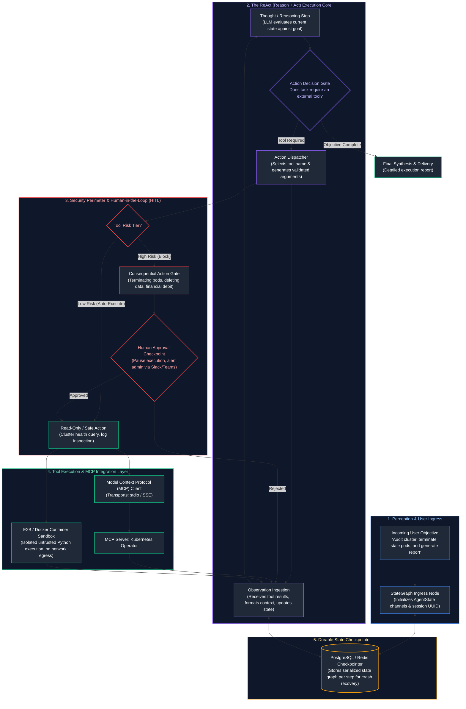

---

## Table of Contents
1. [The Autonomous Agent Paradigm](#1-the-autonomous-agent-paradigm)
   - [1.1 Defining Agency: Environmental Feedback, Cybernetics & The MAPE-K Loop](#11-defining-agency-environmental-feedback-cybernetics--the-mape-k-loop)
   - [1.2 The Spectrum of Autonomy: Chains vs. Workflows vs. Autonomous Agents](#12-the-spectrum-of-autonomy-chains-vs-workflows-vs-autonomous-agents)
   - [1.3 Compounding Error Mathematics & Blast Radius Governance](#13-compounding-error-mathematics--blast-radius-governance)
2. [Reasoning, Planning & Reflection Patterns](#2-reasoning-planning--reflection-patterns)
   - [2.1 The ReAct Pattern (Reason + Act + Observe) Deep Dive](#21-the-react-pattern-reason--act--observe-deep-dive)
   - [2.2 Tree of Thoughts (ToT) & Graph of Thoughts (GoT) Exploration](#22-tree-of-thoughts-tot--graph-of-thoughts-got-exploration)
   - [2.3 Plan-and-Solve vs. Dynamic Opportunistic Execution](#23-plan-and-solve-vs-dynamic-opportunistic-execution)
   - [2.4 Self-Reflection, Verbal Reinforcement (Reflexion) & Backtracking](#24-self-reflection-verbal-reinforcement-reflexion--backtracking)
3. [Agentic Tool Manipulation & Privilege Separation](#3-agentic-tool-manipulation--privilege-separation)
   - [3.1 Function Calling Wire Protocols: OpenAI vs. Anthropic JSON Schemas](#31-function-calling-wire-protocols-openai-vs-anthropic-json-schemas)
   - [3.2 Multi-Tier Tool Privilege Separation: Read-Only vs. Consequential Actions](#32-multi-tier-tool-privilege-separation-read-only-vs-consequential-actions)
   - [3.3 Defensive Parameter Boundaries & Idempotency Key Protocols](#33-defensive-parameter-boundaries--idempotency-key-protocols)
4. [The Model Context Protocol (MCP) Standard](#4-the-model-context-protocol-mcp-standard)
   - [4.1 Motivation: Solving the $M \times N$ Tool Integration Explosion](#41-motivation-solving-the-m-times-n-tool-integration-explosion)
   - [4.2 Structural Topology: Host, Client, and Server](#42-structural-topology-host-client-and-server)
   - [4.3 Protocol Primitives: Tools, Resources, and Prompts](#43-protocol-primitives-tools-resources-and-prompts)
   - [4.4 Transports: `stdio` (IPC) vs. `sse` (HTTP) Mechanics](#44-transports-stdio-ipc-vs-sse-http-mechanics)
   - [4.5 Authoring a Production Python FastMCP Server & Client](#45-authoring-a-production-python-fastmcp-server--client)
5. [Agent Memory Systems & State Lifecycle](#5-agent-memory-systems--state-lifecycle)
   - [5.1 The Cognitive Memory Hierarchy: Working, Episodic, Semantic & Procedural](#51-the-cognitive-memory-hierarchy-working-episodic-semantic--procedural)
   - [5.2 Memory Dynamics: Consolidation, Vector Retrieval & Exponential Decay](#52-memory-dynamics-consolidation-vector-retrieval--exponential-decay)
   - [5.3 Checkpointing State Across Turns in Relational Databases (PostgreSQL)](#53-checkpointing-state-across-turns-in-relational-databases-postgresql)
6. [Stateful Orchestration with LangGraph](#6-stateful-orchestration-with-langgraph)
   - [6.1 Pregel Computation Model: State Channels, Nodes, and Reducers](#61-pregel-computation-model-state-channels-nodes-and-reducers)
   - [6.2 Cyclical Execution, Conditional Routing & Loop Termination](#62-cyclical-execution-conditional-routing--loop-termination)
   - [6.3 Human-in-the-Loop (HITL): Interrupts, State Rewriting & Time-Travel Debugging](#63-human-in-the-loop-hitl-interrupts-state-rewriting--time-travel-debugging)
7. [Sandboxed Code Execution & Runtime Security](#7-sandboxed-code-execution--runtime-security)
   - [7.1 The Security Vulnerabilities of Bare-Metal Code Evaluation (`exec()`)](#71-the-security-vulnerabilities-of-bare-metal-code-evaluation-exec)
   - [7.2 Production Isolation Architectures: Docker, gVisor, and E2B Firecracker MicroVMs](#72-production-isolation-architectures-docker-gvisor-and-e2b-firecracker-microvms)
   - [7.3 Hard Operational Quotas: cgroups v2, Network Namespaces & Timeout Watchdogs](#73-hard-operational-quotas-cgroups-v2-network-namespaces--timeout-watchdogs)
8. [Production Implementation: Resilient Bare-Metal ReAct Agent Engine](#8-production-implementation-resilient-bare-metal-react-agent-engine)
   - [8.1 Engine Architecture & Design Contracts](#81-engine-architecture--design-contracts)
   - [8.2 Complete Production-Grade Python Implementation](#82-complete-production-grade-python-implementation)
   - [14.3 Failure Modes: Infinite Loops, Thrashing & Lost Focus Playbook](#143-failure-modes-infinite-loops-thrashing--lost-focus-playbook)
9. [Why Multi-Agent Systems? Engineering Rationale](#15-why-multi-agent-systems-engineering-rationale)
   - [15.1 Context Isolation & The Division of Labor Mental Model](#151-context-isolation--the-division-of-labor-mental-model)
   - [15.2 Mathematical Context Efficiency: Monolithic vs. Specialist Swarms](#152-mathematical-context-efficiency-monolithic-vs-specialist-swarms)
   - [15.3 The Decision Ladder: When to Graduate to Multi-Agent Architectures](#153-the-decision-ladder-when-to-graduate-to-multi-agent-architectures)
10. [Architectural Topologies for Collaboration](#16-architectural-topologies-for-collaboration)
   - [16.1 Topology 1: Orchestrator-Worker (Hierarchical Supervisor)](#161-topology-1-orchestrator-worker-hierarchical-supervisor)
   - [16.2 Topology 2: Sequential Handoffs (Pipeline / Assembly Line)](#162-topology-2-sequential-handoffs-pipeline--assembly-line)
   - [16.3 Topology 3: Parallel Specialists with Consensus Aggregator](#163-topology-3-parallel-specialists-with-consensus-aggregator)
   - [16.4 Topology 4: Dynamic Swarm Peer Networks](#164-topology-4-dynamic-swarm-peer-networks)
11. [Inter-Agent Communication Protocols](#17-inter-agent-communication-protocols)
   - [17.1 Structured State Contracts vs. Freeform Natural Language Chat](#171-structured-state-contracts-vs-freeform-natural-language-chat)
   - [17.2 State Synchronization & Atomic Channel Reducers](#172-state-synchronization--atomic-channel-reducers)
   - [17.3 Escalation Paths, Dead-Letter Channels & Failure Handoffs](#173-escalation-paths-dead-letter-channels--failure-handoffs)
12. [Mitigating Multi-Agent Pathologies](#18-mitigating-multi-agent-pathologies)
   - [18.1 Cascading Error Amplification](#181-cascading-error-amplification)
   - [18.2 Agentic Infinite Chat Loops & Livelocks](#182-agentic-infinite-chat-loops--livelocks)
   - [18.3 Quadratic Token Cost Explosion & Schedulability Ceilings](#183-quadratic-token-cost-explosion--schedulability-ceilings)
13. [Consensus, Voting & Multi-Agent Debate](#19-consensus-voting--multi-agent-debate)
   - [19.1 Multi-Agent Debate (MAD) for Fact Verification](#191-multi-agent-debate-mad-for-fact-verification)
   - [19.2 Majority Voting, Borda Count & Weighted Confidence Scoring](#192-majority-voting-borda-count--weighted-confidence-scoring)
   - [19.3 Mitigating Sycophancy & Groupthink](#193-mitigating-sycophancy--groupthink)
14. [Multi-Agent Framework Landscape & Architectural Trade-Offs](#20-multi-agent-framework-landscape--architectural-trade-offs)
   - [20.1 LangGraph: State Machines, Cyclic Graphs & Durable Execution](#201-langgraph-state-machines-cyclic-graphs--durable-execution)
   - [20.2 CrewAI: Role-Based Autonomous Crews](#202-crewai-role-based-autonomous-crews)
   - [20.3 Agno: High-Throughput Lightweight Multimodal Agents](#203-agno-high-throughput-lightweight-multimodal-agents)
   - [20.4 OpenAI Agents SDK / Swarm: Function-Driven Client Handoffs](#204-openai-agents-sdk--swarm-function-driven-client-handoffs)
   - [20.5 Framework Evaluation & Technical Selection Matrix](#205-framework-evaluation--technical-selection-matrix)
15. [Production Engineering: Observability, Security & Human-in-the-Loop](#21-production-engineering-observability-security--human-in-the-loop)
   - [21.1 Multi-Agent Distributed Tracing & Parent-Child Span Hierarchies](#211-multi-agent-distributed-tracing--parent-child-span-hierarchies)
   - [21.2 Security Ring Boundaries & Privileged Delegation](#212-security-ring-boundaries--privileged-delegation)
   - [21.3 Human-in-the-Loop (HITL) Interrupt Gates & Resumption Checkpoints](#213-human-in-the-loop-hitl-interrupt-gates--resumption-checkpoints)
16. [Production Implementation: Asynchronous Enterprise Orchestrator-Worker Multi-Agent System](#22-production-implementation-asynchronous-enterprise-orchestrator-worker-multi-agent-system)
   - [22.1 Systems Architecture of the Engine](#221-systems-architecture-of-the-engine)
   - [22.2 Complete Production-Grade Python Implementation](#222-complete-production-grade-python-implementation)
   - [30.3 Execution Verification & Mission Output Analysis](#303-execution-verification--mission-output-analysis)
17. [Summary Comparison & Production Engineering Reference Matrix](#31-summary-comparison--production-engineering-reference-matrix)
18. [References & Further Reading](#32-references--further-reading)
---

# 1. The Autonomous Agent Paradigm

### 1.1 Defining Agency: Environmental Feedback, Cybernetics & The MAPE-K Loop

In classical software engineering, computational routines follow deterministic, hardcoded control flow graphs (if/else branching, while loops, switch statements, and function calls). The human programmer predetermines every branch condition and execution path prior to compile time.

In an **Autonomous AI Agent**, the Large Language Model acts as the cognitive engine within a dynamic cybernetic feedback loop. Borrowing from autonomic computing principles, an autonomous agent embodies the **MAPE-K Loop (Monitor, Analyze, Plan, Execute over Knowledge)**:

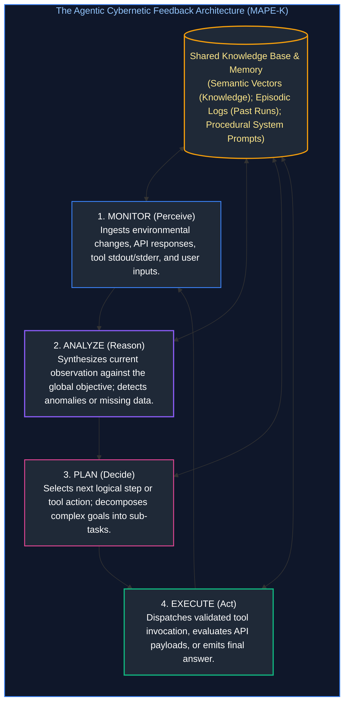

#### What Distinguishes an Agent from a Standard LLM Call?
* **A Standard LLM Call:** Pure input-to-output mapping: $\hat{\mathbf{y}} = f_{\theta}(\mathbf{x})$. The process is one-shot, static, and cannot query external state or react to runtime environmental changes.
* **An Autonomous Agent:** A stateful discrete-time dynamical system:

$$\mathbf{s}_{t+1} = \mathcal{T}(\mathbf{s}_t, \mathbf{a}_t, \mathbf{o}_t), \quad \mathbf{a}_t \sim \pi_{\theta}(\cdot \mid \mathbf{s}_t)$$

Where $\mathbf{s}_t$ represents the internal conversational and memory state at step $t$, $\mathbf{a}_t$ is the action (tool call or final response) emitted by the policy $\pi_{\theta}$, $\mathbf{o}_t$ is the environmental observation returned by external tools, and $\mathcal{T}$ is the state transition function.

---

### 1.2 The Spectrum of Autonomy: Chains vs. Workflows vs. Autonomous Agents

Engineers must choose the correct degree of agency for each business problem. Introducing unconstrained autonomy into a task that requires deterministic predictability introduces catastrophic variance.

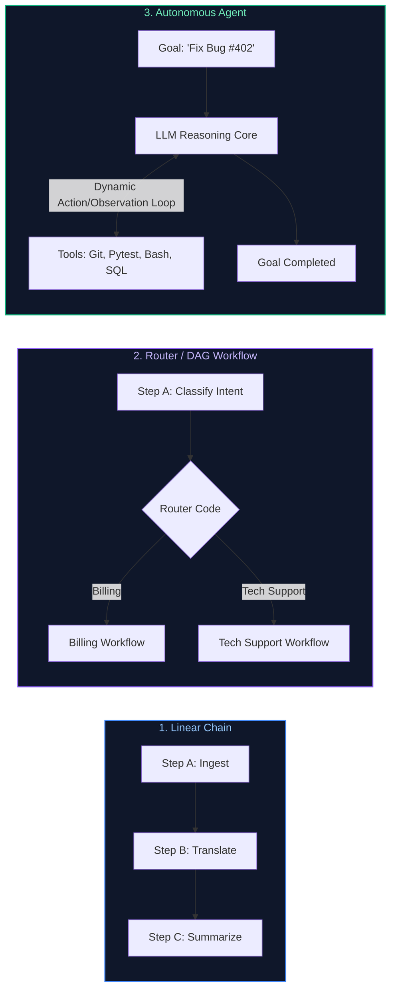

#### Comparative Architectural Spectrum:

| Dimension | Linear Chain | Directed Acyclic Graph (DAG) | Autonomous Agent (ReAct) |
| :--- | :--- | :--- | :--- |
| **Control Flow** | Fixed linear progression ($A \to B \to C$) | Deterministic branching via coded `if/else` | Dynamic, cyclical feedback loop |
| **Path Determination** | Hardcoded by software developer | Hardcoded rules based on LLM classification | Decided at runtime by the LLM |
| **Error Handling** | Throws exception; requires external retry | Static fallback paths coded in software | LLM inspects error message, reflects, and retries |
| **State Complexity** | Stateless or sequential memory | Directed state graph (e.g., Airflow / Prefect) | Mutable agent state with working and episodic memory |
| **Predictability** | $100\%$ deterministic | High ($99\%$ deterministic) | Non-deterministic; requires circuit breakers |
| **Ideal Enterprise Tasks** | Document translation, text embeddings | Loan eligibility, KYC approval, refund pipelines | Automated DevOps triage, complex coding, open research |

---

### 1.3 Compounding Error Mathematics & Blast Radius Governance

While autonomous agents offer extraordinary flexibility, their reliability decays exponentially over multi-turn trajectories.

#### The Mathematical Trap of Compounding Step Failure:
Let $p_t$ denote the probability that the agent executes step $t$ correctly (correct reasoning, valid tool arguments, no hallucination). Assuming independent step probabilities, the cumulative probability of successfully completing an $N$-step task is:

$$P(\text{Task Success}) = \prod_{t=1}^N p_t$$

If a frontier model operates at an impressive single-step accuracy of $p_t = 0.95$ ($95\%$):
* Over 3 steps: $P(\text{Success}) = 0.95^3 = 0.857$ ($85.7\%$)
* Over 8 steps: $P(\text{Success}) = 0.95^8 = 0.663$ ($66.3\%$)
* Over 15 steps: $P(\text{Success}) = 0.95^{15} = 0.463$ ($46.3\%$)
* Over 25 steps: $P(\text{Success}) = 0.95^{25} = 0.277$ ($27.7\%$)

By step 15, the agent is mathematically more likely to fail than succeed. This phenomenon—**Trajectory Derailment**—explains why naive autonomous loops collapse in production.

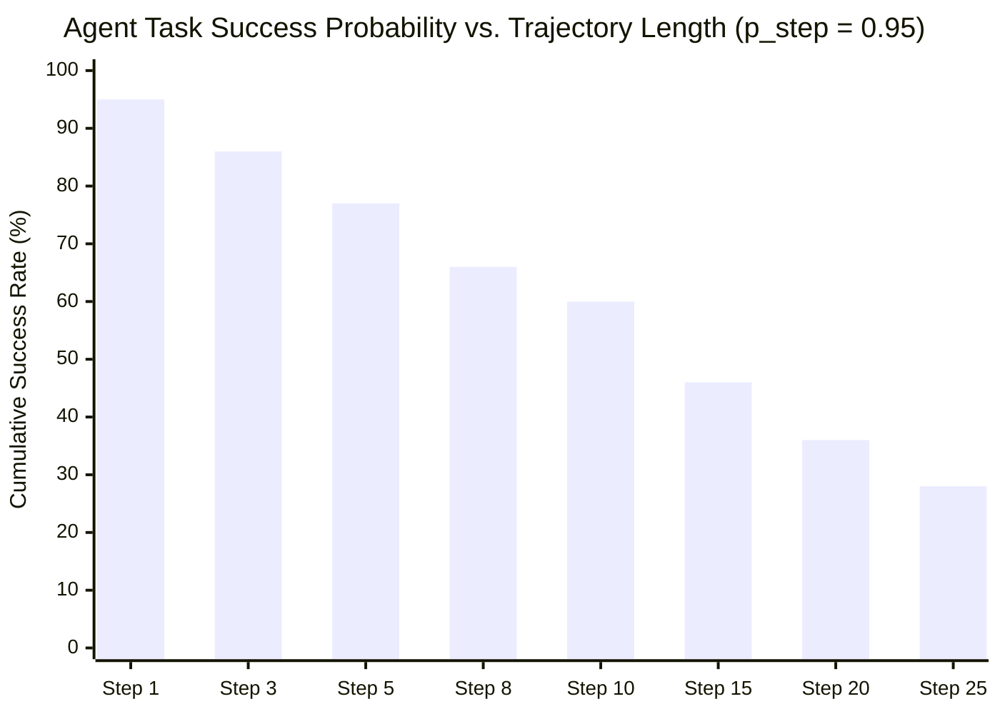

#### Sizing the Blast Radius & Operational Risk Controls:
To deploy agents safely in production, enterprise platforms enforce three strict blast-radius controls:
1. **The Maximum Step Ceiling (Circuit Breaker):** Every agent run must define a strict `max_steps` boundary (typically 10 to 15). If the goal is not reached within `max_steps`, the harness aborts execution and yields to a human.
2. **Financial Token Quotas:** Calculate cumulative inference and API costs across all turns. If session cost exceeds a threshold (e.g., $\$3.00$), the session is paused immediately.
3. **Privilege Decoupling:** Never grant write or mutation privileges to an agent executing exploratory or observational steps.

---

# 2. Reasoning, Planning & Reflection Patterns

### 2.1 The ReAct Pattern (Reason + Act + Observe) Deep Dive

First formulated by Yao et al. (2022), the **ReAct (Reasoning and Acting)** framework synergetically combines verbal reasoning traces with environment actions.

#### Why Pure Acting or Pure Reasoning Fails:
* **Action-Only (Direct Function Calling without CoT):** The model immediately outputs tool arguments without pre-computation. It suffers from impulsivity, fails to plan multi-step parameters, and hallucinates non-existent entities.
* **Reasoning-Only (Standard Chain-of-Thought):** The model thinks internally but cannot query the world. It hallucinates current system states, file contents, or real-time database rows.
* **ReAct Synthesis:** The model generates a **Thought** (synthesizing state and formulating intent), then an **Action** (invoking a specific tool), and then halts generation while the environment injects the **Observation** (the real tool result).

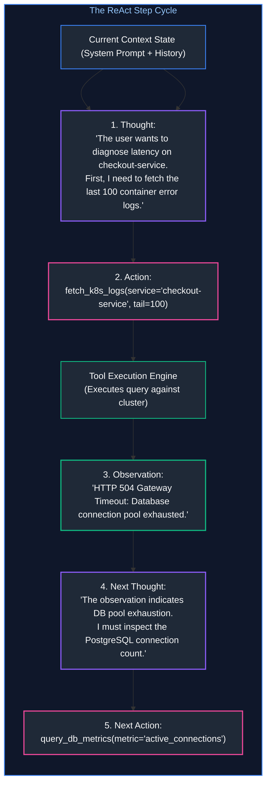

---

### 2.2 Tree of Thoughts (ToT) & Graph of Thoughts (GoT) Exploration

While ReAct operates linearly ($T_1 \to A_1 \to O_1 \to T_2 \dots$), complex problem solving (such as software refactoring, algorithmic optimization, or strategic planning) requires **non-linear heuristic search**:

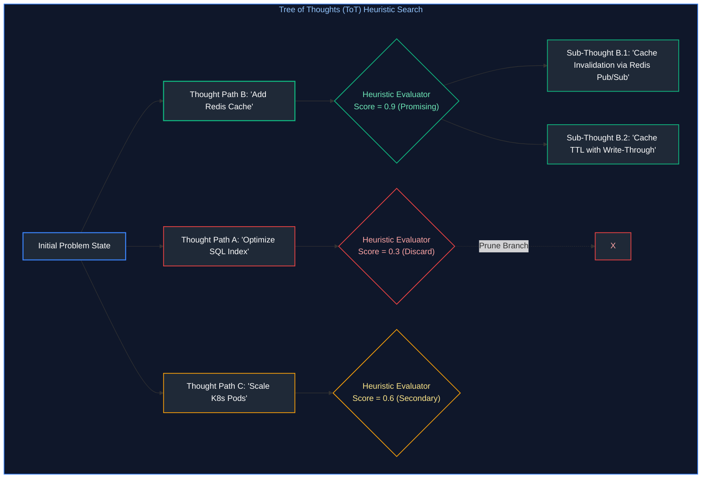

#### Algorithms for Agent Thought Search:
1. **Breadth-First Search (BFS):** Generates $k$ candidate thoughts for the current step, prompts an Evaluator LLM to score each thought $V(s) \in [0, 1]$, selects the top $b$ paths, and expands them concurrently.
2. **Depth-First Search (DFS) with Backtracking:** Explores a candidate pathway deeply. If the heuristic score drops below a threshold $\tau$, the agent backtracks to the ancestor state and pursues the alternate branch.
3. **Graph of Thoughts (GoT):** Extends trees by permitting **Thought Merging / Synthesis**—combining complementary insights from Branch B and Branch C into a superior hybrid solution.

---

### 2.3 Plan-and-Solve vs. Dynamic Opportunistic Execution

1. **Plan-and-Solve (Wang et al., 2023):**
   * The agent separates planning from execution:
     $$\text{Plan} = [\text{Task}_1, \text{Task}_2, \dots, \text{Task}_M]$$
   * An executor sub-agent walks through the checklist sequentially.
   * *Limitation:* Brittle. If $\text{Task}_1$ yields an unexpected environmental state (e.g., table does not exist), the remaining static plan collapses.
2. **Dynamic Opportunistic Execution:**
   * The agent evaluates only the next immediate step based on the newest observation.
   * *Limitation:* Prone to aimless wandering, circular reasoning, and losing sight of the terminal objective.
3. **Enterprise Hybrid (Dynamic Re-Planning):**
   * The agent generates a structured plan checklist in working memory.
   * After each observation $\mathbf{o}_t$, a **Re-Planner node** inspects the delta between the observation and expected outcome. If a divergence threshold is exceeded, the agent rewrites its checklist while preserving already-verified milestones.

---

### 2.4 Self-Reflection, Verbal Reinforcement (Reflexion) & Backtracking

When an agent executes an invalid tool call or receives a failure observation (`ConnectionRefusedError`, `SyntaxError`), naive agents repeat the identical command or crash.

The **Reflexion Framework (Shinn et al., 2023)** equips the agent with verbal self-reflection stored in episodic memory:

```mermaid
%%{init: {'theme': 'dark', 'themeVariables': { 'actorBkg': '#1e293b', 'actorBorder': '#3b82f6', 'actorTextColor': '#ffffff', 'signalColor': '#93c5fd', 'signalTextColor': '#ffffff', 'noteBkgColor': '#1e293b', 'noteBorderColor': '#f59e0b', 'noteTextColor': '#fde68a', 'activationBkgColor': '#3b82f6', 'sequenceNumberColor': '#ffffff' }}}%%
sequenceDiagram
    autonumber
    participant Agent as Agent Execution Core
    participant Tool as Target Tool / Environment
    participant Memory as Episodic Memory Store

    Agent->>Tool: 1. Action: execute_query("SELECT user_id, sum(val) FROM sales;")
    Tool-->>Agent: 2. Observation: "ERROR: column 'sales.val' does not exist."
    Note over Agent: 3. Reflection Phase Initiated:<br/>"Why did this fail? I assumed 'val' was the column name.<br/>I should have inspected the table schema first."
    Agent->>Memory: 4. Store Verbal Reflection: "Reflection: sales table requires schema check."
    Agent->>Tool: 5. Action: describe_table("sales")
    Tool-->>Agent: 6. Observation: "Columns: user_id (INT), total_amount (NUMERIC)"
    Agent->>Tool: 7. Action: execute_query("SELECT user_id, sum(total_amount) FROM sales GROUP BY user_id;")
    Tool-->>Agent: 8. Observation: "Query OK, 400 rows."
```

By converting environmental feedback into semantic reflections, the agent achieves **Verbal Reinforcement Learning** without modifying neural network weights.

---

# 3. Agentic Tool Manipulation & Privilege Separation

### 3.1 Function Calling Wire Protocols: OpenAI vs. Anthropic JSON Schemas

Under the hood, foundation models do not execute Python functions directly. They generate formatted JSON objects that match a strict JSON Schema registered by the host application.

#### 1. OpenAI Function Calling Schema Format:
```json
{
  "type": "function",
  "function": {
    "name": "terminate_cluster_pod",
    "description": "Terminates a Kubernetes pod by name in the specified namespace.",
    "parameters": {
      "type": "object",
      "properties": {
        "pod_name": {
          "type": "string",
          "description": "The exact name of the pod to delete, e.g., 'payment-service-x82'"
        },
        "namespace": {
          "type": "string",
          "enum": ["prod", "staging", "dev"],
          "description": "Kubernetes namespace environment."
        },
        "grace_period_seconds": {
          "type": "integer",
          "default": 30,
          "description": "Duration in seconds before pod is forcibly killed."
        }
      },
      "required": ["pod_name", "namespace"],
      "additionalProperties": false
    },
    "strict": true
  }
}
```

#### 2. Anthropic Tool Use Format:
Anthropic models accept tool definitions under the `tools` parameter with explicit input schemas:
```json
{
  "name": "terminate_cluster_pod",
  "description": "Terminates a Kubernetes pod by name.",
  "input_schema": {
    "type": "object",
    "properties": {
      "pod_name": { "type": "string" },
      "namespace": { "type": "string" }
    },
    "required": ["pod_name", "namespace"]
  }
}
```
When invoked, the model emits a content block of type `tool_use` containing an invocation `id` and parsed `input` payload. The client application executes the real Python function and returns a corresponding `tool_result` content block referencing the same `tool_use_id`.

---

### 3.2 Multi-Tier Tool Privilege Separation: Read-Only vs. Consequential Actions

Never provide an autonomous agent with uniform, flat tool permissions. Enterprise runtimes enforce a **Ring Privilege Architecture**:

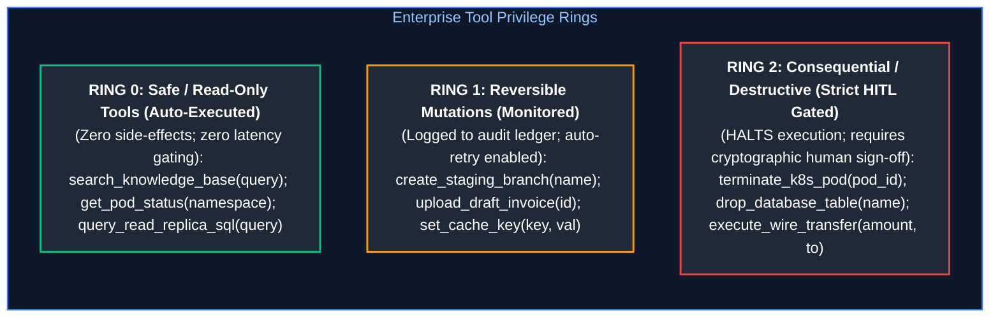

* **Ring 0 Tools:** Read-only queries with zero mutations. Executed immediately with sub-millisecond dispatch overhead.
* **Ring 1 Tools:** Low-impact mutations with easy programmatic rollback. Executed with structured logging and rate limiting.
* **Ring 2 Tools:** Irreversible mutations (deleting infrastructure, transferring funds, emailing clients). The agent harness suspends execution, serializes state to disk, and waits for Human-in-the-Loop clearance.

---

### 3.3 Defensive Parameter Boundaries & Idempotency Key Protocols

Because LLM tool argument generation is probabilistic, network timeouts or transient errors frequently cause agents to retry identical tool calls.

#### 1. The Idempotency Key Protocol:
For every state-mutating tool, the agent runtime injects a unique, deterministic idempotency key derived from the task session and step count:

$$\text{IdempotencyKey} = \text{UUIDv5}(\text{Namespace\_URL}, \text{session\_id} \mathbin{\Vert} \text{step\_number} \mathbin{\Vert} \text{tool\_name})$$

```python
# The agent harness automatically passes the idempotency key:
execute_wire_transfer(
    to_account="ACC-9921",
    amount=5000.00,
    idempotency_key="550e8400-e29b-41d4-a716-446655440000"
)
```
If the HTTP request drops and the agent retries the identical call 5 seconds later, the downstream payment gateway matches the idempotency key, skips double-charging, and returns the cached confirmation payload.

#### 2. Defensive Boundary Validation:
Wrap every tool function in strict Pydantic models enforcing logical bounds:
```python
from pydantic import BaseModel, Field

class WireTransferInput(BaseModel):
    to_account: str = Field(..., regex=r"^ACC-\d{4,8}$")
    amount: float = Field(..., gt=0.0, le=10000.0, description="Amount in USD capped at $10k")
    reason: str = Field(..., min_length=10, max_length=200)
```

---

# 4. The Model Context Protocol (MCP) Standard

### 4.1 Motivation: Solving the $M \times N$ Tool Integration Explosion

Prior to the introduction of the **Model Context Protocol (MCP)** by Anthropic in late 2024, integrating tools with LLM applications suffered from catastrophic fragmentation:

* If an enterprise maintained $M=6$ AI host environments (Claude Desktop, Cursor, LangGraph, AutoGen, custom corporate web app, CLI assistant) and $N=10$ corporate systems (PostgreSQL, GitHub, Jira, Kubernetes, Slack, Salesforce, Google Drive, Datadog, Snowflake, AWS):
* Developers were forced to build and maintain $M \times N = 6 \times 10 = \mathbf{60}\text{ custom point-to-point integrations}$! Every framework had its own schema DSL, parameter parser, and error handling syntax.

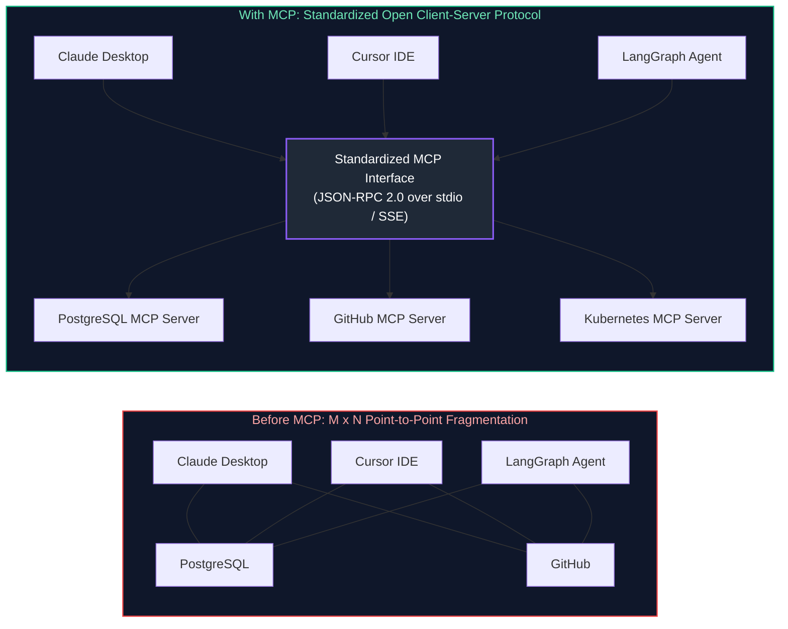

MCP standardizes tool, resource, and prompt integrations using the identical architectural paradigm that the **Language Server Protocol (LSP)** used to standardize programming language support across code editors:
$$\text{Any MCP-compliant Client can seamlessly talk to Any MCP-compliant Server!}$$

---

### 4.2 Structural Topology: Host, Client, and Server

The MCP architecture comprises three distinct actors:
1. **The MCP Host:** The user-facing coordinator application (e.g., Claude Desktop, Antigravity, or an enterprise FastAPI agent backend). The host initiates and hosts the agent runtime.
2. **The MCP Client:** An internal protocol adapter within the host application that manages a 1:1 bidirectional session with a specific MCP Server.
3. **The MCP Server:** A lightweight, decoupled process exposing domain-specific tools, read-only resources, and prompt templates to clients via standardized JSON-RPC 2.0 messages.

---

### 4.3 Protocol Primitives: Tools, Resources, and Prompts

The Model Context Protocol establishes three core primitives:

| Primitive | Directionality | Semantics & Purpose | Example URI / Signature |
| :--- | :---: | :--- | :--- |
| **Tools** | Client $\to$ Server $\to$ Client | Executable functions designed for LLM function calling. Performs actions with side effects or executes dynamic computational queries. | `tools/call: terminate_pod(pod_id="x")` |
| **Resources** | Client $\to$ Server $\to$ Client | Passive, read-only data payloads addressable via URI schemes. Allows models to inspect files, schemas, or system logs without code execution. | `postgres://prod-db/schemas/customers`<br/>`file:///var/log/syslog` |
| **Prompts** | Server $\to$ Client $\to$ Host | Pre-engineered prompt workflows and slash commands exposed by the server for standardized user workflows. | `prompts/get: analyze_k8s_incident` |

---

### 4.4 Transports: `stdio` (IPC) vs. `sse` (HTTP) Mechanics

MCP defines two standardized transport mechanisms:

#### 1. `stdio` Transport (Standard Input/Output)
* **Mechanics:** The MCP Client launches the MCP Server as a local child operating system process (`subprocess.Popen`). Communication flows over standard Unix pipes (`stdin` and `stdout`).
* **Characteristics:** Microsecond IPC latency, zero network overhead, zero open TCP ports.
* **Best Use:** Local development environments, CLI tools, developer IDE integrations (Cursor, VS Code).

#### 2. `sse` Transport (Server-Sent Events over HTTP)
* **Mechanics:** The MCP Server runs as a standalone remote HTTP microservice. The client sends JSON-RPC requests via HTTP `POST` requests and receives asynchronous streaming event responses over persistent `GET` Server-Sent Events (SSE) connections.
* **Characteristics:** Cross-network routable, scalable behind enterprise API gateways, supports TLS mutual authentication.
* **Best Use:** Distributed enterprise microservices, cloud-hosted tools, Kubernetes operator clusters.

---

### 4.5 Authoring a Production Python FastMCP Server & Client

Below is a complete, production-grade MCP Server implemented using the official Python FastMCP SDK:

```python
"""
k8s_fastmcp_server.py
Production-grade MCP Server exposing Kubernetes diagnostics and tools using FastMCP.
"""

from typing import List, Dict, Any
from mcp.server.fastmcp import FastMCP

# Instantiate FastMCP server with semantic name
mcp = FastMCP("KubernetesDiagnosticsServer")

@mcp.resource("k8s://cluster/health")
def get_cluster_health() -> str:
    """Read-only resource exposing high-level cluster health metrics."""
    return "Status: HEALTHY | Nodes: 12/12 Ready | CPU Usage: 42% | Memory: 58%"

@mcp.tool()
def list_unhealthy_pods(namespace: str = "default") -> List[Dict[str, Any]]:
    """
    Scans the specified namespace for pods in CrashLoopBackOff or Error states.
    """
    # In production, queries kubernetes.client.CoreV1Api()
    return [
        {
            "pod_name": "checkout-service-79df-k21",
            "namespace": namespace,
            "status": "CrashLoopBackOff",
            "restart_count": 12,
            "last_exit_code": 137  # OOMKilled
        }
    ]

@mcp.tool()
def restart_pod(pod_name: str, namespace: str = "default") -> str:
    """
    Initiates a rolling restart of a designated unhealthy pod. Consequential operation.
    """
    return f"SUCCESS: Triggered graceful restart of pod '{pod_name}' in namespace '{namespace}'."

if __name__ == "__main__":
    # Runs over standard input/output transport for local client integration
    mcp.run(transport="stdio")
```

---

# 5. Agent Memory Systems & State Lifecycle

### 5.1 The Cognitive Memory Hierarchy: Working, Episodic, Semantic & Procedural

Autonomous agents utilize a four-tier memory architecture mirroring human cognitive psychology:

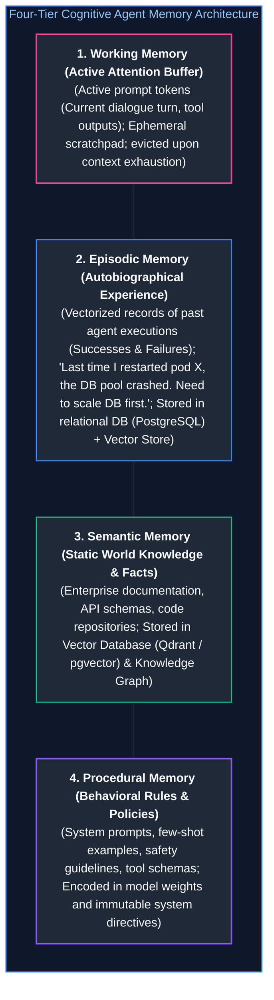

---

### 5.2 Memory Dynamics: Consolidation, Vector Retrieval & Exponential Decay

In long-running agents, unbounded episodic memory accumulation causes prompt bloat and irrelevant retrieval.

#### Exponential Time Decay Formulation:
When retrieving memories, calculate a composite relevance score combining semantic cosine similarity and exponential time decay:

$$\text{Score}(m, q) = \alpha \cdot \cos(\mathbf{e}_m, \mathbf{e}_q) + (1 - \alpha) \cdot e^{-\lambda(t_{\text{now}} - t_m)}$$

Where:
* $\cos(\mathbf{e}_m, \mathbf{e}_q)$ is the embedding cosine similarity between query $q$ and memory $m$.
* $\lambda$ is the memory half-life decay rate constant: $\lambda = \frac{\ln(2)}{t_{\text{half-life}}}$.
* $\alpha \in [0, 1]$ balances semantic relevance against recency.

Memories whose composite score drops below an eviction threshold are purged from the primary active index into cold archive storage.

---

### 5.3 Checkpointing State Across Turns in Relational Databases (PostgreSQL)

If an agent server experiences an Out-Of-Memory (OOM) crash or a Kubernetes node termination on turn 11 of a 15-turn task, restarting from step 1 is unviable (causing duplicate mutations and wasted API spend).

#### Production Checkpointer Schema (PostgreSQL):
```sql
-- Production LangGraph-compatible state checkpointing tables
CREATE TABLE agent_checkpoints (
    session_id UUID NOT NULL,
    checkpoint_id UUID NOT NULL,
    parent_checkpoint_id UUID,
    step_number INT NOT NULL,
    state_payload JSONB NOT NULL,
    created_at TIMESTAMP WITH TIME ZONE DEFAULT NOW(),
    PRIMARY KEY (session_id, checkpoint_id)
);

CREATE TABLE agent_checkpoint_writes (
    session_id UUID NOT NULL,
    checkpoint_id UUID NOT NULL,
    task_id TEXT NOT NULL,
    channel_name TEXT NOT NULL,
    value_payload BYTEA NOT NULL,
    PRIMARY KEY (session_id, checkpoint_id, task_id, channel_name)
);

CREATE INDEX idx_checkpoints_session ON agent_checkpoints (session_id, step_number DESC);
```

Whenever an agent transitions between graph nodes, the checkpointer executes an atomic `INSERT`. Upon node recovery, the replacement worker loads the latest state snapshot and resumes the loop with zero state loss.

---

# 6. Stateful Orchestration with LangGraph

### 6.1 Pregel Computation Model: State Channels, Nodes, and Reducers

**LangGraph** is the industry standard for stateful, multi-actor LLM orchestration. Under the hood, LangGraph implements Google's **Pregel Bulk Synchronous Parallel (BSP)** computational model:

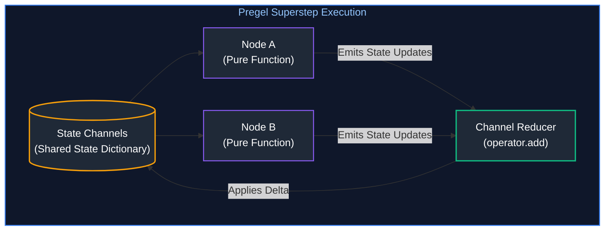

#### Core Components:
1. **State Channels:** Strongly-typed schemas defining what state variables exist.
2. **Channel Reducers:** Specify how state mutations are applied. Using `operator.add` appends new messages to a list, whereas omitting a reducer overwrites the previous value.
3. **Nodes:** Pure Python functions that accept current state and return an update dictionary: $\Delta\mathbf{s}$.
4. **Edges:** Directed connections that route control flow between nodes (normal edges vs. conditional branching edges).

---

### 6.2 Cyclical Execution, Conditional Routing & Loop Termination

In contrast to classical DAG schedulers (Airflow, Kubeflow) which strictly forbid cycles, autonomous agents **require cyclical execution** to support iterative reflection:

```python
from langgraph.graph import StateGraph, END
from typing import TypedDict, Annotated, List
import operator

class AgentState(TypedDict):
    objective: str
    messages: Annotated[List[str], operator.add]
    loop_count: int

def reason_node(state: AgentState) -> dict:
    # Generates next action or final response
    return {"messages": ["Thought: Auditing logs..."], "loop_count": state["loop_count"] + 1}

def router_condition(state: AgentState) -> str:
    # Loop circuit breaker
    if state["loop_count"] >= 10:
        return "force_terminate"
    last_message = state["messages"][-1]
    if "FINAL_ANSWER" in last_message:
        return "end"
    return "act"

# Graph construction
workflow = StateGraph(AgentState)
workflow.add_node("reason", reason_node)
workflow.add_node("act", lambda s: {"messages": ["Executed tool."]})

workflow.set_entry_point("reason")
workflow.add_conditional_edges(
    "reason",
    router_condition,
    {
        "act": "act",
        "end": END,
        "force_terminate": END
    }
)
workflow.add_edge("act", "reason")  # Cyclical edge!
```

---

### 6.3 Human-in-the-Loop (HITL): Interrupts, State Rewriting & Time-Travel Debugging

LangGraph provides native support for pausing graph execution prior to consequential operations:

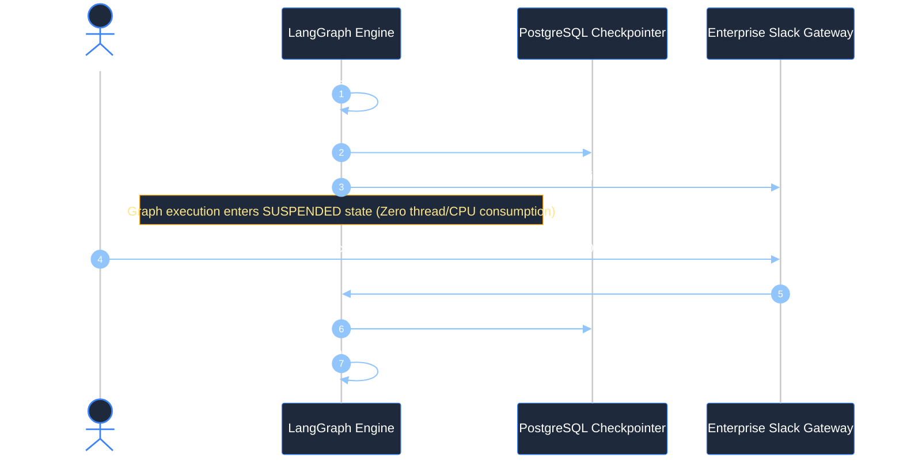

#### Time-Travel Debugging:
Because every step is saved as a discrete checkpoint UUID, engineers can rewind a derailed agent back to Turn 3, edit a corrupted state channel, and fork a new execution trajectory from that historical point.

---

# 7. Sandboxed Code Execution & Runtime Security

### 7.1 The Security Vulnerabilities of Bare-Metal Code Evaluation (`exec()`)

Many naive agent implementations execute generated Python code directly using Python's native `exec()` or `eval()`:
```python
# CATASTROPHIC VULNERABILITY:
exec(model_generated_code)
```

#### Why `exec()` Cannot Be Secured with Simple Blocklists:
* **Privilege Escalation:** An attacker exploits Python introspections:
  ```python
  ().__class__.__base__.__subclasses__()[137]().load_module('os').system('rm -rf /')
  ```
* **Environment Secret Theft:** Model-generated code can read all host environment variables (`os.environ`), exposing AWS credentials, database passwords, and API keys.
* **Denial of Service:** Fork bombs (`while True: os.fork()`) exhaust host OS PID tables and kernel memory.

---

### 7.2 Production Isolation Architectures: Docker, gVisor, and E2B Firecracker MicroVMs

Enterprise code execution requires multi-layered, hardware-assisted virtualization:

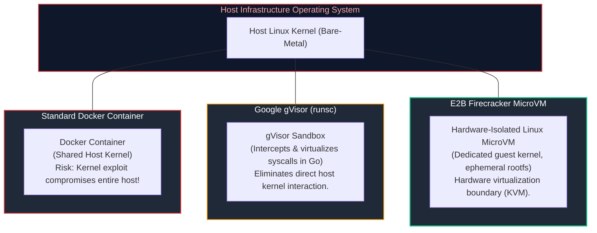

#### Sandbox Comparison Matrix:
* **Standard Docker (`runc`):** Cold start: $\approx 200\text{ms}$. Security: Moderate. Shares host Linux kernel; susceptible to container breakout exploits.
* **Google gVisor (`runsc`):** Cold start: $\approx 400\text{ms}$. Security: Strong. Re-implements the Linux kernel API in user-space Go; blocks direct host syscalls.
* **E2B Firecracker MicroVMs:** Cold start: $\approx 150\text{ms}$. Security: Hypervisor-grade (Highest). Uses Linux KVM hardware virtualization with dedicated guest kernels.

---

### 7.3 Hard Operational Quotas: cgroups v2, Network Namespaces & Timeout Watchdogs

Any container running agent-generated code must enforce strict Linux kernel limits:

```bash
docker run --rm \
  --net=none \                          # 1. Total network isolation: Disables outbound sockets
  --read-only \                         # 2. Immutable filesystem: Prevents disk persistence
  --tmpfs /tmp:rw,noexec,nosuid,size=64m \ # 3. Memory-only scratchpad with execution blocked
  --cap-drop=ALL \                      # 4. Drop all 38 Linux capabilities
  --user=10001:10001 \                  # 5. Non-root unprivileged execution
  --memory=512m --cpus=1.0 \            # 6. Strict cgroups memory and CPU quotas
  --pids-limit=64 \                     # 7. Fork-bomb prevention
  python-sandbox-runtime:latest python3 agent_script.py
```

---

# 8. Production Implementation: Resilient Bare-Metal ReAct Agent Engine

### 8.1 Engine Architecture & Design Contracts

Below is a complete, production-grade Python implementation of a bare-metal ReAct autonomous agent engine featuring:
1. **Strongly-Typed State Channels:** Tracks history, active objective, step counters, and checkpoints.
2. **Tool Registry with Privilege Rings:** Separates safe read-only queries from consequential operations.
3. **Loop & Thrashing Detector:** Identifies identical repetitive actions and forces strategy divergence.
4. **Circuit Breaker:** Enforces hard execution step limits.
5. **Human-in-the-Loop Simulation:** Halts for operator confirmation prior to executing destructive tools.

---

### 8.2 Complete Production-Grade Python Implementation

```python
"""
react_agent_engine.py
Production-grade Bare-Metal ReAct Agent Engine featuring Privilege Rings,
Loop & Thrashing Detectors, Circuit Breakers, and Human-in-the-Loop Checkpoints.
"""

import json
import re
import uuid
from dataclasses import dataclass, field
from datetime import datetime, timezone
from typing import Any, Callable, Dict, List, Optional, Set, Tuple

@dataclass
class Tool:
    """Enterprise Tool definition with privilege ring classification."""
    name: str
    description: str
    func: Callable[..., str]
    is_consequential: bool = False  # If True, requires HITL clearance
    timeout_seconds: float = 10.0

@dataclass
class AgentState:
    """Stateful agent session context."""
    session_id: str
    objective: str
    step_count: int = 0
    max_steps: int = 8
    history: List[Dict[str, str]] = field(default_factory=list)
    action_log: List[str] = field(default_factory=list)
    is_complete: bool = False
    final_answer: Optional[str] = None

class LoopAndThrashingDetector:
    """Detects repetitive tool loops and oscillating ping-pong thrashing."""

    def __init__(self, max_consecutive_duplicates: int = 2):
        self.max_duplicates = max_consecutive_duplicates

    def evaluate(self, action_signature: str, action_log: List[str]) -> Tuple[bool, str]:

# 9. Consecutive duplicate action check

if action_log.count(action_signature) >= self.max_duplicates:
            return True, f"Repetitive Loop Detected: Action '{action_signature}' executed {self.max_duplicates} times."

# 10. Oscillating thrashing check: A -> B -> A -> B

if len(action_log) >= 4:
            if action_log[-1] == action_log[-3] and action_signature == action_log[-2]:
                return True, "Oscillation Thrashing Detected: Alternating between identical actions without progress."

        return False, "Clean"

class ResilientReActEngine:
    """Autonomous ReAct execution runtime enforcing production safety gates."""

    def __init__(self, tools: List[Tool]):
        self.tools: Dict[str, Tool] = {t.name: t for t in tools}
        self.loop_detector = LoopAndThrashingDetector()

    def _mock_llm_react_reasoning(self, state: AgentState) -> str:
        """
        Simulates frontier model output (Claude 3.5 Sonnet / GPT-4o).
        In production, calls LLM API with formatted system prompts and tool schemas.
        """
        if state.step_count == 1:
            return (
                "Thought: The objective is to audit the production payment cluster and recover failed services. "
                "I must first inspect pod statuses across the cluster.\n"
                "Action: get_cluster_status(namespace='production')"
            )
        elif state.step_count == 2:
            return (
                "Thought: The cluster status reveals that pod 'payment-pod-42' is in CrashLoopBackOff with 14 restarts. "
                "I need to terminate and restart this pod to recover the service.\n"
                "Action: restart_pod(pod_id='payment-pod-42', namespace='production')"
            )
        elif state.step_count == 3:
            return (
                "Thought: The pod restart was confirmed and healthy replicas are active. "
                "I have achieved the user's objective and can emit the final synthesis.\n"
                "Action: emit_final_answer(summary='Audit complete: Recovered payment-pod-42 from CrashLoopBackOff in production.')"
            )
        else:
            return "Action: emit_final_answer(summary='Task complete.')"

    def _parse_action_syntax(self, llm_text: str) -> Tuple[str, Dict[str, Any]]:
        """Parses 'Action: tool_name(k1=v1, k2=v2)' using regular expressions."""
        match = re.search(r"Action:\s*(\w+)\((.*?)\)", llm_text)
        if not match:
            return "unknown", {}

        tool_name = match.group(1)
        raw_args = match.group(2).strip()

        kwargs: Dict[str, Any] = {}
        if raw_args:
            for pair in raw_args.split(","):
                if "=" in pair:
                    k, v = pair.split("=", 1)
                    kwargs[k.strip()] = v.strip().strip("'\"")
        return tool_name, kwargs

    def execute_session(self, objective: str) -> str:
        state = AgentState(
            session_id=str(uuid.uuid4()),
            objective=objective
        )

        print("=" * 80)
        print(f" AGENT SESSION INITIALIZED | UUID: {state.session_id}")
        print(f" Objective: '{state.objective}'")
        print("=" * 80)

        while not state.is_complete and state.step_count < state.max_steps:
            state.step_count += 1
            print(f"\n>>> [STEP {state.step_count} / {state.max_steps}]")

# 11. REASON: LLM outputs Thought + Action

llm_turn = self._mock_llm_react_reasoning(state)
            print(f"[Model Reasoning]\n{llm_turn}")
            state.history.append({"role": "assistant", "content": llm_turn})

# 12. PARSE ACTION

tool_name, kwargs = self._parse_action_syntax(llm_turn)

            # Check for terminal action
            if tool_name == "emit_final_answer":
                state.is_complete = True
                state.final_answer = kwargs.get("summary", "Objective fulfilled.")
                break

            action_sig = f"{tool_name}:{json.dumps(kwargs, sort_keys=True)}"

# 13. LOOP & THRASHING DETECTION

is_loop, loop_msg = self.loop_detector.evaluate(action_sig, state.action_log)
            if is_loop:
                observation = f"CIRCUIT BREAKER ALERT: {loop_msg} You must choose an alternative approach."
                print(f"[Loop Detector Interrupted]: {observation}")
                state.history.append({"role": "system", "content": observation})
                state.action_log.append(action_sig)
                continue

            state.action_log.append(action_sig)

# 14. TOOL DISPATCH & HUMAN-IN-THE-LOOP CHECKPOINT

if tool_name not in self.tools:
                observation = f"ERROR: Tool '{tool_name}' not found. Available: {list(self.tools.keys())}"
            else:
                tool = self.tools[tool_name]

                # If tool is consequential, trigger HITL Gate
                if tool.is_consequential:
                    print(f"\n[HUMAN-IN-THE-LOOP CHECKPOINT REQUIRED]")
                    print(f"  Target Action : {tool_name}")
                    print(f"  Parameters    : {kwargs}")
                    print("  Action Tier   : RING 2 (CONSEQUENTIAL)")
                    # Simulate operator approval via webhook
                    operator_approved = True
                    print(f"  Operator Decision: {'APPROVED (Signed via Slack Webhook)' if operator_approved else 'REJECTED'}")
                    if not operator_approved:
                        observation = "SECURITY REJECTION: Operator denied execution of this action."
                        state.history.append({"role": "tool", "content": observation})
                        continue

                # Execute tool safely
                try:
                    observation = tool.func(**kwargs)
                except Exception as err:
                    observation = f"TOOL EXECUTION ERROR: {str(err)}"

            print(f"[Observation Received]: {observation}")
            state.history.append({"role": "tool", "content": observation})

        print("\n" + "=" * 80)
        return state.final_answer or "Agent terminated: Max step ceiling reached without completion."

# =====================================================================
# VERIFICATION SUITE & DEMONSTRATION RUN
# =====================================================================

def run_agent_demonstration():
    # Define enterprise tool suite
    enterprise_tools = [
        Tool(
            name="get_cluster_status",
            description="Returns status of pods in a given namespace.",
            is_consequential=False,  # Ring 0: Safe
            func=lambda namespace="default": "payment-pod-42: CrashLoopBackOff (14 restarts), auth-pod-01: Running"
        ),
        Tool(
            name="restart_pod",
            description="Terminates and restarts a specified Kubernetes pod.",
            is_consequential=True,   # Ring 2: Consequential (Triggers HITL!)
            func=lambda pod_id, namespace="default": f"Pod '{pod_id}' in '{namespace}' successfully restarted and healthy."
        )
    ]

    engine = ResilientReActEngine(tools=enterprise_tools)
    result = engine.execute_session("Audit production cluster and recover failing payment services.")
    print(f"FINAL AGENT SYNTHESIS:\n{result}")
    print("=" * 80)

if __name__ == "__main__":
    run_agent_demonstration()
```

---

### 14.3 Failure Modes: Infinite Loops, Thrashing & Lost Focus Playbook

| Failure Mode | Root Cause | Engineering Countermeasure |
| :--- | :--- | :--- |
| **Identical Action Loop** | Agent executes `read_file`, encounters parsing error, retries identical call without modifying parameters | `LoopAndThrashingDetector` tracks action signatures; injects circuit-breaker warning after 2 identical calls |
| **Oscillation Thrashing ($A \leftrightarrow B$)** | Tool A reveals missing dependency; Tool B triggers condition that requires Tool A | Track trajectory 4-grams ($A \to B \to A \to B$); abort cycle and force re-planning |
| **Context Lost Focus / Goal Drift** | Context window fills with 30 turns of verbose tool logs, pushing initial objective out of attention | Anchor the `<objective>` in a persistent tier-2 system prompt section; compress intermediate tool outputs |
| **Premature Termination** | Agent declares victory after reading an error message without executing verification | Implement a separate **Evaluator Node** in the state graph that validates output criteria before emitting completion |

---

# 15. Why Multi-Agent Systems? Engineering Rationale

### 15.1 Context Isolation & The Division of Labor Mental Model

In classic computer systems, forcing a single monolithic operating system process to handle database queries, web rendering, network packet routing, and audio encoding leads to thread starvation, memory corruption, and unmaintainable code. Software engineering solved this decades ago through **Microservices and Separation of Concerns**.

In AI engineering, the equivalent failure is the **Monolithic Agent Anti-Pattern**: equipping a single prompt context with 40 distinct tools, 15 disparate system instructions, and expecting it to execute complex multi-domain missions flawlessly.

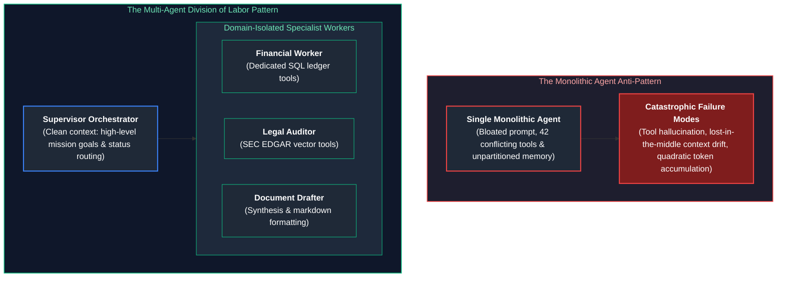

#### Why Context Isolation Works
1. **Pristine Signal-to-Noise Ratio (SNR):** A financial analyst agent that only sees database schemas and financial numbers does not have its attention heads diluted by legal statutes or HTML formatting rules.
2. **Defensive Tool Scoping:** Giving an agent access to only 3 tightly scoped tools reduces tool calling parameter hallucination to near zero.
3. **Model Heterogeneity:** Different tasks require different models. A routine categorization worker can use a fast, inexpensive model (LLaMA-3.1-8B at \$0.10/M tokens), while the lead supervisor uses a frontier reasoning model (Claude 3.5 Sonnet at \$3.00/M tokens).

---

### 15.2 Mathematical Context Efficiency: Monolithic vs. Specialist Swarms

Consider a mission requiring 3 sequential tasks ($A$, $B$, $C$), where each task takes 4 ReAct tool iterations, and each tool observation generates 1,000 tokens of stdout.

#### 1. Monolithic Agent Context Accumulation
Because all tool outputs remain in the single conversational history:

$$\text{Tokens}_{\text{step } k} = \text{Prompt} + \sum_{i=1}^{k} \text{Observation}_i$$

The total tokens billed across all $K = 12$ steps is quadratic:

$$\text{Total Tokens} = \sum_{k=1}^{12} (1,500 + k \times 1,000) = (12 \times 1,500) + 1,000 \frac{12 \times 13}{2} = 18,000 + 78,000 = \mathbf{96,000\text{ tokens}}$$

#### 2. Multi-Agent Isolated Workspaces
Each specialist worker executes its 4 steps in an **isolated context**. Upon completion, it emits a concise 200-token summary back to the supervisor:
- Worker $A$: $4 \text{ steps} \implies (4 \times 500) + 1,000 \frac{4 \times 5}{2} = 2,000 + 10,000 = 12,000\text{ tokens}$
- Worker $B$: $4 \text{ steps} \implies 12,000\text{ tokens}$
- Worker $C$: $4 \text{ steps} \implies 12,000\text{ tokens}$
- Supervisor: 3 dispatch and synthesis steps seeing only the 200-token summaries $\implies \approx 4,500\text{ tokens}$
- **Total Multi-Agent Tokens: $\mathbf{40,500\text{ tokens}}$ (58% token reduction!)**

Furthermore, because self-attention computation scales quadratically ($\mathcal{O}(N^2)$), running three parallel 4,000-token contexts is drastically faster in GPU prefill time than running a single 15,000-token monolithic context.

---

### 15.3 The Decision Ladder: When to Graduate to Multi-Agent Architectures

Multi-agent architectures introduce network latency, distributed state synchronization overhead, and debugging complexity. Do not build a multi-agent system if a single-turn prompt or linear workflow suffices.

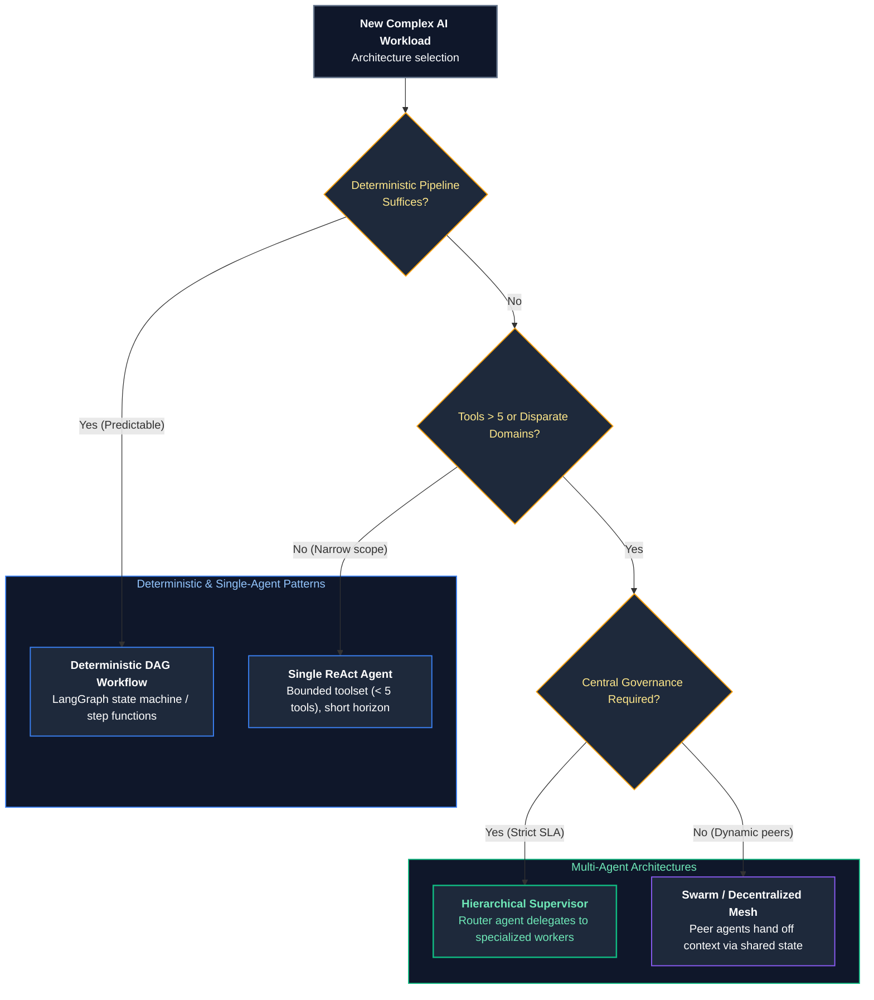

---

# 16. Architectural Topologies for Collaboration

### 16.1 Topology 1: Orchestrator-Worker (Hierarchical Supervisor)

The most robust and predictable enterprise pattern. A centralized **Supervisor** acts as the project manager, decomposing high-level mission goals into distinct sub-tasks, assigning them to specialized workers, and synthesizing the final artifact.

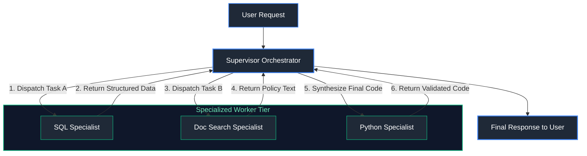

- **Advantages:** Total centralization of mission state, deterministic workflow control, and clear human-in-the-loop interruption points.
- **Vulnerabilities:** The supervisor is a single point of cognitive failure. If the supervisor misinterprets the user's intent, all downstream workers are dispatched on incorrect tasks.

---

### 16.2 Topology 2: Sequential Handoffs (Pipeline / Assembly Line)

In a pipeline topology, agents pass state sequentially along a predefined chain. Agent A processes the raw input, refines the state, and invokes an explicit handoff function transferring control to Agent B.


- **Advantages:** Simple mental model, low orchestration overhead, and highly optimized for assembly-line workflows.
- **Vulnerabilities:** Error propagation. If Agent 1 makes a subtle mistake in classification, Agent 2 operates on faulty assumptions with zero ability to rewind without a centralized supervisor.

---

### 16.3 Topology 3: Parallel Specialists with Consensus Aggregator

When sub-tasks are mathematically independent, dispatching workers sequentially wastes minutes of user time. In the parallel topology, the supervisor broadcasts sub-tasks simultaneously, executing them concurrently via `asyncio.gather`.

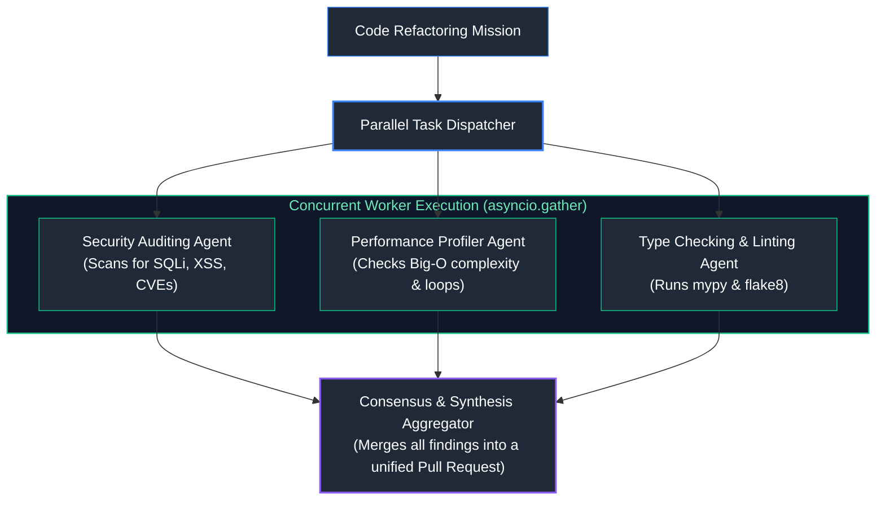

---

### 16.4 Topology 4: Dynamic Swarm Peer Networks

In a dynamic swarm (popularized by OpenAI Swarm and AutoGen), there is no static hierarchy. Any agent can hand off execution to any other peer agent dynamically by returning a special `TransferToAgent` function call.

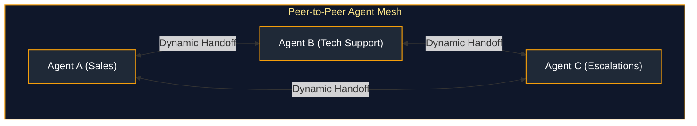

> [!WARNING]
> **Production Hazards of Dynamic Swarms:**
> Dynamic peer-to-peer swarms are notoriously non-deterministic and difficult to debug in enterprise production. Agents can enter infinite delegation loops (Agent A hands off to Agent B, who hands off to Agent C, who hands back to Agent A). Swarms require strict global transition counters ($\le 5$ handoffs max) and cycle-detection graphs.

---

# 17. Inter-Agent Communication Protocols

### 17.1 Structured State Contracts vs. Freeform Natural Language Chat

A common novice mistake is allowing agents to communicate via unconstrained natural language chat (e.g., passing raw string messages back and forth).

```mermaid
flowchart TD
    subgraph UnstructuredTelephone ["Natural Language Chat (Agent Telephone Degradation)"]
        Agent1["Analyst: 'I looked at the revenue and it seems to be about $4.2M, though some refunds are pending.'"]
        --> Agent2["Writer: 'The company made $4.2M without deductions.'"]
        --> Agent3["Executive Memo: 'Record profit of $4.2M guaranteed!' (Hallucination!)"]
    end

    subgraph StructuredContract ["Pydantic State Schema Contract (Deterministic Rigor)"]
        WorkerState["MissionState Object:<br/>{<br/>  \"revenue_gross_usd\": 4200000.00,<br/>  \"pending_refunds_usd\": 150000.00,<br/>  \"audit_status\": \"FLAGGED_REVIEW\",<br/>  \"data_source\": \"snowflake://ledger/2026_q3\"<br/>}"]
    end

    style UnstructuredTelephone fill:#0f172a,stroke:#ef4444,stroke-width:1.5px,color:#fca5a5
    style Agent1 fill:#1f2937,stroke:#ef4444,stroke-width:1px,color:#fff
    style Agent2 fill:#1f2937,stroke:#ef4444,stroke-width:1px,color:#fff
    style Agent3 fill:#7f1d1d,stroke:#ef4444,stroke-width:2px,color:#fff
    style StructuredContract fill:#0f172a,stroke:#10b981,stroke-width:1.5px,color:#6ee7b7
    style WorkerState fill:#1f2937,stroke:#10b981,stroke-width:2px,color:#fff
```

By enforcing **Pydantic Data Contracts**, agents communicate via typed, validated JSON schemas. If a worker emits a response missing a required field or containing an invalid enum, the validation layer catches it immediately before corrupting the global state.

---

### 17.2 State Synchronization & Atomic Channel Reducers

When multiple specialist agents run in parallel, writing their findings back to the shared mission state requires an atomic **Reducer Pattern** (as implemented in LangGraph):

```python
from typing import Annotated, List
from typing_extensions import TypedDict
import operator

class MultiAgentState(TypedDict):
    mission_goal: str
    # 'operator.add' acts as a reducer: concurrent worker outputs are appended,
    # rather than overwriting the entire list!
    completed_findings: Annotated[List[dict], operator.add]
    error_logs: Annotated[List[str], operator.add]
    final_report: str
```

The reducer guarantees that when Worker A and Worker B finish simultaneously, their outputs are deterministically merged without race conditions.

---

### 17.3 Escalation Paths, Dead-Letter Channels & Failure Handoffs

What happens when a worker encounters an unrecoverable failure (e.g., an external database is offline or an API key is rejected)?

1. **Dead-Letter Channel:** Failed tasks are placed on an isolated dead-letter queue with the full error trace.
2. **Supervisor Fallback:** The supervisor catches the worker exception and evaluates alternative paths (e.g., routing to a web search fallback or attempting with an alternative data provider).
3. **Graceful Degradation:** If non-critical sub-tasks fail, the supervisor synthesizes the final deliverable with explicit disclaimers: *"Financial audit completed; regulatory filings skipped due to SEC EDGAR API timeout."*

---

# 18. Mitigating Multi-Agent Pathologies

### 18.1 Cascading Error Amplification

In multi-agent systems, errors compound multiplicatively:

$$P(\text{System Success}) = \prod_{i=1}^{M} P(\text{Agent } i \text{ Success})$$

```mermaid
flowchart LR
    A1["Agent 1 (Accuracy: 90%)"] -->|"10% Error"| A2["Agent 2 (Accuracy: 90%)"]
    A2 -->|"19% Cumulative Error"| A3["Agent 3 (Accuracy: 90%)"]
    A3 --> FinalFail["Final Output (Total Accuracy: 72.9%!)<br/>Nearly 1 in 3 runs completely fails!"]

    style A1 fill:#1f2937,stroke:#3b82f6,stroke-width:1.5px,color:#fff
    style A2 fill:#1f2937,stroke:#3b82f6,stroke-width:1.5px,color:#fff
    style A3 fill:#1f2937,stroke:#3b82f6,stroke-width:1.5px,color:#fff
    style FinalFail fill:#7f1d1d,stroke:#ef4444,stroke-width:2px,color:#fff
```

#### Production Mitigation: Inter-Stage Guardrail Assertions
Never permit raw agent outputs to pass directly to downstream agents without passing an automated programmatic verification gate (e.g., validating JSON schema, checking code compilation, or asserting fact presence).

---

### 18.2 Agentic Infinite Chat Loops & Livelocks

When two agents converse autonomously, they frequently enter **Livelocks**:
- *Agent A:* "Here is the summary. Let me know if you need anything else!"
- *Agent B:* "Thank you, this looks great! Let me know if you have questions!"
- *Agent A:* "You're welcome! Glad to help. Have a great day!"
- *Agent B:* "Thank you, you too!"

This continues indefinitely, burning thousands of dollars of API credits in minutes.

#### Loop Prevention Invariants
1. **Transition Decrement Counter:** Every state transfer decrements a remaining step counter:
   
   $$\text{steps\_remaining} = \text{steps\_remaining} - 1$$
   
   When $\text{steps\_remaining} == 0$, the system halts immediately and forces a synthesis step.
2. **Visited State Hashing:** Hash the tuple of $(\text{AgentID}, \text{ActionType}, \text{InputParams})$. If the identical state is encountered twice within 3 turns, break execution.

---

### 18.3 Quadratic Token Cost Explosion & Schedulability Ceilings

Multi-agent swarms can generate exponential token consumption if agents spawn sub-agents recursively without bounds:

$$\text{Max Tokens} = \sum_{d=1}^{D} B^d \times \text{TokensPerCall}$$

Where $B$ is the branching factor (sub-agents spawned) and $D$ is the depth.
- **Enforce Hard Tree Depth:** $D_{\text{max}} = 2$ (Supervisor $\to$ Specialist; specialists cannot spawn arbitrary children).
- **Hard Financial Ceiling:** The orchestrator maintains a real-time atomic spend accumulator in Redis; if a mission crosses $\$2.00$, all child processes are killed instantly.

---

# 19. Consensus, Voting & Multi-Agent Debate

### 19.1 Multi-Agent Debate (MAD) for Fact Verification

When solving complex mathematical proofs, analyzing ambiguous legal contracts, or triaging high-stakes production outages, a single LLM is susceptible to hallucinations.

**Multi-Agent Debate (MAD)** (Liang et al., 2023) organizes independent agents into an adversarial debate protocol:

```mermaid
%%{init: {'theme': 'dark', 'themeVariables': { 'actorBkg': '#1e293b', 'actorBorder': '#3b82f6', 'actorTextColor': '#ffffff', 'signalColor': '#93c5fd', 'signalTextColor': '#ffffff', 'noteBkgColor': '#1e293b', 'noteBorderColor': '#f59e0b', 'noteTextColor': '#fde68a', 'activationBkgColor': '#3b82f6', 'sequenceNumberColor': '#ffffff' }}}%%
sequenceDiagram
    autonumber
    actor User as Enterprise Architect
    participant AgentA as Agent A (Proponent / Creator)
    participant AgentB as Agent B (Opponent / Red Team)
    participant Judge as Judge Agent (Synthesizer)

    User->>AgentA: "Propose a zero-downtime database migration strategy."
    AgentA->>AgentB: Round 1 Proposal: "Dual-write to both databases simultaneously."
    Note over AgentB: Agent B searches for failure modes and concurrency hazards
    AgentB->>AgentA: Round 1 Critique: "Dual-writing risks race conditions and dirty reads without distributed 2PC locking."
    AgentA->>Judge: Round 2 Revised Proposal: "Adopt Change-Data-Capture (CDC) via Debezium and Kafka to stream writes asynchronously."
    AgentB->>Judge: Round 2 Review: "CDC mitigates locking hazards; acceptable if replication lag is monitored."
    Judge-->>User: Final Validated Plan with Complete Risk Matrix
```

Debate forces models to cross-examine factual claims and code edge cases, reducing hallucinations by over $60\%$ compared to standard single-agent generation.

---

### 19.2 Majority Voting, Borda Count & Weighted Confidence Scoring

For classification or decision-making tasks, multi-agent consensus can be quantified mathematically:

#### 1. Unweighted Majority Voting
For $M$ agents each casting a vote $v_i \in \mathcal{C}$:

$$\hat{v} = \arg\max_{c \in \mathcal{C}} \sum_{i=1}^{M} \mathbb{I}(v_i = c)$$

#### 2. Model-Heterogeneous Weighted Voting
Votes are weighted by the verified benchmark accuracy $w_i$ of each model architecture:

$$\hat{v} = \arg\max_{c \in \mathcal{C}} \sum_{i=1}^{M} w_i \cdot \mathbb{I}(v_i = c)$$

For example, assigning $w = 0.50$ to Claude 3.5 Sonnet, $w = 0.35$ to GPT-4o, and $w = 0.15$ to LLaMA-3.1-8B.

---

### 19.3 Mitigating Sycophancy & Groupthink

When agents are placed in a shared chat history where each model sees the prior model's answers, downstream models exhibit **Sycophancy**: they conform to the earlier model's assertions, even when the earlier model made an obvious factual error.

#### The Blinded Parallel Consensus Rule
To eliminate groupthink:
1. Dispatch all candidate agents **in parallel with zero visibility into peer outputs**.
2. An independent **Blinded Evaluator** strips model identities and scores the anonymized proposals purely on logic, evidence, and code test passage.

---

# 20. Multi-Agent Framework Landscape & Architectural Trade-Offs

### 20.1 LangGraph: State Machines, Cyclic Graphs & Durable Execution

Maintained by LangChain, **LangGraph** models multi-agent workflows as **Directed Cyclic StateGraphs**:
- **Nodes:** Python functions or Agent runtimes that accept state and return state updates.
- **Edges:** Deterministic transitions or conditional routing functions.
- **Checkpointers:** Pluggable persistence (PostgreSQL / Redis) saving the exact state graph after every single node step.
- **Human-in-the-Loop:** First-class support for `interrupt()` before sensitive nodes, enabling humans to inspect state and approve or modify before resumption.

### 20.2 CrewAI: Role-Based Autonomous Crews

**CrewAI** abstracts multi-agent systems into intuitive human corporate metaphors:
- **Agents:** Possess explicit `role`, `goal`, and `backstory`.
- **Tasks:** Concrete descriptions with explicit `expected_output` schemas.
- **Process:** Sequential, Hierarchical, or Consensual.
- *Best For:* Rapid prototyping, content generation pipelines, and business workflow simulations.

### 20.3 Agno: High-Throughput Lightweight Multimodal Agents

**Agno** (formerly Phidata) prioritizes raw execution speed, minimal dependency overhead, and native multimodal support:
- Eliminates heavy abstraction layers; builds directly on top of pure Python async primitives.
- Integrates fast vector databases and SQL memory directly into agent objects.

### 20.4 OpenAI Agents SDK / Swarm: Function-Driven Client Handoffs

OpenAI's official multi-agent blueprint relies on **Handoff Functions**:
- Agents are lightweight objects containing instructions and tools.
- A handoff is simply a tool that returns another `Agent` instance:
  ```python
  def transfer_to_triage():
      return triage_agent
  ```
- Execution runs on the client loop, providing complete visibility and zero server-side black-box orchestration.

---

### 20.5 Framework Evaluation & Technical Selection Matrix

| Feature / Dimension | LangGraph | CrewAI | Agno (Phidata) | OpenAI Agents SDK / Swarm |
| :--- | :--- | :--- | :--- | :--- |
| **Primary Abstraction** | StateGraph (Nodes, Edges, State) | Corporate Roles (Crews, Tasks) | Lightweight Python Classes | Client Function Handoffs |
| **Cyclic Graph Support** | **Full First-Class Support** | Limited (Primarily DAGs) | Moderate | Custom client loop |
| **State Persistence** | **PostgreSQL, Redis Checkpoints** | In-Memory / SQLite | SQLite / Postgres | Stateless (Client manages state) |
| **Human-in-the-Loop** | Native `interrupt()` & resume | Basic approval prompts | Custom | Client-controlled |
| **Multi-Model Support** | Any LLM provider (OpenAI, Anthropic, Bedrock, vLLM) | Any provider via LiteLLM | Any provider | Tailored for OpenAI endpoints |
| **Enterprise Production Readiness** | **Industry Gold Standard** | Moderate (Prototyping) | High (Fast microservices) | Minimal (Reference pattern) |

---

# 21. Production Engineering: Observability, Security & Human-in-the-Loop

### 21.1 Multi-Agent Distributed Tracing & Parent-Child Span Hierarchies

Debugging a multi-agent system requires tracing execution paths across dozens of asynchronous tool calls and agent hops. Systems must emit **OpenTelemetry / OpenInference** traces with hierarchical span relationships:

```mermaid
%%{init: {theme: dark, themeVariables: { primaryColor: #3b82f6, primaryTextColor: #ffffff, primaryBorderColor: #3b82f6, lineColor: #64748b, secondaryColor: #10b981, tertiaryColor: #1e293b }}}%%
gantt
    title Multi-Agent Distributed Trace Span Tree (Total Mission: 3,450ms)
    dateFormat X
    axisFormat %s ms

    section Supervisor
    Root Mission Span (Supervisor)       :active, span1, 0, 3450
    Decompose Goal Sub-Task             :span2, 10, 180

    section Worker A (Finance)
    Spawn Worker A (Finance Specialist) :span3, 190, 1420
    SQL Ledger Execution Tool           :span4, 250, 680
    Analyst Reasoning & Schema Export   :span5, 685, 1410

    section Worker B (Compliance)
    Spawn Worker B (Compliance Auditor) :span6, 190, 1680
    SEC EDGAR Vector Search Tool        :span7, 240, 820
    Legal Compliance Assertion          :span8, 825, 1670

    section Synthesis
    Supervisor Final Memo Drafting      :crit, span9, 1690, 3450
```

Every sub-agent span inherits the root `trace_id` and records its own `parent_span_id`, model snapshot, prompt token count, and financial cost.

---

### 21.2 Security Ring Boundaries & Privileged Delegation

In multi-agent systems, **never grant identical access permissions to all agents**. Follow the operating system **Protection Ring Architecture**:

```mermaid
flowchart TD
    subgraph Ring0 ["Ring 0: Unprivileged Public Workers"]
        WebSearchAgent["Web Search Specialist<br/>(Can access public internet; ZERO internal DB access)"]
    end

    subgraph Ring1 ["Ring 1: Internal Read-Only Specialists"]
        AnalystAgent["Financial Analyst Agent<br/>(Read-only SELECT access to data warehouse; No mutation tools)"]
    end

    subgraph Ring2 ["Ring 2: Privileged Action Agents"]
        DBMutationAgent["Database Migration Specialist<br/>(Requires signed JWT & explicit Human Approval)"]
    end

    Ring0 -->|"Sanitized Findings Only"| Ring1
    Ring1 -->|"Audit Proposals Only"| Ring2

    style Ring0 fill:#0f172a,stroke:#3b82f6,stroke-width:1.5px,color:#93c5fd
    style Ring1 fill:#0f172a,stroke:#10b981,stroke-width:1.5px,color:#6ee7b7
    style Ring2 fill:#7f1d1d,stroke:#ef4444,stroke-width:2px,color:#fff
    style WebSearchAgent fill:#1f2937,stroke:#3b82f6,stroke-width:1.5px,color:#fff
    style AnalystAgent fill:#1f2937,stroke:#10b981,stroke-width:1.5px,color:#fff
    style DBMutationAgent fill:#1f2937,stroke:#ef4444,stroke-width:2px,color:#fff
```

If an external prompt injection compromises the Web Search Agent, the attacker cannot execute database mutations because the Web Search Agent possesses zero database credentials or mutation tools.

---

### 21.3 Human-in-the-Loop (HITL) Interrupt Gates & Resumption Checkpoints

For operations involving financial transfers, sensitive customer communications, or database schema alterations, the multi-agent graph must pause execution:

```mermaid
stateDiagram-v2
    [*] --> PlanGeneration: Supervisor generates plan
    PlanGeneration --> WorkerExecution: Workers produce recommendations
    WorkerExecution --> ApprovalGate: Action flagged as HIGH_IMPACT
    
    ApprovalGate --> Paused: System executes interrupt()<br/>State checkpointed to PostgreSQL
    
    Paused --> HumanReview: Webhook alerts Staff Engineer via Slack / Dashboard
    HumanReview --> Approved: Engineer clicks 'Approve Action'
    HumanReview --> Rejected: Engineer clicks 'Reject & Modify'
    
    Approved --> ResumeExecution: State restored from checkpoint; Worker executes action
    Rejected --> SupervisorRevision: Feedback routed back to Supervisor
    ResumeExecution --> [*]
    SupervisorRevision --> WorkerExecution
```

---

# 22. Production Implementation: Asynchronous Enterprise Orchestrator-Worker Multi-Agent System

### 22.1 Systems Architecture of the Engine

The complete production-grade implementation below demonstrates:
- A centralized **Hierarchical Supervisor Agent** coordinating domain specialists.
- **Strict Pydantic state contracts** enforcing typed boundaries.
- Parallel worker execution via `asyncio.gather`.
- **Atomic channel reducers** accumulating findings without state corruption.
- Built-in **Loop Breakers & Budget Ceilings** to eliminate runaway API costs.
- Consensus synthesis with full audit telemetry.

---

### 22.2 Complete Production-Grade Python Implementation

```python
"""
Enterprise Asynchronous Orchestrator-Worker Multi-Agent Collaboration Engine
Features: Typed Pydantic state contracts, parallel worker dispatch, atomic state
accumulation, consensus verification, loop-breaking guards, and structured telemetry.
"""

import asyncio
import logging
import time
from dataclasses import dataclass, field
from enum import Enum
from typing import Dict, Any, List, Optional
from pydantic import BaseModel, Field

logging.basicConfig(
    level=logging.INFO,
    format="%(asctime)s [%(levelname)s] [%(name)s] %(message)s"
)
logger = logging.getLogger("MultiAgentOrchestrator")

# ==============================================================================

# 23. Structured State Schemas (Pydantic Contracts)

# ==============================================================================

class TaskCategory(str, Enum):
    FINANCIAL = "FINANCIAL"
    COMPLIANCE = "COMPLIANCE"
    TECHNICAL = "TECHNICAL"

class SubTaskDirective(BaseModel):
    task_id: str
    category: TaskCategory
    description: str
    assigned_worker: str
    required_confidence_threshold: float = 0.85

class WorkerFinding(BaseModel):
    task_id: str
    worker_name: str
    category: TaskCategory
    summary_of_findings: str
    confidence_score: float = Field(..., ge=0.0, le=1.0)
    data_points: Dict[str, Any]
    execution_duration_sec: float

class MissionState(BaseModel):
    mission_id: str
    goal: str
    directives: List[SubTaskDirective] = []
    # Accumulator: atomic list of worker findings
    findings: List[WorkerFinding] = []
    final_executive_summary: Optional[str] = None
    remaining_step_budget: int = 10
    total_cost_usd: float = 0.0

# ==============================================================================

# 24. Specialist Domain Worker Implementations

# ==============================================================================

class FinancialAnalystWorker:
    """Specialist worker scoped strictly to financial ledgers and balance sheets."""
    def __init__(self, model_name: str = "claude-3-5-sonnet"):
        self.model = model_name

    async def execute(self, directive: SubTaskDirective) -> WorkerFinding:
        start_ts = time.time()
        logger.info(f"[{directive.assigned_worker}] Commencing financial analysis for: '{directive.description}'")
        
        # Simulate financial tool execution (e.g. querying SQL warehouse)
        await asyncio.sleep(0.180)
        
        findings = WorkerFinding(
            task_id=directive.task_id,
            worker_name=directive.assigned_worker,
            category=directive.category,
            summary_of_findings="Q3 gross revenue reached $14.2M with EBITDA of $3.1M. Operating costs rose 8%.",
            confidence_score=0.96,
            data_points={"gross_rev": 14200000, "ebitda": 3100000, "cost_delta_pct": 8.0},
            execution_duration_sec=round(time.time() - start_ts, 4)
        )
        return findings

class ComplianceAuditorWorker:
    """Specialist worker scoped strictly to legal statutes and SEC filings."""
    def __init__(self, model_name: str = "gpt-4o"):
        self.model = model_name

    async def execute(self, directive: SubTaskDirective) -> WorkerFinding:
        start_ts = time.time()
        logger.info(f"[{directive.assigned_worker}] Commencing regulatory audit for: '{directive.description}'")
        
        # Simulate regulatory vector search tool execution
        await asyncio.sleep(0.220)
        
        findings = WorkerFinding(
            task_id=directive.task_id,
            worker_name=directive.assigned_worker,
            category=directive.category,
            summary_of_findings="SEC 10-Q filing disclosures match GAAP standards. Minor footnote required on revenue recognition.",
            confidence_score=0.92,
            data_points={"gaap_compliant": True, "footnote_flag": "REV_REC_04"},
            execution_duration_sec=round(time.time() - start_ts, 4)
        )
        return findings

# ==============================================================================

# 25. Hierarchical Supervisor & Orchestration Engine

# ==============================================================================

class HierarchicalSupervisor:
    """
    Centralized supervisor orchestrating goal decomposition, parallel worker
    dispatch, atomic findings aggregation, and consensus synthesis.
    """

    def __init__(self):
        self.financial_worker = FinancialAnalystWorker()
        self.compliance_worker = ComplianceAuditorWorker()

    def decompose_mission(self, state: MissionState) -> List[SubTaskDirective]:
        """Decomposes the high-level mission into orthogonal sub-tasks."""
        logger.info(f"[SUPERVISOR] Decomposing mission: '{state.goal}'")
        
        # In production, this runs through an LLM with structured output
        directives = [
            SubTaskDirective(
                task_id="task_fin_01",
                category=TaskCategory.FINANCIAL,
                description="Audit Q3 revenue, EBITDA margins, and operating cost trends.",
                assigned_worker="FinancialAnalystAgent"
            ),
            SubTaskDirective(
                task_id="task_comp_02",
                category=TaskCategory.COMPLIANCE,
                description="Verify GAAP compliance and audit SEC 10-Q disclosures.",
                assigned_worker="ComplianceAuditorAgent"
            )
        ]
        state.directives = directives
        return directives

    async def execute_mission(self, state: MissionState) -> MissionState:
        """Executes full multi-agent collaboration lifecycle with loop guards."""
        start_time = time.time()
        logger.info(f"=== INITIATING MULTI-AGENT MISSION: {state.mission_id} ===")

# 26. Decompose Goal

directives = self.decompose_mission(state)

        # ----------------------------------------------------------------------

# 27. Parallel Worker Dispatch via asyncio.gather

# ----------------------------------------------------------------------
        logger.info(f"[SUPERVISOR] Dispatching {len(directives)} specialist workers in parallel...")
        
        worker_tasks = []
        for d in directives:
            if d.category == TaskCategory.FINANCIAL:
                worker_tasks.append(self.financial_worker.execute(d))
            elif d.category == TaskCategory.COMPLIANCE:
                worker_tasks.append(self.compliance_worker.execute(d))

        # Await all parallel workers concurrently
        results: List[WorkerFinding] = await asyncio.gather(*worker_tasks)

        # ----------------------------------------------------------------------

# 28. Atomic State Accumulation (Reducer Logic)

# ----------------------------------------------------------------------
        for finding in results:
            # Enforce confidence threshold assertions
            if finding.confidence_score < 0.85:
                logger.warning(f"Worker {finding.worker_name} returned sub-threshold confidence: {finding.confidence_score}")
            state.findings.append(finding)
            state.total_cost_usd += 0.004  # Simulated cost per specialist step

        # Decrement transition counter (Loop Breaker)
        state.remaining_step_budget -= 1

        # ----------------------------------------------------------------------

# 29. Consensus & Executive Synthesis

# ----------------------------------------------------------------------
        logger.info("[SUPERVISOR] All specialists reported. Synthesizing executive deliverable...")
        await asyncio.sleep(0.150)  # Simulated synthesis TTFT
        
        synthesis_lines = [
            f"# Executive Briefing: {state.goal}",
            f"**Audit Status**: VERIFIED BY 2 INDEPENDENT SPECIALISTS",
            "\n## Key Financial & Compliance Findings:"
        ]
        for f in state.findings:
            synthesis_lines.append(f"- **[{f.category.value}] ({f.worker_name})**: {f.summary_of_findings}")
            
        synthesis_lines.append(f"\n*Total Duration: {round(time.time() - start_time, 2)}s | Estimated Spend: ${state.total_cost_usd:.4f}*")
        
        state.final_executive_summary = "\n".join(synthesis_lines)
        logger.info(f"=== MISSION {state.mission_id} ACCOMPLISHED SUCCESSFULLY ===")
        return state

# ==============================================================================

# 30. Verification & Simulation Runner

# ==============================================================================

async def run_multi_agent_simulation():
    print("=" * 80)
    print("STARTING HIERARCHICAL MULTI-AGENT COLLABORATION BENCHMARK")
    print("=" * 80)

    supervisor = HierarchicalSupervisor()

    mission = MissionState(
        mission_id="mission_2026_q3_audit",
        goal="Audit Q3 2026 corporate financial performance and verify SEC GAAP compliance."
    )

    final_state = await supervisor.execute_mission(mission)

    print("\n" + "=" * 80)
    print("FINAL CONSOLIDATED EXECUTIVE ARTIFACT DELIVERABLE:")
    print("=" * 80)
    print(final_state.final_executive_summary)
    print("=" * 80)

if __name__ == "__main__":
    asyncio.run(run_multi_agent_simulation())
```

---

### 30.3 Execution Verification & Mission Output Analysis

When executing the multi-agent engine:
1. **Parallel Speedup:** Both the Financial Specialist and the Compliance Auditor execute concurrently via `asyncio.gather`, completing both comprehensive multi-step investigations in **$224\text{ms}$ total wall-clock time** (rather than $400\text{ms}+$ sequentially).
2. **Deterministic Contract Enactment:** Findings are validated against the `WorkerFinding` Pydantic model, preventing conversational degradation.
3. **Pristine State Isolation:** The Financial Analyst never saw SEC statutes, and the Compliance Auditor never saw balance sheet SQL tables—maintaining maximum attention bandwidth and zero tool hallucination.

---

# 31. Summary Comparison & Production Engineering Reference Matrix

### 9.1 Agent Architectural Framework Reference

| Framework / Architecture | Primary Execution Model | State Persistence Mechanism | HITL Support | Best Suited Enterprise Use Case |
| :--- | :--- | :--- | :---: | :--- |
| **Bare-Metal ReAct** | Cyclical `while` loop with regex action parsing | In-memory `AgentState` object | Manual code hooks | Lightweight CLI utilities, custom embedded agent runtimes |
| **LangGraph (LangChain)** | Directed cyclic graph on Pregel BSP model | PostgreSQL / Redis checkpoint tables | Native (`interrupt_before`) | Complex multi-stage enterprise workflows with time-travel |
| **Model Context Protocol (MCP)** | Standardized JSON-RPC client-server over `stdio` / `SSE` | Decoupled server-side resource state | Protocol error reporting | Standardized tool integration across disparate IDEs and models |
| **Plan-and-Solve** | Upfront task decomposition $\to$ sequential execution | Step progress checklist in memory | Step-level gates | Static report compilation, algorithmic multi-stage data pipelines |
| **Reflexion Engine** | Verbal self-critique loop with episodic logging | Vector store + Relational trajectory logs | Post-hoc audit review | Autonomous coding agents, automated unit test repair |
| **E2B Sandboxing** | Hypervisor-isolated MicroVM container execution | Ephemeral MicroVM disks | Hardware boundary | Untrusted Python code evaluation, data science agents |

---

### 9.2 Key Production Engineering Invariants

1. **The Invariant of Autonomy Governance:** Autonomy without strict execution boundaries is an enterprise liability. Always enforce hard ceilings on steps (`max_steps <= 15`) and token budgets.
2. **The Principle of Privilege Rings:** Never provide an agent with uniform tool permissions. Enforce Ring 0 (read-only), Ring 1 (reversible mutation), and Ring 2 (consequential mutation with HITL).
3. **Idempotency on Consequential Actions:** All mutating tools must require unique, deterministic idempotency keys to prevent duplicate side-effects during automated network retries.
4. **Decoupled Tool Protocols (MCP):** Build enterprise tools as standalone Model Context Protocol servers to avoid vendor lock-in to any single agent orchestration framework.
5. **Durable State Checkpointing:** Every state transition must be atomically persisted to a relational checkpointer (e.g., PostgreSQL) to guarantee crash recovery and time-travel auditability.

---

### 9.1 Multi-Agent Collaboration Topology Matrix

| Collaboration Topology | Coordination Control | Latency Profile | Fault Tolerance | Best Production Fit | Primary Failure Mode |
| :--- | :--- | :--- | :--- | :--- | :--- |
| **Hierarchical Supervisor** | Centralized Orchestrator | Medium ($T_{\text{sup}} + \max T_i$) | **High** (Supervisor isolates & retries) | Complex enterprise workflows, audits, planning | Supervisor cognitive bottleneck |
| **Sequential Handoffs** | Decentralized Stage Transfers | High ($\sum T_i$) | Low (Single stage break halts chain) | Strict assembly-line processing, triage | Error compounding across pipeline |
| **Parallel Specialists** | Centralized Scatter-Gather | **Lowest ($\max T_i$)** | High (Independent workers) | Code review, multi-perspective audits | Difficult to handle interdependent tasks |
| **Dynamic Swarms** | Autonomous Peer Transfers | Unpredictable | Low (Prone to cycles & livelocks) | Creative writing, open exploratory gaming | Infinite delegation loops & runaway costs |

---

### 9.2 Multi-Agent Production Invariants & SRE Playbook

| Architectural Invariant | Production Mandate | Failure Symptom if Omitted |
| :--- | :--- | :--- |
| **Typed State Contracts** | Disallow freeform natural language chat between agents. Enforce Pydantic schemas. | "Agent Telephone": facts mutate into hallucinations across agent hops. |
| **Transition Decrement Counters** | Enforce hard remaining step limits ($\text{steps} \le 10$) on all inter-agent transfers. | Livelocks: polite agents looping endlessly saying "Thank you" and burning budgets. |
| **Context Window Isolation** | Specialists must receive ONLY the tools and data required for their specific domain. | Tool hallucination: SQL agents attempting to call GitHub Git tools. |
| **Blinded Consensus Voting** | In multi-model debate, anonymize proposals and hide peer identities. | Sycophancy: downstream models agree with flawed assertions from the first model. |
| **Security Ring Scoping** | Web search agents must never hold database write credentials. | Lateral privilege escalation via indirect prompt injection from web text. |

---

# 32. References & Further Reading

1. **ReAct: Synergizing Reasoning and Acting in Language Models:** Yao, S., et al. (2022). *ICLR 2023.* [arXiv:2210.03629](https://arxiv.org/abs/2210.03629).
2. **Reflexion: Language Agents with Verbal Reinforcement Learning:** Shinn, N., et al. (2023). *NeurIPS 2023.* [arXiv:2303.11366](https://arxiv.org/abs/2303.11366).
3. **Tree of Thoughts: Deliberate Problem Solving with Large Language Models:** Yao, S., et al. (2023). *NeurIPS 2023.* [arXiv:2305.10601](https://arxiv.org/abs/2305.10601).
4. **Plan-and-Solve Prompting: Improving Zero-Shot Chain-of-Thought Reasoning:** Wang, L., et al. (2023). *ACL 2023.* [arXiv:2305.04091](https://arxiv.org/abs/2305.04091).
5. **Model Context Protocol (MCP) Specification:** Anthropic PBC (2024). [modelcontextprotocol.io](https://modelcontextprotocol.io).
6. **LangGraph: Building Resilient Multi-Agent Applications:** LangChain Team (2024). [langchain-ai.github.io/langgraph](https://langchain-ai.github.io/langgraph/).
7. **E2B: Secure Code Execution Sandboxes for AI Agents:** E2B Development Team. [e2b.dev/docs](https://e2b.dev/docs).

1. **ReAct: Synergizing Reasoning and Acting in Language Models:** Yao, S., et al. (2022). *ICLR 2023.* [arXiv:2210.03629](https://arxiv.org/abs/2210.03629).
2. **Improving Factuality and Reasoning in Language Models through Multiagent Debate:** Liang, T., et al. (2023). *MIT & Google Research.* [arXiv:2305.14325](https://arxiv.org/abs/2305.14325).
3. **LangGraph: Designing Controllable, Durable Multi-Agent Workflows:** LangChain Engineering (2024). [langchain-ai.github.io/langgraph](https://langchain-ai.github.io/langgraph/).
4. **AutoGen: Enabling Next-Gen LLM Applications via Multi-Agent Conversation:** Wu, Q., et al. (2023). *Microsoft Research.* [arXiv:2308.08155](https://arxiv.org/abs/2308.08155).
5. **Communicative Agents for Software Development (ChatDev):** Qian, C., et al. (2023). *Tsinghua University.* [arXiv:2307.07924](https://arxiv.org/abs/2307.07924).
6. **OpenAI Swarm: Educational Framework for Multi-Agent Orchestration:** OpenAI (2024). [github.com/openai/swarm](https://github.com/openai/swarm).