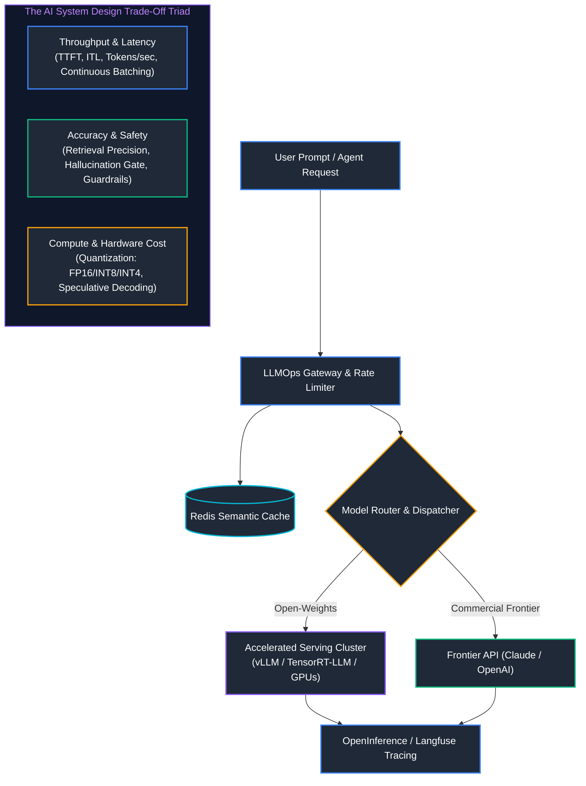
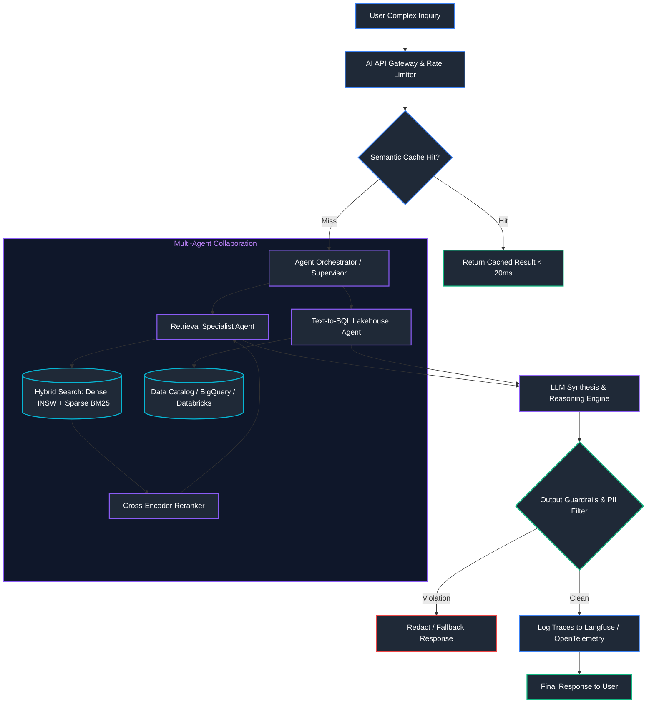
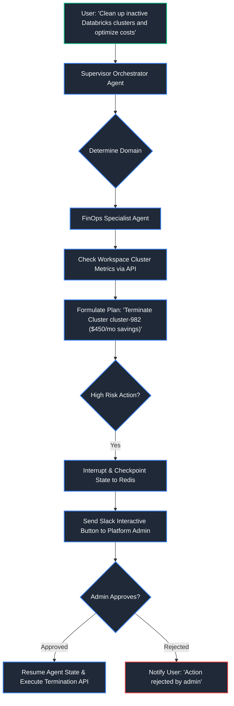
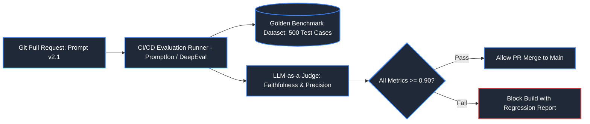
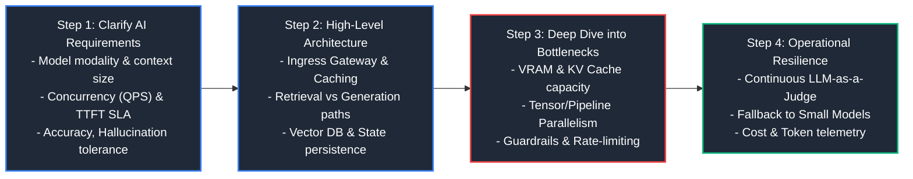

# 05. AI System Design

A comprehensive, production-grade guide to end-to-end system design for enterprise Generative AI platforms, high-throughput LLM serving clusters, multi-agent cognitive systems, continuous evaluation, and AI system design interview frameworks.

---

## Table of Contents
1. [AI System Design Fundamentals: Trade-Offs & Mechanics](#1-ai-system-design-fundamentals-trade-offs--mechanics)
   - [1.1 Core Architectural Dimensions of AI Systems](#11-core-architectural-dimensions-of-ai-systems)
   - [1.2 Compute-Bound vs. Memory-Bandwidth Bound Inference](#12-compute-bound-vs-memory-bandwidth-bound-inference)
   - [1.3 Serving Latency Metrics: TTFT vs. ITL](#13-serving-latency-metrics-ttft-vs-itl)
2. [Enterprise AI System Designs](#2-enterprise-ai-system-designs)
   - [2.1 Blueprint 1: Enterprise Production RAG & AI Agent Platform](#21-blueprint-1-enterprise-production-rag--ai-agent-platform)
   - [2.2 Blueprint 2: High-Throughput LLM Serving Platform](#22-blueprint-2-high-throughput-llm-serving-platform)
   - [2.3 Blueprint 3: Enterprise Multi-Agent System with Human-in-the-Loop](#23-blueprint-3-enterprise-multi-agent-system-with-human-in-the-loop)
   - [2.4 Blueprint 4: Continuous LLM Evaluation & Observability Platform](#24-blueprint-4-continuous-llm-evaluation--observability-platform)
3. [AI System Design Interview Framework (The 4-Step Method)](#3-ai-system-design-interview-framework-the-4-step-method)
   - [3.1 Quantitative Estimation Cheat-Sheet for LLM Serving & Sizing](#31-quantitative-estimation-cheat-sheet-for-llm-serving--sizing)
4. [Summary & AI System Design Best Practices](#4-summary--ai-system-design-best-practices)

---

## 1. AI System Design Fundamentals: Trade-Offs & Mechanics



### 1.1 Core Architectural Dimensions of AI Systems
- **Decoupling Orchestration from Model Execution**: Never let client applications directly invoke raw model weights or frontier APIs. Interpose an AI Gateway providing semantic caching, authentication, fallback routing, and audit logging.
- **Stateless Inference vs. Stateful Context Management**: LLM execution engines are strictly stateless. Conversational state, vector index references, and working agent memory must be persisted in external distributed stores (Redis, PostgreSQL, Vector DBs).
- **Graceful Degradation & Fallback Topology**: When upstream APIs throttle or primary GPU clusters saturate, route requests to secondary lightweight models (e.g., Llama-3-8B fallback or distilled task-specific models).

### 1.2 Compute-Bound vs. Memory-Bandwidth Bound Inference
1. **Prefill Phase (Prompt Ingestion)**:
   - Computes query, key, and value matrices for all input tokens simultaneously.
   - Fully parallelized matrix multiplications saturate tensor cores $\implies$ **Compute-Bound** ($\text{TFLOPS}$).
2. **Decode Phase (Token-by-Token Generation)**:
   - Generates one token per forward pass.
   - For every single generated token, all model weights and KV cache values must be fetched from High Bandwidth Memory (HBM) into SRAM $\implies$ **Memory-Bandwidth Bound** ($\text{GB/s}$).

### 1.3 Serving Latency Metrics: TTFT vs. ITL
- **Time to First Token (TTFT)**: Latency elapsed from user request transmission to generation of the very first token. Dominated by prompt length, queuing delays, and Prefill computation. Target: $< 200\text{ ms}$ for conversational apps.
- **Inter-Token Latency (ITL) / Time per Output Token (TPOT)**: Average duration between subsequent emitted tokens. Governed by GPU memory bandwidth and concurrent batch saturation. Target: $< 30\text{ ms/token}$ ($> 33\text{ tokens/sec}$ streaming rate).

> [!NOTE]
> For GPU architecture, KV cache memory calculations, and PagedAttention internals, see [04. LLMOps, Safety & AI Infrastructure](04_llmops_safety_and_ai_infrastructure.md).

---

## 2. Enterprise AI System Designs

### 2.1 Blueprint 1: Enterprise Production RAG & AI Agent Platform



> [!NOTE]
> For vector embedding generation, HNSW indexing, and hybrid search mechanics, see [02. Generative AI, RAG & Vector Search](02_generative_ai_rag_and_vector_search.md). For agent cognitive architectures, see [03. AI Agents & Multi-Agent Systems](03_ai_agents_and_multi_agent_systems.md).

---

### 2.2 Blueprint 2: High-Throughput LLM Serving Platform
- **Requirements**: Sub-100ms TTFT, 1,000 concurrent streaming connections, 99.99% availability, least-cost routing.
- **Key Architectural Components**:
  1. **vLLM Cluster with PagedAttention**: Continuous iteration-level batching maximizing GPU saturation.
  2. **Tensor Parallelism**: 70B models distributed across 4x A100 GPUs via NVLink.
  3. **Multi-Model Router (LiteLLM / Portkey)**: Dispatches $80\%$ of lightweight tasks to small models, falling back to frontier models dynamically on error codes.
  4. **Semantic Caching Layer (Redis)**: Absorbs repetitive organizational questions.

#### Code Example: API Circuit Breaker & Fallback Handler (Python)
```python
import time

class APICircuitBreaker:
    """
    Guards microservices against cascading failures when third-party LLM endpoints fail.
    Implements standard CLOSED -> OPEN -> HALF-OPEN finite state machine.
    """
    def __init__(self, failure_threshold: int = 3, recovery_cooldown_sec: float = 2.0):
        self.failure_threshold = failure_threshold             # Failures before tripping
        self.recovery_cooldown_sec = recovery_cooldown_sec     # Cooldown before attempting probe
        self.failure_count = 0
        self.last_failure_timestamp = 0.0
        self.state = "CLOSED"                                  # Initial normal state

    def record_success(self) -> None:
        """Resets failure counts and restores CLOSED state upon successful API response."""
        self.failure_count = 0
        self.state = "CLOSED"

    def record_failure(self) -> None:
        """Increments error counts and transitions to OPEN state when threshold breached."""
        self.failure_count += 1
        self.last_failure_timestamp = time.time()
        if self.failure_count >= self.failure_threshold:
            self.state = "OPEN"
            print("[CIRCUIT BREAKER TRIPPED] Threshold exceeded. State shifted to OPEN.")

    def allow_request(self) -> bool:
        """Determines whether an outbound request should be permitted or blocked immediately."""
        if self.state == "CLOSED":
            return True                                       # All requests permitted
        if self.state == "OPEN":
            # Check if recovery cooldown timer has elapsed
            if time.time() - self.last_failure_timestamp > self.recovery_cooldown_sec:
                self.state = "HALF_OPEN"
                print("[CIRCUIT BREAKER PROBE] Cooldown expired. Testing endpoint in HALF_OPEN state.")
                return True                                   # Allow single probe request
            return False                                      # Fast-fail without hitting downstream API
        return True                                           # In HALF_OPEN state

# Test simulation
breaker = APICircuitBreaker(failure_threshold=2, recovery_cooldown_sec=0.5)
print("Request 1 Allowed:", breaker.allow_request())
breaker.record_failure()
print("Request 2 Allowed:", breaker.allow_request())
breaker.record_failure()                                       # Breached threshold -> shifts to OPEN
print("Request 3 Blocked (Fast Fail):", not breaker.allow_request())
time.sleep(0.6)                                               # Wait for cooldown
print("Request 4 Allowed as Probe (HALF_OPEN):", breaker.allow_request())
```

---

### 2.3 Blueprint 3: Enterprise Multi-Agent System with Human-in-the-Loop
- **Requirements**: Dynamic triage supervisor, specialist execution subagents (SQL Agent, Cloud FinOps Agent), state persistence across restarts, and mandatory human authorization for destructive operations.



---

### 2.4 Blueprint 4: Continuous LLM Evaluation & Observability Platform
- **Requirements**: CI/CD regression testing for prompts on every Git PR, full request/response token tracing, and real-time hallucination drift detection on live traffic.



---

## 3. AI System Design Interview Framework (The 4-Step Method)



### 3.1 Quantitative Estimation Cheat-Sheet for LLM Serving & Sizing

| Metric / Dimension | Calculation Formula | Example (Llama-3-70B FP16) | Practical Implication |
| :--- | :--- | :--- | :--- |
| **Model Weights VRAM** | $\text{Params} \times \text{Bytes per Param}$ | $70\text{B} \times 2\text{ Bytes (FP16)} = 140\text{ GB}$ | Requires at least $2\times 80\text{GB}$ A100/H100 GPUs solely for weights. |
| **KV Cache per Token** | $2 \times L \times H \times B$ | 80 layers, 8 heads (GQA), FP16 $\approx 1.28\text{ MB/token}$ | For 4,096 context length $\implies 5.24\text{ GB}$ VRAM per concurrent stream. |
| **Total VRAM Target** | $\text{Weights} + \text{KV Cache} \times \text{Concurrency} \times 1.25$ | $140\text{ GB} + (5.24\text{ GB} \times 32) \times 1.25 \approx 384\text{ GB}$ | Requires an $8\times 80\text{GB}$ GPU node to serve 32 concurrent 4k streams. |
| **Throughput (Tokens/sec)** | $\frac{\text{Concurrent Requests} \times \text{Avg Output Tokens}}{\text{Generation Latency (s)}}$ | $\frac{64 \times 250}{5\text{ s}} = 3,200\text{ tokens/sec}$ | Cluster must sustain $> 3.2\text{k tokens/sec}$ memory read bandwidth. |
| **Vector DB Storage** | $\text{Documents} \times \text{Chunks} \times \text{Dim} \times 4\text{ Bytes} \times 1.4$ | $10\text{M} \times 1,536 \times 4\text{B} \times 1.4 \approx 86\text{ GB}$ | Index metadata & graph links (HNSW) add ~40% memory overhead. |

---

## 4. Summary & AI System Design Best Practices

1. **Deploy Model Routers & Gateways**: Never expose downstream models directly. Route $70\%-80\%$ of routine requests to compact models (e.g. 8B parameters) and reserve 70B+ frontier models for complex multi-hop synthesis.
2. **Implement PagedAttention & Continuous Batching**: Conventional static batching leaves GPUs up to $80\%$ idle waiting for differing prompt lengths. Use vLLM to dynamically allocate non-contiguous KV cache memory.
3. **Guardrails at Ingress and Egress**: Validate and sanitize input prompts to prevent prompt injection and jailbreaking before token generation; verify output responses for toxicity, hallucination, and PII leaks before returning to clients.
4. **Instrument Tracing from Day One**: Capture full token distributions, prompt-completion latencies, TTFT, and LLM-as-a-judge scores using OpenInference and Langfuse.

- **Sources & References**:
  - [vLLM: Easy, Fast, and Cheap LLM Serving with PagedAttention (Kwon et al.)](https://arxiv.org/abs/2309.06180)
  - [RAGAS: Automated Evaluation of Retrieval Augmented Generation](https://arxiv.org/abs/2309.15217)
  - [Designing Large Language Model Applications (Chip Huyen)](https://huyenchip.com/)
  - [LangChain & LangGraph Cognitive Architectures](https://langchain-ai.github.io/langgraph/)
