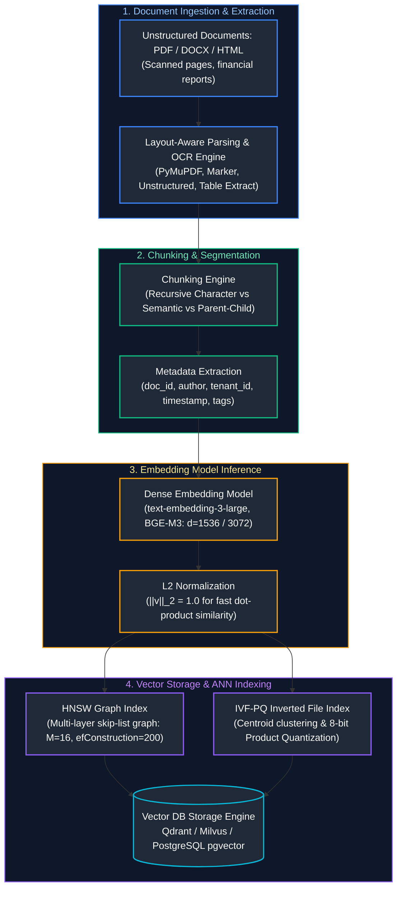
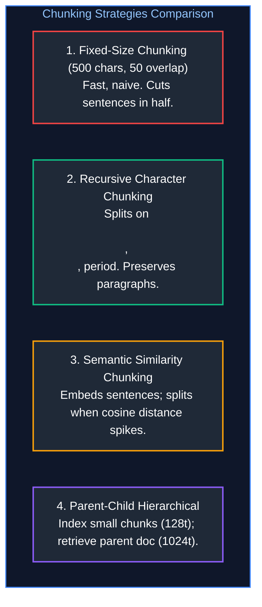

# 05. Embeddings, Vector Databases & Search Engines

A comprehensive, production-grade guide to vector embeddings, mathematical similarity metrics, Approximate Nearest Neighbor (ANN) indexing physics (HNSW, IVF-PQ), production vector database architectures (Qdrant, Milvus, PostgreSQL pgvector), document parsing, OCR table extraction, and chunking engineering tailored for AI Engineers.

---

## Architectural Overview: Vector Ingestion, Indexing & Approximate Nearest Neighbor Search



---

## Table of Contents
1. [Embedding Models & Mathematical Similarity Metrics](#1-embedding-models-mathematical-similarity-metrics)
   - [1.1 Dense Embedding Representation Space](#11-dense-embedding-representation-space)
   - [1.2 Mathematical Distance Metrics: Cosine, Euclidean L2, Inner Product](#12-mathematical-distance-metrics-cosine-euclidean-l2-inner-product)
2. [Approximate Nearest Neighbor (ANN) Indexing Physics](#2-approximate-nearest-neighbor-ann-indexing-physics)
   - [2.1 Exhaustive Flat Search ($O(N)$) vs. Sub-linear ANN](#21-exhaustive-flat-search-on-vs-sub-linear-ann)
   - [2.2 Inverted File Index with Product Quantization (IVF-PQ)](#22-inverted-file-index-with-product-quantization-ivf-pq)
   - [2.3 Hierarchical Navigable Small World (HNSW) Graphs](#23-hierarchical-navigable-small-world-hnsw-graphs)
3. [Production Vector Databases: Architecture & Comparison](#3-production-vector-databases-architecture-comparison)
   - [3.1 PostgreSQL pgvector (HNSW vs. IVFFlat)](#31-postgresql-pgvector-hnsw-vs-ivfflat)
   - [3.2 Qdrant (Rust, Segment Architecture, Filtered Payload Search)](#21-exhaustive-flat-search-on-vs-sub-linear-ann)
   - [3.3 Milvus (Distributed Cloud-Native Vector Engine)](#3-production-vector-databases-architecture-comparison)
4. [Document Parsing, OCR & Table Extraction](#4-document-parsing-ocr-table-extraction)
   - [4.1 PDF Structure Extraction & Layout Analysis](#41-pdf-structure-extraction-layout-analysis)
   - [4.2 Optical Character Recognition (OCR) & Structured Table Extraction](#4-document-parsing-ocr-table-extraction)
5. [Document Chunking Strategies & Trade-offs](#5-document-chunking-strategies-trade-offs)
   - [5.1 Fixed-Length Chunking with Sliding Window Overlap](#5-document-chunking-strategies-trade-offs)
   - [5.2 Recursive Character Chunking](#52-recursive-character-chunking-implementation)
   - [5.3 Semantic Similarity Chunking](#5-document-chunking-strategies-trade-offs)
   - [5.4 Hierarchical Parent-Child (Small-to-Big) Chunking](#23-hierarchical-navigable-small-world-hnsw-graphs)
6. [Metadata Extraction & Single-Stage Vector Filtering](#6-metadata-extraction-single-stage-vector-filtering)
   - [6.1 Pre-Filtering vs. Post-Filtering vs. Single-Stage In-Graph Filtering](#61-pre-filtering-vs-post-filtering-vs-single-stage-in-graph-filtering)
   - [6.2 Production Filtering Implementation in Qdrant](#62-production-filtering-implementation-in-qdrant)
7. [Vector Database Sizing, Memory Estimation & Sharding](#7-vector-database-sizing-memory-estimation-sharding)
   - [7.1 VRAM / RAM Formulas for Raw Vectors and HNSW Graphs](#71-vram-ram-formulas-for-raw-vectors-and-hnsw-graphs)
   - [7.2 Disk-Backed Vector Storage & Memory-Mapped IO (mmap)](#7-vector-database-sizing-memory-estimation-sharding)
8. [Production Diagnostics: Recall Degeneration & Index Bloat](#8-production-diagnostics-recall-degeneration-index-bloat)
   - [8.1 Evaluating Recall@k against Exact Brute-Force Baselines](#81-evaluating-recallk-against-exact-brute-force-baselines)
   - [8.2 Garbage Collection & Compaction in Dynamic Indices](#62-production-filtering-implementation-in-qdrant)
9. [Summary Comparison & Engineering Reference Matrix](#9-summary-comparison-engineering-reference-matrix)
10. [References & Further Reading](#10-references-further-reading)

---

# 1. Embedding Models & Mathematical Similarity Metrics

### 1.1 Dense Embedding Representation Space

A dense embedding model maps an arbitrary variable-length string of text $T$ into a fixed-dimensional continuous vector $\mathbf{v} \in \mathbb{R}^d$ (e.g., $d = 1536$ for `text-embedding-3-small`, $d = 3072$ for `text-embedding-3-large`):

$$f_\theta(T) = \mathbf{v}$$

Semantically similar texts are placed close together in this high-dimensional latent manifold, allowing semantic search to retrieve concepts that share meaning without requiring verbatim keyword overlap.

---

### 1.2 Mathematical Distance Metrics: Cosine, Euclidean L2, Inner Product

Given two vectors $\mathbf{u}, \mathbf{v} \in \mathbb{R}^d$:

1. **Euclidean (L2) Distance:**
   $$d_{L2}(\mathbf{u}, \mathbf{v}) = \|\mathbf{u} - \mathbf{v}\|_2 = \sqrt{\sum_{i=1}^d (u_i - v_i)^2}$$
   Measures absolute geometric distance. Sensitive to vector magnitude.

2. **Cosine Similarity:**
   $$S_{\cos}(\mathbf{u}, \mathbf{v}) = \frac{\mathbf{u} \cdot \mathbf{v}}{\|\mathbf{u}\|_2 \|\mathbf{v}\|_2} = \frac{\sum_{i=1}^d u_i v_i}{\sqrt{\sum u_i^2} \sqrt{\sum v_i^2}}$$
   Measures the cosine of the angle between vectors, normalizing away document length/magnitude. Range: $[-1.0, 1.0]$.

3. **Dot Product (Inner Product / IP):**
   $$S_{IP}(\mathbf{u}, \mathbf{v}) = \mathbf{u} \cdot \mathbf{v} = \sum_{i=1}^d u_i v_i$$

> [!TIP]
> **Production Hardware Optimization:** If all vectors are pre-normalized to unit length ($\|\mathbf{u}\|_2 = 1.0$) upon ingestion, Cosine Similarity simplifies mathematically to the Dot Product:
> $$S_{\cos}(\mathbf{u}, \mathbf{v}) = \mathbf{u} \cdot \mathbf{v}, \quad d_{L2}^2(\mathbf{u}, \mathbf{v}) = 2 - 2(\mathbf{u} \cdot \mathbf{v})$$
> Dot product requires only fused multiply-add (FMA) instructions without expensive square roots or divisions, accelerating search by $3\times\text{--}4\times$ on AVX-512 and CUDA cores.

---

# 2. Approximate Nearest Neighbor (ANN) Indexing Physics

### 2.1 Exhaustive Flat Search ($O(N)$) vs. Sub-linear ANN

- **Flat Exact Search:** Compares the query vector against every single vector in the database. Guaranteed 100% recall, but search latency scales linearly: $O(N \cdot d)$. Scanning 10 million 1536-dimensional vectors takes $>800\text{ms}$.
- **Approximate Nearest Neighbor (ANN):** Trades a tiny fraction of recall ($1\%\text{--}3\%$) for logarithmic or sub-linear query latency ($O(\log N)$ or $O(\sqrt{N})$), returning results in $<5\text{ms}$.

---

### 2.2 Inverted File Index with Product Quantization (IVF-PQ)

```mermaid
flowchart TD
    subgraph IVFPartitioning ["Inverted File (IVF) Clustering"]
        Centroids["K-Means Centroid Partitioning (nlist = 1024)<br/>Voronoi Cells partition vector space"]
        QueryVec["Query Vector q"] --> MatchCentroids["Find nprobe = 16 Nearest Centroids"]
        MatchCentroids --> ScanCells["Scan only vectors assigned to matching cells"]
    end

    subgraph PQCompression ["Product Quantization (PQ) Memory Compression"]
        Vec1024["1024-dim FP32 Vector (4096 bytes)"] --> SplitM["Split into M = 64 sub-vectors (16 dims each)"]
        SplitM --> Quantize["Quantize each sub-vector to 256 codebook centroids"]
        Quantize --> CompactVec["Stored as 64 bytes (64x Compression Ratio!)"]
    end

    style IVFPartitioning fill:#0f172a,stroke:#3b82f6,stroke-width:1.5px,color:#93c5fd
    style PQCompression fill:#0f172a,stroke:#10b981,stroke-width:1.5px,color:#6ee7b7
    style Centroids fill:#1f2937,stroke:#3b82f6,stroke-width:2px,color:#fff
    style QueryVec fill:#1f2937,stroke:#3b82f6,stroke-width:2px,color:#fff
    style MatchCentroids fill:#1f2937,stroke:#3b82f6,stroke-width:2px,color:#fff
    style ScanCells fill:#1f2937,stroke:#3b82f6,stroke-width:2px,color:#fff
    style Vec1024 fill:#1f2937,stroke:#10b981,stroke-width:2px,color:#fff
    style SplitM fill:#1f2937,stroke:#10b981,stroke-width:2px,color:#fff
    style Quantize fill:#1f2937,stroke:#10b981,stroke-width:2px,color:#fff
    style CompactVec fill:#1f2937,stroke:#06b6d4,stroke-width:2px,color:#fff
```



---

### 2.3 Hierarchical Navigable Small World (HNSW) Graphs

HNSW is the gold standard for high-accuracy in-memory vector search. It constructs a multi-layer hierarchical graph analogous to a skip list:

```text
HNSW MULTI-LAYER GRAPH STRUCTURE:
Layer 3 (Sparse Top Layer):   (Node A) --------------> (Node Z)      [Long-range skips]
                                  |                       |
Layer 2:                      (Node A) ------> (Node M) -> (Node Z)
                                  |               |       |
Layer 1:                      (Node A) -> (F) -> (Node M) -> (Node Z)
                                  |        |      |          |
Layer 0 (Dense Bottom Layer): All N vectors interconnected locally    [Short-range greedy search]
```

**Key Hyperparameters:**
- **$M$ (e.g., 16 to 64):** Maximum number of bidirectional links per node per layer. Higher $M$ improves recall on high-dimensional vectors at the expense of RAM and build time.
- **$efConstruction$ (e.g., 100 to 400):** Size of the dynamic candidate list during graph construction. Controls index quality.
- **$efSearch$ (e.g., 32 to 128):** Number of candidate nodes evaluated during query time. Higher $efSearch$ increases recall from 95% to 99.5% at slightly higher query latency.

---

# 3. Production Vector Databases: Architecture & Comparison

```text
+---------------------+-------------------+------------------+------------------------------------+
| DATABASE            | CORE ENGINE / LANG| INDEXING TYPES   | ARCHITECTURAL ADVANTAGES           |
+---------------------+-------------------+------------------+------------------------------------+
| PostgreSQL pgvector | C (Postgres Ext)  | HNSW, IVFFlat    | Native ACID joins with enterprise  |
|                     |                   |                  | relational tables; zero new infra. |
| Qdrant              | Rust              | HNSW + Quantized | Blazing fast single-stage payload  |
|                     |                   | in-graph filter  | filtering; low memory footprint.   |
| Milvus              | Go / C++ / K8s    | HNSW, IVF-PQ,    | Cloud-native distributed sharding; |
|                     |                   | SCANN, DiskANN   | scales to billions of vectors.     |
+---------------------+-------------------+------------------+------------------------------------+
```

---

### 3.1 PostgreSQL pgvector (HNSW vs. IVFFlat)

```sql
-- Enable the vector extension in PostgreSQL
CREATE EXTENSION IF NOT EXISTS vector;

-- Define documents table with dense embeddings and metadata
CREATE TABLE enterprise_knowledge_chunks (
    chunk_id UUID PRIMARY KEY DEFAULT gen_random_uuid(),
    document_id VARCHAR(64) NOT NULL,
    tenant_id VARCHAR(64) NOT NULL,
    chunk_text TEXT NOT NULL,
    embedding vector(1536) NOT NULL
);

-- Build production HNSW index using Cosine distance operator (<=>)
-- m=16 (links per node), ef_construction=128 (candidate search depth)
CREATE INDEX idx_chunks_hnsw_cosine 
ON enterprise_knowledge_chunks 
USING hnsw (embedding vector_cosine_ops) 
WITH (m = 16, ef_construction = 128);

-- Production query: Cosine similarity with strict tenant isolation predicate
SELECT 
    chunk_id,
    document_id,
    chunk_text,
    1 - (embedding <=> '[0.015, -0.042, 0.089, ...]'::vector) AS cosine_similarity
FROM enterprise_knowledge_chunks
WHERE tenant_id = 'tenant_enterprise_corp'
ORDER BY embedding <=> '[0.015, -0.042, 0.089, ...]'::vector
LIMIT 5;
```

---

# 4. Document Parsing, OCR & Table Extraction

### 4.1 PDF Structure Extraction & Layout Analysis

PDFs do not store natural sentences or paragraphs; they store raw character drawing commands at physical Cartesian coordinates `(x, y)` on a page. Naive string extraction destroys reading order in multi-column documents:

```text
NAIVE EXTRACTION HAZARD (Multi-column PDF):
Column 1 Line 1 ---> Column 2 Line 1 ---> Column 1 Line 2 ---> Column 2 Line 2
(Interleaves completely unrelated sentences, destroying embedding coherence)
```

**Production Ingestion Protocol:**
1. **Layout-Aware Segmentation:** Use vision-based or bounding-box parsers (Marker, PyMuPDF, Unstructured) that reconstruct reading flow by sorting text blocks spatially into reading columns.
2. **Table Preservation:** Extract tables as structured HTML or Markdown rather than raw tab-separated strings. LLMs comprehend tabular relationships significantly better when formatted as Markdown tables (`| Col1 | Col2 |`).

---

# 5. Document Chunking Strategies & Trade-offs



### 5.2 Recursive Character Chunking Implementation

```python
# ==============================================================================
# Production Recursive Document Chunking Engine
# ==============================================================================
import re
from typing import List

class ProductionRecursiveChunker:
    """Recursively splits unstructured text respecting semantic delimiters."""
    def __init__(self, chunk_size: int = 500, chunk_overlap: int = 50):
        self.chunk_size = chunk_size
        self.chunk_overlap = chunk_overlap
        # Delimiter hierarchy: Double newline -> Single newline -> Space -> Character
        self.separators = ["\n\n", "\n", ". ", " ", ""]

    def split_text(self, text: str) -> List[str]:
        return self._split(text, self.separators)

    def _split(self, text: str, separators: List[str]) -> List[str]:
        final_chunks = []
        separator = separators[-1]
        
        # Pick highest-level separator present in current text
        for sep in separators:
            if sep == "" or sep in text:
                separator = sep
                break

        splits = text.split(separator) if separator != "" else list(text)
        
        accumulated = ""
        for piece in splits:
            candidate = accumulated + (separator if accumulated else "") + piece
            if len(candidate) <= self.chunk_size:
                accumulated = candidate
            else:
                if accumulated:
                    final_chunks.append(accumulated)
                # If individual piece exceeds chunk size, recurse with finer separators
                if len(piece) > self.chunk_size:
                    sub_separators = separators[separators.index(separator) + 1:]
                    if sub_separators:
                        final_chunks.extend(self._split(piece, sub_separators))
                    else:
                        final_chunks.append(piece)
                    accumulated = ""
                else:
                    accumulated = piece
        
        if accumulated:
            final_chunks.append(accumulated)
        return final_chunks

# Verification
sample_doc = """Machine learning models require robust validation. Cross-validation prevents overfitting.

In deep learning, neural networks optimize loss functions via backpropagation.
Scaled dot-product attention forms the bedrock of modern Transformers."""

chunker = ProductionRecursiveChunker(chunk_size=120, chunk_overlap=20)
chunks = chunker.split_text(sample_doc)
for i, c in enumerate(chunks):
    print(f"Chunk {i} ({len(c)} chars): {repr(c)}")
```

---

# 6. Metadata Extraction & Single-Stage Vector Filtering

### 6.1 Pre-Filtering vs. Post-Filtering vs. Single-Stage In-Graph Filtering

```text
+----------------------+---------------------------------------------------------------+
| FILTERING STRATEGY   | RUNTIME MECHANICS & CRITICAL HAZARDS                          |
+----------------------+---------------------------------------------------------------+
| Post-Filtering       | Perform ANN search for Top-100 vectors; filter by metadata.   |
|                      | HAZARD: If target tenant owns only 2% of vectors, Top-100     |
|                      | returns 0 matching results! Recall collapses to 0%.          |
| Pre-Filtering        | Query metadata index first (B-Tree); perform flat search.    |
|                      | HAZARD: Bypasses HNSW index entirely, collapsing to slow      |
|                      | O(N_filtered) brute-force scan.                               |
| Single-Stage In-Graph| Evaluates metadata predicates DURING the HNSW greedy graph    |
| (Qdrant / Milvus)    | traversal. Non-matching nodes are skipped during neighbor     |
|                      | expansion. Guarantees top-k matches with sub-5ms latency.    |
+----------------------+---------------------------------------------------------------+
```

---

### 6.2 Production Filtering Implementation in Qdrant

```python
# ==============================================================================
# Production In-Graph Filtered Vector Search with Qdrant Client
# ==============================================================================
from qdrant_client import QdrantClient
from qdrant_client.models import Distance, VectorParams, PointStruct, Filter, FieldCondition, MatchValue

# 1. Initialize local in-memory Qdrant instance
client = QdrantClient(":memory:")

# 2. Configure collection with HNSW index
client.create_collection(
    collection_name="enterprise_documents",
    vectors_config=VectorParams(size=4, distance=Distance.COSINE)
)

# 3. Ingest points with rich payload metadata
points = [
    PointStruct(id=1, vector=[0.1, 0.2, 0.8, 0.1], payload={"tenant_id": "corp_a", "department": "legal"}),
    PointStruct(id=2, vector=[0.1, 0.2, 0.7, 0.2], payload={"tenant_id": "corp_b", "department": "engineering"}),
    PointStruct(id=3, vector=[0.9, 0.1, 0.1, 0.1], payload={"tenant_id": "corp_a", "department": "legal"}),
]
client.upsert(collection_name="enterprise_documents", points=points)

# 4. Execute single-stage in-graph filtered search
search_filter = Filter(
    must=[
        FieldCondition(key="tenant_id", match=MatchValue(value="corp_a")),
        FieldCondition(key="department", match=MatchValue(value="legal"))
    ]
)

results = client.search(
    collection_name="enterprise_documents",
    query_vector=[0.12, 0.19, 0.78, 0.11],
    query_filter=search_filter,
    limit=2
)

for hit in results:
    print(f"Point ID: {hit.id}, Score: {hit.score:.4f}, Payload: {hit.payload}")
```

---

# 7. Vector Database Sizing, Memory Estimation & Sharding

### 7.1 VRAM / RAM Formulas for Raw Vectors and HNSW Graphs

To size RAM requirements for $N$ vectors of dimension $d$ with HNSW connectivity $M$:

$$\text{RAM}_{\text{total}} = \text{RAM}_{\text{vectors}} + \text{RAM}_{\text{HNSW}} + \text{RAM}_{\text{overhead}}$$

$$\text{RAM}_{\text{vectors}} = N \times d \times 4 \text{ bytes (FP32)}$$

$$\text{RAM}_{\text{HNSW}} \approx N \times M \times 2 \times 8 \text{ bytes (bi-directional 64-bit pointers)}$$

$$\text{RAM}_{\text{overhead}} \approx 1.25 \times (\text{Payload storage} + \text{OS page cache})$$

**Concrete Sizing Example (10 Million Vectors, $d=1536$, $M=16$):**
- $\text{RAM}_{\text{vectors}} = 10^7 \times 1536 \times 4 = 61.44 \text{ GB}$
- $\text{RAM}_{\text{HNSW}} = 10^7 \times 16 \times 16 = 2.56 \text{ GB}$
- Total RAM Required: $\sim 80 \text{ GB}$ of high-speed host memory.

---

# 8. Production Diagnostics: Recall Degeneration & Index Bloat

### 8.1 Evaluating Recall@k against Exact Brute-Force Baselines

In production, measure index retrieval recall by periodically comparing ANN results against an exact Flat index on a sample of 1,000 queries:

$$\text{Recall@k} = \frac{|\mathcal{R}_{\text{ANN}} \cap \mathcal{R}_{\text{Exact}}|}{k}$$

If $\text{Recall@10} < 0.95$, increase $efSearch$ or trigger index compaction.

---

# 9. Summary Comparison & Engineering Reference Matrix

| Vector Index | Build Time | Query Latency | Memory Footprint | Production Recommendation |
| :--- | :--- | :--- | :--- | :--- |
| **Flat (Exact)** | $0$ s (No index build) | $O(N)$ (High) | Baseline ($N \times d \times 4$ B) | Small datasets ($N < 50,000$). Reference validation baseline. |
| **IVF-Flat** | Moderate (K-Means) | $O(\sqrt{N})$ | Baseline + small centroid list | Balanced CPU search with modest RAM. |
| **IVF-PQ** | High (Quantization train) | $O(\sqrt{N})$ | $90\%\text{--}95\%$ compression | Massive datasets ($N > 100\text{M}$) where RAM cost dominates. |
| **HNSW** | High (Graph building) | $O(\log N)$ ($<5\text{ms}$) | Baseline $+ 20\%\text{--}30\%$ graph overhead | Default production choice for latency-critical RAG ($N < 50\text{M}$). |

---

# 10. References & Further Reading

- [Efficient and Robust Approximate Nearest Neighbor Search Using Hierarchical Navigable Small World Graphs (Malkov & Yashunin, 2018)](https://arxiv.org/abs/1603.09320)
- [Qdrant Vector Database Official Documentation](https://qdrant.tech/documentation/)
- [pgvector: Open-source Vector Similarity Search for Postgres](https://github.com/pgvector/pgvector)
- [Milvus: An Open-Source Cloud-Native Vector Database](https://milvus.io/docs)
- [Bilinear Product Quantization for Nearest Neighbor Search (Jégou et al., 2011)](https://hal.inria.fr/inria-00514462v2/document)

