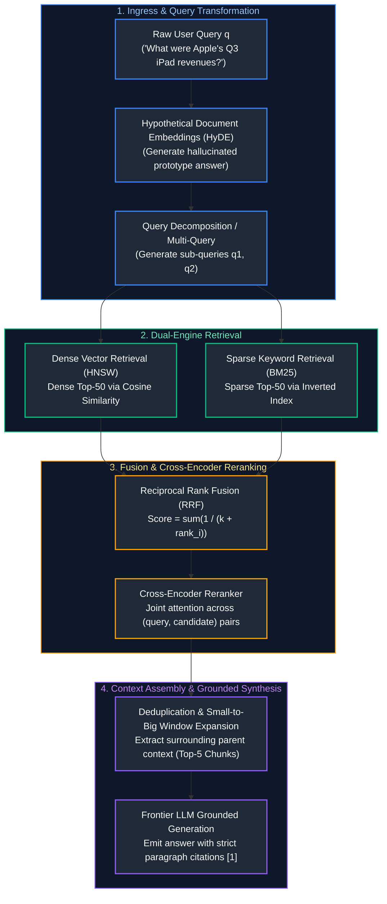
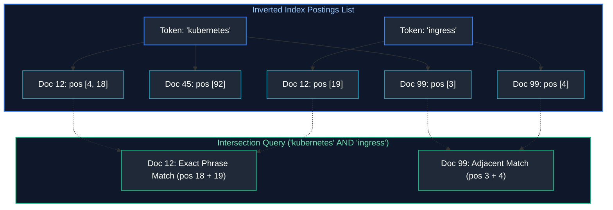
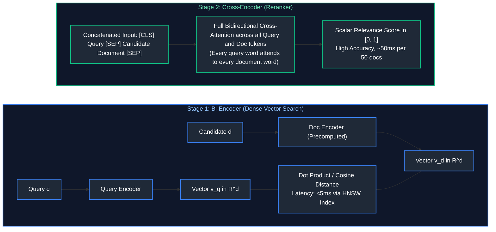

# 06. Advanced RAG, Hybrid Retrieval & Knowledge Systems

A comprehensive, production-grade guide to advanced Retrieval-Augmented Generation (RAG), BM25 sparse keyword inverted indexing, dense vs. sparse vs. hybrid retrieval, Reciprocal Rank Fusion (RRF), Cross-Encoder reranking, query transformation (HyDE, Multi-Query, Step-Back), context window assembly, citation provenance, incremental indexing/deletion, and Graph RAG knowledge topologies tailored for AI Engineers.

---

## Architectural Overview: Two-Stage Hybrid Retrieval & RAG Synthesis Pipeline



---

## Table of Contents
1. [Sparse Keyword Search Mechanics: BM25 & Inverted Indices](#1-sparse-keyword-search-mechanics-bm25-inverted-indices)
   - [1.1 Term Frequency, Inverse Document Frequency & Length Normalization](#11-term-frequency-inverse-document-frequency-length-normalization)
   - [1.2 Inverted Index Posting Lists & Compression](#12-inverted-index-posting-lists-compression)
2. [Dense vs. Sparse vs. Hybrid Retrieval](#2-dense-vs-sparse-vs-hybrid-retrieval)
   - [2.1 The Failure Modes of Pure Dense Search](#21-the-failure-modes-of-pure-dense-search)
   - [2.2 Reciprocal Rank Fusion (RRF) Mathematical Formulation](#22-reciprocal-rank-fusion-rrf-mathematical-formulation)
3. [Two-Stage Retrieval & Cross-Encoder Reranking](#3-two-stage-retrieval-cross-encoder-reranking)
   - [3.1 Bi-Encoder vs. Cross-Encoder Computational Mechanics](#31-bi-encoder-vs-cross-encoder-computational-mechanics)
   - [3.2 Production Reranking with Cohere & BGE-Reranker](#32-production-reranking-with-sentence-transformers)
4. [Query Transformation Engineering: HyDE, Multi-Query & Decomposition](#4-query-transformation-engineering-hyde-multi-query-decomposition)
   - [4.1 Hypothetical Document Embeddings (HyDE)](#41-hypothetical-document-embeddings-hyde)
   - [4.2 Multi-Query Expansion & Step-Back Prompting](#42-multi-query-expansion-step-back-prompting)
5. [Context Assembly, Deduplication & Grounded Generation](#5-context-assembly-deduplication-grounded-generation)
   - [5.1 Overlap Deduplication & Context Window Budgeting](#51-overlap-deduplication-context-window-budgeting)
   - [5.2 Strict Citation Provenance & Verifiable Attribution](#52-strict-citation-provenance-verifiable-attribution)
6. [Incremental Indexing, Document Deletion & Access Control (ACLs)](#6-incremental-indexing-document-deletion-access-control-acls)
   - [6.1 Delta Ingestion & CDC-Driven Reindexing](#61-delta-ingestion-cdc-driven-reindexing)
   - [6.2 Document-Level Access Control Lists (ACLs)](#62-document-level-access-control-lists-acls)
7. [RAG vs. Fine-Tuning vs. Long-Context Prompting](#7-rag-vs-fine-tuning-vs-long-context-prompting)
   - [7.1 The Architectural Decision Framework](#21-the-failure-modes-of-pure-dense-search)
   - [7.2 Hybrid RAG-Fine-Tuning Coexistence](#7-rag-vs-fine-tuning-vs-long-context-prompting)
8. [Graph RAG: Knowledge Graphs & Multi-Hop Traversal](#8-graph-rag-knowledge-graphs-multi-hop-traversal)
   - [8.1 Entity-Relation Extraction & Graph Construction](#81-entity-relation-extraction-graph-construction)
   - [8.2 Multi-Hop Path Reasoning vs. Semantic Vector Neighbors](#82-multi-hop-path-reasoning-in-python)
9. [Summary Comparison & Engineering Reference Matrix](#9-summary-comparison-engineering-reference-matrix)
10. [References & Further Reading](#10-references-further-reading)

---

# 1. Sparse Keyword Search Mechanics: BM25 & Inverted Indices

### 1.1 Term Frequency, Inverse Document Frequency & Length Normalization

While dense embeddings capture broad conceptual topics, they frequently fail on exact keywords: serial numbers, acronyms, product IDs (e.g., `SKU-8921-X`), and legal codes. **Okapi BM25** is the industry standard probabilistic retrieval function for sparse keyword search:

$$\text{BM25}(D, Q) = \sum_{i=1}^n \text{IDF}(q_i) \cdot \frac{f(q_i, D) \cdot (k_1 + 1)}{f(q_i, D) + k_1 \cdot \left(1 - b + b \cdot \frac{|D|}{\text{avgdl}}\right)}$$

- $f(q_i, D)$: Raw term frequency of query token $q_i$ in document $D$.
- $|D| / \text{avgdl}$: Ratio of document length to the average document length across the entire corpus.
- $k_1$ (typically $1.2\text{--}2.0$): Calibrates term frequency saturation. Unlike TF-IDF, which scales linearly, BM25 term frequency asymptotically approaches $k_1 + 1$, preventing repeated keyword stuffing from dominating relevance.
- $b$ (typically $0.75$): Controls document length penalty. High $b$ penalizes long documents for diluting keyword density.
- $\text{IDF}(q_i) = \ln\left( \frac{N - n(q_i) + 0.5}{n(q_i) + 0.5} + 1 \right)$: Inverse document frequency down-weights common stop words (`the`, `is`).

---

### 1.2 Inverted Index Posting Lists & Compression

An Inverted Index maps each discrete vocabulary token to a sorted **posting list** containing document IDs and term positions:



---

# 2. Dense vs. Sparse vs. Hybrid Retrieval

### 2.1 The Failure Modes of Pure Dense Search

| Query Type | Pure Dense Vector Search | Sparse BM25 Search |
| :--- | :--- | :--- |
| **Conceptual / Semantic**<br/>(*"heart disease risk"*) | **SUCCESS:** Captures conceptual synonyms (*"cardiac infarction"*, *"coronary artery syndrome"*). | **FAILS:** Misses relevant documents lacking verbatim matching keywords. |
| **Exact Part Number**<br/>(*"C5-X9802-Rev4"*) | **FAILS:** Returns semantically similar hardware descriptions but completely incorrect model number. | **SUCCESS:** Inverted index matches exact alphanumeric identifier with 100% precision. |
| **Uncommon Acronym**<br/>(*"HIPAA 45 CFR 164"*) | **FAILS:** Out-of-vocabulary representation distortion across dense vector space. | **SUCCESS:** Matches rare exact tokens directly across posting lists. |

---

### 2.2 Reciprocal Rank Fusion (RRF) Mathematical Formulation

Dense vector scores (Cosine similarities $\in [0, 1]$) and BM25 scores (unbounded positive reals $\in [0, \infty)$) cannot be summed directly due to incompatible distributions. **Reciprocal Rank Fusion (RRF)** combines candidate lists based purely on their relative ordinal rank:

$$RRF(d) = \sum_{m \in M} \frac{1}{k + r_m(d)}$$

where $M$ is the set of retrieval systems (Dense and Sparse), $r_m(d)$ is the 1-indexed rank of document $d$ in system $m$, and $k$ (typically $60$) is a constant smoothing hyperparameter that prevents top-ranked documents from dominating the score.

> [!IMPORTANT]
> **Score Calibration with RRF:** Raw dense cosine similarities cannot be directly added to sparse BM25 scores without severe distribution skew. Reciprocal Rank Fusion ($k=60$) normalizes both candidate streams into uniform rank positions, ensuring balanced, high-precision retrieval across both semantic and lexical vectors.

```python
# ==============================================================================
# Production Reciprocal Rank Fusion (RRF) Implementation
# ==============================================================================
from typing import Dict, List, Tuple

def reciprocal_rank_fusion(
    ranked_lists: List[List[str]],
    k: int = 60
) -> List[Tuple[str, float]]:
    """Combines multiple ranked document candidate lists using RRF."""
    rrf_scores: Dict[str, float] = {}

    for ranked_list in ranked_lists:
        for rank, doc_id in enumerate(ranked_list, start=1):
            if doc_id not in rrf_scores:
                rrf_scores[doc_id] = 0.0
            rrf_scores[doc_id] += 1.0 / (k + rank)

    # Sort descending by combined RRF score
    sorted_fused = sorted(rrf_scores.items(), key=lambda item: item[1], reverse=True)
    return sorted_fused

# Verification:
dense_candidates = ["doc_A", "doc_B", "doc_C", "doc_D"]
sparse_candidates = ["doc_C", "doc_A", "doc_E", "doc_B"]

fused_results = reciprocal_rank_fusion([dense_candidates, sparse_candidates], k=60)
for doc, score in fused_results:
    print(f"Document: {doc:<10} | Combined RRF Score: {score:.5f}")
```

---

# 3. Two-Stage Retrieval & Cross-Encoder Reranking

### 3.1 Bi-Encoder vs. Cross-Encoder Computational Mechanics



- **Bi-Encoders:** Query and document are encoded independently into isolated vectors. Cross-attention is never computed between query and document tokens. Fast ($O(1)$ search via HNSW), but misses subtle linguistic interactions.
- **Cross-Encoders:** Feed query and candidate document into a shared Transformer simultaneously. Full bidirectional self-attention models every query-token to document-token relationship. Too slow to scan 10 million vectors, but ideal for reranking the Top-50 candidates down to the Top-5.

> [!TIP]
> **Two-Stage Latency Optimization:** Cross-encoders are computationally intensive ($O(N \cdot L^2)$) compared to bi-encoders. Always use high-speed bi-encoder ANN vector search to prune candidate document sets down to top 25–50 before invoking the cross-encoder reranking pass.

---

### 3.2 Production Reranking with Sentence-Transformers

```python
# ==============================================================================
# Production Two-Stage Cross-Encoder Reranking
# ==============================================================================
from sentence_transformers import CrossEncoder

# Instantiate high-performance open-weight reranker
reranker = CrossEncoder("BAAI/bge-reranker-large")

query = "What is the capital expenditure requirement for H100 GPU clusters?"
candidate_chunks = [
    "NVIDIA H100 GPUs require specialized liquid cooling infrastructure and draw up to 700W.",
    "The quarterly dividend for Microsoft shareholders was declared at $0.75 per share.",
    "A typical 8x H100 SXM5 server chassis costs approximately $300,000 in capital expense.",
    "Transformers use multi-head attention to model long-range context sequences."
]

# Pair query with each retrieved candidate
query_doc_pairs = [[query, chunk] for chunk in candidate_chunks]

# Compute cross-encoder relevance scores
scores = reranker.predict(query_doc_pairs)

# Rank candidates descending by relevance score
ranked_indices = sorted(range(len(scores)), key=lambda i: scores[i], reverse=True)
print(f"Query: '{query}'\n")
for rank, idx in enumerate(ranked_indices, start=1):
    print(f"Rank {rank} (Score: {scores[idx]:.4f}): {candidate_chunks[idx]}")
```

---

# 4. Query Transformation Engineering: HyDE, Multi-Query & Decomposition

### 4.1 Hypothetical Document Embeddings (HyDE)

User search queries are typically short, colloquial, and question-shaped (`"how to fix cuda oom in pytorch"`), whereas authoritative source chunks are long, formal, and answer-shaped (`"To resolve torch.cuda.OutOfMemoryError, invoke torch.cuda.empty_cache()..."`).

**HyDE (Gao et al., 2022)** uses an LLM to generate a hypothetical synthetic answer document. Even if the synthetic answer contains factual errors, its vocabulary and embedding representation lie in the exact semantic manifold of authoritative answers:

$$\mathbf{q}_{\text{HyDE}} = \text{Embed}(\text{LLM}_{\text{hypothetical}}(q))$$

---

### 4.2 Multi-Query Expansion & Step-Back Prompting

- **Multi-Query Expansion:** Employs an LLM to rewrite a single user query from 3 to 4 complementary perspectives (e.g., technical, business, error-code). Dispatches all 4 queries across the vector database and merges results via RRF.
- **Step-Back Prompting:** Generates an abstract, high-level conceptual question from a specific inquiry (e.g., `"Why did my Redis cluster drop connection at 10:00?"` $\rightarrow$ `"What causes connection drops in distributed Redis clusters under high load?"`). Retrieves foundational architecture documentation.

---

# 5. Context Assembly, Deduplication & Grounded Generation

### 5.1 Overlap Deduplication & Context Window Budgeting

When chunks originate from overlapping recursive splits, Top-5 retrieval frequently returns duplicate or near-duplicate passages. Deduplicating via Jaccard token overlap or chunk ID tracking saves $30\%\text{--}50\%$ of context window budget.

---

### 5.2 Strict Citation Provenance & Verifiable Attribution

```python
# ==============================================================================
# Production Grounded RAG Generation with Verifiable Citations
# ==============================================================================
from openai import OpenAI

def generate_grounded_answer(query: str, retrieved_chunks: list[dict], client: OpenAI) -> str:
    """Assembles prompt with verified chunk citations and grounded guardrails."""
    # Build numbered reference context blocks
    context_blocks = []
    for idx, chunk in enumerate(retrieved_chunks, start=1):
        context_blocks.append(
            f"[{idx}] Source: {chunk['document_name']} (Page {chunk['page_number']})\n{chunk['text']}"
        )
    formatted_context = "\n\n".join(context_blocks)

    system_prompt = """You are an Enterprise Grounded Knowledge Assistant.
Answer the user's question STRICTLY based on the provided numbered sources.
For every factual assertion, append the exact bracketed citation ID (e.g., [1] or [2]).
If the provided sources do not contain the answer, explicitly state:
'The provided documents do not contain sufficient evidence to answer this question.'
Do not speculate or extrapolate beyond the sources."""

    user_prompt = f"""CONTEXT DOCUMENTS:
{formatted_context}

USER QUESTION:
{query}"""

    response = client.chat.completions.create(
        model="gpt-4o",
        messages=[
            {"role": "system", "content": system_prompt},
            {"role": "user", "content": user_prompt}
        ],
        temperature=0.0
    )
    return response.choices[0].message.content
```

---

# 6. Incremental Indexing, Document Deletion & Access Control (ACLs)

### 6.1 Delta Ingestion & CDC-Driven Reindexing

In enterprise environments, files are continuously created, updated, and deleted. Rebuilding an entire 50-million-chunk vector database nightly is cost-prohibitive.
- **Change Data Capture (CDC):** Stream file update events from cloud storage (AWS S3 SNS/SQS, Kafka).
- **Document Hashing:** Calculate the SHA-256 hash of each document upon ingestion. If hash matches existing metadata, skip re-chunking and re-embedding.
- **Cascading Deletions:** When document `doc_123` is updated, issue a bulk delete for all existing chunks where `document_id == "doc_123"` before inserting the updated chunks.

---

### 6.2 Document-Level Access Control Lists (ACLs)

Users must only retrieve documents they are authorized to view (e.g., HR compensation documents must never leak to general engineering queries). Store authorized role and user IDs directly in vector metadata payloads:

```json
{
  "chunk_id": "c-981",
  "document_id": "hr-comp-2026",
  "allowed_roles": ["role_hr_admin", "role_executive"],
  "allowed_users": ["user_alice_99"]
}
```

> [!CAUTION]
> **Vector ACL Pre-Filtering vs. Post-Filtering:** Always enforce document-level ACLs as *pre-filters* during vector graph traversal rather than filtering after ANN retrieval. Post-filtering top-$k$ nearest neighbors can cause result starvation if all retrieved neighbors are unauthorized, yielding empty result sets or unintended metadata leakage.

---

# 7. RAG vs. Fine-Tuning vs. Long-Context Prompting

| Criterion | RAG (Retrieval-Augmented) | Model Fine-Tuning |
| :--- | :--- | :--- |
| **Knowledge Dynamism** | **REAL-TIME:** New documents searchable in $<1$ second upon ingestion into vector store. | **STATIC:** Requires re-running training pipelines to ingest updated information. |
| **Hallucination Defense** | **HIGH:** Responses grounded directly with verifiable citations and retrieved context. | **MODERATE:** Models can still hallucinate memorized facts or blend conflicting data. |
| **Style & Tone Control** | **MODERATE:** Dictated by system prompt instructions and few-shot examples. | **SUPERIOR:** Deeply learns specialized enterprise vocabulary, dialect, and schema syntax. |
| **Compute Sizing** | Ingestion embedding calls + standard LLM inference serving. | Dedicated GPU training cluster required (LoRA, QLoRA, or full-parameter tuning). |
| **Cost at Scale** | Higher input token costs due to injected context chunks on every request. | Minimal input prompt tokens once the model has internalized domain knowledge. |

---

# 8. Graph RAG: Knowledge Graphs & Multi-Hop Traversal

### 8.1 Entity-Relation Extraction & Graph Construction

Traditional vector search operates on isolated text chunks. If a question requires connecting entities across 5 distinct documents (e.g., *"Which suppliers of Acme Corp's battery provider were affected by the 2025 raw lithium tariffs?"*), vector search fails because no individual chunk contains the complete multi-hop path.

**Graph RAG (Microsoft Research, 2024)** constructs an explicit knowledge graph:
1. LLM extracts entities (Nodes: `Acme Corp`, `BatteryCo`, `LithiumMiningInc`) and relationships (Edges: `SUPPLIED_BY`, `LOCATED_IN`).
2. Graph algorithms (Leiden community detection) cluster entities into semantic communities and generate hierarchical summaries.
3. Queries perform graph traversals across multi-hop edges to retrieve structurally linked facts.

---

### 8.2 Multi-Hop Path Reasoning in Python

```python
# ==============================================================================
# Multi-Hop Knowledge Graph Traversal Simulator
# ==============================================================================
import networkx as nx

# 1. Instantiate directed Knowledge Graph
G = nx.DiGraph()

# 2. Add extracted entity relations
G.add_edge("Acme Corp", "BatteryCo", relation="SOURCE_BATTERIES_FROM")
G.add_edge("BatteryCo", "LithiumSupplyInc", relation="PURCHASES_RAW_MATERIALS_FROM")
G.add_edge("LithiumSupplyInc", "Chile Tariffs 2025", relation="SUBJECT_TO_REGULATION")

# 3. Perform multi-hop graph path discovery
def trace_entity_dependencies(graph: nx.DiGraph, start_node: str, max_depth: int = 3):
    paths = []
    for target in graph.nodes():
        if target != start_node and nx.has_path(graph, start_node, target):
            all_paths = list(nx.all_simple_paths(graph, start_node, target, cutoff=max_depth))
            paths.extend(all_paths)
    return paths

discovered_paths = trace_entity_dependencies(G, "Acme Corp")
print("Discovered Multi-Hop Knowledge Paths:")
for p in discovered_paths:
    print(" -> ".join(p))
```

---

# 9. Summary Comparison & Engineering Reference Matrix

| Strategy / Technique | Retrieval Recall Gain | Latency Impact | Production Cost Overhead |
| :--- | :--- | :--- | :--- |
| **Hybrid Dense + Sparse (BM25)** | $+15\%\text{--}25\%$ | $+5\text{ms}$ | Minimal (inverted index storage) |
| **Reciprocal Rank Fusion (RRF)** | $+10\%$ | $<1\text{ms}$ (CPU calculation) | \$0.00 |
| **Cross-Encoder Reranking** | $+20\%\text{--}30\%$ | $+30\text{--}70\text{ms}$ | Requires local CPU/GPU reranker model |
| **HyDE Query Transformation** | $+10\%\text{--}15\%$ | $+400\text{--}800\text{ms}$ | 1 additional LLM generation call |
| **Graph RAG Multi-Hop** | $+40\%$ on global queries | $+50\text{--}150\text{ms}$ | Graph database storage & ingestion compute |

---

# 10. References & Further Reading

- [From Local to Global: A Graph RAG Approach to Query-Focused Summarization (Edge et al., 2024)](https://arxiv.org/abs/2404.16130)
- [Precise Zero-Shot Dense Retrieval without Relevance Labels (HyDE - Gao et al., 2022)](https://arxiv.org/abs/2212.10496)
- [Reciprocal Rank Fusion Outperforms Condorcet and Individual Rank Methods (Cormack et al., 2009)](https://plg.uwaterloo.ca/~gvcormac/cormacksigir09-rrf.pdf)
- [BGE Reranker: Large-Scale Cross-Encoder Models (BAAI)](https://huggingface.co/BAAI/bge-reranker-large)
- [Sentence-Transformers Official Documentation](https://www.sbert.net/)

