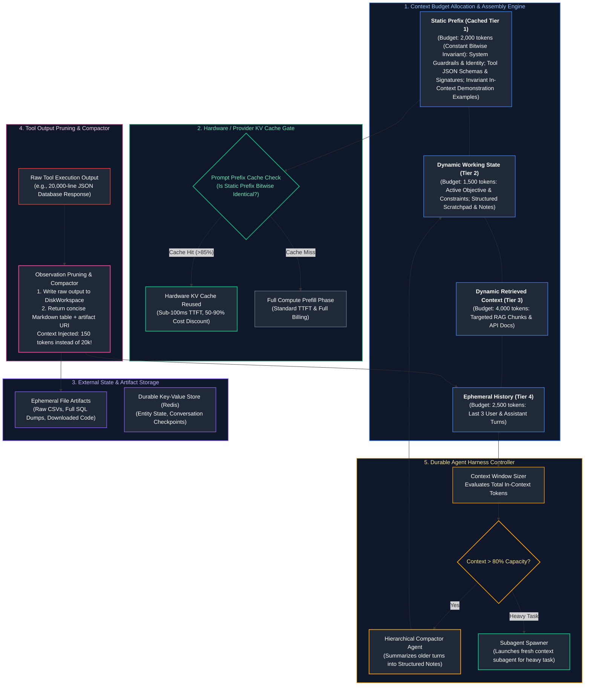
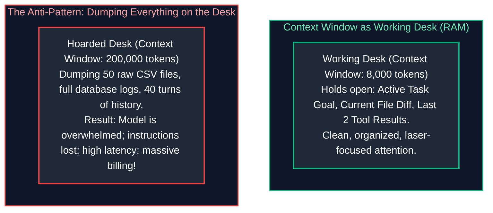
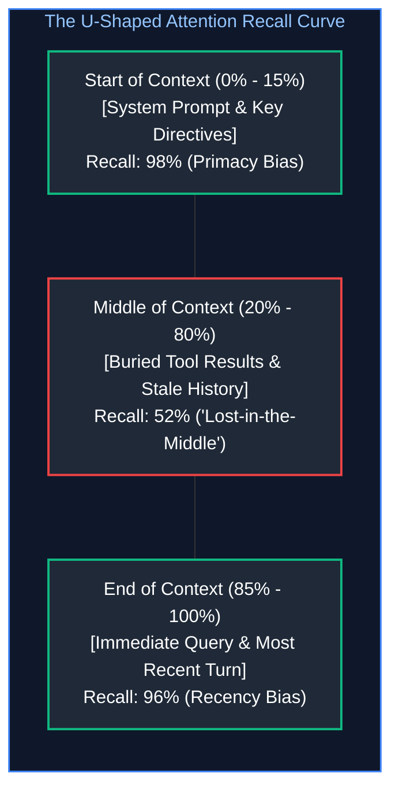
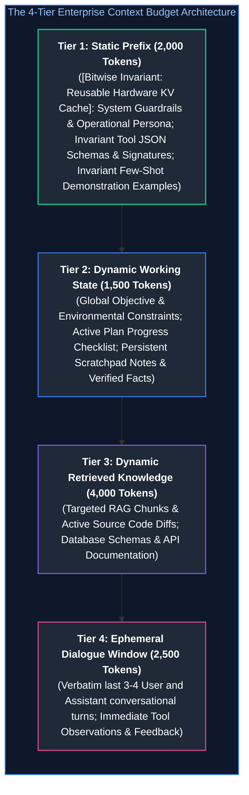
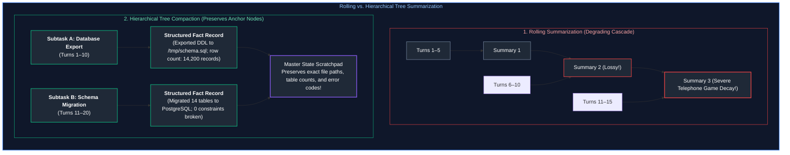
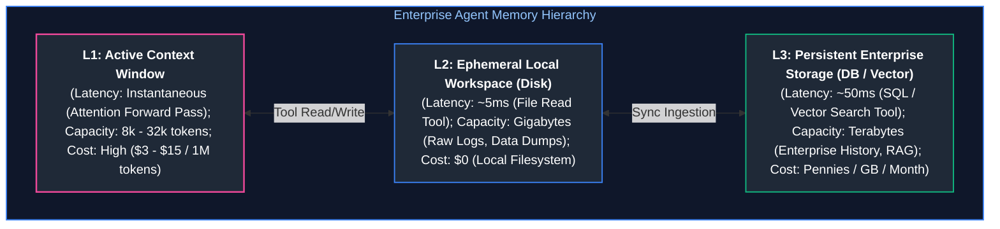
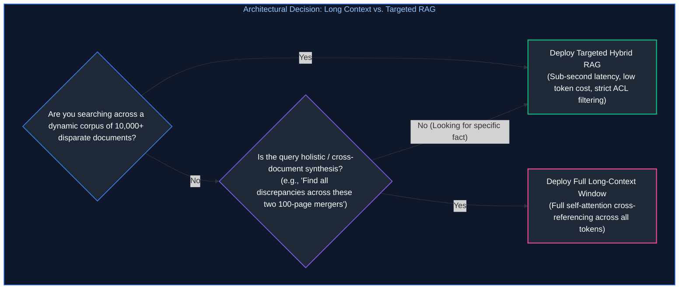
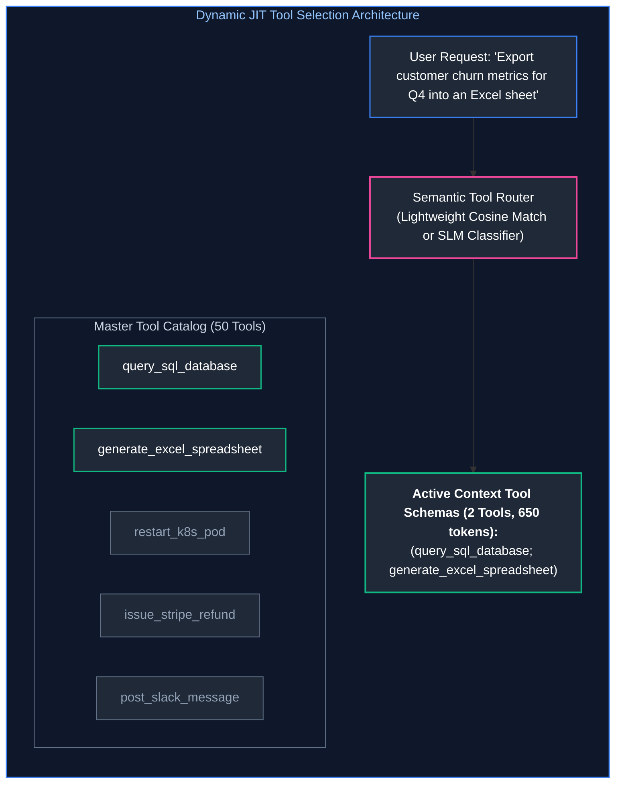
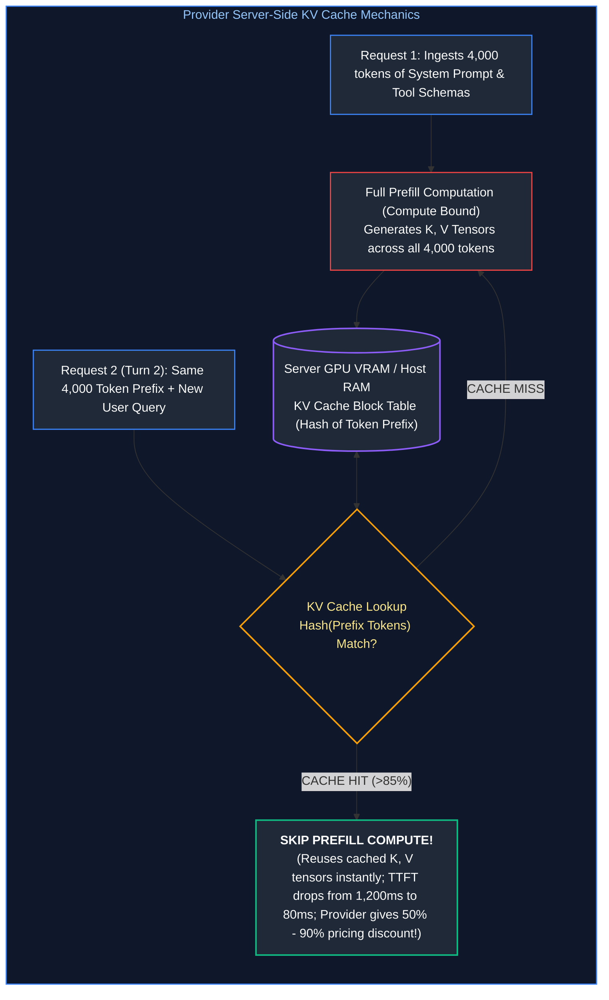
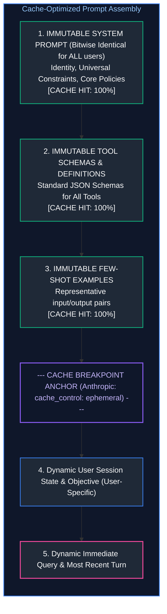

# 06. Context Engineering & Agent Harness Design

A comprehensive, production-grade guide to context window budgeting, attention degradation dynamics, deliberate context selection and assembly, context compression, memory state offloading, tool observation pruning, provider prompt prefix caching optimization, and durable agent harness engineering. Tailored for AI Engineers, Distributed Systems Architects, and Autonomous Systems Practitioners.

---

## Architectural Overview: The Durable Agent Context Harness Runtime

The diagram below details the architecture of an enterprise Agent Harness, managing active context budgets, prompt prefix caching, external state offloading, observation pruning, and rolling context compaction across extended autonomous execution horizons.



---

## Table of Contents
1. [The Context Window as a Finite Operating Budget](#1-the-context-window-as-a-finite-operating-budget)
   - [1.1 The Working Desk vs. Disk Storage Mental Model](#11-the-working-desk-vs-disk-storage-mental-model)
   - [1.2 Mathematical Mechanics of Attention Dilution & Context Rot](#12-mathematical-mechanics-of-attention-dilution--context-rot)
   - [1.3 The 'Lost-in-the-Middle' Phenomenon & Attention Sinks](#13-the-lost-in-the-middle-phenomenon--attention-sinks)
2. [Deliberate Context Selection & Assembly](#2-deliberate-context-selection--assembly)
   - [2.1 The Four-Tier Context Budget Architecture](#21-the-four-tier-context-budget-architecture)
   - [2.2 Priority Eviction Policies & Context Shedding Algorithms](#22-priority-eviction-policies--context-shedding-algorithms)
   - [2.3 Structural XML Delimiters & Prompt Boundary Isolation](#23-structural-xml-delimiters--prompt-boundary-isolation)
3. [Context Compression & Compaction Techniques](#3-context-compression--compaction-techniques)
   - [3.1 Rolling Summaries vs. Hierarchical Tree Summaries](#31-rolling-summaries-vs-hierarchical-tree-summaries)
   - [3.2 Compacting Voluminous Tool Outputs (JSON to Markdown & CSV)](#32-compacting-voluminous-tool-outputs-json-to-markdown--csv)
   - [3.3 Preserving Invariant Anchor Entities (UUIDs, Dates, Numbers, Hashes)](#33-preserving-invariant-anchor-entities-uuids-dates-numbers-hashes)
4. [Memory & External State Offloading](#4-memory--external-state-offloading)
   - [4.1 Active In-Context Tokens vs. Persisted Database Storage](#41-active-in-context-tokens-vs-persisted-database-storage)
   - [4.2 The File Artifact Workspace Pattern](#42-the-file-artifact-workspace-pattern)
   - [4.3 Self-Managed Scratchpads & State Machine Checklists](#43-self-managed-scratchpads--state-machine-checklists)
5. [Long-Context Realities vs. Retrieval Architectures](#5-long-context-realities-vs-retrieval-architectures)
   - [5.1 The True Computational & Financial Cost of Million-Token Contexts](#51-the-true-computational--financial-cost-of-million-token-contexts)
   - [5.2 When to Stuff Context vs. When to Deploy Targeted RAG](#52-when-to-stuff-context-vs-when-to-deploy-targeted-rag)
   - [5.3 Needle-in-a-Haystack Benchmarks vs. Complex Multi-Hop Synthesis](#53-needle-in-a-haystack-benchmarks-vs-complex-multi-hop-synthesis)
6. [Tool Context Management & Observation Pruning](#6-tool-context-management--observation-pruning)
   - [6.1 The Hidden Context Footprint of Large Tool Registries](#61-the-hidden-context-footprint-of-large-tool-registries)
   - [6.2 Dynamic Tool Schema Filtering & Semantic Routing](#62-dynamic-tool-schema-filtering--semantic-routing)
   - [6.3 Observation Masking & Tombstoning Lifecycles](#63-observation-masking--tombstoning-lifecycles)
7. [Provider Context Caching & Economic Optimization](#7-provider-context-caching--economic-optimization)
   - [7.1 Server-Side KV Cache Reuse Mechanics (vLLM, Anthropic, OpenAI, Gemini)](#71-server-side-kv-cache-reuse-mechanics-vllm-anthropic-openai-gemini)
   - [7.2 The Bitwise Invariant Prefix Rule](#72-the-bitwise-invariant-prefix-rule)
   - [7.3 Architecting Prompts for >85% Cache Hit Rates](#73-architecting-prompts-for-85-cache-hit-rates)
8. [Production Implementation: Durable Agent Context Harness](#8-production-implementation-durable-agent-context-harness)
   - [8.1 Harness Architectural Contracts & State Interfaces](#81-harness-architectural-contracts--state-interfaces)
   - [8.2 Complete Production-Grade Python Implementation](#82-complete-production-grade-python-implementation)
   - [8.3 Isolating Harness Failures from Model Reasoning Errors](#83-isolating-harness-failures-from-model-reasoning-errors)
9. [Summary Comparison & Engineering Reference Matrix](#9-summary-comparison--engineering-reference-matrix)
10. [References & Further Reading](#10-references--further-reading)

---

## 1. The Context Window as a Finite Operating Budget

### 1.1 The Working Desk vs. Disk Storage Mental Model

In classical operating system architecture, the computer manages a strict hierarchy of memory and storage:
* **RAM (Random Access Memory):** High-speed, volatile working memory where active CPU threads evaluate instructions. Sized in tens of gigabytes.
* **NVMe SSD Storage:** Massive, persistent storage where terabytes of cold files, operating system binaries, and database tables reside.

**The Foundation Model Analogy:**
* An LLM's **Context Window** is its **RAM / Physical Working Desk**. It is the active attention canvas where self-attention matrix multiplications execute across every token pair.
* External databases, file systems, and vector stores are its **NVMe SSD Storage**.



If you place two relevant files on your physical desk, you can synthesize them with complete cognitive clarity. If an assistant dumps 500 unorganized binders onto your desk, you cannot locate the critical sentence, your cognitive load is exhausted, and your execution slows to a crawl.
**Context Engineering is the rigorous systems discipline of keeping the model's active working desk clean, curated, and laser-focused.**

---

### 1.2 Mathematical Mechanics of Attention Dilution & Context Rot

Why does dumping large amounts of context degrade LLM performance? The root cause lies in the mathematical formulation of self-attention.

#### The Softmax Normalization Constraint:
In a transformer layer with sequence length $N$, the attention weight $A_{ij}$ assigned by token $i$ to token $j$ is computed as:

$$A_{ij} = \frac{\exp\left(\frac{\mathbf{q}_i \mathbf{k}_j^T}{\sqrt{d_k}}\right)}{\sum_{l=1}^N \exp\left(\frac{\mathbf{q}_i \mathbf{k}_l^T}{\sqrt{d_k}}\right)}, \quad \text{such that } \sum_{j=1}^N A_{ij} = 1.0$$

* When $N = 1,000$ tokens, a critical 50-token system guardrail (*"Do not execute DELETE statements without confirmation"*) commands a substantial portion of the total probability mass (e.g., $A_{i, \text{system}} \approx 0.05 \text{ to } 0.15$).
* When $N$ is expanded to $150,000$ tokens by stuffing raw database logs and verbose history, the denominator $\sum_{l=1}^N \dots$ balloons by over two orders of magnitude.
* **Attention Dilution:** The total attention mass allocated to the system guardrail is diluted:

$$A_{i, \text{system}} \longrightarrow \epsilon \ll 0.001$$

Statistically, the model begins hallucinating or violating negative constraints because the token probability distribution is drowned out by background noise tokens.

#### Attention Entropy & Context Rot:
The Shannon entropy of the attention distribution across token sequence $N$ is defined as:

$$H(A_i) = -\sum_{j=1}^N A_{ij} \log_2 A_{ij}$$

As context length $N$ grows with uncurated, repetitive text, the attention distribution approaches maximum entropy (a uniform distribution), destroying the model's ability to sharply focus on critical instructional tokens. Furthermore, in multi-turn agent sessions, outdated debugging attempts from Turn 4 remain in context on Turn 28. The agent re-attends to obsolete errors and enters repetitive loops—a pathology known as **Context Rot**.

---

### 1.3 The 'Lost-in-the-Middle' Phenomenon & Attention Sinks

Empirical investigations into long-context transformer architectures (Liu et al., 2023) reveal that foundation models do not distribute attention uniformly across their context window. They exhibit a pronounced **U-shaped recall distribution**:



#### Underlying Architectural Drivers:
1. **Primacy Bias & Attention Sinks:** Xiao et al. (2023) demonstrated that the very first tokens of a sequence (tokens $0 \dots 4$) act as "attention sinks"—absorbing massive attention scores regardless of semantic relevance because Softmax requires attention scores to sum to 1. Information placed at the start of context is prioritized by default.
2. **Recency Bias:** Autoregressive causal masking dictates that the most recently generated tokens have direct, non-decayed causal paths to the next token prediction.
3. **The Lost Middle:** Tokens residing between the $20\%$ and $80\%$ boundaries suffer severe retrieval degradation; retrieval accuracy for facts buried in the middle drops by $30\%\text{--}50\%$.

#### Production Harness Placement Invariants:
* **Invariant 1:** Place immutable system instructions, security guardrails, and tool schemas at the **very beginning** of the context.
* **Invariant 2:** Place the active task goal, immediate observation, and user prompt at the **very end** of the context.
* **Invariant 3:** Never bury critical constraints in the middle of retrieved chunks or conversation history.

---

## 2. Deliberate Context Selection & Assembly

### 2.1 The Four-Tier Context Budget Architecture

A production agent harness treats the model's context window not as an infinite bucket, but as an explicit, budget-constrained memory canvas. A standard $10,000$-token working context is divided into four distinct architectural tiers:



---

### 2.2 Priority Eviction Policies & Context Shedding Algorithms

When an agent's execution progresses over 20+ turns, total accumulated tokens inevitably threaten to breach the allocated budget. Rather than crashing or blindly truncating the oldest messages, the harness applies **Priority Eviction**:

| Priority Tier | Content Type | Eviction & Shedding Policy |
| :---: | :--- | :--- |
| **P0 (Highest)** | System Guardrails & Tool Definitions | **IMMUTABLE / NEVER EVICTED**: Ensures the model never loses its identity, safety boundaries, or execution capabilities. |
| **P1** | Active Task Goal & User Objective | **IMMUTABLE / NEVER EVICTED**: Prevents trajectory derailment and goal drift. |
| **P2** | Working Scratchpad & Entity Notes | **Compacted**: Rolled into higher-level abstract notes when updated. |
| **P3** | Retrieved RAG Documentation | **Evicted on Demand**: RAG chunks from prior turns are flushed as soon as the corresponding step is completed. |
| **P4 (Lowest)** | Historical Tool Observations & Stale Dialogue | **Aggressively Masked / Pruned**: Replaced with 1-line tombstone summaries after 2 execution turns. |

#### The Sliding Window with Attention Anchoring:
The harness maintains a strict sliding window of the last $K$ turns for Tier 4, while keeping Tier 1 (Static Prefix) and Tier 2 (Dynamic State) permanently pinned at the top. This guarantees constant-time token bounded execution regardless of session duration.

---

### 2.3 Structural XML Delimiters & Prompt Boundary Isolation

To provide clear structural semantics and prevent untrusted input from masquerading as system directives, enterprise harnesses wrap context blocks in **Structured XML Tags**:

```markdown
<system_identity>
You are an autonomous Site Reliability Engineering Agent for CloudCorp.
Strictly obey security invariants: Never drop production tables; never log passwords.
</system_identity>

<tools_inventory>
[{"name": "query_metrics", "description": "Fetches Prometheus cluster metrics..."}, ...]
</tools_inventory>

<active_objective>
Diagnose HTTP 504 error spikes on payment-gateway-service in production.
</active_objective>

<working_scratchpad>
- [x] Step 1: Query Prometheus for 5xx error rate (SPIKE CONFIRMED: 42% errors)
- [x] Step 2: Inspect pod restart logs (payment-pod-02 OOMKilled at 14:02 UTC)
- [/] Step 3: Check memory limits in deployment manifest (IN PROGRESS)
- [ ] Step 4: Recommend memory quota patch
</working_scratchpad>

<retrieved_context source="k8s_deployment_manifest">
apiVersion: apps/v1
kind: Deployment
metadata:
  name: payment-gateway
spec:
  template:
    spec:
      containers:
      - name: gateway
        resources:
          limits:
            memory: "512Mi"  <!-- BOTTLENECK DETECTED -->
</retrieved_context>

<immediate_task>
Evaluate whether the 512Mi limit is sufficient given recent heap telemetry.
</immediate_task>
```

#### Why XML Outperforms Markdown or JSON for Prompt Delimiting:
1. **Closing Tag Verification:** Modern foundation models (Claude 3.5 Sonnet, GPT-4o) are heavily trained on HTML/XML data. The explicit presence of `</active_objective>` creates an unambiguous boundary token that prevents prompt injection from bleeding into adjacent tiers.
2. **Document Object Model Representation:** The model can parse nested XML blocks identically to an AST, enabling precise cross-referencing between `<retrieved_context>` and `<immediate_task>`.

---

## 3. Context Compression & Compaction Techniques

### 3.1 Rolling Summaries vs. Hierarchical Tree Summaries

When context approaches capacity, intermediate conversational history must be compressed.



#### The Information Loss Theorem of Rolling Summaries:
Let $I(X; S_k)$ denote the mutual information between the original ground-truth events $X$ and the $k$-th recursive summary $S_k$. By the **Data Processing Inequality**:

$$I(X; S_1) \ge I(X; S_2) \ge \dots \ge I(X; S_k)$$

With each recursive summary pass, fine-grained technical details (UUIDs, specific error codes, port numbers) are irreversibly erased, creating a severe **"Telephone Game"** degradation. By Turn 25, the summary reads: *"The user and assistant discussed database issues and resolved them,"* which is useless for downstream debugging.

#### Hierarchical Tree Compaction:
Instead of recursively summarizing summaries, partition tasks into discrete sub-task milestones. When a milestone completes, emit a structured, immutable **Milestone Fact Record** that retains explicit technical parameters and store it in Tier 2.

---

### 3.2 Compacting Voluminous Tool Outputs (JSON to Markdown & CSV)

Raw tool execution returns are the primary cause of sudden context window explosions.
* Consider an agent executing: `query_database("SELECT * FROM customer_transactions LIMIT 200")`.
* The PostgreSQL driver returns a raw JSON payload with 200 nested JSON dictionaries:
  $$\text{Payload Size} \approx 28,000 \text{ tokens}$$
* Ingesting this single observation consumes nearly $30\%$ of a large context budget and over $90\%$ of an interactive budget.

#### The Harness Observation Compactor:
1. **Intercept:** The harness catches the raw 28,000-token JSON payload before it reaches the model context.
2. **Artifact Offload:** It persists the complete JSON dump to the local workspace disk:
   `/workspace/artifacts/query_result_txn_492.json`.
3. **Format Conversion & Truncation:** It converts the data to a compact Markdown table containing only the schema and the top 3 preview rows:

```markdown
[Output truncated: 200 records returned. Full payload written to: /workspace/artifacts/query_result_txn_492.json]
Schema: (txn_id: str, customer_id: int, amount: float, status: str, created_at: str)
Preview (Top 3 records):
| txn_id | customer_id | amount | status | created_at |
| :--- | :--- | :--- | :--- | :--- |
| TXN-8491 | 1042 | 149.50 | COMPLETED | 2026-03-31 14:02:11 |
| TXN-8492 | 2088 | 12.00 | FAILED | 2026-03-31 14:02:15 |
| TXN-8493 | 9941 | 890.00 | COMPLETED | 2026-03-31 14:02:22 |
```

**Result:** Token consumption plummets from **28,000 tokens down to 140 tokens** ($99.5\%$ reduction) while preserving total diagnostic utility. If the model needs full processing, it writes a Python script to iterate over the saved file on disk.

---

### 3.3 Preserving Invariant Anchor Entities (UUIDs, Dates, Numbers, Hashes)

When compacting context, summarizer agents must be constrained by strict **Entity Preservation Contracts**:
* **Deterministic Identifiers:** UUIDs (`8f4a21-bc...`), Git commit SHAs (`c8492f1`), and IP addresses (`10.244.1.84`) must **never** be abstracted.
* **Exact Numeric Values:** Financial sums, latencies ($p99 = 241\text{ms}$), and error counts must never be rounded.
* **Source Code Paths:** File paths (`src/auth/jwt_verifier.py#L42`) must be recorded verbatim.

---

## 4. Memory & External State Offloading

### 4.1 Active In-Context Tokens vs. Persisted Database Storage

High-performance agentic systems enforce a strict decoupling between **In-Context Working Memory** and **External Persistent Storage**:



---

### 4.2 The File Artifact Workspace Pattern

State-of-the-art coding and research agents (e.g., Claude Code, Devin, Google Antigravity) employ the **Artifact Workspace Pattern**:
* The model is equipped with file inspection and manipulation tools: `read_file(path, offset, limit)`, `write_file(path, content)`, and `patch_file(path, diff)`.
* Instead of loading a 10,000-line repository into the prompt context, the agent treats the operating system filesystem as its external memory.
* It reads only the 50 lines of code it intends to inspect, evaluates them, applies a localized patch, and writes changes back to disk.
* **The Context Advantage:** The active working context remains tiny ($< 8,000\text{ tokens}$), even when refactoring enterprise repositories comprising millions of lines of code.

---

### 4.3 Self-Managed Scratchpads & State Machine Checklists

To prevent goal drift over long-horizon trajectories, the harness supplies the agent with a dedicated, self-managed scratchpad (`scratchpad.md`):

```markdown
# AGENT SCRATCHPAD & STATE MACHINE
Active Objective: Refactor Redis connection pool to prevent thread starvation under load.

## Hypotheses & Findings
- Finding 1: Redis connection pool max_connections was hardcoded to 10 in config.py.
- Finding 2: Load testing at 2,000 RPS generates 45 connection timeouts per second.

## Dynamic Execution Plan
- [x] Phase 1: Locate connection pool initialization in src/db/redis.py. (COMPLETED)
- [x] Phase 2: Create unit test reproducing pool exhaustion under concurrent threads. (COMPLETED)
- [/] Phase 3: Implement dynamic pool scaling based on max_threads environment variable. (IN PROGRESS)
- [ ] Phase 4: Run pytest test_redis_pool.py and verify 0 timeouts.
- [ ] Phase 5: Commit changes to git branch feature/dynamic-redis-pool.
```

By re-injecting this structured scratchpad into Tier 2 on every turn, the agent maintains an unbroken chain of causality, immediately knowing what was accomplished and what remains to be executed.

---

## 5. Long-Context Realities vs. Retrieval Architectures

### 5.1 The True Computational & Financial Cost of Million-Token Contexts

Frontier model providers now advertise context windows supporting 1 million to 2 million tokens. While technically feasible, utilizing massive contexts in production introduces severe latency and financial bottlenecks:

| Context Window Size | Prefill TTFT Latency (A100/H100) | GPU VRAM for KV Cache (FP16) | Input Token Cost (Per Call) | 15-Turn Agent Session Cost |
| :---: | :---: | :---: | :---: | :---: |
| **8,000 tokens** | $\approx 200\text{ms}$ | $\approx 1.0\text{ GB}$ | $\approx \$0.024$ | $\approx \$0.36$ |
| **32,000 tokens** | $\approx 850\text{ms}$ | $\approx 4.0\text{ GB}$ | $\approx \$0.096$ | $\approx \$1.44$ |
| **128,000 tokens** | $\approx 3.2\text{s}$ | $\approx 16.0\text{ GB}$ | $\approx \$0.384$ | $\approx \$5.76$ |
| **1,000,000 tokens** | $\approx 22.0\text{s}$ | $\approx 125.0\text{ GB}$ | $\approx \$3.000$ | $\approx \mathbf{\$45.00}$ |

* **Latency Bottleneck:** An agent that incurs a 22-second Time-To-First-Token (TTFT) prefill latency on every turn will take over 6 minutes just waiting for model prefill across a 15-turn task.
* **Financial Bottleneck:** A single multi-turn agent session costs $\$45.00$—rendering the system economically unviable for automated SaaS features.

---

### 5.2 When to Stuff Context vs. When to Deploy Targeted RAG



* **Deploy Long-Context Window:** When comparing two large legal contracts, analyzing a full single codebase during a security audit, or evaluating a 150-page financial filing where every table must cross-reference every footnote.
* **Deploy Targeted RAG:** When querying enterprise knowledge repositories (Confluence, Jira, Google Drive) with tens of thousands of documents where $99.9\%$ of the text is irrelevant to the prompt.

---

### 5.3 Needle-in-a-Haystack Benchmarks vs. Complex Multi-Hop Synthesis

Model providers frequently boast $99.5\%+$ recall on synthetic **Needle-In-A-Haystack (NIAH)** benchmarks across 1 million tokens.

> [!IMPORTANT]
> **The Synthetic NIAH Illusion:**
> In a standard synthetic NIAH test, a distinct, out-of-distribution sentence (*"The secret code word is NeonPineapple99"*) is inserted into 800,000 tokens of generic Wikipedia text. Because the needle has zero semantic overlap with the surrounding corpus, its embedding vectors and attention activations stand out sharply.
> In real enterprise scenarios, tasks require **Complex Multi-Hop Reasoning**:
> *"Did the revenue recognized in Section 4.2 account for the currency hedging losses reported in Footnote 18, and what was the net impact on EBITDA?"*
> On real-world multi-hop synthesis across $> 64,000$ tokens, model accuracy routinely drops by **$30\%$ to $50\%$** due to attention dispersion and distractors!

---

## 6. Tool Context Management & Observation Pruning

### 6.1 The Hidden Context Footprint of Large Tool Registries

In naive agent implementations, developers equip an agent with 30 to 50 tools simultaneously:
* Every tool definition includes its function name, detailed docstrings, parameter types, enums, and JSON Schema validation rules.
* 40 tools $\times 350\text{ tokens per schema} = \mathbf{14,000\text{ tokens of prompt preamble}}$!
* Before the user submits a single token of input, 14,000 tokens of context budget are permanently occupied by tools that may never be called during that session.

---

### 6.2 Dynamic Tool Schema Filtering & Semantic Routing

To eliminate schema bloat, a production harness deploys **Dynamic Just-In-Time Tool Filtering**:



* Compute vector embeddings for all tool descriptions at startup.
* When the agent formulates a step, compute semantic similarity between the agent's `<active_objective>` and the tool descriptions.
* Inject only the top 3–5 candidate tools for that specific step, slashing tool schema overhead by up to $90\%$.

---

### 6.3 Observation Masking & Tombstoning Lifecycles

During multi-step execution, an agent calls tools to inspect logs, query files, and verify builds:
1. **Turn 4:** Agent runs `read_file("src/server.py")` $\to$ Returns 600 lines of code ($2,500$ tokens).
2. **Turn 5:** Agent identifies the bug: *"The port number is set to 80 instead of 8080."*
3. **Turn 6:** Agent executes `patch_file(...)` $\to$ Bug fixed.

On Turn 7, the 600 lines of code from Turn 4 are completely obsolete. Leaving them in context wastes tokens and risks distracting the model.
* **The Tombstoning Protocol:** The harness replaces the Turn 4 tool observation with a compact tombstone:
  ```markdown
  [Observation pruned: read_file("src/server.py") completed; 600 lines inspected; finding extracted in Turn 5]
  ```
* The conversational structure remains intact, but $2,480$ tokens are instantly reclaimed for downstream reasoning.

---

## 7. Provider Context Caching & Economic Optimization

### 7.1 Server-Side KV Cache Reuse Mechanics (vLLM, Anthropic, OpenAI, Gemini)

During transformer prefill, computing the Key and Value matrices ($\mathbf{K}$ and $\mathbf{V}$) across long prompt prefixes requires massive GPU compute ($O(N^2)$ FLOPS).
Once computed, modern serving engines (vLLM PagedAttention, Anthropic Prompt Caching, OpenAI Cached Prompts, Google Gemini Context Caching) persist these $\mathbf{K}$ and $\mathbf{V}$ tensors in GPU VRAM or host memory:



#### Economic & Performance Dividends:
* **Anthropic Prompt Caching:** Cached tokens are billed at **$10\%$ of normal input cost** ($90\%$ savings); Time-To-First-Token (TTFT) drops by up to $85\%$.
* **OpenAI Prompt Caching:** Cached input tokens receive a **$50\%$ cost discount** automatically.
* **Google Gemini Context Caching:** Hourly pricing models for long-lived cached token blocks.

---

### 7.2 The Bitwise Invariant Prefix Rule

> [!CAUTION]
> **The Bitwise Invariant Rule:**
> KV caching uses exact cryptographic hash matching on token sequences from token index $0$ to token index $K$. If even a **single character, space, or newline** changes at the start of your prompt, the entire prefix hash changes, and the **entire cache is invalidated**!

#### Common Developer Mistakes That Destroy Cache Hits:
1. **Dynamic Timestamps:** Inserting `Current Time: 2026-03-31 14:02:18` into the system prompt at line 1 invalidates the cache on every single request.
2. **Random Request UUIDs:** Placing `Request ID: 8f4a-29a...` in the system preamble destroys caching across turns.
3. **Dynamic User IDs:** Placing user-specific headers before invariant tool schemas prevents cross-user cache sharing.

---

### 7.3 Architecting Prompts for >85% Cache Hit Rates

To achieve continuous $> 85\%$ prompt cache hit rates in production fleets, structure prompt assembly following the **Static Head, Dynamic Tail Architecture**:



By concentrating all static content at the absolute head of the sequence and placing variable content strictly at the tail, the prefix cache remains continuously warm across all turns and users.

---

## 8. Production Implementation: Durable Agent Context Harness

### 8.1 Harness Architectural Contracts & State Interfaces

Below is a complete, production-grade Python implementation of an enterprise `DurableContextHarness` featuring:
1. **Four-Tier Context Sizing & Budget Enforcement:** Prevents token overflows using exact token estimations.
2. **Bitwise Invariant Cache Prefix Assembly:** Ensures Tier 1 remains identical across all requests for maximum KV cache reuse.
3. **Observation Governor & File Artifact Offloader:** Intercepts massive tool returns, offloads raw dumps to disk, and passes compact Markdown table previews into context.
4. **Dynamic Tool Filtering:** Injects only the subset of tool schemas relevant to the active objective.
5. **Observation Tombstoning Engine:** Prunes stale historical observations while retaining semantic context.

---

### 8.2 Complete Production-Grade Python Implementation

```python
"""
durable_context_harness.py
Production-grade Agent Context Harness featuring 4-Tier Budgeting, Bitwise
Invariant KV Cache Anchoring, File Artifact Offloading, Tool Pruning,
and Structured XML Boundary Isolation.
"""

import json
import os
import re
import time
from dataclasses import dataclass, field
from typing import Any, Dict, List, Optional, Set, Tuple


@dataclass
class ToolDefinition:
    """Tool metadata and JSON schema definition."""
    name: str
    description: str
    parameters: Dict[str, Any]
    category: str = "general"


@dataclass
class MessageTurn:
    """Represents a discrete turn in the conversational dialogue."""
    role: str  # 'user', 'assistant', or 'tool'
    content: str
    turn_id: int
    tool_name: Optional[str] = None
    is_tombstoned: bool = False
    artifact_path: Optional[str] = None


class ObservationGovernor:
    """Offloads massive tool payloads to disk artifacts and returns compact summaries."""

    def __init__(self, workspace_dir: str, char_threshold: int = 800):
        self.workspace_dir = workspace_dir
        self.threshold = char_threshold
        os.makedirs(workspace_dir, exist_ok=True)

    def process_tool_output(self, tool_name: str, raw_output: str) -> Tuple[str, Optional[str]]:
        """If raw_output exceeds threshold, writes to disk and returns a markdown preview."""
        if len(raw_output) <= self.threshold:
            return raw_output, None

        # Generate unique artifact path
        timestamp = int(time.time() * 1000)
        filename = f"artifact_{tool_name}_{timestamp}.json"
        artifact_path = os.path.join(self.workspace_dir, filename)

        with open(artifact_path, "w", encoding="utf-8") as f:
            f.write(raw_output)

        # Attempt to parse as JSON list for structured markdown table preview
        try:
            parsed = json.loads(raw_output)
            if isinstance(parsed, list) and len(parsed) > 0 and isinstance(parsed[0], dict):
                columns = list(parsed[0].keys())
                header_row = "| " + " | ".join(columns) + " |"
                separator_row = "| " + " | ".join(["---"] * len(columns)) + " |"
                
                sample_rows = []
                for row in parsed[:3]:
                    row_vals = [str(row.get(col, ""))[:30] for col in columns]
                    sample_rows.append("| " + " | ".join(row_vals) + " |")
                
                table_preview = "\n".join([header_row, separator_row] + sample_rows)
                compact_text = (
                    f"[Tool Output Truncated ({len(raw_output)} chars). Full data saved to: {artifact_path}]\n"
                    f"Record Count: {len(parsed)} | Schema: ({', '.join(columns)})\n"
                    f"Top 3 Records Preview:\n{table_preview}"
                )
                return compact_text, artifact_path
        except Exception:
            pass

        # Fallback raw character truncation preview
        compact_text = (
            f"[Tool Output Truncated ({len(raw_output)} chars). Full payload saved to: {artifact_path}]\n"
            f"Preview (First 300 chars):\n{raw_output[:300]}..."
        )
        return compact_text, artifact_path


class DurableContextHarness:
    """Orchestrates token budgeting, cache-aligned assembly, and context hygiene."""

    def __init__(
        self,
        system_persona: str,
        workspace_dir: str = "/tmp/agent_context_workspace",
        max_context_budget: int = 6000
    ):
        self.system_persona = system_persona
        self.workspace_dir = workspace_dir
        self.max_budget = max_context_budget

        self.governor = ObservationGovernor(workspace_dir)
        self.tool_registry: Dict[str, ToolDefinition] = {}
        
        # State Channels
        self.active_objective: str = ""
        self.scratchpad_checklist: List[str] = []
        self.conversation_history: List[MessageTurn] = []
        self._turn_counter: int = 0

    def register_tool(self, tool: ToolDefinition) -> None:
        self.tool_registry[tool.name] = tool

    def set_objective(self, objective: str) -> None:
        self.active_objective = objective

    def update_scratchpad(self, checklist: List[str]) -> None:
        self.scratchpad_checklist = checklist

    def append_user_message(self, text: str) -> None:
        self._turn_counter += 1
        self.conversation_history.append(
            MessageTurn(role="user", content=text, turn_id=self._turn_counter)
        )

    def append_assistant_message(self, text: str) -> None:
        self._turn_counter += 1
        self.conversation_history.append(
            MessageTurn(role="assistant", content=text, turn_id=self._turn_counter)
        )

    def record_tool_result(self, tool_name: str, raw_output: str) -> None:
        self._turn_counter += 1
        compact_output, artifact_path = self.governor.process_tool_output(tool_name, raw_output)
        self.conversation_history.append(
            MessageTurn(
                role="tool",
                content=compact_output,
                turn_id=self._turn_counter,
                tool_name=tool_name,
                artifact_path=artifact_path
            )
        )
        # Trigger tombstoning on historical observations older than 2 turns
        self._tombstone_stale_observations()

    def _tombstone_stale_observations(self) -> None:
        """Replaces tool outputs older than 2 turns with compact tombstones."""
        current_turn = self._turn_counter
        for turn in self.conversation_history:
            if turn.role == "tool" and not turn.is_tombstoned:
                if current_turn - turn.turn_id >= 4:
                    turn.content = f"[Observation tombstoned: {turn.tool_name} completed in Turn {turn.turn_id}]"
                    turn.is_tombstoned = True

    @staticmethod
    def _estimate_tokens(text: str) -> int:
        """Approximates token length (1 token ≈ 4 characters for English prose)."""
        return max(1, len(text) // 4)

    def assemble_prompt_context(self, active_tool_names: Optional[List[str]] = None) -> List[Dict[str, str]]:
        """
        Assembles 4-tier context payload adhering strictly to the Bitwise Invariant
        Prefix Rule for maximum server-side KV cache hits.
        """
        # 1. TIER 1: BITWISE INVARIANT STATIC PREFIX (Cache Anchor)
        # Select active tool schemas
        if active_tool_names:
            selected_tools = [self.tool_registry[k] for k in active_tool_names if k in self.tool_registry]
        else:
            selected_tools = list(self.tool_registry.values())

        tools_json = json.dumps([t.__dict__ for t in selected_tools], indent=2, sort_keys=True)
        
        static_tier_1 = (
            f"<system_identity>\n{self.system_persona}\n</system_identity>\n\n"
            f"<available_tools>\n{tools_json}\n</available_tools>"
        )

        # 2. TIER 2: DYNAMIC WORKING STATE
        checklist_str = "\n".join([f"- {item}" for item in self.scratchpad_checklist])
        dynamic_tier_2 = (
            f"<active_objective>\n{self.active_objective}\n</active_objective>\n\n"
            f"<working_scratchpad>\n{checklist_str}\n</working_scratchpad>"
        )

        # Combine System message
        system_content = f"{static_tier_1}\n\n{dynamic_tier_2}"
        tier1_2_tokens = self._estimate_tokens(system_content)

        messages = [
            {"role": "system", "content": system_content}
        ]

        # 3. TIER 4: EPHEMERAL DIALOGUE WINDOW (Budget Bound Enforcement)
        remaining_budget = self.max_budget - tier1_2_tokens
        assembled_history: List[Dict[str, str]] = []
        accumulated_tokens = 0

        # Traverse conversation backwards to keep the most recent turns within budget
        for turn in reversed(self.conversation_history):
            turn_tokens = self._estimate_tokens(turn.content)
            if accumulated_tokens + turn_tokens > remaining_budget:
                break
            assembled_history.append({"role": turn.role, "content": turn.content})
            accumulated_tokens += turn_tokens

        # Restore chronological order
        messages.extend(reversed(assembled_history))
        return messages


# =====================================================================
# VERIFICATION SUITE & HARNESS DEMONSTRATION
# =====================================================================

def run_harness_demonstration():
    print("=" * 80)
    print(" DURABLE AGENT CONTEXT HARNESS: LIFECYCLE DEMONSTRATION")
    print("=" * 80)

    harness = DurableContextHarness(
        system_persona="You are a Senior Infrastructure Automation Agent. Strictly enforce safety policies.",
        workspace_dir="/tmp/test_context_harness",
        max_context_budget=3000
    )

    # 1. Register Tools in Catalog
    harness.register_tool(ToolDefinition(
        name="query_active_connections",
        description="Queries PostgreSQL for current active connection pools.",
        parameters={"db_name": {"type": "string"}},
        category="database"
    ))
    harness.register_tool(ToolDefinition(
        name="restart_service_pod",
        description="Triggers a rolling restart of a designated service pod.",
        parameters={"pod_name": {"type": "string"}},
        category="kubernetes"
    ))

    # 2. Initialize Objective & Working State
    harness.set_objective("Diagnose connection pool exhaustion on payments-db and recover service.")
    harness.update_scratchpad([
        "[x] Step 1: Query active database connection metrics (COMPLETED)",
        "[/] Step 2: Identify rogue unclosed connection clients (IN PROGRESS)",
        "[ ] Step 3: Trigger rolling restart of misbehaving pod"
    ])

    harness.append_user_message("Please check why payments-db is rejecting incoming connections.")
    harness.append_assistant_message("I will query active PostgreSQL connections to inspect the pool status.")

    # 3. Simulate Massive Tool Return (e.g., 200 connection objects = 12,000 chars)
    massive_db_dump = json.dumps([
        {"conn_id": i, "client_ip": f"10.244.1.{i}", "state": "idle_in_transaction", "query": "SELECT * FROM orders"}
        for i in range(1, 150)
    ])
    print(f"\n[Simulation]: Intercepting massive tool output ({len(massive_db_dump)} characters)...")
    harness.record_tool_result("query_active_connections", massive_db_dump)

    # 4. Assemble Cache-Aligned Context
    assembled = harness.assemble_prompt_context(active_tool_names=["query_active_connections"])

    print("\n--- ASSEMBLED CONTEXT PAYLOAD ---")
    for idx, msg in enumerate(assembled):
        print(f"\n[Message {idx} - Role: {msg['role'].upper()}]")
        # Print snippet of content
        lines = msg["content"].split("\n")
        preview = "\n".join(lines[:10])
        print(preview)
        if len(lines) > 10:
            print(f"... [{len(lines) - 10} additional lines formatted in context] ...")

    # 5. Verify Artifact Offloading
    print("\n[Verification Checkpoint]:")
    last_turn = harness.conversation_history[-1]
    print(f"Artifact File Created On Disk : {last_turn.artifact_path}")
    print(f"File Exists on Filesystem     : {os.path.exists(last_turn.artifact_path)}")
    print(f"In-Context Pruned Length      : {len(last_turn.content)} characters (Down from {len(massive_db_dump)}!)")
    print(f"Token Reduction Percentage    : {((1 - len(last_turn.content)/len(massive_db_dump)) * 100):.2f}%")
    print("=" * 80)


if __name__ == "__main__":
    run_harness_demonstration()
```

---

### 8.3 Isolating Harness Failures from Model Reasoning Errors

When an autonomous agent crashes, enters infinite loops, or emits hallucinated answers, engineers frequently attribute the fault to model intellect (*"The model is getting dumber"*).

#### Systematic Production Diagnostic Matrix:

| Symptom | Probable Root Cause | Verification Diagnostic Check | Engineering Remedy |
| :--- | :--- | :--- | :--- |
| **Model ignores negative safety constraints** | **Attention Dilution** | Count total prompt tokens. Is context $> 50,000$ tokens? | Evict stale historical turns; enforce 4-tier context budgeting. |
| **Model repeats actions from 15 turns ago** | **Context Rot** | Inspect middle context. Are old error traces still present? | Deploy Observation Tombstoning; mask intermediate tool stderr. |
| **Severe TTFT latency spikes ($> 5\text{s}$)** | **Prefix Cache Invalidation** | Check first 500 characters of System Prompt. Did a timestamp or UUID leak in? | Enforce Bitwise Invariant Prefix Rule; move timestamps to dynamic tail. |
| **Model hallucinates tool arguments** | **Schema Clutter** | Are 40 tool schemas active simultaneously? | Implement dynamic JIT tool filtering via semantic router. |

---

## 9. Summary Comparison & Engineering Reference Matrix

### 9.1 Context Engineering Strategies Matrix

| Strategy / Technique | Implementation Mechanism | Primary Benefit | Latency & Cost Impact | Ideal Enterprise Application |
| :--- | :--- | :--- | :--- | :--- |
| **4-Tier Context Budgeting** | Hard token boundaries across Static, State, RAG, and Dialogue | Eliminates context saturation & unbounded memory sprawl | Predictable, strictly capped API billing | All production agent and conversational systems |
| **Artifact Workspace Offload** | Write raw payloads to disk; pass compact markdown previews | Compresses 25k-token dumps into 150-token previews | Slashes input token costs by up to $95\%$ | SQL tools, web scrapers, code execution environments |
| **Bitwise Invariant Prefix** | Anchor static prompt head; position dynamic state at tail | Maximize server-side KV cache hits | TTFT drops by up to $85\%$; 50–90% pricing discount | High-concurrency enterprise chatbots and coding agents |
| **Dynamic Tool Filtering** | Semantic cosine similarity router over tool registry | Eliminates thousands of tokens of idle tool schemas | Reduces base prompt preamble by up to $90\%$ | Large enterprise tool registries (20+ tools) |
| **Observation Tombstoning** | Replace consumed tool results with 1-line tombstone tags | Reclaims thousands of tokens from debugging traces | Prevents multi-turn context rot | Multi-step autonomous coding and DevOps agents |

---

### 9.2 Key Production Engineering Invariants

1. **The Invariant of Context Finite Budget:** Treat context window capacity as expensive RAM, not unbounded disk storage. Never let total active tokens grow unconstrained.
2. **The Bitwise Invariant Prefix Rule:** Every static token in the prompt prefix must remain 100% bitwise identical across calls. Never place timestamps, random nonces, or dynamic variables at the prompt head.
3. **The Observation Offload Invariant:** Tools must never dump raw, un-pruned JSON payloads directly into context. Always write raw output to disk artifacts and inject compact markdown summaries.
4. **Delimiters as AST Boundaries:** Always wrap context tiers in structured XML tags. It provides deterministic parsing boundaries and prevents prompt injection leakage.
5. **Observation Tombstoning:** Intermediate tool outputs have an operational shelf life of 2 turns. Once synthesized, mask them to prevent catastrophic attention dilution.

---

## 10. References & Further Reading

1. **Lost in the Middle: How Language Models Use Long Contexts:** Liu, N. F., et al. (2023). *Transactions of the ACL.* [arXiv:2307.03172](https://arxiv.org/abs/2307.03172).
2. **Efficient Streaming Language Models with Attention Sinks:** Xiao, G., et al. (2023). *ICLR 2024.* [arXiv:2309.17453](https://arxiv.org/abs/2309.17453).
3. **Prompt Caching Documentation & Architectural Guidelines:** Anthropic Engineering Team (2024). [docs.anthropic.com/en/docs/build-with-claude/prompt-caching](https://docs.anthropic.com/en/docs/build-with-claude/prompt-caching).
4. **vLLM: Efficient Memory Management for Large Language Models with PagedAttention:** Kwon, W., et al. (2023). *SOSP 2023.* [arXiv:2309.06180](https://arxiv.org/abs/2309.06180).
5. **The Needle In A Haystack Benchmark:** Kamradt, G. (2023). [github.com/gkamradt/LLMTest_NeedleInAHaystack](https://github.com/gkamradt/LLMTest_NeedleInAHaystack).
6. **FlashAttention-2: Faster Attention with Better Parallelism and Work Partitioning:** Dao, T. (2023). *ICLR 2024.* [arXiv:2307.08691](https://arxiv.org/abs/2307.08691).
