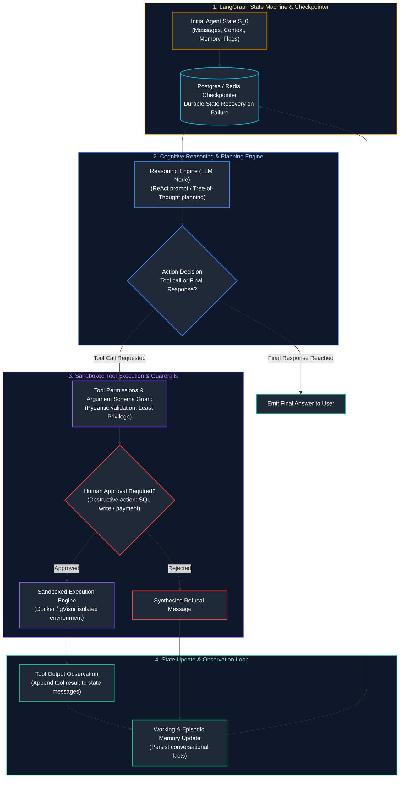
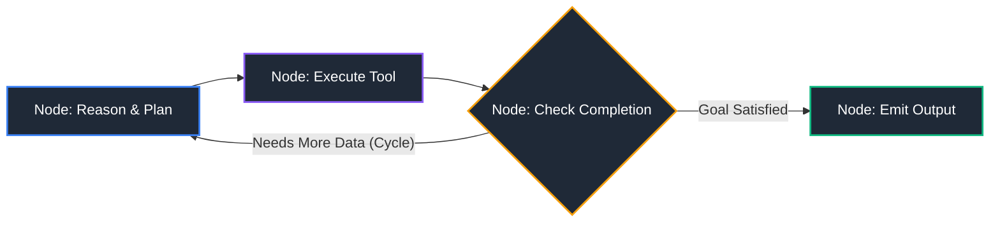
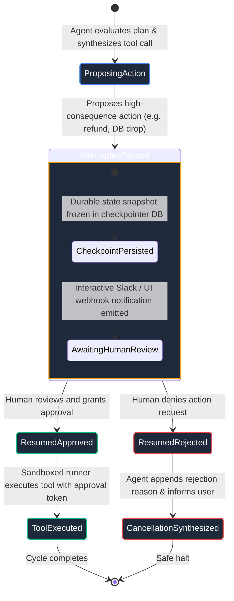

# 07. AI Agents & Workflow Orchestration

A comprehensive, production-grade guide to cognitive agent architectures, the ReAct (Reason, Act, Observe) loop, deterministic workflows vs. autonomous agents, state machines, LangGraph cyclic state graph execution, durable checkpointing, short-term vs. long-term memory architectures, Human-in-the-Loop (HITL) approval gates, and idempotency guarantees tailored for AI Engineers.

---

## Architectural Overview: Autonomous Cognitive Loop & State Machine Graph



---

## Table of Contents
1. [Agent Foundations: Autonomous Loops vs. Deterministic Workflows](#1-agent-foundations-autonomous-loops-vs-deterministic-workflows)
   - [1.1 The Continuum: Chains vs. Routers vs. State Machines vs. Autonomous Agents](#11-the-continuum-chains-vs-routers-vs-state-machines-vs-autonomous-agents)
   - [1.2 The ReAct Paradigm: Reason, Act, Observe](#12-the-react-paradigm-reason-act-observe)
2. [Agent Planning & Task Decomposition Strategies](#2-agent-planning-task-decomposition-strategies)
   - [2.1 Plan-and-Solve vs. ReAct](#21-plan-and-solve-vs-react)
   - [2.2 Tree-of-Thought (ToT) & Reflexion Loops](#22-tree-of-thought-tot-reflexion-loops)
3. [State Machines, Checkpointing & Durable Execution](#3-state-machines-checkpointing-durable-execution)
   - [3.1 Cyclic Graphs vs. Directed Acyclic Graphs (DAGs)](#31-cyclic-graphs-vs-directed-acyclic-graphs-dags)
   - [3.2 State Persistence & Thread Checkpointing](#32-state-persistence-thread-checkpointing)
4. [LangGraph Production Architecture & State Graph Implementation](#4-langgraph-production-architecture-state-graph-implementation)
   - [4.1 State Schema Definition & Reducer Operators](#11-the-continuum-chains-vs-routers-vs-state-machines-vs-autonomous-agents)
   - [4.2 Production StateGraph Implementation with Tool Nodes](#4-langgraph-production-architecture-state-graph-implementation)
5. [Memory Systems: Working vs. Short-Term vs. Persistent Episodic Memory](#5-memory-systems-working-vs-short-term-vs-persistent-episodic-memory)
   - [5.1 Working Context vs. Vectorized Episodic Storage](#5-memory-systems-working-vs-short-term-vs-persistent-episodic-memory)
   - [5.2 Context Window Compaction & Rolling Summarization](#52-context-window-compaction-rolling-summarization)
6. [Human-in-the-Loop (HITL) Checkpoints & Approval Patterns](#6-human-in-the-loop-hitl-checkpoints-approval-patterns)
   - [6.1 Asynchronous Interrupts & State Pausing](#61-asynchronous-interrupts-state-pausing)
   - [6.2 Production Approval State Machine Code](#architectural-overview-autonomous-cognitive-loop-state-machine-graph)
7. [Idempotency & Safe Tool Execution](#7-idempotency-safe-tool-execution)
   - [7.1 The Danger of Blind Retries on Side-Effect Tools](#71-the-danger-of-blind-retries-on-side-effect-tools)
   - [7.2 Idempotency Keys & Distributed Locks](#7-idempotency-safe-tool-execution)
8. [Production Diagnostics: Infinite Recursion Loops & Context Bloat](#8-production-diagnostics-infinite-recursion-loops-context-bloat)
   - [8.1 Guarding Against Infinite Tool Loops](#81-guarding-against-infinite-tool-loops)
   - [8.2 Circuit Breakers and Maximum Recursion Limits](#21-plan-and-solve-vs-react)
9. [Summary Comparison & Engineering Reference Matrix](#9-summary-comparison-engineering-reference-matrix)
10. [References & Further Reading](#10-references-further-reading)

---

# 1. Agent Foundations: Autonomous Loops vs. Deterministic Workflows

### 1.1 The Continuum: Chains vs. Routers vs. State Machines vs. Autonomous Agents

| Architectural Pattern | Control Flow Determinism | Production Suitability |
| :--- | :--- | :--- |
| **Prompt Chains** | 100% Deterministic (Step A $\rightarrow$ Step B $\rightarrow$ Step C). | ETL, document summarization, linear batch transformations. |
| **Router Patterns** | Conditional branch governed by LLM classifier. | Routing queries to specialized domain handlers or task-specific models. |
| **State Machines**<br/>(LangGraph Workflows) | Structured states with code-governed transitions & loops. | Enterprise business processes requiring strict guardrails, human approval gates. |
| **Autonomous Agents**<br/>(Unconstrained ReAct) | LLM decides next state, tool invocation, and termination dynamically. | Exploratory research, coding assistance, open-ended problem solving. |

---

### 1.2 The ReAct Paradigm: Reason, Act, Observe

The ReAct pattern (Yao et al., 2022) combines internal reasoning traces with external environment interactions:
1. **Thought:** The model analyzes the current state and forms a step hypothesis.
2. **Action:** The model emits a tool call with specific arguments.
3. **Observation:** The application executes the tool and injects the output back into the message history.
4. **Repeat:** The model incorporates the observation into its next thought until solving the task.

---

# 2. Agent Planning & Task Decomposition Strategies

### 2.1 Plan-and-Solve vs. ReAct

- **Standard ReAct:** Decides one step at a time. Prone to getting stuck in local minima or wandering aimlessly on long-horizon tasks (e.g., executing 25 steps to resolve a bug).
- **Plan-and-Solve:**
  1. *Planner:* Decomposes the initial goal into a static DAG of 5 sub-tasks.
  2. *Executor:* Steps through each sub-task sequentially using targeted tools.
  3. *Re-planner:* Dynamically updates remaining sub-tasks if an execution fails or uncovers new data.

---

### 2.2 Tree-of-Thought (ToT) & Reflexion Loops

- **Tree-of-Thought (ToT):** Explores multiple alternate reasoning branches concurrently using breadth-first (BFS) or depth-first (DFS) search, backtracking when a branch fails evaluation.
- **Reflexion (Shinn et al., 2023):** Equips the agent with verbal reinforcement learning. When an execution fails, a reflection prompt analyzes the failure, writes a post-mortem into episodic memory, and restarts the task with explicit failure-avoidance instructions.

---

# 3. State Machines, Checkpointing & Durable Execution

### 3.1 Cyclic Graphs vs. Directed Acyclic Graphs (DAGs)

Traditional orchestrators (Airflow, Kubeflow) enforce **Directed Acyclic Graphs (DAGs)**. However, cognitive agent loops inherently require **cycles** (Retry tool upon failure $\rightarrow$ Evaluate tool result $\rightarrow$ Refine query $\rightarrow$ Re-run tool).



---

### 3.2 State Persistence & Thread Checkpointing

In production, an agent run may take minutes or days (waiting for human approval or multi-step execution). If the server restarts during execution, an in-memory agent loses state.
- **Checkpointers (PostgreSQL / Redis / SQLite):** Save a snapshot of the full state graph after **every single node execution**.
- **Thread IDs:** Partition states by conversation/user thread, enabling seamless resumption and rollbacks.

---

# 4. LangGraph Production Architecture & State Graph Implementation

```python
# ==============================================================================
# Production StateGraph Implementation with Cyclic Tool Node in LangGraph
# ==============================================================================
from typing import Annotated, TypedDict, List
import json
from langgraph.graph import StateGraph, END
from langgraph.checkpoint.memory import MemorySaver

# 1. Define shared Agent State using Annotated reducers
class AgentState(TypedDict):
    # 'messages' appends new messages via a reducer operator rather than overwriting
    messages: Annotated[List[dict], lambda x, y: x + y]
    iteration_count: int
    is_complete: bool

# 2. Define Node Logic
def reasoning_node(state: AgentState) -> dict:
    """Evaluates conversation and decides whether to invoke tool or conclude."""
    curr_messages = state["messages"]
    iters = state["iteration_count"] + 1

    last_message = curr_messages[-1]["content"]
    
    # Check if target data is already retrieved
    if "AAPL: $235.40" in last_message or iters >= 3:
        return {
            "messages": [{"role": "assistant", "content": "Analysis complete: Apple stock is at $235.40."}],
            "iteration_count": iters,
            "is_complete": True
        }
    else:
        # Request tool call
        return {
            "messages": [{"role": "assistant", "content": "CALL_TOOL: get_stock_price('AAPL')"}],
            "iteration_count": iters,
            "is_complete": False
        }

def tool_execution_node(state: AgentState) -> dict:
    """Executes external tool and appends observation to state."""
    # Simulated stock price tool execution
    tool_observation = "OBSERVATION: AAPL: $235.40 (Timestamp: 2026-10-10)"
    return {
        "messages": [{"role": "tool", "content": tool_observation}],
        "iteration_count": state["iteration_count"],
        "is_complete": False
    }

# 3. Conditional routing edge
def should_continue(state: AgentState) -> str:
    if state["is_complete"]:
        return END
    return "tools"

# 4. Assemble Cyclic Graph
workflow = StateGraph(AgentState)
workflow.add_node("agent", reasoning_node)
workflow.add_node("tools", tool_execution_node)

workflow.set_entry_point("agent")
workflow.add_conditional_edges("agent", should_continue, {"tools": "tools", END: END})
workflow.add_edge("tools", "agent")  # Cycle back to agent reasoning!

# 5. Compile with durable checkpointer
memory_checkpointer = MemorySaver()
app = workflow.compile(checkpointer=memory_checkpointer)

# 6. Execute state machine with thread isolation
thread_config = {"configurable": {"thread_id": "session_user_42"}}
initial_state = {
    "messages": [{"role": "user", "content": "What is the current stock price of Apple?"}],
    "iteration_count": 0,
    "is_complete": False
}

final_output = app.invoke(initial_state, config=thread_config)
print("Agent Finished Execution!")
print(f"Final State Messages Count: {len(final_output['messages'])}")
print(f"Final Message: {final_output['messages'][-1]['content']}")
```

---

# 5. Memory Systems: Working vs. Short-Term vs. Persistent Episodic Memory

| Memory Tier | Storage Backend & Retrieval | Function & Lifecycle |
| :--- | :--- | :--- |
| **Working Memory**<br/>(Immediate Context) | Prompt context window (In-memory token list). | Scratchpad for current task execution and immediate step reasoning. |
| **Short-Term Memory**<br/>(Session State) | Session cache (Redis, LangGraph checkpointer). | Multi-turn conversation state and thread checkpoint spanning an active user session. |
| **Persistent Episodic Memory** | Vector Database / Relational (pgvector, Qdrant, Mem0). | Long-term factual recall, personalized user preferences, and cross-session historical resolutions. |

---

### 5.2 Context Window Compaction & Rolling Summarization

As an agent executes 15 successive tool calls, raw tool outputs (e.g., massive 5,000-line JSON responses) quickly exceed context windows.
- **Selective Retention:** Strip verbose raw tool payloads from message history once the agent extracts the essential answer.
- **Rolling Summarizer Node:** When message history crosses 8,000 tokens, trigger an intermediate LLM call to compress older turns into a concise factual summary block.

---

# 6. Human-in-the-Loop (HITL) Checkpoints & Approval Patterns

### 6.1 Asynchronous Interrupts & State Pausing

For high-consequence operations (deleting a production database, executing wire transfers, sending customer-facing emails), agents must not execute autonomously without human review:



---

# 7. Idempotency & Safe Tool Execution

### 7.1 The Danger of Blind Retries on Side-Effect Tools

If an agent tool call times out while charging a credit card or creating a VM, the network request may have succeeded remotely while the client received an HTTP timeout. A naive retry charges the card a second time!

```python
# ==============================================================================
# Production Idempotent Tool Execution Pattern
# ==============================================================================
import uuid
import redis

redis_client = redis.Redis(host="localhost", port=6379, db=0)

def execute_payment_idempotent(order_id: str, amount_cents: int, idempotency_key: str) -> dict:
    """Guarantees payment is executed exactly once regardless of retries."""
    # Acquire distributed lock using idempotency key
    lock_key = f"lock:payment:{idempotency_key}"
    is_locked = redis_client.set(lock_key, "locked", nx=True, ex=30)
    
    if not is_locked:
        # Request is already being processed or was processed
        cached_result = redis_client.get(f"result:payment:{idempotency_key}")
        if cached_result:
            return json.loads(cached_result)
        raise RuntimeError("Concurrent transaction in progress; please retry shortly.")

    try:
        # Execute actual transactional payment logic
        payment_record = {
            "transaction_id": str(uuid.uuid4()),
            "order_id": order_id,
            "status": "SETTLED",
            "amount_cents": amount_cents
        }
        # Cache result permanently
        redis_client.set(f"result:payment:{idempotency_key}", json.dumps(payment_record), ex=86400)
        return payment_record
    finally:
        redis_client.delete(lock_key)
```

---

# 8. Production Diagnostics: Infinite Recursion Loops & Context Bloat

### 8.1 Guarding Against Infinite Tool Loops

When an agent encounters a tool error (e.g., `FileNotFoundError`), it may repeatedly try the same failing tool command with slight syntactic variations indefinitely, exhausting API budgets and crashing servers.

> [!CAUTION]
> Always enforce strict **Maximum Recursion Depth** guards (`max_iterations = 10`) and **Duplicate Action Detection** in your agent state engine. If the exact same tool name and arguments are dispatched twice in succession without intermediate state changes, immediately terminate the loop and escalate to human review.

---

# 9. Summary Comparison & Engineering Reference Matrix

| Agent Architecture | Implementation Complexity | Autonomy Level | Failure Resilience | Production Use Case |
| :--- | :--- | :--- | :--- | :--- |
| **Linear Prompt Chain** | Low (Single script) | Zero (Static code) | High | Document extraction, tabular formatting. |
| **Deterministic State Machine** | Moderate (LangGraph) | Constrained | Very High | Enterprise compliance, KYC, customer support triage. |
| **ReAct Autonomous Loop** | Moderate | High | Moderate (Prone to loops)| Ad-hoc code execution, deep web research. |
| **Plan-and-Solve with HITL** | High | Balanced | High | DevOps incident remediation, financial trade operations. |

---

# 10. References & Further Reading

- [ReAct: Synergizing Reasoning and Acting in Language Models (Yao et al., 2022)](https://arxiv.org/abs/2210.03629)
- [LangGraph: Building Resilient Language Agents as Graphs](https://langchain-ai.github.io/langgraph/)
- [Reflexion: Language Agents with Verbal Reinforcement Learning (Shinn et al., 2023)](https://arxiv.org/abs/2303.11366)
- [Tree of Thoughts: Deliberate Problem Solving with Large Language Models (Yao et al., 2023)](https://arxiv.org/abs/2305.10601)
- [Enterprise Patterns for Reliable Autonomous Agents (Anthropic, 2024)](https://www.anthropic.com/research/building-effective-agents)

