# 08. AI Infrastructure, Cloud Platforms & High-Throughput Inference Serving

A comprehensive, production-grade guide to enterprise AI infrastructure, cloud AI platforms (AWS Bedrock, GCP Vertex AI, Azure AI Foundry), GPU microarchitecture (NVIDIA Hopper H100, Blackwell B200, Tensor Cores, HBM3e, NVLink), high-throughput serving engines (vLLM, SGLang, TensorRT-LLM), PagedAttention virtual memory management, continuous iteration batching, chunked prefill, speculative decoding, distributed inference (Tensor Parallelism via Megatron-LM All-Reduce, Pipeline Parallelism), model quantization (FP8, AWQ, GPTQ), Kubernetes GPU orchestration, and capacity planning. Tailored for AI Platform Engineers, ML Infrastructure Architects, and Systems SREs.

---

## Architectural Overview: High-Throughput Distributed LLM Serving Node

The diagram below details the internal systems architecture of an enterprise open-weight model serving node powered by vLLM, illustrating PagedAttention virtual memory translation, continuous iteration batching, chunked prefill scheduling, and multi-GPU Tensor Parallelism over an NVLink interconnect.

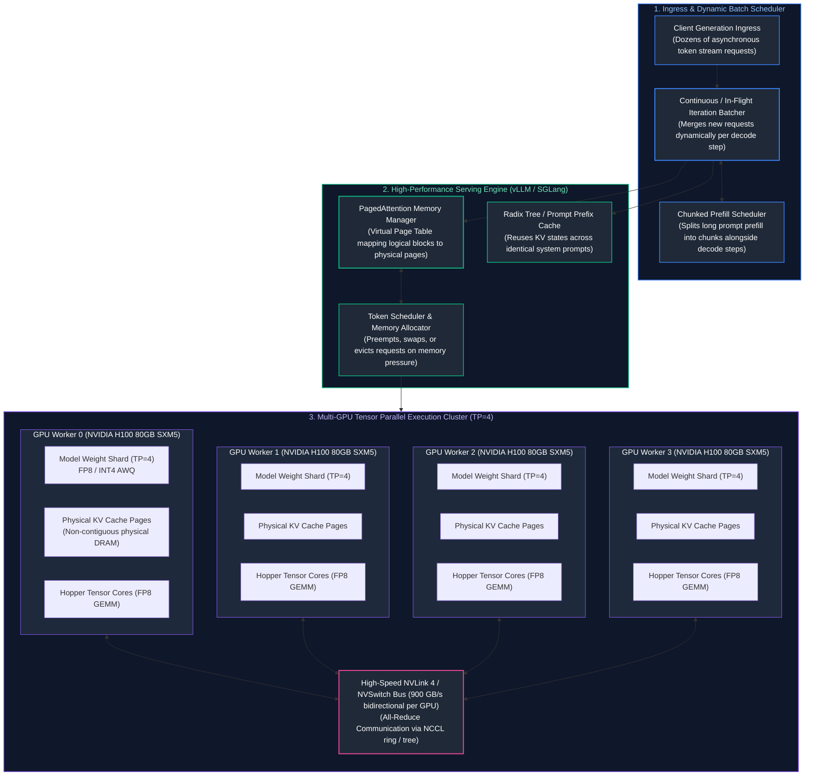

---

## Table of Contents
1. [Enterprise Cloud AI Platforms & Hosting Architectures](#1-enterprise-cloud-ai-platforms--hosting-architectures)
   - [1.1 The Hosting Decision Ladder (Serverless vs. Dedicated vs. Self-Hosted)](#11-the-hosting-decision-ladder-serverless-vs-dedicated-vs-self-hosted)
   - [1.2 Enterprise Cloud Catalogs: AWS Bedrock, GCP Vertex AI, and Azure AI Foundry](#12-enterprise-cloud-catalogs-aws-bedrock-gcp-vertex-ai-and-azure-ai-foundry)
   - [1.3 Private VPC Endpoints, AWS PrivateLink & CMEK Security](#13-private-vpc-endpoints-aws-privatelink--cmek-security)
   - [1.4 Provisioned Throughput (PTUs / RCUs) vs. Pay-As-You-Go Economics](#14-provisioned-throughput-ptus--rcus-vs-pay-as-you-go-economics)
2. [GPU Microarchitecture, Hardware Mechanics & Sizing](#2-gpu-microarchitecture-hardware-mechanics--sizing)
   - [2.1 NVIDIA GPU Evolution: Ampere A100 to Hopper H100 to Blackwell B200](#21-nvidia-gpu-evolution-ampere-a100-to-hopper-h100-to-blackwell-b200)
   - [2.2 Tensor Cores, High Bandwidth Memory (HBM3e) & Arithmetic Intensity](#22-tensor-cores-high-bandwidth-memory-hbm3e--arithmetic-intensity)
   - [2.3 Multi-GPU Interconnects: PCIe Gen5 vs. NVLink 4 vs. NVSwitch](#23-multi-gpu-interconnects-pcie-gen5-vs-nvlink-4-vs-nvswitch)
   - [2.4 Total GPU VRAM Sizing Formula & Mathematical Derivation](#24-total-gpu-vram-sizing-formula--mathematical-derivation)
3. [Serving Engine Mechanics: vLLM, SGLang & PagedAttention](#3-serving-engine-mechanics-vllm-sglang--pagedattention)
   - [3.1 The Memory Crisis of Naive Serving: Internal vs. External Memory Fragmentation](#31-the-memory-crisis-of-naive-serving-internal-vs-external-memory-fragmentation)
   - [3.2 PagedAttention Virtual Memory Architecture](#32-pagedattention-virtual-memory-architecture)
   - [3.3 Radix Tree Prefix Caching Mechanics](#33-radix-tree-prefix-caching-mechanics)
4. [Continuous Batching, Chunked Prefill & Speculative Decoding](#4-continuous-batching-chunked-prefill--speculative-decoding)
   - [4.1 Static Batching Inefficiencies: Padding Waste & Head-of-Line Blocking](#41-static-batching-inefficiencies-padding-waste--head-of-line-blocking)
   - [4.2 Continuous (In-Flight / Iteration-Level) Batching](#42-continuous-in-flight--iteration-level-batching)
   - [4.3 Prefill vs. Decode Disparity & Chunked Prefill Scheduling](#43-prefill-vs-decode-disparity--chunked-prefill-scheduling)
   - [4.4 Speculative Decoding: Draft Models & Target Verification](#44-speculative-decoding-draft-models--target-verification)
5. [Distributed Inference: Tensor Parallelism vs. Pipeline Parallelism](#5-distributed-inference-tensor-parallelism-vs-pipeline-parallelism)
   - [5.1 Megatron-LM Tensor Parallelism (TP) via All-Reduce](#51-megatron-lm-tensor-parallelism-tp-via-all-reduce)
   - [5.2 Pipeline Parallelism (PP) & Inter-Node Bubble Overhead](#52-pipeline-parallelism-pp--inter-node-bubble-overhead)
   - [5.3 Communication Topologies: Intra-Node NVLink vs. Inter-Node InfiniBand / RoCE](#53-communication-topologies-intra-node-nvlink-vs-inter-node-infiniband--roce)
6. [Model Quantization Mechanics: FP8, AWQ, GPTQ & GGUF](#6-model-quantization-mechanics-fp8-awq-gptq--gguf)
   - [6.1 The Mathematical Mechanics of Quantization](#61-the-mathematical-mechanics-of-quantization)
   - [6.2 FP8 Formats: E4M3 vs. E5M2 and Hopper Acceleration](#62-fp8-formats-e4m3-vs-e5m2-and-hopper-acceleration)
   - [6.3 Weight-Only vs. Weight-and-Activation Quantization (AWQ vs. GPTQ)](#63-weight-only-vs-weight-and-activation-quantization-awq-vs-gptq)
   - [6.4 Quantization Quality, Latency & VRAM Trade-Off Matrix](#64-quantization-quality-latency--vram-trade-off-matrix)
7. [Kubernetes Orchestration & GPU Autoscaling](#7-kubernetes-orchestration--gpu-autoscaling)
   - [7.1 Kubernetes Pod Configuration with NVIDIA GPU Operator](#71-kubernetes-pod-configuration-with-nvidia-gpu-operator)
   - [7.2 Custom Metric Autoscaling with KEDA](#72-custom-metric-autoscaling-with-keda)
   - [7.3 Multi-Instance GPU (MIG) vs. Time-Slicing for Workload Partitioning](#73-multi-instance-gpu-mig-vs-time-slicing-for-workload-partitioning)
8. [Production Implementation: Enterprise Capacity Planning & Sizing Engine](#8-production-implementation-enterprise-capacity-planning--sizing-engine)
   - [8.1 Systems Architecture of the Planner](#81-systems-architecture-of-the-planner)
   - [8.2 Complete Production-Grade Python Implementation](#82-complete-production-grade-python-implementation)
   - [18.3 Operational Sizing Playbook & Benchmark Validation](#183-operational-sizing-playbook--benchmark-validation)
9. [Summary Comparison & Production Engineering Reference Matrix](#19-summary-comparison--production-engineering-reference-matrix)
10. [References & Further Reading](#20-references--further-reading)
---

# 1. Enterprise Cloud AI Platforms & Hosting Architectures

### 1.1 The Hosting Decision Ladder (Serverless vs. Dedicated vs. Self-Hosted)

When deploying large language models, enterprise infrastructure architects face a three-way architectural fork: **Serverless Managed APIs**, **Dedicated Cloud Provisioned Capacity**, or **Self-Hosted Open-Weight Clusters**. Choosing incorrectly leads either to astronomical monthly cloud bills or operational gridlock.

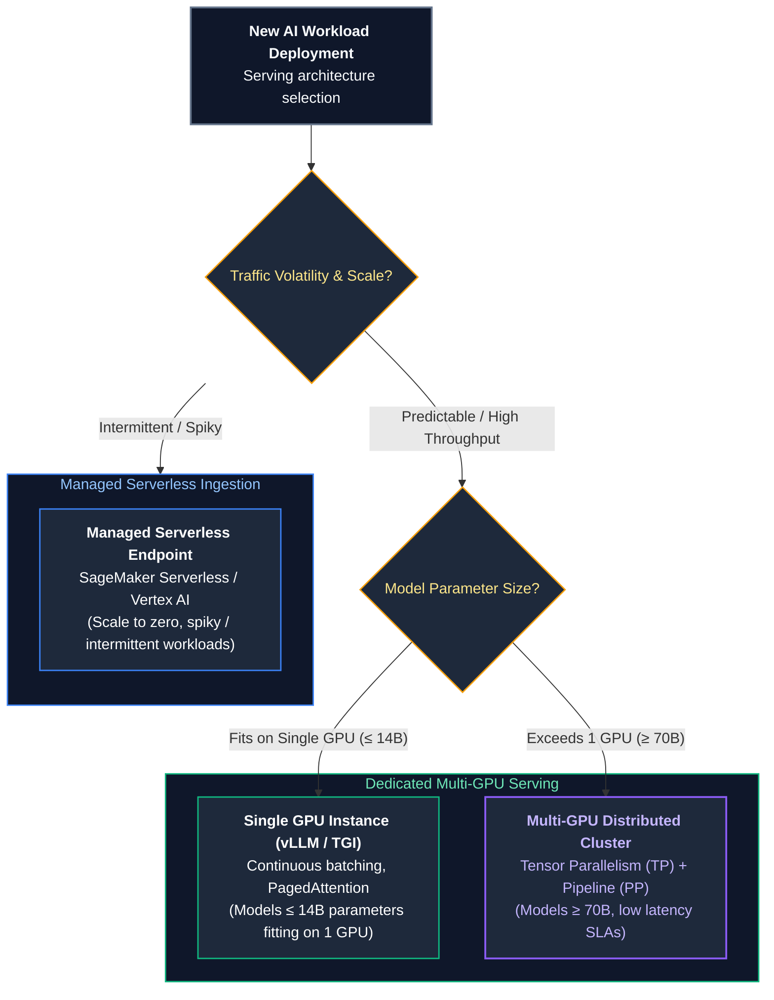

| Hosting Model | Primary Infrastructure | Pricing Mechanism | SLA & Concurrency | Engineering Burden |
| :--- | :--- | :--- | :--- | :--- |
| **Serverless API** (OpenAI, Anthropic, Bedrock) | Multi-tenant public cloud | Pay-per-token (\$0.15–\$15.00 / 1M tokens) | Variable; prone to noisy-neighbor HTTP 429 rate limits | **Minimal** (Call REST endpoint) |
| **Dedicated Capacity** (Azure PTU, Bedrock PTU) | Reserved cloud GPU partitions | Fixed hourly / monthly commitment (\$15k–\$40k/mo) | Guaranteed tokens/sec; deterministic latency; zero 429s | **Low** (Manage provisioned units) |
| **Self-Hosted Kubernetes** (vLLM on EKS / GKE) | Dedicated GPU instances (e.g., `p5.48xlarge`, 8x H100) | Infrastructure VM cost (\$32.77/hr per 8x H100 node) | Strict SLA governed by internal cluster capacity | **Very High** (CUDA, NCCL, InfiniBand, Autoscaling) |

---

### 1.2 Enterprise Cloud Catalogs: AWS Bedrock, GCP Vertex AI, and Azure AI Foundry

The "Big Three" hyperscalers provide managed AI platforms designed to isolate enterprise data from public internet traversal and public model training:

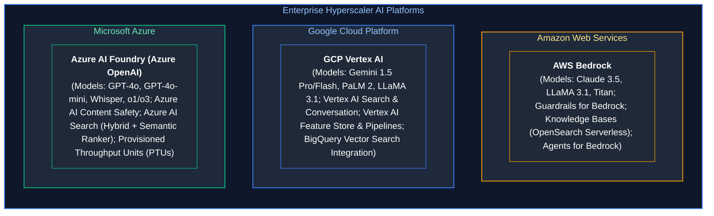

#### Core Enterprise Invariants
1. **Zero Data Retention for Training:** Commercial agreements with all three hyperscalers legally guarantee that customer prompt tokens and completion responses are **never logged, retained, or utilized** for training base foundation models.
2. **Regional Data Residency:** Enterprises operating under strict jurisdictional boundaries (e.g., GDPR in the EU or HIPAA in the US) can lock model processing to specific geographic regions (e.g., `eu-west-1` or `us-east-1`).
3. **Unified IAM Integration:** Model invocation permissions inherit cloud-native identity fabrics (AWS IAM Roles, GCP Workload Identity, Azure Managed Identities).

---

### 1.3 Private VPC Endpoints, AWS PrivateLink & CMEK Security

In high-compliance financial and healthcare environments, network packets containing sensitive data must never traverse the public internet.

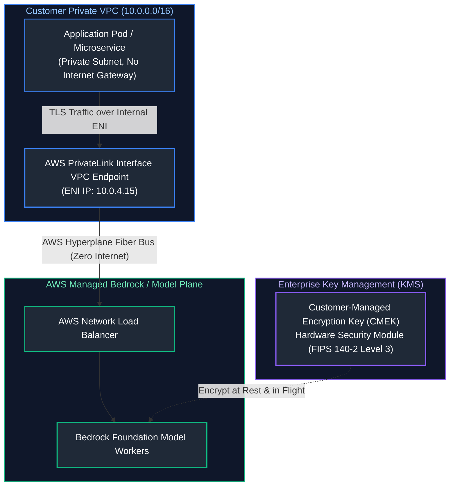

#### 1. AWS PrivateLink / Azure Private Endpoints
- A virtual Elastic Network Interface (ENI) with a private IP address (`10.0.4.15`) is injected into the customer's private subnet.
- The application resolves the model API hostname to this private IP.
- Traffic flows over the internal AWS/Azure private network backbone (Hyperplane) directly into the managed AI cluster without ever touching public IP space or traversing NAT gateways.

#### 2. Customer-Managed Encryption Keys (CMEK)
Foundation model inputs, intermediate cached activations, and persistent vector databases are encrypted using encryption keys managed in the customer's AWS KMS, GCP Cloud KMS, or Azure Key Vault. The customer retains the cryptographic ability to instantly revoke access, rendering all model data instantly unreadable.

---

### 1.4 Provisioned Throughput (PTUs / RCUs) vs. Pay-As-You-Go Economics

When traffic exceeds approximately 20,000 requests per day, serverless pay-as-you-go pricing exhibits non-linear financial scaling. 

**Provisioned Throughput Units (PTUs)** (Azure) or **Provisioned Throughput** (AWS Bedrock) reserve physical GPU compute capacity dedicated to an enterprise tenant for a fixed duration (1 month to 1 year).

#### Break-Even Sizing Calculation
Consider an enterprise application processing an average of $30\text{ Million Tokens/Day}$ ($20\text{M prompt tokens}$, $10\text{M completion tokens}$) using a model equivalent to GPT-4o:

1. **Serverless Cost (Pay-As-You-Go):**
   - Prompt Cost: $20\text{M} \times \$2.50 / 1\text{M} = \$50.00 / \text{day}$
   - Completion Cost: $10\text{M} \times \$10.00 / 1\text{M} = \$100.00 / \text{day}$
   - Total Daily Cost: $\$150.00 / \text{day} \implies \$4,500 / \text{month}$.
2. **Dedicated Cloud PTU Reservation:**
   - 100 PTUs required to sustain a peak concurrency of 120 tokens/sec.
   - Cost: $\approx \$18,000 / \text{month}$.
   - *Verdict:* At 30M tokens/day, serverless is cheaper.
3. **High-Scale Scenario (500 Million Tokens/Day):**
   - Serverless Cost: $\$150.00 \times \frac{500}{30} = \$2,500 / \text{day} \implies \mathbf{\$75,000 / \text{month}}$.
   - Dedicated PTUs Cost: $\mathbf{\$36,000 / \text{month}}$ (200 PTUs).
   - *Verdict:* At high, sustained volume, **dedicated provisioned throughput saves \$39,000/month (52% cost reduction)** while eliminating all HTTP 429 rate limit errors.

---

# 2. GPU Microarchitecture, Hardware Mechanics & Sizing

### 2.1 NVIDIA GPU Evolution: Ampere A100 to Hopper H100 to Blackwell B200

Modern LLM serving performance is governed by the underlying silicon architecture of NVIDIA's data center GPUs:

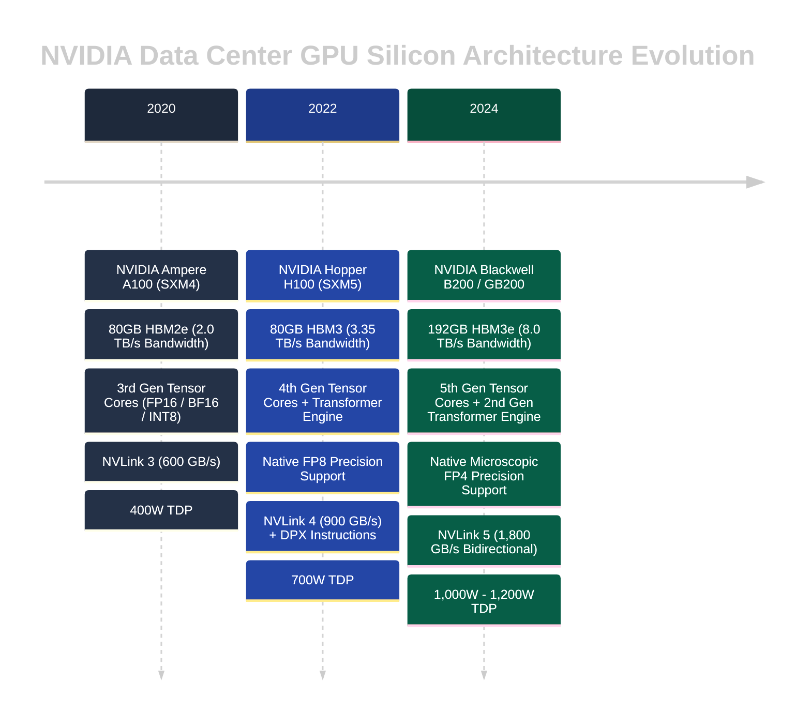

---

### 2.2 Tensor Cores, High Bandwidth Memory (HBM3e) & Arithmetic Intensity

To understand why LLMs run slowly or quickly on GPUs, one must analyze the physical distinction between **Compute Bound** and **Memory Bandwidth Bound** operations through the lens of the **Roofline Model**.

$$\text{Arithmetic Intensity} = \frac{\text{Floating Point Operations (FLOPs)}}{\text{Memory Access (Bytes)}}$$

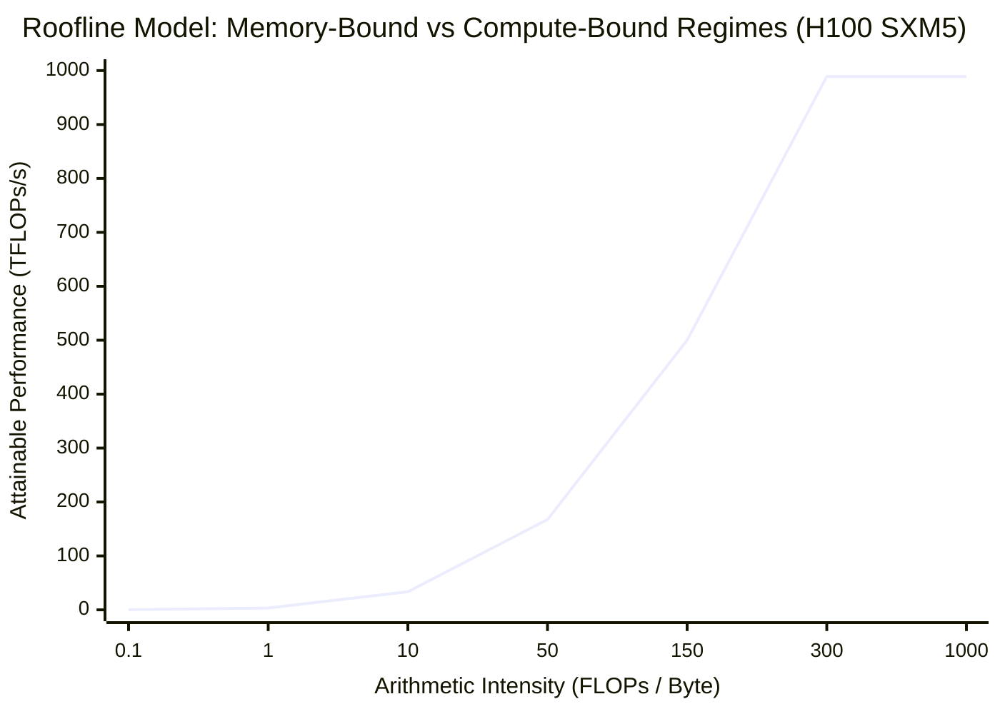

1. **The Prefill Phase is Compute-Bound (High Arithmetic Intensity):**
   When the user submits a 2,000-token prompt, the model processes all 2,000 tokens concurrently in a single massive matrix multiplication ($\text{GEMM}$: General Matrix Multiply). The weights are loaded into GPU registers once, and thousands of dot products are computed across the tokens. The arithmetic intensity is high ($\approx 150\text{ FLOPs/Byte}$), fully saturating the H100 Tensor Cores ($989\text{ TFLOPs}$ FP8).
2. **The Decode Phase is Memory-Bandwidth Bound (Low Arithmetic Intensity):**
   During token generation, the model produces exactly **one token at a time** per sequence ($\text{GEMV}$: General Matrix-Vector Multiply). To generate a single token for a 70-billion parameter model, the GPU must stream the **entire 70GB of weights from HBM3 memory through the GPU registers**, execute one multiply-accumulate operation per weight, and write the output.
   
   $$\text{Arithmetic Intensity (Decode, Batch=1)} = \frac{2 \times 70 \times 10^9\text{ FLOPs}}{70 \times 10^9\text{ Bytes}} = 2.0\text{ FLOPs/Byte}$$
   
   Because $2.0 \ll 150$, the Tensor Cores sit idle >95% of the time, waiting for memory to arrive from the HBM memory bus. Decode latency is strictly dictated by **Memory Bandwidth ($\text{TB/s}$)**, not TFLOPs.

---

### 2.3 Multi-GPU Interconnects: PCIe Gen5 vs. NVLink 4 vs. NVSwitch

When a model is too large to fit in a single GPU's VRAM (e.g., LLaMA-3.1-70B requires $\approx 140\text{GB}$ in FP16), its layers must be split across multiple GPUs. 

At every single Transformer layer, the GPUs must exchange intermediate activation tensors via an **All-Reduce** collective communication operation. The interconnect speed dictates whether distributed inference is viable:

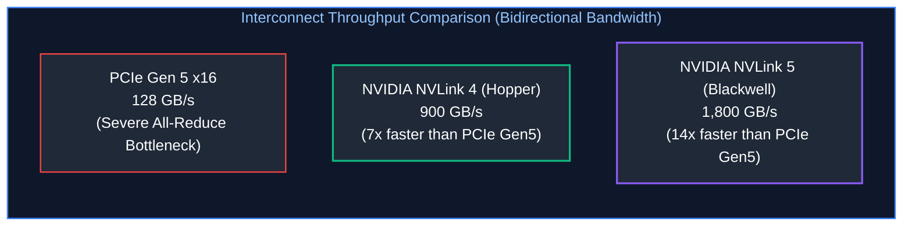

> [!CAUTION]
> **Never Run Tensor Parallelism over PCIe or Standard Ethernet:**
> Running Tensor Parallelism ($TP \ge 2$) across GPUs connected only via PCIe slots or across separate nodes over standard 10Gbps/100Gbps Ethernet will cause inference performance to collapse. The GPUs spend 80% of their time waiting for the All-Reduce communication barrier. Tensor Parallelism requires **NVLink within the node**; inter-node distributed scaling must use **Pipeline Parallelism** or dedicated $400\text{Gbps}$ InfiniBand / RoCE networking.

---

### 2.4 Total GPU VRAM Sizing Formula & Mathematical Derivation

Calculating the exact GPU memory required to host a model under production concurrency requires sizing four distinct memory components:

$$\text{Total VRAM Required} = \mathcal{M}_{\text{weights}} + \mathcal{M}_{\text{KV\_cache}} + \mathcal{M}_{\text{activations}} + \mathcal{M}_{\text{runtime}}$$

#### 1. Static Model Weights ($\mathcal{M}_{\text{weights}}$)
For a model with $P$ billion parameters stored in precision with $B_{\text{weight}}$ bytes per parameter:

$$\mathcal{M}_{\text{weights}} = P \times 10^9 \times B_{\text{weight}} \text{ bytes}$$

- **FP16 / BF16:** $B_{\text{weight}} = 2.0\text{ bytes}$ (e.g., 70B parameter model $\implies 140\text{ GB}$).
- **FP8:** $B_{\text{weight}} = 1.0\text{ byte}$ (70B model $\implies 70\text{ GB}$).
- **INT4 (AWQ / GPTQ):** $B_{\text{weight}} = 0.5\text{ bytes}$ (70B model $\implies 35\text{ GB}$).

#### 2. Dynamic Key-Value (KV) Cache ($\mathcal{M}_{\text{KV\_cache}}$)
For each token in the context window across all active concurrent streams, the Key and Value projection matrices must be stored in memory to prevent recomputing self-attention:

$$\mathcal{M}_{\text{KV\_token}} = 2 \times L \times N_{\text{kv\_heads}} \times d_{\text{head}} \times B_{\text{kv}} \text{ bytes/token}$$

Where:
- $2$: Two matrices (Key and Value).
- $L$: Number of Transformer layers.
- $N_{\text{kv\_heads}}$: Number of KV attention heads (equal to total heads in MHA; reduced by factor of 8 in Grouped-Query Attention GQA).
- $d_{\text{head}}$: Dimension per head ($d_{\text{model}} / N_{\text{heads}}$).
- $B_{\text{kv}}$: Bytes per KV element ($2.0$ for FP16, $1.0$ for FP8).

For $C$ concurrent user streams each with an average context length of $S$ tokens:

$$\mathcal{M}_{\text{KV\_cache}} = C \times S \times \mathcal{M}_{\text{KV\_token}}$$

#### 3. Intermediate Activations & Scratchpad ($\mathcal{M}_{\text{activations}}$)
Memory consumed during the forward pass by layer norms, intermediate MLP expansions, and softmax attention buffers. In continuous batching engines, this scales linearly with the maximum tokens in a single batch iteration (typically 2GB–6GB).

#### 4. CUDA Runtime & NCCL Context Overhead ($\mathcal{M}_{\text{runtime}}$)
CUDA driver context, cuBLAS workspaces, and NCCL inter-GPU communication ring buffers require a fixed allocation of $\approx 1.5\text{GB}$ to $3.0\text{GB}$ per GPU.

---

# 3. Serving Engine Mechanics: vLLM, SGLang & PagedAttention

### 3.1 The Memory Crisis of Naive Serving: Internal vs. External Memory Fragmentation

Before 2023, serving large language models using standard PyTorch (e.g., HuggingFace Transformers) was plagued by catastrophic memory waste. Because PyTorch requires contiguous memory tensors, serving systems had to pre-allocate contiguous KV cache buffers based on the **maximum possible context length** (e.g., 2,048 or 8,192 tokens).

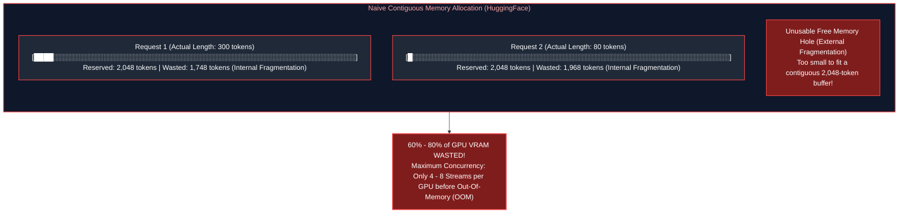

1. **Internal Fragmentation:** Memory reserved for the hypothetical future growth of a sequence that is never actually utilized because the model emits an early `<|endoftext|>` token.
2. **External Fragmentation:** Unusable gaps of free VRAM scattered between existing contiguous allocations. Even if 12GB of VRAM was physically free, a new request could not boot if that 12GB was split into small non-contiguous chunks.

---

### 3.2 PagedAttention Virtual Memory Architecture

Inspired by classic operating system virtual memory paging (OS page tables translation), **PagedAttention** (Kwon et al., UC Berkeley / vLLM) solves the memory crisis by breaking the continuous KV cache of a sequence into fixed-size **Physical Blocks** (typically 16 or 32 tokens per block).

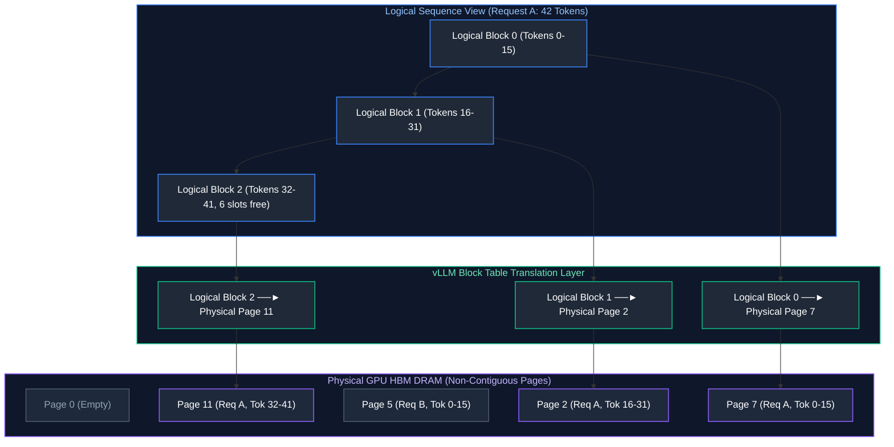

#### Operational Advantages of PagedAttention
- **Near-Zero Waste (<4%):** Memory is allocated dynamically one block (16 tokens) at a time. The only waste occurs in the final unfulfilled slots of the active terminal block.
- **Dynamic Memory Sharing (Parallel Sampling / Beam Search):** Multiple generation branches spawned from the same prompt share the identical physical prompt KV blocks via copy-on-write pointers, eliminating redundant VRAM consumption.
- **$3\times - 5\times$ Concurrency Multiplier:** By eliminating fragmentation, the exact same GPU hardware can sustain $3\times$ to $5\times$ more concurrent user streams.

---

### 3.3 Radix Tree Prefix Caching Mechanics

In enterprise applications, hundreds of different user requests share identical system instructions, few-shot examples, or document context (e.g., in enterprise RAG or multi-tenant agents).

Modern serving engines (vLLM and SGLang) implement **Automatic Prefix Caching (APC)** using a **Radix Tree** data structure:

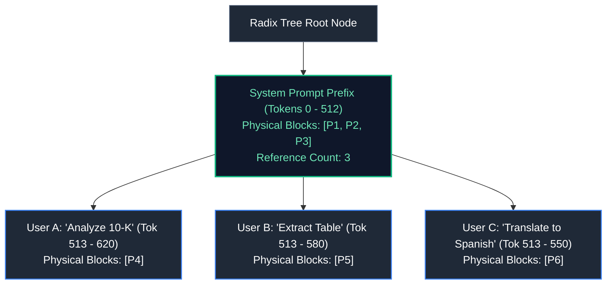

When User B arrives with the identical system prompt prefix, the engine traverses the Radix Tree, recognizes the exact token sequence match, and **reuses the already computed KV blocks in GPU VRAM**. The prefill computation is completely skipped:
- Prefill Latency drops from $1,200\text{ms} \to 12\text{ms}$.
- TTFT collapses to near zero.
- GPU compute is preserved exclusively for decoding.

---

# 4. Continuous Batching, Chunked Prefill & Speculative Decoding

### 4.1 Static Batching Inefficiencies: Padding Waste & Head-of-Line Blocking

In classical deep learning (e.g., ResNet image classification), **Static Request-Level Batching** is standard: wait for $N$ requests to arrive, pack them into a tensor batch of shape $[N, \text{channels}, H, W]$, run the forward pass, and return results.

In autoregressive generation, static batching creates severe inefficiencies:

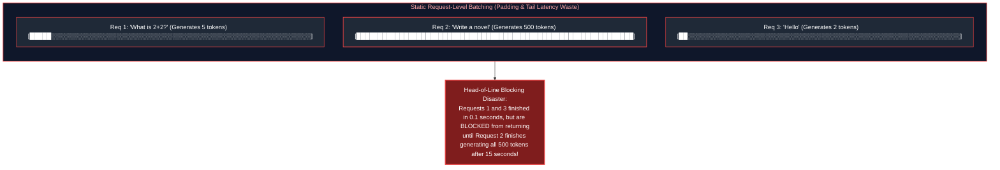

---

### 4.2 Continuous (In-Flight / Iteration-Level) Batching

First introduced by **Orca** (Yu et al., OSDI 2022) and popularized by vLLM and TensorRT-LLM, **Continuous Batching** operates at the **iteration level** rather than the request level.

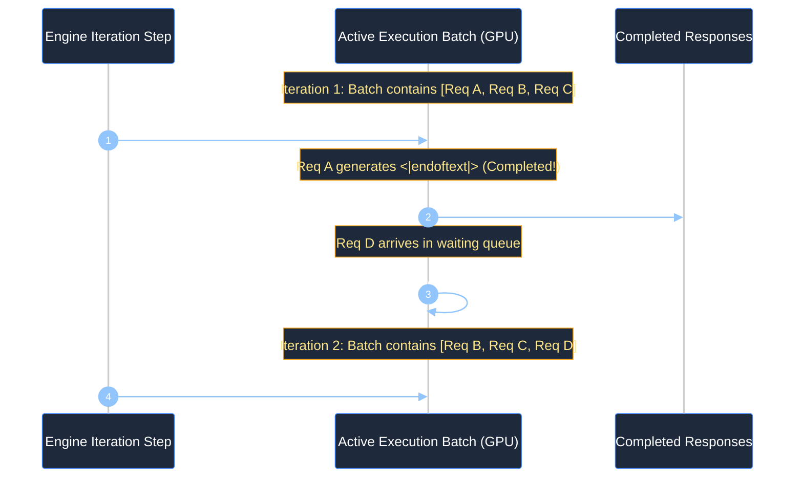

- When a request finishes generating, its slot is freed immediately, and its final response is returned to the user without waiting for other requests.
- Newly arrived requests are dynamically injected into the active batch on the very next decoding step.
- Hardware utilization jumps from $\approx 20\% \to >85\%$.

---

### 4.3 Prefill vs. Decode Disparity & Chunked Prefill Scheduling

A major operational challenge in continuous batching is the **Interference of Prefill with Decode**:
- **Decode Phase:** Fast, memory-bandwidth bound, requires $\approx 20\text{ms}$ per token.
- **Prefill Phase:** Massive compute burst, takes $500\text{ms} - 3,000\text{ms}$ for a long prompt.

If an engine schedules a massive 16,000-token prefill into an active continuous batch, all ongoing decode streams experience a **3-second latency freeze** (Inter-Token Latency ITL spike), causing visible stutter in user-facing streaming text.

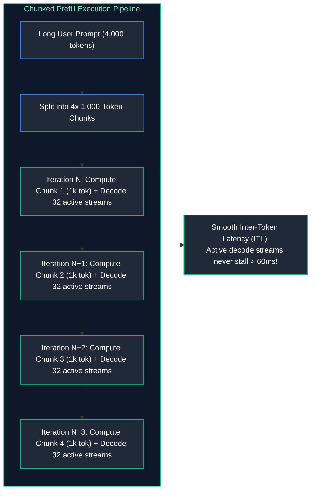

Under **Chunked Prefill**, large prompts are sliced into fixed token chunks (e.g., 512 or 1,024 tokens). The engine interleaves one prefill chunk alongside the ongoing decode tokens in each iteration. High GPU compute utilization is maintained while keeping Inter-Token Latency ($ITL$) strictly under interactive human perception thresholds ($<60\text{ms}$).

---

### 4.4 Speculative Decoding: Draft Models & Target Verification

As established in Section 2.2, decoding is memory-bandwidth bound. Running an 80B model to generate 1 token takes nearly the same time as running it to process 5 tokens concurrently.

**Speculative Decoding** leverages this mathematical reality to accelerate inference by $2\times - 3\times$ without altering output distribution quality:

```mermaid
%%{init: {'theme': 'dark', 'themeVariables': { 'actorBkg': '#1e293b', 'actorBorder': '#3b82f6', 'actorTextColor': '#ffffff', 'signalColor': '#93c5fd', 'signalTextColor': '#ffffff', 'noteBkgColor': '#1e293b', 'noteBorderColor': '#f59e0b', 'noteTextColor': '#fde68a', 'activationBkgColor': '#3b82f6', 'sequenceNumberColor': '#ffffff' }}}%%
sequenceDiagram
    autonumber
    participant Draft as Fast Draft Model (LLaMA-3-1B)
    participant Target as Large Target Model (LLaMA-3-70B)
    participant Client as Streaming Output

    Note over Draft: 1. Draft model autoregressively speculates K=4 tokens quickly
    Draft->>Draft: Emits: [ "The", " capital", " of", " France" ]
    
    Note over Target: 2. Target model evaluates all 4 tokens in a SINGLE forward pass (GEMM)
    Draft->>Target: Validate speculative sequence in parallel
    Target->>Target: Logit verification check (Accept/Reject sample)
    
    alt Tokens 1, 2, 3 Accepted; Token 4 Rejected
        Target-->>Client: Accept: [ "The", " capital", " of" ]
        Target-->>Client: Replace Token 4 with Target Correction: [ " Burgundy" ]
        Note over Target: Result: 4 tokens generated in the time of 1 Target step!
    end
```

#### Acceptance Criteria Mathematics
The draft token $x$ is accepted with probability:

$$\alpha = \min\left(1, \frac{P_{\text{target}}(x)}{P_{\text{draft}}(x)}\right)$$

If the draft model's proposal is rejected, the target model samples a replacement token directly from the adjusted normalized residual distribution:

$$P'(x) = \max\left(0, P_{\text{target}}(x) - P_{\text{draft}}(x)\right)$$

This mathematical formulation rigorously guarantees that the final output token distribution is **provably identical** to sampling directly from the large target model alone.

---

# 5. Distributed Inference: Tensor Parallelism vs. Pipeline Parallelism

### 5.1 Megatron-LM Tensor Parallelism (TP) via All-Reduce

When an individual linear layer within a Transformer block is partitioned across multiple GPUs, we employ **Tensor Parallelism (TP)** (Shoeybi et al., Megatron-LM).

A Transformer Multi-Head Attention block consists of two primary matrix multiplications:
1. Column-Parallel Linear Projection ($W_Q, W_K, W_V$)
2. Row-Parallel Linear Projection ($W_O$)

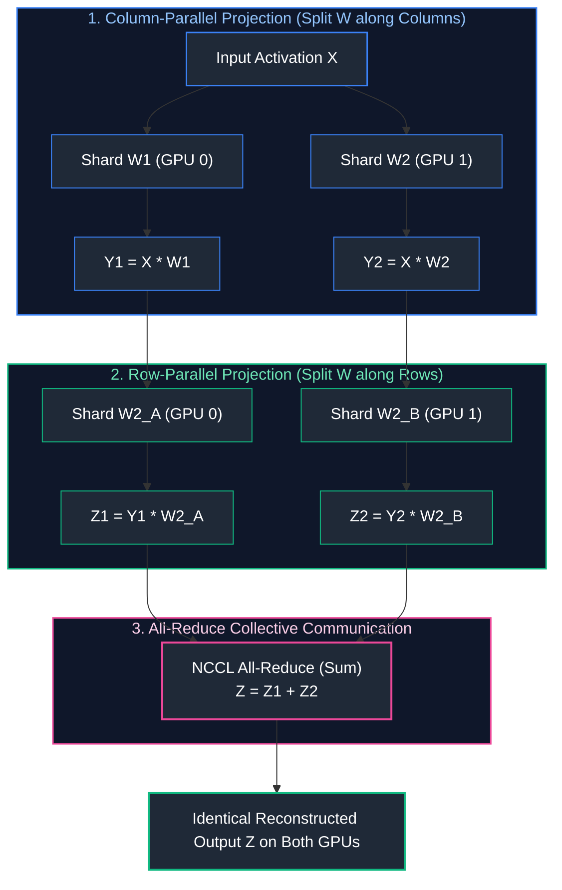

By pairing a Column-Parallel layer with a Row-Parallel layer, the system requires **only a single All-Reduce operation** at the end of the Attention block and a second All-Reduce at the end of the MLP block. Communication is minimized to exactly $2 \times \text{All-Reduce}$ operations per Transformer layer.

---

### 5.2 Pipeline Parallelism (PP) & Inter-Node Bubble Overhead

When models exceed the capacity of a single 8-GPU node (e.g., LLaMA-3.1-405B requires $\approx 810\text{GB}$ in FP16), the model's layers must be partitioned sequentially across separate physical server nodes. This is **Pipeline Parallelism (PP)**.

```mermaid
%%{init: {'theme': 'dark', 'themeVariables': { 'primaryColor': '#3b82f6', 'primaryTextColor': '#ffffff', 'primaryBorderColor': '#3b82f6', 'lineColor': '#64748b', 'secondaryColor': '#10b981', 'tertiaryColor': '#1e293b' }}}%%
gantt
    title Pipeline Parallelism 1F1B Schedule (PP=4 Stages, Bubble Overhead)
    dateFormat X
    axisFormat Step %s

    section Node 0 (Layers 1-20)
    F1 :active, 0, 1
    F2 :active, 1, 2
    F3 :active, 2, 3
    F4 :active, 3, 4
    B1 :crit, 6, 7
    B2 :crit, 7, 8

    section Node 1 (Layers 21-40)
    Bubble :done, 0, 1
    F1 :active, 1, 2
    F2 :active, 2, 3
    F3 :active, 3, 4
    B1 :crit, 5, 6

    section Node 2 (Layers 41-60)
    Bubble :done, 0, 2
    F1 :active, 2, 3
    F2 :active, 3, 4
    B1 :crit, 4, 5

    section Node 3 (Layers 61-80)
    Bubble :done, 0, 3
    F1 :active, 3, 4
    B1 :crit, 4, 5
```

#### The Pipeline Bubble Problem
Because Node 1 must wait for Node 0 to process its layers before receiving activations, downstream nodes remain completely idle during initial steps. This idle GPU time is the **Pipeline Bubble Fraction**:

$$F_{\text{bubble}} = \frac{PP - 1}{M + PP - 1}$$

Where $PP$ is the pipeline depth and $M$ is the number of micro-batches. To make pipeline parallelism efficient, serving engines must maintain a high number of concurrent micro-batches ($M \gg PP$).

---

### 5.3 Communication Topologies: Intra-Node NVLink vs. Inter-Node InfiniBand / RoCE

| Parallelism Dimension | Interconnect Requirement | Bandwidth Required | Network Protocol | Typical Boundary |
| :--- | :--- | :--- | :--- | :--- |
| **Tensor Parallelism (TP)** | NVIDIA NVLink 4 / NVSwitch | $900\text{ GB/s}$ bidirectional | NCCL Shared Memory / P2P | Strictly **Intra-Node** (Within single 8x GPU chassis) |
| **Pipeline Parallelism (PP)** | NVIDIA Quantum-2 InfiniBand | $400\text{ Gbps} - 800\text{ Gbps}$ | NCCL RDMA / RoCE v2 | **Inter-Node** (Across separate rack servers) |
| **Data Parallelism (DP)** | Standard Data Center Network | $100\text{ Gbps} - 400\text{ Gbps}$ | TCP/IP or RoCE | Across independent cluster replicas |

---

# 6. Model Quantization Mechanics: FP8, AWQ, GPTQ & GGUF

### 6.1 The Mathematical Mechanics of Quantization

Quantization compresses high-precision floating-point weights (FP16, 16 bits) into compact lower-bit representations (INT4 or FP8), reducing GPU memory footprints by $50\% - 75\%$ and increasing memory-bandwidth-bound decode speeds.

#### Linear Affine Quantization (Uniform Symmetric INT8/INT4)
For a weight tensor $W \in \mathbb{R}$, uniform symmetric quantization projects continuous values into signed integer buckets:

$$q = \text{clamp}\left(\left\lfloor \frac{W}{S} \right\rceil, -2^{b-1}, 2^{b-1}-1\right)$$

Where $b$ is the target bit-width (e.g., $b=4$ for INT4, range $[-8, 7]$) and $S$ is the floating-point **Scale Factor**:

$$S = \frac{\max(|W|)}{2^{b-1} - 1}$$

To perform computation during dequantization:

$$\hat{W} = q \times S$$

---

### 6.2 FP8 Formats: E4M3 vs. E5M2 and Hopper Acceleration

NVIDIA Hopper (H100) and Blackwell (B200) architectures introduced native hardware instructions for **8-bit Floating Point (FP8)**, providing two distinct standard formats defined by IEEE / OCP:

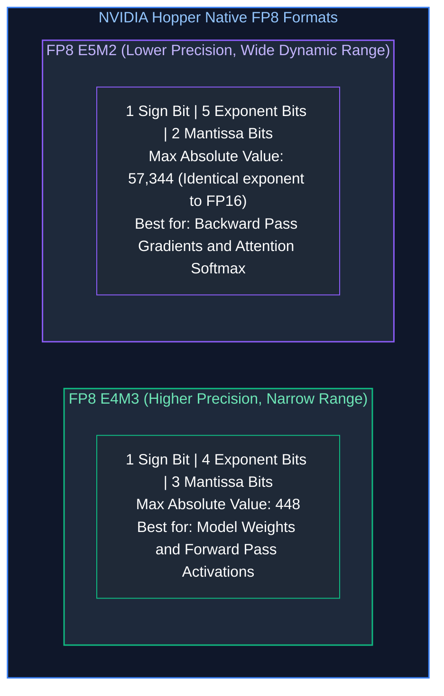

On NVIDIA H100 GPUs, **FP8 Tensor Cores yield $2\times$ the raw compute throughput ($989\text{ TFLOPs}$)** compared to FP16 ($494\text{ TFLOPs}$), while cutting static model weight VRAM strictly in half with virtually zero degradation in MMLU benchmark accuracy.

---

### 6.3 Weight-Only vs. Weight-and-Activation Quantization (AWQ vs. GPTQ)

When quantizing down to 4 bits (INT4), naive round-to-nearest methods severely degrade model reasoning capabilities due to the presence of **Salient Outlier Activations** (a small fraction of feature dimensions that exhibit activations $100\times$ larger than average).

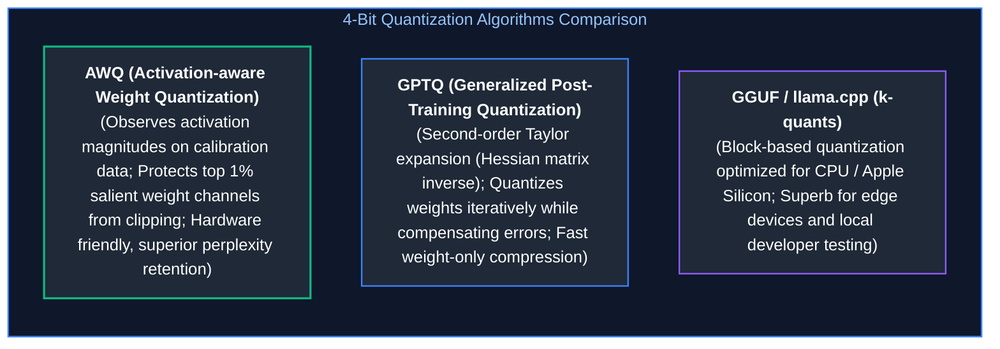

- **Weight-Only Quantization (W4A16 / W8A16):** Only the static model weights are stored in INT4/INT8. During inference, weights are dynamically dequantized back to FP16 inside GPU registers before the dot product. This eliminates memory bandwidth bottlenecks during decoding while using standard FP16 Tensor Cores.
- **Weight-and-Activation Quantization (W8A8 / FP8):** Both weights and intermediate activations are quantized. Matrix multiplication is executed natively in 8-bit arithmetic on FP8 Tensor Cores, accelerating both the compute-bound prefill phase and memory-bound decode phase.

---

### 6.4 Quantization Quality, Latency & VRAM Trade-Off Matrix

| Quantization Scheme | Bits (W / A) | LLaMA-3-70B VRAM | Accuracy Loss (MMLU) | Serving Engine Support | Ideal Production Use Case |
| :--- | :--- | :--- | :--- | :--- | :--- |
| **Unquantized (BF16)** | 16 / 16 | $142\text{ GB}$ | $0.0\%$ (Baseline) | All Engines | Maximum reasoning accuracy; zero tolerance for drift |
| **Native FP8 (OCP)** | 8 / 8 | $72\text{ GB}$ | $<0.2\%$ | vLLM, TensorRT-LLM | **Gold Standard for NVIDIA H100 / B200 Enterprise Nodes** |
| **AWQ (INT4)** | 4 / 16 | $38\text{ GB}$ | $<1.0\%$ | vLLM, SGLang, TGI | High-throughput serving on consumer or Ampere (A100) GPUs |
| **GPTQ (INT4)** | 4 / 16 | $38\text{ GB}$ | $\approx 1.2\%$ | vLLM, AutoGPTQ | Legacy 4-bit deployments |
| **GGUF (Q4_K_M)** | 4 / 16 | $40\text{ GB}$ | $\approx 1.5\%$ | llama.cpp, Ollama | Local edge devices, MacBook Apple Silicon, CPU fallback |

---

# 7. Kubernetes Orchestration & GPU Autoscaling

### 7.1 Kubernetes Pod Configuration with NVIDIA GPU Operator

Deploying high-throughput serving engines like vLLM in Kubernetes (EKS / GKE) requires precise container resource configurations:

```yaml
apiVersion: apps/v1
kind: Deployment
metadata:
  name: vllm-llama-70b
  namespace: ai-serving
spec:
  replicas: 2
  selector:
    matchLabels:
      app: vllm-llama-70b
  template:
    metadata:
      labels:
        app: vllm-llama-70b
    spec:
      containers:
        - name: server
          image: vllm/vllm-openai:v0.6.3
          args:
            - "--model"
            - "meta-llama/Meta-Llama-3.1-70B-Instruct"
            - "--tensor-parallel-size"
            - "8"
            - "--gpu-memory-utilization"
            - "0.92"
            - "--max-model-len"
            - "8192"
            - "--enable-chunked-prefill"
            - "--enable-prefix-caching"
          resources:
            limits:
              nvidia.com/gpu: 8   # Requests all 8 H100 GPUs on node
              memory: 500Gi
              cpu: "64"
            requests:
              nvidia.com/gpu: 8
              memory: 500Gi
              cpu: "64"
          volumeMounts:
            - mountPath: /dev/shm
              name: dshm
      volumes:
        # CRITICAL: NCCL inter-GPU communication requires massive shared memory!
        - name: dshm
          emptyDir:
            medium: Memory
            sizeLimit: 64Gi
```

> [!IMPORTANT]
> **The `/dev/shm` Shared Memory Invariant:**
> Multi-GPU Tensor Parallelism relies on NCCL, which exchanges activation tensors via Linux shared memory (`/dev/shm`). If Kubernetes pods do not explicitly mount a large `emptyDir` backed by RAM for `/dev/shm`, NCCL crashes silently with `CUDA error: out of memory` or causes erratic node-level kernel panics.

---

### 7.2 Custom Metric Autoscaling with KEDA

Traditional Kubernetes Horizontal Pod Autoscalers (HPA) scale pods based on **CPU or GPU Utilization (`container_gpu_utilization`)**. In LLM serving, GPU utilization is a **fatally misleading metric**:
- A GPU running a single request with continuous batching may report 99% GPU utilization while having 70GB of free KV cache capacity.
- Conversely, a GPU whose KV cache is 100% saturated might drop throughput drastically while queuing dozens of incoming requests.

Production autoscaling must scale using **Kubernetes Event-driven Autoscaling (KEDA)** targeting two specific vLLM Prometheus metrics:
1. `vllm:num_requests_waiting`: The number of requests stuck in the pending queue awaiting KV cache allocation.
2. `vllm:gpu_cache_usage_factor`: The fraction of physical PagedAttention KV blocks currently allocated ($0.0 - 1.0$).

```yaml
apiVersion: keda.sh/v1alpha1
kind: ScaledObject
metadata:
  name: vllm-autoscaler
  namespace: ai-serving
spec:
  scaleTargetRef:
    name: vllm-llama-70b
  minReplicaCount: 2
  maxReplicaCount: 10
  cooldownPeriod: 300
  triggers:
    - type: prometheus
      metadata:
        serverAddress: http://prometheus-server.monitoring.svc.cluster.local:9090
        metricName: vllm_gpu_cache_usage_factor
        query: max(vllm:gpu_cache_usage_factor{app="vllm-llama-70b"})
        threshold: "0.85"  # Scale out when KV cache hits 85% capacity
```

---

### 7.3 Multi-Instance GPU (MIG) vs. Time-Slicing for Workload Partitioning

For smaller models (e.g., 7B parameters, embedding models, or rerankers), dedicating an entire \$35,000 H100 80GB GPU to a single replica is financially wasteful.

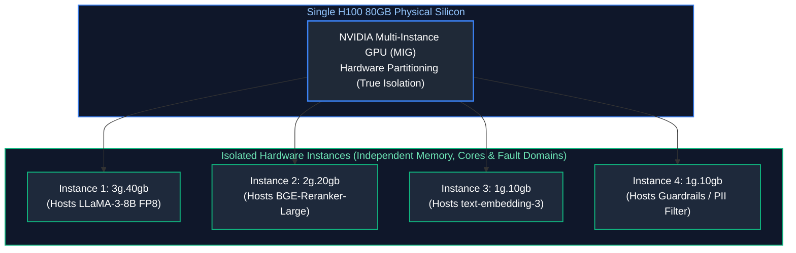

- **MIG (Multi-Instance GPU):** Physically partitions the GPU silicon into up to 7 independent hardware slices. Each instance possesses dedicated memory controllers, crossbar paths, and SM compute cores. If one container triggers a CUDA kernel panic, other MIG slices continue running unaffected.
- **Time-Slicing (vGPU):** Interleaves workloads across the entire GPU temporally. Offers zero memory isolation; if one container runs out of memory, it triggers an OOM crash across all shared tenants.

---

# 8. Production Implementation: Enterprise Capacity Planning & Sizing Engine

### 8.1 Systems Architecture of the Planner

The capacity planning tool below implements the rigorous mathematical equations detailed in Section 2.4 and Section 3.2. It computes:
- Static model weight footprint across arbitrary bit precisions (FP16, FP8, INT4).
- PagedAttention block table sizing and memory allocation.
- Maximum concurrent streaming users supported before KV cache saturation.
- Memory-bandwidth bound peak token throughput ($TPS$) based on GPU hardware specifications.

---

### 8.2 Complete Production-Grade Python Implementation

```python
"""
Enterprise AI Infrastructure Capacity Planner & Hardware Sizing Engine
Computes static VRAM footprints, PagedAttention KV cache allocations,
maximum concurrent streams, and memory-bandwidth bound decode throughput.
"""

import math
from dataclasses import dataclass
from typing import Dict, Any, List

@dataclass(frozen=True)
class GPUHardwareProfile:
    name: str
    gpu_architecture: str
    vram_per_gpu_gb: float
    memory_bandwidth_tb_s: float
    fp8_tensor_tflops: float
    nvlink_bandwidth_gb_s: float

@dataclass(frozen=True)
class ModelArchitectureProfile:
    name: str
    parameter_count_billions: float
    num_layers: int
    num_attention_heads: int
    num_kv_heads: int  # Reflects GQA (Grouped-Query Attention)
    hidden_dimension: int
    vocab_size: int

    @property
    def head_dim(self) -> int:
        return self.hidden_dimension // self.num_attention_heads

# ==============================================================================

# 9. Canonical Reference Hardware Specs

# ==============================================================================

NVIDIA_A100_80GB_SXM4 = GPUHardwareProfile(
    name="NVIDIA A100 SXM4",
    gpu_architecture="Ampere",
    vram_per_gpu_gb=80.0,
    memory_bandwidth_tb_s=2.039,
    fp8_tensor_tflops=0.0,  # Native FP8 not supported on Ampere
    nvlink_bandwidth_gb_s=600.0
)

NVIDIA_H100_80GB_SXM5 = GPUHardwareProfile(
    name="NVIDIA H100 SXM5",
    gpu_architecture="Hopper",
    vram_per_gpu_gb=80.0,
    memory_bandwidth_tb_s=3.35,
    fp8_tensor_tflops=989.0,
    nvlink_bandwidth_gb_s=900.0
)

NVIDIA_B200_192GB = GPUHardwareProfile(
    name="NVIDIA Blackwell B200",
    gpu_architecture="Blackwell",
    vram_per_gpu_gb=192.0,
    memory_bandwidth_tb_s=8.0,
    fp8_tensor_tflops=2250.0,
    nvlink_bandwidth_gb_s=1800.0
)

# ==============================================================================

# 10. Canonical Model Architecture Profiles

# ==============================================================================

LLAMA_3_1_8B = ModelArchitectureProfile(
    name="Meta-LLaMA-3.1-8B",
    parameter_count_billions=8.03,
    num_layers=32,
    num_attention_heads=32,
    num_kv_heads=8,      # GQA factor of 4:1
    hidden_dimension=4096,
    vocab_size=128256
)

LLAMA_3_1_70B = ModelArchitectureProfile(
    name="Meta-LLaMA-3.1-70B",
    parameter_count_billions=70.6,
    num_layers=80,
    num_attention_heads=64,
    num_kv_heads=8,      # GQA factor of 8:1
    hidden_dimension=8192,
    vocab_size=128256
)

DEEPSEEK_V3_MOE_671B = ModelArchitectureProfile(
    name="DeepSeek-V3-671B-MoE (37B Active)",
    parameter_count_billions=671.0,
    num_layers=61,
    num_attention_heads=128,
    num_kv_heads=128,
    hidden_dimension=7168,
    vocab_size=129280
)

# ==============================================================================

# 11. Capacity Planning Engine

# ==============================================================================

class EnterpriseCapacityPlanner:
    """Rigorous capacity and throughput planning engine for vLLM clusters."""

    def __init__(
        self,
        hardware: GPUHardwareProfile,
        gpu_count: int,
        model: ModelArchitectureProfile,
        weight_precision_bytes: float = 1.0,  # 2.0 = FP16, 1.0 = FP8, 0.5 = INT4
        kv_precision_bytes: float = 1.0,      # 2.0 = FP16, 1.0 = FP8
        paged_attention_block_size: int = 16,
        gpu_memory_utilization: float = 0.90
    ):
        self.hw = hardware
        self.gpu_count = gpu_count
        self.model = model
        self.weight_precision = weight_precision_bytes
        self.kv_precision = kv_precision_bytes
        self.block_size = paged_attention_block_size
        self.gpu_utilization = gpu_memory_utilization

    def compute_plan(self, target_context_tokens: int = 4096) -> Dict[str, Any]:
        total_cluster_vram_gb = self.gpu_count * self.hw.vram_per_gpu_gb
        effective_usable_vram_gb = total_cluster_vram_gb * self.gpu_utilization

# 12. Model Static Weights VRAM

raw_weights_gb = (self.model.parameter_count_billions * 1e9 * self.weight_precision) / (1024 ** 3)
        # Add 12% overhead for CUDA context, NCCL buffers, and peak activation tensors
        static_overhead_gb = raw_weights_gb * 1.12

        if static_overhead_gb >= effective_usable_vram_gb:
            return {
                "feasible": False,
                "error": f"Model static footprint ({static_overhead_gb:.1f} GB) exceeds total cluster capacity ({effective_usable_vram_gb:.1f} GB)"
            }

# 13. Remaining VRAM allocated to PagedAttention KV Cache

available_kv_vram_gb = effective_usable_vram_gb - static_overhead_gb

# 14. KV Cache Footprint per Token (PagedAttention Block Calculation)

# Formula: 2 * num_layers * num_kv_heads * head_dim * bytes_per_elem
        bytes_per_token = (
            2 * self.model.num_layers * self.model.num_kv_heads * 
            self.model.head_dim * self.kv_precision
        )
        kv_cache_gb_per_stream = (bytes_per_token * target_context_tokens) / (1024 ** 3)

# 15. Maximum Concurrent Continuous Streams

max_concurrent_streams = int(available_kv_vram_gb / kv_cache_gb_per_stream)

# 16. PagedAttention Physical Block Allocation

bytes_per_block = bytes_per_token * self.block_size
        total_physical_blocks = int((available_kv_vram_gb * (1024 ** 3)) / bytes_per_block)

# 17. Theoretical Peak Decode Throughput (Memory-Bandwidth Bound)

# Peak Tokens/Sec ≈ Aggregate Memory Bandwidth / Model Weight Footprint per token
        aggregate_bandwidth_tb_s = self.gpu_count * self.hw.memory_bandwidth_tb_s
        peak_decode_tps = (aggregate_bandwidth_tb_s * 1e12) / (raw_weights_gb * (1024 ** 3))

        return {
            "feasible": True,
            "cluster_summary": {
                "hardware": f"{self.gpu_count}x {self.hw.name}",
                "total_vram_gb": total_cluster_vram_gb,
                "effective_vram_gb": round(effective_usable_vram_gb, 2),
                "interconnect": f"NVLink ({self.hw.nvlink_bandwidth_gb_s} GB/s)"
            },
            "model_summary": {
                "model_name": self.model.name,
                "parameters_b": self.model.parameter_count_billions,
                "precision": "FP8" if self.weight_precision == 1.0 else ("INT4" if self.weight_precision == 0.5 else "FP16"),
                "static_weight_vram_gb": round(raw_weights_gb, 2),
                "total_static_with_runtime_gb": round(static_overhead_gb, 2)
            },
            "paged_attention_kv_cache": {
                "available_kv_vram_gb": round(available_kv_vram_gb, 2),
                "kv_bytes_per_token": bytes_per_token,
                "kv_gb_per_stream": round(kv_cache_gb_per_stream, 3),
                "total_physical_blocks_allocated": total_physical_blocks,
                "block_size_tokens": self.block_size,
                "max_concurrent_continuous_streams": max_concurrent_streams
            },
            "performance_limits": {
                "aggregate_memory_bandwidth_tb_s": round(aggregate_bandwidth_tb_s, 2),
                "theoretical_peak_decode_tokens_per_sec": int(peak_decode_tps)
            }
        }

# ==============================================================================

# 18. Operational Sizing Benchmark Run

# ==============================================================================

def execute_enterprise_benchmark():
    print("=" * 85)
    print("ENTERPRISE AI INFRASTRUCTURE & VLLM CAPACITY REPORT")
    print("=" * 85)

    # Scenario: Sizing an 8x H100 node serving LLaMA-3.1-70B under native FP8
    planner = EnterpriseCapacityPlanner(
        hardware=NVIDIA_H100_80GB_SXM5,
        gpu_count=8,
        model=LLAMA_3_1_70B,
        weight_precision_bytes=1.0,  # Native FP8
        kv_precision_bytes=1.0,      # FP8 KV Cache
        gpu_memory_utilization=0.92
    )

    plan = planner.compute_plan(target_context_tokens=8192)

    if not plan["feasible"]:
        print(f"FAILED: {plan['error']}")
        return

    c = plan["cluster_summary"]
    m = plan["model_summary"]
    k = plan["paged_attention_kv_cache"]
    p = plan["performance_limits"]

    print(f"Compute Hardware:       {c['hardware']} ({c['total_vram_gb']} GB Total HBM3)")
    print(f"Interconnect Bus:       {c['interconnect']}")
    print(f"Deployed Model:         {m['model_name']} ({m['precision']} Weights)")
    print(f"Static Model Footprint: {m['static_weight_vram_gb']} GB (Runtime Total: {m['total_static_with_runtime_gb']} GB)")
    print("-" * 85)
    print(f"PagedAttention KV Pool: {k['available_kv_vram_gb']} GB dedicated to KV caching")
    print(f"KV Footprint / Stream:  {k['kv_gb_per_stream']} GB (Context: 8,192 tokens)")
    print(f"Physical Paged Blocks:  {k['total_physical_blocks_allocated']} blocks ({k['block_size_tokens']} tok/blk)")
    print(f"Max Concurrent Streams: {k['max_concurrent_continuous_streams']} simultaneous users")
    print("-" * 85)
    print(f"Aggregate Bandwidth:    {p['aggregate_memory_bandwidth_tb_s']} TB/s across cluster")
    print(f"Peak Decode Throughput: {p['theoretical_peak_decode_tokens_per_sec']} tokens/sec")
    print("=" * 85)

if __name__ == "__main__":
    execute_enterprise_benchmark()
```

---

### 18.3 Operational Sizing Playbook & Benchmark Validation

When executing capacity planning in production:
1. **Never Size for Average Context Length:** Sizing clusters based on average context ($1,500\text{ tokens}$) will cause catastrophic Out-of-Memory ($OOM$) evictions when users submit $16\text{k}$ documents. Size KV pools for the **$p90$ context length**.
2. **Standardize on GQA (Grouped-Query Attention):** Notice in the benchmark that LLaMA-3.1-70B has 64 attention heads but only 8 KV heads. This $8:1$ GQA ratio cuts KV cache memory consumption by **$87.5\%$**, enabling a single 8x H100 node to support hundreds of concurrent streams where older MHA models (like LLaMA-1) could only support dozens.
3. **Always Run FP8 on Hopper:** Moving from FP16 to FP8 cuts model weight VRAM from $140\text{GB} \to 70\text{GB}$, releasing $70\text{GB}$ of ultra-fast HBM3 memory directly into the PagedAttention KV pool.

---

# 19. Summary Comparison & Production Engineering Reference Matrix

### 9.1 High-Performance Inference Serving Engines

| Feature / Metric | vLLM (v0.6+) | TensorRT-LLM | SGLang | Modular MAX / Mojo |
| :--- | :--- | :--- | :--- | :--- |
| **Primary Maintainer** | UC Berkeley / Red Hat | NVIDIA | LMSYS / UC Berkeley | Modular |
| **KV Cache Manager** | PagedAttention (Virtual blocks) | In-Flight Paged Memory | RadixAttention (Optimized APC) | Unified Extensible Engine |
| **Prefix Caching Engine** | Automatic Prefix Caching (APC) | Lookahead Prefix Match | Radix Tree Cache (High hit rate) | Custom memory graph |
| **Continuous Batching** | Iteration-Level Orca Batching | In-Flight Iteration Batching | Iteration-Level Batching | Custom Graph Batching |
| **Quantization Support** | FP8, AWQ, GPTQ, BitsAndBytes | FP8, INT4 SmoothQuant, FP4 | FP8, AWQ, GPTQ | FP8, BF16 |
| **Setup & Engineering Effort** | **Low (Pip install, Python native)** | **High (C++ / TensorRT build)** | **Low (Python native)** | Medium |
| **Best Production Fit** | Enterprise open-weight Kubernetes | Extreme scale, single-model clusters | Complex multi-turn Agent pipelines | Heterogeneous cloud / CPU nodes |

---

### 9.2 Quantization & Memory Compression Reference

| Format | Bit Width | VRAM Compression Ratio | Hardware Requirement | MMLU Degradation | Primary Engine |
| :--- | :--- | :--- | :--- | :--- | :--- |
| **BF16 / FP16** | 16-bit | $1.0\times$ (Baseline) | Standard GPUs (V100, A100) | $0.0\%$ | PyTorch, vLLM |
| **FP8 (E4M3)** | 8-bit | $2.0\times$ Reduction | NVIDIA Hopper H100 / Ada Lovelace | $<0.2\%$ | vLLM, TensorRT-LLM |
| **AWQ** | 4-bit (Weights) | $3.7\times$ Reduction | Any modern CUDA GPU | $<1.0\%$ | vLLM, SGLang |
| **GPTQ** | 4-bit (Weights) | $3.7\times$ Reduction | Any modern CUDA GPU | $\approx 1.2\%$ | AutoGPTQ, vLLM |
| **GGUF (Q4_K)** | 4-bit (Block) | $3.5\times$ Reduction | Apple Silicon / CPU / Metal | $\approx 1.5\%$ | llama.cpp, Ollama |

---

# 20. References & Further Reading

1. **PagedAttention & vLLM: Efficient Memory Management for Large Language Model Serving:** Kwon, W., et al. (2023). *SOSP 2023.* [arXiv:2309.06180](https://arxiv.org/abs/2309.06180).
2. **Orca: A Distributed Serving System for Transformer-Based Generative Models:** Yu, G. I., et al. (2022). *OSDI 2022.*
3. **SGLang: Fast Serving Program for Large Language Models and Vision-Language Models:** Zheng, L., et al. (2024). *LMSYS Org.* [arXiv:2312.07104](https://arxiv.org/abs/2312.07104).
4. **AWQ: Activation-aware Weight Quantization for On-Device LLM Compression:** Lin, J., et al. (2023). *MLSys 2024.* [arXiv:2306.00978](https://arxiv.org/abs/2306.00978).
5. **Megatron-LM: Training Multi-Billion Parameter Language Models Using Model Parallelism:** Shoeybi, M., et al. (2019). *NVIDIA Applied Deep Learning Research.* [arXiv:1909.08053](https://arxiv.org/abs/1909.08053).
6. **Fast Inference from Transformers via Speculative Decoding:** Leviathan, Y., Kalman, M., & Matias, Y. (2023). *ICML 2023.* [arXiv:2211.17192](https://arxiv.org/abs/2211.17192).
7. **NVIDIA Hopper Architecture In-Depth:** NVIDIA Corporation (2023). Technical Whitepaper.