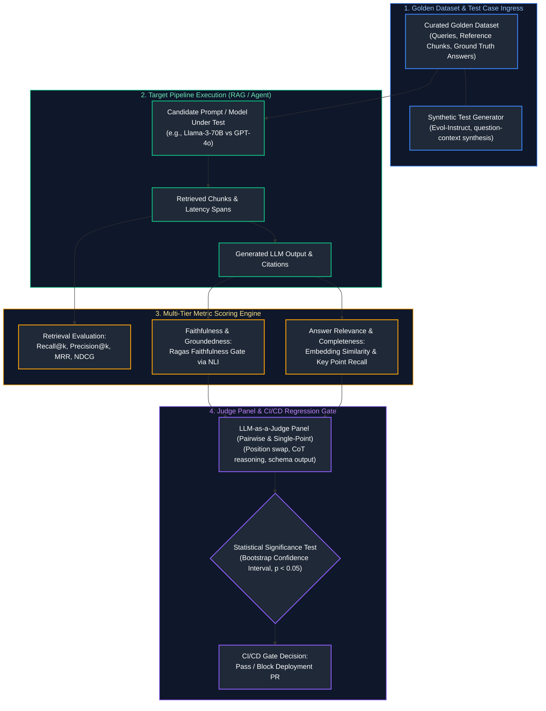
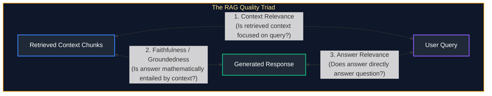
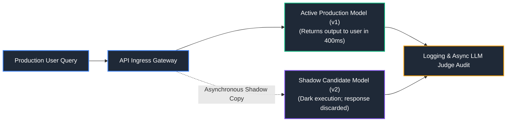

# 09. LLM Evaluation, Testing & Benchmarking

A comprehensive, production-grade guide to LLM evaluation methodology, golden ground-truth curation, retrieval metrics (Recall@k, MRR, NDCG), generation quality benchmarks (faithfulness, relevance, citation precision), LLM-as-a-Judge architectures, judge bias mitigation, human-in-the-loop evaluation, regression testing, A/B shadow testing, statistical significance, and continuous CI/CD evaluation pipelines (Ragas, DeepEval, promptfoo) tailored for AI Engineers.

---

## Architectural Overview: Continuous LLM Evaluation & CI/CD Benchmarking Pipeline



---

## Table of Contents
1. [Evaluation Dataset Engineering: Golden Standards vs. Synthetic Generation](#1-evaluation-dataset-engineering-golden-standards-vs-synthetic-generation)
   - [1.1 Golden Dataset Curation Protocols](#11-golden-dataset-curation-protocols)
   - [1.2 Synthetic Test Dataset Generation with Evol-Instruct](#12-synthetic-test-dataset-generation-with-evol-instruct)
2. [Retrieval Evaluation Metrics: Recall@k, Precision@k, MRR, NDCG](#2-retrieval-evaluation-metrics-recallk-precisionk-mrr-ndcg)
   - [2.1 Mathematical Definitions](#21-mathematical-definitions)
   - [2.2 Production Retrieval Evaluation Code](#22-production-retrieval-evaluation-code)
3. [Generation Quality Metrics: Faithfulness, Relevance & Completeness](#3-generation-quality-metrics-faithfulness-relevance-completeness)
   - [3.1 The RAG Triad of Generation Metrics](#31-the-rag-triad-of-generation-metrics)
   - [3.2 Citation Correctness & Precision Verification](#32-citation-correctness-precision-verification)
4. [LLM-as-a-Judge Architectures & Bias Mitigation](#4-llm-as-a-judge-architectures-bias-mitigation)
   - [4.1 Single-Point vs. Pairwise Evaluation](#41-single-point-vs-pairwise-evaluation)
   - [4.2 Overcoming Judge Biases: Position, Verbosity & Self-Preference](#42-overcoming-judge-biases-position-verbosity-self-preference)
   - [4.3 Production Structured Judge Implementation](#43-production-structured-judge-implementation)
5. [Human Evaluation & Inter-Annotator Agreement](#5-human-evaluation-inter-annotator-agreement)
   - [5.1 Statistical Metrics: Cohen's Kappa & Fleiss' Kappa](#51-statistical-metrics-cohens-kappa-fleiss-kappa)
   - [5.2 Human-in-the-Loop Calibration of LLM Judges](#31-the-rag-triad-of-generation-metrics)
6. [Regression Testing, A/B Testing & Shadow Evaluation](#6-regression-testing-ab-testing-shadow-evaluation)
   - [6.1 Prompt & Model Version Regression Suites](#61-prompt-model-version-regression-suites)
   - [6.2 Production Shadow Testing (Dark Traffic Forking)](#62-production-shadow-testing-dark-traffic-forking)
7. [Statistical Significance & Confidence Intervals](#7-statistical-significance-confidence-intervals)
   - [7.1 The Bootstrap Resampling Method for LLM Outputs](#71-the-bootstrap-resampling-method-for-llm-outputs)
   - [7.2 Determining Minimum Sample Sizes](#7-statistical-significance-confidence-intervals)
8. [Continuous Evaluation in CI/CD: Ragas, DeepEval, promptfoo](#8-continuous-evaluation-in-cicd-ragas-deepeval-promptfoo)
   - [8.1 Automated GitHub Actions Evaluation Gate](#81-automated-github-actions-evaluation-gate)
   - [8.2 Automated PR Blocking Policies](#81-automated-github-actions-evaluation-gate)
9. [Summary Comparison & Engineering Reference Matrix](#9-summary-comparison-engineering-reference-matrix)
10. [References & Further Reading](#10-references-further-reading)

---

# 1. Evaluation Dataset Engineering: Golden Standards vs. Synthetic Generation

### 1.1 Golden Dataset Curation Protocols

> [!IMPORTANT]
> **Evaluation Dataset Decontamination:** Ensure evaluation test sets are strictly isolated from any training, fine-tuning, or few-shot demonstration datasets. Test set contamination artificially inflates benchmark metrics and masks catastrophic generalization failures in production.

A **Golden Dataset** is the immutable ground-truth benchmark against which all prompt changes, model upgrades, and retrieval indexing parameters are evaluated.
A production test case tuple comprises five distinct elements:
$$\mathcal{T}_i = (q_i, \mathcal{C}^*_i, y^*_i, \mathcal{M}_i, \text{rubric}_i)$$
- $q_i$: Raw user input query.
- $\mathcal{C}^*_i$: Set of reference document chunk IDs that contain the factual evidence.
- $y^*_i$: Human-verified canonical golden answer.
- $\mathcal{M}_i$: Metadata tags (domain, difficulty, latency SLA).
- $\text{rubric}_i$: Evaluation criteria detailing mandatory factual claims and acceptable variations.

---

### 1.2 Synthetic Test Dataset Generation with Evol-Instruct

Manually curating 1,000 golden questions takes weeks. Synthetic test generation leverages frontier models to extract factual propositions from document chunks and synthesize questions across varying difficulty levels:

```text
EVOL-INSTRUCT COMPLEXITY TAXONOMY:
1. Reasoning Evolution: Rewrite question to require multi-step logical deduction.
2. Multi-Context Evolution: Require joining information across 2 distinct chunks.
3. Negative Constraint: "Answer without mentioning [common entity]."
4. Conversational Hardening: Add ambiguous pronouns and colloquial phrasing.
```

---

# 2. Retrieval Evaluation Metrics: Recall@k, Precision@k, MRR, NDCG

### 2.1 Mathematical Definitions

Given a set of relevant document chunk IDs $\mathcal{R}$ and the top-$k$ retrieved chunks $\hat{\mathcal{R}}_k = [d_1, \dots, d_k]$:

1. **Precision@k and Recall@k:**
   $$\text{Precision@k} = \frac{|\mathcal{R} \cap \hat{\mathcal{R}}_k|}{k}, \quad \text{Recall@k} = \frac{|\mathcal{R} \cap \hat{\mathcal{R}}_k|}{|\mathcal{R}|}$$

2. **Mean Reciprocal Rank (MRR):** Measures where the *first* relevant chunk appears:
   $$\text{MRR} = \frac{1}{|Q|} \sum_{i=1}^{|Q|} \frac{1}{\text{rank}_i}$$
   where $\text{rank}_i$ is the 1-indexed position of the first relevant document retrieved for query $i$.

3. **Normalized Discounted Cumulative Gain (NDCG@k):** Evaluates graded relevance:
   $$\text{DCG@k} = \sum_{j=1}^k \frac{2^{\text{rel}_j} - 1}{\log_2(j + 1)}, \quad \text{NDCG@k} = \frac{\text{DCG@k}}{\text{IDCG@k}}$$
   where $\text{IDCG@k}$ is the Ideal DCG score obtained by perfectly sorting items by relevance.

---

### 2.2 Production Retrieval Evaluation Code

```python
# ==============================================================================
# Production Retrieval Evaluation Suite: Precision@k, Recall@k, MRR, NDCG@k
# ==============================================================================
import numpy as np
from typing import List, Set

def evaluate_retrieval_metrics(
    retrieved_chunk_ids: List[str],
    ground_truth_chunk_ids: Set[str],
    k: int = 5
) -> dict:
    """Calculates standard IR metrics for a single query."""
    top_k = retrieved_chunk_ids[:k]
    
    # 1. Precision@k & Recall@k
    hits = [1 if cid in ground_truth_chunk_ids else 0 for cid in top_k]
    num_hits = sum(hits)
    precision_at_k = num_hits / k
    recall_at_k = num_hits / len(ground_truth_chunk_ids) if ground_truth_chunk_ids else 0.0

    # 2. Reciprocal Rank (RR)
    reciprocal_rank = 0.0
    for idx, hit in enumerate(hits, start=1):
        if hit == 1:
            reciprocal_rank = 1.0 / idx
            break

    # 3. Discounted Cumulative Gain (DCG@k & NDCG@k)
    dcg = sum([hit / np.log2(idx + 1) for idx, hit in enumerate(hits, start=1)])
    
    # Ideal DCG (all relevant documents ranked at the top)
    ideal_hits = [1] * min(k, len(ground_truth_chunk_ids))
    idcg = sum([1.0 / np.log2(idx + 1) for idx in range(1, len(ideal_hits) + 1)])
    ndcg_at_k = (dcg / idcg) if idcg > 0 else 0.0

    return {
        f"Precision@{k}": round(precision_at_k, 4),
        f"Recall@{k}": round(recall_at_k, 4),
        "MRR": round(reciprocal_rank, 4),
        f"NDCG@{k}": round(ndcg_at_k, 4)
    }

# Verification
retrieved = ["chunk_99", "chunk_12", "chunk_05", "chunk_88", "chunk_33"]
ground_truth = {"chunk_12", "chunk_05"}

scores = evaluate_retrieval_metrics(retrieved, ground_truth, k=5)
for metric, score in scores.items():
    print(f"{metric:<15}: {score}")
```

---

# 3. Generation Quality Metrics: Faithfulness, Relevance & Completeness

### 3.1 The RAG Triad of Generation Metrics



1. **Faithfulness (Groundedness):**
   $$\text{Faithfulness} = \frac{|\text{Factual claims in answer entailed by retrieved context}|}{|\text{Total factual claims in answer}|}$$
   A score $<1.0$ flags a factual hallucination.
2. **Answer Relevance:** Evaluates whether the generated response directly addresses the user query without superfluous tangents.

---

### 3.2 Citation Correctness & Precision Verification

In enterprise legal and medical RAG, every claim must reference a verified source:
- **Citation Recall:** Did the model cite all chunks used to substantiate claims?
- **Citation Precision:** Does the cited chunk *actually support* the specific sentence it follows?

---

# 4. LLM-as-a-Judge Architectures & Bias Mitigation

### 4.1 Single-Point vs. Pairwise Evaluation

- **Single-Point Scoring:** The judge evaluates an individual answer against a 1-to-5 Likert rubric. Prone to score compression (judges cluster scores around 4 and 5).
- **Pairwise Comparison:** The judge evaluates Answer A vs. Answer B side-by-side. Produces higher human correlation, but requires two evaluations swapping positions to mitigate position bias.

---

### 4.2 Overcoming Judge Biases: Position, Verbosity & Self-Preference

> [!CAUTION]
> **LLM-as-a-Judge Biases:** LLM evaluators exhibit severe systematic biases including Position Bias (preferring whichever candidate appears first), Verbosity Bias (rewarding longer verbose answers), and Self-Preference Bias (favoring outputs generated by the same model family). Always swap candidate positions and normalize length to eliminate evaluation skew.

1. **Position Bias:** Judges heavily favor the first candidate presented (Candidate A) due to primacy effects.
   - *Mitigation:* Always evaluate both orders: `(A, B)` and `(B, A)`. If the winner changes, declare a tie.
2. **Verbosity Bias:** LLMs consistently rate longer, wordier answers higher than concise ones, even when brevity is requested.
   - *Mitigation:* Instruct the judge explicitly in the rubric: *"Penalize redundant verbiage; concise answers that convey full facts must score higher."*
3. **Self-Preference Bias:** Models (e.g., GPT-4o) preferentially award higher scores to completions generated by their own model family.
   - *Mitigation:* Employ multi-model judge panels (e.g., Claude 3.5 Sonnet + GPT-4o + Gemini 1.5 Pro).

---

### 4.3 Production Structured Judge Implementation

```python
# ==============================================================================
# Production LLM-as-a-Judge with Chain-of-Thought Rubric & Pydantic Validation
# ==============================================================================
from pydantic import BaseModel, Field
from openai import OpenAI

class JudgeEvaluation(BaseModel):
    reasoning_trace: str = Field(description="Step-by-step audit of factual claims against context")
    faithfulness_score: int = Field(ge=1, le=5, description="1=Completely hallucinated, 5=Fully grounded")
    relevance_score: int = Field(ge=1, le=5, description="1=Irrelevant, 5=Directly answers question")
    hallucination_detected: bool = Field(description="True if any claim is unverified")

def evaluate_with_llm_judge(question: str, context: str, answer: str, client: OpenAI) -> JudgeEvaluation:
    judge_system_prompt = """You are an impartial, highly rigorous AI Quality Auditor.
Audit the provided ANSWER against the CONTEXT and QUESTION.
Analyze every sentence in the answer. Verify whether it is directly substantiated by the context.
Output your evaluation strictly according to the JudgeEvaluation schema."""

    user_payload = f"""QUESTION:
{question}

RETRIEVED CONTEXT:
{context}

CANDIDATE ANSWER:
{answer}"""

    response = client.beta.chat.completions.parse(
        model="gpt-4o",
        messages=[
            {"role": "system", "content": judge_system_prompt},
            {"role": "user", "content": user_payload}
        ],
        response_format=JudgeEvaluation,
        temperature=0.0
    )
    return response.choices[0].message.parsed
```

---

# 5. Human Evaluation & Inter-Annotator Agreement

### 5.1 Statistical Metrics: Cohen's Kappa & Fleiss' Kappa

When multiple human annotators grade LLM outputs, subjective disagreement is inevitable. **Cohen's Kappa ($\kappa$)** measures agreement between two raters, corrected for agreement occurring purely by chance:

$$\kappa = \frac{p_o - p_e}{1 - p_e}$$

- $p_o$: Relative observed agreement.
- $p_e$: Hypothetical probability of chance agreement.
- $\kappa > 0.80$: Strong agreement (reliable benchmark).
- $\kappa < 0.60$: Ambiguous annotation rubric; requires calibration sessions.

---

# 6. Regression Testing, A/B Testing & Shadow Evaluation

### 6.1 Prompt & Model Version Regression Suites

Before deploying a modified prompt or upgrading model versions (e.g., `gpt-4o-2024-05-13` to `gpt-4o-2024-08-06`), execute the 200-case regression suite.

```text
REGRESSION ACCEPTANCE CRITERIA:
1. Zero Faithfulness Regression: Groundedness score must not drop below 98%.
2. Latency SLA: TTFT p95 must remain <= 800ms.
3. Cost Ceiling: Token usage per request must not exceed +5% of baseline.
```

---

### 6.2 Production Shadow Testing (Dark Traffic Forking)



---

# 7. Statistical Significance & Confidence Intervals

### 7.1 The Bootstrap Resampling Method for LLM Outputs

Evaluating 100 test cases and noting that Model B scored 86% vs Model A's 84% does NOT prove Model B is superior. The difference could easily result from sampling variance.
- **Bootstrap Protocol:** Resample with replacement 10,000 times from the 100 evaluation scores to construct a 95% Confidence Interval (CI).
- If the 95% CIs of Model A $[0.81, 0.87]$ and Model B $[0.83, 0.89]$ overlap substantially, the improvement is not statistically significant.

---

# 8. Continuous Evaluation in CI/CD: Ragas, DeepEval, promptfoo

### 8.1 Automated GitHub Actions Evaluation Gate

> [!TIP]
> **Semantic Regression Gating:** Integrate automated eval suites into PR check runs using GitHub Actions. Block model/prompt deployments if semantic correctness or faithfulness metrics drop by more than 2% relative to the baseline production release.

```yaml
# .github/workflows/llm-eval.yml
name: LLM Evaluation CI Gate
on: [pull_request]

jobs:
  run-eval:
    runs-on: ubuntu-latest
    steps:
      - uses: actions/checkout@v4
      - name: Setup Python
        uses: actions/setup-python@v5
        with:
          python-version: '3.11'
      - name: Install Evaluation Dependencies
        run: pip install deepeval ragas openai pydantic
      - name: Execute Automated Regression Test Suite
        env:
          OPENAI_API_KEY: ${{ secrets.OPENAI_API_KEY }}
        run: |
          python -m pytest tests/test_llm_eval.py --junitxml=eval-results.xml
```

---

# 9. Summary Comparison & Engineering Reference Matrix

| Metric / Evaluation Framework | Latency | Cost | Automation Level | Production Role |
| :--- | :--- | :--- | :--- | :--- |
| **Recall@k / MRR** | $<1\text{ms}$ | $0.00$ | 100% Automated | Retrieval engine validation & indexing optimization. |
| **Ragas Faithfulness** | $\sim 1\text{--}2\text{s}$ | 1 LLM call | 100% Automated | Hallucination detection in continuous CI/CD pipelines. |
| **LLM Pairwise Judge** | $\sim 2\text{--}4\text{s}$ | 2 LLM calls | 100% Automated | Prompt version upgrades and model migration sign-off. |
| **Human Expert Audit** | Days | $\$5\text{--}\$25$ / sample | Manual | Ground-truth curation and judge calibration (monthly). |

---

# 10. References & Further Reading

- [Ragas: Automated Evaluation of Retrieval Augmented Generation](https://github.com/explodinggradients/ragas)
- [Judging LLM-as-a-Judge with MT-Bench and Chatbot Arena (Zheng et al., 2023)](https://arxiv.org/abs/2306.05685)
- [DeepEval: The Open-Source LLM Evaluation Framework](https://github.com/confident-ai/deepeval)
- [promptfoo: Test LLM Prompts, Models, and Guardrails](https://www.promptfoo.dev/docs/intro/)
- [Evol-Instruct: WizardLM: Empowering Large Language Models to Follow Complex Instructions (Xu et al., 2023)](https://arxiv.org/abs/2304.12244)

