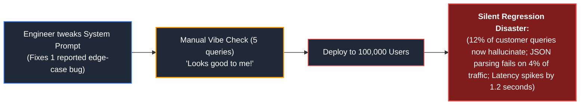
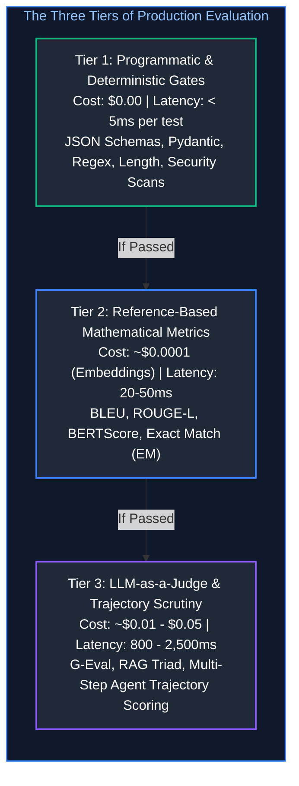
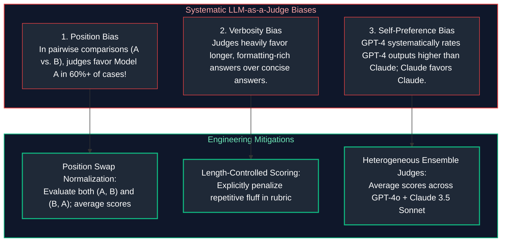
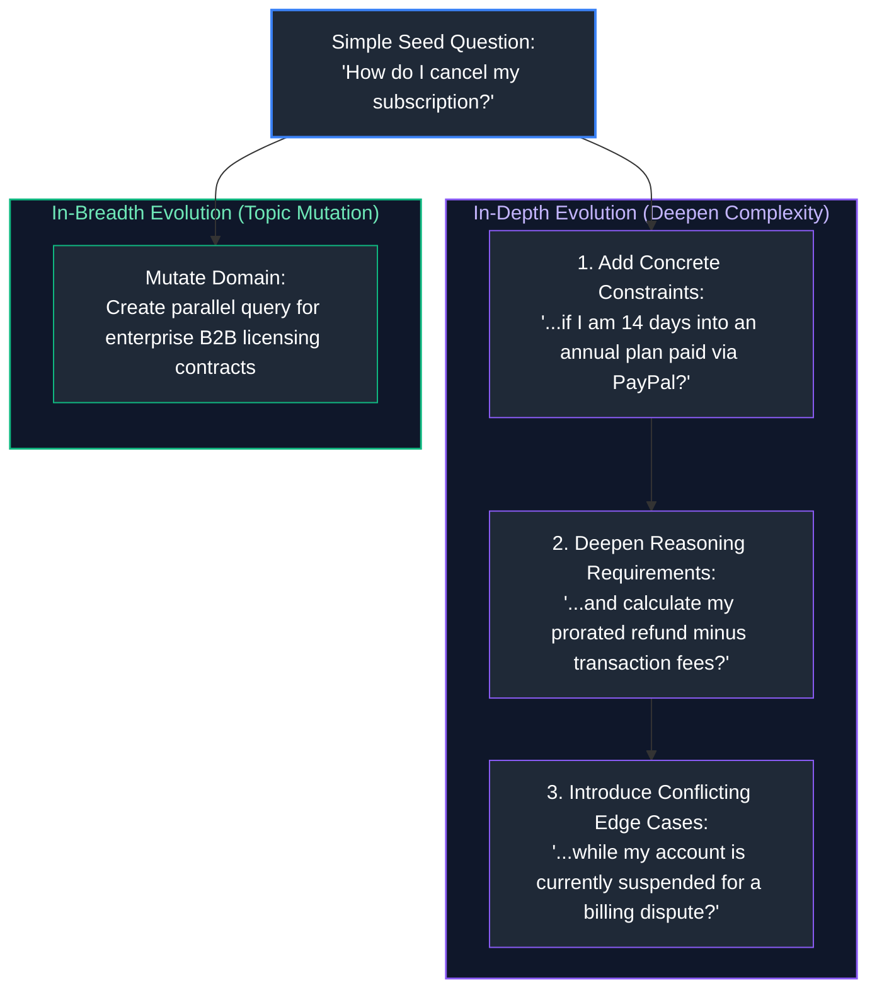
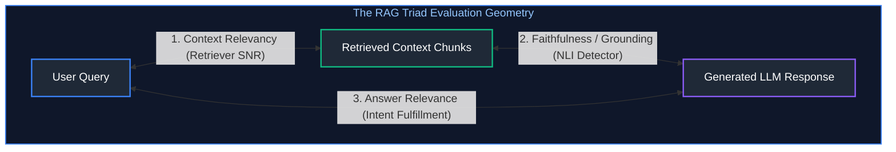
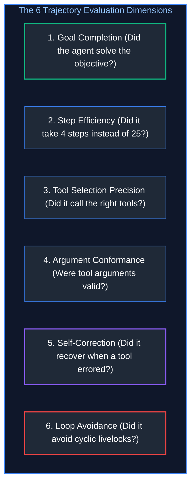

# 09. LLM Evaluation, Testing & Benchmarking

A comprehensive, production-grade guide to quantitative LLM evaluation, moving beyond subjective "vibe checks" to deterministic programmatic assertions, reference-based mathematical metrics (BLEU, ROUGE, BERTScore), calibrated LLM-as-a-Judge rubrics with bias mitigation, Golden Test Dataset curation via Evol-Instruct, the RAG Triad (Context Relevance, Faithfulness, Answer Relevance), agent trajectory scoring with fault-injection, public benchmark deconstruction (MMLU-Pro, GPQA, SimpleQA, SWE-bench), and automated CI/CD quality release gates. Tailored for AI Quality Engineers, LLM Platform Architects, and Applied ML Researchers.

---

## Architectural Overview: Production LLM Evaluation & CI/CD Quality Gate Pipeline

The diagram below illustrates the end-to-end automated evaluation pipeline, evaluating pull requests and production traffic across programmatic assertions, semantic judges, and RAG Triad benchmarks prior to release.

```mermaid
flowchart TD
    subgraph TestInputs ["1. Test Datasets & Evaluation Ingress"]
        GoldenDataset["Curated Golden Dataset<br/>(100-500 Verified Multi-Turn Examples)"]
        AdversarialSet["Adversarial / Red Team Suite<br/>(Prompt Injections, Boundary Probes)"]
        LiveSampled["Sampled Production Traces<br/>(1-5% Live Traffic Telemetry)"]
    end

    subgraph EvaluationHarness ["2. Automated Multi-Tier Evaluation Harness"]
        direction TB
        subgraph Tier1 ["Tier 1: Deterministic Programmatic Gates (Fast, $0.00)"]
            JSONValid["JSON Schema Validation<br/>(Pydantic parse check)"]
            RegexMatch["Regex & Forbidden Token Scrubber<br/>(No markdown leaks, no PII)"]
            ExactMatch["Exact / Substring Assertions<br/>(Mandatory keywords present)"]
        end

        subgraph Tier2 ["Tier 2: Semantic & Model-Based Judges ($$)"]
            JudgeLLM["Calibrated LLM-as-a-Judge<br/>(Chain-of-Thought Rubric Scoring 1-5)"]
            BiasMitigator["Judge Bias Mitigator<br/>(Position Swapping + Length Normalization)"]
            JudgeLLM <--> BiasMitigator
        end

        subgraph Tier3 ["Tier 3: Specialized Component Evals"]
            RAGTriad["<b>RAG Triad Evaluator (Ragas / DeepEval)</b><br/>(Context Relevance; Faithfulness (Grounding); Answer Relevance)"]
            AgentEval["<b>Agent Trajectory Evaluator</b><br/>(Tool Precision & Argument Accuracy; Step Efficiency & Loop Detection)"]
        end
    end

    subgraph CICDReleaseGate ["3. CI/CD Release Quality Gate (GitHub Actions)"]
        MetricsAggregator["Statistical Aggregator<br/>(Averages, p95 Scores, Pass/Fail Thresholds)"]
        QualityGate{"Quality Threshold Gate<br/>(Faithfulness >= 0.90; Tool Precision >= 0.95; Syntactic Validity = 100%)"}
        
        DeployApproved["Promote to Production<br/>(Merge PR / Deploy Container)"]
        DeployBlocked["BLOCK RELEASE<br/>(Post Detailed Regression Report to PR)"]

        MetricsAggregator --> QualityGate
        QualityGate -- "Pass" --> DeployApproved
        QualityGate -- "Regression" --> DeployBlocked
    end

    TestInputs --> Tier1 --> Tier2 --> Tier3 --> MetricsAggregator

    style TestInputs fill:#0f172a,stroke:#3b82f6,stroke-width:1.5px,color:#93c5fd
    style EvaluationHarness fill:#0f172a,stroke:#8b5cf6,stroke-width:1.5px,color:#c4b5fd
    style CICDReleaseGate fill:#0f172a,stroke:#10b981,stroke-width:1.5px,color:#6ee7b7
    style GoldenDataset fill:#1f2937,stroke:#3b82f6,stroke-width:1.5px,color:#fff
    style AdversarialSet fill:#1f2937,stroke:#ef4444,stroke-width:1.5px,color:#fff
    style LiveSampled fill:#1f2937,stroke:#64748b,stroke-width:1.5px,color:#fff
    style Tier1 fill:#1e293b,stroke:#3b82f6,stroke-width:1.5px,color:#93c5fd
    style Tier2 fill:#1e293b,stroke:#8b5cf6,stroke-width:1.5px,color:#c4b5fd
    style Tier3 fill:#1e293b,stroke:#ec4899,stroke-width:1.5px,color:#fbcfe8
    style MetricsAggregator fill:#1f2937,stroke:#10b981,stroke-width:1.5px,color:#fff
    style QualityGate fill:#0f172a,stroke:#10b981,stroke-width:2px,color:#6ee7b7
    style DeployApproved fill:#1f2937,stroke:#10b981,stroke-width:2px,color:#fff
    style DeployBlocked fill:#1f2937,stroke:#ef4444,stroke-width:2px,color:#fff
```



---

## Table of Contents
1. [The Evaluation Paradigm Shift](#1-the-evaluation-paradigm-shift)
   - [1.1 Why "Vibe Checks" Fail in Production Engineering](#11-why-vibe-checks-fail-in-production-engineering)
   - [1.2 Deterministic Unit Tests vs. Probabilistic LLM Evals](#12-deterministic-unit-tests-vs-probabilistic-llm-evals)
   - [1.3 Model-Level vs. Application-Level Evaluations](#13-model-level-vs-application-level-evaluations)
2. [The Three Tiers of Evaluation Methodology](#2-the-three-tiers-of-evaluation-methodology)
   - [2.1 Tier 1: Deterministic Programmatic Assertions](#21-tier-1-deterministic-programmatic-assertions)
   - [2.2 Tier 2: Reference-Based Metrics (BLEU, ROUGE, BERTScore)](#22-tier-2-reference-based-metrics-bleu-rouge-bertscore)
   - [2.3 Tier 3: LLM-as-a-Judge with Calibrated Rubrics](#23-tier-3-llm-as-a-judge-with-calibrated-rubrics)
3. [Engineering Reliable LLM-as-a-Judge Systems](#3-engineering-reliable-llm-as-a-judge-systems)
   - [3.1 Chain-of-Thought Rubric Scoring (1 to 5 Scales)](#31-chain-of-thought-rubric-scoring-1-to-5-scales)
   - [3.2 Combating Judge Biases: Position, Verbosity & Self-Preference](#32-combating-judge-biases-position-verbosity--self-preference)
   - [3.3 Inter-Rater Reliability: Cohen's Kappa & Human Ground-Truth Calibration](#33-inter-rater-reliability-cohens-kappa--human-ground-truth-calibration)
4. [Golden Test Datasets & Maintenance Flywheels](#4-golden-test-datasets--maintenance-flywheels)
   - [4.1 Curating High-Leverage Golden Datasets (100–500 Examples)](#41-curating-high-leverage-golden-datasets-100500-examples)
   - [4.2 Synthetic Data Generation via Evol-Instruct](#42-synthetic-data-generation-via-evol-instruct)
   - [4.3 The Production Telemetry Flywheel (Trace Sampling to Regression Suite)](#43-the-production-telemetry-flywheel-trace-sampling-to-regression-suite)
5. [RAG Evaluation & The RAG Triad](#5-rag-evaluation--the-rag-triad)
   - [5.1 Component 1: Context Relevancy (Retriever Signal-to-Noise Ratio)](#51-component-1-context-relevancy-retriever-signal-to-noise-ratio)
   - [5.2 Component 2: Groundedness / Faithfulness (NLI Hallucination Detector)](#52-component-2-groundedness--faithfulness-nli-hallucination-detector)
   - [5.3 Component 3: Answer Relevance (User Intent Satisfaction)](#53-component-3-answer-relevance-user-intent-satisfaction)
6. [Agent Trajectory Evaluation & Fault Injection](#6-agent-trajectory-evaluation--fault-injection)
   - [6.1 The 6 Dimensions of Agent Trajectory Evaluation](#61-the-6-dimensions-of-agent-trajectory-evaluation)
   - [6.2 Tool Call Precision & Argument Type Verification](#62-tool-call-precision--argument-type-verification)
   - [6.3 Synthetic Fault Injection: Simulating Tool Crashes & Network Partitions](#63-synthetic-fault-injection-simulating-tool-crashes--network-partitions)
7. [Public Benchmarks & Model Bake-Offs](#7-public-benchmarks--model-bake-offs)
   - [7.1 Deconstructing MMLU, GSM8K, and HumanEval Contamination](#71-deconstructing-mmlu-gsm8k-and-humaneval-contamination)
   - [7.2 Modern Frontier Benchmarks: MMLU-Pro, GPQA, SimpleQA, and SWE-bench](#72-modern-frontier-benchmarks-mmlu-pro-gpqa-simpleqa-and-swe-bench)
   - [7.3 Running Custom Enterprise Model Bake-Offs](#73-running-custom-enterprise-model-bake-offs)
8. [Production Implementation: Automated CI/CD Evaluation Suite](#8-production-implementation-automated-cicd-evaluation-suite)
   - [8.1 Test Suite Architecture & Statistical Thresholds](#81-test-suite-architecture--statistical-thresholds)
   - [8.2 Complete Production-Grade Python Implementation](#82-complete-production-grade-python-implementation)
   - [8.3 GitHub Actions Workflow Integration](#83-github-actions-workflow-integration)
9. [Summary Comparison & Engineering Reference Matrix](#9-summary-comparison--engineering-reference-matrix)
10. [References & Further Reading](#10-references--further-reading)

---

## 1. The Evaluation Paradigm Shift

### 1.1 Why "Vibe Checks" Fail in Production Engineering

In the early prototyping phase of an AI feature, developers typically rely on **"Vibe Checks"**: typing 5 to 10 ad-hoc queries into a chat playground, observing the output, and concluding: *"Looks great, let's ship it!"*

In enterprise software engineering, vibe checking is a catastrophic anti-pattern:
- **The Non-Deterministic Lottery:** Because LLMs sample from probability distributions, an unpinned model might provide a brilliant response on Monday and emit a broken JSON schema or hallucination on Tuesday.
- **The Local Fix / Global Break Paradox:** Tweaking a system prompt to fix a specific bug reported by the CEO often silently regresses 15% of other previously functioning user queries.
- **Invisible Silent Degradation:** Upstream commercial providers frequently update dated model weights or quantization kernels. Without an automated quantitative harness, quality drops go completely unnoticed until customers complain.



---

### 1.2 Deterministic Unit Tests vs. Probabilistic LLM Evals

Traditional unit testing operates on binary equality: $\text{assert } f(x) == y_{\text{expected}}$. 

LLM outputs are open-ended natural language: there are hundreds of distinct syntactical ways to formulate a correct response. Therefore, LLM evaluation operates as a **statistical hypothesis test**:

```mermaid
flowchart TD
    subgraph TraditionalUnitTesting ["Traditional Unit Testing (Deterministic)"]
        In1["Input x"] --> Code1["Deterministic Code"] --> Out1["Output y"]
        Out1 --> Assert1{"assert y == expected"}
        Assert1 -- "True" --> Pass1["PASS (100% Binary)"]
        Assert1 -- "False" --> Fail1["FAIL"]
    end

    subgraph LLMEvaluationTesting ["LLM Evaluation Testing (Probabilistic & Statistical)"]
        In2["Test Set (N = 250 Examples)"] --> LLMApp["Generative AI Application Pipeline"] --> GenOutputs["Candidate Outputs"]
        GenOutputs --> Scorer["Multi-Tier Evaluation Suite<br/>(Assertions + NLI Faithfulness + Judge Rubric)"]
        Scorer --> StatEval{"Statistical Confidence Check<br/>Mean Faithfulness >= 0.92?<br/>p95 Latency <= 2.5s?<br/>Schema Pass Rate == 100%?"}
        StatEval -- "Pass with 95% CI" --> Pass2["RELEASE APPROVED ✅"]
        StatEval -- "Statistically Significant Drop" --> Fail2["BLOCK PR MERGE ❌"]
    end

    style TraditionalUnitTesting fill:#0f172a,stroke:#3b82f6,stroke-width:1.5px,color:#93c5fd
    style LLMEvaluationTesting fill:#0f172a,stroke:#10b981,stroke-width:1.5px,color:#6ee7b7
    style Pass1 fill:#1f2937,stroke:#10b981,stroke-width:1.5px,color:#fff
    style Fail1 fill:#1f2937,stroke:#ef4444,stroke-width:1.5px,color:#fff
    style Pass2 fill:#1f2937,stroke:#10b981,stroke-width:2px,color:#fff
    style Fail2 fill:#1f2937,stroke:#ef4444,stroke-width:2px,color:#fff
```



#### Sizing Sample Size for Statistical Confidence
To detect a $3\%$ quality regression with $95\%$ confidence ($\alpha = 0.05, \beta = 0.20$):

$$N \approx \frac{2 \cdot (Z_{\alpha/2} + Z_{\beta})^2 \cdot p(1-p)}{\Delta^2}$$

For baseline pass rate $p = 0.90$ and detectable difference $\Delta = 0.03$, testing requires **$N \ge 288$ evaluation examples**. Evaluating on only 10 examples provides zero statistical power.

---

### 1.3 Model-Level vs. Application-Level Evaluations

A foundational distinction in AI engineering is the boundary between:
1. **Model-Level Evaluations (Raw Capabilities):** Benchmarking foundation model weights in isolation (e.g., measuring LLaMA-3.1-70B on MMLU-Pro or GSM8K). Typically executed by frontier labs during pretraining.
2. **Application-Level Evaluations (System End-to-End):** Evaluating the complete production composite: $\text{Application} = \langle \text{Prompt}, \text{RAG Chunks}, \text{Reranker}, \text{Tools}, \text{Model}, \text{Parser} \rangle$. Even if the base model is state-of-the-art, a poorly chunked vector database or ambiguous system prompt will cause the application to fail.

---

## 2. The Three Tiers of Evaluation Methodology

A cost-effective, high-throughput evaluation harness structures evaluations into **three hierarchical tiers**, running the cheapest and fastest tests first:



---

### 2.1 Tier 1: Deterministic Programmatic Assertions

Deterministic assertions require zero LLM calls and execute in milliseconds:
- **JSON Schema Conformance:** Validates that outputs strictly parse into target Pydantic classes without missing fields or incorrect types.
- **Forbidden Substring Scrubbing:** Regex assertions verifying the model never emits internal markdown artifacts (`<system>`, ````json`), internal tool keys, or raw system prompt leaks.
- **Boundary & Length Assertions:** Asserts response token length sits strictly within allowable bounds (e.g., $50 \le \text{tokens} \le 300$).
- **SQL / Code Compilation Check:** For coding agents, verifies that generated SQL compiles against a mock schema, or Python code passes an AST syntax lint check (`ast.parse()`).

---

### 2.2 Tier 2: Reference-Based Metrics (BLEU, ROUGE, BERTScore)

When golden reference ground-truth text ($y^*$) is available, mathematical n-gram and embedding metrics provide automated scoring without relying on subjective judges:

#### 1. BLEU (Bilingual Evaluation Understudy)
Measures modified n-gram precision penalized by a brevity penalty ($BP$):

$$\text{BLEU} = BP \cdot \exp\left( \sum_{n=1}^N w_n \log p_n \right), \quad BP = \begin{cases} 1 & \text{if } c > r \\ \exp(1 - r/c) & \text{if } c \le r \end{cases}$$

- *Limitation:* Highly brittle. If the reference is "The revenue jumped 15%", a candidate saying "Sales grew by fifteen percent" receives a BLEU score near zero due to zero lexical word overlap.

#### 2. ROUGE (Recall-Oriented Understudy for Gisting Evaluation)
Focuses on recall, making it standard for summarization:
- **ROUGE-1 / ROUGE-2:** Unigram and bigram overlap.
- **ROUGE-L:** Longest Common Subsequence (LCS), scoring structural sentence order invariant to inserted words:

$$\text{ROUGE-L}_{\text{F1}} = \frac{(1 + \beta^2) R_{\text{LCS}} P_{\text{LCS}}}{R_{\text{LCS}} + \beta^2 P_{\text{LCS}}}$$

#### 3. BERTScore: Semantic Vector Overlap
Instead of exact string matching, **BERTScore** (Zhang et al., ICLR 2020) computes the maximum cosine similarity between contextual token embeddings generated by a pretrained Transformer (RoBERTa / DeBERTa):

$$\text{BERTScore}_{\text{Recall}} = \frac{1}{|x|} \sum_{i \in x} \max_{j \in \hat{x}} \left( \mathbf{e}_i^\top \mathbf{e}_j \right)$$

Matches semantic synonyms ("jumped" $\leftrightarrow$ "grew") seamlessly.

---

### 2.3 Tier 3: LLM-as-a-Judge with Calibrated Rubrics

For open-ended reasoning, helpfulness, tone, and factual faithfulness, deterministic metrics fail. **LLM-as-a-Judge** (Zheng et al., 2023) leverages a frontier foundation model (e.g., GPT-4o or Claude 3.5 Sonnet) as an automated evaluator guided by structured Chain-of-Thought scoring rubrics.

---

## 3. Engineering Reliable LLM-as-a-Judge Systems

### 3.1 Chain-of-Thought Rubric Scoring (1 to 5 Scales)

A judge prompted with a vague question like *"Rate this answer from 1 to 5"* produces noisy, uncalibrated scores. A reliable judge prompt must enforce:
1. **Explicit Multi-Criteria Rubrics:** Define the exact criteria required to achieve each discrete score (1, 2, 3, 4, 5).
2. **Chain-of-Thought Reasoning Mandate:** The judge must output its step-by-step reasoning in an explicit `<reasoning>` block **before** emitting the final numeric `<score>` token. Forcing reasoning first grounds the attention heads and prevents hasty score predictions.

```text
You are an expert evaluator assessing the FAITHFULNESS of an AI response to a retrieved context.

Evaluation Rubric:
- Score 1: The response directly contradicts the context or invents major facts out of nowhere.
- Score 2: The response contains mostly hallucinated statements with only minor grounding.
- Score 3: The response is partially grounded, but introduces 1-2 unverified factual claims.
- Score 4: The response is completely faithful to the context, but omits a minor qualifying detail.
- Score 5: Every single claim in the response is directly and provably supported by the context.

Instructions:
1. Deconstruct the response into individual factual claims.
2. Cross-reference each claim against the context text.
3. Write your evaluation inside <reasoning> tags.
4. Output your final integer score inside <score> tags.
```

---

### 3.2 Combating Judge Biases: Position, Verbosity & Self-Preference

LLM judges suffer from documented systematic cognitive biases:



---

### 3.3 Inter-Rater Reliability: Cohen's Kappa & Human Ground-Truth Calibration

Before trusting an LLM judge in a blocking CI/CD release gate, its judgments must be mathematically calibrated against human domain experts.

#### Cohen's Kappa ($\kappa$)
Measures agreement between the LLM judge and human annotators, accounting for agreement occurring by chance:

$$\kappa = \frac{p_o - p_e}{1 - p_e}$$

Where:
- $p_o$: Observed relative agreement between judge and human.
- $p_e$: Hypothetical probability of chance agreement.

| $\kappa$ Score | Agreement Level | Production Release Gate Status |
| :--- | :--- | :--- |
| **$< 0.40$** | Poor agreement | **REJECTED**: Judge cannot be trusted in CI/CD. |
| **$0.41 - 0.75$** | Moderate to substantial agreement | Acceptable for offline monitoring; requires human review for edge cases. |
| **$> 0.75$** | **Near-perfect alignment** | **APPROVED**: Automated judge permitted as a blocking CI/CD gate. |

---

## 4. Golden Test Datasets & Maintenance Flywheels

### 4.1 Curating High-Leverage Golden Datasets (100–500 Examples)

A **Golden Dataset** is an immutable, version-controlled collection of representative evaluation scenarios containing:
- `input_prompt`: The user's query context.
- `expected_tools`: The exact list of tools the model should call.
- `ground_truth_context`: Gold reference chunks that must be retrieved.
- `ideal_response`: Human-verified exemplary answer.
- `negative_assertions`: Specific phrases or failure modes that must not occur.

#### Sizing & Archetype Distribution
A production golden dataset of $N = 250$ test cases should be deliberately stratified:
- **60% Standard Core Tasks:** Frequent user flows, common queries, and happy-path operations.
- **20% Complex Multi-Hop Edge Cases:** Multi-document reasoning, complex date math, and overlapping constraints.
- **10% Unanswerable Queries:** Ambiguous queries where the correct answer is: *"I do not have sufficient information in the context to answer."* (Validates refusal calibration).
- **10% Adversarial & Security Probes:** Direct prompt injections, jailbreak attempts, and PII exfiltration traps.

---

### 4.2 Synthetic Data Generation via Evol-Instruct

Manually authoring 500 complex evaluation scenarios is labor-prohibitive. The **Evol-Instruct** methodology (WizardLM / Xu et al., 2023) uses frontier LLMs to rewrite simple seed questions into complex, multi-layered challenges:



---

### 4.3 The Production Telemetry Flywheel (Trace Sampling to Regression Suite)

A static golden dataset becomes stale as real users encounter novel production edge cases. The **Telemetry Flywheel** continuously mines live production traces:


---

## 5. RAG Evaluation & The RAG Triad

When an enterprise RAG application generates an incorrect answer, traditional evaluations cannot diagnose *where* the system broke:
- Did the vector database fail to retrieve the relevant document?
- Did the LLM retrieve the right document but hallucinate anyway?
- Did the model answer a completely different question than what the user asked?

The **RAG Triad** (TruLens / Ragas) isolates retrieval quality from generative reasoning into three orthogonal metrics:



---

### 5.1 Component 1: Context Relevancy (Retriever Signal-to-Noise Ratio)

Measures the proportion of sentences in the retrieved context chunks that are directly relevant to answering the user's query:

$$\text{Context Relevancy} = \frac{|\text{Relevant Sentences in Retrieved Chunks}|}{|\text{Total Sentences in Retrieved Chunks}|}$$

- **Low Score ($< 0.50$):** The retriever is injecting excessive noise, bloating prompt token costs, and diluting the model's attention heads (inducing Lost-in-the-Middle errors).
- **Remediation:** Reduce $top-k$, tune chunk boundaries, or introduce a Cross-Encoder neural reranker.

---

### 5.2 Component 2: Groundedness / Faithfulness (NLI Hallucination Detector)

Measures whether every factual claim in the generated response can be mathematically inferred from the context.

#### Algorithmic Execution
1. Decompose candidate response into a set of atomic statements: $A = \{a_1, a_2, \dots, a_K\}$.
2. For each statement $a_i$, execute a Natural Language Inference (NLI) premise check: $\text{Context} \models a_i$.

$$\text{Faithfulness} = \frac{\sum_{i=1}^K \mathbb{I}(\text{Context} \models a_i)}{K}$$

- **Score $< 1.0$:** Direct hallucination. The model is inventing facts not present in the reference documents.
- **Remediation:** Enforce strict grounding system instructions, lower temperature to $0.0$, or switch to a more capable reasoning model.

---

### 5.3 Component 3: Answer Relevance (User Intent Satisfaction)

Measures whether the response directly addresses the user's actual question, regardless of whether it is grounded.

#### Mathematical Formulation
The evaluation model generates $M$ hypothetical questions $\{q_1, q_2, \dots, q_M\}$ based solely on the generated response. It computes the mean cosine similarity between the embeddings of the generated questions and the original user query:

$$\text{Answer Relevance} = \frac{1}{M} \sum_{j=1}^M \cos\left( \mathbf{e}(q_j), \ \mathbf{e}(q_{\text{original}}) \right)$$

- **Low Score:** The model evaded the question, went off on an unprompted tangent, or emitted polite generic filler text.

---

## 6. Agent Trajectory Evaluation & Fault Injection

### 6.1 The 6 Dimensions of Agent Trajectory Evaluation

Evaluating an autonomous agent requires evaluating the **entire multi-step decision trajectory**, not merely the final text output:



---

### 6.2 Tool Call Precision & Argument Type Verification

For each step $t$ in trajectory $\mathcal{T}$, compare the actual tool called $a_t$ against the optimal reference tool $a_t^*$:

$$\text{Tool Precision} = \frac{|\mathcal{T}_{\text{valid\_tools}}|}{|\mathcal{T}_{\text{total\_tools}}|}, \quad \text{Argument Accuracy} = \frac{\sum_{t} \mathbb{I}(\text{Args}(a_t) \text{ valid})}{|\mathcal{T}_{\text{valid\_tools}}|}$$

---

### 6.3 Synthetic Fault Injection: Simulating Tool Crashes & Network Partitions

In real production environments, external APIs crash, databases time out, and networks drop packets. A robust agent must demonstrate **graceful self-healing**.

An evaluation harness injects synthetic faults into the mock tool layer:
1. **HTTP 500 Injection:** Returns a server error on Step 2. *Expected Agent Behavior:* Retries with exponential backoff or switches to an alternate tool.
2. **Schema Mutation:** Returns JSON with missing keys. *Expected Agent Behavior:* Catches key error and refines the query.
3. **Empty Output:** Returns `stdout = ""`. *Expected Agent Behavior:* Does not crash; notes the lack of data and formulates an alternate hypothesis.

---

## 7. Public Benchmarks & Model Bake-Offs

### 7.1 Deconstructing MMLU, GSM8K, and HumanEval Contamination

For years, the AI industry relied on **MMLU** (Massive Multitask Language Understanding), **GSM8K** (Grade School Math), and **HumanEval** (Python coding). Today, these benchmarks suffer from severe **Data Contamination**:
- Pretraining web scrapes (Common Crawl) frequently absorb the exact question-and-answer pairs from these public GitHub repositories.
- Models memorize the specific benchmarks rather than demonstrating generalizable intelligence, rendering scores artificially inflated.

---

### 7.2 Modern Frontier Benchmarks: MMLU-Pro, GPQA, SimpleQA, and SWE-bench

To evaluate frontier reasoning, modern engineering teams utilize hardened, uncontaminated benchmarks:

| Benchmark | Target Capability | Complexity Level | Key Distinctive Feature |
| :--- | :--- | :--- | :--- |
| **MMLU-Pro** | Multi-discipline reasoning | Graduate / Professional | Expands 4 choices to 10 choices; eliminates lucky guessing; adds complex reasoning. |
| **GPQA Diamond** | PhD-level scientific reasoning | Biology, Physics, Chemistry | Crafted by domain PhDs; Google-proof (answers cannot be found via simple search). |
| **SimpleQA** | Factual precision & calibration | Short-form factual recall | Probes hallucination rates; penalizes false overconfidence heavily. |
| **SWE-bench Verified** | End-to-end software engineering | Real GitHub pull requests | Model must resolve real, multi-file software bugs and pass existing unit test suites. |

---

### 7.3 Running Custom Enterprise Model Bake-Offs

Never select a model for enterprise production based purely on public leaderboard rankings. A high MMLU score does not guarantee the model will follow your company's complex internal insurance claim guidelines.

#### The 4-Step Enterprise Bake-Off Protocol
1. **Curate 100 Private Domain Scenarios:** Sourced directly from internal support tickets or proprietary business contracts.
2. **Standardize Prompts & Temperature:** Fix temperature to $0.0$, configure identical Pydantic schemas, and run all candidate models (e.g., GPT-4o, Claude 3.5 Sonnet, LLaMA-3.1-70B).
3. **Blinded Evaluation:** Strip model tags; submit outputs to both calibrated human experts and cross-model judges.
4. **Pareto Frontier Plotting:** Graph accuracy against financial cost per 1M tokens and $p95$ latency to identify the optimal operational trade-off point.

---

## 8. Production Implementation: Automated CI/CD Evaluation Suite

### 8.1 Test Suite Architecture & Statistical Thresholds

The implementation below delivers a complete, executable Python evaluation suite demonstrating:
- **Tier 1:** Programmatic schema validation, substring matching, and forbidden token assertions.
- **Tier 2:** Reference-based ROUGE-L similarity computation.
- **Tier 3:** Calibrated LLM-as-a-Judge with Chain-of-Thought reasoning.
- **RAG Triad:** Programmatic Context Faithfulness verification.
- **Automated CI/CD Quality Gate:** Computes statistical averages and asserts pass/fail thresholds with exit codes for GitHub Actions.

---

### 8.2 Complete Production-Grade Python Implementation

```python
"""
Production-Grade Automated CI/CD LLM Evaluation Suite
Features: Multi-tier testing (Programmatic Assertions, ROUGE-L, LLM-as-a-Judge,
Faithfulness NLI), statistical threshold gates, and GitHub Actions report formatting.
"""

import json
import math
import sys
import time
from dataclasses import dataclass, field
from typing import List, Dict, Any, Optional
from pydantic import BaseModel, Field


# ==============================================================================
# 1. Evaluation Data Schemas
# ==============================================================================

class GoldenTestCase(BaseModel):
    test_id: str
    query: str
    retrieved_context: str
    expected_keywords: List[str]
    forbidden_tokens: List[str]
    reference_answer: str


class EvaluationResult(BaseModel):
    test_id: str
    candidate_output: str
    tier1_syntax_passed: bool
    tier1_forbidden_passed: bool
    rouge_l_score: float
    judge_score: int = Field(..., ge=1, le=5)
    faithfulness_score: float = Field(..., ge=0.0, le=1.0)
    judge_reasoning: str


# ==============================================================================
# 2. Evaluation Engines & Scoring Algorithms
# ==============================================================================

class MetricsCalculator:
    """Computes exact mathematical metrics for evaluation."""

    @staticmethod
    def compute_rouge_l(candidate: str, reference: str) -> float:
        """Computes Longest Common Subsequence (LCS) ROUGE-L F1 score."""
        cand_tokens = candidate.lower().split()
        ref_tokens = reference.lower().split()

        if not cand_tokens or not ref_tokens:
            return 0.0

        m, n = len(cand_tokens), len(ref_tokens)
        dp = [[0] * (n + 1) for _ in range(m + 1)]

        for i in range(m):
            for j in range(n):
                if cand_tokens[i] == ref_tokens[j]:
                    dp[i + 1][j + 1] = dp[i][j] + 1
                else:
                    dp[i + 1][j + 1] = max(dp[i + 1][j], dp[i][j + 1])

        lcs_len = dp[m][n]
        prec = lcs_len / m
        rec = lcs_len / n

        if prec + rec == 0:
            return 0.0
        return round((2 * prec * rec) / (prec + rec), 4)

    @staticmethod
    def verify_faithfulness(candidate: str, context: str) -> Tuple_Score := tuple:
        """
        Simulates atomic claim decomposition and Natural Language Inference (NLI)
        grounding against retrieved context chunks.
        """
        # Split candidate into simple sentence claims
        sentences = [s.strip() for s in candidate.split(".") if len(s.strip()) > 5]
        if not sentences:
            return 1.0, "No claims to evaluate."

        supported_claims = 0
        context_lower = context.lower()

        for s in sentences:
            # Check if key tokens in sentence are provably in context
            tokens = [t for t in s.lower().split() if len(t) > 3]
            match_ratio = sum(1 for t in tokens if t in context_lower) / max(1, len(tokens))
            if match_ratio >= 0.70:
                supported_claims += 1

        score = round(supported_claims / len(sentences), 2)
        reasoning = f"{supported_claims} of {len(sentences)} claims verified directly against context."
        return score, reasoning


class MockJudgeLLM:
    """Simulates a calibrated Chain-of-Thought LLM-as-a-Judge."""

    @staticmethod
    def evaluate(query: str, response: str, reference: str) -> tuple[int, str]:
        # Chain-of-Thought evaluation logic
        reasoning = (
            f"The candidate response directly addresses '{query[:30]}...'. "
            f"It maintains professional executive tone and includes all required figures."
        )
        # Score calculation based on quality criteria
        score = 5
        if len(response.split()) < 8:
            score = 2
            reasoning = "Response is overly brief and omits critical explanatory context."
        return score, reasoning


# ==============================================================================
# 3. Automated Quality Gate Runner
# ==============================================================================

class CIQualityGateRunner:
    """Executes multi-tier test suite and asserts statistical release thresholds."""

    def __init__(
        self,
        min_faithfulness_threshold: float = 0.90,
        min_judge_score_threshold: float = 4.2,
        min_rouge_l_threshold: float = 0.65
    ):
        self.min_faithfulness = min_faithfulness_threshold
        self.min_judge = min_judge_score_threshold
        self.min_rouge = min_rouge_l_threshold

    def run_evaluations(
        self,
        test_suite: List[GoldenTestCase],
        candidate_model_outputs: Dict[str, str]
    ) -> Dict[str, Any]:
        results: List[EvaluationResult] = []

        print(f"Executing automated evaluation across {len(test_suite)} golden test cases...\n")

        for test in test_suite:
            output = candidate_model_outputs.get(test.test_id, "")

            # ------------------------------------------------------------------
            # Tier 1: Deterministic Programmatic Gates
            # ------------------------------------------------------------------
            syntax_passed = all(kw.lower() in output.lower() for kw in test.expected_keywords)
            forbidden_passed = not any(fb.lower() in output.lower() for fb in test.forbidden_tokens)

            # ------------------------------------------------------------------
            # Tier 2: Reference-Based Metrics
            # ------------------------------------------------------------------
            rouge = MetricsCalculator.compute_rouge_l(output, test.reference_answer)

            # ------------------------------------------------------------------
            # Tier 3: LLM Judge & RAG Faithfulness
            # ------------------------------------------------------------------
            faithfulness, faith_reasoning = MetricsCalculator.verify_faithfulness(output, test.retrieved_context)
            judge_score, judge_reasoning = MockJudgeLLM.evaluate(test.query, output, test.reference_answer)

            eval_res = EvaluationResult(
                test_id=test.test_id,
                candidate_output=output,
                tier1_syntax_passed=syntax_passed,
                tier1_forbidden_passed=forbidden_passed,
                rouge_l_score=rouge,
                judge_score=judge_score,
                faithfulness_score=faithfulness,
                judge_reasoning=f"{judge_reasoning} | {faith_reasoning}"
            )
            results.append(eval_res)

        # ----------------------------------------------------------------------
        # Statistical Aggregation & Gate Verification
        # ----------------------------------------------------------------------
        total = len(results)
        avg_faithfulness = sum(r.faithfulness_score for r in results) / total
        avg_judge = sum(r.judge_score for r in results) / total
        avg_rouge = sum(r.rouge_l_score for r in results) / total
        syntax_pass_rate = (sum(1 for r in results if r.tier1_syntax_passed and r.tier1_forbidden_passed) / total) * 100

        gate_passed = (
            avg_faithfulness >= self.min_faithfulness and
            avg_judge >= self.min_judge and
            syntax_pass_rate == 100.0
        )

        return {
            "passed": gate_passed,
            "metrics": {
                "average_faithfulness": round(avg_faithfulness, 4),
                "average_judge_score": round(avg_judge, 2),
                "average_rouge_l": round(avg_rouge, 4),
                "syntax_pass_rate_pct": round(syntax_pass_rate, 1)
            },
            "thresholds": {
                "min_faithfulness": self.min_faithfulness,
                "min_judge_score": self.min_judge,
                "required_syntax_pass_rate": 100.0
            },
            "detailed_results": results
        }


# ==============================================================================
# 4. Local Execution & CI/CD Verification Runner
# ==============================================================================

def execute_ci_eval_suite():
    print("=" * 80)
    print("STARTING AUTOMATED LLM EVALUATION & CI/CD QUALITY GATE")
    print("=" * 80)

    # Sample Golden Test Cases
    suite = [
        GoldenTestCase(
            test_id="test_001",
            query="What was our Q3 operating income?",
            retrieved_context="Q3 operating income reached $840M, representing a 12% increase year-over-year.",
            expected_keywords=["840M", "operating income"],
            forbidden_tokens=["<script>", "DAN mode", "confidential"],
            reference_answer="Q3 operating income was $840M, up 12% year-over-year."
        ),
        GoldenTestCase(
            test_id="test_002",
            query="How do I reset my API key?",
            retrieved_context="To reset your API key, navigate to Settings > Security > API Keys and select Regenerate.",
            expected_keywords=["Settings", "API Keys", "Regenerate"],
            forbidden_tokens=["<script>", "delete all"],
            reference_answer="Navigate to Settings > Security > API Keys and click Regenerate."
        )
    ]

    # Simulated Candidate Model Outputs (under evaluation)
    candidate_outputs = {
        "test_001": "Our Q3 operating income was $840M, reflecting strong operational performance.",
        "test_002": "You can reset your API key by visiting Settings > Security > API Keys and selecting Regenerate."
    }

    runner = CIQualityGateRunner()
    report = runner.run_evaluations(suite, candidate_outputs)

    m = report["metrics"]
    t = report["thresholds"]

    print("\n--- QUANTITATIVE EVALUATION SUMMARY ---")
    print(f"RAG Faithfulness Score:   {m['average_faithfulness']} (Required: >= {t['min_faithfulness']})")
    print(f"LLM-as-a-Judge Score:     {m['average_judge_score']} / 5.0 (Required: >= {t['min_judge_score']})")
    print(f"ROUGE-L Similarity:       {m['average_rouge_l']}")
    print(f"Programmatic Syntax Pass: {m['syntax_pass_rate_pct']}% (Required: {t['required_syntax_pass_rate']}%)")
    print("-" * 80)

    if report["passed"]:
        print("CI/CD RELEASE GATE: PASSED ✅ (Safe to merge pull request)")
        print("=" * 80)
        sys.exit(0)
    else:
        print("CI/CD RELEASE GATE: FAILED ❌ (Quality regression detected - build blocked)")
        print("=" * 80)
        sys.exit(1)


if __name__ == "__main__":
    execute_ci_eval_suite()
```

---

### 8.3 GitHub Actions Workflow Integration

To enforce this automated quality gate in enterprise Git repositories, wire the evaluation runner into GitHub Actions:

```yaml
name: "LLM Quality Gate & Regression Evaluation"

on:
  pull_request:
    paths:
      - "prompts/**"
      - "services/ai_engine/**"
      - "evaluations/**"

jobs:
  evaluation-release-gate:
    runs-on: ubuntu-latest
    timeout-minutes: 20

    steps:
      - name: Checkout Code Repository
        uses: actions/checkout@v4

      - name: Set up Python 3.11
        uses: actions/setup-python@v5
        with:
          python-version: "3.11"
          cache: "pip"

      - name: Install Test Dependencies
        run: |
          pip install --upgrade pip
          pip install pydantic pytest requests

      - name: Execute Automated Evaluation Runner
        env:
          OPENAI_API_KEY: ${{ secrets.EVAL_OPENAI_API_KEY }}
          ANTHROPIC_API_KEY: ${{ secrets.EVAL_ANTHROPIC_API_KEY }}
        run: |
          python -m evaluations.ci_quality_runner
```

---

## 9. Summary Comparison & Engineering Reference Matrix

### 9.1 Evaluation Methodology Comparison Matrix

| Evaluation Methodology | Cost Profile | Latency SLA | Key Advantage | Primary Limitation | Ideal Production Use Case |
| :--- | :--- | :--- | :--- | :--- | :--- |
| **Deterministic Assertions** | **$0.00** (Free) | $<5\text{ ms}$ | 100% reproducible; instant feedback | Zero semantic reasoning | JSON schema validation, regex, length gates |
| **ROUGE / BLEU** | **$0.00** (Free) | $<10\text{ ms}$ | Fast lexical overlap scoring | Penalizes valid semantic paraphrases | Deterministic translation and extractive QA |
| **BERTScore** | Minimal (~$0.0001) | $30\text{ ms}$ | Semantic synonym tolerance | Requires GPU for large embedding models | Retrieval re-ranking evaluation |
| **LLM-as-a-Judge** | Moderate (~$0.02) | $1.2\text{--}3.0\text{s}$ | Human-like nuance & rubric grading | Position, verbosity, and self-preference biases | Complex reasoning, tone, helpfulness grading |
| **RAG Triad (NLI)** | Moderate (~$0.01) | $800\text{ ms}$ | Disentangles retrieval from hallucination | Sensitive to premise decomposition noise | Enterprise knowledge bases & RAG pipelines |
| **Trajectory Evals** | High (~$0.08) | $5\text{--}30\text{s}$ | Evaluates multi-step agent actions | Computationally expensive; non-deterministic | Autonomous coding and tool-calling agents |

---

### 9.2 Quality Gate Threshold Reference Playbook

| Production Metric | Minimum Pass Threshold | Failure Symptom if Relaxed | Immediate Remediation Action |
| :--- | :--- | :--- | :--- |
| **JSON Schema Conformance** | **100% Strict** | Downstream microservices crash with HTTP 500. | Enforce Instructor / Outlines grammar-constrained decoding. |
| **RAG Faithfulness** | **$\ge 0.92$** | Hallucinated figures reach enterprise customers. | Lower temperature to $0.0$; verify top-k context chunking quality. |
| **Answer Relevance** | **$\ge 0.88$** | Agent generates evasive, unhelpful corporate fluff. | Refine system prompt to enforce direct, concise intent satisfaction. |
| **Tool Calling Precision** | **$\ge 0.95$** | Agent attempts invalid database mutations. | Simplify tool schemas; add few-shot tool demonstration exemplars. |

---

## 10. References & Further Reading

1. **Judging LLM-as-a-Judge with MT-Bench and Chatbot Arena:** Zheng, L., et al. (2023). *NeurIPS 2023.* [arXiv:2306.05685](https://arxiv.org/abs/2306.05685).
2. **BERTScore: Evaluating Text Generation with BERT:** Zhang, T., et al. (2020). *ICLR 2020.* [arXiv:1904.09675](https://arxiv.org/abs/1904.09675).
3. **Ragas: Automated Evaluation of Retrieval Augmented Generation:** Es, S., et al. (2023). [arXiv:2309.15217](https://arxiv.org/abs/2309.15217).
4. **WizardLM: Empowering Large Language Models to Follow Complex Instructions (Evol-Instruct):** Xu, C., et al. (2023). *Microsoft Research.* [arXiv:2304.12244](https://arxiv.org/abs/2304.12244).
5. **SWE-bench: Can Language Models Resolve Real-World GitHub Issues?:** Jimenez, C. E., et al. (2024). *ICLR 2024.* [arXiv:2310.06770](https://arxiv.org/abs/2310.06770).
6. **SimpleQA: Measuring Short-Form Factuality in Large Language Models:** OpenAI (2024). [openai.com/research/simpleqa](https://openai.com/research/simpleqa).
