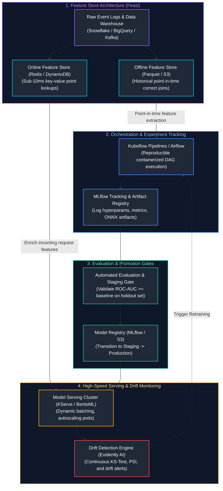
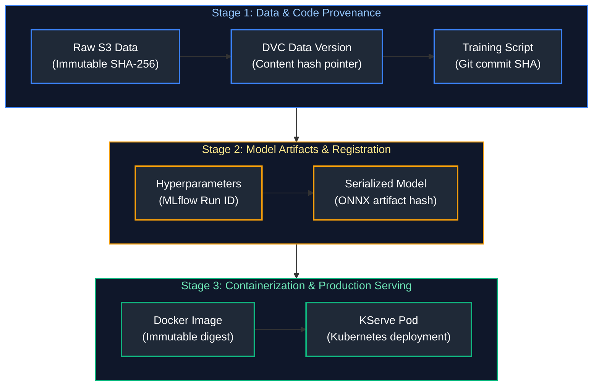
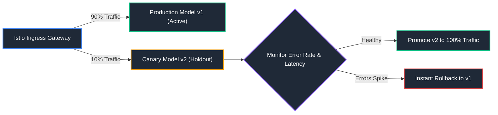

# 10. Production MLOps & Feature Stores

A comprehensive, production-grade guide to enterprise Machine Learning Operations (MLOps), experiment tracking with MLflow, pipeline orchestration (Kubeflow Pipelines, Apache Airflow), centralized feature stores (Feast, Hopsworks), training-serving skew mitigation, point-in-time correctness, model packaging and serving (KServe, BentoML), drift detection (Evidently AI), and automated canary deployments tailored for MLOps and AI Engineers.

---

## Architectural Overview: Enterprise Production MLOps Engine & Feature Store Topology



---

## Table of Contents
1. [MLOps Foundations: Lifecycle, Reproducibility & Governance](#1-mlops-foundations-lifecycle-reproducibility-governance)
   - [1.1 Software 1.0 (Code) vs. Software 2.0 (Code + Data + Models)](#11-software-10-code-vs-software-20-code-data-models)
   - [1.2 Data and Model Lineage Architecture](#12-data-and-model-lineage-architecture)
2. [Experiment Tracking & Model Registries with MLflow](#2-experiment-tracking-model-registries-with-mlflow)
   - [2.1 Tracking Parameters, Metrics, Artifacts & Code Git Commits](#21-tracking-parameters-metrics-artifacts-code-git-commits)
   - [2.2 Production MLflow Implementation](#22-production-mlflow-implementation)
3. [Feature Stores: Feast Architecture & Offline/Online Consistency](#3-feature-stores-feast-architecture-offlineonline-consistency)
   - [3.1 The Dual-Store Architecture: Offline vs. Online](#31-the-dual-store-architecture-offline-vs-online)
   - [3.2 Point-in-Time Correctness & Time-Travel Joins](#32-point-in-time-correctness-time-travel-joins)
   - [3.3 Production Feast Feature Definition Code](#33-production-feast-feature-definition-code)
4. [Training-Serving Skew & Feature Consistency](#4-training-serving-skew-feature-consistency)
   - [4.1 Root Causes of Training-Serving Skew](#41-root-causes-of-training-serving-skew)
   - [4.2 Architectural Defenses Against Skew](#4-training-serving-skew-feature-consistency)
5. [Pipeline Orchestration: Kubeflow Pipelines & Airflow](#5-pipeline-orchestration-kubeflow-pipelines-airflow)
   - [5.1 Containerized Pipeline Steps & Dependency DAGs](#51-containerized-pipeline-steps-dependency-dags)
   - [5.2 Automated Approval Gates & Model Promotion](#12-data-and-model-lineage-architecture)
6. [Model Packaging & Serving: KServe & BentoML](#6-model-packaging-serving-kserve-bentoml)
   - [6.1 Unified Model Serving Architectures (v2 Data Plane)](#61-unified-model-serving-architectures-v2-data-plane)
   - [6.2 Production BentoML Service Definition](#62-production-bentoml-service-definition)
7. [Continuous Monitoring: Data Drift, Concept Drift & Evidently AI](#7-continuous-monitoring-data-drift-concept-drift-evidently-ai)
   - [7.1 Real-Time Statistical Profiling](#71-real-time-statistical-profiling)
   - [7.2 Production Evidently AI Drift Suite](#7-continuous-monitoring-data-drift-concept-drift-evidently-ai)
8. [Production Deployment Strategies: Canary, Shadow & Blue-Green](#8-production-deployment-strategies-canary-shadow-blue-green)
   - [8.1 Traffic Splitting with Istio & Knative](#8-production-deployment-strategies-canary-shadow-blue-green)
   - [8.2 Automated Rollback Triggers](#8-production-deployment-strategies-canary-shadow-blue-green)
9. [Summary Comparison & Engineering Reference Matrix](#9-summary-comparison-engineering-reference-matrix)
10. [References & Further Reading](#10-references-further-reading)

---

# 1. MLOps Foundations: Lifecycle, Reproducibility & Governance

### 1.1 Software 1.0 (Code) vs. Software 2.0 (Code + Data + Models)

> [!CAUTION]
> **Silent Prediction Degradation:** Unlike traditional software crashes, model performance in production decays silently without throwing runtime exceptions. Continuously compute Population Stability Index (PSI) and Kolmogorov-Smirnov (KS) statistics against incoming feature streams to trigger automated retraining alerts.

Traditional Software Engineering (Software 1.0) is deterministic: code version $V$ compiled with dependencies $D$ produces predictable behavior.
In Machine Learning (Software 2.0), behavior is governed by a **trio of mutable artifacts**:
$$\text{Production Behavior} = f(\text{Code Commit}, \text{Dataset Snapshot}, \text{Environment Dependencies})$$
A model trained on yesterday's dataset may produce completely different predictions than one trained today on identical code due to changing underlying data distributions.

---

### 1.2 Data and Model Lineage Architecture

> [!IMPORTANT]
> **Eliminating Feature Leakage:** Point-in-time correct joins are mandatory when constructing training data from historical feature logs. Using current feature values with past labels introduces lookahead data leakage, creating models that perform flawlessly offline but fail catastrophically in live production.



---

# 2. Experiment Tracking & Model Registries with MLflow

### 2.1 Tracking Parameters, Metrics, Artifacts & Code Git Commits

MLflow centralizes the machine learning lifecycle:
1. **MLflow Tracking:** Logs parameters (e.g., learning rate, tree depth), metrics across training epochs, and code commit hashes.
2. **MLflow Artifacts:** Stores trained model binaries, confusion matrices, and feature importance plots.
3. **MLflow Model Registry:** Manages model lifecycle stages: `None` $\rightarrow$ `Staging` $\rightarrow$ `Production` $\rightarrow$ `Archived`.

---

### 2.2 Production MLflow Implementation

```python
# ==============================================================================
# Production MLflow Tracking & Model Registry Integration
# ==============================================================================
import mlflow
import mlflow.xgboost
import xgboost as xgb
from sklearn.metrics import roc_auc_score, f1_score
import numpy as np

# Set tracking server URI (e.g., remote enterprise server backed by Postgres & S3)
mlflow.set_tracking_uri("http://localhost:5000")
mlflow.set_experiment("enterprise_churn_prediction")

def train_and_register_churn_model(X_train, y_train, X_val, y_val, params: dict):
    with mlflow.start_run(run_name="xgboost_hpo_candidate") as run:
        # 1. Log hyperparameters
        mlflow.log_params(params)
        mlflow.set_tag("pipeline_version", "v2.4.1")

        # 2. Train model with early stopping
        model = xgb.XGBClassifier(**params)
        model.fit(
            X_train, y_train,
            eval_set=[(X_val, y_val)],
            verbose=False
        )

        # 3. Compute and log evaluation metrics
        val_preds = model.predict_proba(X_val)[:, 1]
        val_auc = roc_auc_score(y_val, val_preds)
        val_f1 = f1_score(y_val, (val_preds >= 0.5).astype(int))

        mlflow.log_metric("val_roc_auc", val_auc)
        mlflow.log_metric("val_f1_score", val_f1)

        # 4. Log model artifact with input signature
        signature = mlflow.models.infer_signature(X_val, val_preds)
        mlflow.xgboost.log_model(
            xgb_model=model,
            artifact_path="model",
            signature=signature,
            registered_model_name="CustomerChurnClassifier"
        )
        print(f"Run {run.info.run_id} logged. Val ROC-AUC: {val_auc:.4f}")
```

---

# 3. Feature Stores: Feast Architecture & Offline/Online Consistency

### 3.1 The Dual-Store Architecture: Offline vs. Online

A **Feature Store** solves the dual requirement of machine learning:
1. **Offline Store (BigQuery, Snowflake, S3/Parquet):** Optimized for high-throughput batch scans across millions of historical rows for model training.
2. **Online Store (Redis, DynamoDB):** Optimized for sub-10ms key-value point lookups by primary key (e.g., `user_id`) during real-time online inference.

---

### 3.2 Point-in-Time Correctness & Time-Travel Joins

When training a model on historical events, feature values must reflect the state of the world **at the exact timestamp of the event**, not the current timestamp:

> **Customer Transaction Event Timestamp:** `2024-03-15 14:32:00`

| Feature Horizon Mode | Evaluated Feature Value | Data Leakage Risk & Production Consequence |
| :--- | :--- | :--- |
| **Current Database Snapshot** | `customer_total_spend = \$15,400` (today) | **Catastrophic Target Leakage:** Leaks future customer transaction activity into historical training rows. |
| **Point-in-Time (As-Of) Correct** | `customer_total_spend = \$4,200` (as of event timestamp) | **Zero Leakage:** Strictly enforces $\text{Feature\_Timestamp} \le \text{Event\_Timestamp}$. |

---

### 3.3 Production Feast Feature Definition Code

```python
# ==============================================================================
# Feast Feature Store Definitions (feature_store.py)
# ==============================================================================
from datetime import timedelta
from feast import Entity, Field, FeatureView, FileSource
from feast.types import Float32, Int64, String

# 1. Define primary entity
customer = Entity(
    name="customer_id",
    join_keys=["customer_id"],
    description="Unique enterprise customer identifier"
)

# 2. Define batch source pointing to offline Parquet storage
customer_stats_source = FileSource(
    name="customer_stats_source",
    path="s3://enterprise-ml-lakehouse/features/customer_stats.parquet",
    timestamp_field="event_timestamp",
    created_timestamp_column="created_timestamp"
)

# 3. Define Feature View linking entity, schema, and source
customer_stats_fv = FeatureView(
    name="customer_stats_feature_view",
    entities=[customer],
    ttl=timedelta(days=30),  # Features older than 30 days are discarded in online store
    schema=[
        Field(name="avg_monthly_spend", dtype=Float32),
        Field(name="support_tickets_30d", dtype=Int64),
        Field(name="risk_tier", dtype=String),
    ],
    online=True,  # Materializes to Redis for sub-10ms production API queries
    source=customer_stats_source,
)
```

---

# 4. Training-Serving Skew & Feature Consistency

### 4.1 Root Causes of Training-Serving Skew

1. **Inconsistent Transformations:** The training pipeline computes features in PySpark using SQL, while the online serving API re-implements transformations in Java or TypeScript, introducing minor rounding or regex differences.
2. **Missing Feature Updates:** Real-time data streams fail to populate the online store, causing the model to receive stale default values (`0` or `null`).
3. **Data Distribution Shifts:** The live operational environment exhibits different distributions than the static training dump.

---

# 5. Pipeline Orchestration: Kubeflow Pipelines & Airflow

### 5.1 Containerized Pipeline Steps & Dependency DAGs

Kubeflow Pipelines (KFP) executes each stage of a machine learning workflow inside an isolated Docker container on Kubernetes:

```python
# ==============================================================================
# Kubeflow Pipeline Component Definition
# ==============================================================================
from kfp import dsl

@dsl.component(
    base_image="python:3.11-slim",
    packages_to_install=["scikit-learn", "xgboost", "boto3"]
)
def train_model_op(
    train_data_path: str,
    max_depth: int,
    output_model_path: dsl.Output[dsl.Model]
):
    import pickle
    import xgboost as xgb
    # Containerized training logic reading from train_data_path
    model = xgb.XGBClassifier(max_depth=max_depth)
    # Save model artifact to KFP pipeline artifact store
    with open(output_model_path.path, "wb") as f:
        pickle.dump(model, f)

@dsl.pipeline(name="enterprise-retraining-pipeline")
def ml_retraining_pipeline(data_s3_uri: str, max_depth: int = 5):
    train_task = train_model_op(train_data_path=data_s3_uri, max_depth=max_depth)
```

---

# 6. Model Packaging & Serving: KServe & BentoML

### 6.1 Unified Model Serving Architectures (v2 Data Plane)

**KServe** provides Kubernetes-native Custom Resource Definitions (`InferenceService`) implementing the KServe v2 Data Plane specification:
- Scale-to-zero when idle via Knative.
- Dynamic request batching to saturate GPU Tensor Cores.
- Pre-processing and post-processing transformer sidecars.

---

### 6.2 Production BentoML Service Definition

```python
# ==============================================================================
# Production BentoML High-Speed Inference Service (service.py)
# ==============================================================================
import bentoml
import numpy as np

# 1. Retrieve model reference from local BentoML model store
churn_runner = bentoml.xgboost.get("customer_churn_model:latest").to_runner()

# 2. Compose BentoML Service
svc = bentoml.Service("churn_prediction_service", runners=[churn_runner])

@svc.api(input=bentoml.io.NumpyNdarray(dtype="float32", shape=(-1, 10)), output=bentoml.io.NumpyNdarray())
async def predict_churn(feature_matrix: np.ndarray) -> np.ndarray:
    """Async endpoint with automated micro-batching enabled by BentoML runner."""
    predictions = await churn_runner.predict_proba.async_run(feature_matrix)
    return predictions[:, 1]
```

---

# 7. Continuous Monitoring: Data Drift, Concept Drift & Evidently AI

### 7.1 Real-Time Statistical Profiling

```python
# ==============================================================================
# Production Drift Detection Report with Evidently AI
# ==============================================================================
import pandas as pd
from evidently.report import Report
from evidently.metric_preset import DataDriftPreset, TargetDriftPreset

def evaluate_production_data_drift(
    reference_df: pd.DataFrame,
    current_production_df: pd.DataFrame
) -> bool:
    """Generates drift report and returns True if critical drift is detected."""
    report = Report(metrics=[
        DataDriftPreset()
    ])

    report.run(reference_data=reference_df, current_data=current_production_df)
    report_dict = report.as_dict()

    # Extract drift metrics
    dataset_drift = report_dict["metrics"][0]["result"]["dataset_drift"]
    drift_share = report_dict["metrics"][0]["result"]["drift_share"]

    print(f"Dataset Drift Flag: {dataset_drift} (Drifted Feature Share: {drift_share:.2%})")
    
    # Trigger alert if more than 30% of features exhibit statistical drift
    if drift_share >= 0.30:
        print("CRITICAL ALERT: Significant feature drift detected. Triggering pipeline retraining.")
        return True
    return False
```

---

# 8. Production Deployment Strategies: Canary, Shadow & Blue-Green



---

# 9. Summary Comparison & Engineering Reference Matrix

| Tool / Technology | Primary Responsibility | Deployment Footprint | Enterprise Alternative |
| :--- | :--- | :--- | :--- |
| **MLflow** | Experiment tracking & model registry | Lightweight (Postgres + S3) | Weights & Biases, Comet ML |
| **Feast** | Feature store (Offline/Online sync) | Serverless (S3 + Redis) | Hopsworks, Tecton |
| **Kubeflow Pipelines** | Containerized ML training DAGs | Heavy (Kubernetes cluster) | Apache Airflow, Prefect, Metaflow |
| **KServe** | Serverless model inference & autoscaling| Kubernetes (CRDs + Knative)| BentoML, Triton Inference Server |
| **Evidently AI** | Data & concept drift monitoring | Python library / Service | Arize AI, Fiddler, Whylabs |

---

# 10. References & Further Reading

- [MLflow: A Machine Learning Lifecycle Platform](https://mlflow.org/docs/latest/index.html)
- [Feast: Feature Store for Machine Learning](https://docs.feast.dev/)
- [KServe: Cloud Native Model Serving on Kubernetes](https://kserve.github.io/website/)
- [Evidently AI: ML System Observability and Monitoring](https://docs.evidentlyai.com/)
- [BentoML: Build Production AI Applications](https://docs.bentoml.com/)

