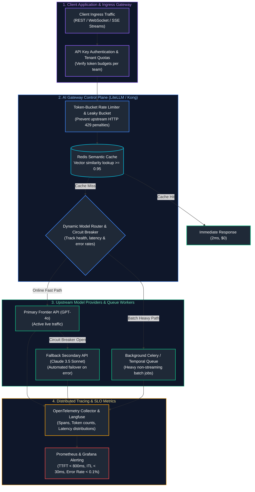
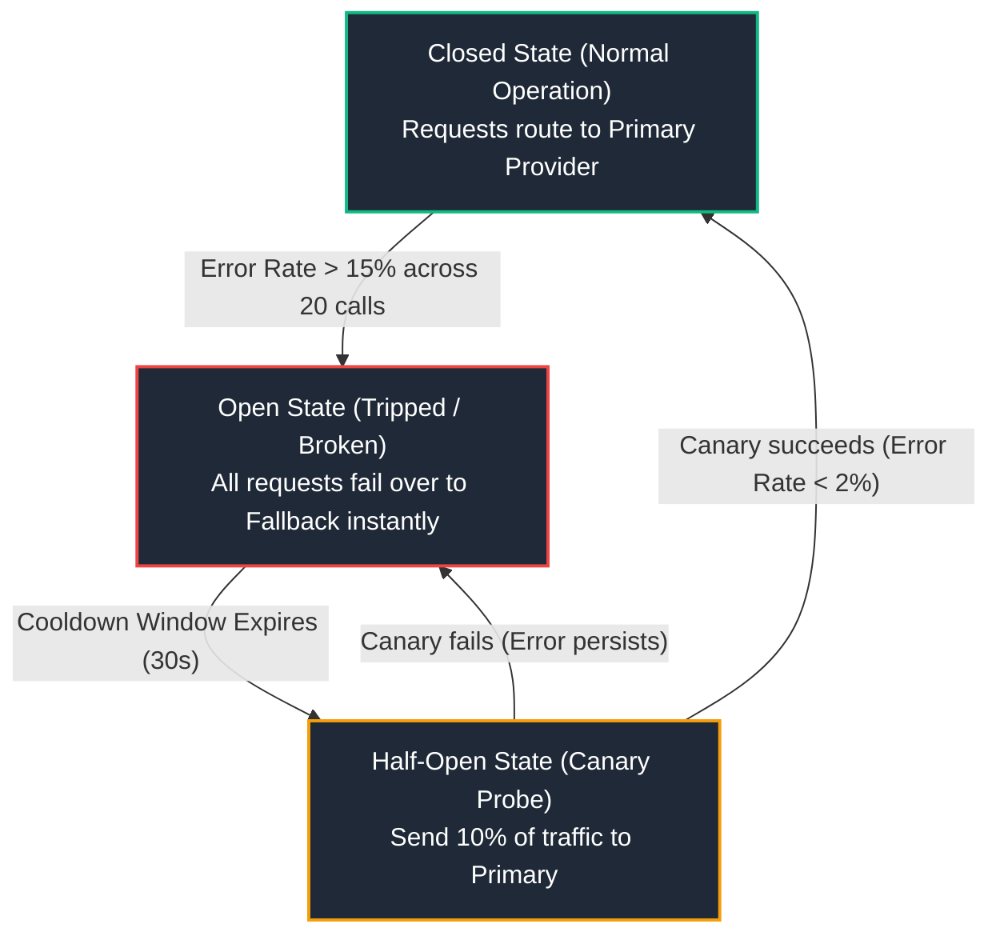
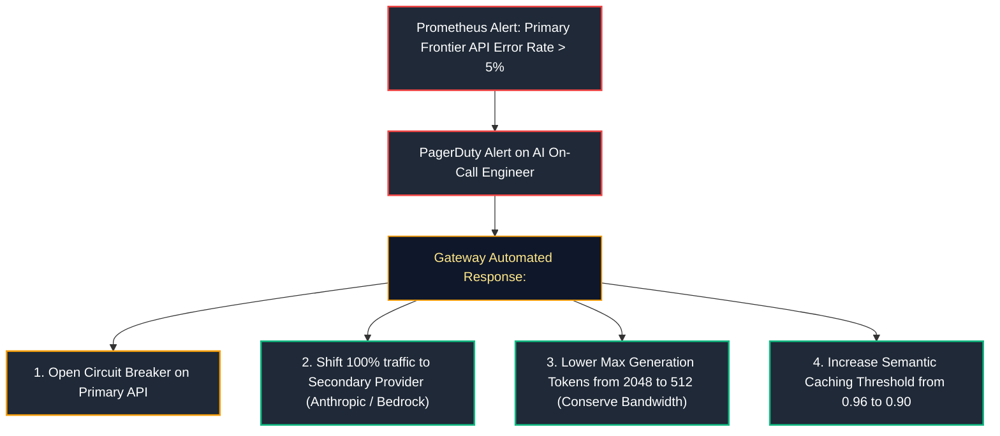

# 11. LLMOps, Gateways & Production Operations

A comprehensive, production-grade guide to Large Language Model Operations (LLMOps), enterprise AI Gateways (LiteLLM, Portkey, Kong), token-bucket rate limiting, circuit breakers, semantic caching, queue-based inference workers (Temporal, Celery), distributed OpenTelemetry tracing, AI-specific metrics (TTFT, ITL, Tokens/sec), AI Service-Level Objectives (SLOs), and incident response runbooks tailored for AI Engineers.

---

## Architectural Overview: Enterprise AI Gateway & Operational Control Plane



---

## Table of Contents
1. [LLMOps Foundations: Configuration, Prompt & Model Versioning](#1-llmops-foundations-configuration-prompt-model-versioning)
   - [1.1 Immutable Prompt Templates as Versioned Code](#11-immutable-prompt-templates-as-versioned-code)
   - [1.2 LLM Configuration Management & GitOps](#12-llm-configuration-management-gitops)
2. [Enterprise AI Gateways & Provider Abstraction](#2-enterprise-ai-gateways-provider-abstraction)
   - [2.1 The Role of AI Gateways: LiteLLM, Portkey, Kong AI](#21-the-role-of-ai-gateways-litellm-portkey-kong-ai)
   - [2.2 Unified OpenAI-Compatible Proxy Architecture](#2-enterprise-ai-gateways-provider-abstraction)
3. [Rate Limiting, Backpressure & Token Budgeting](#3-rate-limiting-backpressure-token-budgeting)
   - [3.1 Token-Bucket and Leaky-Bucket Rate Limiting Algorithms](#31-token-bucket-and-leaky-bucket-rate-limiting-algorithms)
   - [3.2 Tenant-Level Token Budgets & Cost Attribution](#32-tenant-level-token-budgets-cost-attribution)
4. [High Availability: Circuit Breakers & Dynamic Model Fallbacks](#4-high-availability-circuit-breakers-dynamic-model-fallbacks)
   - [4.1 Circuit Breaker Finite State Machine](#41-circuit-breaker-finite-state-machine)
   - [4.2 Production Dynamic Failover Router Code](#42-production-dynamic-failover-router-code)
5. [Caching Architectures: Exact Hash vs. Semantic Vector Caching](#5-caching-architectures-exact-hash-vs-semantic-vector-caching)
   - [5.1 Exact Cache Hits ($<2\text{ms}$) with Redis](#51-exact-cache-hits-2textms-with-redis)
   - [5.2 Semantic Caching Mechanics & Invalidation Strategies](#52-semantic-caching-mechanics-invalidation-strategies)
6. [Asynchronous Queue-Based Inference & Streaming Cancellation](#6-asynchronous-queue-based-inference-streaming-cancellation)
   - [6.1 Asynchronous Background Job Workers (Temporal / Celery)](#61-asynchronous-background-job-workers-temporal-celery)
   - [6.2 Client Disconnect Detection & Stream Cancellation](#62-client-disconnect-detection-stream-cancellation)
7. [Observability & The Four Golden Signals of LLMs](#7-observability-the-four-golden-signals-of-llms)
   - [7.1 Time-to-First-Token (TTFT) and Inter-Token Latency (ITL)](#31-token-bucket-and-leaky-bucket-rate-limiting-algorithms)
   - [7.2 Token Throughput, Error Rates, and Cost per Request](#32-tenant-level-token-budgets-cost-attribution)
8. [AI Service-Level Objectives (SLOs) & Incident Response](#8-ai-service-level-objectives-slos-incident-response)
   - [8.1 Defining Rigorous AI SLOs and Error Budgets](#81-defining-rigorous-ai-slos-and-error-budgets)
   - [8.2 Outage Response Playbooks & Degraded Operating Modes](#82-outage-response-playbooks-degraded-operating-modes)
9. [Summary Comparison & Engineering Reference Matrix](#9-summary-comparison-engineering-reference-matrix)
10. [References & Further Reading](#10-references-further-reading)

---

# 1. LLMOps Foundations: Configuration, Prompt & Model Versioning

### 1.1 Immutable Prompt Templates as Versioned Code

In immature architectures, prompts are stored as ad-hoc strings scattered across application files. In enterprise LLMOps, prompts are treated as **immutable, versioned software artifacts**:
- Every prompt template resides in source control (`prompts/triage/v3.yaml`).
- Prompts have explicit input schema definitions, unit test fixtures, and assigned semantic versions (`v1.2.0`).
- Deployments use immutable Git commit SHAs, guaranteeing that production models can be deterministically rolled back to previous prompt configurations.

---

### 1.2 LLM Configuration Management & GitOps

```yaml
# config/llm_gateways.yaml
production_routing:
  primary:
    provider: openai
    model: gpt-4o-2024-08-06
    temperature: 0.2
    max_tokens: 1500
    timeout_seconds: 10
  fallback:
    provider: anthropic
    model: claude-3-5-sonnet-20241022
    temperature: 0.2
    max_tokens: 1500
    timeout_seconds: 12
  token_budget:
    monthly_ceiling_usd: 50000
    tenant_rate_limit_rpm: 1200
```

---

# 2. Enterprise AI Gateways & Provider Abstraction

### 2.1 The Role of AI Gateways: LiteLLM, Portkey, Kong AI

An **AI Gateway** sits as a reverse proxy between internal enterprise microservices and external LLM APIs:
1. **Unified Interface:** Standardizes all calls to the OpenAI REST schema (`POST /v1/chat/completions`), translating requests under the hood to Anthropic, Google Vertex, or self-hosted vLLM.
2. **Centralized Key Management:** Developers never handle raw provider API keys; the gateway injects vaulted secrets.
3. **Audit Logging & Token Chargeback:** Automatically logs exact token consumption, calculating costs per team and department.

---

# 3. Rate Limiting, Backpressure & Token Budgeting

### 3.1 Token-Bucket and Leaky-Bucket Rate Limiting Algorithms

Commercial LLM APIs enforce strict limits on both **Requests Per Minute (RPM)** and **Tokens Per Minute (TPM)**. Exceeding either immediately yields `HTTP 429 Too Many Requests`.

```text
TOKEN-BUCKET ALGORITHM MECHANICS:
Capacity: C = 500,000 tokens.
Refill Rate: r = 8,333 tokens per second (500k TPM / 60s).
Each incoming request estimates required tokens (prompt_tokens + max_tokens).
If bucket has sufficient tokens: Subtract tokens and dispatch request immediately.
If bucket is empty: Enqueue request or return HTTP 429 with Retry-After header.
```

---

### 3.2 Tenant-Level Token Budgets & Cost Attribution

In multi-tenant SaaS platforms, a single misconfigured customer script must never exhaust the entire organization's rate limit or monthly budget:
- Maintain per-tenant Redis counters: `usage:tenant_id:2026-10`.
- If tenant spend exceeds quota, return `HTTP 402 Payment Required` or gracefully degrade to an ultra-low-cost small model (`gpt-4o-mini`).

---

# 4. High Availability: Circuit Breakers & Dynamic Model Fallbacks

### 4.1 Circuit Breaker Finite State Machine



---

### 4.2 Production Dynamic Failover Router Code

```python
# ==============================================================================
# Production Circuit-Breaker Failover Router with Automatic Fallback
# ==============================================================================
import time
from typing import List, Dict
import openai
from openai import OpenAI

class CircuitBreakerOpenException(Exception): pass

class ResilientModelGateway:
    def __init__(self):
        self.client = OpenAI()
        self.failure_count = 0
        self.failure_threshold = 3
        self.state = "CLOSED"
        self.last_failure_time = 0.0
        self.cooldown_seconds = 30.0

    def invoke_with_fallback(self, messages: List[Dict[str, str]]) -> str:
        # Check Circuit Breaker state
        if self.state == "OPEN":
            if time.time() - self.last_failure_time > self.cooldown_seconds:
                print("Circuit Breaker transitioned to HALF-OPEN. Testing canary request.")
                self.state = "HALF-OPEN"
            else:
                print("Circuit Breaker OPEN! Diverting to Fallback Provider.")
                return self._fallback_invocation(messages)

        # Attempt Primary Model
        try:
            response = self.client.chat.completions.create(
                model="gpt-4o",
                messages=messages,
                timeout=8.0
            )
            # Reset on successful execution
            if self.state == "HALF-OPEN":
                print("Primary recovered! Circuit Breaker reset to CLOSED.")
                self.state = "CLOSED"
                self.failure_count = 0
            return response.choices[0].message.content
        except (openai.APIConnectionError, openai.RateLimitError, openai.InternalServerError) as e:
            self.failure_count += 1
            self.last_failure_time = time.time()
            print(f"Primary error ({e}). Failure count: {self.failure_count}")

            if self.failure_count >= self.failure_threshold:
                self.state = "OPEN"
                print("CRITICAL: Error threshold breached. Circuit Breaker is now OPEN.")

            return self._fallback_invocation(messages)

    def _fallback_invocation(self, messages: List[Dict[str, str]]) -> str:
        """Invokes secondary model family (e.g., gpt-4o-mini or Claude via proxy)."""
        fallback_resp = self.client.chat.completions.create(
            model="gpt-4o-mini",
            messages=messages,
            timeout=10.0
        )
        return f"[FALLBACK_SERVED] {fallback_resp.choices[0].message.content}"
```

---

# 5. Caching Architectures: Exact Hash vs. Semantic Vector Caching

### 5.1 Exact Cache Hits ($<2\text{ms}$) with Redis

Hash the canonicalized prompt string:
$$\text{CacheKey} = \text{SHA256}(\text{model} + \text{temp} + \text{system\_prompt} + \text{user\_prompt})$$
Store responses in Redis with a 24-hour TTL:
```python
import hashlib, json, redis

def get_exact_cache(redis_client, model, messages, temperature):
    raw_key = json.dumps({"m": model, "msgs": messages, "t": temperature}, sort_keys=True)
    cache_key = f"llm_cache:{hashlib.sha256(raw_key.encode()).hexdigest()}"
    cached = redis_client.get(cache_key)
    return json.loads(cached) if cached else None
```

---

### 5.2 Semantic Caching Mechanics & Invalidation Strategies

When users query *"How do I reset my password?"* and *"What are the steps to recover my account password?"*, exact hashing misses the cache. Semantic caching embeds the query and searches a vector index. If cosine similarity $\ge 0.96$, the cached answer is returned directly, bypassing the LLM completely.

> [!CAUTION]
> Never enable semantic caching for queries containing personalized session tokens, dynamic timestamps, user names, or customer financial account IDs. Semantic caching on PII leads to cross-tenant data leakage.

---

# 6. Asynchronous Queue-Based Inference & Streaming Cancellation

### 6.1 Asynchronous Background Job Workers (Temporal / Celery)

Not all AI tasks require interactive HTTP responses. Batch document ingestion, offline audio transcription, and weekly report generation must be decoupled via message brokers:
1. API immediately returns `202 Accepted` with a `job_id`.
2. Job is placed onto a Redis or RabbitMQ queue.
3. Celery / Temporal workers pull jobs, respect provider rate limits, and write final outputs to S3 or a relational database.

---

### 6.2 Client Disconnect Detection & Stream Cancellation

When a user closes their browser tab 2 seconds into a 20-second streaming completion, standard servers keep generating tokens in the background, consuming GPU compute and API token budgets for an abandoned response.
- **FastAPI Disconnect Handling:** Monitor `request.is_disconnected()` in the streaming loop and immediately call `stream.close()` to stop upstream generation.

---

# 7. Observability & The Four Golden Signals of LLMs

```text
+-----------------------+-----------------------------+-------------------------------+
| GOLDEN SIGNAL         | PRODUCTION DEFINITION       | TARGET PRODUCTION SLA         |
+-----------------------+-----------------------------+-------------------------------+
| Time to First Token   | Latency between HTTP request| p50 < 400ms,                  |
| (TTFT)                | arrival and 1st token chunk.| p95 < 1200ms.                 |
| Inter-Token Latency   | Time elapsed between        | p50 < 25ms,                   |
| (ITL)                 | emission of successive tokens| p95 < 50ms (40+ tokens/sec).  |
| Output Generation     | Total tokens emitted per    | > 40 tokens/sec               |
| Speed (Throughput)    | second per active request.  | per streaming client.         |
| Error Rate (HTTP 429  | Percentage of requests      | < 0.1% across rolling         |
| / 500 / 503)          | terminating in error.       | 5-minute window.              |
+-----------------------+-----------------------------+-------------------------------+
```

---

# 8. AI Service-Level Objectives (SLOs) & Incident Response

### 8.1 Defining Rigorous AI SLOs and Error Budgets

```text
ENTERPRISE AI PRODUCTION SLO MATRIX:
1. Availability: 99.9% of API requests return HTTP 200 within timeout budget.
2. Latency: 95% of interactive chat queries achieve TTFT < 800ms.
3. Groundedness: 99.5% of production RAG responses score Faithfulness = 1.0 on automated sample audit.
4. Error Budget: A 0.1% allowable failure rate over 30 days = 43 minutes of total downtime.
```

---

### 8.2 Outage Response Playbooks & Degraded Operating Modes



---

# 9. Summary Comparison & Engineering Reference Matrix

| Gateway / Tool | Protocol | Primary Strength | Overhead | Production Recommendation |
| :--- | :--- | :--- | :--- | :--- |
| **LiteLLM Proxy** | Python / AsyncIO | 100+ provider integrations, native OpenAI mapping | $\sim 5\text{ms}$ | Standard for Python-centric enterprise AI teams. |
| **Portkey** | Rust / Node.js | Multi-region routing, audit logs, caching | $\sim 3\text{ms}$ | High-throughput enterprise SaaS backbones. |
| **Kong AI Gateway** | C / Lua (Nginx) | High concurrency API gateway with AI plugins | $<1\text{ms}$ | Organizations with existing Kong infrastructure. |
| **Redis Cache** | In-Memory K-V | Sub-millisecond exact key hits | $<2\text{ms}$ | Mandatory for all repeat queries and batch processing. |

---

# 10. References & Further Reading

- [LiteLLM: Call All LLM APIs Using the OpenAI Format](https://docs.litellm.ai/docs/)
- [Portkey AI Gateway: Unified API & Observability for Generative AI](https://portkey.ai/docs)
- [OpenTelemetry Semantic Conventions for Generative AI Systems](https://opentelemetry.io/docs/specs/semconv/gen-ai/)
- [Google Site Reliability Engineering: Monitoring Distributed Systems](https://sre.google/sre-book/monitoring-distributed-systems/)
- [Token-Bucket Algorithm and Rate-Limiting Mechanics (RFC 6598)](https://datatracker.ietf.org/doc/html/rfc6598)

