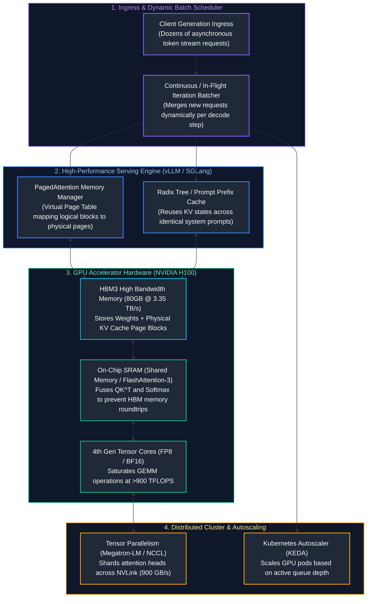
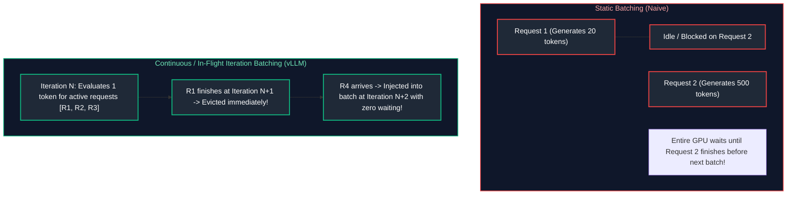

# 12. AI Infrastructure & Inference Serving

A comprehensive, production-grade guide to high-performance AI infrastructure, GPU hardware architecture (NVIDIA Hopper H100, Tensor Cores, HBM3 bandwidth), KV cache memory dynamics, PagedAttention virtual memory mapping (vLLM, SGLang), continuous batching, model quantization (FP8, AWQ, GPTQ), Kubernetes GPU scheduling, KEDA autoscaling, and capacity planning tailored for AI Infrastructure Engineers.

---

## Architectural Overview: High-Throughput Distributed LLM Serving Node



---

## Table of Contents
1. [GPU Hardware Mechanics & Memory Hierarchies](#1-gpu-hardware-mechanics-memory-hierarchies)
   - [1.1 Modern GPU Architectures: Ampere A100 vs. Hopper H100 vs. Blackwell B200](#11-modern-gpu-architectures-ampere-a100-vs-hopper-h100-vs-blackwell-b200)
   - [1.2 High Bandwidth Memory (HBM3), Memory Bandwidth vs. Compute Bounds](#12-high-bandwidth-memory-hbm3-memory-bandwidth-vs-compute-bounds)
2. [The Key-Value (KV) Cache: Physics & Memory Sizing](#2-the-key-value-kv-cache-physics-memory-sizing)
   - [2.1 Why Autoregressive Generation Requires the KV Cache](#21-why-autoregressive-generation-requires-the-kv-cache)
   - [2.2 Exact Mathematical KV Cache Memory Sizing Formula](#22-exact-mathematical-kv-cache-memory-sizing-formula)
3. [Virtual Memory for LLMs: PagedAttention & vLLM](#3-virtual-memory-for-llms-pagedattention-vllm)
   - [2.3 Internal vs. External Memory Fragmentation](#23-internal-vs-external-memory-fragmentation)
   - [3.2 Operating System Page Tables for KV Blocks](#32-operating-system-page-tables-for-kv-blocks)
4. [Inference Dynamics: Prefill vs. Decode & Continuous Batching](#4-inference-dynamics-prefill-vs-decode-continuous-batching)
   - [4.1 Compute-Bound Prefill vs. Memory-Bound Decode](#12-high-bandwidth-memory-hbm3-memory-bandwidth-vs-compute-bounds)
   - [4.2 Static Batching vs. Continuous (In-Flight / Iteration-Level) Batching](#4-inference-dynamics-prefill-vs-decode-continuous-batching)
5. [Model Quantization & Tensor Precision Formats](#5-model-quantization-tensor-precision-formats)
   - [5.1 Precision Formats: FP32, FP16, BF16, FP8 (E4M3 vs. E5M2)](#5-model-quantization-tensor-precision-formats)
   - [5.2 Post-Training Quantization: AWQ vs. GPTQ](#12-high-bandwidth-memory-hbm3-memory-bandwidth-vs-compute-bounds)
6. [Distributed Serving: Tensor Parallelism vs. Pipeline Parallelism](#6-distributed-serving-tensor-parallelism-vs-pipeline-parallelism)
   - [6.1 Megatron-LM Tensor Parallelism (Row-Parallel & Column-Parallel GEMMs)](#61-megatron-lm-tensor-parallelism-row-parallel-column-parallel-gemms)
   - [6.2 NVLink vs. PCIe Gen5 Interconnect Constraints](#12-high-bandwidth-memory-hbm3-memory-bandwidth-vs-compute-bounds)
7. [Containerization & Kubernetes GPU Scheduling](#7-containerization-kubernetes-gpu-scheduling)
   - [7.1 Production Dockerfile for GPU Inference with CUDA](#71-production-dockerfile-for-gpu-inference-with-cuda)
   - [7.2 Production Kubernetes Deployment Manifest with KEDA Autoscaling](#72-production-kubernetes-deployment-manifest-with-keda-autoscaling)
8. [Benchmarking, Load Testing & Capacity Sizing Playbooks](#8-benchmarking-load-testing-capacity-sizing-playbooks)
   - [8.1 Benchmarking with Locust & vLLM Bench](#81-benchmarking-with-locust-vllm-bench)
   - [8.2 Back-of-the-Envelope GPU Sizing Calculator](#2-the-key-value-kv-cache-physics-memory-sizing)
9. [Summary Comparison & Engineering Reference Matrix](#9-summary-comparison-engineering-reference-matrix)
10. [References & Further Reading](#10-references-further-reading)

---

# 1. GPU Hardware Mechanics & Memory Hierarchies

### 1.1 Modern GPU Architectures: Ampere A100 vs. Hopper H100 vs. Blackwell B200

```text
+-----------------------+-------------------+-------------------+-------------------+
| HARDWARE SPEC         | NVIDIA A100 (80GB)| NVIDIA H100 (80GB)| NVIDIA B200 (192GB|
+-----------------------+-------------------+-------------------+-------------------+
| GPU Architecture      | Ampere            | Hopper            | Blackwell         |
| Memory Type           | HBM2e             | HBM3              | HBM3e             |
| Memory Bandwidth      | 2.039 TB/s        | 3.35 TB/s         | 8.0 TB/s          |
| FP16 / BF16 Tensor    | 312 TFLOPS        | 989 TFLOPS        | 2,250 TFLOPS      |
| FP8 Tensor Cores      | Not Supported     | 1,979 TFLOPS      | 4,500 TFLOPS      |
| NVLink Bandwidth      | 600 GB/s          | 900 GB/s          | 1,800 GB/s        |
+-----------------------+-------------------+-------------------+-------------------+
```

---

### 1.2 High Bandwidth Memory (HBM3), Memory Bandwidth vs. Compute Bounds

In LLM serving, understanding the **Arithmetic Intensity** ($\text{FLOPs per byte of memory read}$) dictates performance:
- **Prefill Phase (Prompt Ingestion):** High arithmetic intensity. Large matrix-matrix multiplications (GEMM) process all prompt tokens in parallel. Runs near peak Tensor Core compute throughput.
- **Decode Phase (Token Generation):** Low arithmetic intensity. Matrix-vector multiplications (GEMV) generate one token at a time. The GPU must stream the entire model's weights and KV cache from HBM3 VRAM into SRAM *to generate just a single token*. The decode phase is **100% memory-bandwidth bound**.

---

# 2. The Key-Value (KV) Cache: Physics & Memory Sizing

### 2.1 Why Autoregressive Generation Requires the KV Cache

Without a KV cache, generating token $N$ requires recomputing attention keys and values for all preceding tokens $1, \dots, N-1$. Computing attention for a 1,000-token sequence would require $\sum_{i=1}^{1000} i^2 \approx 3.33 \times 10^8$ operations ($O(N^2)$ per token).

By caching Key ($\mathbf{K}$) and Value ($\mathbf{V}$) activation tensors in GPU memory, the model only computes $\mathbf{q}_N$ for the newly generated token and appends $\mathbf{k}_N$ and $\mathbf{v}_N$ to the cache ($O(N)$ per token).

---

### 2.2 Exact Mathematical KV Cache Memory Sizing Formula

The memory required to store the KV cache for a single active request is:

$$\text{Memory}_{\text{KV}} = 2 \times n_{\text{layers}} \times n_{\text{kv\_heads}} \times d_{\text{head}} \times s \times b_{\text{bytes}}$$

- Factor $2$: Stores both Keys and Values.
- $n_{\text{layers}}$: Number of Transformer layers (e.g., 80 in Llama-3-70B).
- $n_{\text{kv\_heads}}$: Number of KV heads ($8$ in Llama-3-70B using Grouped-Query Attention).
- $d_{\text{head}}$: Head dimension ($128$).
- $s$: Current context sequence length in tokens.
- $b_{\text{bytes}}$: Precision size ($2$ bytes for FP16/BF16, $1$ byte for FP8).

```python
# ==============================================================================
# Production GPU Memory & KV Cache Calculator
# ==============================================================================
def calculate_kv_cache_vram_gb(
    num_layers: int,
    num_kv_heads: int,
    head_dim: int,
    seq_len: int,
    batch_size: int,
    precision_bytes: int = 2  # 2 for FP16/BF16, 1 for FP8
) -> float:
    """Calculates exact GPU VRAM consumed by KV cache in Gigabytes."""
    total_bytes = 2 * num_layers * num_kv_heads * head_dim * seq_len * batch_size * precision_bytes
    return total_bytes / (1024 ** 3)

# Llama-3-70B: 80 layers, 8 KV heads (GQA), head_dim 128
# Scenario: 64 concurrent users, 8,192 token context length, FP16
vram_needed = calculate_kv_cache_vram_gb(
    num_layers=80,
    num_kv_heads=8,
    head_dim=128,
    seq_len=8192,
    batch_size=64,
    precision_bytes=2
)
print(f"Llama-3-70B KV Cache Footprint (64 users @ 8k context): {vram_needed:.2f} GB VRAM")
```

---

# 3. Virtual Memory for LLMs: PagedAttention & vLLM

### 2.3 Internal vs. External Memory Fragmentation

In naive serving frameworks (Hugging Face Transformers), memory for a request's KV cache must be pre-allocated contiguously for its maximum possible context length (e.g., 8,192 tokens). If a request only generates 200 tokens, $97\%$ of the pre-allocated VRAM is wasted (**internal fragmentation**).

---

### 3.2 Operating System Page Tables for KV Blocks

**PagedAttention (Kwon et al., 2023 - vLLM)** brings virtual memory paging to LLM serving:
1. KV cache is partitioned into fixed-size **physical page blocks** (e.g., 16 or 32 tokens per block).
2. Physical blocks are allocated on-demand as new tokens are emitted, eliminating contiguous memory constraints.
3. Logical blocks map to physical blocks through a **Block Table** analogous to OS page tables.
4. Reduces KV cache memory waste from $>60\%$ to $<4\%$, enabling a **$2\times\text{--}4\times$ increase in concurrent batch size**.

---

# 4. Inference Dynamics: Prefill vs. Decode & Continuous Batching



- **Continuous Batching (Orca / vLLM):** Operates at the iteration level rather than the request level. As soon as a request emits an `<eos>` token, its memory pages are freed, and a waiting request from the queue enters the batch on the very next token generation step.

---

# 5. Model Quantization & Tensor Precision Formats

```text
+-----------------------+-----------------------------+-------------------------------+
| PRECISION / SCHEME    | VRAM PER PARAMETER          | RUNTIME CHARACTERISTICS       |
+-----------------------+-----------------------------+-------------------------------+
| BF16 (Unquantized)    | 2.0 Bytes                   | Baseline full quality.        |
| FP8 (Hopper Native)   | 1.0 Byte                    | Supported on H100 Tensor      |
|                       |                             | Cores; zero perplexity loss.  |
| INT4 AWQ             | 0.5 Bytes                   | Weights quantized; activations|
|                       |                             | in FP16. High perplexity retention.|
| INT4 GPTQ             | 0.5 Bytes                   | Layer-wise Hessian inversion. |
+-----------------------+-----------------------------+-------------------------------+
```

---

# 6. Distributed Serving: Tensor Parallelism vs. Pipeline Parallelism

### 6.1 Megatron-LM Tensor Parallelism (Row-Parallel & Column-Parallel GEMMs)

When a model cannot fit in a single GPU's VRAM (e.g., Llama-3-70B in FP16 requires 145GB; an H100 has 80GB), the weights must be sharded across multiple GPUs:

```text
MEGATRON TENSOR PARALLELISM (TP = 2):
Column-Parallel Linear Layer (W_1):
  GPU 0 computes: Y_1 = X * W_1_top
  GPU 1 computes: Y_2 = X * W_1_bottom
Row-Parallel Linear Layer (W_2):
  GPU 0 computes: Z_1 = Y_1 * W_2_left
  GPU 1 computes: Z_2 = Y_2 * W_2_right
All-Reduce Collective:
  Z = Z_1 + Z_2 (Transferred across NVLink @ 900 GB/s)
```

> [!IMPORTANT]
> **Tensor Parallelism (TP)** requires an **All-Reduce** communication step after every single Transformer layer. TP must execute strictly across high-speed intra-node **NVLink interconnects** (600–900 GB/s). Never run Tensor Parallelism across standard PCIe slots or Ethernet network cables, as communication bottlenecks will reduce generation speeds by $>90\%$.

---

# 7. Containerization & Kubernetes GPU Scheduling

### 7.1 Production Dockerfile for GPU Inference with CUDA

```dockerfile
# Production Container Image for High-Throughput vLLM Inference
FROM vllm/vllm-openai:v0.6.2

# Set production environment variables
ENV PYTHONUNBUFFERED=1 \
    HF_HUB_ENABLE_HF_TRANSFER=1 \
    NCCL_DEBUG=WARN \
    VLLM_LOGGING_LEVEL=INFO

# Expose OpenAI-compatible HTTP serving port
EXPOSE 8000

# Entrypoint launches vLLM with Tensor Parallelism 2 and PagedAttention
ENTRYPOINT ["python3", "-m", "vllm.entrypoints.openai.api_server", \
            "--model", "meta-llama/Meta-Llama-3.1-70B-Instruct", \
            "--tensor-parallel-size", "2", \
            "--gpu-memory-utilization", "0.92", \
            "--max-model-len", "8192", \
            "--port", "8000"]
```

---

### 7.2 Production Kubernetes Deployment Manifest with KEDA Autoscaling

```yaml
# deploy/vllm-deployment.yaml
apiVersion: apps/v1
kind: Deployment
metadata:
  name: vllm-llama3-70b-service
  labels:
    app: vllm-inference
spec:
  replicas: 2
  selector:
    matchLabels:
      app: vllm-inference
  template:
    metadata:
      labels:
        app: vllm-inference
    spec:
      containers:
      - name: vllm-server
        image: enterprise-registry.internal/ai/vllm-serving:v0.6.2
        resources:
          limits:
            nvidia.com/gpu: "2"       # Requests 2x NVIDIA H100 80GB GPUs
            memory: "160Gi"
            cpu: "16"
          requests:
            nvidia.com/gpu: "2"
            memory: "128Gi"
            cpu: "8"
        ports:
        - containerPort: 8000
        readinessProbe:
          httpGet:
            path: /health
            port: 8000
          initialDelaySeconds: 60
          periodSeconds: 10
---
apiVersion: keda.sh/v1alpha1
kind: ScaledObject
metadata:
  name: vllm-autoscaler
spec:
  scaleTargetRef:
    name: vllm-llama3-70b-service
  minReplicaCount: 1
  maxReplicaCount: 8
  triggers:
  - type: prometheus
    metadata:
      serverAddress: http://prometheus-k8s.monitoring.svc:9090
      metricName: vllm:num_requests_waiting
      query: sum(vllm:num_requests_waiting{app="vllm-inference"})
      threshold: "5"                  # Scale out when waiting queue > 5 requests
```

---

# 8. Benchmarking, Load Testing & Capacity Sizing Playbooks

### 8.1 Benchmarking with Locust & vLLM Bench

```bash
# Benchmark throughput directly against local vLLM cluster
python3 -m vllm.benchmarks.benchmark_serving \
    --backend vllm \
    --model meta-llama/Meta-Llama-3.1-70B-Instruct \
    --dataset-name sharegpt \
    --dataset-path ./ShareGPT_V3_unfiltered_cleaned_split.json \
    --num-prompts 500 \
    --request-rate 20.0
```

---

# 9. Summary Comparison & Engineering Reference Matrix

| Model Architecture | FP16 VRAM (Weights) | Min GPUs Required (FP16) | INT4 AWQ VRAM | Min GPUs (INT4 AWQ) |
| :--- | :--- | :--- | :--- | :--- |
| **Llama-3.1-8B** | $\sim 16\text{ GB}$ | 1x A10G (24GB) or L4 | $\sim 5.5\text{ GB}$ | 1x T4 (16GB) |
| **Llama-3.1-70B** | $\sim 145\text{ GB}$| 2x A100 / H100 (80GB)| $\sim 40\text{ GB}$ | 1x A100 (80GB) |
| **Mixtral 8x22B** | $\sim 290\text{ GB}$| 4x A100 / H100 (80GB)| $\sim 85\text{ GB}$ | 2x A100 (80GB) |
| **DeepSeek-V3 (671B)**| $\sim 1350\text{ GB}$| 16x H100 (80GB) | $\sim 360\text{ GB}$ | 8x H100 (80GB) FP8 |

---

# 10. References & Further Reading

- [Efficient Memory Management for Large Language Model Serving with PagedAttention (vLLM - Kwon et al., 2023)](https://arxiv.org/abs/2309.06180)
- [SGLang: Fast Serving Framework for Complex LLM Programs](https://github.com/sgl-project/sglang)
- [Megatron-LM: Training Multi-Billion Parameter Language Models Using Model Parallelism (Shoeybi et al., 2019)](https://arxiv.org/abs/1909.08053)
- [NVIDIA Hopper Architecture In-Depth Technical Whitepaper](https://resources.nvidia.com/en-us-tensor-core/gtc22-whitepaper-hopper)
- [FlashAttention-3: Fast and Accurate Attention with Asynchrony and Low-Precision (Shah et al., 2024)](https://arxiv.org/abs/2407.08608)

