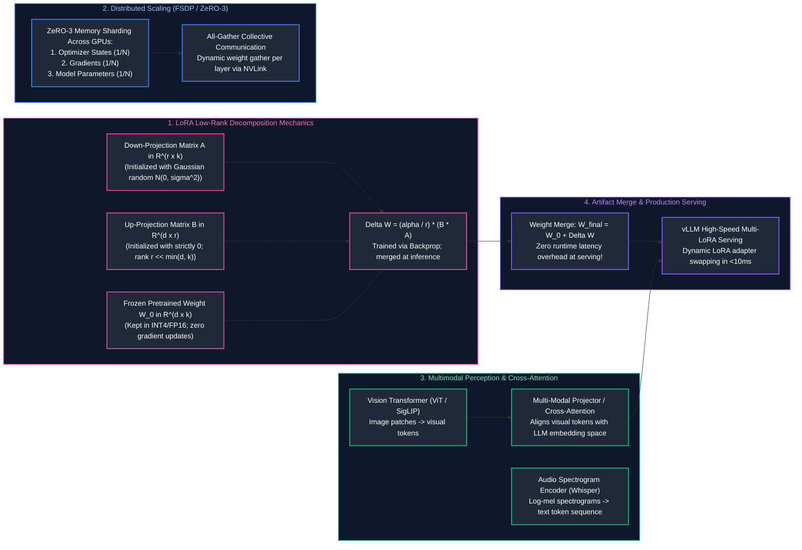
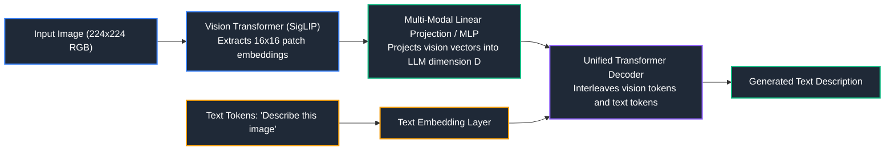

# 14. Model Specialization, Fine-Tuning & Specialized AI Domains

A comprehensive, production-grade guide to model fine-tuning theory, Parameter-Efficient Fine-Tuning (PEFT), LoRA and QLoRA mathematical mechanics, Hugging Face TRL `SFTTrainer`, model distillation, distributed training (FSDP, DeepSpeed ZeRO-3), synthetic data pipelines, multimodal Vision-Language Models (VLMs), speech synthesis/transcription (Whisper), and enterprise recommendation architectures tailored for AI Engineers.

---

## Architectural Overview: Parameter-Efficient Fine-Tuning & Multimodal Pipeline



---

## Table of Contents
1. [Full Fine-Tuning vs. Parameter-Efficient Fine-Tuning (PEFT)](#1-full-fine-tuning-vs-parameter-efficient-fine-tuning-peft)
   - [1.1 Memory Sizing for Full Fine-Tuning (The 16x Parameter Rule)](#11-memory-sizing-for-full-fine-tuning-the-16x-parameter-rule)
   - [1.2 Catastrophic Forgetting & Task Interference](#12-catastrophic-forgetting-task-interference)
2. [LoRA & QLoRA: Mathematical Foundations & Physics](#2-lora-qlora-mathematical-foundations-physics)
   - [2.1 Low-Rank Decomposition Calculus ($W_0 + \frac{\alpha}{r} BA$)](#21-low-rank-decomposition-calculus-w0-fracalphar-ba)
   - [2.2 QLoRA: NormalFloat4 (NF4), Double Quantization & Paged Optimizers](#22-qlora-normalfloat4-nf4-double-quantization-paged-optimizers)
3. [Production Fine-Tuning Pipeline with Hugging Face & TRL](#3-production-fine-tuning-pipeline-with-hugging-face-trl)
   - [3.1 Chat Template Formatting & Packing Strategies](#5-distributed-training-frameworks-fsdp-deepspeed-zero-123)
   - [3.2 Production QLoRA Fine-Tuning Script with `SFTTrainer`](#3-production-fine-tuning-pipeline-with-hugging-face-trl)
4. [Model Distillation: Teacher-Student Logit Matching](#4-model-distillation-teacher-student-logit-matching)
   - [4.1 Temperature Softening & Kullback-Leibler (KL) Divergence Loss](#41-temperature-softening-kullback-leibler-kl-divergence-loss)
   - [4.2 Compressing 70B Frontier Capabilities into 3B Edge Models](#4-model-distillation-teacher-student-logit-matching)
5. [Distributed Training Frameworks: FSDP & DeepSpeed ZeRO-1/2/3](#5-distributed-training-frameworks-fsdp-deepspeed-zero-123)
   - [5.1 Fully Sharded Data Parallel (PyTorch FSDP) Mechanics](#5-distributed-training-frameworks-fsdp-deepspeed-zero-123)
   - [5.2 DeepSpeed ZeRO Memory Sharding Breakdown](#5-distributed-training-frameworks-fsdp-deepspeed-zero-123)
6. [Synthetic Data Generation & Quality Curation](#6-synthetic-data-generation-quality-curation)
   - [6.1 Self-Instruct & Evol-Instruct Pipelines](#61-self-instruct-evol-instruct-pipelines)
   - [6.2 De-duplication (MinHash LSH) and Quality Filtering](#6-synthetic-data-generation-quality-curation)
7. [Multimodal AI Systems: Vision, Speech & Audio](#7-multimodal-ai-systems-vision-speech-audio)
   - [7.1 Vision-Language Models (VLM Architecture: CLIP, SigLIP, LLaVA)](#71-vision-language-models-vlm-architecture-clip-siglip-llava)
   - [7.2 Speech-to-Text (Whisper) & Text-to-Speech (TTS) Pipelines](#72-speech-to-text-whisper-text-to-speech-tts-pipelines)
8. [Specialized Domains: Recommendation Systems & Embedding Models](#8-specialized-domains-recommendation-systems-embedding-models)
   - [8.1 Two-Tower Deep Neural Network Recommendation Models](#81-two-tower-deep-neural-network-recommendation-models)
   - [8.2 Contrastive Fine-Tuning for Domain Embeddings](#11-memory-sizing-for-full-fine-tuning-the-16x-parameter-rule)
9. [Summary Comparison & Engineering Reference Matrix](#9-summary-comparison-engineering-reference-matrix)
10. [References & Further Reading](#10-references-further-reading)

---

# 1. Full Fine-Tuning vs. Parameter-Efficient Fine-Tuning (PEFT)

### 1.1 Memory Sizing for Full Fine-Tuning (The 16x Parameter Rule)

In Full Fine-Tuning, every parameter $\mathbf{W}$ in the model is updated. The VRAM required is far greater than just the model weights:

| State Component | Precision | VRAM Footprint per Parameter | Description / Role in Backpropagation |
| :--- | :---: | :---: | :--- |
| **Model Weights** | FP16 / BF16 | 2 Bytes | Current parameter values loaded onto GPU. |
| **Gradients** | FP16 / BF16 | 2 Bytes | First-order partial derivatives computed during backward pass. |
| **FP32 Master Weights** | FP32 | 4 Bytes | High-precision weights used by AdamW to accumulate small steps. |
| **AdamW First Moment ($m_t$)** | FP32 | 4 Bytes | Running exponential moving average of gradients (momentum). |
| **AdamW Second Moment ($v_t$)** | FP32 | 4 Bytes | Running exponential moving average of squared gradients (RMSProp). |
| **Total Baseline VRAM** | — | **16 Bytes / parameter** | Minimum VRAM needed before allocating activation memory. |

**Sizing 70B Model Full Fine-Tuning:**
$70 \times 10^9 \times 16 \text{ bytes} \approx 1,120 \text{ GB}$ of VRAM (requires 16x NVIDIA H100 80GB GPUs just for weights and optimizer state, before activation memory).

---

### 1.2 Catastrophic Forgetting & Task Interference

> [!CAUTION]
> **Catastrophic Forgetting & Generalization Decay:** Task-specific fine-tuning can severely degrade broader mathematical, safety, and reasoning abilities. Always include a 5–10% replay mixture of general instruction-tuning samples in the training split to mitigate catastrophic forgetting.

When a foundation model is aggressively fine-tuned on a narrow domain dataset (e.g., medical diagnoses), it frequently loses general reasoning, coding, and common-sense abilities. **PEFT (LoRA/QLoRA)** protects against this by keeping the original base weights frozen.

---

# 2. LoRA & QLoRA: Mathematical Foundations & Physics

### 2.1 Low-Rank Decomposition Calculus ($W_0 + \frac{\alpha}{r} BA$)

> [!IMPORTANT]
> **LoRA Rank and Scaling Invariants:** When decomposing weight updates into $\Delta W = \frac{\alpha}{r} B A$, setting rank $r \in [8, 64]$ and alpha $\alpha = 2r$ provides optimal parameter efficiency. Always keep base pretrained weights frozen to preserve core language understanding.

For a pretrained linear layer with frozen weight matrix $\mathbf{W}_0 \in \mathbb{R}^{d \times k}$, **LoRA (Hu et al., 2021)** constrains the weight update $\Delta \mathbf{W}$ by representing it as the product of two low-rank matrices:

$$\mathbf{W} = \mathbf{W}_0 + \Delta \mathbf{W} = \mathbf{W}_0 + \frac{\alpha}{r} \mathbf{B} \mathbf{A}$$

where $\mathbf{B} \in \mathbb{R}^{d \times r}$, $\mathbf{A} \in \mathbb{R}^{r \times k}$, and rank $r \ll \min(d, k)$ (typically $r \in [8, 64]$).
- $\mathbf{A}$ is initialized from a Gaussian distribution $\mathcal{N}(0, \sigma^2)$.
- $\mathbf{B}$ is initialized to zero, ensuring $\Delta \mathbf{W} = 0$ at the start of training.
- Scaling factor $\frac{\alpha}{r}$ prevents the magnitude of updates from swinging wildly when experimenting with different rank values $r$.

**Zero Inference Latency Overhead:**
At inference time, the adapter weights can be permanently folded into the base weights: $\mathbf{W}_{\text{merged}} = \mathbf{W}_0 + \frac{\alpha}{r} \mathbf{BA}$. The merged model executes at identical speed as the original foundation model.

---

### 2.2 QLoRA: NormalFloat4 (NF4), Double Quantization & Paged Optimizers

> [!TIP]
> **Memory-Efficient Fine-Tuning:** QLoRA with 4-bit NormalFloat (NF4) and paged optimizers enables fine-tuning 70B parameter models on a single 80GB A100/H100 GPU without measurable degradation in downstream task accuracy.

**QLoRA (Dettmers et al., 2023)** enables fine-tuning a 70B model on a single 48GB GPU (or an 8B model on a single consumer 16GB GPU):
1. **NormalFloat4 (NF4):** An information-theoretically optimal quantile quantization data type for normally distributed weights.
2. **Double Quantization (DQ):** Quantizes the quantization constants themselves, saving an additional 0.37 bits per parameter.
3. **Paged Optimizers:** Uses CUDA Unified Memory to automatically page AdamW optimizer states between GPU VRAM and CPU system RAM when memory spikes occur.

---

# 3. Production Fine-Tuning Pipeline with Hugging Face & TRL

```python
# ==============================================================================
# Production QLoRA Fine-Tuning Pipeline with TRL & SFTTrainer
# ==============================================================================
import torch
from datasets import load_dataset
from transformers import AutoModelForCausalLM, AutoTokenizer, BitsAndBytesConfig
from peft import LoraConfig, get_peft_model, prepare_model_for_kbit_training
from trl import SFTTrainer, SFTConfig

# 1. Configure 4-bit NormalFloat4 (NF4) BitsAndBytes quantization
bnb_config = BitsAndBytesConfig(
    load_in_4bit=True,
    bnb_4bit_quant_type="nf4",
    bnb_4bit_compute_dtype=torch.bfloat16,
    bnb_4bit_use_double_quant=True
)

model_id = "meta-llama/Meta-Llama-3.1-8B-Instruct"

# 2. Load quantized model and tokenizer
tokenizer = AutoTokenizer.from_pretrained(model_id)
tokenizer.pad_token = tokenizer.eos_token

model = AutoModelForCausalLM.from_pretrained(
    model_id,
    quantization_config=bnb_config,
    device_map="auto"
)
model = prepare_model_for_kbit_training(model)

# 3. Configure LoRA adapter hyperparameters
peft_config = LoraConfig(
    r=16,                               # Low-rank dimension
    lora_alpha=32,                      # Scaling factor (alpha = 2 * r is standard)
    target_modules=["q_proj", "k_proj", "v_proj", "o_proj", "gate_proj", "up_proj", "down_proj"],
    lora_dropout=0.05,
    bias="none",
    task_type="CAUSAL_LM"
)
model = get_peft_model(model, peft_config)
model.print_trainable_parameters()  # Demonstrates ~0.2% trainable parameters!

# 4. Define Training Arguments
training_args = SFTConfig(
    output_dir="./lora-llama3-domain-adapter",
    num_train_epochs=3,
    per_device_train_batch_size=4,
    gradient_accumulation_steps=4,
    learning_rate=2e-4,
    optim="paged_adamw_8bit",
    fp16=False,
    bf16=True,
    logging_steps=10,
    save_strategy="epoch",
    max_seq_length=2048,
    dataset_text_field="text"
)

# 5. Initialize SFTTrainer and execute
# trainer = SFTTrainer(
#     model=model,
#     train_dataset=dataset,
#     peft_config=peft_config,
#     args=training_args
# )
# trainer.train()
```

---

# 4. Model Distillation: Teacher-Student Logit Matching

### 4.1 Temperature Softening & Kullback-Leibler (KL) Divergence Loss

Knowledge Distillation transfers the capabilities of a massive frontier "Teacher" (e.g., 70B or GPT-4o) into a compact, low-latency "Student" model (e.g., 1B to 3B parameters).
The student is trained on a combination of ground-truth hard cross-entropy and soft teacher probability matching:

$$\mathcal{L}_{\text{distill}} = (1 - \lambda) \mathcal{L}_{CE}(y, \hat{y}_{\text{student}}) + \lambda T^2 D_{KL}\left( \text{softmax}\left(\frac{\mathbf{z}_{\text{teacher}}}{T}\right) \parallel \text{softmax}\left(\frac{\mathbf{z}_{\text{student}}}{T}\right) \right)$$

where $T > 1$ is the distillation temperature. Higher $T$ softens the output distribution, exposing "dark knowledge" (e.g., relative probabilities among incorrect answers, revealing conceptual taxonomy).

---

# 5. Distributed Training Frameworks: FSDP & DeepSpeed ZeRO-1/2/3

| Stage | Sharded Memory Components | Communication Collectives |
| :--- | :--- | :--- |
| **ZeRO-1** | Shards Optimizer States across GPUs (4x memory reduction). | **Reduce-Scatter** gradients, **All-Gather** updated parameters. |
| **ZeRO-2** | Shards Optimizer States + Gradients (8x memory reduction). | **Reduce-Scatter** gradients directly during the backward pass. |
| **ZeRO-3 / PyTorch FSDP** | Shards Optimizer States + Gradients + Model Weights (Linear memory reduction with GPU count). | **All-Gather** layer weights dynamically on-the-fly during forward and backward passes. |

---

# 6. Synthetic Data Generation & Quality Curation

### 6.1 Self-Instruct & Evol-Instruct Pipelines

Training high-performing specialized models requires high-quality instruction datasets. Using frontier models to generate synthetic instructions with human-in-the-loop validation:
1. Seed with 100 human-written high-quality prompts.
2. Prompt teacher model to mutate and diversify seeds.
3. Filter via MinHash deduplication to eliminate near-duplicate prompts.
4. Filter out generations containing toxic, refusal, or low-perplexity outputs.

---

# 7. Multimodal AI Systems: Vision, Speech & Audio

### 7.1 Vision-Language Models (VLM Architecture: CLIP, SigLIP, LLaVA)

Modern VLMs do not reinvent image processing; they align vision representations with an existing LLM:



---

### 7.2 Speech-to-Text (Whisper) & Text-to-Speech (TTS) Pipelines

**OpenAI Whisper** utilizes an Encoder-Decoder Transformer:
- **Audio Frontend:** Raw audio sampled at 16 kHz is converted into an 80-channel log-magnitude Mel spectrogram with 25ms windows and 10ms shifts.
- **Audio Encoder:** Two convolutional layers stride the audio features, followed by a standard Transformer encoder.
- **Decoder:** Cross-attends to audio encoder representations to autoregressively emit transcript tokens, handling timestamp prediction and language identification as special tokens.

---

# 8. Specialized Domains: Recommendation Systems & Embedding Models

### 8.1 Two-Tower Deep Neural Network Recommendation Models

Recommendation systems process billions of candidate items in $<20\text{ms}$:
- **User Tower:** Encodes user demographic, historical clicks, and session state into vector $\mathbf{u} \in \mathbb{R}^d$.
- **Item Tower:** Encodes item catalog attributes, categories, and descriptions into vector $\mathbf{v} \in \mathbb{R}^d$.
- **Serving:** Item vectors are pre-computed and indexed in an HNSW vector database. The User Tower computes $\mathbf{u}$ in real-time, executing an ANN vector lookup to retrieve the Top-100 recommended items.

---

# 9. Summary Comparison & Engineering Reference Matrix

| Specialization Technique | Target Hardware | Trainable Parameter % | Quality Retention | Production Maintenance |
| :--- | :--- | :--- | :--- | :--- |
| **Full Fine-Tuning** | 8x–64x H100 (Cluster) | 100% | Highest, but risk of forgetting | High (Separate multi-GB model weights) |
| **LoRA** | 1x–4x A100 (80GB) | $0.1\%\text{--}1.0\%$ | Matches full FT on specific tasks | Low (Small 50MB adapter checkpoints) |
| **QLoRA (NF4)** | 1x Consumer GPU (24GB) | $0.1\%\text{--}1.0\%$ | Within $1\%$ of full precision LoRA | Low (Trainable on local workstations) |
| **Knowledge Distillation** | High (Teacher inference) | Student model (100%) | $85\%\text{--}95\%$ of teacher ability | Replaces heavy model with edge model |

---

# 10. References & Further Reading

- [LoRA: Low-Rank Adaptation of Large Language Models (Hu et al., 2021)](https://arxiv.org/abs/2106.09685)
- [QLoRA: Efficient Finetuning of Quantized LLMs (Dettmers et al., 2023)](https://arxiv.org/abs/2305.14314)
- [TRL: Transformer Reinforcement Learning Library (Hugging Face)](https://github.com/huggingface/trl)
- [PyTorch Fully Sharded Data Parallel (FSDP) Documentation](https://pytorch.org/docs/stable/fsdp.html)
- [Visual Instruction Tuning (LLaVA - Liu et al., 2023)](https://arxiv.org/abs/2304.08485)

