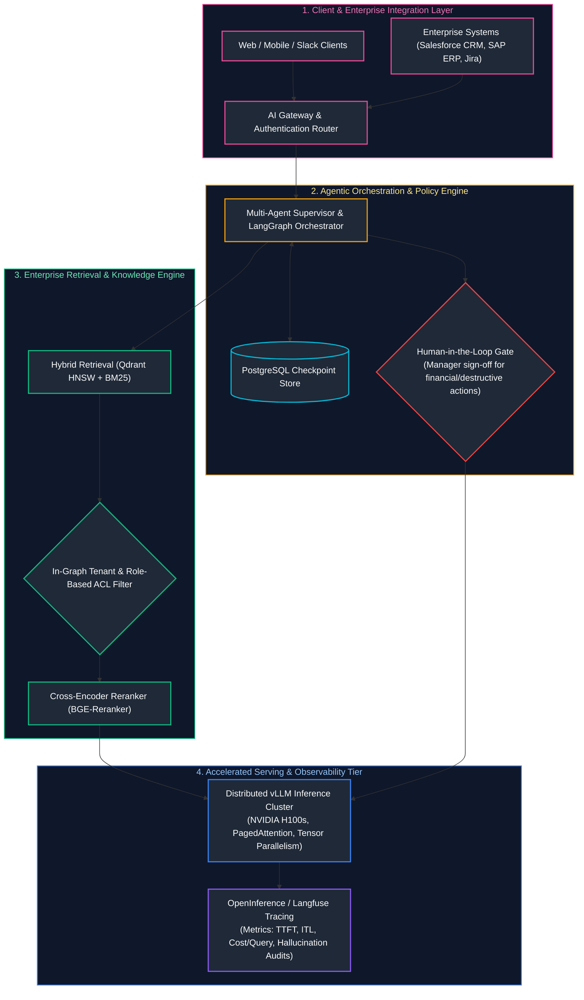
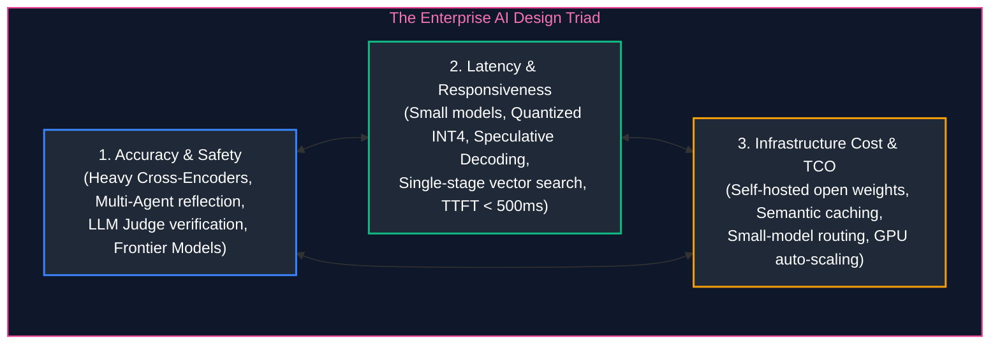
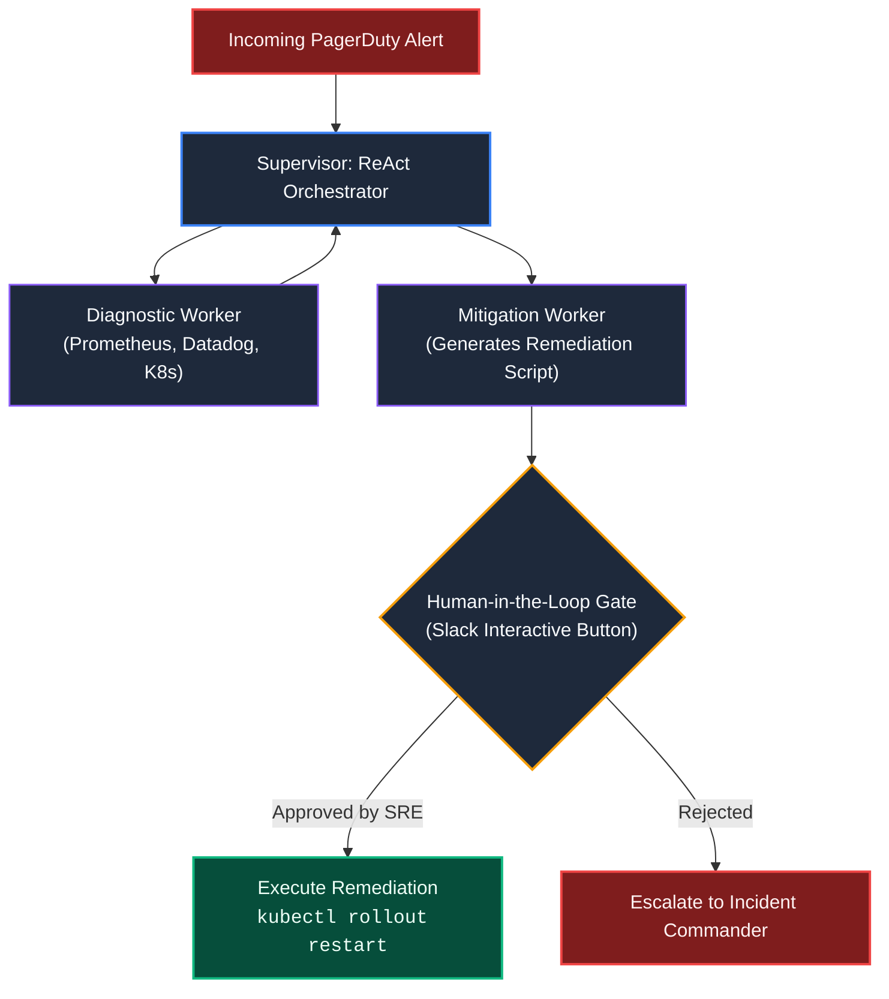
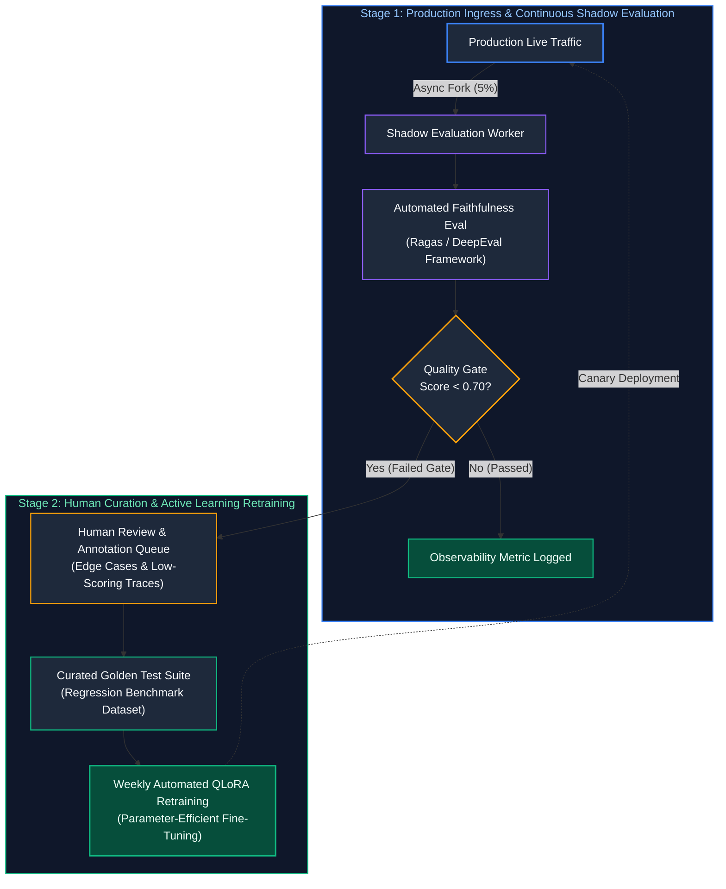
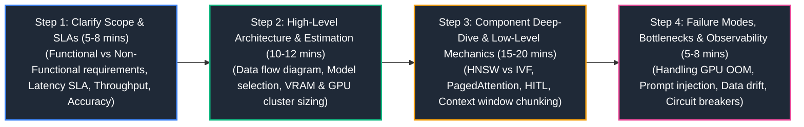

# 15. Enterprise AI System Design & Forward Deployed Engineering

A comprehensive, production-grade guide to enterprise AI system design, Forward Deployed Engineering (FDE) delivery, translating business requirements into probabilistic architectures, enterprise ERP/CRM integration patterns, production system design blueprints (Enterprise Hybrid RAG, High-Throughput Model Serving, Multi-Agent Operations, Continuous Evaluation), back-of-the-envelope GPU sizing, and the 4-step interview methodology tailored for Lead AI Engineers and AI Architects.

---

## Architectural Overview: Enterprise AI Platform Blueprint & Core Ecosystem



---

## Table of Contents
1. [AI Forward Deployed Engineering (FDE) Methodology](#1-ai-forward-deployed-engineering-fde-methodology)
   - [1.1 Translating Business Requirements into Probabilistic Architectures](#11-translating-business-requirements-into-probabilistic-architectures)
   - [1.2 Enterprise System Integrations: Salesforce CRM, SAP ERP, Jira](#12-enterprise-system-integrations-salesforce-crm-sap-erp-jira)
   - [1.3 Defining Acceptance Criteria & SLAs for Probabilistic Outputs](#13-defining-acceptance-criteria-slas-for-probabilistic-outputs)
2. [The AI System Design Triad & Architectural Trade-offs](#2-the-ai-system-design-triad-architectural-trade-offs)
   - [2.1 Accuracy/Safety vs. Latency vs. Infrastructure Cost](#21-accuracysafety-vs-latency-vs-infrastructure-cost)
   - [2.2 Compute-Bound vs. Memory-Bandwidth-Bound Regimes](#21-accuracysafety-vs-latency-vs-infrastructure-cost)
3. [Blueprint 1: Enterprise Production RAG & AI Agent Platform](#3-blueprint-1-enterprise-production-rag-ai-agent-platform)
   - [3.1 End-to-End Component Topology](#13-defining-acceptance-criteria-slas-for-probabilistic-outputs)
   - [3.2 Data Flow & Zero-Trust Access Control](#3-blueprint-1-enterprise-production-rag-ai-agent-platform)
4. [Blueprint 2: High-Throughput LLM Serving Platform](#4-blueprint-2-high-throughput-llm-serving-platform)
   - [4.1 Multi-Node Distributed Cluster Architecture](#4-blueprint-2-high-throughput-llm-serving-platform)
   - [4.2 Continuous Batching & Tensor Parallelism Routing](#4-blueprint-2-high-throughput-llm-serving-platform)
5. [Blueprint 3: Enterprise Autonomous Multi-Agent Operations Platform](#5-blueprint-3-enterprise-autonomous-multi-agent-operations-platform)
   - [5.1 Supervisor Orchestrator with Human-in-the-Loop Handoffs](#5-blueprint-3-enterprise-autonomous-multi-agent-operations-platform)
   - [5.2 Idempotent Transaction Rollbacks & Audit Trails](#5-blueprint-3-enterprise-autonomous-multi-agent-operations-platform)
6. [Blueprint 4: Continuous Evaluation & Data Flywheel System](#6-blueprint-4-continuous-evaluation-data-flywheel-system)
   - [6.1 Production Traffic Shadowing & LLM Judge Audits](#3-blueprint-1-enterprise-production-rag-ai-agent-platform)
   - [6.2 Automated Curation for LoRA Retraining Pipelines](#6-blueprint-4-continuous-evaluation-data-flywheel-system)
7. [Quantitative Back-of-the-Envelope Estimation Cheat-Sheet](#7-quantitative-back-of-the-envelope-estimation-cheat-sheet)
   - [7.1 GPU VRAM & Hardware Sizing Formulas](#71-gpu-vram-hardware-sizing-formulas)
   - [7.2 Throughput, Concurrency & Bandwidth Calculations](#72-throughput-concurrency-bandwidth-calculations)
8. [The 4-Step AI System Design Interview Framework](#8-the-4-step-ai-system-design-interview-framework)
   - [8.1 Step 1: Requirements Clarification & Scope Boundary Definition](#81-step-1-requirements-clarification-scope-boundary-definition)
   - [8.2 Step 2: High-Level Architecture & Mathematical Sizing](#82-step-2-high-level-architecture-mathematical-sizing)
   - [8.3 Step 3: Deep-Dive Component Engineering & Edge Cases](#83-step-3-deep-dive-component-engineering-edge-cases)
   - [8.4 Step 4: Failure Modes, Bottlenecks & Operational Playbooks](#84-step-4-failure-modes-bottlenecks-operational-playbooks)
9. [Summary Comparison & Engineering Reference Matrix](#9-summary-comparison-engineering-reference-matrix)
10. [References & Further Reading](#10-references-further-reading)

---

# 1. AI Forward Deployed Engineering (FDE) Methodology

### 1.1 Translating Business Requirements into Probabilistic Architectures

Forward Deployed Engineers operate at the intersection of enterprise business stakeholders and production AI infrastructure.
- **The Core Challenge:** Business stakeholders think in **deterministic guarantees** (*"The system must answer invoice questions with 100% accuracy and zero downtime"*), whereas LLMs are **probabilistic next-token generators**.
- **The FDE Solution:** Decouple probabilistic generative synthesis from deterministic validation:
  1. Use deterministic SQL/APIs to fetch ground-truth financial balances.
  2. Use LLMs strictly to parse user intent and format human-friendly text.
  3. Validate LLM outputs against Pydantic schemas before returning to users.

---

### 1.2 Enterprise System Integrations: Salesforce CRM, SAP ERP, Jira

| Target Enterprise Platform | Protocol & Authentication | Integration Pattern & Operational Guardrails |
| :--- | :--- | :--- |
| **Salesforce CRM / HubSpot** | OAuth 2.0 token exchange, mTLS | Webhooks for real-time lead updates; LangGraph tool wrappers with strict schema validation. |
| **SAP ERP / NetSuite** | Mutual TLS, private VPC peering | Strict transactional boundaries; write actions staged as draft orders requiring ERP approval workflows. |
| **Jira / ServiceNow** | API Keys / Webhooks | Automated ticket classification, sentiment-based routing, and draft diagnostic generation. |

---

### 1.3 Defining Acceptance Criteria & SLAs for Probabilistic Outputs

> [!CAUTION]
> **Cascading Agent Failures:** Never deploy multi-step agent loops without durable checkpointing, loop iteration guards (e.g., max 5 hops), and automated fallbacks. Unbounded agent recursions can quickly consume thousands of dollars in API tokens and crash user sessions.

| SLA / Acceptance Metric | Target Threshold | Verification Mechanism | Fallback / Degradation Action |
| :--- | :---: | :--- | :--- |
| **Groundedness SLA** | $\ge 99.0\%$ | Ragas / TruLens automated claim citation checking. | Re-prompt with narrowed context or trigger web search. |
| **Hallucination Threshold** | $< 0.5\%$ | Monthly offline gold-dataset audit by domain SME. | Quarantine suspect prompt templates and alert engineering. |
| **Refusal Calibration** | Confidence $\ge 0.70$ | Vector cosine similarity + re-ranker cross-encoder score. | Return standardized refusal message; zero speculative generation. |
| **Time-to-First-Token (TTFT)** | $p95 < 1200\text{ ms}$ | Gateway distributed APM tracing (OpenTelemetry). | Stream immediate status heartbeat or switch to provisioned throughput. |
| **Total Task Latency** | $< 5000\text{ ms}$ | End-to-end request timer. | Cancel secondary reflection cycles to preserve user responsiveness. |

---

# 2. The AI System Design Triad & Architectural Trade-offs

### 2.1 Accuracy/Safety vs. Latency vs. Infrastructure Cost

> [!IMPORTANT]
> **The Enterprise AI Trade-Off Frontier:** Optimizing for 99.9% accuracy via iterative multi-agent reflection loops directly conflicts with sub-second p99 latency budgets. Explicitly negotiate SLA boundaries with business stakeholders before finalizing architectural patterns.



- **Optimizing Accuracy:** Introduces HyDE query transformation (+500ms), Cross-Encoder reranking (+50ms), and multi-agent reflection (+2000ms).
- **Optimizing Latency:** Drops rerankers, uses small 8B quantized models, streams tokens immediately via SSE.
- **Optimizing Cost:** Maximizes Redis semantic caching (saves up to 60%), routes simple queries to `gpt-4o-mini`.

---

# 3. Blueprint 1: Enterprise Production RAG & AI Agent Platform

```text
COMPONENT STACK:
- Ingress: Envoy / Kong AI Gateway with JWT validation & Rate Limiting.
- Preprocessing: Unstructured.io + PyMuPDF layout-aware chunking.
- Storage: Qdrant vector database (HNSW indexing, Cosine metric, in-graph ACL).
- Reranking: BAAI/bge-reranker-large running on local GPU worker.
- Reasoning: LangGraph cyclic state graph with PostgreSQL checkpoint persistence.
- Models: Hybrid routing (GPT-4o for complex queries; vLLM Llama-3-70B for private data).
```

---

# 4. Blueprint 2: High-Throughput LLM Serving Platform

```text
SCALE TARGET: 2,000 concurrent streaming users, 10,000 requests/minute.
- Cluster: 8x Nodes, each equipped with 8x NVIDIA H100 80GB GPUs (64 GPUs total).
- Model: Llama-3.1-70B-Instruct (Tensor Parallelism = 4 across NVLink).
- Serving Engine: vLLM with PagedAttention and continuous batching.
- Autoscaling: KEDA monitoring `vllm:num_requests_waiting` queue depth.
- Ingress: Nginx load balancer distributing requests across vLLM replicas using least-connections.
```

---

# 5. Blueprint 3: Enterprise Autonomous Multi-Agent Operations Platform



---

# 6. Blueprint 4: Continuous Evaluation & Data Flywheel System



---

# 7. Quantitative Back-of-the-Envelope Estimation Cheat-Sheet

### 7.1 GPU VRAM & Hardware Sizing Formulas

1. **Model Weight Memory:**
   $$\text{VRAM}_{\text{weights}} = \text{Parameters} \times \text{Bytes per parameter}$$
   - FP16/BF16: $2.0 \text{ bytes}$ (e.g., $70\text{B} \times 2 = 140\text{ GB}$).
   - FP8: $1.0 \text{ byte}$ (e.g., $70\text{B} \times 1 = 70\text{ GB}$).
   - INT4: $0.55 \text{ bytes}$ with metadata (e.g., $70\text{B} \times 0.55 \approx 38.5\text{ GB}$).

2. **KV Cache Memory:**
   $$\text{VRAM}_{\text{KV}} = 2 \times n_{\text{layers}} \times n_{\text{kv\_heads}} \times d_{\text{head}} \times \text{context\_len} \times \text{concurrency} \times b_{\text{bytes}}$$
   For Llama-3-70B ($80$ layers, $8$ KV heads, $d=128$, FP16):
   $$\text{VRAM}_{\text{KV per user at 4k context}} = 2 \times 80 \times 8 \times 128 \times 4096 \times 2 \approx 1.34\text{ GB}$$
   For 32 concurrent streaming users at 4k tokens: $\sim 43\text{ GB}$ of KV cache VRAM.

3. **Total VRAM Needed for Serving:**
   $$\text{VRAM}_{\text{total}} = 1.20 \times (\text{VRAM}_{\text{weights}} + \text{VRAM}_{\text{KV}})$$
   (Where $1.20$ accounts for CUDA context overhead and intermediate activation buffers).

---

### 7.2 Throughput, Concurrency & Bandwidth Calculations

$$\text{Generation Latency per Token} = \frac{\text{Model Weights Size (Bytes)}}{\text{GPU Memory Bandwidth (Bytes/sec)}}$$
For Llama-3-70B (FP16 = 140 GB) on 2x A100 GPUs ($2 \times 2.0 \text{ TB/s} = 4.0 \text{ TB/s}$ total bandwidth):
$$\text{Latency per Token} = \frac{140 \times 10^9}{4.0 \times 10^{12}} = 35\text{ ms per token} \implies \sim 28.5 \text{ tokens/sec}$$

---

# 8. The 4-Step AI System Design Interview Framework



### 8.1 Step 1: Requirements Clarification & Scope Boundary Definition
- What is the scale? (DAU, Peak RPS, P95 TTFT target).
- What data sources exist? (Private PDFs, SQL, Real-time APIs).
- What are the compliance and isolation boundaries? (Air-gapped VPC vs Hosted API).

### 8.2 Step 2: High-Level Architecture & Mathematical Sizing
- Draw end-to-end dataflow diagram.
- Perform back-of-the-envelope calculations for parameter counts, KV cache memory, and GPU counts.

### 8.3 Step 3: Deep-Dive Component Engineering & Edge Cases
- Explain low-level algorithms (HNSW $M$ and $efSearch$, Cross-Encoder reranking, PagedAttention page sizes).
- Address concurrency and distributed sharding (Tensor Parallelism over NVLink).

### 8.4 Step 4: Failure Modes, Bottlenecks & Operational Playbooks
- What happens when a GPU runs Out of Memory (OOM)? (Preemption, block eviction).
- How is prompt injection defended? (Canary tokens, Presidio PII redaction).

---

# 9. Summary Comparison & Engineering Reference Matrix

| Architecture Blueprint | Target Concurrency | Primary Bottleneck | Recommended Hardware Stack |
| :--- | :--- | :--- | :--- |
| **Enterprise RAG Platform** | $100\text{--}500$ RPS | Ingestion parsing & reranking latency | 1x GPU Node (4x A100) + Qdrant cluster |
| **High-Throughput Serving** | $2,000+$ concurrent streams | Memory Bandwidth (HBM3) during decode | Multi-node H100 cluster (vLLM + KEDA) |
| **Multi-Agent Operations** | $10\text{--}50$ complex tasks/min | State coordination & tool error rates | PostgreSQL checkpointer + Temporal workers |
| **Continuous Evaluation** | Batch offline (10k items/hr) | API token costs & Judge bias | Kubernetes Ray cluster + LiteLLM proxy |

---

# 10. References & Further Reading

- [System Design for Machine Learning & Generative AI (Google Research)](https://research.google/pubs/)
- [Anthropic: Building Effective Agents & Enterprise Architectural Patterns](https://www.anthropic.com/research/building-effective-agents)
- [vLLM: A High-Throughput and Memory-Efficient Inference Engine for LLMs](https://vllm.ai/)
- [LangGraph: Multi-Agent Workflows as Cyclic Graphs](https://langchain-ai.github.io/langgraph/)
- [Designing Data-Intensive Applications (Martin Kleppmann)](https://dataintensive.net/)

