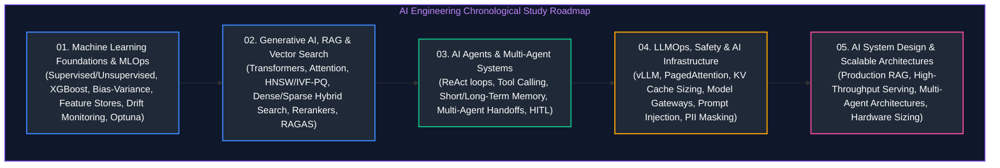

# AI Engineering Master Curriculum & Comprehensive Architecture Guide

A dedicated, production-grade guide to enterprise AI Engineering, covering statistical machine learning foundations, MLOps, vector search, Retrieval-Augmented Generation (RAG), autonomous agent cognitive architectures, multi-agent collaboration, LLMOps, AI safety guardrails, GPU acceleration infrastructure, and enterprise AI system design.

---

## Chronological Study Roadmap

---

## Curriculum Modules & Coverage Overview

| Module | File | Core Disciplines | Key Architectural Topics & Implementations |
| :---: | :--- | :--- | :--- |
| **01** | [`01_machine_learning_and_ai_engineering.md`](01_machine_learning_and_ai_engineering.md) | **ML Foundations & MLOps** | Supervised/Unsupervised learning, XGBoost, Random Forest, Bias-Variance tradeoff, ROC-AUC, Feast/Hopsworks feature stores, MLflow tracking, Evidently AI drift detection, ONNX serialization, shadow/canary deployments. |
| **02** | [`02_generative_ai_rag_and_vector_search.md`](02_generative_ai_rag_and_vector_search.md) | **GenAI, RAG & Embeddings** | Transformer self-attention, tokenization, temperature/top-p sampling, HNSW & IVF-PQ vector indexing, Qdrant/Pinecone/pgvector, hybrid search with Reciprocal Rank Fusion (RRF), Cross-Encoder reranking, Graph RAG, RAGAS evaluation. |
| **03** | [`03_ai_agents_and_multi_agent_systems.md`](03_ai_agents_and_multi_agent_systems.md) | **Cognitive Agents & Multi-Agent** | ReAct (Reason, Act, Observe) loop, tool calling with structured JSON/Pydantic schemas, agentic RAG, working vs episodic memory, LangGraph state graphs, multi-agent collaboration & supervisor routing, Human-in-the-Loop (HITL) checkpoints. |
| **04** | [`04_llmops_safety_and_ai_infrastructure.md`](04_llmops_safety_and_ai_infrastructure.md) | **LLMOps, Safety & Infra** | Continuous evaluation with LLM-as-a-Judge, prompt injection defenses, PII redaction, LiteLLM / Portkey AI Gateways, Redis semantic caching, vLLM inference engine, PagedAttention, KV cache memory sizing, Tensor Parallelism, FP16/INT8/INT4 quantization. |
| **05** | [`05_ai_system_design.md`](05_ai_system_design.md) | **AI System Design & Interviews** | Trade-off triad, TTFT vs. ITL optimization, Enterprise RAG platform blueprint, High-throughput serving blueprint, Enterprise Multi-Agent platform blueprint, Continuous evaluation platform blueprint, 4-step interview framework, and GPU VRAM calculation cheat-sheet. |

---

## Foundational Data Engineering Prerequisite Links

The AI Engineering stack builds upon distributed data systems, lakehouses, streaming pipelines, and low-latency storage engines. The corresponding foundational guides are located in the parent repository:

- [Python for Data & AI Engineering](file:///Users/joydeep/Downloads/Data%20Engineering/03_python_for_data_engineering.md) - Type hints, Pydantic data modeling, generators, asynchronous I/O, and chunked processing.
- [Database Internals & Storage Engines](file:///Users/joydeep/Downloads/Data%20Engineering/04_database_internals_and_performance.md) - B-Trees, LSM-Trees, row vs columnar memory layouts, and indexing structures.
- [Distributed Systems & APIs](file:///Users/joydeep/Downloads/Data%20Engineering/05_distributed_systems_and_apis.md) - CAP theorem, circuit breakers, rate limiters, and backpressure.
- [Databricks, Spark & Delta Lake](file:///Users/joydeep/Downloads/Data%20Engineering/09_databricks_and_delta_lake.md) - Feature store tables, Delta Lake ACID logs, and PySpark distributed transformations.
- [Data Governance, Security & Lineage](file:///Users/joydeep/Downloads/Data%20Engineering/14_data_governance_security_and_observability.md) - Fine-grained access control, column masking, and audit logging.
- [Data Engineering System Design](file:///Users/joydeep/Downloads/Data%20Engineering/15_system_design_for_data_engineering.md) - Real-time lakehouses, CDC ingestion, ClickHouse/Pinot OLAP, and metadata automation.
