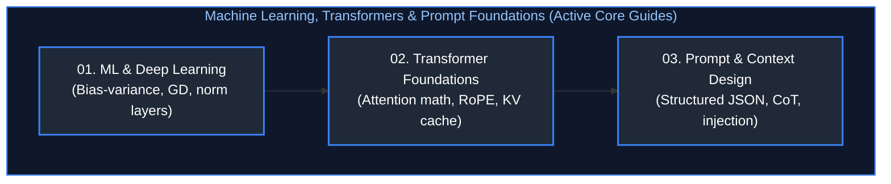

# AI Engineering Interview Questions & Comprehensive Solutions Master Guide

This directory contains production-grade, deeply analyzed answers to the active collection of real-world AI Engineering interview scenarios, live coding challenges, and enterprise system designs.

All questions have been systematically grouped by conceptual similarity, mapped to enterprise AI disciplines, and organized in the **optimal chronological order in which they should be studied**. Each guide provides formal definitions, architectural diagrams, mathematical/memory analysis, production-grade code snippets, edge-case handling, and troubleshooting playbooks matching the rigorous style of the base concepts guides.

---

## Recommended Chronological Study Order

---

## Topic Guides & Coverage Overview

| Study Order | Guide File | Questions Covered | Corresponding Base Concepts | Key Topics & Grouped Scenarios |
| :---: | :--- | :---: | :--- | :--- |
| **01** | [`01_machine_learning_` `and_deep_learning_faq.md`](01_machine_learning_and_deep_learning_faq.md) | ML & DL Foundations (Q1–Q12) | [`01_machine_learning_and_` `deep_learning_fundamentals.md`](../01_machine_learning_and_deep_learning.md) | • **Core Mechanics:** Bias-variance trade-off, L1 vs L2 regularization, backpropagation loss surfaces. • **Training Invariants:** Learning rate schedules with warmups, vanishing/exploding gradients, batch norm. • **Production Decisions:** Heuristics vs ML suitability, cost vs speed vs accuracy optimization. |
| **02** | [`02_llm_and_` `transformer_architecture_faq.md`](02_llm_and_transformer_architecture_faq.md) | Transformer Architectures (Q1–Q12) | [`02_llm_and_` `transformer_architecture.md`](../02_llm_and_transformer_architecture.md) | • **Attention Internals:** Multi-head vs grouped-query attention (MHA vs GQA), KV cache memory limits. • **Model Topologies:** Encoder-only vs decoder-only vs encoder-decoder, Mixture-of-Experts routing. • **Inference Mechanics:** Prefill vs decode latency profiling, speculative decoding acceleration. |
| **03** | [`03_prompt_engineering_and_` `context_design_faq.md`](03_prompt_engineering_and_context_design_faq.md) | Prompting & Context Design (Q1–Q11) | [`03_prompt_engineering_context_` `design_and_orchestration.md`](../03_prompt_engineering_and_context_design.md) | • **Prompt Engineering:** Few-shot vs zero-shot formatting, chain-of-thought, system message framing. • **Context Optimization:** Token counting across BPE tokenizer families, lost-in-the-middle positioning. • **Harness Architecture:** Structured schema extraction, automated fallback chains, adaptive routing. |

---

## Master Topic Directory & Difficulty Matrix

| Category | Domain & Focus Area | Questions | Progressive Difficulty Distribution | Companion Deep-Dive Guide |
| :---: | :--- | :---: | :--- | :--- |
| **01** | [ML & Deep Learning Fundamentals](#01--ml--deep-learning-fundamentals) | 12 Questions | Easy: 3 | Medium: 6 | Hard: 3 | Expert: 0 | [`01_machine_learning_` `and_deep_learning_faq.md`](01_machine_learning_and_deep_learning_faq.md) |
| **02** | [LLM & Transformer Architecture](#02--llm--transformer-architecture) | 12 Questions | Easy: 3 | Medium: 5 | Hard: 3 | Expert: 1 | [`02_llm_and_` `transformer_architecture_faq.md`](02_llm_and_transformer_architecture_faq.md) |
| **03** | [Prompt Engineering, Context Design & Structured Outputs](#03--prompt-engineering-context-design--structured-outputs) | 11 Questions | Easy: 3 | Medium: 5 | Hard: 2 | Expert: 1 | [`03_prompt_engineering_` `and_context_design_faq.md`](03_prompt_engineering_and_context_design_faq.md) |
| **TOTAL** | **Enterprise AI Engineering Preparation Bank** | **35 Questions** | **All Active Modules Fully Covered** | **[3 Companion Guides](#topic-guides--coverage-overview)** |

---

## 01 – ML & Deep Learning Fundamentals

*Companion Deep-Dive Guide: [`01_machine_learning_and_deep_learning_faq.md`](01_machine_learning_and_deep_learning_faq.md) (12 Questions & Production Solutions)*

1. **`[Easy]`** Explain the bias-variance tradeoff and how you would diagnose which one is hurting a model in production. → [Solution](01_machine_learning_and_deep_learning_faq.md#q1-explain-the-bias-variance-tradeoff-and-how-you-would-diagnose-which-one-is-hurting-a-model-in-production)
2. **`[Easy]`** What is the difference between L1 (Lasso) and L2 (Ridge) regularization, and when would you choose one over the other? → [Solution](01_machine_learning_and_deep_learning_faq.md#q2-what-is-the-difference-between-l1-lasso-and-l2-ridge-regularization-and-when-would-you-choose-one-over-the-other)
3. **`[Easy]`** Explain a practical use case where you would apply machine learning vs deterministic heuristics. → [Solution](01_machine_learning_and_deep_learning_faq.md#q3-explain-a-practical-use-case-where-you-would-apply-machine-learning-vs-deterministic-heuristics)
4. **`[Medium]`** Walk through how gradient descent works, and explain the difference between SGD, mini-batch, and batch gradient descent. → [Solution](01_machine_learning_and_deep_learning_faq.md#q4-walk-through-how-gradient-descent-works-and-explain-the-difference-between-sgd-mini-batch-and-batch-gradient-descent)
5. **`[Medium]`** How do you handle class imbalance in a classification problem (SMOTE, class weighting, Focal Loss)? → [Solution](01_machine_learning_and_deep_learning_faq.md#q5-how-do-you-handle-class-imbalance-in-a-classification-problem-smote-class-weighting-focal-loss)
6. **`[Medium]`** Explain backpropagation and why vanishing and exploding gradients happen in deep networks. → [Solution](01_machine_learning_and_deep_learning_faq.md#q6-explain-backpropagation-and-why-vanishing-and-exploding-gradients-happen-in-deep-networks)
7. **`[Medium]`** How does batch normalization help training, and what is the key difference between batch normalization and layer normalization? → [Solution](01_machine_learning_and_deep_learning_faq.md#q7-how-does-batch-normalization-help-training-and-what-is-the-key-difference-between-batch-normalization-and-layer-normalization)
8. **`[Medium]`** Compare CNNs, RNNs, and Transformers: When would you pick one architecture over another for vision, time-series, and text? → [Solution](01_machine_learning_and_deep_learning_faq.md#q8-compare-cnns-rnns-and-transformers-when-would-you-pick-one-architecture-over-another-for-vision-time-series-and-text)
9. **`[Medium]`** How would you select an appropriate machine learning model for a given business problem with latency vs accuracy constraints? → [Solution](01_machine_learning_and_deep_learning_faq.md#q9-how-would-you-select-an-appropriate-machine-learning-model-for-a-given-business-problem-with-latency-vs-accuracy-constraints)
10. **`[Hard]`** A production model suddenly drops from 95% to 60% accuracy. Walk me through your step-by-step investigation runbook. → [Solution](01_machine_learning_and_deep_learning_faq.md#q10-a-production-model-suddenly-drops-from-95-to-60-accuracy-walk-me-through-your-step-by-step-investigation-runbook)
11. **`[Hard]`** Your model works great Monday–Friday but performs poorly on weekends. How would you investigate and fix temporal distribution drift? → [Solution](01_machine_learning_and_deep_learning_faq.md#q11-your-model-works-great-mondayfriday-but-performs-poorly-on-weekends-how-would-you-investigate-and-fix-temporal-distribution-drift)
12. **`[Hard]`** You can have fast, cheap, or accurate in an AI system. Pick two and explain the architectural trade-offs. → [Solution](01_machine_learning_and_deep_learning_faq.md#q12-you-can-have-fast-cheap-or-accurate-in-an-ai-system-pick-two-and-explain-the-architectural-trade-offs)

---

## 02 – LLM & Transformer Architecture

*Companion Deep-Dive Guide: [`02_llm_and_transformer_architecture_faq.md`](02_llm_and_transformer_architecture_faq.md) (12 Questions & Production Solutions)*

1. **`[Easy]`** Explain the architecture of Transformer models and how data flows from tokenization to output logits. → [Solution](02_llm_and_transformer_architecture_faq.md#q1-explain-the-architecture-of-transformer-models-and-how-data-flows-from-tokenization-to-output-logits)
2. **`[Easy]`** What is the difference between encoder-only, decoder-only, and encoder-decoder models, and what are their typical use cases? → [Solution](02_llm_and_transformer_architecture_faq.md#q2-what-is-the-difference-between-encoder-only-decoder-only-and-encoder-decoder-models-and-what-are-their-typical-use-cases)
3. **`[Easy]`** Walk me through what happens during pre-training vs fine-tuning of a foundation language model. → [Solution](02_llm_and_transformer_architecture_faq.md#q3-walk-me-through-what-happens-during-pre-training-vs-fine-tuning-of-a-foundation-language-model)
4. **`[Medium]`** Why did the industry move from RNNs/LSTMs to transformers? What fundamental problem did attention solve? → [Solution](02_llm_and_transformer_architecture_faq.md#q4-why-did-the-industry-move-from-rnnslstms-to-transformers-what-fundamental-problem-did-attention-solve)
5. **`[Medium]`** Why is self-attention more effective than recurrent connections for capturing long-range dependencies? → [Solution](02_llm_and_transformer_architecture_faq.md#q5-why-is-self-attention-more-effective-than-recurrent-connections-for-capturing-long-range-dependencies)
6. **`[Medium]`** Explain positional encoding in Transformers: Why is it necessary, and how do sinusoidal encodings compare to RoPE and ALiBi? → [Solution](02_llm_and_transformer_architecture_faq.md#q6-explain-positional-encoding-in-transformers-why-is-it-necessary-and-how-do-sinusoidal-encodings-compare-to-rope-and-alibi)
7. **`[Medium]`** How does multi-head attention improve a model's representation power compared to single-head attention? → [Solution](02_llm_and_transformer_architecture_faq.md#q7-how-does-multi-head-attention-improve-a-models-representation-power-compared-to-single-head-attention)
8. **`[Medium]`** How does masked language modeling (MLM) differ from causal language modeling (CLM)? → [Solution](02_llm_and_transformer_architecture_faq.md#q8-how-does-masked-language-modeling-mlm-differ-from-causal-language-modeling-clm)
9. **`[Hard]`** What is the KV Cache in Transformer inference, why does it consume massive VRAM, and how do Multi-Query (MQA) and Grouped-Query Attention (GQA) optimize it? → [Solution](02_llm_and_transformer_architecture_faq.md#q9-what-is-the-kv-cache-in-transformer-inference-why-does-it-consume-massive-vram-and-how-do-multi-query-mqa-and-grouped-query-attention-gqa-optimize-it)
10. **`[Hard]`** What causes attention computation to scale quadratically ($O(N^2)$) with context length, and how do FlashAttention and FlashAttention-2 achieve sub-quadratic I/O efficiency? → [Solution](02_llm_and_transformer_architecture_faq.md#q10-what-causes-attention-computation-to-scale-quadratically-on2-with-context-length-and-how-do-flashattention-and-flashattention-2-achieve-sub-quadratic-io-efficiency)
11. **`[Hard]`** What happens during the pre-training phase of an autoregressive LLM under modern distributed parallelisms (Tensor, Pipeline, and ZeRO-3)? → [Solution](02_llm_and_transformer_architecture_faq.md#q11-what-happens-during-the-pre-training-phase-of-an-autoregressive-llm-under-modern-distributed-parallelisms-tensor-pipeline-and-zero-3)
12. **`[Expert]`** Design an optimal speculative decoding architecture to accelerate LLM token generation by 2–3x without altering output probability distributions. → [Solution](02_llm_and_transformer_architecture_faq.md#q12-design-an-optimal-speculative-decoding-architecture-to-accelerate-llm-token-generation-by-23x-without-altering-output-probability-distributions)

---

## 03 – Prompt Engineering, Context Design & Structured Outputs

*Companion Deep-Dive Guide: [`03_prompt_engineering_and_context_design_faq.md`](03_prompt_engineering_and_context_design_faq.md) (11 Questions & Production Solutions)*

1. **`[Easy]`** What is the difference between few-shot and zero-shot learning in prompt engineering? → [Solution](03_prompt_engineering_and_context_design_faq.md#q1-what-is-the-difference-between-few-shot-and-zero-shot-learning-in-prompt-engineering)
2. **`[Easy]`** Explain token counting: How does BPE/WordPiece tokenization work and why is it critical when managing LLM APIs? → [Solution](03_prompt_engineering_and_context_design_faq.md#q2-explain-token-counting-how-does-bpewordpiece-tokenization-work-and-why-is-it-critical-when-managing-llm-apis)
3. **`[Easy]`** What is Chain-of-Thought (CoT) prompting, and why does eliciting intermediate reasoning steps improve complex problem solving? → [Solution](03_prompt_engineering_and_context_design_faq.md#q3-what-is-chain-of-thought-cot-prompting-and-why-does-eliciting-intermediate-reasoning-steps-improve-complex-problem-solving)
4. **`[Medium]`** Explain prompt engineering strategies that actually work in enterprise production (System prompts, delimiters, few-shot dynamic selection, ReAct). → [Solution](03_prompt_engineering_and_context_design_faq.md#q4-explain-prompt-engineering-strategies-that-actually-work-in-enterprise-production-system-prompts-delimiters-few-shot-dynamic-selection-react)
5. **`[Medium]`** How would you design a prompt to minimize hallucinations in an open-domain question answering system? → [Solution](03_prompt_engineering_and_context_design_faq.md#q5-how-would-you-design-a-prompt-to-minimize-hallucinations-in-an-open-domain-question-answering-system)
6. **`[Medium]`** How can you enforce strict, valid output structure (like JSON schemas) from a generative model reliably? → [Solution](03_prompt_engineering_and_context_design_faq.md#q6-how-can-you-enforce-strict-valid-output-structure-like-json-schemas-from-a-generative-model-reliably)
7. **`[Medium]`** How would you reduce token usage in a multi-turn chatbot without sacrificing quality or memory retention? → [Solution](03_prompt_engineering_and_context_design_faq.md#q7-how-would-you-reduce-token-usage-in-a-multi-turn-chatbot-without-sacrificing-quality-or-memory-retention)
8. **`[Hard]`** Your chatbot context hits 40K tokens at message 30, and each reply costs $0.40. How do you re-architect context window management to cut costs by 90%? → [Solution](03_prompt_engineering_and_context_design_faq.md#q8-your-chatbot-context-hits-40k-tokens-at-message-30-and-each-reply-costs-040-how-do-you-re-architect-context-window-management-to-cut-costs-by-90)
9. **`[Hard]`** What is Prompt Injection (Direct vs Indirect), and how do you build multi-layered enterprise defenses against adversarial jailbreaks? → [Solution](03_prompt_engineering_and_context_design_faq.md#q9-what-is-prompt-injection-direct-vs-indirect-and-how-do-you-build-multi-layered-enterprise-defenses-against-adversarial-jailbreaks)
10. **`[Hard]`** How do modern LLMs implement Function Calling under the hood (Grammar constraints vs special tokens vs tool definitions)? → [Solution](03_prompt_engineering_and_context_design_faq.md#q10-how-do-modern-llms-implement-function-calling-under-the-hood-grammar-constraints-vs-special-tokens-vs-tool-definitions)
11. **`[Expert]`** Design an adaptive context routing harness that dynamically selects context compression, semantic vector lookups, or full context expansion based on query complexity. → [Solution](03_prompt_engineering_and_context_design_faq.md#q11-design-an-adaptive-context-routing-harness-that-dynamically-selects-context-compression-semantic-vector-lookups-or-full-context-expansion-based-on-query-complexity)

---

## Summary & Interview Engineering Takeaways

1. **Mathematical Grounding:** Deep-dive interview questions consistently evaluate understanding of low-level loss derivatives, attention scaling ($1/\sqrt{d_k}$), and numerical stability (SwiGLU, RMSNorm).
2. **System Scalability:** Senior engineering evaluations focus on inference memory calculus (KV cache formulas, MQA/GQA memory reduction) and distributed parallelisms.
3. **Production Robustness:** Enterprise questions probe failure modes—hallucination containment, cascading routing harnesses, and prompt injection defense.

---

## References & Further Reading

- [Attention Is All You Need (Vaswani et al.)](https://arxiv.org/abs/1706.03762)
- [FlashAttention-2: Faster Attention with Better Parallelism and Work Partitioning (Dao)](https://arxiv.org/abs/2307.08691)
- [Deep Learning (Goodfellow, Bengio, Courville)](https://www.deeplearningbook.org/)
