# 02. LLM & Transformer Architecture: Interview Questions & Deep-Dive Solutions

A comprehensive, production-grade guide answering 12 core Transformer and Large Language Model architecture interview scenarios, covering end-to-end token dataflow, encoder/decoder paradigms, pre-training dynamics, attention mathematics, positional encodings (RoPE/ALiBi), multi-head/grouped-query attention, masked vs causal modeling, KV cache memory footprint formulas, FlashAttention GPU SRAM tiling, 3D distributed parallelism, and speculative decoding.

---

## Architectural Overview: The Modern Autoregressive Transformer Block & KV Cache Dataflow

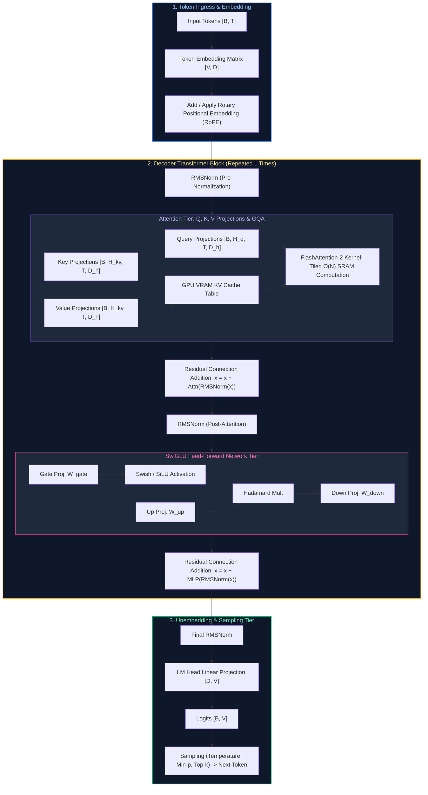

---

## Table of Contents & Question Mapping

1. **Foundational Mechanisms & Model Typologies**
   - [Q1. Explain the architecture of Transformer models and how data flows from tokenization to output logits.](#q1-explain-the-architecture-of-transformer-models-and-how-data-flows-from-tokenization-to-output-logits)
   - [Q2. What is the difference between encoder-only, decoder-only, and encoder-decoder models, and what are their typical use cases?](#q2-what-is-the-difference-between-encoder-only-decoder-only-and-encoder-decoder-models-and-what-are-their-typical-use-cases)
   - [Q3. Walk me through what happens during pre-training vs fine-tuning of a foundation language model.](#q3-walk-me-through-what-happens-during-pre-training-vs-fine-tuning-of-a-foundation-language-model)
   - [Q4. Why did the industry move from RNNs/LSTMs to transformers? What fundamental problem did attention solve?](#q4-why-did-the-industry-move-from-rnnslstms-to-transformers-what-fundamental-problem-did-attention-solve)
2. **Attention Mechanics & Positional Encoding**
   - [Q5. Why is self-attention more effective than recurrent connections for capturing long-range dependencies?](#q5-why-is-self-attention-more-effective-than-recurrent-connections-for-capturing-long-range-dependencies)
   - [Q6. Explain positional encoding in Transformers: Why is it necessary, and how do sinusoidal encodings compare to RoPE and ALiBi?](#q6-explain-positional-encoding-in-transformers-why-is-it-necessary-and-how-do-sinusoidal-encodings-compare-to-rope-and-alibi)
   - [Q7. How does multi-head attention improve a model's representation power compared to single-head attention?](#q7-how-does-multi-head-attention-improve-a-models-representation-power-compared-to-single-head-attention)
   - [Q8. How does masked language modeling (MLM) differ from causal language modeling (CLM)?](#q8-how-does-masked-language-modeling-mlm-differ-from-causal-language-modeling-clm)
3. **Inference Acceleration & Distributed Scaling**
   - [Q9. What is the KV Cache in Transformer inference, why does it consume massive VRAM, and how do Multi-Query (MQA) and Grouped-Query Attention (GQA) optimize it?](#q9-what-is-the-kv-cache-in-transformer-inference-why-does-it-consume-massive-vram-and-how-do-multi-query-mqa-and-grouped-query-attention-gqa-optimize-it)
   - [Q10. What causes attention computation to scale quadratically ($O(N^2)$) with context length, and how do FlashAttention and FlashAttention-2 achieve sub-quadratic I/O efficiency?](#q10-what-causes-attention-computation-to-scale-quadratically-on2-with-context-length-and-how-do-flashattention-and-flashattention-2-achieve-sub-quadratic-io-efficiency)
   - [Q11. What happens during the pre-training phase of an autoregressive LLM under modern distributed parallelisms (Tensor, Pipeline, and ZeRO-3)?](#q11-what-happens-during-the-pre-training-phase-of-an-autoregressive-llm-under-modern-distributed-parallelisms-tensor-pipeline-and-zero-3)
   - [Q12. Design an optimal speculative decoding architecture to accelerate LLM token generation by 2–3x without altering output probability distributions.](#q12-design-an-optimal-speculative-decoding-architecture-to-accelerate-llm-token-generation-by-23x-without-altering-output-probability-distributions)
---

# 1. Foundational Mechanisms & Model Typologies

---

### Q1. Explain the architecture of Transformer models and how data flows from tokenization to output logits.
**Topic Covered:** End-to-End Transformer Tensor Pipeline  
**Question:** Explain the architecture of Transformer models.

#### Definition & Core Concepts
Introduced in *Attention Is All You Need* (Vaswani et al., 2017), the Transformer is a sequence-to-sequence neural network relying entirely on self-attention mechanisms to model global dependencies. Modern generative LLMs (Llama 3, Mistral, GPT-4) adopt the **Decoder-Only Autoregressive Transformer** architecture.

#### End-to-End Dataflow Stages
1. **Tokenization:** Raw string text is segmented into discrete integer token IDs using Byte-Pair Encoding (BPE):
   $$\mathbf{t} = [t_1, t_2, \dots, t_T] \in \mathbb{N}^T, \quad t_i \in [0, V-1]$$
2. **Embedding & Positional Injection:** Token IDs are mapped into dense continuous vector space via an embedding table $\mathbf{W}_e \in \mathbb{R}^{V \times d_{\text{model}}}$. Positional information is injected via Rotary Position Embedding (RoPE) applied to query and key vectors.
3. **Repeated Transformer Blocks ($L$ Layers):** The hidden state $\mathbf{X}_0 \in \mathbb{R}^{B \times T \times d_{\text{model}}}$ traverses $L$ identical blocks:
   $$\mathbf{X}'_l = \mathbf{X}_{l-1} + \text{Attention}(\text{RMSNorm}(\mathbf{X}_{l-1}))$$
   $$\mathbf{X}_l = \mathbf{X}'_l + \text{SwiGLU}(\text{RMSNorm}(\mathbf{X}'_l))$$
4. **Final Normalization & Unembedding Head:**
   The final layer output $\mathbf{X}_L$ passes through a final RMSNorm and is projected onto the vocabulary dimension by the language model head $\mathbf{W}_{\text{head}} \in \mathbb{R}^{d_{\text{model}} \times V}$:
   $$\mathbf{Z} = \text{RMSNorm}(\mathbf{X}_L) \mathbf{W}_{\text{head}} \in \mathbb{R}^{B \times T \times V}$$
5. **Sampling / Softmax:** Probabilities for the next token $t_{T+1}$ are computed:
   $$P(t_{T+1} = v \mid t_{\le T}) = \frac{\exp(z_{T, v} / \tau)}{\sum_{j=1}^V \exp(z_{T, j} / \tau)}$$

#### Visual Flow
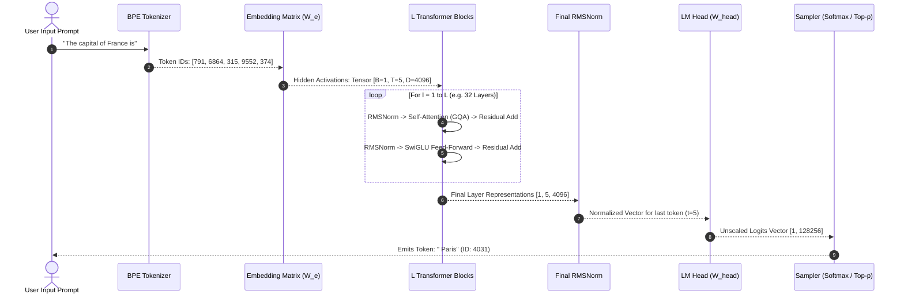

#### Production Implementation / Code Solution
```python
import torch
import torch.nn as nn
import torch.nn.functional as F

class TransformerDecoderBlock(nn.Module):
    """
    Production-grade LLaMA-style Decoder Block featuring RMSNorm, 
    Pre-normalization, and SwiGLU activation.
    """
    def __init__(self, d_model: int, n_heads: int, d_ff: int):
        super().__init__()
        self.attn_norm = nn.RMSNorm(d_model)
        self.mha = nn.MultiheadAttention(d_model, n_heads, batch_first=True)
        self.ffn_norm = nn.RMSNorm(d_model)
        
        # SwiGLU feed-forward network components
        self.w_gate = nn.Linear(d_model, d_ff, bias=False)
        self.w_up = nn.Linear(d_model, d_ff, bias=False)
        self.w_down = nn.Linear(d_ff, d_model, bias=False)

    def _swiglu(self, x: torch.Tensor) -> torch.Tensor:
        # SwiGLU(x) = (SiLU(x * W_gate) * (x * W_up)) * W_down
        return self.w_down(F.silu(self.w_gate(x)) * self.w_up(x))

    def forward(self, x: torch.Tensor, causal_mask: torch.Tensor) -> torch.Tensor:
        # Pre-LN Self-Attention with Residual Skip Connection
        normed_x = self.attn_norm(x)
        attn_out, _ = self.mha(normed_x, normed_x, normed_x, attn_mask=causal_mask, is_causal=True)
        x = x + attn_out
        
        # Pre-LN SwiGLU FFN with Residual Skip Connection
        x = x + self._swiglu(self.ffn_norm(x))
        return x
```
- **Time Complexity:** $O(L \cdot (T^2 \cdot d_{\text{model}} + T \cdot d_{\text{model}} \cdot d_{\text{ff}}))$ per forward pass.
- **Space Complexity:** $O(L \cdot B \cdot T \cdot d_{\text{model}})$ memory to store layer activations during training.

#### Engineering Implications & Production Pitfalls
1. **Weight Tying (Tie Word Embeddings):** Sharing weights between $\mathbf{W}_e$ (input embeddings) and $\mathbf{W}_{\text{head}}$ (output logits) saves hundreds of megabytes of VRAM in smaller models (e.g. GPT-2, Gemma), but frontier models (Llama 3 70B) decouple them to increase output vocabulary expressiveness.
2. **Pre-Norm vs Post-Norm:** Original Transformers used Post-LN ($x = \text{LayerNorm}(x + \text{SubLayer}(x))$), which suffers from vanishing gradients without aggressive warmup schedules. Modern LLMs strictly use **Pre-LN** ($x = x + \text{SubLayer}(\text{RMSNorm}(x))$) to guarantee stable gradient flow down residual highways.

#### Core Curriculum Cross-Reference
- See [02. LLM Foundations & Model Architecture](../02_llm_and_transformer_architecture.md#41-prefill-phase-vs-decode-phase-deep-dive) for complete mathematical proofs.

---

### Q2. What is the difference between encoder-only, decoder-only, and encoder-decoder models, and what are their typical use cases?
**Topic Covered:** Architectural Taxonomy & Attention Masking  
**Question:** What's the difference between encoder-only, decoder-only, and encoder-decoder models?

#### Definition & Core Concepts
The structural difference between Transformer variants originates from their **Attention Masking Matrix** $\mathbf{M}$ applied during self-attention:

$$\text{Attention}(\mathbf{Q}, \mathbf{K}, \mathbf{V}) = \text{softmax}\left(\frac{\mathbf{Q}\mathbf{K}^T}{\sqrt{d_k}} + \mathbf{M}\right) \mathbf{V}$$

1. **Encoder-Only Models (BERT, RoBERTa, DeBERTa):**
   - **Attention Mask:** $\mathbf{M} = \mathbf{0}$ (Bidirectional Attention). Every token can attend to all other tokens (past and future) simultaneously.
   - **Inductive Bias:** Global bidirectional context extraction.
   - **Optimal Use Cases:** Semantic embedding generation, classification, token tagging (NER), and extractive Question Answering. Cannot generate autoregressive text efficiently.
2. **Decoder-Only Models (GPT-4, LLaMA 3, Mistral, Claude):**
   - **Attention Mask:** Causal / Lower-Triangular Mask:
     $$M_{ij} = \begin{cases} 0 & \text{if } i \ge j \\ -\infty & \text{if } i < j \end{cases}$$
   - **Inductive Bias:** Unidirectional autoregression ($P(w_t \mid w_{<t})$). Tokens can only attend to past and current tokens.
   - **Optimal Use Cases:** Generative text completion, reasoning, dialogue, zero-shot instruction following, and code synthesis.
3. **Encoder-Decoder Models (T5, BART, Whisper):**
   - **Structure:** Bidirectional Encoder processes the full input prompt; Autoregressive Decoder generates the target sequence via **Cross-Attention** ($\mathbf{Q}$ comes from the decoder, $\mathbf{K}, \mathbf{V}$ come from the encoder).
   - **Optimal Use Cases:** Strict sequence-to-sequence transformations where input and output lengths diverge: language translation, abstractive summarization, speech-to-text (Whisper).

#### Visual Flow
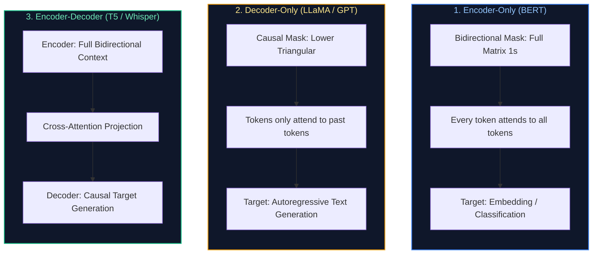

#### Production Implementation / Code Solution
```python
import torch

def generate_attention_masks(seq_len: int):
    """
    Demonstrates the mathematical construction of Bidirectional vs Causal masks.
    """
    # 1. Encoder Mask (Bidirectional: Zero penalty everywhere)
    bidirectional_mask = torch.zeros((seq_len, seq_len))
    
    # 2. Decoder Mask (Causal: -inf for upper triangle to zero out future attention)
    causal_mask = torch.triu(torch.full((seq_len, seq_len), float('-inf')), diagonal=1)
    
    print("=== Bidirectional Encoder Mask (All tokens attend to all) ===")
    print(bidirectional_mask[:4, :4])
    
    print("\n=== Causal Decoder Mask (Tokens only attend to past) ===")
    print(causal_mask[:4, :4])
    return bidirectional_mask, causal_mask
```
- **Time Complexity:** $O(T^2)$ to materialize full mask tensors.
- **Space Complexity:** $O(T^2)$ memory footprint unless using FlashAttention implicit causal flags.

#### Engineering Implications & Production Pitfalls
1. **Why Decoder-Only Won the Foundation Model Race:** While Encoder-Decoder models were theoretically superior for translation, decoder-only models scale more efficiently on compute clusters. Unifying prompt and generation into a single causal autoregressive objective allows effortless multi-task learning, in-context learning, and KV cache reuse without maintaining two separate network stacks.

#### Core Curriculum Cross-Reference
- See [02. LLM Foundations & Model Architecture](../02_llm_and_transformer_architecture.md#31-decoder-only-architecture--the-industry-convergence) for historical scaling proofs.

---

### Q3. Walk me through what happens during pre-training vs fine-tuning of a foundation language model.
**Topic Covered:** Foundation Lifecycle Dynamics & Optimization Regimes  
**Question:** Walk me through what happens during pre-training vs fine-tuning.

#### Definition & Core Concepts
Developing a production Large Language Model follows a two-stage thermodynamic knowledge compression process:

1. **Pre-Training Phase (Knowledge Ingestion & Compression):**
   - **Objective:** Self-supervised next-token prediction across trillions of tokens ($\mathcal{D}_{\text{train}} \approx 3\text{–}15\text{ Trillion}$ tokens):
     $$\mathcal{L}_{\text{pre}}(\theta) = -\sum_{i=1}^N \log P_\theta(x_i \mid x_{<i})$$
   - **Compute Profile:** Enormous compute scale ($1,000\text{–}16,000\text{ GPUs}$ running for months; $10^{24}\text{–}10^{26}\text{ FLOPs}$).
   - **Outcome:** A "Base Model" possessing rich world knowledge, linguistic grammar, and pattern completion capabilities, but lacking conversation etiquette (e.g. prompt: "Write an essay on photosynthesis" $\to$ output: "Chapter 2: Write an essay on cellular respiration").
2. **Fine-Tuning Phase (Instruction Alignment & Behavioral Steering):**
   - **Stage 2A: Supervised Fine-Tuning (SFT):** Trained on $10,000\text{–}1,000,000$ high-quality (Prompt, Response) demonstrations. Teaches the model the **dialogue format**, system prompt compliance, and tool-calling schemas.
   - **Stage 2B: Preference Alignment (RLHF / DPO):** Steers the model toward human preferences (Helpfulness, Honesty, Harmlessness), penalizing toxic or hallucinatory generations.
   - **Compute Profile:** Small compute scale ($8\text{–}64\text{ GPUs}$ running for hours or days; $< 0.1\%$ of pre-training cost).

#### Comparative Lifecycle Matrix
| Dimension | Pre-Training | Supervised Fine-Tuning (SFT) | Preference Alignment (DPO / RLHF) |
| :--- | :--- | :--- | :--- |
| **Data Volume** | $3\text{–}15\text{ Trillion tokens}$ | $10\text{K}\text{–}500\text{K}$ high-quality conversations | $10\text{K}\text{–}100\text{K}$ preference pairs $(y_w, y_l)$ |
| **Data Quality** | Web scrape (Common Crawl), filtered & deduplicated | Expert human / synthetic high-purity dialogs | Human / LLM-as-a-judge ranked outputs |
| **Learning Rate** | High ($\eta \approx 10^{-4}$ decaying with Cosine Annealing) | Low ($\eta \approx 10^{-5}\text{–}10^{-6}$) | Very low ($\eta \approx 10^{-6}\text{–}10^{-7}$) |
| **Compute Cost** | Millions of dollars ($10^{24}\text{ FLOPs}$) | Hundreds to thousands of dollars | Low |
| **Primary Goal** | Knowledge compression & representation | Instruction following & formatting | Human alignment & hallucination suppression |

#### Visual Flow
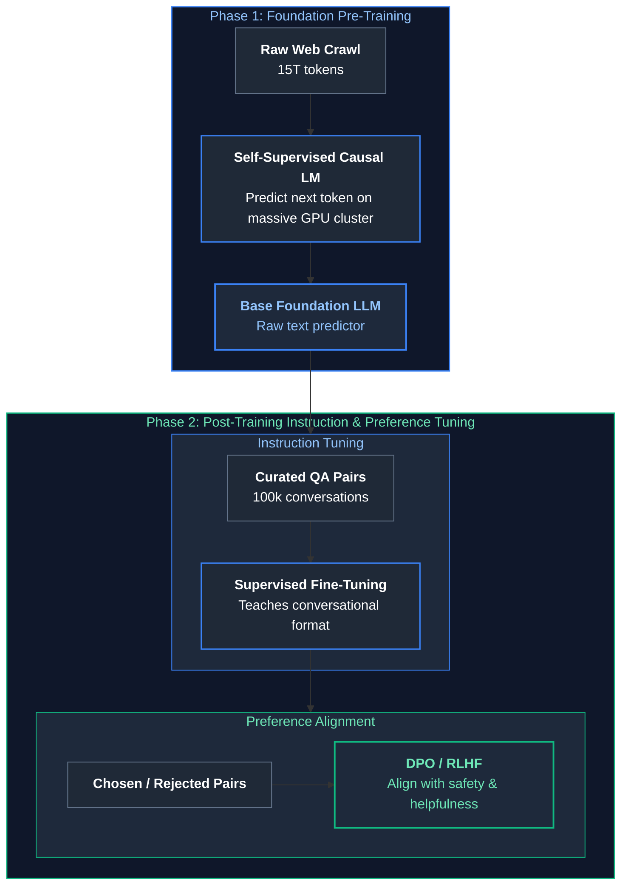

#### Production Implementation / Code Solution
```python
import torch
import torch.nn as nn

def compute_sft_loss_with_prompt_masking(
    model: nn.Module,
    input_ids: torch.Tensor,
    prompt_len: int,
    ignore_index: int = -100
) -> torch.Tensor:
    """
    Production SFT loss calculation: Applies loss masking on the user prompt tokens!
    Only the assistant's response tokens contribute to the gradient updates.
    """
    # input_ids: [Batch=1, SeqLen]
    labels = input_ids.clone()
    
    # Mask out prompt tokens with -100 so CrossEntropyLoss ignores them!
    labels[:, :prompt_len] = ignore_index
    
    # Forward pass
    logits = model(input_ids) # [Batch, SeqLen, Vocab]
    
    # Shift logits and labels for autoregressive next-token prediction
    shift_logits = logits[..., :-1, :].contiguous()
    shift_labels = labels[..., 1:].contiguous()
    
    # Compute CrossEntropy loss ignoring prompt tokens
    loss_fn = nn.CrossEntropyLoss(ignore_index=ignore_index)
    loss = loss_fn(shift_logits.view(-1, shift_logits.size(-1)), shift_labels.view(-1))
    return loss
```
- **Time Complexity:** $O(T \cdot V)$ cross-entropy reduction across unmasked assistant tokens.
- **Space Complexity:** $O(T \cdot V)$ logit tensors.

#### Engineering Implications & Production Pitfalls
1. **The Missing Loss Masking Disaster:** A rampant error in custom SFT pipelines is computing cross-entropy loss over the entire conversation (prompt + response). The model wastes gradient capacity memorizing the user's prompt rather than learning to generate high-quality responses. Always mask prompt tokens with `ignore_index = -100`.
2. **Alignment Tax:** Aggressive RLHF/DPO alignment can cause models to become overly cautious, refusing benign prompts or suffering reasoning degradation.

#### Core Curriculum Cross-Reference
- See [14. Model Adaptation & Fine-Tuning](../10_model_adaptation_and_system_design.md#3-supervised-fine-tuning-sft-mechanics) for complete SFT training harnesses.

---

### Q4. Why did the industry move from RNNs/LSTMs to transformers? What fundamental problem did attention solve?
**Topic Covered:** Sequential Bottlenecks & Attention Mechanics  
**Question:** Why did we move from RNNs to transformers? What problem did attention solve?

#### Definition & Core Concepts
Before 2017, sequential modeling was dominated by Recurrent Neural Networks (RNNs, LSTMs, GRUs). The paradigm shift to Transformers was driven by two fundamental mathematical bottlenecks:

1. **The Sequential Execution Bottleneck (Hardware Inefficiency):**
   - **RNN Recurrence:** In an LSTM, the hidden state at step $t$ requires the hidden state at step $t-1$:
     $$\mathbf{h}_t = \sigma(\mathbf{W}_h \mathbf{h}_{t-1} + \mathbf{W}_x \mathbf{x}_t + \mathbf{b})$$
   - **Hardware Impact:** Sequential dependency prevents horizontal GPU parallelization across time steps during training. Training a 100B parameter LSTM on 10 trillion tokens would take decades because GPUs cannot parallelize sequential loops.
   - **Transformer Solution:** Self-attention computes dependencies across all sequence positions simultaneously via parallel matrix multiplication ($\mathbf{Q}\mathbf{K}^T$), achieving 100% GPU Tensor Core saturation during training.
2. **The Information Bottleneck & Vanishing Gradient (Context Compression):**
   - **RNN Compression:** An RNN compresses an entire arbitrary-length sequence ($1,000\text{ words}$) into a single fixed-size vector $\mathbf{h}_t \in \mathbb{R}^d$. By step 500, earlier context is catastrophically lost or diluted.
   - **Transformer Solution:** Direct $O(1)$ pairwise attention links every token to every other token regardless of distance, eliminating the fixed-vector compression bottleneck.

#### Visual Flow
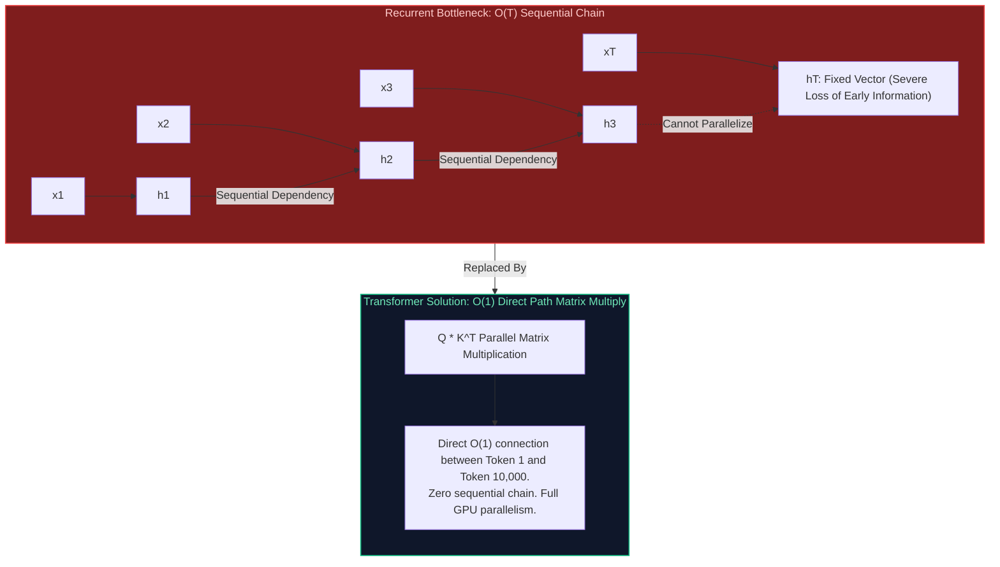

#### Production Implementation / Code Solution
```python
import torch

def parallel_self_attention_demonstration(seq_len: int = 1024, d_model: int = 4096):
    """
    Demonstrates the parallel matrix multiplication that enables Transformer scaling.
    Processes all tokens in a single vectorized GPU tensor operation!
    """
    # Simulated input activations [Batch=1, SeqLen=1024, Dim=4096]
    X = torch.randn(1, seq_len, d_model, device="cuda" if torch.cuda.is_available() else "cpu")
    
    W_q = torch.randn(d_model, d_model, device=X.device)
    W_k = torch.randn(d_model, d_model, device=X.device)
    W_v = torch.randn(d_model, d_model, device=X.device)
    
    # 1. Parallel Projection (Vectorized across all 1024 tokens simultaneously!)
    Q = torch.matmul(X, W_q)
    K = torch.matmul(X, W_k)
    V = torch.matmul(X, W_v)
    
    # 2. Parallel Attention Scores: Q * K^T computed via GEMM in a single kernel launch
    scale = (d_model // 16) ** 0.5
    scores = torch.matmul(Q, K.transpose(-2, -1)) / scale
    attn_weights = torch.softmax(scores, dim=-1)
    
    # 3. Output Context Aggregation
    context = torch.matmul(attn_weights, V)
    print(f"Successfully computed attention across {seq_len} tokens in parallel. Output shape: {context.shape}")
```
- **Time Complexity:** $O(T^2 \cdot d)$ computed via hardware-accelerated parallel systolic arrays.
- **Space Complexity:** $O(T^2)$ attention score matrix.

#### Engineering Implications & Production Pitfalls
1. **The Inference Divergence:** While Transformers completely outperform RNNs during **training** due to parallelizability, during **autoregressive generation** they generate tokens sequentially ($t_1 \to t_2 \to t_3$), facing memory bandwidth bottlenecks similar to RNNs. This requires **KV Caching** to avoid recomputing past representations.

#### Core Curriculum Cross-Reference
- See [02. LLM Foundations & Model Architecture](../02_llm_and_transformer_architecture.md#31-decoder-only-architecture--the-industry-convergence) for computational graphs and profiling benchmarks.

---

# 2. Attention Mechanics & Positional Encoding

---

### Q5. Why is self-attention more effective than recurrent connections for capturing long-range dependencies?
**Topic Covered:** Maximum Path Length & Signal Propagation  
**Question:** Why is self-attention more effective than RNNs?

#### Definition & Core Concepts
The effectiveness of a deep architecture in learning long-range dependencies is fundamentally governed by the **Maximum Path Length** that forward signals and backward gradients must traverse between interacting input tokens:

| Model Architecture | Path Length Between Position $i$ and $j$ | Complexity per Layer | Gradient Attenuation Behavior |
| :--- | :---: | :---: | :--- |
| **Recurrent (RNN / LSTM)** | $O(|i - j|)$ | $O(d^2)$ | Exponential decay ($\sigma'(z)^{|i-j|}$) causing vanishing gradient |
| **Convolutional (CNN)** | $O(\log_k(|i - j|))$ | $O(k \cdot d^2)$ | Logarithmic scaling via dilated receptive fields |
| **Self-Attention (Transformer)** | $O(1)$ | $O(T^2 \cdot d)$ | Direct pairwise connection; constant gradient flow |

In Self-Attention, the gradient of the loss with respect to an interaction between token $1$ and token $1000$ does not pass through $999$ intermediate matrix multiplications; it flows **directly through the softmax attention weight** $A_{1000, 1}$:

$$\frac{\partial \text{Context}_{1000}}{\partial \mathbf{v}_1} = A_{1000, 1} \cdot \mathbf{I}$$

If $A_{1000, 1} > 0$, the gradient flows instantaneously without vanishing.

#### Visual Flow
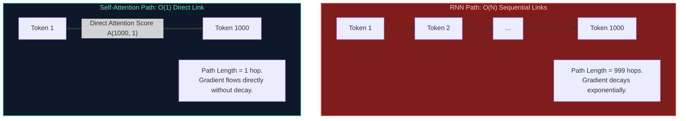

#### Production Implementation / Code Solution
```python
import torch
import torch.nn.functional as F

def inspect_attention_gradient_flow():
    """
    Demonstrates that gradients flow directly between distant tokens in self-attention
    without distance-dependent attenuation.
    """
    seq_len = 1000
    d_k = 64
    
    Q = torch.randn(1, seq_len, d_k, requires_grad=True)
    K = torch.randn(1, seq_len, d_k, requires_grad=True)
    V = torch.randn(1, seq_len, d_k, requires_grad=True)
    
    # Compute attention scores
    scores = torch.matmul(Q, K.transpose(-2, -1)) / (d_k ** 0.5)
    A = F.softmax(scores, dim=-1)
    out = torch.matmul(A, V)
    
    # Loss calculated specifically on the LAST token (index 999)
    loss = out[0, 999].sum()
    loss.backward()
    
    # Inspect gradient on FIRST token's value vector (index 0)
    grad_v0 = V.grad[0, 0].norm().item()
    print(f"Gradient norm on Value vector at Token 0: {grad_v0:.6f}")
    print("Gradient flows directly to Token 0 proportional to attention weight A[999, 0]!")
```
- **Time Complexity:** $O(T^2 \cdot d_k)$ forward/backward pass.
- **Space Complexity:** $O(T^2)$ memory for attention graph.

#### Engineering Implications & Production Pitfalls
1. **The Cost of $O(1)$ Path Length:** The $O(1)$ path length is achieved by evaluating every token against every other token, which incurs the quadratic computational complexity ($O(T^2)$). For massive context lengths ($128\text{K}\text{–}1\text{M}$ tokens), this requires FlashAttention, context chunking, or linear state-space alternatives.

#### Core Curriculum Cross-Reference
- See [02. LLM Foundations & Model Architecture](../02_llm_and_transformer_architecture.md#41-prefill-phase-vs-decode-phase-deep-dive) for attention scaling proofs.

---

### Q6. Explain positional encoding in Transformers: Why is it necessary, and how do sinusoidal encodings compare to RoPE and ALiBi?
**Topic Covered:** Positional Encodings & Relative Geometry  
**Question:** Explain positional encoding in Transformers.

#### Definition & Core Concepts
Because the self-attention operation is **permutation-equivariant** ($\text{Attention}(\mathbf{P}\mathbf{X}) = \mathbf{P}\text{Attention}(\mathbf{X})$ for any permutation matrix $\mathbf{P}$), a Transformer has no inherent concept of word order. Without positional encoding, the sentences *"The dog bit the man"* and *"The man bit the dog"* yield identical attention representations.

#### The Three Generations of Positional Encoding
1. **Absolute Sinusoidal Positional Encoding (Vaswani et al., 2017):**
   - Injects fixed trigonometric vectors directly into token embeddings:
     $$PE_{(pos, 2i)} = \sin\left(\frac{pos}{10000^{2i/d}}\right), \quad PE_{(pos, 2i+1)} = \cos\left(\frac{pos}{10000^{2i/d}}\right)$$
   - **Flaw:** Adding positional vectors directly to semantic embeddings distorts semantic vector space. Cannot extrapolate beyond maximum training context length.
2. **Rotary Position Embedding - RoPE (Su et al., 2021 - LLaMA, Mistral, Gemma):**
   - Applies a **2D rotation matrix** directly to query and key vectors in complex vector space:
     $$\mathbf{q}_m = \mathbf{R}_{\Theta, m}^d \mathbf{W}_q \mathbf{x}_m, \quad \mathbf{k}_n = \mathbf{R}_{\Theta, n}^d \mathbf{W}_k \mathbf{x}_n$$
   - **Inner Product Property:** The inner product depends strictly on relative distance $(m - n)$:
     $$\langle \mathbf{q}_m, \mathbf{k}_n \rangle = (\mathbf{W}_q \mathbf{x}_m)^T \mathbf{R}_{\Theta, n-m}^d (\mathbf{W}_k \mathbf{x}_n) = g(\mathbf{x}_m, \mathbf{x}_n, m - n)$$
   - **Benefit:** Preserves vector norms, captures relative distances naturally, and supports context extrapolation via **RoPE Frequency Scaling** (YaRN).
3. **Attention with Linear Biases - ALiBi (Press et al., 2021):**
   - Adds a non-learnable static geometric penalty directly to the attention logits:
     $$\text{Softmax}\left(\mathbf{q}_i \mathbf{k}_j^T - m \cdot |i - j|\right)$$
   - **Benefit:** Exceptional context extrapolation without any positional training, but weaker expressiveness on complex in-context retrieval tasks.

#### Visual Flow
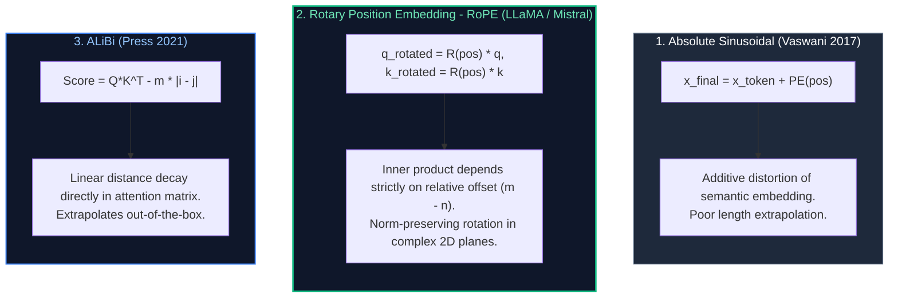

#### Production Implementation / Code Solution
```python
import torch

def apply_rotary_pos_emb(x: torch.Tensor, freqs_cis: torch.Tensor) -> torch.Tensor:
    """
    Production-grade Rotary Positional Embedding (RoPE) application.
    Rotates pairs of query/key feature dimensions in the complex plane.
    """
    # Reshape x to complex numbers: [Batch, SeqLen, Heads, Dim/2]
    x_complex = torch.view_as_complex(x.float().reshape(*x.shape[:-1], -1, 2))
    
    # Broadcast freqs_cis: [1, SeqLen, 1, Dim/2]
    freqs_cis = freqs_cis.unsqueeze(0).unsqueeze(2)
    
    # Complex multiplication rotates vectors by position angle
    x_rotated = torch.view_as_real(x_complex * freqs_cis).flatten(-2)
    return x_rotated.type_as(x)
```
- **Time Complexity:** $O(B \cdot T \cdot H \cdot D)$ element-wise complex multiplications.
- **Space Complexity:** $O(T \cdot D/2)$ precomputed trigonometric frequency tables.

#### Engineering Implications & Production Pitfalls
1. **Context Window Expansion via RoPE Scaling:** To extend an 8K-context model to 128K tokens without full retraining, engineers scale the RoPE base frequency:
   $$\theta_{\text{new}} = \theta_{\text{base}} \times s^{\frac{d}{d - 2}}$$
   This stretches the positional wavelengths, allowing the model to attend across long documents using techniques like **YaRN** (Yet another RoPE extensioN).

#### Core Curriculum Cross-Reference
- See [02. LLM Foundations & Model Architecture](../02_llm_and_transformer_architecture.md#41-prefill-phase-vs-decode-phase-deep-dive) for RoPE complex analysis derivations.

---

### Q7. How does multi-head attention improve a model's representation power compared to single-head attention?
**Topic Covered:** Multi-Head Attention & Representation Subspaces  
**Question:** How does multi-head attention improve a model’s representation power?

#### Definition & Core Concepts
In **Single-Head Attention**, queries, keys, and values are projected into a single high-dimensional space $\mathbb{R}^{d_{\text{model}}}$. When computing softmax attention weights across tokens, the single distribution tends to average out conflicting linguistic relationships: a single attention head cannot simultaneously track syntactic subject-verb agreement, semantic coreference, and grammatical dependency.

**Multi-Head Attention (MHA)** projects $\mathbf{Q}, \mathbf{K}, \mathbf{V}$ into $h$ distinct, lower-dimensional representation subspaces:

$$d_k = d_v = \frac{d_{\text{model}}}{h}$$

$$\text{MHA}(\mathbf{Q}, \mathbf{K}, \mathbf{V}) = \text{Concat}(\text{head}_1, \dots, \text{head}_h) \mathbf{W}_O$$

$$\text{head}_i = \text{Attention}(\mathbf{Q}\mathbf{W}_i^Q, \mathbf{K}\mathbf{W}_i^K, \mathbf{V}\mathbf{W}_i^V)$$

#### Key Architectural Benefits
1. **Disentangled Feature Subspaces:** Head 1 can attend to grammatical tense ("was" $\to$ "running"), Head 2 can resolve pronoun coreference ("it" $\to$ "the machine"), and Head 3 can identify lexical entities.
2. **Computational Invariance:** Because each head operates on $d_k = d_{\text{model}} / h$, the total computational complexity of Multi-Head Attention is **identical** to Single-Head Attention:
   $$h \times O(T^2 \cdot d_k) = O(T^2 \cdot d_{\text{model}})$$
   It provides significantly greater representation power at zero additional FLOP cost.

#### Visual Flow
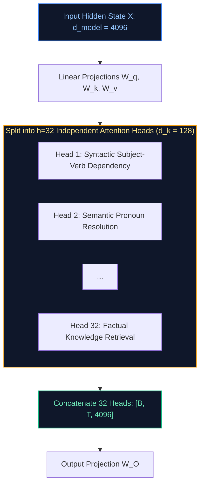

#### Production Implementation / Code Solution
```python
import torch
import torch.nn as nn

class MultiHeadAttentionSplit(nn.Module):
    """
    Illustrates the tensor reshaping mechanics of splitting queries/keys/values
    across multiple parallel representation heads.
    """
    def __init__(self, d_model: int = 4096, n_heads: int = 32):
        super().__init__()
        self.d_model = d_model
        self.n_heads = n_heads
        self.d_k = d_model // n_heads # 128 dimensions per head

        self.q_proj = nn.Linear(d_model, d_model, bias=False)
        self.k_proj = nn.Linear(d_model, d_model, bias=False)
        self.v_proj = nn.Linear(d_model, d_model, bias=False)
        self.out_proj = nn.Linear(d_model, d_model, bias=False)

    def forward(self, x: torch.Tensor) -> torch.Tensor:
        B, T, _ = x.shape
        # Project and reshape into [Batch, Heads, SeqLen, HeadDim]
        q = self.q_proj(x).view(B, T, self.n_heads, self.d_k).transpose(1, 2)
        k = self.k_proj(x).view(B, T, self.n_heads, self.d_k).transpose(1, 2)
        v = self.v_proj(x).view(B, T, self.n_heads, self.d_k).transpose(1, 2)
        
        # Vectorized scaled dot-product attention across all heads in parallel
        scores = torch.matmul(q, k.transpose(-2, -1)) / (self.d_k ** 0.5)
        attn = torch.softmax(scores, dim=-1)
        context = torch.matmul(attn, v) # [B, n_heads, T, d_k]
        
        # Concatenate heads back into [B, T, d_model]
        context = context.transpose(1, 2).contiguous().view(B, T, self.d_model)
        return self.out_proj(context)
```
- **Time Complexity:** $O(B \cdot T^2 \cdot d_{\text{model}})$.
- **Space Complexity:** $O(B \cdot h \cdot T^2)$ for intermediate attention scores.

#### Engineering Implications & Production Pitfalls
1. **Memory Bandwidth Pressure in Inference:** While MHA has identical FLOPs to single-head attention, during token generation it requires reading $h$ separate key-value states from VRAM for every token. This memory bandwidth bottleneck led directly to the development of **MQA** and **GQA**.

#### Core Curriculum Cross-Reference
- See [02. LLM Foundations & Model Architecture](../02_llm_and_transformer_architecture.md#41-prefill-phase-vs-decode-phase-deep-dive) for GQA optimizations.

---

### Q8. How does masked language modeling (MLM) differ from causal language modeling (CLM)?
**Topic Covered:** Training Objectives & Pre-Training Formulations  
**Question:** How does masked language modeling differ from causal language modeling?

#### Definition & Core Concepts
The difference between **Masked Language Modeling (MLM)** and **Causal Language Modeling (CLM)** defines the fundamental boundary between **Representation Models** (BERT) and **Generative Models** (LLaMA):

1. **Masked Language Modeling - MLM (BERT, RoBERTa):**
   - **Formulation:** Corrupts 15% of input tokens by replacing them with a special `[MASK]` token, random token, or keeping them identical. The model must reconstruct the masked tokens given full bidirectional context:
     $$\mathcal{L}_{\text{MLM}}(\theta) = -\sum_{i \in \text{Masked}} \log P_\theta(x_i \mid \mathbf{x}_{\backslash i})$$
   - **Characteristics:** Utilizes bidirectional attention. The model sees past and future context simultaneously.
   - **Limitation:** Incurs a mismatch between pre-training (where `[MASK]` exists) and downstream tasks (where `[MASK]` never appears). Inefficient at generating continuous paragraphs of text.
2. **Causal Language Modeling - CLM (GPT-4, LLaMA 3, Mistral):**
   - **Formulation:** Standard autoregressive next-token prediction using a strictly lower-triangular attention mask:
     $$\mathcal{L}_{\text{CLM}}(\theta) = -\sum_{t=1}^T \log P_\theta(x_t \mid x_1, x_2, \dots, x_{t-1})$$
   - **Characteristics:** Unidirectional attention. Every single token in the training sequence produces an active loss and gradient, maximizing compute efficiency.
   - **Advantage:** Naturally aligned with sequential generation, zero-shot prompting, and in-context reasoning.

#### Comparison Matrix
| Dimension | Masked Language Modeling (MLM) | Causal Language Modeling (CLM) |
| :--- | :--- | :--- |
| **Model Type** | Encoder-Only (BERT) | Decoder-Only (LLaMA, GPT) |
| **Attention Mask** | Bidirectional (Full Attention) | Causal (Lower-Triangular Mask) |
| **Loss Utilization** | Only ~15% of tokens contribute to loss | 100% of tokens contribute to loss |
| **Downstream Strengths** | Embeddings, Classification, Re-ranking | Generative Reasoning, Dialogue, Coding |

#### Visual Flow


#### Production Implementation / Code Solution
```python
import torch
import torch.nn as nn

def compare_mlm_vs_clm_loss(logits: torch.Tensor, target_ids: torch.Tensor, is_mlm: bool):
    """
    Illustrates the loss calculation distinction:
    MLM computes loss only over masked token indices (-100 ignored).
    CLM shifts all sequence positions to predict t+1.
    """
    loss_fn = nn.CrossEntropyLoss(ignore_index=-100)
    
    if is_mlm:
        # target_ids has -100 for all 85% unmasked positions
        loss = loss_fn(logits.view(-1, logits.size(-1)), target_ids.view(-1))
    else:
        # Causal next-token shift
        shift_logits = logits[:, :-1, :].contiguous()
        shift_labels = target_ids[:, 1:].contiguous()
        loss = loss_fn(shift_logits.view(-1, shift_logits.size(-1)), shift_labels.view(-1))
        
    return loss
```
- **Time Complexity:** MLM $O(0.15 \cdot T \cdot V)$, CLM $O(T \cdot V)$.
- **Space Complexity:** $O(T \cdot V)$ logit memory.

#### Engineering Implications & Production Pitfalls
1. **Pre-Training Efficiency:** CLM trains on 100% of tokens in the corpus, whereas MLM only trains on 15% of tokens per forward pass. CLM extracts $\sim 6.6\times$ more training signal per token processed.

#### Core Curriculum Cross-Reference
- See [02. LLM Foundations & Model Architecture](../02_llm_and_transformer_architecture.md#31-decoder-only-architecture--the-industry-convergence) for data efficiency comparisons.

---

# 3. Inference Acceleration & Distributed Scaling

---

### Q9. What is the KV Cache in Transformer inference, why does it consume massive VRAM, and how do Multi-Query (MQA) and Grouped-Query Attention (GQA) optimize it?
**Topic Covered:** KV Cache Sizing, Memory Bandwidth & Attention Variants  
**Question:** What is the KV Cache in Transformer inference, and how do MQA and GQA optimize it?

#### Definition & Core Concepts
During autoregressive generation, generating token $t+1$ requires computing attention against all previous tokens $1 \dots t$. Recomputing key and value projections for all previous tokens at every step scales quadratically ($O(T^2)$ compute).

The **Key-Value Cache (KV Cache)** stores the precomputed $\mathbf{K}$ and $\mathbf{V}$ tensor states of past tokens in GPU VRAM, allowing step $t+1$ to execute in $O(1)$ new compute.

#### The VRAM Explosion Formula
The VRAM required to store the KV Cache for a batch size $B$, sequence length $T$, across $L$ layers with $h_{\text{kv}}$ heads of dimension $d_k$ in FP16 (2 bytes) is:

$$\text{Memory}_{\text{KV Cache}} = 2 \times 2 \times B \times T \times L \times h_{\text{kv}} \times d_k \quad \text{bytes}$$

For a Llama-3-70B model ($L=80, d_{\text{model}}=8192, h=64$) at sequence length $T=8192$ and batch size $B=16$:
- With standard **Multi-Head Attention (MHA)** ($h_{\text{kv}} = 64$):
  $$\text{Memory} = 4 \times 16 \times 8192 \times 80 \times 64 \times 128 \approx 343.5\text{ GB of pure VRAM for KV Cache alone!}$$
The system crashes with `CUDA Out of Memory` before even serving a single concurrent user.

#### MHA vs MQA vs GQA Architectures
1. **Multi-Head Attention (MHA):** $h_q = h_{\text{kv}}$. Each query head has its own private key and value head. Massive VRAM consumption.
2. **Multi-Query Attention - MQA (Shazeer, 2019):** $h_{\text{kv}} = 1$. All $h_q$ query heads share a **single key head and value head**. Reduces KV cache memory by $h_q \times$ (e.g. 64x reduction), but can cause minor quality degradation on complex reasoning.
3. **Grouped-Query Attention - GQA (Ainslie et al., 2023 - Llama 3, Mistral):** Partitions query heads into $G$ groups (e.g. $G=8$), where each group of $\frac{h_q}{G}$ query heads shares a single key-value head pair:
   - Compresses KV cache by $\frac{h_q}{G}\times$ (e.g. 8x reduction).
   - Recovers 99.5% of MHA accuracy while achieving MQA inference throughput!

#### Visual Flow
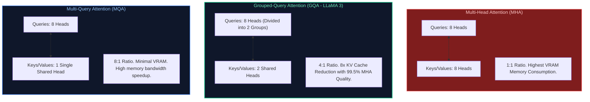

#### Production Implementation / Code Solution
```python
def calculate_kv_cache_vram_gb(
    batch_size: int,
    seq_len: int,
    num_layers: int,
    num_kv_heads: int,
    head_dim: int,
    bytes_per_param: int = 2 # 2 for FP16/BF16, 1 for FP8
) -> float:
    """
    Calculates exact KV Cache memory allocation required in GPU VRAM.
    Formula: 2 (K and V) * layers * batch * seq_len * kv_heads * head_dim * precision_bytes
    """
    total_bytes = 2 * num_layers * batch_size * seq_len * num_kv_heads * head_dim * bytes_per_param
    vram_gb = total_bytes / (1024 ** 3)
    return vram_gb

# Case Study: LLaMA-3-70B (80 layers, head_dim=128, batch=16, seq=8192)
mha_vram = calculate_kv_cache_vram_gb(16, 8192, 80, num_kv_heads=64, head_dim=128)
gqa_vram = calculate_kv_cache_vram_gb(16, 8192, 80, num_kv_heads=8, head_dim=128) # LLaMA 3 uses 8 KV heads!

print(f"MHA KV Cache VRAM Footprint: {mha_vram:.2f} GB (Unviable in production)")
print(f"GQA KV Cache VRAM Footprint: {gqa_vram:.2f} GB (Fits easily in H100 memory!)")
```
- **Time Complexity:** KV Cache lookup is $O(1)$ per past token.
- **Space Complexity:** Bounded strictly by sequence length: $O(B \cdot T \cdot L \cdot h_{\text{kv}} \cdot d_k)$.

#### Engineering Implications & Production Pitfalls
1. **Memory Bandwidth Bottleneck:** In generation, computing attention is **memory-bandwidth bound**, not compute bound. Loading large KV caches from GPU HBM memory to SRAM takes longer than performing the actual FLOPs. GQA reduces memory transfers by 8x, speeding up decoding throughput proportionally.

#### Core Curriculum Cross-Reference
- See [02. LLM Foundations & Model Architecture](../02_llm_and_transformer_architecture.md#5-key-value-kv-caching--memory-footprints) for hardware memory hierarchy analysis.

---

### Q10. What causes attention computation to scale quadratically ($O(N^2)$) with context length, and how do FlashAttention and FlashAttention-2 achieve sub-quadratic I/O efficiency?
**Topic Covered:** GPU Memory Hierarchy, SRAM Tiling & FlashAttention Mechanics  
**Question:** How does FlashAttention achieve efficiency given quadratic attention complexity?

#### Definition & Core Concepts
Standard attention computes:

$$\mathbf{S} = \frac{\mathbf{Q}\mathbf{K}^T}{\sqrt{d_k}} \in \mathbb{R}^{N \times N}, \quad \mathbf{P} = \text{softmax}(\mathbf{S}) \in \mathbb{R}^{N \times N}, \quad \mathbf{O} = \mathbf{P}\mathbf{V} \in \mathbb{R}^{N \times d}$$

For a sequence of length $N=128,000$, materializing the intermediate attention score matrix $\mathbf{S}$ requires:

$$N^2 = (128,000)^2 = 1.63 \times 10^{10} \text{ elements} \approx 32.7\text{ GB per head per layer!}$$

#### The Hardware Bottleneck: High Bandwidth Memory (HBM) vs On-Chip SRAM
On modern GPUs (NVIDIA A100 / H100):
- **GPU HBM (High Bandwidth Memory):** 80GB capacity, but slow bandwidth ($2\text{–}3.35\text{ TB/s}$).
- **GPU SRAM (L1 / Shared Memory):** Ultra-fast ($19\text{ TB/s}$), but tiny capacity ($228\text{ KB}$ per Streaming Multiprocessor).

Standard PyTorch attention writes and reads the massive $N \times N$ attention matrix $\mathbf{S}$ and $\mathbf{P}$ to **slow HBM repeatedly**, throttling execution at GPU memory bus speeds.

#### How FlashAttention Solves the Bottleneck
Developed by Tri Dao et al., **FlashAttention** does NOT alter the mathematical output of attention; it reorganizes memory access using two core innovations:
1. **Tiling (Block Computation in SRAM):** Partitions $\mathbf{Q}, \mathbf{K}, \mathbf{V}$ into small blocks ($B_r, B_c \approx 64\text{–}128$) that fit entirely within fast **on-chip SRAM**.
2. **Online Softmax:** Computes softmax incrementally across blocks without materializing the full $N \times N$ matrix in HBM, maintaining running normalization statistics ($m$ and $\ell$):
   $$m_{\text{new}} = \max(m_{\text{prev}}, \tilde{m}), \quad \ell_{\text{new}} = e^{m_{\text{prev}} - m_{\text{new}}} \ell_{\text{prev}} + e^{\tilde{m} - m_{\text{new}}} \tilde{\ell}$$
3. **Recomputation in Backward Pass:** Discards intermediate attention weights during forward pass and recomputes them on-the-fly in SRAM during backpropagation, slashing VRAM consumption from $O(N^2)$ to $O(N)$!

#### Visual Flow
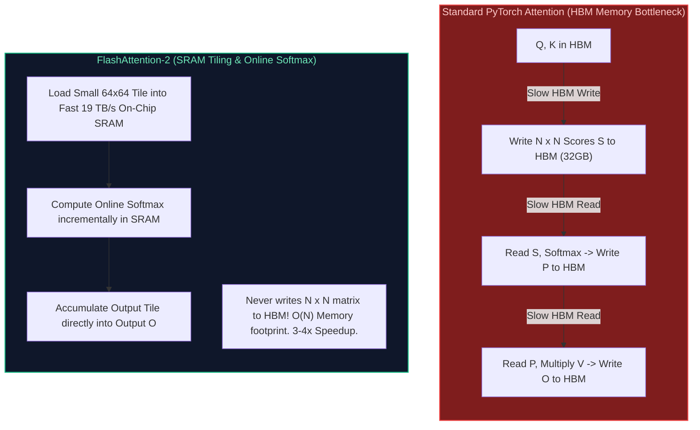

#### Production Implementation / Code Solution
```python
import torch
import torch.nn.functional as F

def benchmark_flash_vs_vanilla_attention(seq_len: int = 8192, d_head: int = 128):
    """
    Demonstrates enabling PyTorch's native FlashAttention-2 backend via scaled_dot_product_attention.
    """
    device = "cuda" if torch.cuda.is_available() else "cpu"
    Q = torch.randn(1, 16, seq_len, d_head, dtype=torch.bfloat16, device=device)
    K = torch.randn(1, 16, seq_len, d_head, dtype=torch.bfloat16, device=device)
    V = torch.randn(1, 16, seq_len, d_head, dtype=torch.bfloat16, device=device)

    # Force PyTorch to use FlashAttention-2 exclusively
    with torch.backends.cuda.sdp_kernel(enable_flash=True, enable_math=False, enable_mem_efficient=False):
        # Executes FlashAttention-2 C++ CUDA kernel without materializing N x N matrix
        out = F.scaled_dot_product_attention(Q, K, V, is_causal=True)
        print(f"FlashAttention-2 executed successfully on {seq_len} tokens. Output: {out.shape}")
```
- **Time Complexity:** $O(N^2 \cdot d)$ arithmetic operations (same FLOPs), but executes $3\text{–}4\times$ faster due to zero HBM memory access stalls.
- **Space Complexity:** $O(N)$ HBM memory footprint (drastic reduction from $O(N^2)$).

#### Engineering Implications & Production Pitfalls
1. **FlashAttention-2 Optimizations:** FlashAttention-2 further improves speed by parallelizing across the sequence length dimension in addition to batch/heads and reducing non-matmul FLOPs in SRAM.

#### Core Curriculum Cross-Reference
- See [02. LLM Foundations & Model Architecture](../02_llm_and_transformer_architecture.md#41-prefill-phase-vs-decode-phase-deep-dive) and [12. AI Infrastructure](../08_ai_infrastructure_and_serving.md#3-serving-engine-mechanics-vllm-sglang--pagedattention) for CUDA kernel tiling.

---

### Q11. What happens during the pre-training phase of an autoregressive LLM under modern distributed parallelisms (Tensor, Pipeline, and ZeRO-3)?
**Topic Covered:** 3D Parallelism & Distributed Scaling  
**Question:** What happens during the pre-training phase of an autoregressive LLM?

#### Definition & Core Concepts
Training a 70B parameter model in FP16 requires:
- Model Weights: $70\text{B} \times 2\text{ bytes} = 140\text{ GB}$
- Gradients: $70\text{B} \times 2\text{ bytes} = 140\text{ GB}$
- AdamW Optimizer States: $70\text{B} \times 12\text{ bytes} (m, v, \text{fp32 weights}) = 840\text{ GB}$
- Total Static Memory: **$1,120\text{ GB}$** (excluding activations).
Since an NVIDIA H100 has 80GB VRAM, the model **cannot fit onto a single GPU**. Training requires orchestrating **3D Distributed Parallelism**:

1. **Tensor Parallelism - TP (Megatron-LM):**
   - Splits individual weight matrices across GPUs within the same server node connected via high-speed NVLink ($900\text{ GB/s}$).
   - **Column Parallel:** Splits $\mathbf{W}_{\text{gate}}, \mathbf{W}_{\text{up}}$ across GPUs.
   - **Row Parallel:** Splits $\mathbf{W}_{\text{down}}$ across GPUs followed by an `All-Reduce` communication primitive.
2. **Pipeline Parallelism - PP:**
   - Partitions network layers across sequential nodes ($L=80$ split into 4 nodes of 20 layers each).
   - Uses **1F1B (1-Forward-1-Backward)** scheduling to minimize pipeline bubble idle time.
3. **Data Parallelism & ZeRO-3 (Fully Sharded Data Parallel - FSDP):**
   - ZeRO partitions optimizer states (ZeRO-1), gradients (ZeRO-2), and parameters (ZeRO-3) across data-parallel ranks.
   - Weights are gathered on-demand via `All-Gather` during forward/backward passes and immediately discarded.

#### Visual Flow
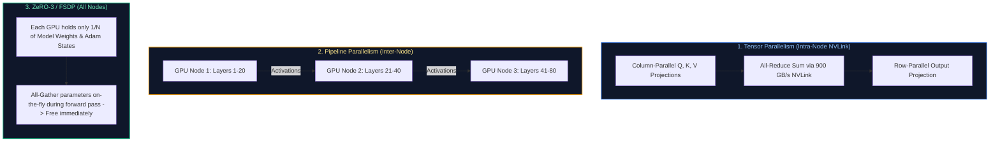

#### Production Implementation / Code Solution
```python
import torch
import torch.distributed as dist
from torch.distributed.fsdp import FullyShardedDataParallel as FSDP
from torch.distributed.fsdp.fully_sharded_data_parallel import ShardingStrategy

def setup_fsdp_training_node(model: torch.nn.Module):
    """
    Wraps a foundation model in PyTorch Fully Sharded Data Parallel (FSDP - ZeRO-3).
    Shards parameters, gradients, and optimizer states across all cluster GPUs.
    """
    if not dist.is_initialized():
        print("Distributed process group must be initialized prior to FSDP wrapping.")
        return model

    # Configure ZeRO-3 Full Sharding Strategy
    fsdp_model = FSDP(
        model,
        sharding_strategy=ShardingStrategy.FULL_SHARD, # ZeRO-3: shards weights, grads, opt
        mixed_precision=torch.distributed.fsdp.MixedPrecision(
            param_dtype=torch.bfloat16,
            reduce_dtype=torch.bfloat16,
            buffer_dtype=torch.bfloat16
        ),
        device_id=torch.cuda.current_device(),
        limit_all_gathers=True # Prevents memory spikes during communication
    )
    return fsdp_model
```
- **Time Complexity:** Communication overhead bounded by cluster network bisection bandwidth.
- **Space Complexity:** Slices static memory by $1/N_{\text{GPUs}}$.

#### Engineering Implications & Production Pitfalls
1. **Network Bisection Bandwidth:** Tensor Parallelism requires massive bandwidth and **must never cross server nodes over InfiniBand/Ethernet**; keep TP $\le 8$ within a single NVLink chassis. Pipeline and Data Parallelism can safely cross nodes over $400\text{ Gbps}$ InfiniBand.

#### Core Curriculum Cross-Reference
- See [12. AI Infrastructure](../08_ai_infrastructure_and_serving.md#5-distributed-inference-tensor-parallelism-vs-pipeline-parallelism) for 3D parallelism topology matrices.

---

### Q12. Design an optimal speculative decoding architecture to accelerate LLM token generation by 2–3x without altering output probability distributions.
**Topic Covered:** Speculative Decoding, Draft Models & Rejection Sampling  
**Question:** Design a speculative decoding architecture to accelerate LLM inference.

#### Definition & Core Concepts
LLM inference generation is **memory-bandwidth bound**: reading 70B parameters from VRAM to generate a single token achieves only $\sim 2\%$ arithmetic GPU core utilization.

**Speculative Decoding (Leviathan et al., 2023)** exploits this arithmetic headroom by pairing a large target model $\mathcal{M}_{\text{target}}$ (e.g. LLaMA-3-70B) with a lightweight, fast draft model $\mathcal{M}_{\text{draft}}$ (e.g. LLaMA-3-8B):

1. **Speculation Step:** The draft model generates $K$ candidate tokens autoregressively in parallel:
   $$\hat{x}_1, \hat{x}_2, \dots, \hat{x}_K \sim P_{\text{draft}}(x \mid \dots)$$
2. **Verification Step (Single Forward Pass):** The target model evaluates all $K$ tokens **in a single forward pass** via causal mask slicing, calculating target probabilities $P_{\text{target}}(x_k)$.
3. **Modified Rejection Sampling:** For each candidate token $k$, it is accepted with probability:
   $$\alpha = \min\left(1, \frac{P_{\text{target}}(\hat{x}_k)}{P_{\text{draft}}(\hat{x}_k)}\right)$$
4. **Mathematical Guarantee:** If a token is rejected, a sample is drawn from the residual distribution $\max(0, P_{\text{target}} - P_{\text{draft}})$. **Theorem:** The generated output distribution is mathematically identical to sampling directly from the target model!

#### Visual Flow
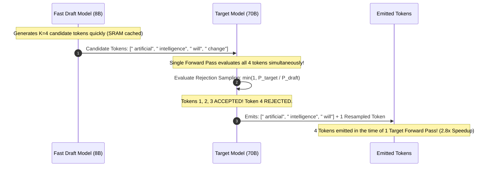

#### Production Implementation / Code Solution
```python
import torch

def speculative_rejection_sampling(
    p_draft: torch.Tensor,
    p_target: torch.Tensor,
    candidate_tokens: torch.Tensor
) -> list[int]:
    """
    Executes mathematically exact speculative verification across candidate tokens.
    Guarantees target model distribution preservation without approximation error.
    """
    accepted_tokens = []
    K = len(candidate_tokens)
    
    for i in range(K):
        token_id = candidate_tokens[i].item()
        p_d = p_draft[i, token_id].item()
        p_t = p_target[i, token_id].item()
        
        # Acceptance probability
        alpha = min(1.0, p_t / max(p_d, 1e-8))
        r = torch.rand(1).item()
        
        if r <= alpha:
            accepted_tokens.append(token_id)
        else:
            # Rejection: Sample from normalized positive residual distribution
            residual = torch.clamp(p_target[i] - p_draft[i], min=0.0)
            residual = residual / residual.sum()
            corrected_token = torch.multinomial(residual, num_samples=1).item()
            accepted_tokens.append(corrected_token)
            break # Stop checking downstream draft tokens
            
    return accepted_tokens
```
- **Time Complexity:** Target model forward pass is $O(K \cdot d)$ computed in parallel (same wall-clock time as $K=1$).
- **Space Complexity:** $O(K \cdot V)$ probability distributions in SRAM.

#### Engineering Implications & Production Pitfalls
1. **Tokenizer Alignment:** The draft model and target model **must share an identical vocabulary and tokenizer**. If token ID 4031 represents different subwords across models, speculative acceptance crashes to 0%.
2. **Acceptance Rate $\alpha$ vs Draft Speed:** If the draft model is too weak (acceptance rate $< 40\%$) or too slow (taking $> 30\%$ of target latency), speculative decoding actually slows down inference. Target an acceptance rate $\alpha \ge 70\%$.

#### Core Curriculum Cross-Reference
- See [02. LLM Foundations & Model Architecture](../02_llm_and_transformer_architecture.md#4-the-lifecycle-of-an-inference-request) and [12. AI Infrastructure](../08_ai_infrastructure_and_serving.md#4-continuous-batching-chunked-prefill--speculative-decoding) for production vLLM speculative implementations.

---

## Summary Comparison & Production Reference Matrix

| Architectural Domain | Core Mechanism | Mathematical Formulation | Primary Engineering Bottleneck | Canonical Production Resolution |
| :--- | :--- | :--- | :--- | :--- |
| **Decoder-Only Transformer** | Pre-LN autoregression with SwiGLU | $\mathbf{X}_l = \mathbf{X}_{l-1} + \text{Attn}(\text{Norm}(\mathbf{X}))$ | Training vanishing gradients | Pre-LN RMSNorm, residual skip connections, SwiGLU FFN |
| **Model Typology** | Attention mask structure | $M_{ij} = 0$ vs $M_{ij} = -\infty$ | Scaling complexity | Decoder-only causal attention for universal generative scaling |
| **Pre-Training vs SFT** | Knowledge compression vs formatting | Causal LM vs Masked Assistant SFT | Memorizing prompts & alignment tax | Mask prompt tokens with `ignore_index = -100`; low LR for SFT |
| **Attention vs RNN** | Global $O(1)$ path length | $\mathbf{Q}\mathbf{K}^T$ parallel GEMM matrix multiply | Sequential recurrence bottleneck | Parallel self-attention; eliminate fixed hidden state |
| **Positional Encoding** | Permutation invariance breaking | $\mathbf{q}_m = \mathbf{R}_{\Theta, m}^d \mathbf{q}$ (RoPE) | Length extrapolation beyond context | Rotary Positional Embedding (RoPE) with YaRN frequency scaling |
| **Multi-Head Attention** | Representation subspace separation | $\text{Concat}(\text{head}_1 \dots \text{head}_h)\mathbf{W}_O$ | VRAM memory bandwidth in decoding | Grouped-Query Attention (GQA) with 8:1 query-to-KV head ratio |
| **MLM vs CLM** | Corrupted token prediction vs Causal | $P(x_i \mid \mathbf{x}_{\backslash i})$ vs $P(x_t \mid x_{<t})$ | 15% compute efficiency in MLM | Causal Language Modeling: 100% token gradient utilization |
| **KV Cache** | Storing past keys/values in VRAM | $2 \times 2 \times B \times T \times L \times h_{\text{kv}} \times d_k$ | VRAM exhaustion ($300\text{GB}+$) | Grouped-Query Attention (GQA) & PagedAttention (vLLM) |
| **FlashAttention-2** | SRAM tiling & Online Softmax | $O(N)$ HBM I/O complexity | Quadratic HBM read/write bottleneck | Block tiling in fast L1 SRAM; online softmax recomputation |
| **3D Parallelism** | Splitting model across cluster | $\text{TP} \times \text{PP} \times \text{FSDP}$ | Network bisection bandwidth | TP inside NVLink chassis ($TP \le 8$); FSDP/ZeRO-3 across InfiniBand |
| **Speculative Decoding** | Fast draft proposal + Target verify | $\alpha = \min(1, P_t / P_d)$ | Memory-bandwidth decoding stall | Draft model proposal verified in single target forward pass (2.8x speedup) |

---

## References & Further Reading

1. **Vaswani, Ashish, et al.** *Attention Is All You Need*. Advances in Neural Information Processing Systems (NeurIPS), 2017. [arXiv:1706.03762](https://arxiv.org/abs/1706.03762).
2. **Su, Jianlin, et al.** *RoFormer: Enhanced Transformer with Rotary Position Embedding (RoPE)*. 2021. [arXiv:2104.09864](https://arxiv.org/abs/2104.09864).
3. **Ainslie, Joshua, et al.** *GQA: Training Generalized Multi-Query Transformer Models from Multi-Head Checkpoints*. 2023. [arXiv:2305.13245](https://arxiv.org/abs/2305.13245).
4. **Dao, Tri.** *FlashAttention-2: Faster Attention with Better Parallelism and Work Partitioning*. 2023. [arXiv:2307.08691](https://arxiv.org/abs/2307.08691).
5. **Leviathan, Yaniv, et al.** *Fast Inference from Transformers via Speculative Decoding*. International Conference on Machine Learning (ICML), 2023. [arXiv:2211.17192](https://arxiv.org/abs/2211.17192).
6. **Rajbhandari, Samyam, et al.** *ZeRO: Memory Optimizations Toward Training Trillion Parameter Models*. IEEE/ACM SC20, 2020. [arXiv:1910.02054](https://arxiv.org/abs/1910.02054).

