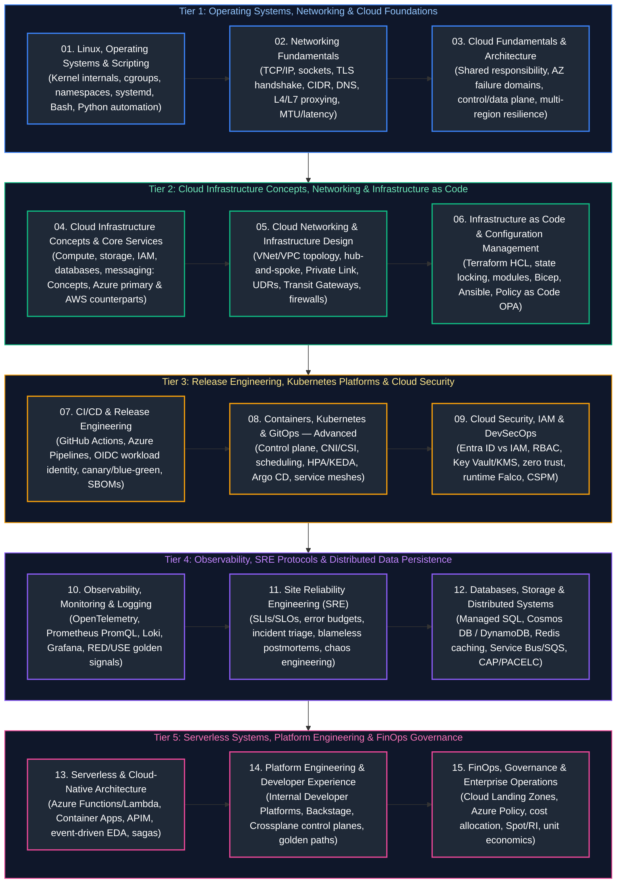

# 00. Cloud Engineering Master Curriculum & Comprehensive Study Guide

This master curriculum guide provides the authoritative, production-grade learning roadmap, conceptual index, and chronological reading order for modern Cloud & Infrastructure Engineering. The curriculum is concept-focused and systems-first, spanning Linux kernel subsystems, low-level OS internals, TCP/IP networking, cloud infrastructure paradigms (with Microsoft Azure as the primary reference architecture and AWS as the equivalent counterpart), software-defined cloud networking, Infrastructure as Code (Terraform, Bicep, Ansible), enterprise CI/CD release engineering, advanced Kubernetes orchestration and GitOps, cloud security and DevSecOps, full-stack observability (OpenTelemetry, Prometheus, Grafana), Site Reliability Engineering (SRE), distributed databases and event streaming, serverless cloud-native design, internal developer platforms (IDP / Platform Engineering), and FinOps cloud financial governance.

Every guide includes formal architectural definitions, Mermaid dark-mode topological diagrams, runtime mechanics, production code and IaC implementations with detailed line-by-line commentary, edge-case mitigation, and production troubleshooting playbooks.

---

## 5-Tier Chronological Mermaid Study Roadmap

---

## Master Topic Guides & Curriculum Coverage Overview

| Study Order | Guide File | Conceptual Domain | Key Architectural Topics & Implementations Covered |
| :---: | :--- | :--- | :--- |
| **01** | [`01_linux_operating_systems_and_scripting.md`](01_linux_operating_systems_and_scripting.md) | **OS Internals & Scripting** | Linux kernel architecture, VFS, inodes, file permissions, process states, signals (`SIGTERM`/`SIGKILL`), systemd service units, CPU scheduling (`CFS`), memory management (virtual memory, page tables, OOM killer), cgroups v2, Linux namespaces (PID, net, mnt), TCP/IP troubleshooting (`ss`, `tcpdump`), robust defensive Bash scripts, Python infrastructure automation, cron, and cloud-init bootstrapping. |
| **02** | [`02_networking_fundamentals.md`](02_networking_fundamentals.md) | **Computer Networking** | OSI vs. TCP/IP model, TCP 3-way handshake and 4-way termination, TCP windowing, congestion control (BBR, CUBIC), UDP socket mechanics, IPv4 CIDR subnet calculations, IPv6 prefix architecture, authoritative vs. recursive DNS, DNS record types, TLS 1.3 cryptographic handshake, PKI, Linux routing tables, NAT (SNAT vs DNAT), Layer 4 vs Layer 7 load balancing, packet analysis with Wireshark/tcpdump, MTU and PMTU discovery. |
| **03** | [`03_cloud_fundamentals_and_architecture.md`](03_cloud_fundamentals_and_architecture.md) | **Cloud Architecture** | Cloud delivery models (IaaS, PaaS, SaaS, FaaS), physical regions, availability zones, fault domains and update domains, scalability vs. elasticity, stateless 12-factor application architecture, shared responsibility model across cloud tiers, control plane vs. data plane failure isolation, resource quotas, High Availability (HA) vs. Disaster Recovery (DR), Well-Architected Framework pillars, multi-account landing zones, and cloud migration patterns (6 Rs). |
| **04** | [`04_azure_core_services_and_aws_equivalents.md`](04_azure_core_services_and_aws_equivalents.md) | **Cloud Infrastructure Concepts** | Concept-first systems guide to core cloud infrastructure paradigms: hierarchical resource governance, compute virtualization (Azure Boost / Nitro), managed Kubernetes (AKS / EKS), serverless containers, SDN overlays, Anycast edge ingress, distributed object/block/file storage, decoupled relational & NoSQL databases (Hyperscale / Aurora / Cosmos DB), FaaS runtimes, API gateways, enterprise messaging (Service Bus / SQS), and KMS envelope encryption — using Azure as primary reference architecture followed by equivalent AWS counterparts. |
| **05** | [`05_cloud_networking_and_infrastructure_design.md`](05_cloud_networking_and_infrastructure_design.md) | **Cloud Network Engineering** | Enterprise VNet/VPC architecture, multi-tier CIDR design, public vs. private vs. isolated subnets, User Defined Routes (UDRs), NAT Gateways, NSGs vs. Security Groups & NACLs, Azure Firewall vs. AWS Network Firewall, Application Gateway (ALB) vs. Azure Load Balancer (NLB), Private Endpoints & Private Link, Hub-and-Spoke topology, Azure Virtual WAN vs. AWS Transit Gateway, Private DNS zones, egress filtering, and ExpressRoute / Direct Connect hybrid backbones. |
| **06** | [`06_infrastructure_as_code_and_configuration_management.md`](06_infrastructure_as_code_and_configuration_management.md) | **IaC & Config Management** | Declarative infrastructure with Terraform and OpenTofu, HCL syntax, provider configurations, remote state backends (Azure Blob / AWS S3) with distributed locking (Blob lease / DynamoDB), Terraform modules, resource lifecycle hooks (`create_before_destroy`, `prevent_destroy`), workspace strategies vs. directory isolation, automated drift detection, security scanning (tfsec, checkov), Azure Bicep native DSL, Ansible idempotent playbooks, and Policy as Code (OPA / Sentinel). |
| **07** | [`07_cicd_and_release_engineering.md`](07_cicd_and_release_engineering.md) | **CI/CD & Delivery Engineering** | Modern continuous delivery pipelines, GitHub Actions workflows, Azure DevOps Pipelines, OIDC Workload Identity Federation (keyless cloud authentication), multi-stage Docker container builds, build caching, artifact registries (ACR/ECR), environment protection gates and approvals, progressive delivery release patterns (rolling, blue-green, canary with Flagger), automated database migrations (Flyway/Liquibase), SBOM generation (Syft), and Sigstore container signing. |
| **08** | [`08_containers_kubernetes_and_gitops.md`](08_containers_kubernetes_and_gitops.md) | **Kubernetes & GitOps** | Deep Kubernetes internals: API server, etcd Raft consensus, kube-scheduler, kubelet, CNI networking (Calico, Azure CNI), CSI dynamic volume provisioning, CRI containerd runtime, Pod scheduling, node affinity, taints/tolerations, topology spread, resource requests/limits, Horizontal Pod Autoscaler (HPA), KEDA event-driven autoscaling, NetworkPolicy, Gateway API, RBAC, Workload Identity, Helm 3, Kustomize, AKS/EKS cluster administration, and Argo CD GitOps pipelines. |
| **09** | [`09_cloud_security_iam_and_devsecops.md`](09_cloud_security_iam_and_devsecops.md) | **Cloud Security & DevSecOps** | Identity architecture: Microsoft Entra ID vs. AWS IAM, principle of least privilege, Azure RBAC roles vs. IAM JSON policy evaluation logic, managed identities, OIDC short-lived credentials, Azure Key Vault vs. AWS Secrets Manager, envelope encryption with KMS and CMEK, TLS certificate automation, Azure Policy vs. AWS SCPs, CSPM with Defender for Cloud / GuardDuty, Web Application Firewalls (WAF), container runtime security with Falco, and SOC 2 / CIS benchmarks. |
| **10** | [`10_observability_monitoring_and_logging.md`](10_observability_monitoring_and_logging.md) | **Observability & Telemetry** | The three pillars (Metrics, Logs, Traces) and profiling, RED and USE diagnostic methods, Google SRE Four Golden Signals, Azure Monitor & Log Analytics (KQL queries), AWS CloudWatch, Prometheus TSDB architecture, PromQL queries, Grafana dashboards, OpenTelemetry (OTel) Collector pipeline, distributed tracing with W3C Trace Context and Jaeger/Tempo, centralized logging with Grafana Loki and OpenSearch, and SLO multi-window burn-rate alerts. |
| **11** | [`11_site_reliability_engineering.md`](11_site_reliability_engineering.md) | **Site Reliability Engineering** | SLI, SLO, and SLA mathematical definitions, error budget burn rates, high availability probability calculations, incident management protocols (SEV-1 to SEV-4), Incident Commander responsibilities, blameless postmortem templates and 5-Whys root cause analysis, operational readiness reviews (ORR), toil reduction automation, resilience patterns (exponential backoff with jitter, circuit breakers, bulkheads, rate limiters), chaos engineering, and disaster recovery drills (RTO/RPO). |
| **12** | [`12_databases_storage_and_distributed_systems.md`](12_databases_storage_and_distributed_systems.md) | **Databases & Storage Systems** | Managed relational systems (Azure SQL, PostgreSQL Flexible, AWS RDS, Aurora distributed storage architecture), globally distributed NoSQL (Azure Cosmos DB consistency levels and Request Units vs. DynamoDB WCU/RCU and partition keys), Blob Storage vs. S3 consistency models, block storage performance (IOPS/throughput limits), connection pooling (PgBouncer), Redis caching patterns, enterprise messaging (Azure Service Bus vs. AWS SQS/SNS), Event Hubs vs. Kinesis, and CAP/PACELC trade-offs. |
| **13** | [`13_serverless_and_cloud_native_architecture.md`](13_serverless_and_cloud_native_architecture.md) | **Serverless Architecture** | FaaS execution environments (Azure Functions vs. AWS Lambda microVM Firecracker), cold start optimization, provisioned concurrency, Azure Container Apps (built on KEDA, Envoy, and Dapr) vs. AWS ECS Fargate, API Gateway policy management, Event-Driven Architecture (EDA), workflow orchestration (Azure Durable Functions / Logic Apps vs. AWS Step Functions), distributed transaction handling with the Saga pattern, and serverless vs. container vs. VM cost economics. |
| **14** | [`14_platform_engineering_and_developer_experience.md`](14_platform_engineering_and_developer_experience.md) | **Platform Engineering & IDP** | Internal Developer Platforms (IDP), Developer Portals (Spotify Backstage software catalog, TechDocs, software templates), Golden Paths and paved roads, self-service infrastructure provisioning, Crossplane Kubernetes-native control planes (Compositions, XRDs, MRs), multi-tenant namespace isolation, admission control with Kyverno and OPA Gatekeeper, External Secrets Operator (ESO), ephemeral pull-request preview environments, and DORA metrics. |
| **15** | [`15_finops_governance_and_enterprise_operations.md`](15_finops_governance_and_enterprise_operations.md) | **FinOps & Cloud Governance** | FinOps lifecycle (Inform, Optimize, Operate), cloud resource hierarchy (Management Groups, Subscriptions, AWS Organizations, SCPs), Enterprise Cloud Landing Zones, mandatory cost-allocation tagging policies, Azure Cost Management vs. AWS Cost Explorer, right-sizing analysis, Spot VM interruption handling, Reserved Instances and Savings Plans, storage lifecycle tiering, network egress cost mitigation, Kubecost Kubernetes allocation, and unit economics. |

---

## Production Problem-Solution Cross-Reference Index (50 Canonical Failures)

The table below maps the **50 canonical Cloud, Infrastructure, Kubernetes, Networking, and SRE production failures** directly to their architectural solutions and corresponding curriculum chapters.

| Problem | Canonical Solution | Module Reference |
| :--- | :--- | :--- |
| **Linux Kernel Out-Of-Memory (OOM) Panic** | Set `vm.panic_on_oom=0`, tune `oom_score_adj`, and enforce cgroups v2 `memory.max` hard caps | [`01_linux_operating_systems_and_scripting.md`](01_linux_operating_systems_and_scripting.md#3-cpu-memory-and-io-resource-management) |
| **Exhausted Linux File Descriptors (`Too many open files`)** | Elevate `fs.file-max` in `/etc/sysctl.conf` and configure systemd `LimitNOFILE=65536` | [`01_linux_operating_systems_and_scripting.md`](01_linux_operating_systems_and_scripting.md#1-linux-filesystem-internals-permissions-and-vfs) |
| **Zombie Process Saturation** | Configure container init system (e.g. `tini` / dumb-init) to adopt and reap orphan processes via `waitpid()` | [`01_linux_operating_systems_and_scripting.md`](01_linux_operating_systems_and_scripting.md#2-processes-threads-signals-and-systemd-internals) |
| **Subnet IP Exhaustion in Cloud VNet/VPC** | Adopt non-contiguous secondary IPv4 CIDR blocks and transition pod networking to overlay CNI / IPv6 | [`02_networking_fundamentals.md`](02_networking_fundamentals.md#2-ip-addressing-cidr-subnet-math-and-ipv6) [`05_cloud_networking_and_infrastructure_design.md`](05_cloud_networking_and_infrastructure_design.md#1-vnet-and-vpc-architecture-and-cidr-planning) |
| **DNS Resolution Timeout / Throttling** | Deploy local CoreDNS node-caching (`NodeLocal DNSCache`) and implement DNS search path truncation | [`02_networking_fundamentals.md`](02_networking_fundamentals.md#3-dns-architecture-resolution-internals-and-records) [`08_containers_kubernetes_and_gitops.md`](08_containers_kubernetes_and_gitops.md#4-kubernetes-networking-cni-and-dns) |
| **MTU Black Hole / Packet Fragmentation** | Enable Path MTU Discovery (PMTUD) and clamp TCP MSS (`iptables -A FORWARD -p tcp --tcp-flags SYN,RST SYN -j TCPMSS --clamp-mss-to-pmtu`) | [`02_networking_fundamentals.md`](02_networking_fundamentals.md#8-network-troubleshooting-packet-analysis-and-mtu) |
| **Cross-Availability Zone Latency Spikes** | Implement topology-aware traffic routing and co-locate chattier microservice tiers within the same AZ | [`03_cloud_fundamentals_and_architecture.md`](03_cloud_fundamentals_and_architecture.md#2-regions-availability-zones-and-fault-domains) [`08_containers_kubernetes_and_gitops.md`](08_containers_kubernetes_and_gitops.md#2-pod-scheduling-affinity-and-topology-spread) |
| **Cloud Service Quota / Rate Limit Reached** | Submit proactive quota increases and distribute requests across multiple subscriptions or accounts | [`03_cloud_fundamentals_and_architecture.md`](03_cloud_fundamentals_and_architecture.md#5-resource-hierarchy-quotas-and-service-limits) |
| **Split-Brain in Multi-Region Failover** | Implement an automated quorum-based health probe with an authoritative global arbiter (e.g., Azure Traffic Manager / Route 53 ARC) | [`03_cloud_fundamentals_and_architecture.md`](03_cloud_fundamentals_and_architecture.md#6-high-availability-vs-disaster-recovery-design) |
| **Asymmetric Routing over ExpressRoute/Direct Connect** | Configure BGP Local Preference on inbound routes and AS-Path Prepending on outbound backup routes | [`05_cloud_networking_and_infrastructure_design.md`](05_cloud_networking_and_infrastructure_design.md#6-hybrid-connectivity-expressroute-and-direct-connect) |
| **Transitive VNet Peering Routing Failure** | Deploy Azure Virtual WAN or centralized Azure Route Server / Transit Gateway with UDR propagations | [`05_cloud_networking_and_infrastructure_design.md`](05_cloud_networking_and_infrastructure_design.md#5-hub-and-spoke-topology-and-transit-networking) |
| **Public Internet Exposure of PaaS Databases** | Implement Private Endpoints / AWS PrivateLink and disable public network access flags on database resources | [`05_cloud_networking_and_infrastructure_design.md`](05_cloud_networking_and_infrastructure_design.md#4-private-link-and-private-endpoints) |
| **Outbound SNAT Port Exhaustion** | Deploy managed NAT Gateway with multiple public IPs to expand ephemeral SNAT port allocations | [`05_cloud_networking_and_infrastructure_design.md`](05_cloud_networking_and_infrastructure_design.md#2-route-tables-gateways-and-nat-mechanics) |
| **Terraform State Lock Deadlock** | Inspect active lock ID in Azure Blob / DynamoDB and execute controlled `terraform force-unlock <LOCK-ID>` | [`06_infrastructure_as_code_and_configuration_management.md`](06_infrastructure_as_code_and_configuration_management.md#3-remote-state-locking-and-backend-management) |
| **Silent Terraform Configuration Drift** | Schedule scheduled CI/CD pipeline running `terraform plan -detailed-exitcode` with alert webhooks | [`06_infrastructure_as_code_and_configuration_management.md`](06_infrastructure_as_code_and_configuration_management.md#5-drift-detection-and-reconciliation) |
| **IaC Security Misconfiguration Leaks** | Enforce pre-commit and CI pull request scanning gates using `checkov` and `tfsec` SARIF reporting | [`06_infrastructure_as_code_and_configuration_management.md`](06_infrastructure_as_code_and_configuration_management.md#6-iac-testing-validation-and-security-scanning) |
| **Hardcoded Cloud Secrets in CI/CD Runners** | Migrate to OpenID Connect (OIDC) Workload Identity Federation with short-lived STS tokens | [`07_cicd_and_release_engineering.md`](07_cicd_and_release_engineering.md#3-workload-identity-federation-and-keyless-authentication) |
| **Container Build Cache Invalidation in CI** | Structure Dockerfiles with ordered layer caching (`COPY package.json` before code) and use GitHub Actions cache backend | [`07_cicd_and_release_engineering.md`](07_cicd_and_release_engineering.md#2-container-image-builds-and-artifact-registries) |
| **Production Rollback Failure from Broken DB Schema** | Adopt the Expand and Contract (Parallel Run) schema migration pattern using Flyway / Liquibase | [`07_cicd_and_release_engineering.md`](07_cicd_and_release_engineering.md#6-database-migration-strategies-expand-and-contract) |
| **Malicious Tampering in CI Container Supply Chain** | Sign container images with Sigstore Cosign and verify cryptographic provenance in Kubernetes via Kyverno | [`07_cicd_and_release_engineering.md`](07_cicd_and_release_engineering.md#7-software-supply-chain-security-and-sboms) |
| **Kubernetes `CrashLoopBackOff` on Container Startup** | Check liveness probe initial delays (`initialDelaySeconds`), inspect `kubectl logs --previous`, and audit entrypoint | [`08_containers_kubernetes_and_gitops.md`](08_containers_kubernetes_and_gitops.md#8-kubernetes-troubleshooting-playbook) |
| **Kubernetes Pod CPU Throttling Despite Low Usage** | Remove CFS CPU limits while keeping CPU requests accurate, or switch to proportional scheduling | [`08_containers_kubernetes_and_gitops.md`](08_containers_kubernetes_and_gitops.md#2-pod-scheduling-affinity-and-topology-spread) |
| **etcd Cluster Leader Election Delays & High Fsync** | Migrate etcd to ultra-low latency NVMe disks and isolate etcd nodes from noisy neighbor workloads | [`08_containers_kubernetes_and_gitops.md`](08_containers_kubernetes_and_gitops.md#1-kubernetes-control-plane-and-etcd-internals) |
| **Horizontal Pod Autoscaler Metric Lag** | Deploy KEDA to scale directly on external queue depths (Service Bus / SQS) rather than lagging CPU metrics | [`08_containers_kubernetes_and_gitops.md`](08_containers_kubernetes_and_gitops.md#3-autoscaling-hpa-vpa-and-keda) |
| **GitOps Sync Loop Conflict / Drift Storm** | Configure Argo CD ignore differences on dynamically mutated fields (e.g., HPA replica count) | [`08_containers_kubernetes_and_gitops.md`](08_containers_kubernetes_and_gitops.md#7-gitops-with-argo-cd-and-progressive-delivery) |
| **Over-Privileged Cloud IAM Roles** | Run Azure Access Review / AWS IAM Access Advisor to discover unused permissions and enforce least privilege | [`09_cloud_security_iam_and_devsecops.md`](09_cloud_security_iam_and_devsecops.md#1-identity-foundations-entra-id-vs-aws-iam) |
| **Compromised Long-Lived Service Principal Key** | Immediately revoke credentials, roll application registration keys, and migrate to Managed Identities | [`09_cloud_security_iam_and_devsecops.md`](09_cloud_security_iam_and_devsecops.md#2-service-principals-managed-identities-and-oidc) |
| **Unencrypted Cloud Storage Bucket Data** | Enforce organization-wide Azure Policy / AWS SCP requiring default SSE-KMS / customer-managed keys (CMEK) | [`09_cloud_security_iam_and_devsecops.md`](09_cloud_security_iam_and_devsecops.md#3-key-management-envelope-encryption-and-kms) |
| **Zero-Day Vulnerability in Running Pod** | Deploy Falco daemonset with eBPF probes to detect abnormal syscalls and trigger automated pod quarantine | [`09_cloud_security_iam_and_devsecops.md`](09_cloud_security_iam_and_devsecops.md#6-container-and-kubernetes-runtime-security) |
| **High Metric Cardinality OOM in Prometheus** | Drop high-cardinality labels (e.g. `user_id`, `ip_address`) in `metric_relabel_configs` before ingestion | [`10_observability_monitoring_and_logging.md`](10_observability_monitoring_and_logging.md#3-prometheus-tsdb-architecture-and-promql) |
| **Distributed Trace Disconnection across Services** | Standardize on W3C `traceparent` HTTP header injection and extraction across all API client middlewares | [`10_observability_monitoring_and_logging.md`](10_observability_monitoring_and_logging.md#5-distributed-tracing-and-context-propagation) |
| **Log Ingestion Cost Explosion** | Implement log level filtering at OpenTelemetry / Fluent Bit collectors and route raw debug logs to cold Blob storage | [`10_observability_monitoring_and_logging.md`](10_observability_monitoring_and_logging.md#6-centralized-logging-with-loki-and-opensearch) |
| **Alert Fatigue from Flapping Monitors** | Implement multi-window multi-burn-rate SLO alert rules and enforce minimum sustain intervals | [`10_observability_monitoring_and_logging.md`](10_observability_monitoring_and_logging.md#7-alerting-strategy-and-burn-rate-alerts) |
| **Cascading Microservice Failure Under Load** | Implement client-side circuit breakers (Resilience4j / Envoy) and server-side rate-limiting load shedding | [`11_site_reliability_engineering.md`](11_site_reliability_engineering.md#5-distributed-systems-resilience-patterns) |
| **Retry Storm Overwhelming Degraded Backend** | Implement exponential backoff with full jitter to decorrelate client retry arrival times | [`11_site_reliability_engineering.md`](11_site_reliability_engineering.md#5-distributed-systems-resilience-patterns) |
| **Production Deploy Violating Error Budget** | Enforce automated CI/CD deployment freezes when 30-day rolling SLO error budget drops below 0% | [`11_site_reliability_engineering.md`](11_site_reliability_engineering.md#1-sli-slo-and-error-budget-mathematics) |
| **Database Connection Pool Starvation** | Deploy PgBouncer / AWS RDS Proxy to multiplex database client connections into a compact pool | [`12_databases_storage_and_distributed_systems.md`](12_databases_storage_and_distributed_systems.md#2-cloud-relational-database-engines-azure-sql-postgresql--aurora) |
| **DynamoDB / Cosmos DB Hot Partition Throttling** | Prepend synthetic random hash salts to high-cardinality partition keys to uniformly distribute throughput | [`12_databases_storage_and_distributed_systems.md`](12_databases_storage_and_distributed_systems.md#3-nosql-architecture-cosmos-db-and-dynamodb) |
| **Redis Cache Stampede (Thundering Herd)** | Implement mutual exclusion locking (mutex) on cache misses or adopt probabilistic early expiration (XFetch) | [`12_databases_storage_and_distributed_systems.md`](12_databases_storage_and_distributed_systems.md#4-distributed-caching-with-redis) |
| **Duplicate Consumer Processing in Message Queues** | Implement idempotent consumers using Redis distributed locks and unique message business transaction keys | [`12_databases_storage_and_distributed_systems.md`](12_databases_storage_and_distributed_systems.md#5-messaging-queues-and-event-streaming) |
| **Serverless Cold Start Latency Spike** | Configure Provisioned Concurrency / Always-On instances and trim runtime dependencies/package sizes | [`13_serverless_and_cloud_native_architecture.md`](13_serverless_and_cloud_native_architecture.md#12-cold-start-physics-init-phase-and-provisioned-concurrency) |
| **Cloud Function Timeout on Long Processing** | Refactor synchronous HTTP functions into asynchronous event pipelines using queues and orchestrators (Step Functions / Durable Functions) | [`13_serverless_and_cloud_native_architecture.md`](13_serverless_and_cloud_native_architecture.md#4-distributed-workflow-orchestration-durable-functions--step-functions) |
| **Serverless Workload Exhausting Downstream DB Connections**| Constrain function maximum concurrent instances and route queries through connection poolers | [`13_serverless_and_cloud_native_architecture.md`](13_serverless_and_cloud_native_architecture.md#12-cold-start-physics-init-phase-and-provisioned-concurrency) |
| **Multi-Tenant Namespace Resource Hoarding in K8s** | Enforce Kubernetes `ResourceQuota` and `LimitRange` per tenant namespace | [`14_platform_engineering_and_developer_experience.md`](14_platform_engineering_and_developer_experience.md#4-kubernetes-platform-abstractions--multi-tenancy) |
| **Drift Between Cloud Resources and Git in Crossplane** | Set continuous reconciliation intervals on Composite Resource Definitions (XRDs) with alerting webhooks | [`14_platform_engineering_and_developer_experience.md`](14_platform_engineering_and_developer_experience.md#3-infrastructure-control-planes-with-crossplane) |
| **Slow Developer Onboarding & Service Proliferation** | Publish Backstage Software Templates with built-in CI/CD, linting, security, and infrastructure pipelines | [`14_platform_engineering_and_developer_experience.md`](14_platform_engineering_and_developer_experience.md#1-the-platform-engineering-paradigm--internal-developer-platforms) |
| **Unattached Orphaned Cloud Storage Disks** | Run automated cron jobs using Azure CLI / AWS CLI to identify and delete unattached disks after retention periods | [`15_finops_governance_and_enterprise_operations.md`](15_finops_governance_and_enterprise_operations.md#4-compute-and-storage-cost-optimization) |
| **Runaway Cloud NAT Gateway Egress Costs** | Route traffic to AWS/Azure services internally via VPC/VNet Gateway Endpoints to bypass NAT Gateways | [`15_finops_governance_and_enterprise_operations.md`](15_finops_governance_and_enterprise_operations.md#5-network-egress-and-data-transfer-optimization) |
| **Spot Instance Termination Causing Workload Outage** | Intercept 2-minute Spot Interruption notices and configure graceful pod draining with Karpenter / PDBs | [`15_finops_governance_and_enterprise_operations.md`](15_finops_governance_and_enterprise_operations.md#4-compute-and-storage-cost-optimization) |
| **Untagged Cloud Resource Cost Attribution Blackhole** | Implement automated Azure Policy / AWS Config rules that deny creation of untagged resources | [`15_finops_governance_and_enterprise_operations.md`](15_finops_governance_and_enterprise_operations.md#2-resource-hierarchy-and-mandatory-tagging-policies) |

---

## Foundational Cross-Discipline Integration Links

Cloud Engineering provides the foundational platform, networking, compute runtime, and security guardrails for distributed data platforms, modern microservices, and AI training/inference infrastructure. Refer to the companion guides across sibling tracks:

- [Linux & Python Foundations for Data Engineering](../Data%20Engineering/03_python_for_data_engineering.md) — Asynchronous I/O, process management, and high-performance scripting.
- [Database Internals & Storage Engines](../Data%20Engineering/04_database_internals_and_performance.md) — B+ Trees, LSM-Trees, storage layouts, and transaction locks.
- [Distributed Systems & Network APIs](../Data%20Engineering/05_distributed_systems_and_apis.md) — CAP theorem, consensus protocols, and rate limiting.
- [Azure Data Engineering & DevOps Pipelines](../Data%20Engineering/13_azure_data_engineering_and_devops.md) — Azure Data Factory, Synapse, Databricks, and CI/CD pipelines.
- [Cloud Native, Containers & DevOps for Java](../Java%20Backend%20Engineering/15_docker_kubernetes_cicd_cloud.md) — JVM container tuning, Kubernetes liveness/readiness probes, and Spring Boot cloud configs.
- [Production MLOps & Feature Serving](../AI%20Engineering/10_production_mlops_and_feature_stores.md) — Cloud-based model registries, Feast feature stores, and containerized serving DAGs.
- [AI Infrastructure & Inference Serving](../AI%20Engineering/12_ai_infrastructure_and_inference_serving.md) — High-performance GPU clusters, NVIDIA H100s, vLLM, and KEDA autoscaling.

