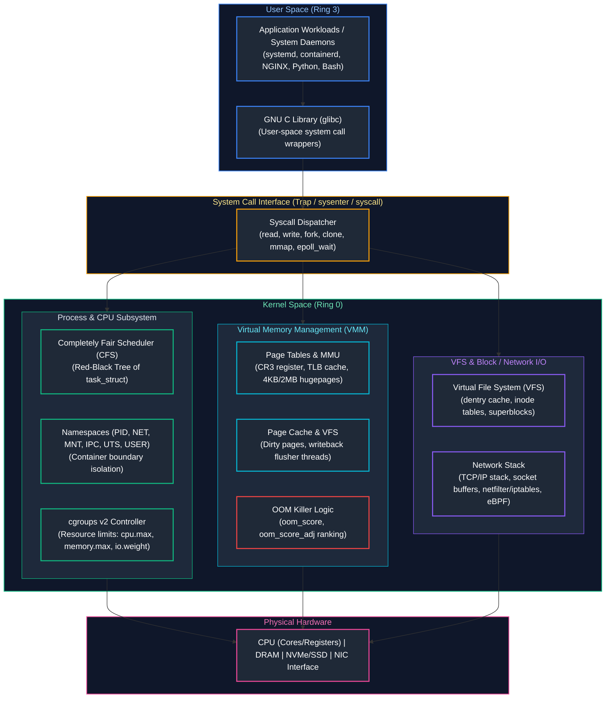
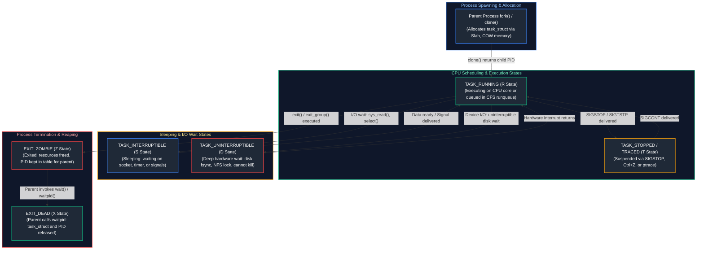

# 01. Linux, Operating Systems & Scripting

A comprehensive, production-grade guide to Linux kernel architecture, Virtual File System (VFS), process lifecycle, systemd unit mechanics, CPU scheduling, memory management, cgroups v2, network namespaces, Bash shell scripting, and Python infrastructure automation tailored for Cloud Engineers, Systems Engineers, and SREs.

---

## Architectural Overview: Linux OS Subsystems & Kernel Space



---

## Table of Contents
1. [Linux Filesystem Internals, Permissions and VFS](#1-linux-filesystem-internals-permissions-and-vfs)
   - [1.1 Inodes, Dentries, and File Descriptors](#11-inodes-dentries-and-file-descriptors)
   - [1.2 POSIX Permissions, Umask, and Access Control Lists (ACLs)](#12-posix-permissions-umask-and-access-control-lists-acls)
2. [Processes, Threads, Signals, and systemd Internals](#2-processes-threads-signals-and-systemd-internals)
   - [2.1 Process Lifecycle, Fork-Exec, and Zombie/Orphan States](#21-process-lifecycle-fork-exec-and-zombieorphan-states)
   - [2.2 Linux Signals and Graceful Termination](#22-linux-signals-and-graceful-termination)
   - [2.3 systemd Service Units, Cgroups Integration, and Journald](#23-systemd-service-units-cgroups-integration-and-journald)
3. [CPU, Memory, and I/O Resource Management](#3-cpu-memory-and-io-resource-management)
   - [3.1 Completely Fair Scheduler (CFS) and CPU Throttling](#31-completely-fair-scheduler-cfs-and-cpu-throttling)
   - [3.2 Virtual Memory, Page Cache, Dirty Pages, and the OOM Killer](#32-virtual-memory-page-cache-dirty-pages-and-the-oom-killer)
4. [Linux Namespaces, Cgroups v2, and Container Foundations](#4-linux-namespaces-cgroups-v2-and-container-foundations)
   - [4.1 The 8 Linux Namespaces](#41-the-8-linux-namespaces)
   - [4.2 Cgroups v2 Resource Limiting](#42-cgroups-v2-resource-limiting)
5. [Linux Networking and Low-Level Troubleshooting Tools](#5-linux-networking-and-low-level-troubleshooting-tools)
   - [5.1 Socket Mechanics and Socket Buffer Queues](#51-socket-mechanics-and-socket-buffer-queues)
   - [5.2 Production Network Diagnostic Toolkit](#52-production-network-diagnostic-toolkit)
6. [Defensive Shell Scripting & Automation Patterns](#6-defensive-shell-scripting-automation-patterns)
   - [6.1 Production Bash Engineering Standards](#61-production-bash-engineering-standards)
   - [6.2 Robust Automated Backup and Node Health Script](#62-robust-automated-backup-and-node-health-script)
7. [Python for Infrastructure Automation](#7-python-for-infrastructure-automation)
   - [7.1 Concurrency, Subprocesses, and System Telemetry](#71-concurrency-subprocesses-and-system-telemetry)
   - [7.2 Production System Telemetry & Log Parser](#72-production-system-telemetry-log-parser)
8. [Automated Bootstrapping, Cloud-Init, and OS Hardening](#8-automated-bootstrapping-cloud-init-and-os-hardening)
   - [8.1 Cloud-Init Initialization Order](#81-cloud-init-initialization-order)
   - [8.2 CIS Benchmark Baseline & Kernel Parameter Hardening](#82-cis-benchmark-baseline-kernel-parameter-hardening)
9. [Summary Comparison & Engineering Reference Matrix](#9-summary-comparison-engineering-reference-matrix)
10. [References & Further Reading](#10-references-further-reading)

---

# 1. Linux Filesystem Internals, Permissions and VFS

### 1.1 Inodes, Dentries, and File Descriptors

In Linux, everything is an abstraction over a sequence of bytes accessed via file descriptors. The **Virtual File System (VFS)** acts as an indirection layer mediating between user-space syscalls (`open`, `read`, `write`) and concrete storage formats (ext4, XFS, Btrfs, NFS).

```text
User Space:       fd = 3 (Process File Descriptor Table)
                      │
                      ▼
Kernel VFS:      struct file (Pointer to struct dentry, file offset, flags)
                      │
                      ▼
                 struct dentry (Directory Cache: Name -> inode mapping)
                      │
                      ▼
                 struct inode (Metadata: UID, GID, Mode, Size, Extent Pointers)
                      │
                      ▼
Disk Storage:    Data Blocks (Actual file payload stored in extents)
```

1. **Inode (Index Node):** Contains metadata describing file ownership, access timestamps (`atime`, `mtime`, `ctime`), permission bits, link count, and block extent pointers. The inode does **not** store the file name.
2. **Dentry (Directory Entry):** Caches the mapping between human-readable path strings and inode numbers in RAM (the `dentry_cache`).
3. **Hard Links vs. Symbolic Links:**
   - A **Hard Link** creates another dentry pointing to the exact same inode number. Decrementing the link count to 0 frees the data blocks once open file descriptors close.
   - A **Symbolic Link** creates a distinct inode containing the path string of the target file.
4. **File Descriptors (FDs):** An integer index in a process-private array pointing to an entry in the system-wide open file table (`struct file`).

> [!CAUTION]
> If a running process retains an open file descriptor to a deleted file (`rm huge_file.log`), the dentry is removed, but the inode's block pointers are not released. `df -h` will continue reporting consumed space while `du -sh` shows nothing. Identify the unlinked file descriptors with: `lsof +L1` or `find /proc/*/fd -ls 2>/dev/null | grep deleted`.

---

### 1.2 POSIX Permissions, Umask, and Access Control Lists (ACLs)

Standard POSIX file permissions are represented internally by the kernel as a **12-bit unsigned integer** stored in the inode's `st_mode` field. This bitfield is structured into four 3-bit octal groups:

```text
 11 10  9    8  7  6    5  4  3    2  1  0  (Bit Positions in st_mode)
┌──────────┬──────────┬──────────┬──────────┐
│ Special  │  User    │  Group   │  Other   │
│ SUID/    │  Owner   │  Members │  World   │
│ SGID/Stk │  (u)     │  (g)     │  (o)     │
├──────────┼──────────┼──────────┼──────────┤
│ 4  2  1  │ 4  2  1  │ 4  2  1  │ 4  2  1  │ (Octal Weighting: 2^2, 2^1, 2^0)
│ s  s  t  │ r  w  x  │ r  w  x  │ r  w  x  │
└──────────┴──────────┴──────────┴──────────┘
```

#### 1. Binary Representation & Octal Weighting
Each triplet represents three independent permission bits:
* **Read ($r$):** Binary `100` = Octal `4` ($2^2$)
* **Write ($w$):** Binary `010` = Octal `2` ($2^1$)
* **Execute ($x$):** Binary `001` = Octal `1` ($2^0$)

The effective octal permission for each group is calculated by summing the active bit weights:

| Octal Value | Binary Bitmask | Symbolic String | Permission Granted |
| :---: | :---: | :---: | :--- |
| **0** | `000` | `---` | No access whatsoever |
| **1** | `001` | `--x` | Execute / search only |
| **2** | `010` | `-w-` | Write only |
| **3** | `011` | `-wx` | Write and execute |
| **4** | `100` | `r--` | Read only |
| **5** | `101` | `r-x` | Read and execute |
| **6** | `110` | `rw-` | Read and write |
| **7** | `111` | `rwx` | Full read, write, and execute |

For example, a file mode of `0754` decomposes into:
* **User (`7`):** $4 + 2 + 1 = \text{Read} + \text{Write} + \text{Execute}$ (`rwx`)
* **Group (`5`):** $4 + 0 + 1 = \text{Read} + \text{Execute}$ (`r-x`)
* **Other (`4`):** $4 + 0 + 0 = \text{Read only}$ (`r--`)

#### 2. File vs. Directory Permission Semantics
A frequent production pitfall is assuming permissions mean the same thing on regular files and directories:

| Permission | Regular File Meaning | Directory Meaning |
| :--- | :--- | :--- |
| **Read (`r`)** | Read the file's data byte stream (`cat`, `less`). | List entries and file names in the directory (`ls`, `readdir`). |
| **Write (`w`)** | Modify or truncate the file's byte contents (`echo >>`, `vim`). | Create, delete (`unlink`), or rename files inside the directory (requires `x`). |
| **Execute (`x`)**| Load byte stream into memory via `execve()` as a binary or script. | Traverse the directory (`cd`, `chdir`), access child inodes and file metadata (`stat`). |

> [!CAUTION]
> If a user has `r--` on a directory without `x`, they can run `ls` to view file names, but cannot `stat`, view sizes, inspect timestamps, or `cd` into the directory. Conversely, having `w` on a directory allows a user to delete files inside it even if they have `000` permissions on the file itself!

#### 3. Mathematical Umask Calculation: The Bitwise Formula
When a process creates a file or directory via the `open(..., O_CREAT)` or `mkdir()` system calls, the operating system does **not** simply perform arithmetic subtraction (`Base - Umask`). Instead, the kernel applies **bitwise logical AND with the bitwise NOT of the umask**:

$$\text{Effective Mode} = \text{Base Mode} \ \& \ (\sim\text{umask})$$

The default base modes compiled into the operating system are:
* **Default Directory Base Mode:** `0777` (`rwxrwxrwx` = `111 111 111_2`)
* **Default Regular File Base Mode:** `0666` (`rw-rw-rw-` = `110 110 110_2`) *(Files never receive execute `x` permissions by default for security)*

##### Step-by-Step Bitwise Walkthrough:
* **Scenario A: Standard Server Umask `0022`**
  * File Base `0666`: `110 110 110_2`
  * Umask `0022`: `000 010 010_2` $\implies$ Bitwise NOT ($\sim$): `111 101 101_2`
  * Effective File Mode: `(110 110 110) & (111 101 101) = 110 100 100_2 = 0644` (`rw-r--r--`)
  * Directory Base `0777`: `111 111 111_2`
  * Effective Directory Mode: `(111 111 111) & (111 101 101) = 111 101 101_2 = 0755` (`rwxr-xr-x`)

* **Scenario B: Hardened Enterprise Umask `0027`**
  * File Base `0666`: `110 110 110_2`
  * Umask `0027`: `000 010 111_2` $\implies$ Bitwise NOT ($\sim$): `111 101 000_2`
  * Effective File Mode: `(110 110 110) & (111 101 000) = 110 100 000_2 = 0640` (`rw-r-----`)
  * Effective Directory Mode: `(111 111 111) & (111 101 000) = 111 101 000_2 = 0750` (`rwxr-x---`)

* **The Arithmetic Subtraction Trap:**
  Suppose an administrator sets umask to `0111`. Naive arithmetic subtraction on a file would calculate: $666 - 111 = 555$ (`r-xr-xr-x`), implying the file gains execute permission! In reality, bitwise evaluation gives:
  $$\text{Effective File Mode} = 0666 \ \& \ (\sim 0111) = (110\ 110\ 110) \ \& \ (110\ 110\ 110) = 0666\ (\text{rw-rw-rw-})$$
  The file remains non-executable because the base mode never possessed the execute bit to begin with.

#### 4. Special Permission Bits (The 4th Leading Octal Digit)
* **SetUID (`4000` / `u+s`):** When an executable binary runs, the process effective user ID (`euid`) assumes the file owner's UID rather than the calling user's UID (e.g., `/usr/bin/passwd` runs as `root`).
* **SetGID (`2000` / `g+s`):** On binaries, the process runs with the group permissions of the file. On directories, any newly created files or subdirectories automatically inherit the group ownership of the parent directory rather than the creator's primary GID.
* **Sticky Bit (`1000` / `+t`):** Applied to world-writable shared directories (e.g., `/tmp`). Only the file owner, the directory owner, or `root` can delete or rename files within the directory, preventing malicious unlinking.
* **Symbolic Representation of Special Bits:**
  * Lowercase `s` or `t`: The special bit is active **AND** the underlying execute (`x`) bit is set (e.g., `rwsr-xr-x` = `4755`, `rwxrwxrwt` = `1777`).
  * Uppercase `S` or `T`: The special bit is active, but the underlying execute (`x`) bit is **NOT** set (e.g., `rwSr-xr-x` = `4655`).

#### 5. POSIX Access Control Lists (ACLs)
When complex multi-tier authorization exceeds standard Owner/Group/Other capabilities, POSIX ACLs enable granular per-user and per-group rules:
```bash
# Set specific read/write access for user 'deployer' on a release folder
setfacl -m u:deployer:rwx /var/www/releases

# Set default ACLs inherited automatically by newly created child objects
setfacl -d -m u:deployer:rwx /var/www/releases
setfacl -d -m g:developers:rx /var/www/releases

# Inspect detailed permissions and effective mask
getfacl /var/www/releases
```

---

# 2. Processes, Threads, Signals, and systemd Internals

### 2.1 Process Lifecycle, Fork-Exec, and Zombie/Orphan States

Every process in Linux is represented in kernel memory by a `struct task_struct` allocated via the Slab allocator. The kernel maintains process scheduling states across distinct operational phases:



- **Fork and Copy-On-Write (COW):** The `fork()` syscall duplicates the caller's page tables while marking all underlying physical memory pages as read-only. Physical memory is cloned only when either parent or child executes a write, triggering a minor page fault.
- **Threads vs Processes:** In the Linux kernel, threads are simply processes created with `clone(CLONE_VM | CLONE_FS | CLONE_FILES | CLONE_SIGHAND)`. The kernel schedules threads using the same `task_struct` machinery.
- **Orphan Process:** A process whose parent terminates before it finishes. It is immediately adopted by PID 1 (e.g., `systemd`).
- **Zombie Process (`<defunct>`):** A process that has exited (`exit_group()`) but remains in the process table because its parent has not yet executed `wait()` or `waitpid()`. Zombies consume no CPU or RAM, but they consume PID slots in `/proc/sys/kernel/pid_max`.

---

### 2.2 Linux Signals and Graceful Termination

Signals are asynchronous software interrupts delivered to a process by the kernel:

| Signal | Number | Default Action | Catchable / Blockable? | Production Role |
| :--- | :---: | :--- | :---: | :--- |
| **SIGHUP** | 1 | Terminate | Yes | Reload application configuration without process termination. |
| **SIGINT** | 2 | Terminate | Yes | Keyboard interrupt (`Ctrl+C`). |
| **SIGQUIT**| 3 | Core Dump | Yes | Quit and generate memory core dump (`Ctrl+\`). |
| **SIGKILL**| 9 | Unconditional Kill | **No** | Kernel removes process immediately; no cleanup handlers execute. |
| **SIGUSR1**| 10 | Terminate | Yes | Custom application logic (e.g. reopen log files). |
| **SIGSEGV**| 11 | Core Dump | Yes | Invalid memory access (dereferencing NULL/unmapped page). |
| **SIGTERM**| 15 | Terminate | Yes | Standard graceful shutdown signal issued by Kubernetes and systemd. |

> [!IMPORTANT]
> Always configure containerized microservices to listen for `SIGTERM` and initiate graceful connection draining before closing sockets. Kubernetes waits for `terminationGracePeriodSeconds` (default 30s) before issuing an un-catchable `SIGKILL`.

---

### 2.3 systemd Service Units, Cgroups Integration, and Journald

`systemd` is the init system (PID 1) responsible for bootstrapping user space, supervising system daemons, and managing hardware events via D-Bus.

Here is a production-grade systemd service unit demonstrating modern sandboxing, restart logic, and cgroup resource caps:

```ini
# /etc/systemd/system/cloud-api.service
[Unit]
Description=Cloud API Production Gateway
Documentation=https://internal.corp/docs/api
After=network-online.target
Wants=network-online.target

[Service]
Type=notify
User=appuser
Group=appgroup
WorkingDirectory=/opt/cloud-api
ExecStart=/opt/cloud-api/bin/server --config=/etc/cloud-api/config.yaml
ExecReload=/bin/kill -HUP $MAINPID
Restart=on-failure
RestartSec=5s
TimeoutStopSec=30s

# Linux Capabilities & Security Hardening
NoNewPrivileges=true
ProtectSystem=strict
ProtectHome=true
PrivateTmp=true
ProtectKernelTunables=true
ProtectControlGroups=true
RestrictNamespaces=true
CapabilityBoundingSet=CAP_NET_BIND_SERVICE
AmbientCapabilities=CAP_NET_BIND_SERVICE

# Resource Isolation via cgroups v2
LimitNOFILE=65536
MemoryMax=2G
MemoryHigh=1.8G
CPUQuota=200%
TasksMax=4096

[Install]
WantedBy=multi-user.target
```

```bash
# Reload daemon definitions and start service
sudo systemctl daemon-reload
sudo systemctl enable --now cloud-api.service

# Real-time structured log streaming via journald
journalctl -u cloud-api.service -f -o json-pretty
```

---

# 3. CPU, Memory, and I/O Resource Management

### 3.1 Completely Fair Scheduler (CFS) and CPU Throttling

The **Completely Fair Scheduler (CFS)** allocates CPU time proportionally using a balanced Red-Black Tree. Each runnable task maintains a `vruntime` (virtual runtime). CFS always schedules the process with the smallest `vruntime`.

- **Bandwidth Control:** In container environments, CPU allocation is governed by quotas:
  - `cpu.cfs_period_us` (e.g. 100,000 $\mu$s = 100ms)
  - `cpu.cfs_quota_us` (e.g. 200,000 $\mu$s = 200ms, representing 2 cores)
- **Throttling Pitfall:** If a multithreaded process exhausts its 200ms quota within the first 20ms of a 100ms period across multiple cores, the kernel halts execution for the remaining 80ms. This introduces massive P99 latency spikes despite average CPU utilization appearing low.

---

### 3.2 Virtual Memory, Page Cache, Dirty Pages, and the OOM Killer

Linux uses virtual memory to provide address space isolation. Memory is allocated in 4KB physical frames.

```text
+-----------------------------------------------------------------------------------------+
|                                    TOTAL SYSTEM RAM                                     |
+------------------------------------+----------------------------------------------------+
| ACTIVE ANONYMOUS MEMORY            | PAGE CACHE (FILE-BACKED)                           |
| (Heap, Stack, Malloc buffers)      | (Read buffers, mmap files, unwritten dirty pages)  |
| Cannot be evicted without swap.    | Can be immediately reclaimed under pressure.       |
+------------------------------------+----------------------------------------------------+
```

1. **Page Cache Mechanics:** When an application reads from disk, the kernel stores the blocks in the Page Cache. Write operations mark pages as "dirty".
2. **Flushing Dirty Pages:** The `flusher` kernel threads wake up to write dirty pages back to physical block storage based on `/etc/sysctl.conf`:
   ```bash
   vm.dirty_background_ratio = 5   # Flush starts when dirty memory hits 5%
   vm.dirty_ratio = 10              # Synchronous write blocking when dirty memory hits 10%
   ```
3. **Out-Of-Memory (OOM) Killer:** When free memory and reclaimable page cache are depleted, the kernel invokes the OOM killer (`mm/oom_kill.c`). It calculates a badness score for every process:
   $$\text{Points} = \frac{\text{RSS Memory Consumed}}{\text{Total RAM}} \times 1000 + \text{oom\_score\_adj}$$
   - Values of `oom_score_adj` range from `-1000` (immune to OOM, e.g. sshd, kubelet) to `+1000` (first candidate for termination).

---

# 4. Linux Namespaces, Cgroups v2, and Container Foundations

### 4.1 The 8 Linux Namespaces

Containers are not first-class kernel abstractions; they are ordinary Linux processes bounded by **Namespaces** (isolation of visibility) and **Cgroups** (enforcement of resource consumption).

| Namespace | Syscall Flag | Isolated Kernel Resource |
| :--- | :--- | :--- |
| **PID** | `CLONE_NEWPID` | Process IDs (container sees itself as PID 1). |
| **NET** | `CLONE_NEWNET` | Network devices, routing tables, port bindings, firewall rules. |
| **MNT** | `CLONE_NEWNS` | Filesystem mount points (`pivot_root`). |
| **IPC** | `CLONE_NEWIPC` | System V IPC message queues, POSIX message queues, shared memory. |
| **UTS** | `CLONE_NEWUTS` | Hostname and NIS domain name. |
| **USER**| `CLONE_NEWUSER`| User and group IDs (map unprivileged user to container root UID 0).|
| **CGROUP**| `CLONE_NEWCGROUP`| Cgroup root hierarchy view. |
| **TIME** | `CLONE_NEWTIME`| Monotonic and boot clocks (Linux 5.6+). |

```bash
# Spawn an isolated bash process with separate network and PID namespaces
sudo unshare --pid --net --mount --fork /bin/bash
```

---

### 4.2 Cgroups v2 Resource Limiting

Unlike Cgroups v1 which had fragmented per-controller hierarchies, **Cgroups v2** exposes a unified single-hierarchy tree mounted at `/sys/fs/cgroup`.

```bash
# 1. Create a cgroup sub-hierarchy
sudo mkdir -p /sys/fs/cgroup/prod_worker

# 2. Assign CPU limits (Quota: 2 cores out of 100ms period)
echo "200000 100000" | sudo tee /sys/fs/cgroup/prod_worker/cpu.max

# 3. Enforce hard memory limit (1GB) and high warning threshold (800MB)
echo "1073741824" | sudo tee /sys/fs/cgroup/prod_worker/memory.max
echo "838860800"  | sudo tee /sys/fs/cgroup/prod_worker/memory.high

# 4. Attach running process PID 45120 to this cgroup
echo 45120 | sudo tee /sys/fs/cgroup/prod_worker/cgroup.procs
```

---

# 5. Linux Networking and Low-Level Troubleshooting Tools

### 5.1 Socket Mechanics and Socket Buffer Queues

When a packet arrives from the Network Interface Card (NIC):
1. **DMA Transfer:** The NIC controller copies the Ethernet frame into kernel RAM via Direct Memory Access (DMA) ring buffers.
2. **Hard IRQ:** NIC signals CPU via hardware interrupt. The CPU queues a SoftIRQ (`NET_RX_SOFTIRQ`).
3. **NAPI Polling:** The kernel NAPI loop processes packets from the ring buffer into `sk_buff` structs.
4. **Socket Buffer (`sk_buff`):** Traverses the Netfilter hooks, IP routing lookup, and is placed in the socket's receive queue (`SO_RCVBUF`).

```text
NIC Rx Ring Buffer ──(DMA)──> sk_buff ──(IP / Netfilter)──> Socket Receive Queue ──(read/recv)──> Application
```

---

### 5.2 Production Network Diagnostic Toolkit

```bash
# 1. Inspect listening sockets with process IDs, omitting DNS lookups
ss -tulpn

# 2. View socket buffer sizes and TCP connection states (SYN_RECV, TIME_WAIT)
ss -s

# 3. Inspect interface errors, dropped packets, and ring buffer overruns
ip -s link show eth0

# 4. Packet capture filtering on TCP port 443 with microsecond timestamps
sudo tcpdump -nnvv -i eth0 tcp port 443 -w /tmp/tls_dump.pcap

# 5. Check routing decisions and policy routing tables
ip route get 10.240.0.10

# 6. Deep kernel socket statistics and TCP drop counters
nstat -az TcpExtTCP*
```

---

# 6. Defensive Shell Scripting & Automation Patterns

### 6.1 Production Bash Engineering Standards

Production Bash scripts must fail deterministically, handle trapped signals, and prevent uninitialized variable expansion:

```bash
#!/usr/bin/env bash
# Strict Execution Mode:
# -e: Exit immediately if a command exits with a non-zero status.
# -u: Treat unset variables as an error when substituting.
# -o pipefail: Pipeline return status is that of the last command to exit with non-zero.
set -euo pipefail
IFS=$'\n\t'
```

---

### 6.2 Robust Automated Backup and Node Health Script

Below is a non-trivial, production-grade script featuring signal traps, structured JSON logging, concurrency locking via `flock`, and system resource auditing:

```bash
#!/usr/bin/env bash
# ==============================================================================
# Script: node_health_audit.sh
# Purpose: Comprehensive Linux node telemetry and automated directory backup
# ==============================================================================
set -euo pipefail
IFS=$'\n\t'

readonly LOCK_FILE="/var/run/node_health_audit.lock"
readonly LOG_FILE="/var/log/node_health_audit.log"
readonly BACKUP_SRC="/etc/cloud-api"
readonly BACKUP_DST="/var/backups/cloud-api"
readonly RETENTION_DAYS=7

# Trap execution for cleanup on SIGINT, SIGTERM, and EXIT
cleanup() {
    local exit_code=$?
    log_json "INFO" "Cleaning up runtime locks and temporary files."
    rm -f "${LOCK_FILE}"
    exit "${exit_code}"
}
trap cleanup EXIT INT TERM

log_json() {
    local level="$1"
    local message="$2"
    local timestamp
    timestamp=$(date -u +"%Y-%m-%dT%H:%M:%SZ")
    printf '{"timestamp":"%s","level":"%s","message":"%s"}\n' \
        "${timestamp}" "${level}" "${message}" >> "${LOG_FILE}"
}

# Concurrency Guard: Ensure only one instance executes
exec 200>"${LOCK_FILE}"
if ! flock -n 200; then
    log_json "ERROR" "Execution blocked: Another instance holds the lock."
    exit 1
fi

check_disk_pressure() {
    local threshold_pct=85
    local root_usage
    root_usage=$(df -h / | awk 'NR==2 {print $5}' | tr -d '%')
    
    if [[ "${root_usage}" -gt "${threshold_pct}" ]]; then
        log_json "WARN" "Disk usage on / exceeds threshold: ${root_usage}% > ${threshold_pct}%"
    else
        log_json "INFO" "Disk usage healthy: ${root_usage}%"
    fi
}

execute_backup() {
    if [[ ! -d "${BACKUP_SRC}" ]]; then
        log_json "ERROR" "Backup source directory does not exist: ${BACKUP_SRC}"
        return 1
    fi

    mkdir -p "${BACKUP_DST}"
    local archive_name
    archive_name="backup_$(date +%Y%m%d_%H%M%S).tar.gz"
    local target_path="${BACKUP_DST}/${archive_name}"

    log_json "INFO" "Initiating archive of ${BACKUP_SRC} to ${target_path}"
    tar -czf "${target_path}" -C "${BACKUP_SRC}" .

    log_json "INFO" "Purging archives older than ${RETENTION_DAYS} days"
    find "${BACKUP_DST}" -type f -name "backup_*.tar.gz" -mtime +"${RETENTION_DAYS}" -delete
}

main() {
    log_json "INFO" "Starting node health check and backup cycle."
    check_disk_pressure
    execute_backup
    log_json "INFO" "Cycle completed successfully."
}

main "$@"
```

---

# 7. Python for Infrastructure Automation

### 7.1 Concurrency, Subprocesses, and System Telemetry

While Bash is optimal for linear glue tasks, Python is the industry standard for cloud infrastructure automation involving JSON APIs, complex text parsing, concurrent network probes, and operating system instrumentation via `/proc`.

---

### 7.2 Production System Telemetry & Log Parser

The following production script implements thread-pool concurrency to query systemd journal logs, parse memory and CPU pressure metrics from `/proc/pressure`, and dispatch structured reports:

```python
#!/usr/bin/env python3
"""
Linux Node Telemetry and Pressure Stall Information (PSI) Reporter.
Collects kernel-level CPU, Memory, and I/O pressure stalls from /proc/pressure
and audits system services without external third-party dependencies.
"""

from concurrent.futures import ThreadPoolExecutor
from dataclasses import asdict, dataclass
import json
import logging
import os
from pathlib import Path
import subprocess
import sys
from typing import Dict, List, Optional

logging.basicConfig(
    level=logging.INFO,
    format='{"time":"%(asctime)s","level":"%(levelname)s","logger":"%(name)s","message":"%(message)s"}',
    handlers=[logging.StreamHandler(sys.stdout)],
)
logger = logging.getLogger("node_telemetry")


@dataclass(frozen=True)
class PressureMetric:
    resource: str
    some_avg10: float
    some_avg60: float
    full_avg10: Optional[float]


class SystemAuditor:
    def __init__(self, psi_dir: Path = Path("/proc/pressure")):
        self.psi_dir = psi_dir

    def parse_psi_file(self, resource_type: str) -> Optional[PressureMetric]:
        """Parses Linux Pressure Stall Information (PSI) files."""
        file_path = self.psi_dir / resource_type
        if not file_path.exists():
            logger.warning("Kernel PSI not enabled or missing: %s", file_path)
            return None

        some_10, some_60, full_10 = 0.0, 0.0, None
        try:
            with open(file_path, "r", encoding="utf-8") as f:
                for line in f:
                    parts = line.strip().split()
                    if parts[0] == "some":
                        some_10 = float(parts[1].split("=")[1])
                        some_60 = float(parts[2].split("=")[1])
                    elif parts[0] == "full":
                        full_10 = float(parts[1].split("=")[1])
            return PressureMetric(
                resource=resource_type,
                some_avg10=some_10,
                some_avg60=some_60,
                full_avg10=full_10,
            )
        except (IOError, ValueError) as err:
            logger.error("Failed to parse PSI for %s: %s", resource_type, err)
            return None

    @staticmethod
    def audit_failed_services() -> List[str]:
        """Queries systemd DBus via systemctl for failed service units."""
        cmd = ["systemctl", "--failed", "--no-legend", "--plain"]
        try:
            res = subprocess.run(
                cmd, capture_output=True, text=True, check=True, timeout=5
            )
            failed_units = []
            for line in res.stdout.strip().splitlines():
                if line:
                    failed_units.append(line.split()[0])
            return failed_units
        except (subprocess.SubprocessError, FileNotFoundError) as err:
            logger.error("Failed to query systemctl: %s", err)
            return []

    def collect_system_telemetry(self) -> Dict:
        """Executes metrics collection concurrently."""
        resources = ["cpu", "memory", "io"]
        with ThreadPoolExecutor(max_workers=3) as executor:
            metrics = list(executor.map(self.parse_psi_file, resources))

        failed_units = self.audit_failed_services()
        
        telemetry = {
            "pressure": [asdict(m) for m in metrics if m is not None],
            "failed_systemd_units": failed_units,
            "status": "UNHEALTHY" if failed_units else "HEALTHY",
        }
        return telemetry


if __name__ == "__main__":
    auditor = SystemAuditor()
    payload = auditor.collect_system_telemetry()
    print(json.dumps(payload, indent=2))
```

---

# 8. Automated Bootstrapping, Cloud-Init, and OS Hardening

### 8.1 Cloud-Init Initialization Order

Cloud-init handles early machine initialization during cloud instance creation across AWS, Azure, and GCP. Execution spans four sequential stages:

```text
1. Generator Stage  -> Checks if cloud-init is enabled by kernel cmdline.
2. Local Stage      -> Identifies cloud datasource (e.g. AWS IMDS, Azure IMDS) and configures network interfaces.
3. Network Stage    -> Runs package updates, user creation, SSH key deployment, and disk partitioning.
4. Final Stage      -> Runs scripts in runcmd, Chef/Ansible pull, and phone-home notifications.
```

---

### 8.2 CIS Benchmark Baseline & Kernel Parameter Hardening

Below is a production `cloud-init` configuration enforcing CIS Level 1 hardening standards:

```yaml
#cloud-config
package_upgrade: true
packages:
  - fail2ban
  - ufw
  - chrony
  - auditd

users:
  - default
  - name: deployer
    gecos: Deployment Automation
    sudo: ALL=(ALL) NOPASSWD:ALL
    groups: [sudo, adm]
    shell: /bin/bash
    ssh_authorized_keys:
      - ssh-ed25519 AAAAC3NzaC1lZDI1NTE5AAAAIClOUD3NG1nZ3e67B9Xk4w109401948190 deployer@prod

write_files:
  - path: /etc/sysctl.d/99-kubernetes-and-hardening.conf
    permissions: "0644"
    owner: root:root
    content: |
      # Disable IP forwarding unless gateway node
      net.ipv4.ip_forward = 1
      net.bridge.bridge-nf-call-iptables = 1
      # Protect against SYN flood attacks
      net.ipv4.tcp_syncookies = 1
      # Disable ICMP redirect acceptance
      net.ipv4.conf.all.accept_redirects = 0
      net.ipv4.conf.default.accept_redirects = 0
      # Protect against IP spoofing
      net.ipv4.conf.all.rp_filter = 1
      net.ipv4.conf.default.rp_filter = 1
      # Maximize file descriptors and socket buffer memory
      fs.file-max = 2097152
      vm.max_map_count = 262144

runcmd:
  - sysctl --system
  - sed -i -e '/^#PasswordAuthentication/s/^.*$/PasswordAuthentication no/' /etc/ssh/sshd_config
  - sed -i -e '/^PermitRootLogin/s/^.*$/PermitRootLogin no/' /etc/ssh/sshd_config
  - systemctl restart sshd
  - ufw default deny incoming
  - ufw default allow outgoing
  - ufw allow 22/tcp
  - ufw --force enable
```

---

# 9. Summary Comparison & Engineering Reference Matrix

| Feature / Subsystem | Linux Mechanism | Core Failure Mode | Production Diagnostic Command | Mitigation Strategy |
| :--- | :--- | :--- | :--- | :--- |
| **Virtual Memory** | 4KB Page Tables, Page Cache | Memory fragmentation, Out-of-Memory (OOM) | `free -h`, `cat /proc/meminfo` | Tune `vm.swappiness`, configure `cgroups memory.max`, adjust `oom_score_adj`. |
| **CPU Allocation** | Completely Fair Scheduler (CFS) | CFS quota throttling, runqueue starvation | `cat /sys/fs/cgroup/cpu.stat`, `uptime` | Remove artificial CPU limits in K8s, scale horizontal replicas. |
| **Storage / VFS** | Inodes, Dentries, Page Cache | Inode exhaustion (`No space left on device`) | `df -i`, `iostat -xz 1` | Purge unlinked open files, isolate ephemeral logs on dedicated volumes. |
| **Networking** | Sockets, Netfilter, TCP ring buffer | Outbound SNAT drops, SYN queue overruns | `ss -tulpn`, `nstat -az` | Increase `net.core.somaxconn`, expand ephemeral port ranges. |
| **Process Control** | Systemd, task_struct | Zombie leaks, uncaught termination signals | `ps aux | grep 'Z'`, `journalctl -xeu` | Enforce container init PID 1 reaping (`tini`), catch `SIGTERM` handlers. |

---

# 10. References & Further Reading

- [The Linux Kernel Documentation](https://www.kernel.org/doc/html/latest/) — Official subsystems, VFS, and CFS scheduling architecture.
- [Linux Cgroups v2 Specification](https://docs.kernel.org/admin-guide/cgroup-v2.html) — Unified hierarchy control reference.
- [Systemd System and Service Manager](https://systemd.io/) — Official architecture and unit file specifications.
- [Brendan Gregg: Linux Performance](http://www.brendangregg.com/linuxperf.html) — Gold standard eBPF, perf, and USE methodology analysis.
- [CIS Linux Benchmark Guidelines](https://www.cisecurity.org/benchmark/ubuntu_linux) — Center for Internet Security hardening baselines.

