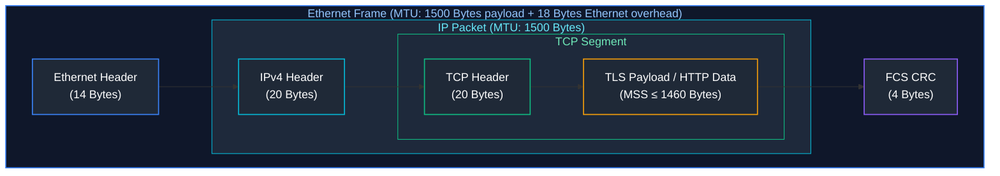
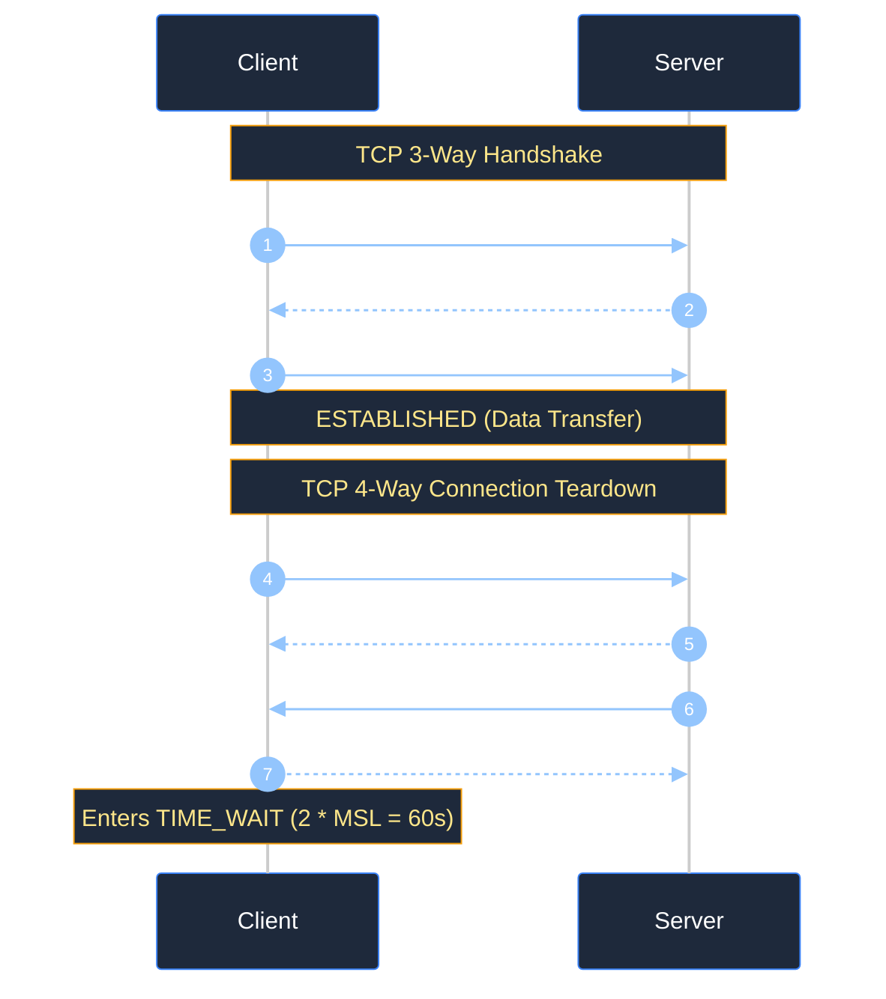
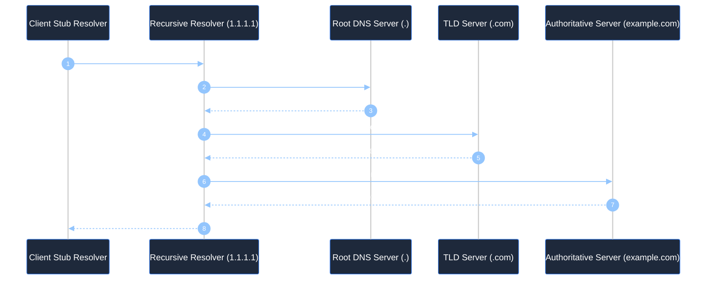
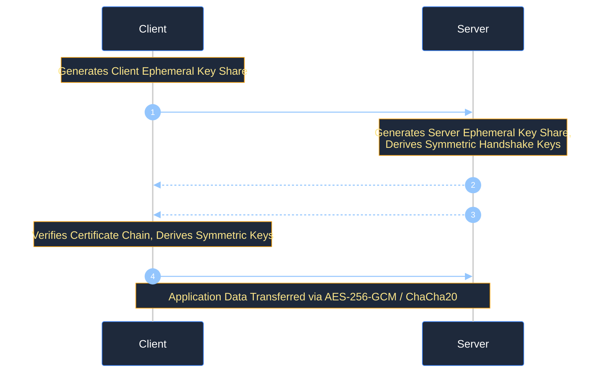
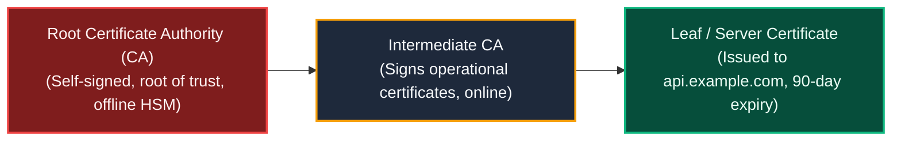
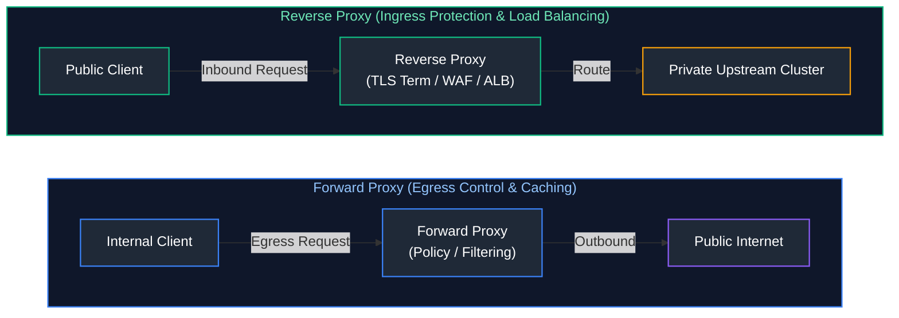
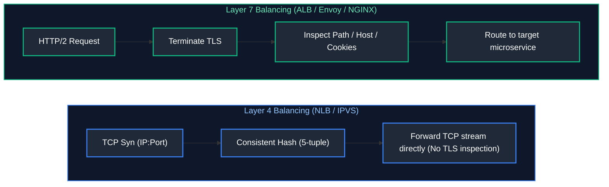
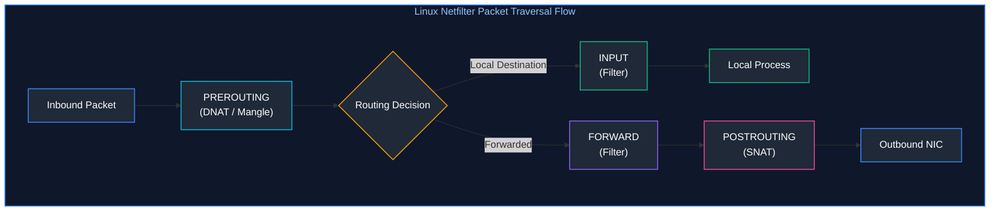

# 02. Networking Fundamentals

A comprehensive, production-grade guide to computer networking, TCP/IP stack mechanics, UDP sockets, CIDR subnetting, IPv6 addressing, DNS resolution pipelines, TLS 1.3 cryptographic handshakes, Linux routing tables, NAT, Layer 4 vs. Layer 7 load balancing, and low-level packet diagnostics tailored for Cloud Engineers, Systems Architects, and SREs.

---

## Architectural Overview: TCP/IP Stack & Packet Flow

```mermaid
flowchart TD
    subgraph ClientHost ["Client Host"]
        AppClient["Application Layer<br/>(HTTP/2, gRPC, DNS, TLS 1.3)"]
        TransportClient["Transport Layer<br/>(TCP 3-Way Handshake, Windowing, UDP)"]
        NetworkClient["Internet Layer<br/>(IPv4 / IPv6, CIDR Routing Table)"]
        LinkClient["Link / Physical Layer<br/>(Ethernet Frames, ARP, MTU 1500)"]

        AppClient --> TransportClient --> NetworkClient --> LinkClient
    end

    subgraph TransitFabric ["Routing & Middleboxes"]
        RouterNAT["Router / NAT Gateway<br/>(Route Tables, SNAT / DNAT, PMTUD)"]
        L4LB["Layer 4 Load Balancer<br/>(Direct Server Return / TCP Proxy)"]
        L7Proxy["Layer 7 Reverse Proxy<br/>(TLS Termination, Path Routing, HTTP Keep-Alive)"]

        RouterNAT --> L4LB --> L7Proxy
    end

    subgraph BackendHost ["Target Server Host"]
        LinkServer["Link Layer (NIC Ring Buffer)"]
        NetworkServer["Internet Layer (IP / Netfilter)"]
        TransportServer["Transport Layer (Socket Rx/Tx Queues)"]
        AppServer["Backend Service (epoll listener)"]

        LinkServer --> NetworkServer --> TransportServer --> AppServer
    end

    LinkClient -->|"Physical Transit (Fiber/WAN)"| RouterNAT
    L7Proxy -->|"Private Connection Pool"| LinkServer

    style ClientHost fill:#0f172a,stroke:#3b82f6,stroke-width:1.5px,color:#93c5fd
    style TransitFabric fill:#0f172a,stroke:#f59e0b,stroke-width:1.5px,color:#fde68a
    style BackendHost fill:#0f172a,stroke:#10b981,stroke-width:1.5px,color:#6ee7b7

    style AppClient fill:#1f2937,stroke:#3b82f6,stroke-width:2px,color:#fff
    style TransportClient fill:#1f2937,stroke:#3b82f6,stroke-width:2px,color:#fff
    style NetworkClient fill:#1f2937,stroke:#3b82f6,stroke-width:2px,color:#fff
    style LinkClient fill:#1f2937,stroke:#3b82f6,stroke-width:2px,color:#fff

    style RouterNAT fill:#1f2937,stroke:#f59e0b,stroke-width:2px,color:#fff
    style L4LB fill:#1f2937,stroke:#f59e0b,stroke-width:2px,color:#fff
    style L7Proxy fill:#1f2937,stroke:#f59e0b,stroke-width:2px,color:#fff

    style LinkServer fill:#1f2937,stroke:#10b981,stroke-width:2px,color:#fff
    style NetworkServer fill:#1f2937,stroke:#10b981,stroke-width:2px,color:#fff
    style TransportServer fill:#1f2937,stroke:#10b981,stroke-width:2px,color:#fff
    style AppServer fill:#1f2937,stroke:#10b981,stroke-width:2px,color:#fff
```



---

## Table of Contents
1. [OSI vs. TCP/IP Models and Socket Mechanics](#1-osi-vs-tcpip-models-and-socket-mechanics)
   - [1.1 Layer Encapsulation & Header Offsets](#11-layer-encapsulation-header-offsets)
   - [1.2 TCP State Machine: Handshakes, Teardown, and Sockets](#12-tcp-state-machine-handshakes-teardown-and-sockets)
2. [IP Addressing, CIDR Subnet Math, and IPv6](#2-ip-addressing-cidr-subnet-math-and-ipv6)
   - [2.1 Binary Subnet Math and Cloud Host Deductions](#21-binary-subnet-math-and-cloud-host-deductions)
   - [2.2 IPv6 Architecture and Dual-Stack Implementations](#22-ipv6-architecture-and-dual-stack-implementations)
3. [DNS Architecture, Resolution Internals, and Records](#3-dns-architecture-resolution-internals-and-records)
   - [3.1 Recursive vs. Authoritative Resolution Flow](#31-recursive-vs-authoritative-resolution-flow)
   - [3.2 Critical Record Types & Split-Horizon DNS](#32-critical-record-types-split-horizon-dns)
4. [HTTP/HTTPS, TLS 1.3 Cryptography, and PKI](#4-httphttps-tls-13-cryptography-and-pki)
   - [4.1 TLS 1.3 1-RTT Handshake Mechanics](#41-tls-13-1-rtt-handshake-mechanics)
   - [4.2 Public Key Infrastructure (PKI) and Mutual TLS (mTLS)](#42-public-key-infrastructure-pki-and-mutual-tls-mtls)
5. [Routing Tables, Default Gateways, and Network Address Translation](#5-routing-tables-default-gateways-and-network-address-translation)
   - [5.1 Longest Prefix Match and Kernel Route Tables](#51-longest-prefix-match-and-kernel-route-tables)
   - [5.2 Source NAT (SNAT) vs. Destination NAT (DNAT)](#52-source-nat-snat-vs-destination-nat-dnat)
6. [Proxies and Load Balancing: Layer 4 vs. Layer 7](#6-proxies-and-load-balancing-layer-4-vs-layer-7)
   - [6.1 Forward Proxies vs. Reverse Proxies](#61-forward-proxies-vs-reverse-proxies)
   - [6.2 Layer 4 (Transport) vs. Layer 7 (Application) Balancing](#62-layer-4-transport-vs-layer-7-application-balancing)
7. [Firewalls, Security Groups, and Network ACLs](#7-firewalls-security-groups-and-network-acls)
   - [7.1 Stateful Firewalls vs. Stateless Network ACLs](#71-stateful-firewalls-vs-stateless-network-acls)
   - [7.2 Linux Netfilter & iptables / nftables Processing Order](#72-linux-netfilter-iptables-nftables-processing-order)
8. [Network Troubleshooting, Packet Analysis, and MTU](#8-network-troubleshooting-packet-analysis-and-mtu)
   - [8.1 Maximum Transmission Unit (MTU) and Path MTU Discovery (PMTUD)](#81-maximum-transmission-unit-mtu-and-path-mtu-discovery-pmtud)
   - [8.2 Automated Latency and Packet Loss Diagnostic Script](#82-automated-latency-and-packet-loss-diagnostic-script)
9. [Summary Comparison & Engineering Reference Matrix](#9-summary-comparison-engineering-reference-matrix)
10. [References & Further Reading](#10-references-further-reading)

---

# 1. OSI vs. TCP/IP Models and Socket Mechanics

### 1.1 Layer Encapsulation & Header Offsets

When application data descends the protocol stack, each layer prepends a protocol header:



- **OSI 7-Layer Model:** Conceptual reference: Physical (L1), Data Link (L2), Network (L3), Transport (L4), Session (L5), Presentation (L6), Application (L7).
- **TCP/IP 4-Layer Architecture:** Pragmatic implementation: Network Access (L1/L2), Internet (L3), Transport (L4), Application (L5-L7).
- **Socket Tuple:** Every network connection is uniquely identified across the OS kernel by a 5-tuple:
  $$\text{Connection ID} = (\text{Source IP}, \text{Source Port}, \text{Destination IP}, \text{Destination Port}, \text{Protocol})$$

---

### 1.2 TCP State Machine: Handshakes, Teardown, and Sockets

TCP is a connection-oriented, full-duplex stream protocol providing reliable, ordered delivery through sequence numbers, acknowledgments, sliding windows, and congestion control algorithms (CUBIC, BBR).



- **TIME_WAIT State Mechanics:** The endpoint initiating the active close enters `TIME_WAIT` for $2 \times \text{MSL}$ (Maximum Segment Lifetime, typically 60 seconds). This ensures:
  1. Any delayed in-flight duplicate segments expire in the network fabric without corrupting a subsequent connection reusing the same 5-tuple.
  2. The final `ACK` is reliably retransmitted if the peer re-sends its `FIN`.
- **SYN Flood Attack:** Attacker floods target with `SYN` packets without sending final `ACK`s, exhausting the kernel's SYN backlog queue.
  - **Mitigation:** Enable TCP SYN Cookies (`net.ipv4.tcp_syncookies = 1`), encoding connection state directly into the initial sequence number $y$.

---

# 2. IP Addressing, CIDR Subnet Math, and IPv6

### 2.1 Binary Subnet Math and Cloud Host Deductions

Classless Inter-Domain Routing (CIDR) notation denotes an IP address and its associated network prefix mask length ($/N$).

```text
IPv4 Address: 192.168.10.0/24
Binary Mask:  11111111.11111111.11111111.00000000 (24 bits Network, 8 bits Host)
Total IPs:    2^(32 - 24) = 256 Total Addresses
```

> [!IMPORTANT]
> **Cloud Provider Subnet Deductions:** In standard on-premises networking, 2 addresses are reserved (Network ID `.0` and Broadcast `.255`). In **AWS VPC and Azure VNet**, cloud providers reserve **5 IP addresses** per subnet:
> - `x.x.x.0`: Network address.
> - `x.x.x.1`: Cloud default gateway router.
> - `x.x.x.2`: Cloud DNS resolver (e.g. Amazon Route 53 Resolver / Azure DNS).
> - `x.x.x.3`: Reserved for future cloud infrastructure use.
> - `x.x.x.255`: Subnet broadcast address.
> A `/28` subnet yields $16 - 5 = 11$ usable host IPs!

---

### 2.2 IPv6 Architecture and Dual-Stack Implementations

IPv6 solves IPv4 address exhaustion using 128-bit addresses represented as 8 groups of 4 hexadecimal digits:
- **Canonical Address:** `2001:0db8:85a3:0000:0000:8a2e:0370:7334`
- **Zero Compression (`::`):** `2001:db8:85a3::8a2e:370:7334` (allowed once per address).
- **Subnet Standard:** The universal subscriber subnet prefix is `/64`, providing $2^{64}$ host addresses per subnet. Eliminates the necessity of NAT.

---

# 3. DNS Architecture, Resolution Internals, and Records

### 3.1 Recursive vs. Authoritative Resolution Flow



1. **Stub Resolver:** Local OS client library reading `/etc/resolv.conf`.
2. **Recursive Resolver:** Caches responses and traverses DNS hierarchy on behalf of the client.
3. **Authoritative Nameserver:** Holds the source-of-truth zone records for a specific domain.

---

### 3.2 Critical Record Types & Split-Horizon DNS

- **A / AAAA:** Maps hostname to IPv4 (32-bit) or IPv6 (128-bit) address.
- **CNAME:** Canonical Name alias mapping one domain to another. Cannot exist at the zone apex (`example.com`).
- **ALIAS / ANAME:** Virtual record allowing CNAME-like flattening at the zone apex.
- **MX:** Mail Exchange server with integer priority.
- **TXT:** Arbitrary text metadata, primarily used for email authentication (SPF, DKIM, DMARC) and domain ownership verification.
- **Split-Horizon (Private DNS):** Serving different DNS records based on requester source IP. Internal corporate requests resolve to private RFC 1918 IPs (`10.0.1.5`), while external public requests resolve to public IPs.

---

# 4. HTTP/HTTPS, TLS 1.3 Cryptography, and PKI

### 4.1 TLS 1.3 1-RTT Handshake Mechanics

TLS 1.3 optimizes security and latency by reducing the handshake to a single round-trip time (1-RTT) and mandating Ephemeral Diffie-Hellman (PFS - Perfect Forward Secrecy):



- **Server Name Indication (SNI):** TLS extension where the client indicates the hostname it wants to connect to in the `ClientHello`, allowing a single IP to host multiple distinct TLS certificates.
- **Perfect Forward Secrecy (PFS):** Even if an adversary compromises the server's private key in the future, past recorded encrypted sessions cannot be decrypted because the ephemeral session keys were never transmitted over the wire.

---

### 4.2 Public Key Infrastructure (PKI) and Mutual TLS (mTLS)



In standard TLS, only the server proves its identity. In **Mutual TLS (mTLS)**, both client and server present X.509 certificates, authenticating both identity and encrypting data in-flight (the cornerstone of Zero-Trust service mesh architectures).

---

# 5. Routing Tables, Default Gateways, and Network Address Translation

### 5.1 Longest Prefix Match and Kernel Route Tables

Routers forward IP packets using the **Longest Prefix Match (LPM)** algorithm. More specific subnet prefixes override broader CIDR blocks:

> **Packet Destination IP:** `10.0.2.45`

| Route Preference | Destination CIDR | Gateway Next Hop | Egress Interface | Prefix Length | Evaluation Status |
| :---: | :--- | :--- | :---: | :---: | :--- |
| **1** | `0.0.0.0/0` | `192.168.1.1` | `eth0` | `/0` | Default catch-all; least specific. |
| **2** | `10.0.0.0/16` | `10.0.0.1` | `eth1` | `/16` | Matches subnet; superseded by longer prefix. |
| **3** | `10.0.2.0/24` | `10.0.2.1` | `eth2` | `/24` | **MATCHED (Longest Prefix Match):** Packet routes to `eth2`. |

---

### 5.2 Source NAT (SNAT) vs. Destination NAT (DNAT)

- **Source NAT (SNAT / Masquerade):** Replaces the private source IP with a public IP on egress.
  - Used when private subnet instances access the public internet.
  - Tracked in Linux via the `conntrack` table (`/proc/net/nf_conntrack`).
- **Destination NAT (DNAT / Port Forwarding):** Replaces the public destination IP with a private backend IP on ingress.
  - Used to expose private internal services behind a single public IP.

```bash
# Production SNAT (Masquerade outbound traffic on eth0)
sudo iptables -t nat -A POSTROUTING -o eth0 -s 10.0.0.0/16 -j MASQUERADE

# Production DNAT (Forward inbound traffic on port 443 to internal backend)
sudo iptables -t nat -A PREROUTING -i eth0 -p tcp --dport 443 -j DNAT --to-destination 10.0.2.15:8443
```

---

# 6. Proxies and Load Balancing: Layer 4 vs. Layer 7

### 6.1 Forward Proxies vs. Reverse Proxies



- **Forward Proxy:** Sits in front of clients to enforce egress filtering, inspect outgoing enterprise traffic, and prevent data exfiltration.
- **Reverse Proxy:** Sits in front of origin servers to terminate TLS, balance traffic, provide caching, and protect internal topologies.

---

### 6.2 Layer 4 (Transport) vs. Layer 7 (Application) Balancing



- **Layer 4 Load Balancers:** Operates on TCP/UDP headers without decrypting or inspecting payloads. Extreme throughput (millions of packets/sec), ultra-low latency, but incapable of path-based routing.
- **Layer 7 Load Balancers:** Terminates TLS, parses HTTP headers, reads JWT cookies, and performs URL path routing (`/api/v1` vs `/static`). Higher CPU overhead.

---

# 7. Firewalls, Security Groups, and Network ACLs

### 7.1 Stateful Firewalls vs. Stateless Network ACLs

| Property | Stateful Firewall (Security Group) | Stateless Network ACL (NACL) |
| :--- | :--- | :--- |
| **Operating Layer** | Layer 4 / Instance NIC boundary | Layer 3/4 Subnet boundary |
| **State Tracking** | Tracks bidirectional connection in `conntrack`. Return traffic automatically permitted. | No state tracking. Inbound and outbound rules evaluated independently. |
| **Rule Processing** | Evaluates all rules; permits if any rule matches. | Processes rules in strict numerical ascending order (Rule 100, 200). First match wins. |
| **Ephemeral Ports** | No need to open ephemeral return ports. | Must explicitly allow outbound ephemeral ports (`1024-65535`). |

---

### 7.2 Linux Netfilter & iptables / nftables Processing Order



- **Mangle Table:** Alters packet headers (TOS, TTL).
- **NAT Table:** Translates IPs and ports (PREROUTING for DNAT, POSTROUTING for SNAT).
- **Filter Table:** Drops or accepts packets (INPUT, OUTPUT, FORWARD).

---

# 8. Network Troubleshooting, Packet Analysis, and MTU

### 8.1 Maximum Transmission Unit (MTU) and Path MTU Discovery (PMTUD)

Standard Ethernet MTU is **1500 bytes**. If a packet exceeds the MTU of any intermediate transit router and has the Don't Fragment (DF) bit set in its IP header:
1. The router drops the packet.
2. The router transmits an ICMP Type 3, Code 4 packet ("Fragmentation Needed and DF set") back to the sender containing the smaller Next-Hop MTU.
3. The sender reduces its Maximum Segment Size (MSS).

> [!CAUTION]
> **MTU Black Hole:** If corporate firewalls or cloud security groups block all inbound ICMP traffic, the "Fragmentation Needed" notice is dropped. Small TCP handshakes succeed, but large HTTP data payloads hang indefinitely. Always ensure ICMP Type 3 is permitted or clamp TCP MSS on gateways:
> `iptables -t mangle -A FORWARD -p tcp --tcp-flags SYN,RST SYN -j TCPMSS --clamp-mss-to-pmtu`

---

### 8.2 Automated Latency and Packet Loss Diagnostic Script

Below is a production-grade Python utility for executing multi-endpoint latency benchmarking, DNS resolution timing, and TCP connection establishment profiling:

```python
#!/usr/bin/env python3
"""
Production Network Health & Latency Diagnostic Utility.
Performs sub-millisecond DNS lookup timing, TCP handshake latency checks,
and HTTP response status verification across critical infrastructure endpoints.
"""

from dataclasses import asdict, dataclass
import json
import logging
import socket
import sys
import time
from typing import Dict, List, Tuple
import urllib.request

logging.basicConfig(
    level=logging.INFO,
    format='{"time":"%(asctime)s","level":"%(levelname)s","message":"%(message)s"}',
    handlers=[logging.StreamHandler(sys.stdout)],
)
logger = logging.getLogger("net_diagnostics")


@dataclass(frozen=True)
class EndpointHealth:
    host: str
    port: int
    dns_latency_ms: float
    tcp_handshake_ms: float
    resolved_ip: str
    is_healthy: bool
    error: str = ""


class NetworkAuditor:
    def __init__(self, timeout_sec: float = 3.0):
        self.timeout = timeout_sec

    def probe_endpoint(self, host: str, port: int) -> EndpointHealth:
        """Measures DNS latency and TCP 3-way handshake duration."""
        resolved_ip = ""
        dns_start = time.perf_counter()
        
        try:
            addr_info = socket.getaddrinfo(
                host, port, family=socket.AF_INET, type=socket.SOCK_STREAM
            )
            dns_duration_ms = (time.perf_counter() - dns_start) * 1000.0
            resolved_ip = addr_info[0][4][0]
        except socket.gaierror as err:
            dns_duration_ms = (time.perf_counter() - dns_start) * 1000.0
            return EndpointHealth(
                host=host,
                port=port,
                dns_latency_ms=round(dns_duration_ms, 2),
                tcp_handshake_ms=0.0,
                resolved_ip="",
                is_healthy=False,
                error=f"DNS resolution failure: {err}",
            )

        sock = socket.socket(socket.AF_INET, socket.SOCK_STREAM)
        sock.settimeout(self.timeout)
        tcp_start = time.perf_counter()

        try:
            sock.connect((resolved_ip, port))
            tcp_duration_ms = (time.perf_counter() - tcp_start) * 1000.0
            sock.close()
            return EndpointHealth(
                host=host,
                port=port,
                dns_latency_ms=round(dns_duration_ms, 2),
                tcp_handshake_ms=round(tcp_duration_ms, 2),
                resolved_ip=resolved_ip,
                is_healthy=True,
            )
        except (socket.timeout, socket.error) as err:
            tcp_duration_ms = (time.perf_counter() - tcp_start) * 1000.0
            return EndpointHealth(
                host=host,
                port=port,
                dns_latency_ms=round(dns_duration_ms, 2),
                tcp_handshake_ms=round(tcp_duration_ms, 2),
                resolved_ip=resolved_ip,
                is_healthy=False,
                error=f"TCP connection failure: {err}",
            )


if __name__ == "__main__":
    targets = [
        ("google.com", 443),
        ("1.1.1.1", 53),
        ("api.github.com", 443),
    ]

    auditor = NetworkAuditor(timeout_sec=2.5)
    results = [asdict(auditor.probe_endpoint(h, p)) for h, p in targets]
    print(json.dumps(results, indent=2))
```

---

# 9. Summary Comparison & Engineering Reference Matrix

| Networking Layer | Core Protocol | Primary Responsibility | Common Production Failure Mode | Diagnostic Tooling |
| :--- | :--- | :--- | :--- | :--- |
| **Layer 2 (Data Link)** | Ethernet, ARP | Local node physical frame transmission | ARP cache poisoning, duplicate MAC address | `ip neigh`, `arping` |
| **Layer 3 (Network)** | IPv4, IPv6, ICMP | Logical packet addressing and cross-network routing | MTU black holes, route flapping, subnet exhaustion | `traceroute`, `ip route`, `ping -M do -s 1472` |
| **Layer 4 (Transport)** | TCP, UDP | Reliable transport, port multiplexing, flow control | SYN backlog exhaustion, TIME_WAIT socket leaks | `ss -s`, `tcpdump -nnvv` |
| **Layer 7 (Application)** | HTTP/2, DNS, TLS 1.3 | Encrypted communication, path routing, domain lookup | SNI mismatches, expired x509 certs, DNS TTL caching | `dig +trace`, `openssl s_client -connect`, `curl -vvv` |

---

# 10. References & Further Reading

- [RFC 793: Transmission Control Protocol](https://datatracker.ietf.org/doc/html/rfc793) — Standard TCP protocol specifications.
- [RFC 8446: The Transport Layer Security (TLS) Protocol Version 1.3](https://datatracker.ietf.org/doc/html/rfc8446) — Cryptographic handshake standards.
- [RFC 1918: Address Allocation for Private Internets](https://datatracker.ietf.org/doc/html/rfc1918) — Private IPv4 ranges (10/8, 172.16/12, 192.168/16).
- [W. Richard Stevens: TCP/IP Illustrated, Volume 1](https://www.pearson.com/) — Foundational computer networking reference.
- [Cloudflare Learning: How DNS Works](https://www.cloudflare.com/learning/dns/what-is-dns/) — Comprehensive architectural overview of domain systems.

