# 02. Networking Fundamentals

A comprehensive, production-grade guide to computer networking, TCP/IP stack mechanics, UDP sockets, CIDR subnet math, IPv6 addressing, DNS resolution pipelines, TLS 1.3 cryptographic handshakes, Linux routing tables, NAT, Layer 4 vs. Layer 7 load balancing, and low-level packet diagnostics tailored for Cloud Engineers, Systems Architects, and SREs.

---

## Architectural Overview: TCP/IP Stack & Packet Flow

Computer networking in the cloud is not an abstract software layer; it is a physical and software-defined pipeline governed by strict protocols. When an application in a Kubernetes pod or virtual machine sends an HTTP request, the data is encapsulated as it descends the client's network stack, traverses software-defined network (SDN) overlays, middleboxes, and cloud routers, and is decapsulated by the destination host.

```mermaid
flowchart TD
    subgraph ClientHost ["Client Host (Application & OS Stack)"]
        AppClient["Application Layer (L7)<br/>HTTP/2, gRPC, TLS 1.3, DNS, REST"]
        TransportClient["Transport Layer (L4)<br/>TCP (Handshake, Sliding Window, Congestion Control) / UDP"]
        NetworkClient["Internet Layer (L3)<br/>IPv4 / IPv6, CIDR Routing Table, TTL, IPSec"]
        LinkClient["Link / Physical Layer (L2/L1)<br/>Ethernet Frames, MAC Addresses, ARP, MTU 1500"]

        AppClient -->|"Encapsulates into payload"| TransportClient
        TransportClient -->|"Prepends TCP header (Port numbers)"| NetworkClient
        NetworkClient -->|"Prepends IP header (Source/Dest IP)"| LinkClient
    end

    subgraph TransitFabric ["Cloud SDN & Transit Fabric"]
        RouterNAT["Cloud Router / NAT Gateway<br/>(Longest Prefix Match, SNAT/DNAT, Conntrack)"]
        L4LB["Layer 4 Load Balancer (NLB / IPVS)<br/>(5-Tuple Consistent Hash, Direct Server Return)"]
        L7Proxy["Layer 7 Reverse Proxy (ALB / Envoy / NGINX)<br/>(TLS Termination, Path Routing, HTTP Keep-Alive)"]

        RouterNAT --> L4LB --> L7Proxy
    end

    subgraph BackendHost ["Target Server Host (Decapsulation)"]
        LinkServer["Link Layer: NIC Ring Buffer & NAPI"]
        NetworkServer["Internet Layer: IP Validation & Netfilter"]
        TransportServer["Transport Layer: Socket Rx Queues"]
        AppServer["Backend Service: epoll Event Loop Listener"]

        LinkServer -->|"Strips Ethernet header"| NetworkServer
        NetworkServer -->|"Strips IP header"| TransportServer
        TransportServer -->|"Strips TCP header"| AppServer
    end

    LinkClient -->|"Physical Transit (Fiber / Overlay VXLAN)"| RouterNAT
    L7Proxy -->|"Private Connection Pool"| LinkServer

    style ClientHost fill:#0f172a,stroke:#3b82f6,stroke-width:1.5px,color:#93c5fd
    style TransitFabric fill:#0f172a,stroke:#f59e0b,stroke-width:1.5px,color:#fde68a
    style BackendHost fill:#0f172a,stroke:#10b981,stroke-width:1.5px,color:#6ee7b7

    style AppClient fill:#1f2937,stroke:#3b82f6,stroke-width:2px,color:#fff
    style TransportClient fill:#1f2937,stroke:#3b82f6,stroke-width:2px,color:#fff
    style NetworkClient fill:#1f2937,stroke:#3b82f6,stroke-width:2px,color:#fff
    style LinkClient fill:#1f2937,stroke:#3b82f6,stroke-width:2px,color:#fff

    style RouterNAT fill:#1f2937,stroke:#f59e0b,stroke-width:2px,color:#fff
    style L4LB fill:#1f2937,stroke:#f59e0b,stroke-width:2px,color:#fff
    style L7Proxy fill:#1f2937,stroke:#f59e0b,stroke-width:2px,color:#fff

    style LinkServer fill:#1f2937,stroke:#10b981,stroke-width:2px,color:#fff
    style NetworkServer fill:#1f2937,stroke:#10b981,stroke-width:2px,color:#fff
    style TransportServer fill:#1f2937,stroke:#10b981,stroke-width:2px,color:#fff
    style AppServer fill:#1f2937,stroke:#10b981,stroke-width:2px,color:#fff
```

---

## Table of Contents
1. [OSI 7-Layer vs. TCP/IP 4-Layer Models & Socket Mechanics](#1-osi-7-layer-vs-tcpip-4-layer-models--socket-mechanics)
   - [1.1 The Postal Analogy & Layer Encapsulation](#11-the-postal-analogy--layer-encapsulation)
   - [1.2 Socket Mechanics and the 5-Tuple Connection Identifier](#12-socket-mechanics-and-the-5-tuple-connection-identifier)
2. [TCP State Machine, Flow Control, and Congestion Control](#2-tcp-state-machine-flow-control-and-congestion-control)
   - [2.1 The TCP 3-Way Handshake & 4-Way Teardown](#21-the-tcp-3-way-handshake--4-way-teardown)
   - [2.2 TCP State Transitions: TIME_WAIT vs. CLOSE_WAIT](#22-tcp-state-transitions-time_wait-vs-close_wait)
   - [2.3 Flow Control (Sliding Window) vs. Congestion Control (CUBIC vs. BBR)](#23-flow-control-sliding-window-vs-congestion-control-cubic-vs-bbr)
   - [2.4 SYN Flood Attacks and Cryptographic TCP SYN Cookies](#24-syn-flood-attacks-and-cryptographic-tcp-syn-cookies)
3. [IP Addressing, CIDR Subnet Math, and IPv6](#3-ip-addressing-cidr-subnet-math-and-ipv6)
   - [3.1 Binary Subnet Math from First Principles](#31-binary-subnet-math-from-first-principles)
   - [3.2 The Cloud Provider 5-IP Deduction Rule](#32-the-cloud-provider-5-ip-deduction-rule)
   - [3.3 IPv6 Architecture & Dual-Stack Cloud Migration](#33-ipv6-architecture--dual-stack-cloud-migration)
4. [DNS Architecture, Resolution Internals, and Records](#4-dns-architecture-resolution-internals-and-records)
   - [4.1 The Distributed DNS Hierarchy: Root, TLD, and Authoritative Servers](#41-the-distributed-dns-hierarchy-root-tld-and-authoritative-servers)
   - [4.2 Comprehensive Record Types (A, AAAA, CNAME, ALIAS, MX, TXT, SOA, SRV)](#42-comprehensive-record-types-a-aaaa-cname-alias-mx-txt-soa-srv)
   - [4.3 Split-Horizon DNS & Cloud Private DNS Zones](#43-split-horizon-dns--cloud-private-dns-zones)
   - [4.4 DNS Caching, TTLs, and the Java DNS Cache Gotcha](#44-dns-caching-ttls-and-the-java-dns-cache-gotcha)
5. [HTTP/1.1 to HTTP/3, TLS 1.3 Cryptography, and PKI](#5-http11-to-http3-tls-13-cryptography-and-pki)
   - [5.1 Protocol Evolution: HTTP/1.1 vs. HTTP/2 Multiplexing vs. HTTP/3 QUIC](#51-protocol-evolution-http11-vs-http2-multiplexing-vs-http3-quic)
   - [5.2 TLS 1.3 1-RTT Handshake & Perfect Forward Secrecy (PFS)](#52-tls-13-1-rtt-handshake--perfect-forward-secrecy-pfs)
   - [5.3 Public Key Infrastructure (PKI) and Mutual TLS (mTLS)](#53-public-key-infrastructure-pki-and-mutual-tls-mtls)
6. [Routing Tables, Gateways, NAT, and BGP](#6-routing-tables-gateways-nat-and-bgp)
   - [6.1 Longest Prefix Match (LPM) Routing Evaluation](#61-longest-prefix-match-lpm-routing-evaluation)
   - [6.2 Source NAT (SNAT), Destination NAT (DNAT), and Port Exhaustion](#62-source-nat-snat-destination-nat-dnat-and-port-exhaustion)
   - [6.3 Anycast Routing & BGP Peering Foundations](#63-anycast-routing--bgp-peering-foundations)
7. [Proxies and Load Balancing: Layer 4 vs. Layer 7](#7-proxies-and-load-balancing-layer-4-vs-layer-7)
   - [7.1 Forward Proxies vs. Reverse Proxies](#71-forward-proxies-vs-reverse-proxies)
   - [7.2 Layer 4 (NLB/IPVS) vs. Layer 7 (ALB/Envoy) Architecture](#72-layer-4-nlbipvs-vs-layer-7-albenvoy-architecture)
   - [7.3 Balancing Algorithms: Round Robin, Least Conn, Consistent Hash](#73-balancing-algorithms-round-robin-least-conn-consistent-hash)
8. [Firewalls, Security Groups, and Network ACLs](#8-firewalls-security-groups-and-network-acls)
   - [8.1 Stateful Firewalls vs. Stateless Network ACLs](#81-stateful-firewalls-vs-stateless-network-acls)
   - [8.2 Linux Netfilter & iptables Packet Processing Architecture](#82-linux-netfilter--iptables-packet-processing-architecture)
9. [MTU, Path MTU Discovery, and Packet Diagnostics](#9-mtu-path-mtu-discovery-and-packet-diagnostics)
   - [9.1 Maximum Transmission Unit (MTU) and the ICMP Black Hole Outage](#91-maximum-transmission-unit-mtu-and-the-icmp-black-hole-outage)
   - [9.2 Production Python Network Health & Latency Auditor](#92-production-python-network-health--latency-auditor)
10. [Senior SRE Network Troubleshooting Runbooks](#10-senior-sre-network-troubleshooting-runbooks)
11. [Summary Comparison & Engineering Reference Matrix](#11-summary-comparison-engineering-reference-matrix)
12. [References & Further Reading](#12-references-further-reading)

---

# 1. OSI 7-Layer vs. TCP/IP 4-Layer Models & Socket Mechanics

### 1.1 The Postal Analogy & Layer Encapsulation

#### The Beginner Intuition: Sending a Letter
Imagine writing a confidential letter to a friend living in an apartment complex overseas:
1. **Application (Payload):** The text of the letter ("Hello! How are you?").
2. **Transport (Port numbers):** You specify the apartment number (`Apartment 443`). Without the apartment number, the mailroom wouldn't know which person gets the letter.
3. **Network (IP address):** You place the letter into an envelope with the building's street address (`203.0.113.10`).
4. **Data Link (MAC address / Ethernet frame):** The envelope is placed inside a mail delivery truck carrying mail between local post office distribution centers.

As the letter travels down the stack, each layer wraps the payload inside its own header (**Encapsulation**). When it reaches the destination, each layer strips away its corresponding header (**Decapsulation**).

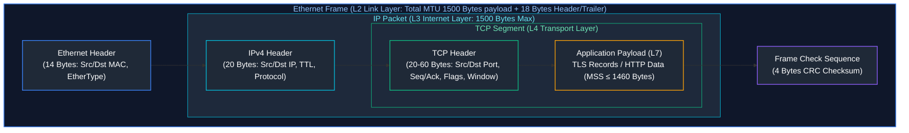

#### Comparison: Theoretical OSI vs. Pragmatic TCP/IP

| OSI Layer (7-Layer Model) | TCP/IP Layer (4-Layer Model) | Primary Function | Canonical Protocols & Data Units |
| :--- | :--- | :--- | :--- |
| **7. Application** | **Application Layer** | High-level APIs, user-facing protocols | HTTP/1.1, HTTP/2, DNS, gRPC, SSH, SMTP |
| **6. Presentation** | Application Layer | Data serialization, compression, TLS encryption | JSON, Protocol Buffers, TLS 1.3, gzip |
| **5. Session** | Application Layer | Session establishment, RPC tokens | SOCKS, NetBIOS, RPC sessions |
| **4. Transport** | **Transport Layer** | End-to-end reliability, multiplexing, flow control | TCP (Segments), UDP (Datagrams) |
| **3. Network** | **Internet Layer** | Logical addressing, packet routing across networks | IPv4, IPv6, ICMP, IPsec (Packets) |
| **2. Data Link** | **Network Access Layer** | Physical framing, local hop MAC addressing | Ethernet, ARP, VLAN 802.1Q, VXLAN (Frames) |
| **1. Physical** | Network Access Layer | Raw electrical/optical bit transmission | 100G Fiber (Single-mode), Cat6a copper, Bits |

---

### 1.2 Socket Mechanics and the 5-Tuple Connection Identifier

In the Linux kernel, a network connection is represented as a file descriptor pointing to a `struct sock`. Across the entire operating system, every TCP/UDP connection is uniquely identified by a **5-Tuple**:

$$\text{Connection ID} = (\text{Source IP}, \text{Source Port}, \text{Destination IP}, \text{Destination Port}, \text{Protocol})$$

#### Why the 5-Tuple Matters in Cloud Engineering:
- A web server listening on port `443` is **not** limited to 65,535 connections!
- Because the tuple contains the *client's* IP and port, a single server IP and port can concurrently serve **millions of simultaneous TCP connections**, bounded only by kernel memory (RAM consumed by `struct sk_buff` and socket buffers) and open file descriptor limits (`fs.file-max`).
- However, when a client (e.g. an API gateway) connects to a *single* upstream server IP and port, the client is constrained by its ephemeral port range (`32768` to `60999`, ~28,232 outbound connections).

---

# 2. TCP State Machine, Flow Control, and Congestion Control

### 2.1 The TCP 3-Way Handshake & 4-Way Teardown

Transmission Control Protocol (TCP) is a connection-oriented, reliable, byte-stream protocol. Before a single byte of HTTP data can be sent, client and server must synchronize their sequence numbers.

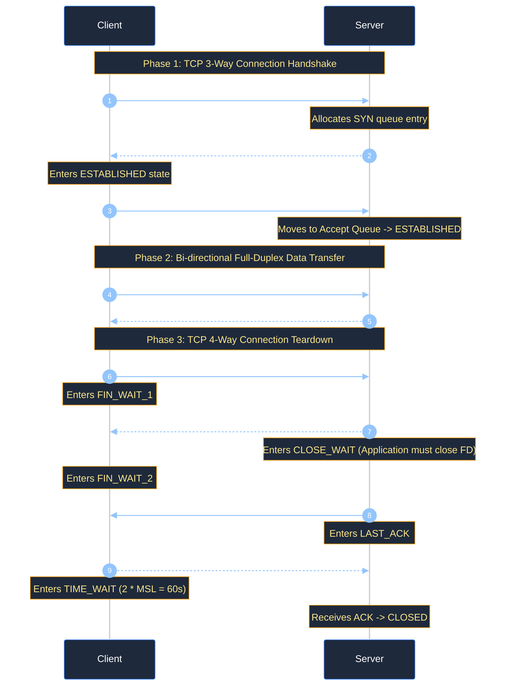

#### Step-by-Step Breakdown:
1. **SYN (Synchronize):** The client selects a cryptographically random Initial Sequence Number (ISN = `1000`) and sends TCP options:
   - **MSS (Maximum Segment Size):** e.g., 1460 bytes (Ethernet MTU 1500 - 20B IP - 20B TCP).
   - **Window Scale (WS):** Allows window sizes up to 1GB instead of the legacy 64KB limit.
   - **SACK Permitted:** Enables Selective Acknowledgments to retransmit only dropped packets.
2. **SYN-ACK:** The server acknowledges the client's ISN (`ack = 1001`) and sends its own ISN (`seq = 5000`).
3. **ACK:** The client acknowledges the server's sequence number (`ack = 5001`). The connection is now `ESTABLISHED`.

---

### 2.2 TCP State Transitions: TIME_WAIT vs. CLOSE_WAIT

Understanding these two states is the single most critical TCP debugging skill for Cloud Engineers and SREs:

```mermaid
flowchart TD
    subgraph TIME_WAIT_Issue ["TIME_WAIT State (Active Closer Side)"]
        TW1["Process calls close() actively"] --> TW2["Connection enters TIME_WAIT"]
        TW2 --> TW3["Kernel holds 5-tuple for 2 * MSL (60s)"]
        TW3 --> TW4["Normal Kernel Behavior:<br/>Prevents old duplicate packets from corrupting new connections"]
    end

    subgraph CLOSE_WAIT_Issue ["CLOSE_WAIT State (Passive Closer Side - BUG!)"]
        CW1["Remote peer sends FIN"] --> CW2["OS Kernel automatically replies with ACK"]
        CW2 --> CW3["Socket enters CLOSE_WAIT"]
        CW3 --> CW4["CRITICAL BUG: Application failed to call close()!<br/>Socket descriptor leaks until app restarts!"]
    end

    style TIME_WAIT_Issue fill:#0f172a,stroke:#3b82f6,stroke-width:1.5px,color:#93c5fd
    style CLOSE_WAIT_Issue fill:#0f172a,stroke:#ef4444,stroke-width:1.5px,color:#fca5a5
    style TW1 fill:#1f2937,stroke:#3b82f6,stroke-width:2px,color:#fff
    style TW2 fill:#1f2937,stroke:#3b82f6,stroke-width:2px,color:#fff
    style TW3 fill:#1f2937,stroke:#3b82f6,stroke-width:2px,color:#fff
    style TW4 fill:#1f2937,stroke:#10b981,stroke-width:2px,color:#fff
    style CW1 fill:#1f2937,stroke:#ef4444,stroke-width:2px,color:#fff
    style CW2 fill:#1f2937,stroke:#ef4444,stroke-width:2px,color:#fff
    style CW3 fill:#1f2937,stroke:#ef4444,stroke-width:2px,color:#fff
    style CW4 fill:#1f2937,stroke:#ef4444,stroke-width:2px,color:#fff
```

- **`TIME_WAIT`:**
  - Occurs on the endpoint that **initiated the close** (usually client or reverse proxy).
  - The socket remains in `TIME_WAIT` for $2 \times \text{MSL}$ (Maximum Segment Lifetime, default 60s in Linux).
  - *Purpose:* Ensures the final `ACK` arrived at the remote end, and allows any lingering delayed packets in transit to expire safely.
  - *Mitigation if exhausting ports:* Enable `net.ipv4.tcp_tw_reuse = 1` in `/etc/sysctl.conf`.
- **`CLOSE_WAIT`:**
  - Occurs on the endpoint that **received the FIN**. The kernel acknowledged the FIN, but the user-space application code forgot to call `socket.close()`!
  - **This is always an application code bug (connection pool leak).** Tuning `sysctl` cannot fix `CLOSE_WAIT`.

---

### 2.3 Flow Control (Sliding Window) vs. Congestion Control (CUBIC vs. BBR)

- **Flow Control (End-to-End):** Prevents a fast sender from overwhelming a slow receiver. The receiver advertises a **Receive Window (`rwnd`)** in every TCP header indicating how many bytes of buffer space remain in its receive queue.
- **Congestion Control (Network-Wide):** Prevents senders from overwhelming the intermediate network routers and switches. Maintained via the **Congestion Window (`cwnd`)**.
  - **TCP CUBIC (Loss-Based):** The legacy standard. Aggressively increases `cwnd` until a packet drop occurs. In modern high-bandwidth cloud networks, packet drops cause "bufferbloat" and severe latency spikes.
  - **TCP BBR (Bottleneck Bandwidth and RTT - Model-Based):** Developed by Google. BBR does not treat packet loss as congestion. Instead, it continuously probes the network to measure **Max Bandwidth** and **Min RTT**, keeping queues empty and achieving 10x-100x lower latency on transatlantic or cross-region cloud links.

```bash
# Enable Google BBR Congestion Control on modern Linux kernels (5.x+)
sudo modprobe tcp_bbr
echo "tcp_bbr" | sudo tee -a /etc/modules-load.d/bbr.conf
echo "net.core.default_qdisc = fq" | sudo tee -a /etc/sysctl.d/99-bbr.conf
echo "net.ipv4.tcp_congestion_control = bbr" | sudo tee -a /etc/sysctl.d/99-bbr.conf
sudo sysctl --system
```

---

### 2.4 SYN Flood Attacks and Cryptographic TCP SYN Cookies

In a standard handshake, when a server receives a `SYN`, it allocates memory in the **SYN Backlog Queue** and waits for the final `ACK`.
- In a **SYN Flood Denial of Service**, an attacker sends millions of spoofed `SYN` packets without ever returning `ACK`.
- The SYN queue overflows, and the server refuses all legitimate incoming connections.

#### The Solution: Cryptographic SYN Cookies (`net.ipv4.tcp_syncookies = 1`)
When the SYN queue fills up, the Linux kernel stops allocating memory for half-open sockets. Instead:
1. It hashes the client's IP, port, server secret, and timestamp into a 32-bit cryptographic hash.
2. It uses this hash as its Initial Sequence Number (`ISN`) in the `SYN-ACK`.
3. When the legitimate client sends the final `ACK`, the acknowledgment number will be $\text{ISN} + 1$.
4. The server subtracts 1, recalculates the cryptographic hash, and if valid, reconstructs the connection on the fly—**allocating zero memory until the handshake is verified!**

---

# 3. IP Addressing, CIDR Subnet Math, and IPv6

### 3.1 Binary Subnet Math from First Principles

An IPv4 address is a 32-bit integer divided into four 8-bit octets separated by dots. In **Classless Inter-Domain Routing (CIDR)** notation, the `/N` suffix indicates how many bits represent the **Network Prefix**, leaving $32 - N$ bits for **Host Addresses**.

#### Step-by-Step Calculation for `10.0.4.0/22`:
1. Total Bits: $32$.
2. Network Bits: $22$.
3. Host Bits: $32 - 22 = 10 \text{ bits}$.
4. Total IP Addresses: $2^{10} = 1024 \text{ addresses}$.
5. Subnet Mask in Binary:
   - Octet 1: `11111111` ($255$)
   - Octet 2: `11111111` ($255$)
   - Octet 3: `11111100` ($252$)
   - Octet 4: `00000000` ($0$)
   - Mask = `255.255.252.0`.
6. IP Range: `10.0.4.0` through `10.0.7.255`.

---

### 3.2 The Cloud Provider 5-IP Deduction Rule

In traditional on-premises networking, **2 IP addresses** are reserved per subnet:
- Network Address (all host bits 0, e.g. `.0`)
- Broadcast Address (all host bits 1, e.g. `.255`)

> [!IMPORTANT]
> **In AWS VPC and Azure VNet, cloud providers reserve 5 IP addresses in every subnet:**
> 1. `x.x.x.0`: Network Address.
> 2. `x.x.x.1`: Subnet Default Gateway Router (VNet / VPC router).
> 3. `x.x.x.2`: Cloud DNS Resolver (e.g., Azure DNS / AWS Route 53 Resolver at VPC base + 2).
> 4. `x.x.x.3`: Reserved by cloud provider for future internal infrastructure routing.
> 5. `x.x.x.255`: Subnet Broadcast Address.

#### Cloud Subnet Capacity Reference Table:

| CIDR Prefix | Total IPs ($2^{32-N}$) | On-Prem Usable ($2^H - 2$) | Cloud Usable (AWS/Azure: $2^H - 5$) | Typical Cloud Use Case |
| :---: | :---: | :---: | :---: | :--- |
| **/28** | 16 | 14 | **11** | Minimal Private Endpoint / Application Gateway |
| **/27** | 32 | 30 | **27** | Azure Bastion / Firewall Management Subnet |
| **/26** | 64 | 62 | **59** | Dedicated Database / Redis Subnet |
| **/24** | 256 | 254 | **251** | Standard Microservice / Web Tier Subnet |
| **/22** | 1,024 | 1,022 | **1,019** | Large Kubernetes Cluster (EKS / AKS Node pool) |
| **/16** | 65,536 | 65,534 | **65,531** | Entire Enterprise Virtual Network (VNet / VPC) |

---

### 3.3 IPv6 Architecture & Dual-Stack Cloud Migration

IPv6 expands address space from 32 bits ($4.3 \times 10^9$) to **128 bits** ($3.4 \times 10^{38}$ addresses).

#### Anatomy of an IPv6 Address:
- Canonical form: `2001:0db8:85a3:0000:0000:8a2e:0370:7334`
- **Zero Compression (`::`):** Consecutive blocks of zeros can be compressed once per address: `2001:db8:85a3::8a2e:370:7334`.
- **Subnet Standard:** In IPv6, the universal subscriber subnet prefix is **/64** ($2^{64}$ addresses per subnet). This renders NAT obsolete; every device has a globally routable public address protected by stateful firewall rules.

---

# 4. DNS Architecture, Resolution Internals, and Records

### 4.1 The Distributed DNS Hierarchy: Root, TLD, and Authoritative Servers

DNS is a globally distributed, hierarchical namespace database translating human-readable hostnames (`api.example.com`) into routable IP addresses.

#### Global DNS Namespace Treeview Chart

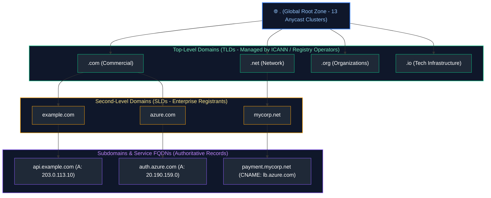

#### The Iterative DNS Resolution Walkthrough

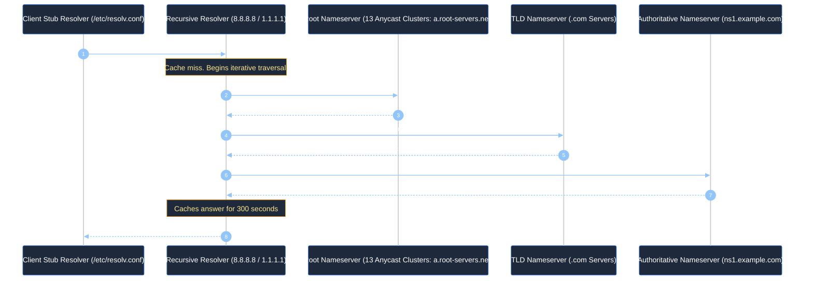

1. **Stub Resolver:** The local client library reading `/etc/resolv.conf` (e.g. pointing to `127.0.0.53` for `systemd-resolved` or cloud DNS `168.63.129.16`).
2. **Recursive Resolver:** Traverses the internet hierarchy on behalf of the client and caches responses according to Time-To-Live (TTL).
3. **Root Nameservers:** 13 logical root server authorities operating thousands of physical nodes worldwide via BGP Anycast routing.
4. **Authoritative Nameserver:** Holds the official DNS records configured by domain administrators.

---

### 4.2 Comprehensive Record Types (A, AAAA, CNAME, ALIAS, MX, TXT, SOA, SRV)

| Record Type | Target Value | Description & Cloud Engineering Role |
| :--- | :--- | :--- |
| **`A`** | `203.0.113.10` | Maps hostname to 32-bit IPv4 address. |
| **`AAAA`** | `2001:db8::1` | Maps hostname to 128-bit IPv6 address. |
| **`CNAME`** | `lb.azure.com` | Canonical name alias. **Cannot exist at the zone apex (`example.com`)** per RFC 1034! |
| **`ALIAS / ANAME`** | `lb.azure.com` | Cloud-provider virtual record that resolves CNAME flattening at the zone apex. |
| **`MX`** | `10 mail.corp.com` | Mail exchange server with integer priority (lower number = higher priority). |
| **`TXT`** | `"v=spf1 ..."` | Arbitrary text metadata. Essential for email verification (SPF, DKIM, DMARC) and TLS ACME domain validation challenges. |
| **`SOA`** | Master NS, Email, Serial | Start of Authority: zone administrative metadata and negative caching TTL. |
| **`SRV`** | Priority, Weight, Port, Host | Service locator record; heavily used in Kubernetes headless services and Consul. |

---

### 4.3 Split-Horizon DNS & Cloud Private DNS Zones

In enterprise cloud security, internal servers should never communicate over public IPs. **Split-Horizon DNS** serves different IP addresses based on the requester's network location:

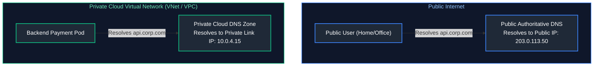

---

### 4.4 DNS Caching, TTLs, and the Java DNS Cache Gotcha

- **Time-To-Live (TTL):** Dictates how many seconds recursive resolvers can cache an answer. During migrations, lower TTL to 60s at least 48 hours prior to cutover.
- **The Java JVM DNS Cache Trap:** By default, if a Java application runs with a security manager or older JDK, the JVM caches DNS lookups **FOREVER (`networkaddress.cache.ttl = -1`)**. If an AWS RDS or Azure SQL database fails over to a replica with a new IP, the Java service continues sending traffic to the dead IP indefinitely!
- **Fix:** Set `-Dsun.net.inetaddr.ttl=30` in JVM startup flags.

---

# 5. HTTP/1.1 to HTTP/3, TLS 1.3 Cryptography, and PKI

### 5.1 Protocol Evolution: HTTP/1.1 vs. HTTP/2 Multiplexing vs. HTTP/3 QUIC

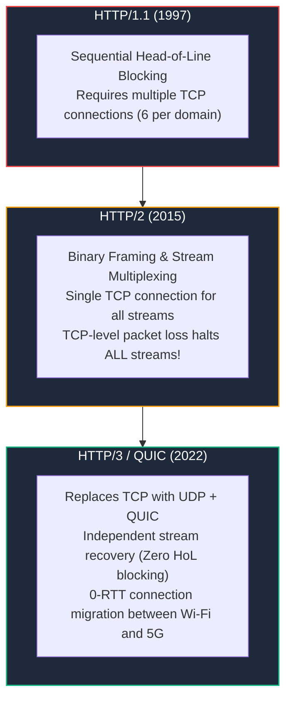

---

### 5.2 TLS 1.3 1-RTT Handshake & Perfect Forward Secrecy (PFS)

TLS 1.3 improves security and connection establishment time over TLS 1.2 by cutting the handshake latency from 2 round-trip times (2-RTT) down to **1-RTT**:

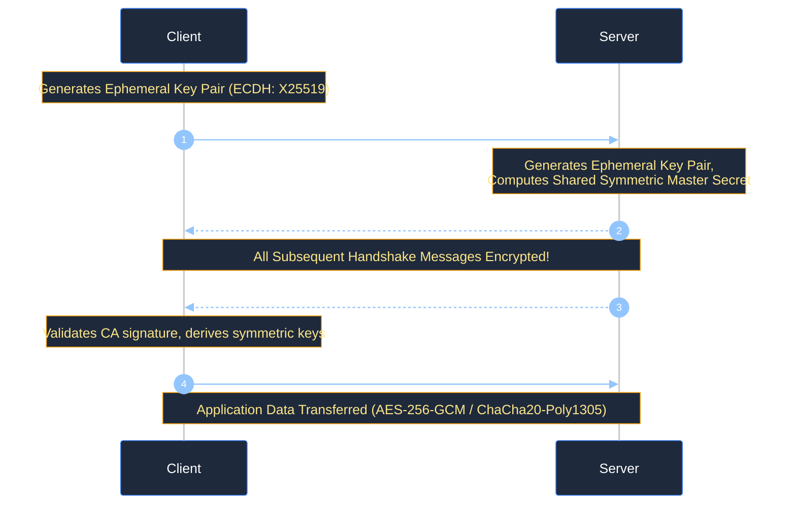

- **Server Name Indication (SNI):** TLS extension sent in `ClientHello` stating which hostname the client wants. This allows a single load balancer IP to host certificates for hundreds of distinct customer domains.
- **Perfect Forward Secrecy (PFS):** Mandated in TLS 1.3. Because ephemeral keys (`ECDHE`) are negotiated for each session and discarded from RAM immediately after, an attacker who steals the server's private key in the future **cannot decrypt recorded historical network traffic**.

---

### 5.3 Public Key Infrastructure (PKI) and Mutual TLS (mTLS)

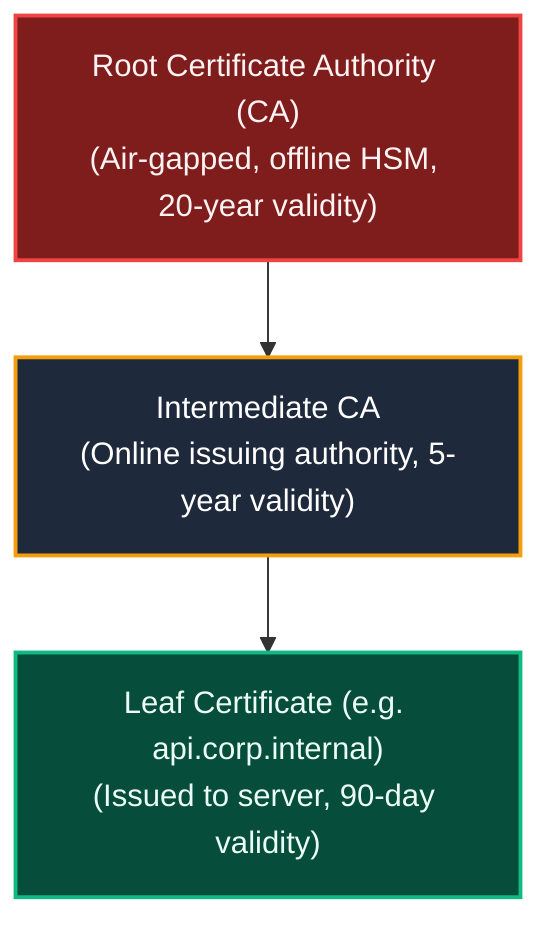

- **Standard TLS:** Server presents certificate to client; client verifies server authenticity.
- **Mutual TLS (mTLS):** Both client and server present X.509 certificates to each other. The server validates that the client is an authorized microservice in the cluster. This is the cryptographic engine powering **Zero Trust Service Meshes** (Istio, Linkerd, Envoy).

---

# 6. Routing Tables, Gateways, NAT, and BGP

### 6.1 Longest Prefix Match (LPM) Routing Evaluation

When a router evaluates where to forward a packet, it compares the packet's destination IP against all entries in its routing table and selects the rule with the **longest prefix match (most specific subnet mask)**:

> **Incoming Packet Destination IP:** `10.0.2.45`

| Evaluation Preference | Route Target CIDR | Next Hop Gateway | Interface | Prefix Length | Decision |
| :---: | :--- | :--- | :---: | :---: | :--- |
| 1 | `0.0.0.0/0` | `192.168.1.1` (Internet GW) | `eth0` | `/0` | Catch-all default route; least specific. |
| 2 | `10.0.0.0/16` | `10.0.0.1` (VNet Peering) | `eth1` | `/16` | Matches subnet, but less specific. |
| 3 | `10.0.2.0/24` | `10.0.2.1` (Local Subnet) | `eth2` | `/24` | **SELECTED (Longest Prefix Match)** |
| 4 | `10.0.2.45/32` | `10.0.2.45` (Direct Host) | `lo` | `/32` | *If present, would beat /24.* |

---

### 6.2 Source NAT (SNAT), Destination NAT (DNAT), and Port Exhaustion

- **Source NAT (SNAT):** Rewrites private RFC 1918 source IP to a public IP on outbound traffic.
- **Destination NAT (DNAT):** Rewrites public destination IP to a private backend server IP on inbound traffic.

#### The Outage: SNAT Port Exhaustion
When hundreds of pods in a private subnet call external APIs (e.g. Stripe, GitHub, Datadog) through a cloud NAT Gateway:
- Every outbound connection to a specific destination IP and port consumes **one ephemeral source port** (out of 65,535).
- If applications open and close connections rapidly without HTTP connection pooling (Keep-Alive), ports enter `TIME_WAIT` for 60 seconds.
- Once all ephemeral ports are allocated, new outbound requests fail with: `Connection timed out` or `Cannot assign requested address`.
- **Architectural Solution:** Implement HTTP Keep-Alive connection pools in application code, use Cloud Private Endpoints / PrivateLink for cloud APIs, or allocate multiple public IPs to the NAT Gateway.

---

### 6.3 Anycast Routing & BGP Peering Foundations

- **Unicast:** One IP address maps to one physical server.
- **Anycast:** **The same IP address is advertised simultaneously by hundreds of data centers worldwide** via Border Gateway Protocol (BGP).
- When a user queries `1.1.1.1` (Cloudflare) or `8.8.8.8` (Google), global ISP BGP routers route packets to the geographically closest data center. If one data center goes dark, BGP automatically routes traffic to the next closest facility.

---

# 7. Proxies and Load Balancing: Layer 4 vs. Layer 7

### 7.1 Forward Proxies vs. Reverse Proxies

- **Forward Proxy (Client-Side Guardian):** Protects and regulates outbound client traffic. Enforces enterprise egress compliance, URL filtering, and data loss prevention (DLP).
- **Reverse Proxy (Server-Side Guardian):** Protects origin application servers. Sits at the edge to terminate TLS, balance traffic, enforce WAF security rules, and cache static assets.

---

### 7.2 Layer 4 (NLB/IPVS) vs. Layer 7 (ALB/Envoy) Architecture

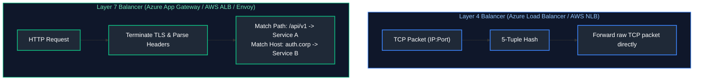

| Dimension | Layer 4 Load Balancer (NLB) | Layer 7 Load Balancer (ALB / Envoy) |
| :--- | :--- | :--- |
| **Inspection Scope** | IP and Port only | Full HTTP payload, headers, cookies, query parameters |
| **Throughput & Latency**| Millions of requests/sec; sub-millisecond latency | Tens of thousands of requests/sec; 2-15ms latency overhead |
| **TLS Termination** | Pass-through or TLS termination | Terminates TLS; injects `X-Forwarded-For` and `X-Forwarded-Proto` |
| **Routing Capability** | IP/Port hashing only | Path routing (`/users`), header routing, cookie stickiness |

---

### 7.3 Balancing Algorithms: Round Robin, Least Conn, Consistent Hash

1. **Round Robin:** Distributes requests sequentially across backends. Poor fit if requests have drastically differing processing times.
2. **Least Connections:** Forwards request to the backend with the fewest active TCP connections. Ideal for long-lived database sessions or WebSockets.
3. **Consistent Hashing (Ketama Ring):** Hashes a key (e.g., Client IP or User ID) onto a circular hash ring. Essential for caching tiers (e.g. Memcached, Redis) because adding or removing a node only redistributes $1/N$ of keys instead of invalidating the entire cache.

---

# 8. Firewalls, Security Groups, and Network ACLs

### 8.1 Stateful Firewalls vs. Stateless Network ACLs

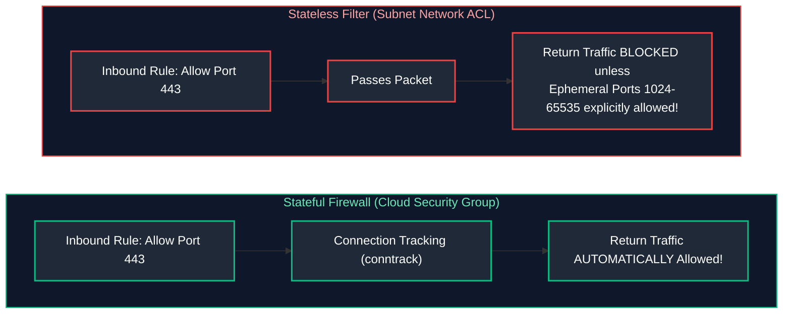

- **Security Groups (Stateful):** If you permit inbound traffic on port 443, the return traffic from the server to the client is automatically permitted regardless of outbound rules.
- **Network ACLs (Stateless):** Evaluates every packet independently. If you open inbound port 443, you **must explicitly configure an outbound rule allowing ephemeral return ports (`1024-65535`)**, or the connection will hang!

---

### 8.2 Linux Netfilter & iptables Packet Processing Architecture

```mermaid
flowchart LR
    PktIn["Inbound Packet"] --> Pre["PREROUTING Chain<br/>(raw, mangle, nat/DNAT)"]
    Pre --> Decision{"Routing Decision"}
    Decision -->|"Destination: Local Host"| In["INPUT Chain<br/>(mangle, filter)"] --> LocalApp["Local Application Socket"]
    Decision -->|"Destination: Another Host"| Fwd["FORWARD Chain<br/>(mangle, filter)"] --> Post["POSTROUTING Chain<br/>(mangle, nat/SNAT)"]
    LocalApp -->|"Outbound Generation"| Out["OUTPUT Chain<br/>(raw, mangle, nat, filter)"] --> Post
    Post --> Wire["Physical Egress NIC"]

    style PktIn fill:#1f2937,stroke:#3b82f6,stroke-width:2px,color:#fff
    style Pre fill:#1e293b,stroke:#06b6d4,stroke-width:1.5px,color:#fff
    style Decision fill:#1e293b,stroke:#f59e0b,stroke-width:1.5px,color:#fff
    style In fill:#1e293b,stroke:#10b981,stroke-width:1.5px,color:#fff
    style LocalApp fill:#1f2937,stroke:#10b981,stroke-width:2px,color:#fff
    style Fwd fill:#1e293b,stroke:#8b5cf6,stroke-width:1.5px,color:#fff
    style Out fill:#1e293b,stroke:#ec4899,stroke-width:1.5px,color:#fff
    style Post fill:#1e293b,stroke:#06b6d4,stroke-width:1.5px,color:#fff
    style Wire fill:#1f2937,stroke:#3b82f6,stroke-width:2px,color:#fff
```

---

# 9. MTU, Path MTU Discovery, and Packet Diagnostics

### 9.1 Maximum Transmission Unit (MTU) and the ICMP Black Hole Outage

- Standard Ethernet MTU is **1500 bytes**.
- Cloud VPCs often support **Jumbo Frames (9001 bytes)** for intra-VPC communication.
- When a packet traverses an intermediate router whose MTU is smaller than the packet size, the router checks the **Don't Fragment (DF)** bit in the IP header.
  - If DF is 0: The router breaks the packet into fragments (introducing reassembly overhead).
  - If DF is 1: The router drops the packet and returns an **ICMP Type 3, Code 4 ("Fragmentation Needed and DF set")** message telling the client to reduce its MTU (**Path MTU Discovery / PMTUD**).

#### The "MTU Black Hole" Nightmare:
If a firewall blocks all ICMP traffic, the ICMP Type 3 Code 4 notice is discarded.
- Small TCP handshakes (SYN, ACK) succeed effortlessly.
- Large HTTP POST requests or TLS certificate exchanges freeze and time out!
- **Fix:** Clamp TCP MSS on the gateway router:
  `iptables -t mangle -A FORWARD -p tcp --tcp-flags SYN,RST SYN -j TCPMSS --clamp-mss-to-pmtu`

---

### 9.2 Production Python Network Health & Latency Auditor

Below is a complete, runnable Python diagnostic utility measuring DNS resolution time, TCP handshake latency, and TLS certificate expiration with sub-millisecond precision:

```python
#!/usr/bin/env python3
"""
Enterprise Network & Endpoint Latency Diagnostic Tool.
Audits DNS resolution speed, TCP handshake duration, and SSL certificate health.
Zero external dependencies.
"""

from dataclasses import asdict, dataclass
from datetime import datetime, timezone
import json
import logging
import socket
import ssl
import sys
import time
from typing import List, Optional

logging.basicConfig(
    level=logging.INFO,
    format='{"time":"%(asctime)s","logger":"%(name)s","level":"%(levelname)s","message":"%(message)s"}',
    handlers=[logging.StreamHandler(sys.stdout)],
)
logger = logging.getLogger("net_auditor")


@dataclass(frozen=True)
class EndpointMetrics:
    host: str
    port: int
    resolved_ip: str
    dns_time_ms: float
    tcp_handshake_ms: float
    tls_handshake_ms: Optional[float]
    cert_expiry_days: Optional[int]
    status: str
    error: str = ""


class NetworkProbe:
    def __init__(self, timeout_sec: float = 3.0):
        self.timeout = timeout_sec

    def audit_endpoint(self, host: str, port: int = 443) -> EndpointMetrics:
        dns_start = time.perf_counter()
        resolved_ip = ""
        try:
            addr_info = socket.getaddrinfo(host, port, family=socket.AF_INET, type=socket.SOCK_STREAM)
            resolved_ip = addr_info[0][4][0]
            dns_time_ms = (time.perf_counter() - dns_start) * 1000.0
        except socket.gaierror as err:
            return EndpointMetrics(
                host=host, port=port, resolved_ip="", dns_time_ms=0.0,
                tcp_handshake_ms=0.0, tls_handshake_ms=None, cert_expiry_days=None,
                status="DNS_FAILURE", error=str(err)
            )

        sock = socket.socket(socket.AF_INET, socket.SOCK_STREAM)
        sock.settimeout(self.timeout)
        tcp_start = time.perf_counter()

        try:
            sock.connect((resolved_ip, port))
            tcp_time_ms = (time.perf_counter() - tcp_start) * 1000.0
        except (socket.timeout, socket.error) as err:
            sock.close()
            return EndpointMetrics(
                host=host, port=port, resolved_ip=resolved_ip, dns_time_ms=round(dns_time_ms, 2),
                tcp_handshake_ms=0.0, tls_handshake_ms=None, cert_expiry_days=None,
                status="TCP_FAILURE", error=str(err)
            )

        tls_time_ms = None
        cert_days = None

        if port == 443:
            tls_start = time.perf_counter()
            ssl_ctx = ssl.create_default_context()
            try:
                with ssl_ctx.wrap_socket(sock, server_hostname=host) as ssock:
                    tls_time_ms = (time.perf_counter() - tls_start) * 1000.0
                    cert = ssock.getpeercert()
                    if cert and "notAfter" in cert:
                        expire_date = datetime.strptime(cert["notAfter"], "%b %d %H:%M:%S %Y %Z").replace(tzinfo=timezone.utc)
                        cert_days = (expire_date - datetime.now(timezone.utc)).days
            except Exception as err:
                return EndpointMetrics(
                    host=host, port=port, resolved_ip=resolved_ip, dns_time_ms=round(dns_time_ms, 2),
                    tcp_handshake_ms=round(tcp_time_ms, 2), tls_handshake_ms=None, cert_expiry_days=None,
                    status="TLS_FAILURE", error=str(err)
                )
        else:
            sock.close()

        return EndpointMetrics(
            host=host, port=port, resolved_ip=resolved_ip,
            dns_time_ms=round(dns_time_ms, 2),
            tcp_handshake_ms=round(tcp_time_ms, 2),
            tls_handshake_ms=round(tls_time_ms, 2) if tls_time_ms else None,
            cert_expiry_days=cert_days,
            status="HEALTHY",
        )


if __name__ == "__main__":
    endpoints = [
        ("google.com", 443),
        ("cloudflare.com", 443),
        ("api.github.com", 443),
    ]
    probe = NetworkProbe(timeout_sec=2.5)
    results = [asdict(probe.audit_endpoint(h, p)) for h, p in endpoints]
    print(json.dumps(results, indent=2))
```

---

# 10. Senior SRE Network Troubleshooting Runbooks

### Runbook 1: Diagnosing Connection Timeouts vs. Connection Refused
- **`Connection Refused`:** The packet reached the destination host, but **no process is listening on that port**, or a local firewall sent an explicit `TCP RST`.
  - *Action:* Verify process is running (`systemctl status`), verify listening ports (`ss -tulpn | grep <port>`).
- **`Connection Timed Out`:** Packets are being **silently dropped** by a middlebox, firewall, or security group.
  - *Action:* Check cloud Security Groups, Subnet NACLs, route table default gateway, and test with `nc -zv -w 3 <IP> <PORT>`.

### Runbook 2: Diagnosing Path MTU Black Holes
```bash
# Test MTU with Don't Fragment (DF) flag set from Linux
# Syntax: ping -M do -s <packet_size> <target_ip>
# 1472 bytes payload + 28 bytes IP/ICMP header = 1500 bytes MTU
ping -M do -s 1472 8.8.8.8
```
- If it responds: Standard 1500 byte MTU is healthy.
- If it returns `Frag needed and DF set`: Lower packet size iteratively to find the bottleneck path MTU.

---

# 11. Summary Comparison & Engineering Reference Matrix

| Networking Concept | Architectural Role | Core Failure Mode | First-Line Diagnostic Command | Production Resolution |
| :--- | :--- | :--- | :--- | :--- |
| **TCP 3-Way Handshake** | Establish connection & sequence sync | SYN Queue exhaustion / Drops | `netstat -s \| grep -i listen` | Enable `tcp_syncookies = 1`, increase `somaxconn`. |
| **TIME_WAIT State** | Graceful connection termination | Ephemeral port exhaustion | `ss -ant \| grep TIME-WAIT \| wc -l`| Enable `tcp_tw_reuse = 1`, implement HTTP Keep-Alive. |
| **CIDR Subnetting** | IP address partitioning | IP exhaustion in private subnet | Cloud portal / subnet IP counters | Size subnets with `/22` for Kubernetes nodes. |
| **DNS Resolution** | Name-to-IP resolution | NXDOMAIN, Stale DNS records | `dig +trace +cd api.corp.com` | Audit TTLs, check `/etc/resolv.conf`, configure CoreDNS. |
| **TLS 1.3** | Transport layer encryption | SNI mismatch, Certificate expiry | `openssl s_client -connect host:443` | Automated certificate rotation (cert-manager, ACME). |
| **Source NAT (SNAT)** | Private-to-public egress | SNAT port starvation | NAT Gateway cloud metric alarms | Allocate additional public IPs to NAT GW, pool conns. |
| **Layer 4 vs L7 LB** | Traffic distribution | L7 CPU saturation, Host unreach | `curl -Iv https://endpoint/healthz` | Offload static traffic to CDN, scale proxy replicas. |

---

# 12. References & Further Reading

- [RFC 793: Transmission Control Protocol](https://datatracker.ietf.org/doc/html/rfc793) — Standard TCP protocol specifications.
- [RFC 8446: The Transport Layer Security (TLS) Protocol Version 1.3](https://datatracker.ietf.org/doc/html/rfc8446) — Modern TLS 1.3 cryptographic handshake.
- [RFC 1918: Address Allocation for Private Internets](https://datatracker.ietf.org/doc/html/rfc1918) — Private IPv4 ranges (10.0.0.0/8, 172.16.0.0/12, 192.168.0.0/16).
- [W. Richard Stevens: TCP/IP Illustrated, Volume 1 (The Protocols)](https://www.pearson.com/) — The definitive computer networking reference.
- [Cloudflare Learning: How DNS & BGP Anycast Work](https://www.cloudflare.com/learning/) — Industry-standard network systems architecture guide.
