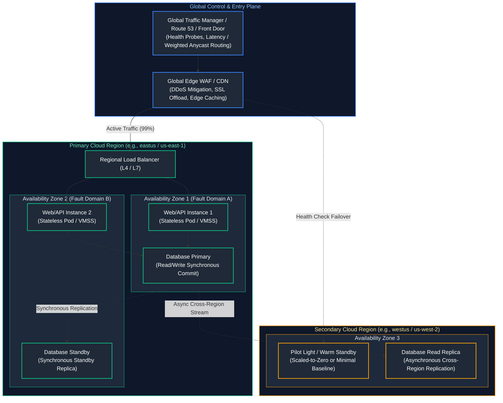
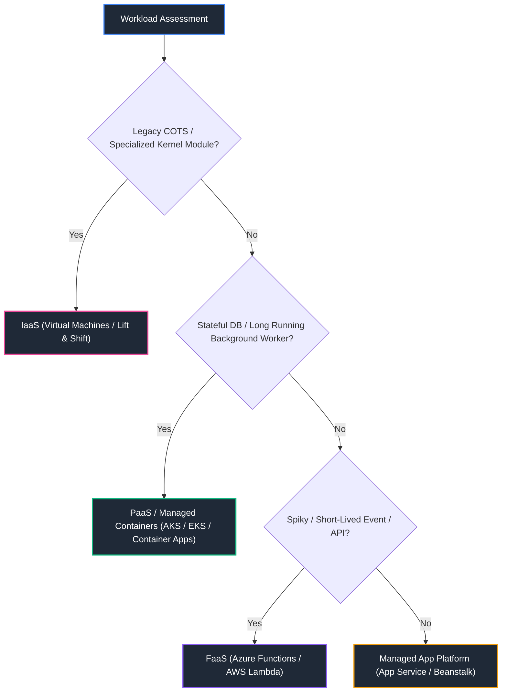
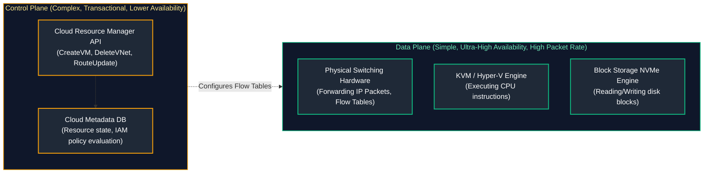

# 03. Cloud Fundamentals & Architecture

A comprehensive, production-grade guide to cloud computing service models (IaaS, PaaS, SaaS, FaaS), physical topologies, availability zones, the cloud shared responsibility model, control plane vs. data plane boundaries, multi-region high availability, disaster recovery strategies, Well-Architected Framework principles, and enterprise landing zone governance tailored for Cloud Architects and Senior Cloud Engineers.

---

## Architectural Overview: Multi-Tier Resilient Cloud Topology



---

## Table of Contents
1. [Cloud Computing Delivery Models: IaaS, PaaS, SaaS, and FaaS](#1-cloud-computing-delivery-models-iaas-paas-saas-and-faas)
   - [1.1 The Abstraction Spectrum and Operational Overhead](#11-the-abstraction-spectrum-and-operational-overhead)
   - [1.2 Workload Classification & Migration Decision Matrix](#12-workload-classification-migration-decision-matrix)
2. [Regions, Availability Zones, and Fault Domains](#2-regions-availability-zones-and-fault-domains)
   - [2.1 Physical Topologies: Campus, Fiber, and Latency Horizons](#21-physical-topologies-campus-fiber-and-latency-horizons)
   - [2.2 Fault Domains vs. Update Domains](#22-fault-domains-vs-update-domains)
3. [The Cloud Shared Responsibility Model](#3-the-cloud-shared-responsibility-model)
   - [3.1 Security of the Cloud vs. Security in the Cloud](#31-security-of-the-cloud-vs-security-in-the-cloud)
   - [3.2 Governance Boundaries across IaaS, PaaS, and SaaS](#1-cloud-computing-delivery-models-iaas-paas-saas-and-faas)
4. [Control Plane vs. Data Plane Failure Isolation](#4-control-plane-vs-data-plane-failure-isolation)
   - [4.1 Blast Radius Engineering and Static Stability](#41-blast-radius-engineering-and-static-stability)
   - [4.2 Handling Control Plane Outages During Surges](#42-handling-control-plane-outages-during-surges)
5. [Resource Hierarchy, Quotas, and Service Limits](#5-resource-hierarchy-quotas-and-service-limits)
   - [5.1 Multi-Tenant Organization and Subscription Scopes](#51-multi-tenant-organization-and-subscription-scopes)
   - [5.2 API Throttling, Token Buckets, and Quota Management](#52-api-throttling-token-buckets-and-quota-management)
6. [High Availability vs. Disaster Recovery Design](#6-high-availability-vs-disaster-recovery-design)
   - [6.1 Recovery Time Objective (RTO) vs. Recovery Point Objective (RPO)](#61-recovery-time-objective-rto-vs-recovery-point-objective-rpo)
   - [6.2 Disaster Recovery Strategies: Backup to Active-Active](#62-disaster-recovery-strategies-backup-to-active-active)
7. [The Well-Architected Framework: The 5/6 Pillars](#7-the-well-architected-framework-the-56-pillars)
   - [7.1 Operational Excellence, Security, Reliability, Performance, Cost, Sustainability](#71-operational-excellence-security-reliability-performance-cost-sustainability)
   - [7.2 Architecture Trade-Off Analysis](#7-the-well-architected-framework-the-56-pillars)
8. [Cloud Migration Strategies (The 6 Rs) and Hybrid Connectivity](#8-cloud-migration-strategies-the-6-rs-and-hybrid-connectivity)
   - [8.1 Rehost, Replatform, Refactor, Repurchase, Retain, Retire](#81-rehost-replatform-refactor-repurchase-retain-retire)
   - [8.2 Automated Multi-Region Disaster Recovery Health Check](#82-automated-multi-region-disaster-recovery-health-check)
9. [Summary Comparison & Engineering Reference Matrix](#9-summary-comparison-engineering-reference-matrix)
10. [References & Further Reading](#10-references-further-reading)

---

# 1. Cloud Computing Delivery Models: IaaS, PaaS, SaaS, and FaaS

### 1.1 The Abstraction Spectrum and Operational Overhead

Cloud computing categorizes infrastructure resources based on the level of abstraction provided to the consumer:

```text
+-----------------------------------------------------------------------------------------+
|                                CLOUD ABSTRACTION SPECTRUM                               |
+---------------------+-------------------+---------------------+-------------------------+
| IaaS                | PaaS              | FaaS (Serverless)   | SaaS                    |
| (Infrastructure)    | (Platform)        | (Function)          | (Software)              |
+---------------------+-------------------+---------------------+-------------------------+
| EC2 / Azure VM      | Azure App Service | AWS Lambda / Azure  | Microsoft 365           |
| Raw Block Storage   | AWS Elastic BStk  | Functions           | Salesforce, Datadog     |
+---------------------+-------------------+---------------------+-------------------------+
| YOU MANAGE:         | YOU MANAGE:       | YOU MANAGE:         | YOU MANAGE:             |
| - OS Patching       | - App Code        | - Event Handler Code| - User Access / Config  |
| - Networking / Fire.| - App Data        | - Function Memory   |                         |
| - Runtime & Runtime |                   |                     |                         |
+---------------------+-------------------+---------------------+-------------------------+
```

1. **Infrastructure as a Service (IaaS):** Direct provisioning of virtual machines, software-defined networks, and raw block storage. Highest architectural flexibility; highest operational toil (OS maintenance, security patching, kernel tuning).
2. **Platform as a Service (PaaS):** Cloud provider manages operating systems, runtimes, web servers, and hardware virtualization. Consumers deploy application binaries and configure databases.
3. **Function as a Service (FaaS / Serverless):** Event-triggered execution of stateless code snippets. The cloud manages scaling to zero, concurrency provisioning, and execution lifecycle.
4. **Software as a Service (SaaS):** Fully managed turnkey application hosted by a vendor.

---

### 1.2 Workload Classification & Migration Decision Matrix



---

# 2. Regions, Availability Zones, and Fault Domains

### 2.1 Physical Topologies: Campus, Fiber, and Latency Horizons

- **Cloud Region:** A distinct geographical area containing a minimum of three physically isolated data center campuses interconnected via a dedicated, private, low-latency (<2ms round-trip time) dark-fiber network fabric.
- **Availability Zone (AZ):** One or more discrete physical data centers within a region. Each AZ has independent, isolated power (redundant utility feeds, diesel generators), cooling infrastructure, and networking.
- **Physical to Logical AZ Mapping:** To distribute load evenly across physical buildings, cloud providers randomize logical AZ names per tenant. Your `us-east-1a` does **not** map to the same physical building as another tenant's `us-east-1a`. Cloud providers expose physical IDs (e.g., `use1-az1`) to ensure co-location across multiple accounts.

---

### 2.2 Fault Domains vs. Update Domains

```text
+-----------------------------------------------------------------------------------------+
|                               AVAILABILITY SET TOPOLOGY                                 |
+------------------------------+------------------------------+---------------------------+
| FAULT DOMAIN 0               | FAULT DOMAIN 1               | FAULT DOMAIN 2            |
| (Rack A: Power Unit 1, TOR 1)| (Rack B: Power Unit 2, TOR 2)| (Rack C: Power Unit 3,TOR)|
+------------------------------+------------------------------+---------------------------+
| [VM 1] (Update Domain 0)     | [VM 2] (Update Domain 1)     | [VM 3] (Update Domain 2)  |
| [VM 4] (Update Domain 3)     | [VM 5] (Update Domain 4)     | [VM 6] (Update Domain 0)  |
+------------------------------+------------------------------+---------------------------+
```

1. **Fault Domain (FD):** Represents a single point of failure in physical infrastructure sharing a common power source and Top-of-Rack (TOR) network switch. Placing instances across distinct FDs prevents total service collapse during hardware or power loss.
2. **Update Domain (UD):** Logical group of hardware that can be rebooted or patched simultaneously by the cloud hypervisor. Spreading instances across multiple UDs prevents reboot outages during platform maintenance.

---

# 3. The Cloud Shared Responsibility Model

### 3.1 Security of the Cloud vs. Security in the Cloud

The Shared Responsibility Model establishes the precise contractual and operational demarcation between the cloud service provider (CSP) and the customer:

```text
Responsibility Area            | On-Premises | IaaS     | PaaS     | SaaS
─────────────────────────────────────────────────────────────────────────
Customer Data Classification   | Customer    | Customer | Customer | Customer
User Identity & Access (IAM)   | Customer    | Customer | Customer | Customer
Application Logic & APIs       | Customer    | Customer | Customer | Provider
Operating System & Patching    | Customer    | Customer | Provider | Provider
Network Configuration & NSGs   | Customer    | Customer | Shared   | Provider
Hypervisor & Virtualization    | Customer    | Provider | Provider | Provider
Physical Servers & Hardware    | Customer    | Provider | Provider | Provider
Data Center Facilities & Power | Customer    | Provider | Provider | Provider
```

> [!CAUTION]
> **Data and Identity Invariant:** Regardless of the delivery model (even in fully managed SaaS like Salesforce or Microsoft 365), **the customer is ALWAYS 100% responsible for customer data classification, backup retention policies, user access management (IAM), and endpoint security.** A ransomware attack encrypting data via compromised API credentials is fully the customer's operational responsibility.

---

# 4. Control Plane vs. Data Plane Failure Isolation

### 4.1 Blast Radius Engineering and Static Stability

Cloud systems are split into two operational planes:



- **Control Plane:** Handles administrative requests: provisioning VMs, updating route tables, querying status (`az vm create`, `aws ec2 run-instances`). Highly complex, transactional, and susceptible to regional outages.
- **Data Plane:** Handles runtime workload execution: forwarding network packets, reading/writing disk blocks, executing machine code instructions. Designed for $99.999\%$ reliability.

---

### 4.2 Handling Control Plane Outages During Surges

**Static Stability Principle:** A system is statically stable if it continues to operate correctly and serve traffic during a complete control plane failure without needing to execute control plane mutations.
- **Anti-Pattern:** Relying on reactive autoscaling to provision new VMs when traffic spikes during a cloud incident. If the cloud compute control plane is degraded, new VM requests fail, crashing the application.
- **Defensive Design:** Pre-provision capacity (over-provision baseline compute across AZs) and configure local circuit breakers and static DNS cache fallbacks.

---

# 5. Resource Hierarchy, Quotas, and Service Limits

### 5.1 Multi-Tenant Organization and Subscription Scopes

Enterprise governance mandates strict hierarchical nesting for policy inheritance, role-based access control (RBAC), and cost aggregation:

```text
[Management Root Group] (Enforces Org-wide Compliance Policies)
    ├── [Platform Management Group]
    │       ├── Subscription: Core Networking (Hub VNet, ExpressRoute, Firewalls)
    │       └── Subscription: Shared Identity & Security (Key Vault, SIEM)
    └── [Landing Zones Management Group]
            ├── Subscription: E-Commerce Production (Prod App & DB Resources)
            └── Subscription: E-Commerce Staging (Dev/Test Sandbox)
```

---

### 5.2 API Throttling, Token Buckets, and Quota Management

Cloud APIs protect backend systems via **Token Bucket** rate limiting. Rapid requests return `HTTP 429 Too Many Requests`.
- **Soft Limits:** Default resource quotas (e.g. 20 vCPUs per region) adjustable via support tickets.
- **Hard Limits:** Architectural limits that cannot be increased (e.g. maximum 65,536 IPs per Azure VNet, 500 Route Tables per AWS VPC).

---

# 6. High Availability vs. Disaster Recovery Design

### 6.1 Recovery Time Objective (RTO) vs. Recovery Point Objective (RPO)

- **Recovery Point Objective (RPO):** Maximum acceptable data loss measured in time. (e.g. RPO = 5 minutes means you can afford to lose at most 5 minutes of transactional data).
- **Recovery Time Objective (RTO):** Maximum acceptable downtime before the service is restored to operational status.

```text
Outage Occurs (T_0)
      │
<─────┼─────────────────>
      │                  │
Last Data Backup   Service Restored
(RPO: Data Delta)  (RTO: Downtime Duration)
```

---

### 6.2 Disaster Recovery Strategies: Backup to Active-Active

```text
Cost & Complexity: Low ──────────────────────────────────────────────────────────> High
RTO / RPO:         Hours/Days ─────────────────────────────────────────────────> Seconds
                  [Backup & Restore]  -->  [Pilot Light]  -->  [Warm Standby]  -->  [Active-Active]
```

1. **Backup and Restore:** Cold backups stored in secondary region storage. RTO = Hours/Days; RPO = Hours.
2. **Pilot Light:** Critical core data continuously replicated to secondary region; compute instances deployed via IaC only upon disaster declaration. RTO = Minutes/Hours; RPO = Minutes.
3. **Warm Standby:** Minimal functional baseline running 24/7 in secondary region. Scaled out automatically upon primary failure. RTO = Minutes; RPO = Seconds/Sub-minute.
4. **Active-Active Multi-Region:** Traffic actively distributed across multiple regions simultaneously using Anycast DNS or Global Load Balancers with multi-master databases. RTO $\approx 0$; RPO $\approx 0$.

---

# 7. The Well-Architected Framework: The 5/6 Pillars

### 7.1 Operational Excellence, Security, Reliability, Performance, Cost, Sustainability

Both AWS and Azure structure cloud governance around six foundational engineering pillars:

1. **Operational Excellence:** Automating deployments via CI/CD, treating infrastructure as code, continuous monitoring, and evolutionary architectures.
2. **Security:** Defense-in-depth, zero-trust network segmentation, least-privilege identity access, envelope encryption at rest and in transit.
3. **Reliability:** Self-healing architectures, automated failure recovery, cross-zone redundancy, fault domain distribution, chaos testing.
4. **Performance Efficiency:** Selecting optimal compute instances (memory-optimized vs compute-optimized), using managed caching, event-driven streaming.
5. **Cost Optimization:** Rightsizing compute, leveraging reserved capacity and savings plans, automated lifecycle tiering of cold storage.
6. **Sustainability:** Minimizing carbon footprint by maximizing server utilization and decommissioning idle cloud assets.

---

# 8. Cloud Migration Strategies (The 6 Rs) and Hybrid Connectivity

### 8.1 Rehost, Replatform, Refactor, Repurchase, Retain, Retire

- **Rehost ("Lift-and-Shift"):** Move VMs directly to cloud IaaS without changing application code.
- **Replatform ("Lift-Tinker-and-Shift"):** Move to managed PaaS infrastructure (e.g., self-hosted PostgreSQL to Azure Database for PostgreSQL) without rewriting core business logic.
- **Refactor / Re-architect:** Rewrite application to embrace cloud-native microservices, serverless FaaS, and distributed queues.
- **Repurchase ("Drop-and-Shop"):** Transition legacy internal system to commercial SaaS (e.g., custom CRM to Salesforce).
- **Retain:** Keep workloads on-premises due to compliance or low-latency hardware dependencies.
- **Retire:** Decommission obsolete applications.

---

### 8.2 Automated Multi-Region Disaster Recovery Health Check

Below is a production Python script that probes primary and secondary regional endpoints, evaluates latency differentials, audits synthetic transaction status, and triggers automated DNS failover logic:

```python
#!/usr/bin/env python3
"""
Multi-Region Cloud Disaster Recovery Prober.
Continuously audits regional application availability and initiates automated
failover decisions based on consecutive health probe failures.
"""

from dataclasses import dataclass
from datetime import datetime, timezone
import json
import logging
import sys
import time
from typing import Dict, Optional
import urllib.error
import urllib.request

logging.basicConfig(
    level=logging.INFO,
    format='{"time":"%(asctime)s","level":"%(levelname)s","message":"%(message)s"}',
    handlers=[logging.StreamHandler(sys.stdout)],
)
logger = logging.getLogger("dr_prober")


@dataclass
class RegionState:
    name: str
    endpoint: str
    failure_count: int = 0
    is_healthy: bool = True
    last_latency_ms: float = 0.0


class DisasterRecoveryController:
    def __init__(
        self,
        primary_endpoint: str,
        secondary_endpoint: str,
        failure_threshold: int = 3,
        timeout_sec: float = 2.0,
    ):
        self.primary = RegionState("eastus-primary", primary_endpoint)
        self.secondary = RegionState("westus-secondary", secondary_endpoint)
        self.failure_threshold = failure_threshold
        self.timeout = timeout_sec
        self.active_routing_target = "eastus-primary"

    def check_endpoint_health(self, region: RegionState) -> bool:
        """Executes HTTP synthetic check against regional health status."""
        start_time = time.perf_counter()
        req = urllib.request.Request(
            region.endpoint,
            headers={"User-Agent": "DR-Prober/1.0", "Accept": "application/json"},
        )
        try:
            with urllib.request.urlopen(req, timeout=self.timeout) as resp:
                elapsed_ms = (time.perf_counter() - start_time) * 1000.0
                region.last_latency_ms = round(elapsed_ms, 2)
                if resp.status == 200:
                    region.failure_count = 0
                    region.is_healthy = True
                    return True
                region.failure_count += 1
                region.is_healthy = False
                return False
        except (urllib.error.URLError, urllib.error.HTTPError, TimeoutError) as err:
            elapsed_ms = (time.perf_counter() - start_time) * 1000.0
            region.last_latency_ms = round(elapsed_ms, 2)
            region.failure_count += 1
            region.is_healthy = False
            logger.warning(
                "Health check failed for %s (%s): %s", region.name, region.endpoint, err
            )
            return False

    def evaluate_failover(self) -> Dict:
        """Determines if automatic disaster recovery failover is required."""
        self.check_endpoint_health(self.primary)
        self.check_endpoint_health(self.secondary)

        event = "STEADY_STATE"
        if (
            self.active_routing_target == "eastus-primary"
            and self.primary.failure_count >= self.failure_threshold
        ):
            if self.secondary.is_healthy:
                logger.critical(
                    "PRIMARY OUTAGE CONFIRMED (%d consecutive failures). EXECUTING DR FAILOVER TO %s",
                    self.primary.failure_count,
                    self.secondary.name,
                )
                self.active_routing_target = self.secondary.name
                event = "FAILOVER_INITIATED"
            else:
                logger.critical(
                    "TOTAL REGIONAL BLACKOUT: Both primary and secondary regions are unhealthy!"
                )
                event = "DUAL_REGION_FAILURE"

        status_report = {
            "timestamp": datetime.now(timezone.utc).isoformat(),
            "event": event,
            "active_target": self.active_routing_target,
            "primary": {
                "name": self.primary.name,
                "healthy": self.primary.is_healthy,
                "consecutive_failures": self.primary.failure_count,
                "latency_ms": self.primary.last_latency_ms,
            },
            "secondary": {
                "name": self.secondary.name,
                "healthy": self.secondary.is_healthy,
                "consecutive_failures": self.secondary.failure_count,
                "latency_ms": self.secondary.last_latency_ms,
            },
        }
        return status_report


if __name__ == "__main__":
    controller = DisasterRecoveryController(
        primary_endpoint="https://httpbin.org/status/200",
        secondary_endpoint="https://httpbin.org/status/200",
        failure_threshold=3,
        timeout_sec=2.0,
    )
    report = controller.evaluate_failover()
    print(json.dumps(report, indent=2))
```

---

# 9. Summary Comparison & Engineering Reference Matrix

| Architectural Dimension | High Availability (HA) | Disaster Recovery (DR) | Multi-Region Active-Active |
| :--- | :--- | :--- | :--- |
| **Primary Scope** | Localized component failure (node, rack, single AZ). | Catastrophic regional failure (power grid, flood, cable cut). | Global traffic distribution and immediate zero-RTO failover. |
| **Recovery Metric** | RTO: Seconds (Automated LB reroute). RPO: 0 (Sync commit). | RTO: Minutes to Hours (DNS switch / DB promotion). RPO: Seconds to Minutes. | RTO: $\approx 0$ seconds. RPO: $\approx 0$ seconds. |
| **Data Synchronization**| Synchronous multi-AZ replication. | Asynchronous cross-region storage replication. | Multi-master distributed database (Cosmos DB, Spanner). |
| **Relative Cost** | Baseline $+20-40\%$ (Redundant compute across AZs). | Baseline $+30-60\%$ (Cold storage, pilot light compute). | Baseline $+100-250\%$ (Full active compute duplicate). |

---

# 10. References & Further Reading

- [Microsoft Azure Well-Architected Framework](https://learn.microsoft.com/en-us/azure/well-architected/) — Architecture design principles and checklists.
- [AWS Well-Architected Framework](https://aws.amazon.com/architecture/well-architected/) — Operational excellence, reliability, and security whitepapers.
- [Google Cloud Architecture Framework](https://cloud.google.com/architecture/framework) — System design best practices for scale.
- [NIST Special Publication 800-145](https://csrc.nist.gov/publications/detail/sp/800-145/final) — The Definitive NIST Definition of Cloud Computing.

