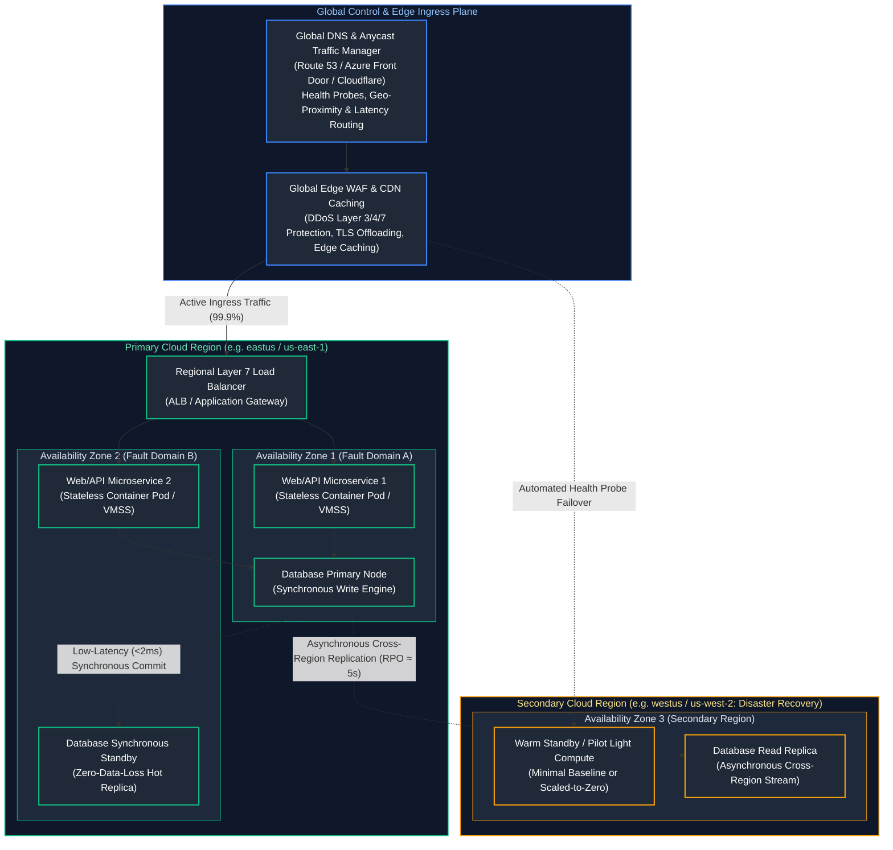
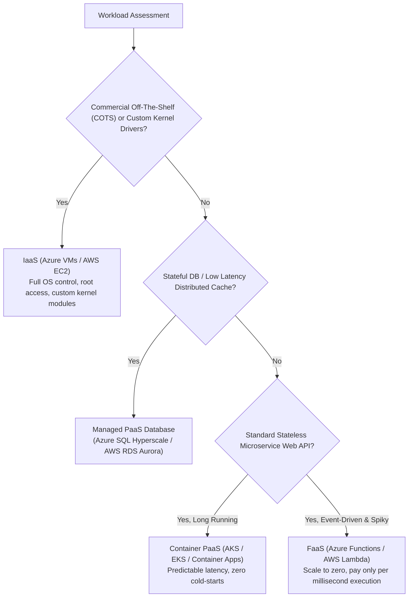
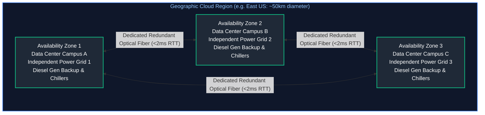
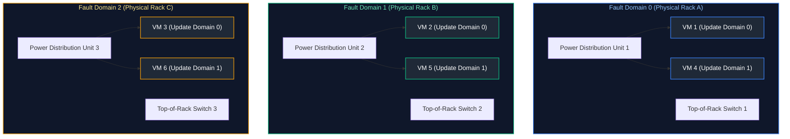
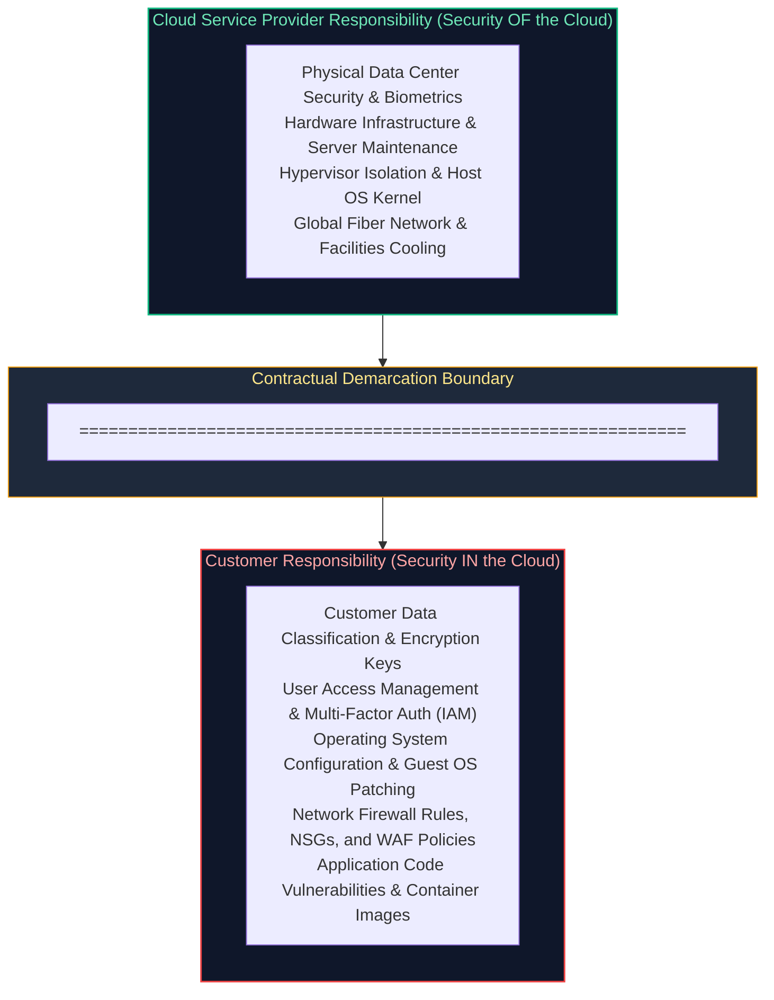
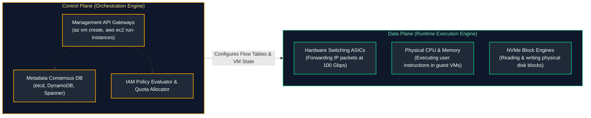
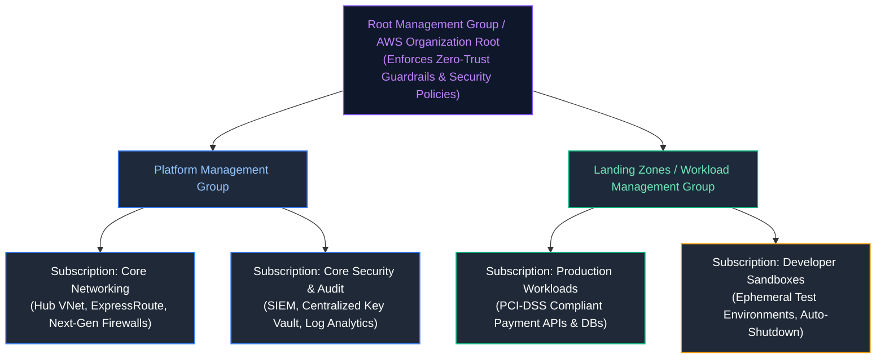
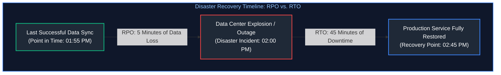

# 03. Cloud Fundamentals & Architecture

A comprehensive, production-grade guide to cloud computing service models (IaaS, PaaS, SaaS, FaaS), physical topologies, availability zones, the cloud shared responsibility model, control plane vs. data plane boundaries, multi-region high availability, disaster recovery strategies, Well-Architected Framework principles, and enterprise landing zone governance tailored for Cloud Architects, Systems Engineers, and Senior SREs.

---

## Architectural Overview: Multi-Tier Resilient Cloud Topology

In modern cloud engineering, true resilience is achieved not by purchasing flawless hardware, but by designing software systems that assume hardware, data center racks, and entire geographic regions will inevitably fail. Cloud architectures achieve high availability (HA) and disaster recovery (DR) by layering distributed services across physical failure boundaries:



---

## Table of Contents
1. [The Evolution of Computing: Why the Cloud Won](#1-the-evolution-of-computing-why-the-cloud-won)
   - [1.1 On-Premises Realities vs. The 5 Essential NIST Cloud Characteristics](#11-on-premises-realities-vs-the-5-essential-nist-cloud-characteristics)
   - [1.2 Financial Paradigms: CapEx vs. OpEx & Cloud Economics](#12-financial-paradigms-capex-vs-opex--cloud-economics)
2. [Cloud Computing Delivery Models: IaaS, PaaS, SaaS, and FaaS](#2-cloud-computing-delivery-models-iaas-paas-saas-and-faas)
   - [2.1 The Abstraction Spectrum: The Pizza Analogy](#21-the-abstraction-spectrum-the-pizza-analogy)
   - [2.2 Deep Architectural Trade-Offs & Workload Classification](#22-deep-architectural-trade-offs--workload-classification)
3. [Physical Topologies: Regions, Availability Zones, and Fault Domains](#3-physical-topologies-regions-availability-zones-and-fault-domains)
   - [3.1 Physical Anatomy of a Cloud Region & Dark Fiber Ring](#31-physical-anatomy-of-a-cloud-region--dark-fiber-ring)
   - [3.2 Availability Zones (AZs) and Logical-to-Physical Zone Randomization](#32-availability-zones-azs-and-logical-to-physical-zone-randomization)
   - [3.3 Fault Domains (FD) vs. Update Domains (UD)](#33-fault-domains-fd-vs-update-domains-ud)
4. [The Cloud Shared Responsibility Model](#4-the-cloud-shared-responsibility-model)
   - [4.1 Security OF the Cloud vs. Security IN the Cloud](#41-security-of-the-cloud-vs-security-in-the-cloud)
   - [4.2 The Immutable Data & Identity Rule](#42-the-immutable-data--identity-rule)
5. [Control Plane vs. Data Plane Failure Isolation](#5-control-plane-vs-data-plane-failure-isolation)
   - [5.1 Blast Radius Engineering & Structural Differences](#51-blast-radius-engineering--structural-differences)
   - [5.2 The Static Stability Principle (Surviving Control Plane Meltdowns)](#52-the-static-stability-principle-surviving-control-plane-meltdowns)
6. [Enterprise Resource Governance, Quotas, and API Throttling](#6-enterprise-resource-governance-quotas-and-api-throttling)
   - [6.1 Hierarchical Governance & Landing Zones](#61-hierarchical-governance--landing-zones)
   - [6.2 API Rate Limiting: Token Bucket Algorithms & Soft vs. Hard Quotas](#62-api-rate-limiting-token-bucket-algorithms--soft-vs-hard-quotas)
7. [High Availability (HA) vs. Disaster Recovery (DR)](#7-high-availability-ha-vs-disaster-recovery-dr)
   - [7.1 Recovery Time Objective (RTO) vs. Recovery Point Objective (RPO)](#71-recovery-time-objective-rto-vs-recovery-point-objective-rpo)
   - [7.2 The 4 Canonical DR Strategies: Cold Backup to Multi-Region Active-Active](#72-the-4-canonical-dr-strategies-cold-backup-to-multi-region-active-active)
8. [The Well-Architected Framework: The 6 Pillars](#8-the-well-architected-framework-the-6-pillars)
   - [8.1 Deep Dive into the Six Engineering Pillars](#81-deep-dive-into-the-six-engineering-pillars)
   - [8.2 Architectural Trade-Off Analysis (CAP & PACELC)](#82-architectural-trade-off-analysis-cap--pacelc)
9. [Cloud Migration Strategies: The 6 Rs](#9-cloud-migration-strategies-the-6-rs)
   - [9.1 Rehost, Replatform, Refactor, Repurchase, Retain, Retire](#91-rehost-replatform-refactor-repurchase-retain-retire)
   - [9.2 Automated Multi-Region Failover Controller in Python](#92-automated-multi-region-failover-controller-in-python)
10. [Senior SRE Architectural Failure Scenarios & Runbooks](#10-senior-sre-architectural-failure-scenarios--runbooks)
11. [Summary Comparison & Engineering Reference Matrix](#11-summary-comparison-engineering-reference-matrix)
12. [References & Further Reading](#12-references-further-reading)

---

# 1. The Evolution of Computing: Why the Cloud Won

### 1.1 On-Premises Realities vs. The 5 Essential NIST Cloud Characteristics

In traditional on-premises enterprise environments, deploying a new application required months of manual effort:
- Sizing hardware 3–5 years in advance based on hypothetical growth projections.
- Submitting hardware procurement purchase orders with 12–24 week manufacturing and shipping lead times.
- Physical data center logistics: reserving rack space, power distribution units (PDUs), cooling capacity, and cabling top-of-rack (TOR) fiber switches.
- Installing hypervisors, provisioning SAN storage LUNs, and configuring physical firewall rules.

According to the National Institute of Standards and Technology (NIST SP 800-145), true **Cloud Computing** is defined by five mandatory characteristics:

| NIST Cloud Characteristic | Formal Definition | Production Implementation in AWS / Azure | Contrast with Legacy On-Premises IT |
| :--- | :--- | :--- | :--- |
| **1. On-Demand Self-Service** | Consumers provision compute, storage, and networking unilaterally via API/portal without human intervention. | Terraform `azurerm_linux_virtual_machine` provisions and boots an enterprise VM in 45 seconds. | Months of hardware procurement purchase orders, vendor bidding, and manual data center racking. |
| **2. Broad Network Access** | Capabilities available over the network and accessed through standard heterogeneous client platforms. | HTTPS REST APIs, Azure CLI, AWS SDKs, web management consoles over public/private networks. | VPN-only access to proprietary terminal consoles or on-site serial ports. |
| **3. Resource Pooling** | Provider's compute resources pooled to serve multiple consumers using a multi-tenant model with dynamic assignment. | Hypervisors (KVM, Nitro) slicing massive physical host nodes across thousands of tenant instances securely. | Rigid physical server silos where dedicated single-purpose servers run at 5% average CPU utilization. |
| **4. Rapid Elasticity** | Capabilities dynamically provisioned and released to scale outward and inward rapidly with demand. | Virtual Machine Scale Sets (VMSS) / AWS EC2 Auto Scaling groups adding 50 nodes during peak traffic. | Over-provisioning hardware 3 years in advance to survive Black Friday peak traffic, idle the rest of the year. |
| **5. Measured Service** | Resource usage monitored, controlled, and billed transparently based on actual granular consumption. | Per-second billing for compute execution; per-gigabyte-month billing for object storage. | Fixed capital expenditure (CapEx) depreciated over 5 years on corporate accounting ledgers. |

---

### 1.2 Financial Paradigms: CapEx vs. OpEx & Cloud Economics

| Financial Dimension | Capital Expenditure (CapEx) - On-Premises | Operational Expenditure (OpEx) - Cloud |
| :--- | :--- | :--- |
| **Accounting Model** | Fixed upfront asset purchase; depreciated over 3–5 years on balance sheet. | Ongoing operational expense deducted from revenue in current tax period. |
| **Capacity Sizing** | Provisioned for peak theoretical load (leading to 80% idle waste during normal operations). | Dynamically scaled to match real-time demand curve (elasticity). |
| **Maintenance Burden** | Replacement of failed hard drives, UPS batteries, and cooling chillers. | Borne entirely by the cloud provider under a defined Service Level Agreement (SLA). |
| **Financial Risk** | Sunk cost: if a project fails, millions spent on physical hardware cannot be refunded. | Fail-fast agility: if a project fails, tear down cloud resources with API calls; zero sunk capital. |

---

# 2. Cloud Computing Delivery Models: IaaS, PaaS, SaaS, and FaaS

### 2.1 The Abstraction Spectrum: The Pizza Analogy

The cloud delivery models differ in **where the boundary of customer responsibility lies**:

```mermaid
flowchart TD
    subgraph OnPrem ["Traditional On-Premises (You manage everything)"]
        OP["Hardware, Hypervisor, OS, Runtime, App, Data"]
    end

    subgraph IaaS ["Infrastructure as a Service (IaaS)"]
        IaaS_P["Provider: Physical Data Center, Cooling, Servers, Hypervisor"]
        IaaS_C["Customer: OS Installation, Kernel Tuning, Security Patches, App, Data"]
        IaaS_P -.-> IaaS_C
    end

    subgraph PaaS ["Platform as a Service (PaaS)"]
        PaaS_P["Provider: Hardware, Hypervisor, OS, Runtime, Auto-scaling"]
        PaaS_C["Customer: Application Code, Business Logic, DB Schemas, IAM"]
        PaaS_P -.-> PaaS_C
    end

    subgraph FaaS ["Function as a Service (FaaS / Serverless)"]
        FaaS_P["Provider: Everything above + Process Lifecycles, Concurrency Routing"]
        FaaS_C["Customer: Individual Function Handlers, Event Triggers, IAM Roles"]
        FaaS_P -.-> FaaS_C
    end

    subgraph SaaS ["Software as a Service (SaaS)"]
        SaaS_P["Provider: Entire Application Stack, Upgrades, Backups, High Availability"]
        SaaS_C["Customer: User Identity, Access Management, Data Ingestion"]
        SaaS_P -.-> SaaS_C
    end

    style OnPrem fill:#0f172a,stroke:#64748b,stroke-width:1.5px,color:#94a3b8
    style IaaS fill:#0f172a,stroke:#3b82f6,stroke-width:1.5px,color:#93c5fd
    style PaaS fill:#0f172a,stroke:#10b981,stroke-width:1.5px,color:#6ee7b7
    style FaaS fill:#0f172a,stroke:#f59e0b,stroke-width:1.5px,color:#fde68a
    style SaaS fill:#0f172a,stroke:#8b5cf6,stroke-width:1.5px,color:#c084fc
```



#### The Intuitive Analogy: Making Pizza
- **On-Premises (Made from scratch at home):** You grow the wheat, milk the cow, buy the oven, build the dining table, and wash the dishes.
- **IaaS (Store-bought frozen pizza cooked at home):** The grocery store provides the pizza base, cheese, and toppings. You provide the oven, electricity, baking sheet, and dining room.
- **PaaS (Pizza delivery):** The pizzeria prepares, cooks, and delivers the pizza to your door. You provide the dining table, paper plates, and beverages.
- **FaaS (Single pizza slice vending machine):** You push a button, the machine heats one slice of pizza on demand, charges you for that slice, and turns off.
- **SaaS (Dining in at a 5-star pizzeria):** You sit at a table, eat pizza, pay the bill, and leave. You have no idea what oven they use or who cleaned the kitchen.

---

### 2.2 Deep Architectural Trade-Offs & Workload Classification



---

# 3. Physical Topologies: Regions, Availability Zones, and Fault Domains

### 3.1 Physical Anatomy of a Cloud Region & Dark Fiber Ring

A **Cloud Region** is not a single building. It is a distinct geographical perimeter containing a cluster of independent data centers interconnected by a dedicated, private, low-latency (<2 milliseconds round-trip time) **dark fiber optical ring**:



- **Latency Budget:** The physical separation between AZs is strictly calibrated (typically 10 to 60 miles apart). They must be far enough apart that a single physical disaster (plane crash, tornado, flood, substation failure) cannot take out multiple AZs, yet close enough that synchronous database writes (`fsync` over fiber) complete within 1–2 milliseconds without impacting application throughput!

---

### 3.2 Availability Zones (AZs) and Logical-to-Physical Zone Randomization

#### The Cloud Provider Zone Randomization Rule
In AWS and Azure, **logical zone names are randomized across customer accounts**:
- Your AWS Account A’s `us-east-1a` might physically map to Data Center Building 3.
- Another company’s Account B’s `us-east-1a` might physically map to Data Center Building 7!
- *Why?* If all cloud customers deployed their default resources into `us-east-1a`, that physical building would exhaust cooling and rack capacity while Zone C sat idle.
- *How to coordinate co-location across accounts:* Cloud providers expose **Physical Zone IDs** (e.g., `use1-az1`, `use1-az2`). When building cross-account low-latency microservices, verify that both accounts reference the identical Physical Zone ID.

---

### 3.3 Fault Domains (FD) vs. Update Domains (UD)

Inside a single Availability Zone, servers are further isolated across physical racks:



- **Fault Domain (FD):** Represents a physical server rack sharing a single point of failure: a common power distribution unit (PDU) and a Top-of-Rack (TOR) network switch. Deploying instances across 3 Fault Domains guarantees that a blown power supply or burnt network switch only takes down one-third of your cluster.
- **Update Domain (UD):** Logical group of hypervisor hosts that can be rebooted simultaneously during cloud platform software maintenance and kernel upgrades. The cloud platform ensures only one Update Domain is patched at any given time.

---

# 4. The Cloud Shared Responsibility Model

### 4.1 Security OF the Cloud vs. Security IN the Cloud

One of the most dangerous misconceptions in cloud engineering is assuming the cloud provider secures everything automatically.



---

### 4.2 The Immutable Data & Identity Rule

> [!CAUTION]
> **The Immutable Invariant:** Regardless of whether you deploy on bare metal IaaS, serverless FaaS, or turnkey SaaS (Salesforce, Microsoft 365, Datadog), **the customer is ALWAYS 100% responsible for:**
> 1. **Data Governance & Classification:** Ensuring sensitive PII/PHI is encrypted at rest and in transit.
> 2. **Identity & Access Management (IAM):** Enforcing least-privilege RBAC, rotating credentials, and mandating Multi-Factor Authentication (MFA).
> 3. **Endpoint Protection:** Securing API keys, SSH keys, and client devices connecting to the cloud.

If an engineer accidentally checks an AWS Root API key or Azure Subscription Secret into a public GitHub repository and an attacker runs ransomware encrypting all storage accounts, **the cloud provider is not at fault**. That failure resides entirely within the customer's domain of responsibility.

---

# 5. Control Plane vs. Data Plane Failure Isolation

### 5.1 Blast Radius Engineering & Structural Differences

Cloud systems are cleanly split into two distinct operational layers:



| Dimension | Control Plane | Data Plane |
| :--- | :--- | :--- |
| **Primary Mission** | Administrative operations, resource orchestration | Runtime payload execution and packet transit |
| **Complexity & Logic**| Highly complex state machines, transactional ACID DBs | Simple, ultra-fast, stateless packet forwarding |
| **Target Availability**| $99.9\%$ (Can tolerate transient maintenance windows) | $99.999\%$ (Five nines: downtime measured in seconds/year) |
| **Outage Impact** | Cannot create new VMs, delete disks, or modify routes | Applications cannot serve customer traffic |

---

### 5.2 The Static Stability Principle (Surviving Control Plane Meltdowns)

**Static Stability** is a core distributed systems principle practiced by Amazon and Microsoft:
> *A system is statically stable if it can continue to operate normally during a complete control plane outage without needing to execute control plane mutations.*

#### The Autoscaling Anti-Pattern:
- **Scenario:** A cloud provider suffers a major regional control plane outage. The VM creation API (`RunInstances`) returns `HTTP 500`.
- **Fragile Design:** Your cluster is scaled to a bare minimum. A traffic spike arrives. The Autoscaler attempts to call `RunInstances` to provision 20 new VMs. The API calls fail. The existing instances become overwhelmed and crash. **Result: Total outage.**
- **Statically Stable Design:** You pre-provision sufficient capacity across 3 Availability Zones to withstand peak traffic plus the loss of an entire AZ. Local circuit breakers, static DNS configurations, and read-through caches keep running smoothly without needing a single API call to the cloud management plane.

---

# 6. Enterprise Resource Governance, Quotas, and API Throttling

### 6.1 Hierarchical Governance & Landing Zones

Enterprise cloud architectures organize resources into a strict inheritance tree to enforce compliance policies, budget allocations, and security boundaries:



---

### 6.2 API Rate Limiting: Token Bucket Algorithms & Soft vs. Hard Quotas

Cloud provider APIs protect their internal multi-tenant infrastructure using **Token Bucket Rate Limiting**:
- When you execute CLI commands (`az`, `aws`) or Terraform deployments rapidly, you consume tokens from your bucket.
- Once depleted, the cloud API returns **`HTTP 429 Too Many Requests`**.
- Cloud SDKs handle this via **Exponential Backoff with Full Jitter**:
  $$\text{Sleep Time} = \text{random}(0, \min(\text{MaxSleep}, \text{BaseSleep} \times 2^{\text{attempt}}))$$
- **Soft Limits:** Artificial capacity caps (e.g. 50 vCPUs per subscription) designed to protect customers from accidental spend. Can be raised via support request.
- **Hard Limits:** Fundamental physical or architectural ceilings (e.g., maximum 65,536 IP addresses per Virtual Network, 500 route tables per VPC) that can never be exceeded.

---

# 7. High Availability (HA) vs. Disaster Recovery (DR)

### 7.1 Recovery Time Objective (RTO) vs. Recovery Point Objective (RPO)

Every disaster recovery plan is governed by two mathematical parameters negotiated with business stakeholders:



- **Recovery Point Objective (RPO):** The maximum tolerable volume of data loss expressed in time. (e.g., "We can tolerate losing at most 5 minutes of customer transactions").
- **Recovery Time Objective (RTO):** The maximum tolerable duration of system downtime before service must be fully operational. (e.g., "The payment gateway must be back online within 30 minutes of a regional failure").

---

### 7.2 The 4 Canonical DR Strategies: Cold Backup to Multi-Region Active-Active

```mermaid
flowchart LR
    subgraph Spectrum ["The Disaster Recovery Cost vs. Recovery Speed Spectrum"]
        direction LR
        S1["1. Backup & Restore<br/>(Cold Backups in Cloud Storage)<br/>RTO: Hours to Days<br/>RPO: Hours<br/>Cost: $"]
        --> S2["2. Pilot Light<br/>(Core DB Sync, Compute Off)<br/>RTO: Tens of Minutes<br/>RPO: Minutes<br/>Cost: $$"]
        --> S3["3. Warm Standby<br/>(Scaled-Down Compute Running 24/7)<br/>RTO: Minutes<br/>RPO: Seconds<br/>Cost: $$$"]
        --> S4["4. Multi-Region Active-Active<br/>(Global Traffic Mirroring & Multi-Master DB)<br/>RTO: &asymp; 0 Seconds<br/>RPO: &asymp; 0 Seconds<br/>Cost: $$$$$"]
    end

    style Spectrum fill:#0f172a,stroke:#3b82f6,stroke-width:1.5px,color:#93c5fd
    style S1 fill:#1f2937,stroke:#3b82f6,stroke-width:1.5px,color:#fff
    style S2 fill:#1f2937,stroke:#06b6d4,stroke-width:1.5px,color:#fff
    style S3 fill:#1f2937,stroke:#f59e0b,stroke-width:1.5px,color:#fff
    style S4 fill:#1f2937,stroke:#10b981,stroke-width:1.5px,color:#fff
```

1. **Backup and Restore (Cold DR):** Regular backups stored in secondary region object storage (S3 Glacier / Azure GRS). In a disaster, infrastructure is rebuilt from scratch via Terraform. Lowest cost; highest RTO/RPO.
2. **Pilot Light:** The database is continuously replicated asynchronously to the secondary region. Core network VPCs are pre-provisioned, but compute clusters (VMs, Kubernetes worker nodes) are kept turned off. Upon failure, compute is scaled up via automated scripts.
3. **Warm Standby:** A miniature version of the entire production stack runs 24/7 in the secondary region. Upon primary failure, global load balancers redirect traffic while the secondary environment scales out to handle 100% capacity.
4. **Multi-Region Active-Active:** Both regions actively serve user traffic simultaneously. Requires a globally distributed multi-master database (e.g. Azure Cosmos DB, Google Cloud Spanner, AWS DynamoDB Global Tables). Zero downtime, but highest architectural complexity and potential for split-brain data conflicts.

---

# 8. The Well-Architected Framework: The 6 Pillars

### 8.1 Deep Dive into the Six Engineering Pillars

Both Microsoft Azure and AWS structure production system design around six core engineering pillars:

| Well-Architected Framework Pillar | Foundational Architectural Principle | Core Production Implementation Mechanisms | Primary Operational Failure Mode If Ignored |
| :--- | :--- | :--- | :--- |
| **1. Operational Excellence** | Run and monitor systems to deliver business value and continually improve processes. | Infrastructure as Code (Terraform), Automated CI/CD Canary Deployments, Observability (OpenTelemetry), Blameless Postmortems. | "Snowflake" manual infrastructure drifts; untracked production changes cause recurring unresolvable outages. |
| **2. Security** | Protect information, assets, and workloads while delivering business value through risk assessment. | Zero-Trust network micro-segmentation, Principle of Least Privilege (IAM), Envelope Encryption (KMS/Key Vault), Secrets Rotation. | Hardcoded credentials in source code leak customer database data; lateral privilege escalation. |
| **3. Reliability** | Ability of a workload to perform its intended function correctly and consistently when expected. | Multi-AZ redundancy, Self-Healing auto-restart controllers, Circuit Breakers, Chaos Engineering, Automated RPO/RTO Failover. | Single point of failure in an availability zone crashes the entire global business platform. |
| **4. Performance Efficiency** | Use computing resources efficiently to meet system requirements and maintain that efficiency as demand changes. | Selecting right-sized instance families (Graviton ARM, Memory-Optimized), In-Memory Distributed Caching (Redis), CDN Edge Offloading. | Latency spikes ($p99 > 5	ext{s}$) under traffic surges; database CPU saturates handling static read requests. |
| **5. Cost Optimization** | Run systems to deliver maximum business value at the lowest price point. | Eliminating unattached EBS/Managed Disks, 1-3 Year Reserved Instances / Savings Plans, Auto-Scaling workloads to zero overnight. | Cloud bill spirals out of control; runaway developer test clusters consume hundreds of thousands of dollars. |
| **6. Sustainability** | Minimize the environmental impacts of running cloud workloads. | Maximizing hardware utilization rates, consolidating underutilized workloads, scheduling batch jobs in low-carbon cloud regions. | High energy and carbon waste running idle compute instances continuously. |

---

### 8.2 Architectural Trade-Off Analysis (CAP & PACELC)

Systems architecture is the science of trade-offs:
- **CAP Theorem:** In the event of a network partition ($P$), a distributed system must choose between **Consistency ($C$)** (returning the most recent write or an error) or **Availability ($A$)** (returning a non-error response that may contain stale data).
- **PACELC Theorem:** If there is a Partition ($P$), trade off Availability ($A$) vs Consistency ($C$); **Else ($E$)**, trade off Latency ($L$) vs Consistency ($C$).
  - Systems like Azure Cosmos DB allow engineers to select across 5 distinct consistency levels (Strong, Bounded Staleness, Session, Consistent Prefix, Eventual) to finely balance latency against data consistency.

---

# 9. Cloud Migration Strategies: The 6 Rs

### 9.1 Rehost, Replatform, Refactor, Repurchase, Retain, Retire

When enterprise IT portfolios transition from on-premises datacenters to the cloud, every application is assigned to one of the **6 Rs**:

| Migration Strategy | Industry Nickname | Description | Typical Cloud Destination |
| :--- | :--- | :--- | :--- |
| **Rehost** | Lift-and-Shift | Move VMs directly to cloud without code changes. | Azure VMs / AWS EC2 |
| **Replatform** | Lift-Tinker-and-Shift | Move to managed cloud services without modifying core business code. | Azure App Service, AWS RDS |
| **Refactor** | Re-Architect | Rewrite application using cloud-native microservices, containers, and serverless. | AKS, EKS, Azure Functions |
| **Repurchase** | Drop-and-Shop | Discard legacy in-house software and purchase commercial SaaS. | Workday, Salesforce |
| **Retain** | Do Nothing | Keep on-premises due to compliance, physical hardware locks, or recent investment. | On-Premises Hyper-V / vSphere |
| **Retire** | Decommission | Identify and shut down obsolete systems no longer providing business value. | Archived / Powered Off |

---

### 9.2 Automated Multi-Region Failover Controller in Python

The production Python script below continuously probes primary and secondary regional endpoints, tracks consecutive failures against error thresholds, and initiates automated DNS traffic failover:

```python
#!/usr/bin/env python3
"""
Enterprise Cloud Multi-Region Failover Controller.
Monitors primary and secondary cloud endpoints with synthetic health checks
and initiates automated routing failover upon sustained primary degradation.
Zero external dependencies.
"""

from dataclasses import dataclass
from datetime import datetime, timezone
import json
import logging
import sys
import time
from typing import Dict, Optional
import urllib.error
import urllib.request

logging.basicConfig(
    level=logging.INFO,
    format='{"time":"%(asctime)s","logger":"%(name)s","level":"%(levelname)s","message":"%(message)s"}',
    handlers=[logging.StreamHandler(sys.stdout)],
)
logger = logging.getLogger("failover_controller")


@dataclass
class RegionalTarget:
    name: str
    health_url: str
    is_healthy: bool = True
    consecutive_failures: int = 0
    last_latency_ms: float = 0.0


class MultiRegionHealthAuditor:
    def __init__(
        self,
        primary: RegionalTarget,
        secondary: RegionalTarget,
        failure_threshold: int = 3,
        timeout_sec: float = 2.0,
    ):
        self.primary = primary
        self.secondary = secondary
        self.failure_threshold = failure_threshold
        self.timeout = timeout_sec
        self.active_routing_target = primary.name

    def execute_probe(self, target: RegionalTarget) -> bool:
        """Executes HTTP synthetic probe and records sub-millisecond response latency."""
        start_time = time.perf_counter()
        req = urllib.request.Request(
            target.health_url,
            headers={"User-Agent": "MultiRegionAuditor/2.0", "Accept": "application/json"},
        )
        try:
            with urllib.request.urlopen(req, timeout=self.timeout) as resp:
                elapsed_ms = (time.perf_counter() - start_time) * 1000.0
                target.last_latency_ms = round(elapsed_ms, 2)
                if resp.status == 200:
                    target.is_healthy = True
                    target.consecutive_failures = 0
                    return True
                target.consecutive_failures += 1
                target.is_healthy = False
                return False
        except (urllib.error.URLError, urllib.error.HTTPError, TimeoutError) as err:
            elapsed_ms = (time.perf_counter() - start_time) * 1000.0
            target.last_latency_ms = round(elapsed_ms, 2)
            target.consecutive_failures += 1
            target.is_healthy = False
            logger.warning("Probe failed for %s (%s): %s", target.name, target.health_url, err)
            return False

    def evaluate_traffic_routing(self) -> Dict:
        """Evaluates health across both regions and computes routing decisions."""
        self.execute_probe(self.primary)
        self.execute_probe(self.secondary)

        action = "MAINTAIN_CURRENT_ROUTING"

        if self.active_routing_target == self.primary.name:
            if self.primary.consecutive_failures >= self.failure_threshold:
                if self.secondary.is_healthy:
                    logger.critical(
                        "PRIMARY FAILURE THRESHOLD EXCEEDED (%d/%d). EXECUTING DR FAILOVER TO %s",
                        self.primary.consecutive_failures, self.failure_threshold, self.secondary.name
                    )
                    self.active_routing_target = self.secondary.name
                    action = "FAILOVER_TO_SECONDARY_EXECUTED"
                else:
                    logger.critical("DUAL REGION DISASTER: Both Primary and Secondary regions are offline!")
                    action = "GLOBAL_BLACKOUT_ALERT"
        else:
            # Secondary is active; check for stable failback conditions
            if self.primary.is_healthy and self.primary.consecutive_failures == 0:
                logger.info("Primary region stabilized. Eligible for manual/automated failback.")

        return {
            "timestamp": datetime.now(timezone.utc).isoformat(),
            "action": action,
            "active_traffic_target": self.active_routing_target,
            "primary": {
                "name": self.primary.name,
                "healthy": self.primary.is_healthy,
                "consecutive_failures": self.primary.consecutive_failures,
                "latency_ms": self.primary.last_latency_ms,
            },
            "secondary": {
                "name": self.secondary.name,
                "healthy": self.secondary.is_healthy,
                "consecutive_failures": self.secondary.consecutive_failures,
                "latency_ms": self.secondary.last_latency_ms,
            },
        }


if __name__ == "__main__":
    primary_region = RegionalTarget(
        name="eastus-primary", health_url="https://httpbin.org/status/200"
    )
    secondary_region = RegionalTarget(
        name="westus-secondary", health_url="https://httpbin.org/status/200"
    )

    auditor = MultiRegionHealthAuditor(
        primary=primary_region, secondary=secondary_region, failure_threshold=3, timeout_sec=2.0
    )
    report = auditor.evaluate_traffic_routing()
    print(json.dumps(report, indent=2))
```

---

# 10. Senior SRE Architectural Failure Scenarios & Runbooks

### Incident 1: Cross-Region Split-Brain Data Inconsistency
- **Symptom:** During a network partition between US-East and US-West, both regions believe the other has died and independently accept writes.
- **Root Cause:** Quorum failure in consensus protocols or bi-directional active-active write collision.
- **Runbook:**
  1. Immediately isolate one region at the global DNS/Edge layer (force all ingress to US-East).
  2. Demote US-West database to read-only mode.
  3. Run deterministic reconciliation scripts using transaction timestamps or Last-Write-Wins (LWW) resolution.
  4. Perform data audit on primary records created during the partition window before restoring traffic.

### Incident 2: Regional Control Plane Blackout
- **Symptom:** Cloud provider portal and CLI return 503 Service Unavailable. Cannot scale VMs or deploy pods.
- **Runbook:**
  1. **Do not execute `terraform apply` or delete existing pods!** (Destructive operations during a control plane outage can permanently destroy running data plane assets).
  2. Rely on **Static Stability**: Verify existing virtual machines and routing tables continue forwarding data packets.
  3. Shed non-critical background batch processing to preserve existing compute headroom.

---

# 11. Summary Comparison & Engineering Reference Matrix

| Cloud Architecture Dimension | Single Zone | Multi-AZ (High Availability) | Multi-Region Active-Passive (DR) | Multi-Region Active-Active |
| :--- | :--- | :--- | :--- | :--- |
| **Failure Protection** | Single VM / disk crash | Datacenter fire, power grid failure | Total regional blackout / natural disaster | Regional catastrophic loss with zero downtime |
| **SLA Availability** | $99.9\%$ (8.76 hrs down/yr) | $99.99\%$ (52.6 mins down/yr) | $99.95\%$ overall recovery SLA | $99.999\%$ (5.26 mins down/yr) |
| **RTO Capability** | Hours (Rebuild VM) | Seconds (Automated LB failover) | Minutes to Hours (DNS propagation) | $\approx 0$ Seconds (Immediate) |
| **RPO Capability** | Hours (Last snapshot) | $0$ (Synchronous commit) | Seconds to Minutes (Async replication) | $\approx 0$ Seconds (Distributed consensus) |
| **Complexity & Cost** | Baseline ($1\times$) | $+20\text{--}40\%$ | $+40\text{--}70\%$ | $+150\text{--}300\%$ |

---

# 12. References & Further Reading

- [Microsoft Azure Well-Architected Framework](https://learn.microsoft.com/en-us/azure/well-architected/) — Architecture design principles, reliability, and security checklists.
- [AWS Well-Architected Framework](https://aws.amazon.com/architecture/well-architected/) — Operational excellence, reliability, and security whitepapers.
- [NIST Special Publication 800-145](https://csrc.nist.gov/publications/detail/sp/800-145/final) — The Definitive NIST Definition of Cloud Computing.
- [Amazon Builders' Library: Static Stability Using Availability Zones](https://aws.amazon.com/builders-library/static-stability-using-availability-zones/) — Foundational distributed systems resiliency patterns.
- [Google Cloud Architecture Framework](https://cloud.google.com/architecture/framework) — System design best practices for planetary-scale applications.
