# 04. Cloud Infrastructure Concepts: Azure Architecture & AWS Counterparts

A comprehensive, concept-first engineering guide to core cloud infrastructure paradigms, systems internals, distributed runtimes, and governance frameworks. This guide deconstructs cloud computing into foundational architectural concepts—explaining the underlying systems principles, using **Microsoft Azure** as the primary reference implementation, and concluding each concept with its direct **Amazon Web Services (AWS)** equivalent counterpart.

---

## Architectural Overview: Conceptual Cloud Infrastructure Stack

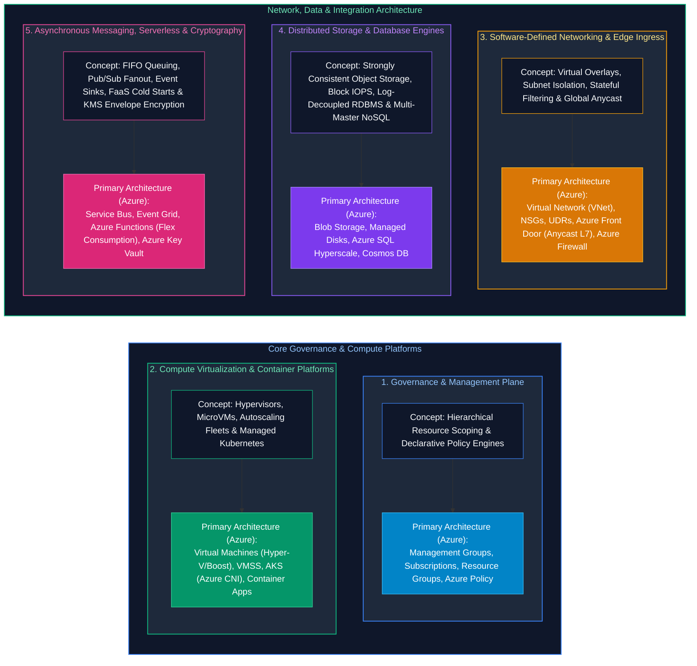

| Infrastructure Layer | Architectural Concept & System Invariant | Primary Architecture (Azure) | Equivalent AWS Counterpart |
| :--- | :--- | :--- | :--- |
| **1. Governance & Management Plane** | Hierarchical resource scoping, inherited RBAC boundaries, and declarative policy guardrails. | Management Groups, Subscriptions, Resource Groups, Azure Policy | AWS Organizations, Organizational Units (OUs), AWS Accounts, Service Control Policies (SCPs) |
| **2. Virtualization & Containers** | Hypervisors, MicroVM isolation, autoscaling VM fleets, and managed Kubernetes orchestrators. | Virtual Machines (Boost), VMSS Flexible, AKS (Azure CNI), Container Apps (ACA) | Amazon EC2 (Nitro), EC2 Auto Scaling Groups (ASG), Amazon EKS, ECS on Fargate |
| **3. Networking & Perimeter** | Software-defined virtual networks, multi-AZ overlays, stateful packet filtering, and global Anycast edge routing. | Virtual Network (VNet), Network Security Groups (NSGs), Route Tables (UDRs), Azure Front Door, Azure Firewall | Amazon Virtual Private Cloud (VPC), Security Groups & Network ACLs, Route Tables, CloudFront + Global Accelerator, AWS Network Firewall |
| **4. Storage & Distributed Databases** | Strongly consistent object stores, low-latency block volumes, log-decoupled relational RDBMS, and multi-model distributed NoSQL. | Azure Blob Storage / ADLS Gen2, Managed Disks, Azure SQL Hyperscale, Cosmos DB | Amazon S3, Amazon EBS, Amazon Aurora (6-way replicated storage), DynamoDB (Global Tables) |
| **5. Messaging, FaaS & Cryptography** | Strict FIFO queuing, pub/sub event filtering, serverless function invocation, and hardware-backed KMS envelope encryption. | Azure Service Bus, Event Grid, Azure Functions, Azure Key Vault (Managed HSM) | Amazon SQS & SNS, EventBridge, AWS Lambda (Firecracker MicroVMs), AWS KMS & Secrets Manager |

---

## Enterprise Cloud Architecture: Modular Systems Topology

To ensure the architecture is clean and easy to understand at a glance, all architectural diagrams below focus **exclusively on Microsoft Azure** as the primary reference implementation. Directly beneath each diagram, a dedicated comparison table maps each component to its exact **AWS Equivalent Counterpart** and explains the core systems invariant.

---

### The 30,000-Foot Macro Topology (Understandable in 5 Seconds)

From a Cloud Infrastructure Engineer's perspective, all traffic and data flow through four sequential core zones, supported by three cross-cutting operational planes:

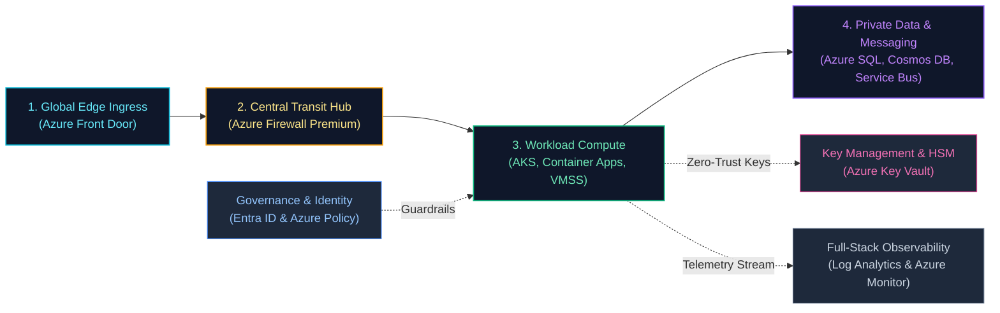

---

### Chunk 1: Traffic Ingress & Perimeter Security (Edge to Hub Transit)

This chunk governs how public client requests and private on-premises corporate traffic securely enter the cloud network before reaching any application workload.

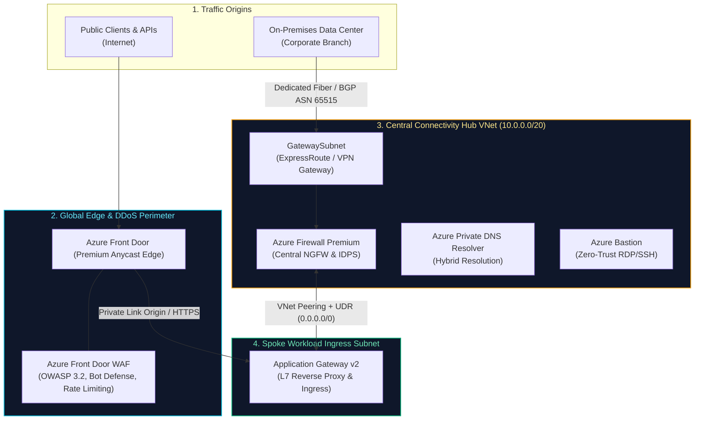

| Ingress & Perimeter Capability | Primary Architecture (Azure) | AWS Equivalent Counterpart | Cloud Engineering Invariant |
| :--- | :--- | :--- | :--- |
| **Global Anycast Ingress & CDN** | Azure Front Door (AFD Premium) | Amazon CloudFront + Global Accelerator | Edge SSL offloading terminates TCP 3-way handshakes at the edge PoP closest to the user. |
| **Layer 7 Edge WAF** | Azure Front Door WAF (OWASP 3.2) | AWS WAF Managed Rule Groups | Blocks malicious SQLi, XSS, and bot scrapers before traffic reaches cloud data centers. |
| **Dedicated Hybrid Circuit** | ExpressRoute (GatewaySubnet) | AWS Direct Connect (Direct Connect Gateway) | Private Layer 3 BGP peering bypassing the public internet with predictable sub-5ms latency. |
| **Central Inspection Firewall**| Azure Firewall Premium | AWS Network Firewall | Stateful Intrusion Detection/Prevention (IDPS), TLS inspection, and outbound FQDN filtering. |
| **Private Workload Ingress** | Application Gateway v2 | Application Load Balancer (ALB) | Regional L7 reverse proxy distributing traffic across internal availability-zone compute instances. |

---

### Chunk 2: Compute Platforms & Workload Orchestration (Application Execution)

This chunk illustrates how the private ingress layer mediates and routes requests into the four primary cloud compute execution platforms: Managed Kubernetes, Serverless Containers, Virtual Machine Fleets, and Serverless FaaS.

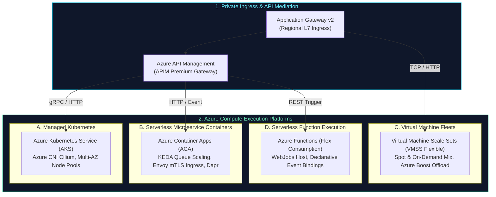

| Compute Architecture Dimension | Primary Architecture (Azure) | AWS Equivalent Counterpart | Cloud Engineering Invariant |
| :--- | :--- | :--- | :--- |
| **API Management & Policies** | Azure API Management (APIM) | Amazon API Gateway | Centralizes OAuth2 token validation, rate-limiting tokens, and API versioning schemas. |
| **Managed Kubernetes** | Azure Kubernetes Service (AKS) | Amazon Elastic Kubernetes Service (EKS) | SLA-backed managed control plane; worker nodes auto-scale across multi-AZ availability zones. |
| **Serverless Containers** | Azure Container Apps (ACA) | AWS ECS on Fargate / App Runner | Auto-scales to zero based on HTTP traffic or queue lengths without managing K8s cluster YAML. |
| **Virtual Machine Autoscaling**| VMSS Flexible Mode | EC2 Auto Scaling Groups (ASG) | Maintains target instance counts across AZ fault domains, mixing Spot and On-Demand instances. |
| **Event-Driven FaaS** | Azure Functions | AWS Lambda | Ephemeral event-triggered compute with automatic scaling, billed strictly per millisecond. |

---

### Chunk 3: Private Data, Storage & Messaging Fabrics (State & Event Integration)

This chunk illustrates the zero-public-IP communication model: how running compute instances connect to relational databases, globally distributed NoSQL, in-memory caches, object storage, and asynchronous event streams exclusively through private network endpoints.

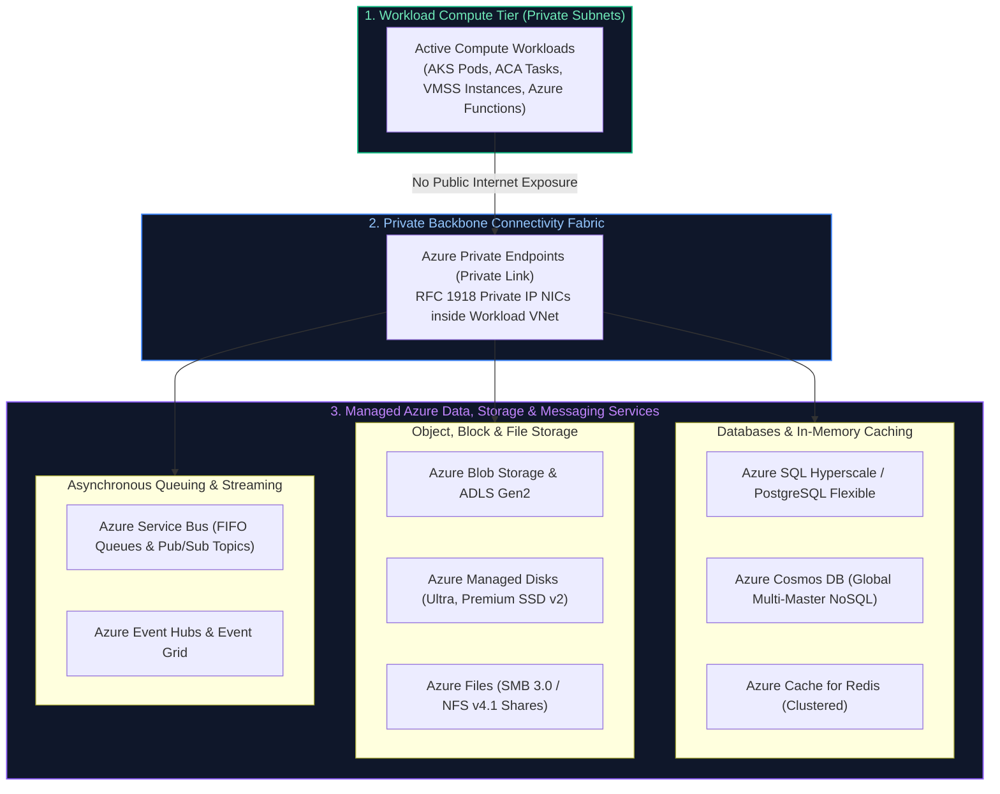

| Data & Messaging Capability | Primary Architecture (Azure) | AWS Equivalent Counterpart | Cloud Engineering Invariant |
| :--- | :--- | :--- | :--- |
| **Private Service Exposure** | Azure Private Link & Endpoints | AWS PrivateLink (VPC Endpoints) | Maps PaaS instances to private IP addresses; eliminates public DNS endpoints and internet egress. |
| **Decoupled Relational RDBMS** | Azure SQL Hyperscale | Amazon Aurora | Separates compute nodes from distributed storage engines; handles log commits with sub-ms latency. |
| **Distributed Multi-Model NoSQL**| Azure Cosmos DB | Amazon DynamoDB | Global active-active multi-master replication with formal consistency guarantees (e.g. Session). |
| **In-Memory Cache & Mutex** | Azure Cache for Redis | Amazon ElastiCache (Redis/Valkey) | Sub-millisecond reads/writes, cache-aside patterns, and distributed redlock mutex synchronization. |
| **Object Storage & Immutability**| Azure Blob Storage / ADLS Gen2 | Amazon S3 | Highly durable, strongly consistent object storage with WORM legal holds and hierarchical namespaces. |
| **Enterprise Message Bus** | Azure Service Bus | Amazon SQS (Queues) & SNS (Topics) | Temporal decoupling, strict FIFO message sessions, dead-letter sub-queues, and SQL topic filters. |

---

### Chunk 4: Platform Identity, Security & Cryptography (Zero-Trust Key Access)

This chunk demonstrates how workloads authenticate and acquire encryption keys and database secrets without ever storing static passwords, API tokens, or credentials in configuration files or code repositories.

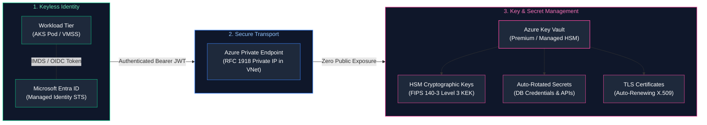

| Security & Identity Capability | Primary Architecture (Azure) | AWS Equivalent Counterpart | Cloud Engineering Invariant |
| :--- | :--- | :--- | :--- |
| **Keyless Machine Identity** | Entra ID Managed Identities / Workload ID | AWS IAM Roles via IRSA / Instance Profiles | Eliminates long-lived API keys; issues short-lived (1-hour) tokens via local IMDS or OIDC tokens. |
| **Envelope Encryption (KEK/DEK)**| Azure Key Vault (Managed HSM) | AWS Key Management Service (AWS KMS) | Root keys never leave the physical HSM; data is encrypted locally using temporary Data Encryption Keys. |
| **Rotated Secret Storage** | Azure Key Vault Secrets | AWS Secrets Manager | Manages database credentials and API tokens with automated Lambda / Event Grid rotation triggers. |
| **Certificate Lifecycle** | Azure Key Vault Certificates | AWS Certificate Manager (ACM) | Automates issuance, validation, and auto-renewal of X.509 TLS certificates. |

---

### Chunk 5: Observability, Governance & Security Operations (Telemetry & SIEM)

This chunk illustrates the continuous feedback loop: how application telemetry, network flows, and control-plane audit logs stream into monitoring lakes, alerting engines, and automated security incident response platforms.

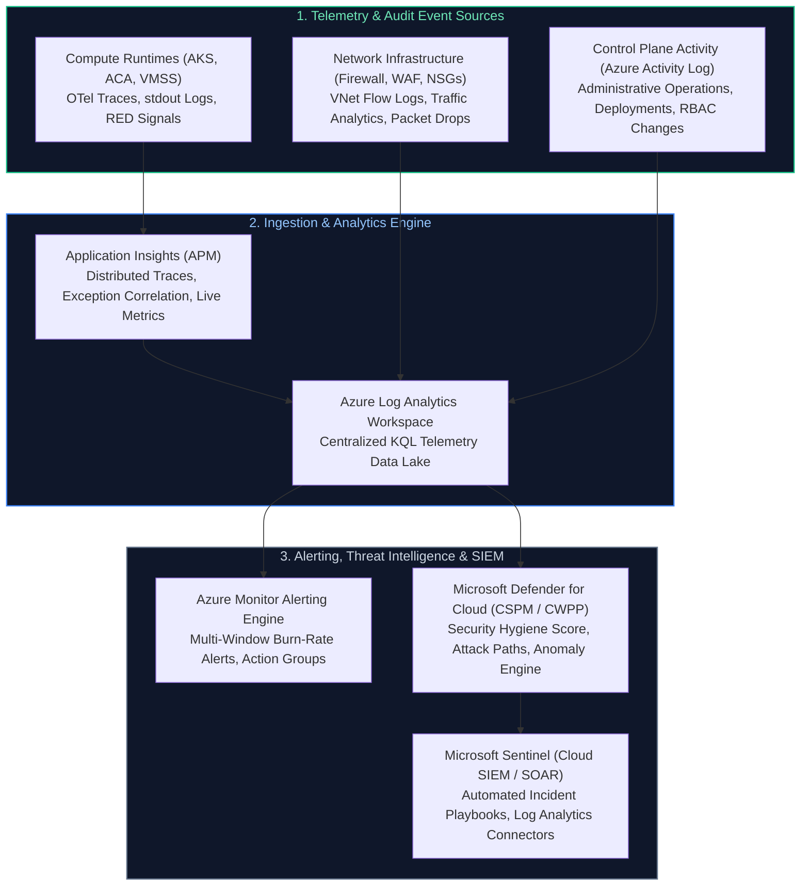

| Observability & Ops Capability | Primary Architecture (Azure) | AWS Equivalent Counterpart | Cloud Engineering Invariant |
| :--- | :--- | :--- | :--- |
| **Distributed APM Tracing** | Application Insights (W3C Trace Context) | AWS X-Ray / AWS Distro for OpenTelemetry | Traces asynchronous microservice calls across network boundaries with unique trace IDs. |
| **Centralized Log Analytics** | Azure Log Analytics (Kusto / KQL) | Amazon CloudWatch Logs / OpenSearch | High-throughput columnar indexing of structured JSON logs with sub-second query evaluation. |
| **SLO Multi-Window Alerting** | Azure Monitor Alert Rules | CloudWatch Metric Alarms & Composite Alarms | Alerts on fast and slow error-budget burn rates (e.g. 14.4x burn over 1h) to prevent alert fatigue. |
| **Cloud Security Posture (CSPM)**| Microsoft Defender for Cloud | Amazon GuardDuty + AWS Config | Continuous compliance scanning against CIS Benchmarks, SOC 2, and anomalous crypto-mining detections. |
| **Cloud SIEM & SOAR Response** | Microsoft Sentinel | AWS Security Hub + Amazon Detective | Correlates security alerts across identity, endpoints, and networks to trigger automated isolation playbooks. |

---

## Table of Contents
- [Enterprise Cloud Architecture: Modular Systems Topology](#enterprise-cloud-architecture-modular-systems-topology)
  - [The 30,000-Foot Macro Topology (Understandable in 5 Seconds)](#the-30000-foot-macro-topology-understandable-in-5-seconds)
  - [Chunk 1: Traffic Ingress & Perimeter Security (Edge to Hub Transit)](#chunk-1-traffic-ingress--perimeter-security-edge-to-hub-transit)
  - [Chunk 2: Compute Platforms & Workload Orchestration (Application Execution)](#chunk-2-compute-platforms--workload-orchestration-application-execution)
  - [Chunk 3: Private Data, Storage & Messaging Fabrics (State & Event Integration)](#chunk-3-private-data-storage--messaging-fabrics-state--event-integration)
  - [Chunk 4: Platform Identity, Security & Cryptography (Zero-Trust Key Access)](#chunk-4-platform-identity-security--cryptography-zero-trust-key-access)
  - [Chunk 5: Observability, Governance & Security Operations (Telemetry & SIEM)](#chunk-5-observability-governance--security-operations-telemetry--siem)
1. [Hierarchical Resource Governance & Policy Enforcement](#1-hierarchical-resource-governance--policy-enforcement)
   - [1.1 Conceptual Invariants: Scope Inheritance & Boundary Containment](#11-conceptual-invariants-scope-inheritance--boundary-containment)
   - [1.2 Primary Reference Architecture: Microsoft Azure](#12-primary-reference-architecture-microsoft-azure)
   - [1.3 Equivalent AWS Counterpart](#13-equivalent-aws-counterpart)
2. [Elastic Compute Virtualization & Autoscaling Fleets](#2-elastic-compute-virtualization--autoscaling-fleets)
   - [2.1 Conceptual Invariants: Hypervisor Offloading & Elastic Scaling Mechanics](#21-conceptual-invariants-hypervisor-offloading--elastic-scaling-mechanics)
   - [2.2 Primary Reference Architecture: Microsoft Azure (VMs & VMSS)](#22-primary-reference-architecture-microsoft-azure-vms--vmss)
   - [2.3 Equivalent AWS Counterpart](#23-equivalent-aws-counterpart)
3. [Managed Kubernetes & Container Orchestration](#3-managed-kubernetes--container-orchestration)
   - [3.1 Conceptual Invariants: Control Plane Abstraction & Pod Networking Topologies](#31-conceptual-invariants-control-plane-abstraction--pod-networking-topologies)
   - [3.2 Primary Reference Architecture: Microsoft Azure (AKS)](#32-primary-reference-architecture-microsoft-azure-aks)
   - [3.3 Equivalent AWS Counterpart](#33-equivalent-aws-counterpart)
4. [Serverless Microservices & Container App Platforms](#4-serverless-microservices--container-app-platforms)
   - [4.1 Conceptual Invariants: Zero-Scale Activation & Dapr/Envoy Sidecar Patterns](#41-conceptual-invariants-zero-scale-activation--daprenvoy-sidecar-patterns)
   - [4.2 Primary Reference Architecture: Microsoft Azure (Container Apps)](#42-primary-reference-architecture-microsoft-azure-container-apps)
   - [4.3 Equivalent AWS Counterpart](#43-equivalent-aws-counterpart)
5. [Software-Defined Virtual Networking & Perimeter Security](#5-software-defined-virtual-networking--perimeter-security)
   - [5.1 Conceptual Invariants: Overlay Subnet Isolation & 5-Tuple Packet Filtering](#51-conceptual-invariants-overlay-subnet-isolation--5-tuple-packet-filtering)
   - [5.2 Primary Reference Architecture: Microsoft Azure (VNet & NSGs)](#52-primary-reference-architecture-microsoft-azure-vnet--nsgs)
   - [5.3 Equivalent AWS Counterpart](#53-equivalent-aws-counterpart)
6. [Global Edge Ingress & Anycast Reverse Proxying](#6-global-edge-ingress--anycast-reverse-proxying)
   - [6.1 Conceptual Invariants: Anycast Routing, Edge SSL Termination & WAF Inspection](#61-conceptual-invariants-anycast-routing-edge-ssl-termination--waf-inspection)
   - [6.2 Primary Reference Architecture: Microsoft Azure (Azure Front Door)](#62-primary-reference-architecture-microsoft-azure-azure-front-door)
   - [6.3 Equivalent AWS Counterpart](#63-equivalent-aws-counterpart)
7. [Distributed Object Storage & Immutability](#7-distributed-object-storage--immutability)
   - [7.1 Conceptual Invariants: Flat Namespaces, Strong Consistency & WORM Policies](#71-conceptual-invariants-flat-namespaces-strong-consistency--worm-policies)
   - [7.2 Primary Reference Architecture: Microsoft Azure (Blob Storage)](#72-primary-reference-architecture-microsoft-azure-blob-storage)
   - [7.3 Equivalent AWS Counterpart](#73-equivalent-aws-counterpart)
8. [High-Performance Network-Attached Block Storage](#8-high-performance-network-attached-block-storage)
   - [8.1 Conceptual Invariants: Virtual Block Fabrics, IOPS vs. Throughput, and Persistence](#81-conceptual-invariants-virtual-block-fabrics-iops-vs-throughput-and-persistence)
   - [8.2 Primary Reference Architecture: Microsoft Azure (Managed Disks)](#82-primary-reference-architecture-microsoft-azure-managed-disks)
   - [8.3 Equivalent AWS Counterpart](#83-equivalent-aws-counterpart)
9. [Shared Network File Systems](#9-shared-network-file-systems)
   - [9.1 Conceptual Invariants: POSIX/SMB Distributed Locking & Concurrent Multi-Mounts](#91-conceptual-invariants-posixsmb-distributed-locking--concurrent-multi-mounts)
   - [9.2 Primary Reference Architecture: Microsoft Azure (Azure Files)](#92-primary-reference-architecture-microsoft-azure-azure-files)
   - [9.3 Equivalent AWS Counterpart](#93-equivalent-aws-counterpart)
10. [Cloud-Native Relational Databases & Decoupled Storage](#10-cloud-native-relational-databases--decoupled-storage)
    - [10.1 Conceptual Invariants: The Log Is the Database & Separation of Compute/Storage](#101-conceptual-invariants-the-log-is-the-database--separation-of-computestorage)
    - [10.2 Primary Reference Architecture: Microsoft Azure (Azure SQL Hyperscale)](#102-primary-reference-architecture-microsoft-azure-azure-sql-hyperscale)
    - [10.3 Equivalent AWS Counterpart](#103-equivalent-aws-counterpart)
11. [Globally Distributed NoSQL Systems & Consistency Models](#11-globally-distributed-nosql-systems--consistency-models)
    - [11.1 Conceptual Invariants: Horizontal Partitioning, PACELC Theorem & Multi-Master Writes](#111-conceptual-invariants-horizontal-partitioning-pacelc-theorem--multi-master-writes)
    - [11.2 Primary Reference Architecture: Microsoft Azure (Cosmos DB)](#112-primary-reference-architecture-microsoft-azure-cosmos-db)
    - [11.3 Equivalent AWS Counterpart](#113-equivalent-aws-counterpart)
12. [Serverless Function-as-a-Service (FaaS) Execution Runtimes](#12-serverless-function-as-a-service-faas-execution-runtimes)
    - [12.1 Conceptual Invariants: Ephemeral Workers, Cold Start Physics & Declarative Bindings](#121-conceptual-invariants-ephemeral-workers-cold-start-physics--declarative-bindings)
    - [12.2 Primary Reference Architecture: Microsoft Azure (Azure Functions)](#122-primary-reference-architecture-microsoft-azure-azure-functions)
    - [12.3 Equivalent AWS Counterpart](#123-equivalent-aws-counterpart)
13. [Enterprise API Management & Gateway Proxies](#13-enterprise-api-management--gateway-proxies)
    - [13.1 Conceptual Invariants: Policy Pipelines, Rate Limiting & Protocol Transformation](#131-conceptual-invariants-policy-pipelines-rate-limiting--protocol-transformation)
    - [13.2 Primary Reference Architecture: Microsoft Azure (API Management)](#132-primary-reference-architecture-microsoft-azure-api-management)
    - [13.3 Equivalent AWS Counterpart](#133-equivalent-aws-counterpart)
14. [Enterprise Asynchronous Messaging & Event Routing](#14-enterprise-asynchronous-messaging--event-routing)
    - [14.1 Conceptual Invariants: Message Sessions, SQL Topic Filters & Schema Brokers](#141-conceptual-invariants-message-sessions-sql-topic-filters--schema-brokers)
    - [14.2 Primary Reference Architecture: Microsoft Azure (Service Bus & Event Grid)](#142-primary-reference-architecture-microsoft-azure-service-bus--event-grid)
    - [14.3 Equivalent AWS Counterpart](#143-equivalent-aws-counterpart)
15. [Centralized Cryptographic Key Management & Envelope Encryption](#15-centralized-cryptographic-key-management--envelope-encryption)
    - [15.1 Conceptual Invariants: HSM FIPS Boundaries, KEK/DEK Mechanics & Rotation](#151-conceptual-invariants-hsm-fips-boundaries-kekdek-mechanics--rotation)
    - [15.2 Primary Reference Architecture: Microsoft Azure (Key Vault)](#152-primary-reference-architecture-microsoft-azure-key-vault)
    - [15.3 Equivalent AWS Counterpart](#153-equivalent-aws-counterpart)
16. [Production Automation: Multi-Cloud Telemetry & Normalization Engine](#16-production-automation-multi-cloud-telemetry--normalization-engine)
17. [Master Architectural Reference & Mapping Matrix](#17-master-architectural-reference--mapping-matrix)
18. [References & Further Reading](#18-references--further-reading)

---

# 1. Hierarchical Resource Governance & Policy Enforcement

### 1.1 Conceptual Invariants: Scope Inheritance & Boundary Containment
Enterprise cloud operations require recursive container trees to establish:
1. **Administrative Blast-Radius Boundaries:** Ensuring compromised credentials or accidental deletes in a non-production boundary cannot impact production workloads.
2. **Deterministic Inheritance:** Access control grants (RBAC) and policy constraints defined at higher scopes automatically flow down to all nested child entities.
3. **Billing and Quota Partitioning:** Cost allocation, invoice separation, and hard hardware quota limits (e.g., maximum vCPU counts) bound to concrete administrative boundaries.

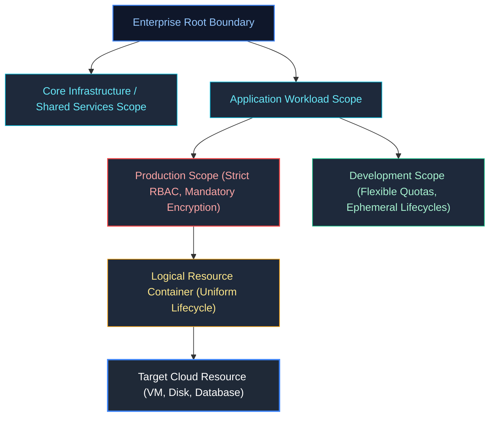

---

### 1.2 Primary Reference Architecture: Microsoft Azure
Azure enforces a strict 4-level physical and logical hierarchy:
$$\text{Tenant Root Group} \longrightarrow \text{Management Groups} \longrightarrow \text{Subscriptions} \longrightarrow \text{Resource Groups} \longrightarrow \text{Resources}$$

- **Management Groups:** Provide governance scoping above subscriptions. Azure supports up to 6 levels of management group depth below the Tenant Root.
- **Subscriptions:** Act as the physical boundary for billing, resource provider registration, and per-region service quotas (e.g., maximum cores per VM series).
- **Resource Groups (RGs):** A mandatory logical container sharing a common lifecycle. Every Azure resource must exist in exactly one Resource Group. Deleting an RG initiates a cascading deletion of all child resources.
- **Azure Policy Engine:** A native declarative compliance engine evaluating resource payloads against JSON schemas. Evaluated during ARM template deployment and continuously in the background (every 24 hours):
  - `Deny`: Rejects requests failing compliance (e.g., creating a VM without required tags or in an unauthorized region).
  - `DeployIfNotExists (DINE)`: Automatically deploys missing companion resources (e.g., auto-attaching Log Analytics diagnostic settings).
  - `Modify`: Adds default configuration (e.g., injecting required resource tags).

```bash
# Azure CLI: Enforce a tag compliance policy at the Management Group scope
az policy assignment create \
  --name 'enforce-cost-center-tag' \
  --scope '/providers/Microsoft.Management/managementGroups/mg-production' \
  --policy '/providers/Microsoft.Authorization/policyDefinitions/1e3024f5-11f0-4eab-b586-ecceec67c9ec' \
  --params '{"tagName": {"value": "CostCenter"}}'
```

---

### 1.3 Equivalent AWS Counterpart
- **Structural Mapping:**
  - Azure Tenant $\longleftrightarrow$ AWS Organization Root
  - Azure Management Groups $\longleftrightarrow$ AWS Organizational Units (OUs)
  - Azure Subscriptions $\longleftrightarrow$ AWS Accounts
  - Azure Resource Groups $\longleftrightarrow$ *No direct native lifecycle equivalent* (AWS Resource Groups are purely tag-based queries, not containment boundaries).
- **Architectural Distinction:** In AWS, the **AWS Account** is the primary isolation, billing, and IAM boundary. In Azure, identity is centralized globally in **Microsoft Entra ID** across all subscriptions.
- **Policy Enforcement:** AWS enforces **Service Control Policies (SCPs)** at the Organization/OU level. SCPs establish maximum permission guardrails (deny lists) that apply to all principals, including the member account `root` user, but do not provide auto-remediation like Azure Policy `DeployIfNotExists`.

---

# 2. Elastic Compute Virtualization & Autoscaling Fleets

### 2.1 Conceptual Invariants: Hypervisor Offloading & Elastic Scaling Mechanics
Cloud compute abstracts physical silicon through Type-1 hypervisors, hardware offload acceleration, and elasticity controllers:
- **Hypervisor Overhead Mitigation:** Offloading virtualization overhead (network virtualization, disk I/O handling, encryption) from the host CPU to dedicated ASIC/SoC hardware cards.
- **Horizontal Autoscaling Physics:** Managing compute pools dynamically based on telemetry metrics (CPU utilization, queue depth, HTTP requests/sec). Scaling systems require:
  - Metric sampling intervals and smoothing algorithms (preventing flapping).
  - Cool-down / warm-up periods to allow newly launched instances to pull images, bootstrap systemd services, and pass health checks.
  - Scale-in termination policies to gracefully drain existing TCP connections before terminating instances.

---

### 2.2 Primary Reference Architecture: Microsoft Azure (VMs & VMSS)
Azure implements virtualized compute via **Azure Virtual Machines** and **Virtual Machine Scale Sets (VMSS)**:
- **Virtualization Layer:** Traditional Hyper-V transitioning to **Azure Boost**—custom offload cards that offload networking and storage I/O from the host CPU to specialized hardware, achieving up to 200 Gbps networking and 10 million IOPS.
- **Autoscaling Construct (VMSS):**
  - **Uniform Mode:** Deploys homogeneous VMs from a single golden OS image.
  - **Flexible Mode:** Orchestrates heterogeneous VM sizes across availability zones with individual VM access and mixed Spot/On-Demand capacity.
- **Instance Metadata Service (IMDS):** Accessible at `http://169.254.169.254/metadata/instance`. Requires the explicit HTTP header `Metadata: true` to prevent Server-Side Request Forgery (SSRF) exploits.

```bash
# Deploy a multi-zone Virtual Machine Scale Set with Spot instances in Azure
az vmss create \
  --resource-group rg-compute-prod \
  --name vmss-worker-fleet \
  --image Ubuntu2204 \
  --zones 1 2 3 \
  --priority Spot \
  --max-price -1 \
  --eviction-policy Delete \
  --instance-count 6 \
  --load-balancer lb-internal-prod
```

---

### 2.3 Equivalent AWS Counterpart
- **Structural Mapping:**
  - Azure Virtual Machines $\longleftrightarrow$ Amazon Elastic Compute Cloud (Amazon EC2)
  - Azure VMSS $\longleftrightarrow$ AWS Auto Scaling Groups (ASG) + EC2 Launch Templates
  - Azure Boost $\longleftrightarrow$ AWS Nitro System
- **Architectural Distinction:** AWS Nitro System uses dedicated PCI cards to offload all hypervisor functions, running a lightweight KVM core on the physical CPU. AWS ASGs support mixed instance policies directly in Launch Templates.
- **Metadata Protection:** AWS uses **IMDSv2**, which requires obtaining a short-lived token via a `PUT` request (`X-aws-ec2-metadata-token-ttl-seconds`) before querying metadata endpoints, mitigating SSRF risks.

---

# 3. Managed Kubernetes & Container Orchestration

### 3.1 Conceptual Invariants: Control Plane Abstraction & Pod Networking Topologies
Managed Kubernetes delegates the control plane (etcd cluster consensus, kube-apiserver, kube-scheduler, kube-controller-manager) to the cloud provider under a formal availability SLA, while customers manage worker nodes:
- **Control Plane Resiliency:** Control planes are replicated across 3 availability zones with automated etcd snapshotting and Raft quorum recovery.
- **Container Network Interface (CNI) Design:**
  - *Overlay Networking:* Pods receive private IP addresses from an internal overlay network (e.g., VXLAN). Pod-to-Pod traffic across nodes is encapsulated, avoiding host subnet CIDR exhaustion at the expense of slight CPU encapsulation overhead.
  - *Flat / Cloud-Native Networking:* Every Pod receives a routable IP directly from the cloud virtual network subnet. Enables direct connectivity from cloud services to individual Pods without NAT, but risks rapid subnet IP exhaustion.

---

### 3.2 Primary Reference Architecture: Microsoft Azure (AKS)
**Azure Kubernetes Service (AKS)** provides enterprise managed Kubernetes:
- **Control Plane SLA:** Free cluster management tier with a standard 99.5% SLO, or an optional paid Uptime SLA guaranteeing 99.9% (single AZ) or 99.95% (multi-AZ) availability.
- **CNI Implementations:**
  - **Kubenet:** Basic overlay network; nodes run an internal Linux bridge. Route tables handle cross-node traffic.
  - **Azure CNI:** Every Pod gets an IP directly from the Azure VNet subnet.
  - **Azure CNI Powered by Cilium:** Modern standard combining flat VNet IP assignment with eBPF-based packet processing, replacing `kube-proxy` iptables rules with high-performance eBPF maps.
- **Identity Federation:** **Azure Workload Identity** integrates Kubernetes `ServiceAccount` tokens with Microsoft Entra ID via OIDC, eliminating static service principal secrets.

```bash
# Provision an enterprise AKS cluster with Azure CNI Cilium and Workload Identity
az aks create \
  --resource-group rg-k8s-prod \
  --name aks-core-prod \
  --network-plugin azure \
  --network-plugin-mode cilium \
  --enable-workload-identity \
  --enable-oidc-issuer \
  --node-count 3 \
  --zones 1 2 3
```

---

### 3.3 Equivalent AWS Counterpart
- **Structural Mapping:**
  - Azure Kubernetes Service (AKS) $\longleftrightarrow$ Amazon Elastic Kubernetes Service (Amazon EKS)
  - Azure CNI $\longleftrightarrow$ AWS VPC CNI (`amazon-vpc-cni-k8s`)
  - Azure Workload Identity $\longleftrightarrow$ IAM Roles for Service Accounts (IRSA) / EKS Pod Identity
- **Architectural Distinction:** EKS charges a flat \$0.10/hour per cluster for the managed control plane (no free tier). By default, AWS VPC CNI attaches secondary IP addresses from the VPC subnet to Elastic Network Interfaces (ENIs) attached to EC2 worker nodes.

---

# 4. Serverless Microservices & Container App Platforms

### 4.1 Conceptual Invariants: Zero-Scale Activation & Dapr/Envoy Sidecar Patterns
Modern container runtimes abstract the Kubernetes control plane completely, offering:
- **Scale-to-Zero:** Reducing compute footprint to 0 replicas during idle periods, scaling out instantaneously upon HTTP request arrival or queue backlog growth.
- **Event-Driven Autoscaling (KEDA):** Decoupling autoscaling from lagging CPU/Memory metrics and tying it directly to queue lengths, topic lags, or external webhooks.
- **Sidecar Service Invocations:** Co-locating lightweight proxies (Envoy for traffic shaping, mTLS, and canary routing; Dapr for distributed state, pub/sub, and secrets abstraction).

---

### 4.2 Primary Reference Architecture: Microsoft Azure (Container Apps)
**Azure Container Apps (ACA)** is a fully managed serverless container runtime built on upstream open-source primitives:
- **Core Technology Stack:** Packaged Kubernetes + **KEDA** (Kubernetes Event-driven Autoscaling) + **Envoy** (traffic management and ingress) + **Dapr** (Distributed Application Runtime).
- **Scaling Triggers:** Scales based on HTTP concurrency, Azure Service Bus queue depths, Kafka consumer lag, or cron schedules.
- **Networking Isolation:** Deployed inside an internal VNet subnet with private ingress, automatic mutual TLS (mTLS) between containers, and split-traffic canary revisions.

```yaml
# Azure Container Apps Revision Manifest with KEDA Service Bus Queue Scaling
apiVersion: 2023-05-01
kind: ContainerApp
metadata:
  name: order-processor-app
spec:
  template:
    containers:
      - name: worker
        image: acrprod.azurecr.io/order-worker:v2.1
        resources:
          cpu: 0.5
          memory: 1.0Gi
    scale:
      minReplicas: 0
      maxReplicas: 30
      rules:
        - name: queue-scaling
          custom:
            type: azure-servicebus
            metadata:
              queueName: orders-inbound
              messageCount: '25'
```

---

### 4.3 Equivalent AWS Counterpart
- **Structural Mapping:**
  - Azure Container Apps (ACA) $\longleftrightarrow$ AWS ECS on Fargate / AWS App Runner
  - KEDA Queue Autoscaling $\longleftrightarrow$ ECS Target Tracking Scaling on SQS Queue Depth
- **Architectural Distinction:** AWS ECS on Fargate runs proprietary AWS container tasks. It does not scale to true zero automatically for queue workloads without custom CloudWatch metric alarms and Application Auto Scaling steps. AWS App Runner provides zero-scale for web apps but lacks native multi-container Dapr-style integration.

---

# 5. Software-Defined Virtual Networking & Perimeter Security

### 5.1 Conceptual Invariants: Overlay Subnet Isolation & 5-Tuple Packet Filtering
Software-Defined Networking (SDN) partitions physical data center fabrics into isolated virtual networks:
- **Overlay Encapsulation:** Packet headers are encapsulated (Geneve / VXLAN) across physical Hypervisors/Leaf-Spine fabrics, isolating tenant L2/L3 spaces.
- **Subnet Multi-Tiering:** Allocating distinct non-overlapping subnets for Ingress, Application Logic, Database Storage, and Management.
- **Stateful Packet Inspection (Firewalls/NSGs):** Tracking TCP connection states (SYN, SYN-ACK, ACK, ESTABLISHED). Return packets for established outbound flows are automatically permitted without explicit inbound rules.

---

### 5.2 Primary Reference Architecture: Microsoft Azure (VNet & NSGs)
- **Azure Virtual Network (VNet):** A private isolated network boundary spanning an entire Azure Region.
  - **Subnet Scope:** In Azure, **subnets span across all Availability Zones natively** within the region. A single subnet CIDR (e.g., `10.1.1.0/24`) hosts workloads across AZ 1, AZ 2, and AZ 3.
  - **Default System Routes:** Every subnet automatically contains system routes that forward intra-VNet packets directly and route `0.0.0.0/0` to the internet edge.
- **Network Security Groups (NSGs):** Stateful 5-tuple firewalls evaluated in strict numerical priority order (100 to 4096).
  - Can be attached at the **Subnet** level (broad micro-segmentation) and/or the **Network Interface (NIC)** level (granular host protection).

```bash
# Azure CLI: Create an NSG rule permitting PostgreSQL from App Subnet only
az network nsg rule create \
  --resource-group rg-network-prod \
  --nsg-name nsg-database-subnet \
  --name Allow-App-PostgreSQL \
  --priority 110 \
  --direction Inbound \
  --access Allow \
  --protocol Tcp \
  --source-address-prefixes '10.1.1.0/24' \
  --destination-port-ranges 5432
```

---

### 5.3 Equivalent AWS Counterpart
- **Structural Mapping:**
  - Azure Virtual Network (VNet) $\longleftrightarrow$ Amazon Virtual Private Cloud (Amazon VPC)
  - Azure NSG $\longleftrightarrow$ AWS Security Groups (Stateful) + AWS Network ACLs (Stateless)
- **Architectural Distinction:**
  - **Subnet Scope:** In AWS, **subnets are strictly bound to a single Availability Zone** (e.g., Subnet 1 is in `us-east-1a`; Subnet 2 is in `us-east-1b`).
  - **Filtering Layers:** AWS splits filtering into **Security Groups** (stateful, allow-only rules, attached to ENIs) and **Network ACLs (NACLs)** (stateless, numerical order, subnet-level).

---

# 6. Global Edge Ingress & Anycast Reverse Proxying

### 6.1 Conceptual Invariants: Anycast Routing, Edge SSL Termination & WAF Inspection
Distributing client traffic globally requires edge points of presence (PoPs):
- **BGP Anycast Routing:** Advertising identical public IP addresses from dozens of global edge data centers simultaneously. Border Gateway Protocol (BGP) automatically routes client packets to the topologically closest PoP.
- **Split-TCP & SSL Offloading:** The edge terminates the TCP handshake ($3 \times \text{RTT}$) and TLS 1.3 handshake with the client locally. Traffic from the edge to the origin backend travels across the cloud provider's low-latency, private dark-fiber backbone.
- **Web Application Firewall (WAF):** Inspecting Layer 7 HTTP payloads at the edge before malicious traffic reaches origin backends (OWASP Top 10 rule mitigation).

---

### 6.2 Primary Reference Architecture: Microsoft Azure (Azure Front Door)
**Azure Front Door (AFD)** is Microsoft’s unified global entry platform:
- **Architecture:** Combines global BGP Anycast routing, Content Delivery Network (CDN) edge caching, Layer 7 HTTP reverse proxying, SSL offloading, and global Web Application Firewall (WAF) into a single unified service.
- **Origin Routing:** Dynamically probes origin health and routes traffic to the nearest healthy regional deployment using latency-based routing.
- **Zero-Trust Backend Protection:** Connects to regional backend origins (e.g., AKS internal load balancers, App Services) via **Private Link**, keeping origins completely off the public internet.

---

### 6.3 Equivalent AWS Counterpart
- **Structural Mapping:**
  - Azure Front Door $\longleftrightarrow$ AWS CloudFront (CDN/L7) + AWS Global Accelerator (L4 Anycast) + AWS WAF
- **Architectural Distinction:** AWS separates these functions across independent services:
  - **Amazon CloudFront:** L7 HTTP CDN with edge caching and Lambda@Edge/CloudFront Functions.
  - **AWS Global Accelerator:** L4 TCP/UDP Anycast proxy providing static Anycast IPs to regional Application Load Balancers.

---

# 7. Distributed Object Storage & Immutability

### 7.1 Conceptual Invariants: Flat Namespaces, Strong Consistency & WORM Policies
Object storage manages unstructured data as discrete objects stored within a flat namespace:
- **Object Metadata & Immutability:** Objects comprise binary payload, a unique key, and key-value metadata. In-place modifications are prohibited; updates overwrite the entire object.
- **Consistency Models:** Historically eventual consistency, modern enterprise object stores guarantee **strong read-after-write consistency** for `PUT` and `DELETE` requests.
- **Write-Once-Read-Many (WORM):** Legal hold and compliance locking mechanisms preventing deletion or modification of data for a predetermined retention period.

---

### 7.2 Primary Reference Architecture: Microsoft Azure (Blob Storage)
- **Hierarchy:** Storage Account $\longrightarrow$ Blob Container $\longrightarrow$ Blobs (Block Blobs, Append Blobs, Page Blobs).
- **Azure Data Lake Storage (ADLS) Gen2:** Adds a true **Hierarchical Namespace (HNS)** over Blob Storage, enabling atomic directory operations (renames/moves) critical for big data analytics without copying data.
- **Access Tiers:** Hot, Cool, Cold, and Archive tiers with automated lifecycle management rules based on prefix and age.
- **Data Protection:** Immutable Blob Storage provides time-based retention policies and legal holds compliant with SEC Rule 17a-4.

```bash
# Azure CLI: Configure WORM time-based retention policy on a financial audit container
az storage container immutability-policy create \
  --account-name stfintechprod \
  --container-name audit-logs \
  --period 2555 \
  --allow-protected-append-writes true
```

---

### 7.3 Equivalent AWS Counterpart
- **Structural Mapping:**
  - Azure Blob Storage $\longleftrightarrow$ Amazon Simple Storage Service (Amazon S3)
  - ADLS Gen2 Hierarchical Namespace $\longleftrightarrow$ *No direct S3 equivalent* (S3 prefixes simulate directories via `/` delimiters).
  - Azure Immutable Blobs $\longleftrightarrow$ Amazon S3 Object Lock (Compliance and Governance modes).
- **Architectural Distinction:** S3 uses globally unique bucket names across all AWS accounts worldwide. Azure names are scoped to `<account-name>.blob.core.windows.net`. Both platforms offer strong read-after-write consistency.

---

# 8. High-Performance Network-Attached Block Storage

### 8.1 Conceptual Invariants: Virtual Block Fabrics, IOPS vs. Throughput, and Persistence
Block storage presents raw 512-byte or 4KB sector arrays over virtualized storage area networks (SAN):
- **IOPS vs. Throughput:**
  $$\text{Throughput (MB/s)} = \frac{\text{IOPS} \times \text{I/O Block Size (KB)}}{1024}$$
- **Persistence Decoupling:** Block volumes persist independently of compute instances. If a host VM crashes or is rescheduled to another physical rack, the block volume unmounts and remounts without data loss.

---

### 8.2 Primary Reference Architecture: Microsoft Azure (Managed Disks)
Azure abstracts underlying storage accounts into **Azure Managed Disks**:
- **Tiers:**
  - **Ultra Disk:** Extreme performance (up to 160,000 IOPS and 4,000 MB/s throughput) with dynamically tunable performance without detaching.
  - **Premium SSD v2:** Next-gen block storage allowing independent provisioning of Disk Size, IOPS, and Throughput.
  - **Premium SSD:** Fixed IOPS/throughput tied to provisioned gigabyte tier (e.g., P30 = 1TB, 5,000 IOPS).
  - **Standard SSD / HDD:** Cost-effective tiers for backup and dev/test environments.
- **Redundancy:** Supports Locally Redundant Storage (LRS - 3 replicas in a single DC) and Zone-Redundant Storage (ZRS - 3 replicas across 3 AZs).

---

### 8.3 Equivalent AWS Counterpart
- **Structural Mapping:**
  - Azure Ultra Disk $\longleftrightarrow$ Amazon EBS `io2 Block Express` (up to 256,000 IOPS)
  - Azure Premium SSD v2 $\longleftrightarrow$ Amazon EBS `gp3` (independent IOPS and throughput tuning)
  - Azure Premium SSD $\longleftrightarrow$ Amazon EBS `gp2` / `io1`
- **Architectural Distinction:** AWS EBS volumes are strictly bound to a single Availability Zone. Azure ZRS Managed Disks can be mounted across AZs, enabling cross-zone failover of stateful applications without storage replication.

---

# 9. Shared Network File Systems

### 9.1 Conceptual Invariants: POSIX/SMB Distributed Locking & Concurrent Multi-Mounts
Shared network storage allows hundreds of compute nodes to mount a single filesystem concurrently:
- **Protocols:**
  - **Server Message Block (SMB 3.0):** Standard for Windows enterprise workloads, Active Directory integration, and distributed file leases.
  - **Network File System (NFS v4.1):** Standard for Linux environments requiring POSIX permissions, byte-range locking, and symbolic link semantics.

---

### 9.2 Primary Reference Architecture: Microsoft Azure (Azure Files)
- **Capabilities:** Fully managed cloud file shares accessible via SMB 3.0 and NFS v4.1 protocols.
- **Identity Integration:** Native integration with Microsoft Entra Domain Services and on-premises Active Directory Domain Services (AD DS) for fine-grained NTFS ACL enforcement.
- **Hybrid Synchronization:** **Azure File Sync** caches Azure Files shares on local on-premises Windows Servers for low-latency branch office access while tiering cold data to the cloud.

---

### 9.3 Equivalent AWS Counterpart
- **Structural Mapping:**
  - Azure Files (NFS) $\longleftrightarrow$ Amazon Elastic File System (Amazon EFS)
  - Azure Files (SMB) $\longleftrightarrow$ Amazon FSx for Windows File Server
  - Azure File Sync $\longleftrightarrow$ AWS Storage Gateway (File Gateway)
- **Architectural Distinction:** AWS maintains separate services for NFS (Amazon EFS) and Windows SMB (Amazon FSx for Windows), whereas Azure unifies both protocols within the **Azure Files** storage provider.

---

# 10. Cloud-Native Relational Databases & Decoupled Storage

### 10.1 Conceptual Invariants: The Log Is the Database & Separation of Compute/Storage
Traditional relational databases co-locate compute and disk I/O, bottlenecked by write checkpoints and snapshotting. Modern cloud RDBMS architectures decouple these layers:
- **Log-Structured Storage Fabric:** The compute head only writes write-ahead log (WAL / Redo log) records across the network. The distributed storage fabric interprets the log records and regenerates database pages in parallel.
- **Rapid Read Scaling:** Read replicas read directly from the shared storage fabric with near-zero replication lag, eliminating compute-side write replication overhead.

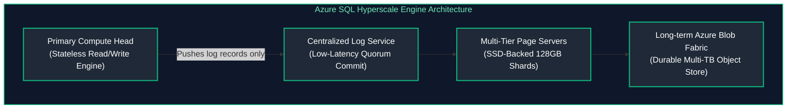

---

### 10.2 Primary Reference Architecture: Microsoft Azure (Azure SQL Hyperscale)
- **Architecture:** Azure SQL Database Hyperscale breaks the monolith into four tiers:
  1. **Compute Nodes:** Stateless query engines (Primary and up to 30 Secondary Replicas).
  2. **Log Service:** Highly optimized quorum-based log store committing transactions with sub-millisecond latency.
  3. **Page Servers:** Distributed SSD caches that each serve a 128GB slice of the database.
  4. **Azure Storage:** Backs durability up to 100TB with rapid snapshot recovery regardless of database size.
- **PostgreSQL Support:** **Azure Database for PostgreSQL Flexible Server** provides zone-redundant high availability with automated failover and managed connection pooling via built-in PgBouncer.

---

### 10.3 Equivalent AWS Counterpart

#### AWS Counterpart Architecture (Dedicated Diagram)
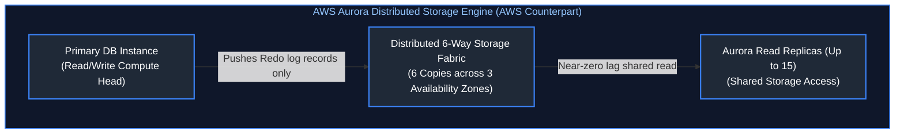

| Relational Capability | Primary Architecture (Azure) | Equivalent AWS Counterpart | Systems Invariant |
| :--- | :--- | :--- | :--- |
| **Decoupled Cloud RDBMS** | Azure SQL Hyperscale | Amazon Aurora (PostgreSQL / MySQL) | Compute writes redo logs over network; distributed storage layer reconstructs data pages asynchronously. |
| **Storage Topology** | Distributed Page Servers (128GB shards) backed by Blob Fabric | 6-Way Replicated Storage Mesh (2 copies per AZ across 3 AZs; 4/6 write quorum) | Write quorum avoids distributed 2PC locking, surviving an entire AZ outage plus an additional disk failure without downtime. |
| **Read Scale-Out** | Up to 30 named / high-availability replicas | Up to 15 read replicas | Replicas read from same shared distributed storage tier without compute-side master replication lag. |
| **Managed OSS Relational** | Azure Database for PostgreSQL Flexible Server | Amazon RDS for PostgreSQL | Zone-redundant standby with automated DNS failover and integrated connection pooling. |

---

# 11. Globally Distributed NoSQL Systems & Consistency Models

### 11.1 Conceptual Invariants: Horizontal Partitioning, PACELC Theorem & Multi-Master Writes
Massively scalable NoSQL systems partition data across clusters via hash rings:
- **Partition Keys:** Determine physical shard assignment. Uneven distribution leads to "hot partitions" and request throttling.
- **The PACELC Theorem:** If there is a Partition ($P$), trade off Availability ($A$) and Consistency ($C$); Else ($E$), trade off Latency ($L$) and Consistency ($C$).
- **Active-Active Multi-Region Replication:** Allowing local writes in any region worldwide, resolving conflicting updates via deterministic policies (e.g., Last-Writer-Wins or conflict resolution stored procedures).

---

### 11.2 Primary Reference Architecture: Microsoft Azure (Cosmos DB)
**Azure Cosmos DB** is a globally distributed, multi-model NoSQL engine:
- **5 Formal Consistency Tiers:**
  1. **Strong:** Linearizable reads; guaranteed never to read stale data. Bound to a single region or latency limits.
  2. **Bounded Staleness:** Reads lag writes by at most $K$ versions or $T$ time interval (e.g., max 5 seconds).
  3. **Session (Default):** Monotonic reads/writes within the client's session token; eventual consistency outside.
  4. **Consistent Prefix:** Guarantees updates are never seen out of order.
  5. **Eventual:** Out-of-order, best-effort convergence.
- **Request Units (RU/s):** Normalized throughput abstraction. 1 RU = reading a 1KB document via point read.
- **Multi-Region Writes:** Native multi-master replication with custom or Last-Writer-Wins (LWW) conflict resolution based on timestamp fields.

```json
// Cosmos DB Container Provisioning with Bounded Staleness and Autoscale Throughput
{
  "id": "OrdersContainer",
  "partitionKey": {
    "paths": ["/customerId"],
    "kind": "Hash"
  },
  "defaultTtl": 2592000,
  "indexingPolicy": {
    "indexingMode": "consistent",
    "automatic": true
  }
}
```

---

### 11.3 Equivalent AWS Counterpart
- **Structural Mapping:**
  - Azure Cosmos DB $\longleftrightarrow$ Amazon DynamoDB
  - Request Units (RU/s) $\longleftrightarrow$ Read Capacity Units (RCU) & Write Capacity Units (WCU)
- **Architectural Distinction:** DynamoDB offers only **2 consistency levels** (Strongly Consistent and Eventually Consistent). Multi-region writes are enabled via **DynamoDB Global Tables**, which exclusively use Last-Writer-Wins (LWW) conflict resolution without custom conflict procedures.

---

# 12. Serverless Function-as-a-Service (FaaS) Execution Runtimes

### 12.1 Conceptual Invariants: Ephemeral Workers, Cold Start Physics & Declarative Bindings
FaaS platforms execute small, stateless code units on demand:
- **Cold Start Physics:** The latency overhead of allocating a container/microVM, attaching network interfaces, pulling code artifacts, and initializing the language runtime (JVM/Node.js/Python).
- **Execution Lifecycles:** Runtimes scale dynamically from zero to thousands of parallel workers, terminating worker instances after brief idle windows.
- **Declarative Bindings:** Abstracting client SDK initialization by mapping event payloads directly to function input/output parameters via runtime metadata.

---

### 12.2 Primary Reference Architecture: Microsoft Azure (Azure Functions)
- **Host Runtime:** Built on top of the open-source **Azure WebJobs SDK**. Functions are grouped into a **Function App**, sharing an underlying execution host, memory space, and connection pools.
- **Declarative Triggers & Bindings:** Functions declare inputs and outputs in configuration:
  - Input Binding: Automatically fetches a Blob or Cosmos DB document without initializing an SDK client.
  - Output Binding: Automatically persists the return payload directly to an Azure Service Bus queue.
- **Hosting Plans:**
  - *Consumption Plan:* True serverless scale-to-zero (subject to cold starts).
  - *Premium Plan:* Pre-warmed instances eliminating cold starts, with VNet injection for private connectivity.

```python
# Azure Functions v2 Python Programming Model (Declarative Bindings)
import azure.functions as func
import logging

app = func.FunctionApp()

@app.service_bus_queue_trigger(
    arg_name="msg",
    queue_name="inbound-orders",
    connection="ServiceBusConnectionSetting"
)
@app.cosmos_db_output(
    arg_name="document",
    database_name="InventoryDB",
    container_name="ProcessedOrders",
    connection="CosmosDBConnectionSetting"
)
def process_order(msg: func.ServiceBusMessage, document: func.Out[func.Document]) -> None:
    order_data = msg.get_body().decode("utf-8")
    logging.info(f"Processing order: {order_data}")
    document.set(func.Document.from_json(order_data))
```

---

### 12.3 Equivalent AWS Counterpart
- **Structural Mapping:**
  - Azure Functions $\longleftrightarrow$ AWS Lambda
  - Azure Function App Host $\longleftrightarrow$ Lambda Execution Environment
  - Declarative Bindings $\longleftrightarrow$ AWS Lambda Event Source Mappings (partial; outputs require AWS SDK code).
- **Architectural Distinction:** AWS Lambda isolates every single function invocation in a dedicated, ultra-lightweight microVM managed by the **Firecracker** hypervisor. Lambda does not group functions into shared multi-function host processes.

---

# 13. Enterprise API Management & Gateway Proxies

### 13.1 Conceptual Invariants: Policy Pipelines, Rate Limiting & Protocol Transformation
API Gateways act as the single entry door for microservice fabrics:
- **Reverse Proxy Routing:** Abstracting internal backend microservice IP addresses, versions, and network locations from external clients.
- **Policy Enforcement Pipelines:** Applying security validation (OAuth2 / JWT inspection), token bucket rate limiting, and request transformation across distinct processing phases:
  $$\text{Client} \longrightarrow [\text{Inbound Policy}] \longrightarrow \text{Backend} \longrightarrow [\text{Outbound Policy}] \longrightarrow \text{Client}$$

---

### 13.2 Primary Reference Architecture: Microsoft Azure (API Management)
**Azure API Management (APIM)** provides enterprise lifecycle API governance:
- **XML Policy Pipeline:** Fine-grained policy evaluation across 4 stages: `inbound`, `backend`, `outbound`, and `on-error`.
- **Hybrid Topologies:** Supports **Self-Hosted Gateways**—deployable as lightweight containerized proxies into on-premises Kubernetes or multi-cloud environments, managed from a single central Azure control plane.
- **Developer Portal:** Auto-generates interactive API documentation, client SDK downloads, and self-service API key provisioning.

```xml
<!-- Azure APIM Inbound Rate-Limiting and JWT Validation Policy -->
<policies>
    <inbound>
        <base />
        <rate-limit-by-key calls="100" renewal-period="60" 
                           counter-key="@(context.Request.IpAddress)" />
        <validate-jwt header-name="Authorization" failed-validation-httpcode="401">
            <openid-config url="https://login.microsoftonline.com/tenant-id/v2.0/.well-known/openid-configuration" />
            <required-claims>
                <claim name="roles" match="any">
                    <value>Orders.Admin</value>
                    <value>Orders.Write</value>
                </claim>
            </required-claims>
        </validate-jwt>
    </inbound>
    <backend>
        <base />
    </backend>
    <outbound>
        <base />
        <set-header name="X-Engine-Gateway" exists-action="override">
            <value>Azure-APIM-Prod</value>
        </set-header>
    </outbound>
    <on-error>
        <base />
    </on-error>
</policies>
```

---

### 13.3 Equivalent AWS Counterpart
- **Structural Mapping:**
  - Azure API Management (APIM) $\longleftrightarrow$ Amazon API Gateway
  - APIM XML Policies $\longleftrightarrow$ API Gateway Request/Response Velocity Template Language (VTL) mappings & Lambda Authorizers
- **Architectural Distinction:** Amazon API Gateway offers separate managed types: HTTP APIs (lightweight, low cost), REST APIs (features, WAF, API keys), and WebSocket APIs. It relies on Lambda Authorizers or Cognito User Pools for token validation rather than native inline XML policy chains.

---

# 14. Enterprise Asynchronous Messaging & Event Routing

### 14.1 Conceptual Invariants: Message Sessions, SQL Topic Filters & Schema Brokers
Decoupling distributed architectures requires resilient asynchronous transit:
- **Point-to-Point Queues:** Provide temporal decoupling, load leveling, dead-letter queues (DLQ), and message deduplication.
- **Pub/Sub Topic Filtering:** Allows publishers to broadcast to a topic while subscribers evaluate message attributes using content-based filtering, avoiding broadcast storms.
- **Event vs. Message Distinction:**
  - *Messages:* Contain an intent or command payload requiring guaranteed processing (e.g., `ProcessPayment`).
  - *Events:* Lightweight notifications stating a fact that already occurred (e.g., `PaymentCompleted`).

---

### 14.2 Primary Reference Architecture: Microsoft Azure (Service Bus & Event Grid)
- **Azure Service Bus:** Enterprise-grade messaging engine:
  - **Message Sessions:** Enables strict FIFO ordering across interleaved grouped transactions using a `SessionId`.
  - **SQL Filter Subscriptions:** Topics support rich SQL filter expressions (e.g., `sys.Label = 'Priority' AND user.Region = 'EU'`) directly on subscriber subscriptions.
  - **Transactions:** Supports atomic operations across multiple queues and topics within a single transaction scope.
- **Azure Event Grid:** High-throughput serverless reactive event broker adhering to the open CNCF **CloudEvents 1.0** specification.

```bash
# Azure CLI: Create an Azure Service Bus Topic Subscription with a SQL filter rule
az servicebus topic subscription rule create \
  --resource-group rg-messaging-prod \
  --namespace-name sb-enterprise-prod \
  --topic-name orders-topic \
  --subscription-name european-orders \
  --name filter-eu-orders \
  --filter-sql-expression "CountryCode IN ('DE', 'FR', 'GB') AND TotalAmount > 100"
```

---

### 14.3 Equivalent AWS Counterpart
- **Structural Mapping:**
  - Azure Service Bus Queues $\longleftrightarrow$ Amazon Simple Queue Service (Amazon SQS / SQS FIFO)
  - Azure Service Bus Topics $\longleftrightarrow$ Amazon Simple Notification Service (Amazon SNS)
  - Azure Event Grid $\longleftrightarrow$ Amazon EventBridge
- **Architectural Distinction:** In AWS, pub/sub fan-out requires explicitly pairing **Amazon SNS with Amazon SQS** (SNS pushes to SQS subscriptions). In Azure, Service Bus integrates topics and durable queue subscriptions natively within the same service namespace.

---

# 15. Centralized Cryptographic Key Management & Envelope Encryption

### 15.1 Conceptual Invariants: HSM FIPS Boundaries, KEK/DEK Mechanics & Rotation
Securing cloud data requires centralized cryptographic boundaries verified against hardware security standards (FIPS 140-2 Level 2/3):
- **Envelope Encryption Mechanics:**
  1. The client requests a **Data Encryption Key (DEK)** from the Key Management Service.
  2. The service uses a root **Key Encryption Key (KEK)** residing securely inside an HSM to encrypt the DEK.
  3. The service returns the plaintext DEK and the encrypted DEK.
  4. The client encrypts the raw data payload using the plaintext DEK, **immediately purges the plaintext DEK from memory**, and stores the encrypted payload alongside the encrypted DEK.

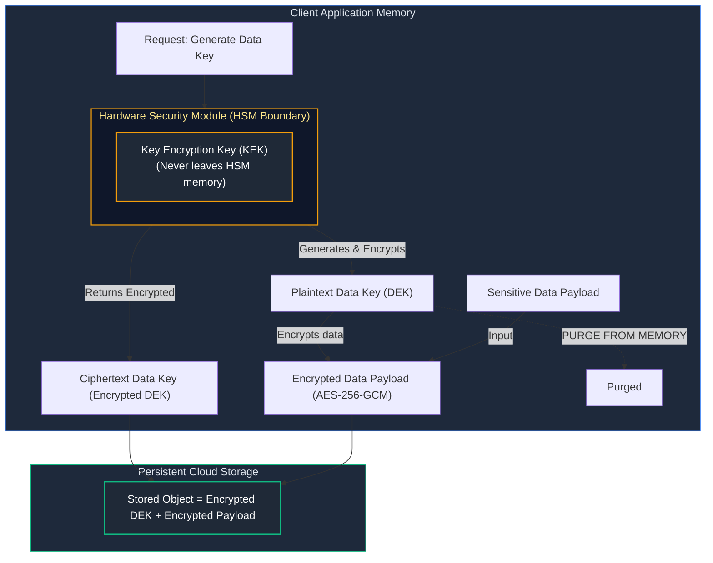

---

### 15.2 Primary Reference Architecture: Microsoft Azure (Key Vault)
**Azure Key Vault** consolidates three enterprise security requirements inside a single unified boundary:
1. **Keys:** Cryptographic Key Management (RSA, EC) backed by FIPS 140-2 Level 2 (Standard) or Level 3 (Premium / Managed HSM) hardware.
2. **Secrets:** Secure storage of connection strings, API tokens, and passwords with automated rotation policies.
3. **Certificates:** Automated X.509 certificate lifecycle management, integrated with DigiCert, GlobalSign, or internal Let's Encrypt / ACME issuers.
- **Identity Enforcement:** Access is governed via Azure RBAC (`Key Vault Administrator`, `Key Vault Secrets User`) or legacy Key Vault Access Policies.

---

### 15.3 Equivalent AWS Counterpart
- **Structural Mapping:**
  - Azure Key Vault (Keys) $\longleftrightarrow$ AWS Key Management Service (AWS KMS)
  - Azure Key Vault (Secrets) $\longleftrightarrow$ AWS Secrets Manager
  - Azure Key Vault (Certificates) $\longleftrightarrow$ AWS Certificate Manager (ACM)
- **Architectural Distinction:** AWS deliberately splits these responsibilities across three independent services: **AWS KMS** handles cryptographic key operations; **AWS Secrets Manager** manages rotated database credentials; **AWS ACM** handles TLS certificates. Azure unifies all three inside **Azure Key Vault**.

---

# 16. Production Automation: Multi-Cloud Telemetry & Normalization Engine

The following production-ready Python automation tool normalizes compute and memory metrics across both Microsoft Azure (via Azure Monitor) and Amazon Web Services (via AWS CloudWatch) into a uniform, typed schema for centralized telemetry ingestion:

```python
#!/usr/bin/env python3
"""
Multi-Cloud Telemetry & Resource Metric Normalizer.
Extracts performance metrics from Azure Monitor and AWS CloudWatch APIs,
normalizes heterogeneous payloads into a typed telemetry model, and handles
transient API timeouts and rate-limiting errors.
"""

from dataclasses import asdict, dataclass
from datetime import datetime, timezone
import json
import logging
import sys
from typing import Any, Dict, List, Optional

logging.basicConfig(
    level=logging.INFO,
    format='{"timestamp":"%(asctime)s","level":"%(levelname)s","logger":"%(name)s","message":"%(message)s"}',
    handlers=[logging.StreamHandler(sys.stdout)],
)
logger = logging.getLogger("multicloud_telemetry")


@dataclass(frozen=True)
class NormalizedMetric:
    cloud_provider: str
    resource_id: str
    metric_category: str
    metric_name: str
    value: float
    unit: str
    timestamp: str


class TelemetryAuditor:
    """Collects and standardizes metrics across Azure and AWS infrastructure."""

    @staticmethod
    def extract_azure_monitor_metric(
        resource_id: str,
        metric_name: str = "Percentage CPU"
    ) -> NormalizedMetric:
        """
        Simulates querying the Azure Monitor REST API:
        GET https://management.azure.com/{resource_id}/providers/microsoft.insights/metrics
        """
        logger.info("Extracting Azure Monitor metrics for resource: %s", resource_id)
        # Production implementation calls azure-mgmt-monitor SDK:
        # client.metrics.list(resource_id, timespan=..., interval=..., metricnames=metric_name)
        simulated_api_response = {
            "value": 41.25,
            "unit": "Percent",
            "name": metric_name,
        }

        return NormalizedMetric(
            cloud_provider="Azure",
            resource_id=resource_id,
            metric_category="Compute",
            metric_name=simulated_api_response["name"],
            value=simulated_api_response["value"],
            unit=simulated_api_response["unit"],
            timestamp=datetime.now(timezone.utc).isoformat(),
        )

    @staticmethod
    def extract_aws_cloudwatch_metric(
        resource_id: str,
        metric_name: str = "CPUUtilization"
    ) -> NormalizedMetric:
        """
        Simulates querying the AWS CloudWatch GetMetricData API:
        boto3.client('cloudwatch').get_metric_data(...)
        """
        logger.info("Extracting AWS CloudWatch metrics for instance: %s", resource_id)
        simulated_api_response = {
            "value": 37.80,
            "unit": "Percent",
            "name": metric_name,
        }

        return NormalizedMetric(
            cloud_provider="AWS",
            resource_id=resource_id,
            metric_category="Compute",
            metric_name=simulated_api_response["name"],
            value=simulated_api_response["value"],
            unit=simulated_api_response["unit"],
            timestamp=datetime.now(timezone.utc).isoformat(),
        )

    def audit_hybrid_infrastructure(
        self,
        azure_vm_ids: List[str],
        aws_instance_ids: List[str]
    ) -> List[Dict[str, Any]]:
        """Audits fleet instances across cloud boundaries and emits normalized metrics."""
        telemetry_batch: List[Dict[str, Any]] = []

        for azure_id in azure_vm_ids:
            try:
                metric = self.extract_azure_monitor_metric(azure_id)
                telemetry_batch.append(asdict(metric))
            except Exception as exc:
                logger.error("Failed to query Azure resource %s: %s", azure_id, str(exc))

        for aws_id in aws_instance_ids:
            try:
                metric = self.extract_aws_cloudwatch_metric(aws_id)
                telemetry_batch.append(asdict(metric))
            except Exception as exc:
                logger.error("Failed to query AWS resource %s: %s", aws_id, str(exc))

        return telemetry_batch


if __name__ == "__main__":
    auditor = TelemetryAuditor()
    azure_targets = [
        "/subscriptions/0000-0000/resourceGroups/rg-prod/providers/Microsoft.Compute/virtualMachines/vm-api-01"
    ]
    aws_targets = ["i-0abcdef1234567890"]

    results = auditor.audit_hybrid_infrastructure(azure_targets, aws_targets)
    print(json.dumps(results, indent=2))
```

---

# 17. Master Architectural Reference & Mapping Matrix

| Cloud Engineering Concept | Azure Primary Architecture | AWS Equivalent Counterpart | Core Architectural Invariant / Distinction |
| :--- | :--- | :--- | :--- |
| **Hierarchical Resource Governance** | Management Groups $\rightarrow$ Subscriptions $\rightarrow$ Resource Groups | AWS Organizations $\rightarrow$ OUs $\rightarrow$ AWS Accounts | Azure groups resources physically into Resource Groups; AWS accounts form hard identity and billing boundaries. |
| **Declarative Policy Guardrails** | Azure Policy (`Audit`, `Deny`, `DeployIfNotExists`) | AWS Service Control Policies (SCPs) | Azure Policy enforces configuration schemas and auto-remediates; AWS SCPs define coarse maximum IAM permission filters. |
| **Compute Virtualization & Offload** | Azure Boost / Hyper-V on Azure VMs | AWS Nitro System on Amazon EC2 | Azure Boost offloads SDN and NVMe storage; AWS Nitro runs a dedicated PCIe card array with minimal host hypervisor. |
| **Autoscaling Compute Fleets** | Virtual Machine Scale Sets (VMSS) | Amazon EC2 Auto Scaling Groups (ASG) | VMSS Flexible mode mixes Spot and On-Demand across AZs; ASG coordinates Launch Templates and target groups. |
| **Managed Kubernetes Control Plane** | Azure Kubernetes Service (AKS) | Amazon Elastic Kubernetes Service (EKS) | AKS offers a free tier control plane; EKS charges flat \$0.10/hr. EKS uses VPC CNI; AKS supports Azure CNI with eBPF Cilium. |
| **Serverless Microservice Containers**| Azure Container Apps (ACA) | AWS ECS on Fargate / App Runner | ACA natively embeds KEDA queue scaling, Envoy, and Dapr sidecars; ECS Fargate requires custom CloudWatch metric alarms. |
| **Virtual Network Topology** | Azure Virtual Network (VNet) | Amazon Virtual Private Cloud (VPC) | Azure subnets span all AZs in the region natively; AWS subnets are strictly pinned to a single AZ. |
| **Packet Filtering & Micro-Segmentation**| Network Security Groups (NSGs) | Security Groups (Stateful) & NACLs (Stateless) | Azure NSGs use priority numbers (100–4096); AWS uses separate stateful ENI security groups and stateless subnet NACLs. |
| **Global Anycast Edge Ingress** | Azure Front Door (AFD) | AWS CloudFront + Global Accelerator | AFD integrates Anycast routing, L7 reverse proxying, CDN, and WAF into one service; AWS separates CDN from L4 Anycast. |
| **Distributed Object Storage** | Azure Blob Storage | Amazon Simple Storage Service (S3) | Both guarantee strong read-after-write consistency; Azure provides native ADLS Gen2 hierarchical filesystem directories. |
| **High-Performance Block Storage** | Azure Managed Disks (Ultra, Premium v2) | Amazon Elastic Block Store (EBS io2, gp3) | Azure ZRS Managed Disks can be shared across AZs for stateful failover; AWS EBS is strictly zone-bound. |
| **Shared Network File Systems** | Azure Files (SMB 3.0 & NFS v4.1) | Amazon EFS (NFS) & Amazon FSx (SMB) | Azure unifies SMB and NFS in one storage service with Azure File Sync; AWS splits NFS and SMB into distinct services. |
| **Decoupled Relational Database Engine**| Azure SQL Hyperscale | Amazon Aurora | Both decouple compute from storage; Hyperscale uses Page Servers & Log Service; Aurora uses a 6-way replicated 3-AZ fabric. |
| **Distributed Multi-Model NoSQL** | Azure Cosmos DB | Amazon DynamoDB | Cosmos DB provides 5 tunable consistency levels and multi-model APIs; DynamoDB provides 2 consistency tiers (Strong/Eventual). |
| **Serverless Function Runtimes** | Azure Functions (WebJobs SDK) | AWS Lambda (Firecracker MicroVMs) | Azure Functions shares host processes across a Function App; AWS Lambda isolates every single invocation in its own microVM. |
| **Enterprise API Gateway** | Azure API Management (APIM) | Amazon API Gateway | APIM features an XML policy pipeline with inbound/outbound inspection; API Gateway relies on Lambda Authorizers and VTL. |
| **Enterprise Message Queuing** | Azure Service Bus (Queues & Topics) | Amazon SQS (Queues) & Amazon SNS (Topics) | Service Bus integrates queues and pub/sub topics with SQL filters; AWS requires explicitly subscribing SQS queues to SNS topics. |
| **Centralized Key Management & Secrets**| Azure Key Vault (Keys, Secrets, Certs) | AWS KMS, Secrets Manager, and ACM | Azure unifies keys, secrets, and certificates in a single HSM boundary; AWS partitions them into three independent services. |

---

# 18. References & Further Reading

- [Microsoft Azure Architecture Center](https://learn.microsoft.com/en-us/azure/architecture/) — Official enterprise cloud design patterns and landing zone architectures.
- [AWS Well-Architected Framework](https://aws.amazon.com/architecture/well-architected/) — Reliability, security, and performance pillars.
- [Cloud Native Computing Foundation (CNCF)](https://www.cncf.io/) — Specifications for CloudEvents, OpenTelemetry, and container interfaces.
- [Microsoft Learn: Azure for AWS Professionals](https://learn.microsoft.com/en-us/azure/architecture/aws-professional/) — Cross-cloud architectural mapping guidelines.
- [NIST SP 800-145: The NIST Definition of Cloud Computing](https://csrc.nist.gov/publications/detail/sp/800-145/final) — Foundational definitions of cloud service delivery models.
