# 04. Azure Core Services & AWS Equivalents

A comprehensive, production-grade guide comparing Microsoft Azure and Amazon Web Services (AWS) architectural paradigms, service mappings, runtime mechanics, networking implementations, storage engines, compute runtimes, and governance models tailored for Multi-Cloud Architects, Cloud Engineers, and DevOps Specialists.

---

## Architectural Overview: Multi-Cloud Enterprise Service Mapping

```mermaid
flowchart TD
    subgraph GovernanceLayer ["Identity & Governance Layer"]
        AzureGov["Azure: Entra ID | Management Groups | Policy"]
        AWSGov["AWS: IAM | Organizations | SCPs"]
    end

    subgraph ComputeLayer ["Compute & Container Runtimes"]
        AzureCompute["Azure: VM | VMSS | AKS | Container Apps | Functions"]
        AWSCompute["AWS: EC2 | Auto Scaling | EKS | ECS Fargate | Lambda"]
    end

    subgraph NetworkLayer ["Virtual Networking & Security"]
        AzureNet["Azure: VNet | NSG | Azure Firewall | App Gateway | Front Door"]
        AWSNet["AWS: VPC | Security Group | Network Firewall | ALB | CloudFront"]
    end

    subgraph DataStorageLayer ["Storage & Database Systems"]
        AzureData["Azure: Blob Storage | Managed Disks | Azure SQL | Cosmos DB"]
        AWSData["AWS: S3 | EBS | RDS / Aurora | DynamoDB"]
    end

    subgraph MessagingLayer ["Messaging & Event Streaming"]
        AzureMsg["Azure: Service Bus | Event Grid | Event Hubs"]
        AWSMsg["AWS: SQS / SNS | EventBridge | Kinesis Data Streams"]
    end

    GovernanceLayer --> ComputeLayer
    ComputeLayer --> NetworkLayer
    NetworkLayer --> DataStorageLayer
    DataStorageLayer --> MessagingLayer

    style GovernanceLayer fill:#0f172a,stroke:#3b82f6,stroke-width:1.5px,color:#93c5fd
    style ComputeLayer fill:#0f172a,stroke:#10b981,stroke-width:1.5px,color:#6ee7b7
    style NetworkLayer fill:#0f172a,stroke:#f59e0b,stroke-width:1.5px,color:#fde68a
    style DataStorageLayer fill:#0f172a,stroke:#8b5cf6,stroke-width:1.5px,color:#c084fc
    style MessagingLayer fill:#0f172a,stroke:#ec4899,stroke-width:1.5px,color:#f472b6

    style AzureGov fill:#1f2937,stroke:#3b82f6,stroke-width:2px,color:#fff
    style AWSGov fill:#1f2937,stroke:#3b82f6,stroke-width:2px,color:#fff
    style AzureCompute fill:#1f2937,stroke:#10b981,stroke-width:2px,color:#fff
    style AWSCompute fill:#1f2937,stroke:#10b981,stroke-width:2px,color:#fff
    style AzureNet fill:#1f2937,stroke:#f59e0b,stroke-width:2px,color:#fff
    style AWSNet fill:#1f2937,stroke:#f59e0b,stroke-width:2px,color:#fff
    style AzureData fill:#1f2937,stroke:#8b5cf6,stroke-width:2px,color:#fff
    style AWSData fill:#1f2937,stroke:#8b5cf6,stroke-width:2px,color:#fff
    style AzureMsg fill:#1f2937,stroke:#ec4899,stroke-width:2px,color:#fff
    style AWSMsg fill:#1f2937,stroke:#ec4899,stroke-width:2px,color:#fff
```



---

## Table of Contents
1. [Enterprise Organization & Resource Hierarchies](#1-enterprise-organization-resource-hierarchies)
   - [1.1 Azure Management Groups vs. AWS Organizations & OUs](#11-azure-management-groups-vs-aws-organizations-ous)
   - [1.2 Policy Enforcement: Azure Policy vs. AWS Service Control Policies (SCPs)](#12-policy-enforcement-azure-policy-vs-aws-service-control-policies-scps)
2. [Compute Architectures: Virtual Machines, Autoscaling & Containers](#2-compute-architectures-virtual-machines-autoscaling-containers)
   - [2.1 Virtual Machines & Scale Sets vs. Amazon EC2 & Auto Scaling](#21-virtual-machines-scale-sets-vs-amazon-ec2-auto-scaling)
   - [2.2 Managed Kubernetes: Azure Kubernetes Service (AKS) vs. Amazon EKS](#22-managed-kubernetes-azure-kubernetes-service-aks-vs-amazon-eks)
   - [2.3 Containerized Microservices: Azure Container Apps vs. AWS ECS / Fargate](#23-containerized-microservices-azure-container-apps-vs-aws-ecs-fargate)
3. [Virtual Networking, Perimeter Security & Traffic Ingress](#3-virtual-networking-perimeter-security-traffic-ingress)
   - [3.1 Azure VNet vs. AWS VPC Design Topology](#31-azure-vnet-vs-aws-vpc-design-topology)
   - [3.2 Traffic Filtering: Network Security Groups vs. Security Groups & NACLs](#32-traffic-filtering-network-security-groups-vs-security-groups-nacls)
   - [3.3 Global Ingress: Azure Front Door vs. AWS CloudFront & Global Accelerator](#33-global-ingress-azure-front-door-vs-aws-cloudfront-global-accelerator)
4. [Storage Subsystems: Object, Block, and File Mechanics](#4-storage-subsystems-object-block-and-file-mechanics)
   - [4.1 Azure Blob Storage vs. Amazon S3 (Consistency & Lifecycle)](#41-azure-blob-storage-vs-amazon-s3-consistency-lifecycle)
   - [4.2 High-Performance Block Storage: Managed Disks vs. Amazon EBS](#42-high-performance-block-storage-managed-disks-vs-amazon-ebs)
   - [4.3 Shared Network File Systems: Azure Files vs. Amazon EFS](#41-azure-blob-storage-vs-amazon-s3-consistency-lifecycle)
5. [Database Architectures: Relational Engines and Global NoSQL](#5-database-architectures-relational-engines-and-global-nosql)
   - [5.1 Relational Cloud DBs: Azure SQL & PostgreSQL vs. AWS RDS & Aurora](#51-relational-cloud-dbs-azure-sql-postgresql-vs-aws-rds-aurora)
   - [5.2 Globally Distributed NoSQL: Azure Cosmos DB vs. Amazon DynamoDB](#52-globally-distributed-nosql-azure-cosmos-db-vs-amazon-dynamodb)
6. [Serverless Compute, APIs & Enterprise Integration](#6-serverless-compute-apis-enterprise-integration)
   - [6.1 Azure Functions vs. AWS Lambda (Execution & Triggers)](#61-azure-functions-vs-aws-lambda-execution-triggers)
   - [6.2 API Gateways: Azure API Management (APIM) vs. Amazon API Gateway](#62-api-gateways-azure-api-management-apim-vs-amazon-api-gateway)
7. [Enterprise Messaging, Event Routing, and Streaming](#7-enterprise-messaging-event-routing-and-streaming)
   - [7.1 Queue Mechanics: Azure Service Bus vs. AWS SQS and SNS](#71-queue-mechanics-azure-service-bus-vs-aws-sqs-and-sns)
   - [7.2 Event Routing & Telemetry: Azure Event Grid / Hubs vs. AWS EventBridge / Kinesis](#72-event-routing-telemetry-azure-event-grid-hubs-vs-aws-eventbridge-kinesis)
8. [Secrets, Observability, and Cross-Cloud Operations](#8-secrets-observability-and-cross-cloud-operations)
   - [8.1 Cryptographic Management: Azure Key Vault vs. AWS KMS & Secrets Manager](#81-cryptographic-management-azure-key-vault-vs-aws-kms-secrets-manager)
   - [8.2 Multi-Cloud Metric Exporter Script](#82-multi-cloud-metric-exporter-script)
9. [Summary Comparison & Engineering Reference Matrix](#9-summary-comparison-engineering-reference-matrix)
10. [References & Further Reading](#10-references-further-reading)

---

# 1. Enterprise Organization & Resource Hierarchies

### 1.1 Azure Management Groups vs. AWS Organizations & OUs

> [!IMPORTANT]
> **Governance Boundaries:** Azure enforces a 4-level structural hierarchy (Management Groups $\rightarrow$ Subscriptions $\rightarrow$ Resource Groups $\rightarrow$ Resources), whereas AWS uses AWS Organizations and Accounts. Always enforce policy guardrails (Azure Policy / AWS SCPs) at the management group / organizational unit level to prevent configuration drift.

Both cloud ecosystems organize enterprise resources into recursive container trees for billing, identity access, and compliance enforcement:

```text
AZURE RESOURCE HIERARCHY:               AWS RESOURCE HIERARCHY:
[Tenant Root Group]                     [Organization Root]
    ├── [Management Group: Platform]        ├── [OU: Core Infrastructure]
    │       └── [Subscription: Network]     │       └── [AWS Account: Networking]
    └── [Management Group: Workloads]       └── [OU: Workloads]
            └── [Subscription: Prod]                └── [AWS Account: Prod Workloads]
                    └── [Resource Group]                    (Direct resource container)
                            └── [Resource]
```

- **Azure Subscriptions vs. AWS Accounts:** In AWS, the **Account** is the absolute security, IAM, and billing boundary. In Azure, the **Subscription** is the billing and quota boundary, but identity is centralized under a single tenant-wide **Microsoft Entra ID (formerly Azure AD)**.
- **Azure Resource Groups:** Azure introduces an additional mandatory layer: the **Resource Group**. All Azure resources must live in exactly one Resource Group, inheriting RBAC and lifecycle management (deleting a Resource Group cascades to all child resources). AWS does not have an equivalent native boundary (AWS resource groups are purely tag-based queries).

---

### 1.2 Policy Enforcement: Azure Policy vs. AWS Service Control Policies (SCPs)

- **Azure Policy:** Declarative compliance engine evaluating resource properties against JSON definitions. Can operate in `Audit`, `Deny`, `Append`, or `DeployIfNotExists` mode (active auto-remediation of missing tags or configurations).
- **AWS Service Control Policies (SCPs):** Guardrails applied at the Organization or OU level. SCPs do **not** grant permissions; they define maximum permission boundaries that no IAM identity (not even the `root` account user of a member account) can exceed.

---

# 2. Compute Architectures: Virtual Machines, Autoscaling & Containers

### 2.1 Virtual Machines & Scale Sets vs. Amazon EC2 & Auto Scaling

> [!TIP]
> **Cost Optimization via Spot & Reserved Capacity:** Leverage Azure Reserved VM Instances / AWS Savings Plans for predictable baseline compute (up to 72% savings), and pair with Spot compute for fault-tolerant, stateless batch workloads.

| Architecture Feature | Azure Virtual Machines & VMSS | Amazon EC2 & Auto Scaling Groups (ASG) |
| :--- | :--- | :--- |
| **Virtualization Hypervisor** | Microsoft Hyper-V / Azure Boost | Nitro System (Hardware offload cards) / KVM |
| **Autoscaling Construct** | Virtual Machine Scale Sets (VMSS) | Auto Scaling Groups (ASG) |
| **Orchestration Mode** | Flexible Mode (heterogeneous VMs) or Uniform Mode | EC2 Launch Templates & Mixed Instances Policies |
| **Instance Metadata Service** | IMDS (`http://169.254.169.254/metadata/instance`) requires header `Metadata: true` | IMDSv2 (`http://169.254.169.254/latest/meta-data/`) requires session token `X-aws-ec2-metadata-token` |

---

### 2.2 Managed Kubernetes: Azure Kubernetes Service (AKS) vs. Amazon EKS

- **Control Plane Cost:** Azure AKS provides a free cluster management tier with standard SLAs (optional paid Uptime SLA). Amazon EKS charges a flat \$0.10/hour per cluster for the managed control plane.
- **Node Networking:**
  - **Azure AKS:** Supports **Kubenet** (basic overlay) or **Azure CNI** (every Pod gets a dedicated real IP from the Azure VNet subnet, consuming VNet CIDR).
  - **Amazon EKS:** Uses **AWS VPC CNI** by default (every Pod gets a real IP from the VPC subnet via secondary Elastic Network Interfaces).
- **Identity Integration:**
  - **AKS:** Azure Workload Identity integrates Kubernetes ServiceAccounts directly with Azure Entra ID Managed Identities using OIDC.
  - **EKS:** IAM Roles for Service Accounts (IRSA) maps Kubernetes ServiceAccounts to AWS IAM roles using OIDC.

---

### 2.3 Containerized Microservices: Azure Container Apps vs. AWS ECS / Fargate

- **Azure Container Apps (ACA):** Built directly on top of open-source **KEDA (Kubernetes Event-driven Autoscaling)**, **Envoy**, and **Dapr**. Natively scales to zero based on HTTP traffic or queue lengths without managing Kubernetes YAML.
- **AWS ECS on Fargate:** Proprietary AWS container orchestrator. Fast task launch times, seamless AWS VPC task networking, but lacks built-in scale-to-zero on external queue depths without custom CloudWatch metric alarms.

---

# 3. Virtual Networking, Perimeter Security & Traffic Ingress

### 3.1 Azure VNet vs. AWS VPC Design Topology

```text
+-----------------------------------------------------------------------------------------+
|                               CLOUD NETWORK COMPARISON                                  |
+------------------------------------+----------------------------------------------------+
| AZURE VIRTUAL NETWORK (VNet)       | AMAZON VIRTUAL PRIVATE CLOUD (VPC)                 |
+------------------------------------+----------------------------------------------------+
| Subnets span across ALL AZs        | Subnets are strictly bound to a SINGLE AZ          |
| natively within the VNet.          | (e.g., Subnet A is in us-east-1a only).           |
|                                    |                                                    |
| System Routes forward traffic      | Route tables must be explicitly attached to        |
| across all subnets automatically.  | subnets with target Internet Gateway (IGW).        |
|                                    |                                                    |
| Outbound internet requires NAT     | Public subnets have IGW routes; private subnets    |
| Gateway or explicit Load Balancer. | require NAT Gateways deployed in public subnets.   |
+------------------------------------+----------------------------------------------------+
```

---

### 3.2 Traffic Filtering: Network Security Groups vs. Security Groups & NACLs

- **Azure NSG:** Stateful firewall containing 5-tuple security rules applied to subnets or NICs. Evaluated in priority order (100 to 4096).
- **AWS Security Groups:** Stateful firewall applied directly to network interfaces. Only allow rules can be configured (implicit deny).
- **AWS Network ACLs (NACLs):** Stateless subnet-level firewalls evaluated in numerical order. Requires explicit return ephemeral port permissions.

---

### 3.3 Global Ingress: Azure Front Door vs. AWS CloudFront & Global Accelerator

- **Azure Front Door:** Combines global Anycast CDN edge caching, Layer 7 HTTP reverse proxying, SSL offloading, and global Web Application Firewall (WAF) into a single unified global entry service.
- **AWS CloudFront:** Global Content Delivery Network (CDN) with edge lambdas (CloudFront Functions, Lambda@Edge).
- **AWS Global Accelerator:** Operates at Layer 4 (TCP/UDP) over Anycast IPs, bypassing public internet routing directly to regional Application Load Balancers.

---

# 4. Storage Subsystems: Object, Block, and File Mechanics

### 4.1 Azure Blob Storage vs. Amazon S3 (Consistency & Lifecycle)

Both platforms offer strongly consistent, highly durable object storage:

| Storage Dimension | Azure Blob Storage | Amazon S3 |
| :--- | :--- | :--- |
| **Namespace Architecture** | Flat Storage Account $\rightarrow$ Blob Container $\rightarrow$ Blobs (Optional Hierarchical Namespace for ADLS Gen2) | Global Bucket Name $\rightarrow$ Object Keys (Prefix-delimited) |
| **Consistency Model** | Strong read-after-write consistency | Strong read-after-write consistency (since Dec 2020) |
| **Access Tiers** | Hot, Cool, Cold, Archive | S3 Standard, Intelligent-Tiering, Standard-IA, Glacier Instant, Glacier Flexible, Glacier Deep Archive |
| **Object Immutability** | Immutable Blob Storage (WORM legal hold & time-based retention) | S3 Object Lock (Compliance mode & Governance mode) |

---

### 4.2 High-Performance Block Storage: Managed Disks vs. Amazon EBS

- **Azure Managed Disks:** Ultra Disk (up to 160,000 IOPS), Premium SSD v2 (independently provisioned IOPS/throughput), Premium SSD, Standard SSD, Standard HDD.
- **Amazon EBS:** io2 Block Express (up to 256,000 IOPS), gp3 (baseline 3,000 IOPS with independent throughput tuning), gp2, st1 (throughput-optimized HDD), sc1 (cold HDD).

---

# 5. Database Architectures: Relational Engines and Global NoSQL

### 5.1 Relational Cloud DBs: Azure SQL & PostgreSQL vs. AWS RDS & Aurora

```mermaid
flowchart TD
    subgraph AWS_Aurora ["Amazon Aurora Architecture"]
        AuroraCompute["Compute Node (Head)"]
        AuroraStorage["Distributed 6-Way Storage Fabric<br/>(Replicated across 3 AZs at storage layer)"]
        AuroraCompute -->|"Log records only (no dirty pages)"| AuroraStorage
    end

    subgraph Azure_SQL_Hyperscale ["Azure SQL Hyperscale Architecture"]
        AzureComputeNode["Compute Node (Primary)"]
        PageServers["Multi-Tier Page Servers<br/>(Cached in SSD)"]
        LogService["Centralized Log Service"]
        AzureComputeNode --> LogService
        LogService --> PageServers
    end

    style AWS_Aurora fill:#0f172a,stroke:#3b82f6,stroke-width:1.5px,color:#93c5fd
    style Azure_SQL_Hyperscale fill:#0f172a,stroke:#10b981,stroke-width:1.5px,color:#6ee7b7
    style AuroraCompute fill:#1f2937,stroke:#3b82f6,stroke-width:2px,color:#fff
    style AuroraStorage fill:#1f2937,stroke:#3b82f6,stroke-width:2px,color:#fff
    style AzureComputeNode fill:#1f2937,stroke:#10b981,stroke-width:2px,color:#fff
    style PageServers fill:#1f2937,stroke:#10b981,stroke-width:2px,color:#fff
    style LogService fill:#1f2937,stroke:#10b981,stroke-width:2px,color:#fff
```



- **Amazon Aurora:** Completely decouples compute from storage. The compute engine pushes only Redo log records to a custom distributed storage engine replicated 6 ways across 3 AZs. Eliminates traditional database checkpointing and write amplification.
- **Azure SQL Database Hyperscale:** Uses tiered page servers and an independent Log Service to support databases up to 100TB with rapid snapshot recovery and independent compute scaling.

---

### 5.2 Globally Distributed NoSQL: Azure Cosmos DB vs. Amazon DynamoDB

| Feature | Azure Cosmos DB | Amazon DynamoDB |
| :--- | :--- | :--- |
| **Throughput Unit** | Request Units (RU/s) normalized for 1KB read | Read Capacity Units (RCU) & Write Capacity Units (WCU) |
| **Consistency Models** | **5 Tiers:** Strong, Bounded Staleness, Session (default), Consistent Prefix, Eventual | **2 Tiers:** Strongly Consistent, Eventually Consistent |
| **Multi-Master Writing** | Native multi-region active-active writes with conflict resolution policies (LWW, Custom Stored Proc) | Global Tables provide multi-region active-active writes using Last-Writer-Wins (LWW) |
| **Multi-Model APIs** | Core (SQL), MongoDB, Cassandra, Gremlin, Table | Proprietary Key-Value / Document API; PartiQL SQL support |

---

# 6. Serverless Compute, APIs & Enterprise Integration

### 6.1 Azure Functions vs. AWS Lambda (Execution & Triggers)

- **AWS Lambda:** Each function invocation executes inside a dedicated lightweight microVM managed by the **Firecracker** hypervisor. Scaling is strictly container/microVM-based.
- **Azure Functions:** Runs on top of the **Azure WebJobs SDK**. Functions are grouped into a **Function App**, sharing a single host runtime instance, memory space, and connection pools.
- **Bindings:** Azure Functions provides declarative **Input/Output Bindings** in code, abstracting SDK client initialization for Blob Storage, Cosmos DB, and Service Bus.

---

### 6.2 API Gateways: Azure API Management (APIM) vs. Amazon API Gateway

- **Azure APIM:** Full lifecycle API platform offering XML-based policy expressions (inbound, backend, outbound, on-error), developer portal, and enterprise self-hosted gateways.
- **Amazon API Gateway:** Highly scalable managed serverless gateway (HTTP APIs vs. REST APIs vs. WebSocket APIs). Direct IAM integration and Cognito user pool authorization.

---

# 7. Enterprise Messaging, Event Routing, and Streaming

### 7.1 Queue Mechanics: Azure Service Bus vs. AWS SQS and SNS

- **Point-to-Point Queuing:**
  - **Azure Service Bus Queues:** Message sessions (strict FIFO ordering), duplicate detection, dead-lettering, scheduled messages, and transactional batching.
  - **Amazon SQS:** Standard Queues (at-least-once, best-effort ordering) and SQS FIFO Queues (exactly-once processing, deduplication ID).
- **Pub/Sub Fanout:**
  - **Azure Service Bus Topics & Subscriptions:** Rich SQL-like subscription filters evaluate message properties to route specific messages to specific subscribers.
  - **AWS SNS:** Simple Notification Service fans out messages to SQS queues, HTTP endpoints, or Lambda functions.

---

### 7.2 Event Routing & Telemetry: Azure Event Grid / Hubs vs. AWS EventBridge / Kinesis

- **Azure Event Grid vs. AWS EventBridge:** Serverless reactive event routers matching CloudEvents / JSON schemas to route control-plane notifications across cloud services.
- **Azure Event Hubs vs. AWS Kinesis Data Streams:** High-throughput partitioned append-only log streaming engines designed for telemetry and real-time analytics.

---

# 8. Secrets, Observability, and Cross-Cloud Operations

### 8.1 Cryptographic Management: Azure Key Vault vs. AWS KMS & Secrets Manager

- **AWS Architecture:** Splits cryptographic keys (**AWS KMS**) from rotating credentials (**AWS Secrets Manager**).
- **Azure Architecture:** Unifies cryptographic keys, secrets, and X.509 certificates inside a single service: **Azure Key Vault**.

---

### 8.2 Multi-Cloud Metric Exporter Script

Below is a production Python automation script designed to poll both Azure Monitor and AWS CloudWatch APIs, extract CPU and memory consumption metrics, and format them into a normalized multi-cloud telemetry payload:

```python
#!/usr/bin/env python3
"""
Multi-Cloud Metric Normalizer (Azure Monitor & AWS CloudWatch).
Pulls instance utilization metrics across cloud boundaries and emits
a standardized telemetry structure for central ingestion.
"""

from dataclasses import asdict, dataclass
from datetime import datetime, timezone
import json
import logging
import sys
from typing import Dict, List, Optional

logging.basicConfig(
    level=logging.INFO,
    format='{"time":"%(asctime)s","level":"%(levelname)s","message":"%(message)s"}',
    handlers=[logging.StreamHandler(sys.stdout)],
)
logger = logging.getLogger("multicloud_telemetry")


@dataclass(frozen=True)
class NormalizedMetric:
    cloud_provider: str
    resource_id: str
    metric_name: str
    value: float
    unit: str
    timestamp: str


class MultiCloudAuditor:
    @staticmethod
    def query_azure_metric_mock(resource_id: str) -> NormalizedMetric:
        """Simulates Azure Monitor REST API metric extraction."""
        logger.info("Querying Azure Monitor for %s", resource_id)
        return NormalizedMetric(
            cloud_provider="Azure",
            resource_id=resource_id,
            metric_name="Percentage CPU",
            value=42.8,
            unit="Percent",
            timestamp=datetime.now(timezone.utc).isoformat(),
        )

    @staticmethod
    def query_aws_metric_mock(resource_id: str) -> NormalizedMetric:
        """Simulates AWS CloudWatch GetMetricData extraction."""
        logger.info("Querying AWS CloudWatch for %s", resource_id)
        return NormalizedMetric(
            cloud_provider="AWS",
            resource_id=resource_id,
            metric_name="CPUUtilization",
            value=38.4,
            unit="Percent",
            timestamp=datetime.now(timezone.utc).isoformat(),
        )

    def collect_fleet_metrics(self) -> List[Dict]:
        """Collects and normalizes metrics across Azure and AWS instances."""
        azure_vms = ["/subscriptions/00/resourceGroups/prod/providers/Microsoft.Compute/virtualMachines/app-vm-01"]
        aws_instances = ["i-0123456789abcdef0"]

        fleet = []
        for vm in azure_vms:
            fleet.append(asdict(self.query_azure_metric_mock(vm)))
        for inst in aws_instances:
            fleet.append(asdict(self.query_aws_metric_mock(inst)))
        return fleet


if __name__ == "__main__":
    auditor = MultiCloudAuditor()
    payload = auditor.collect_fleet_metrics()
    print(json.dumps(payload, indent=2))
```

---

# 9. Summary Comparison & Engineering Reference Matrix

| Cloud Capability | Azure Enterprise Service | AWS Enterprise Service | Architectural Trade-Off Nuance |
| :--- | :--- | :--- | :--- |
| **Resource Hierarchy** | Management Groups $\rightarrow$ Subscriptions $\rightarrow$ Resource Groups | Organizations $\rightarrow$ Organizational Units (OUs) $\rightarrow$ Accounts | Azure groups resources physically into Resource Groups; AWS accounts form hard isolation boundaries. |
| **Virtual Networking** | Azure Virtual Network (VNet) | Amazon Virtual Private Cloud (VPC) | Azure subnets cross AZs natively; AWS subnets are bound to a single AZ. |
| **Managed Kubernetes** | Azure Kubernetes Service (AKS) | Amazon Elastic Kubernetes Service (EKS) | AKS offers free control planes; EKS charges \$0.10/hr. EKS uses VPC CNI; AKS supports Kubenet or Azure CNI. |
| **Distributed NoSQL** | Azure Cosmos DB | Amazon DynamoDB | Cosmos DB provides 5 formal consistency levels; DynamoDB provides eventual or strong consistency. |
| **Enterprise Messaging**| Azure Service Bus | Amazon SQS (Queues) & SNS (Topics) | Service Bus combines topics and queues with native SQL filtering; AWS requires SNS fan-out to SQS. |
| **Secret Management** | Azure Key Vault | AWS Secrets Manager & AWS KMS | Azure combines keys, secrets, and certificates in one vault; AWS splits KMS from Secrets Manager. |

---

# 10. References & Further Reading

- [Microsoft Learn: Azure for AWS Professionals](https://learn.microsoft.com/en-us/azure/architecture/aws-professional/) — Official comprehensive service comparison matrix.
- [AWS Documentation: AWS to Azure Service Comparison](https://docs.aws.amazon.com/whitepapers/latest/aws-fault-isolation-boundaries/) — Fault isolation boundaries in AWS.
- [Azure Architecture Center](https://learn.microsoft.com/en-us/azure/architecture/) — Cloud design patterns and enterprise landing zones.
- [AWS Solutions Library](https://aws.amazon.com/solutions/) — Vetted multi-tier reference architectures.

