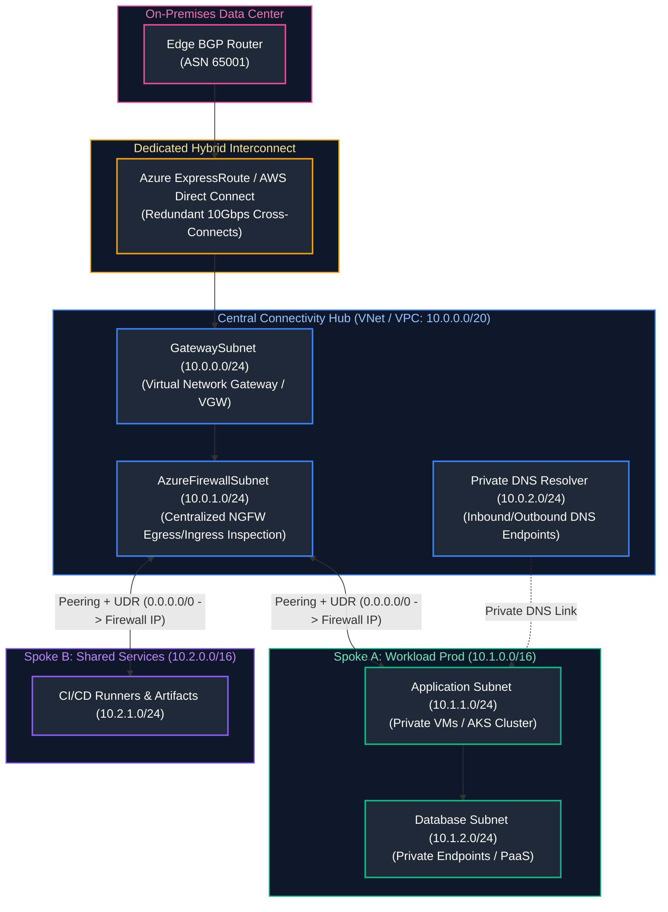
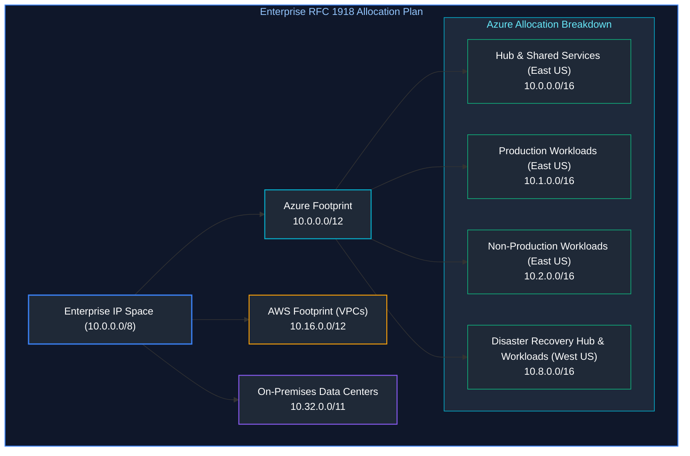
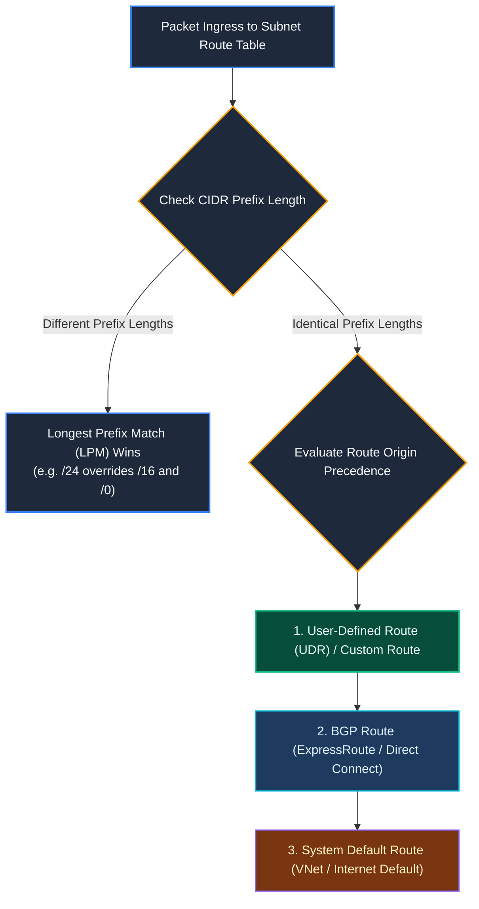
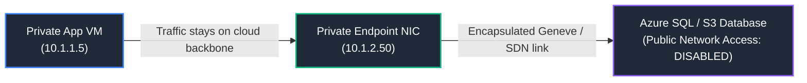
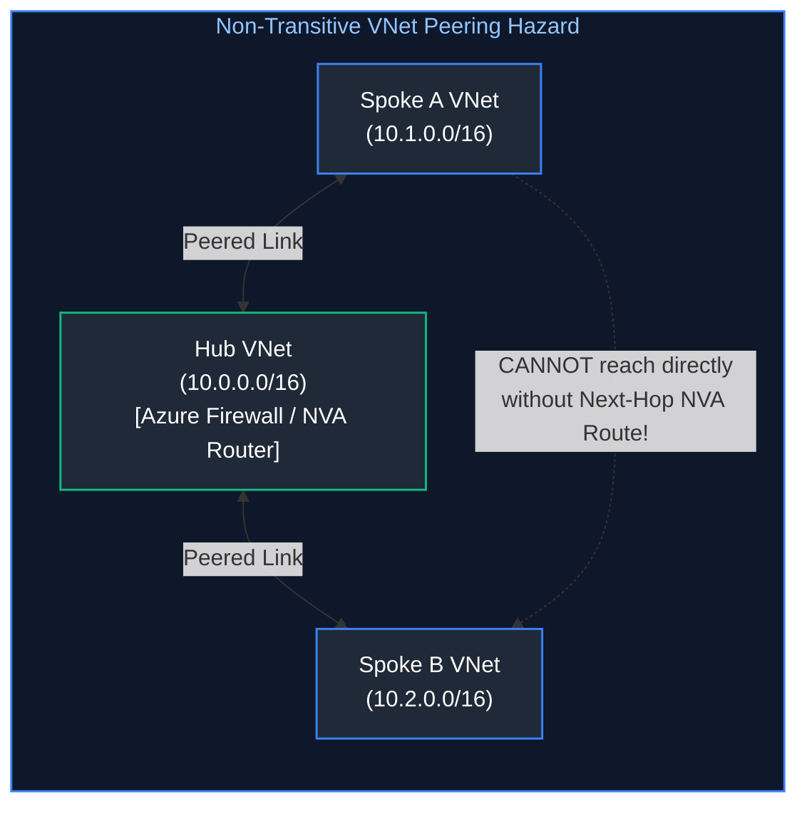
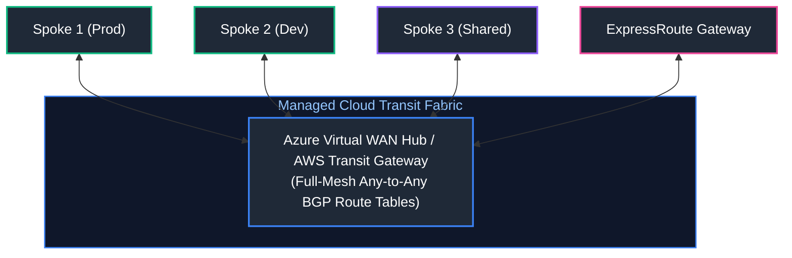
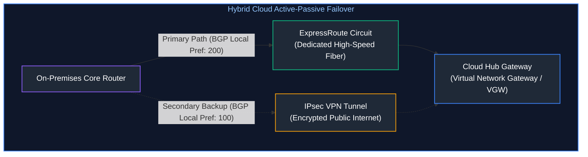

# 05. Cloud Networking & Infrastructure Design

A comprehensive, production-grade guide to enterprise cloud networking architecture, multi-tier CIDR design, Hub-and-Spoke topologies, Azure Virtual WAN and AWS Transit Gateway, Private Link and Private Endpoints, Next-Generation Firewalls, User-Defined Routes (UDRs), zero-trust egress filtering, and hybrid connectivity via ExpressRoute and Direct Connect tailored for Cloud Network Engineers and Enterprise Infrastructure Architects.

---

## Architectural Overview: Enterprise Hub-and-Spoke Transit Architecture



---

## Table of Contents
1. [VNet and VPC Architecture and CIDR Planning](#1-vnet-and-vpc-architecture-and-cidr-planning)
   - [1.1 Enterprise IP Addressing Strategy and Avoiding Overlap](#11-enterprise-ip-addressing-strategy-and-avoiding-overlap)
   - [1.2 Tiered Subnet Isolation: Ingress, Application, Data, and Management](#12-tiered-subnet-isolation-ingress-application-data-and-management)
2. [Route Tables, Gateways, and NAT Mechanics](#2-route-tables-gateways-and-nat-mechanics)
   - [2.1 User-Defined Routes (UDRs) vs. System Route Precedence](#21-user-defined-routes-udrs-vs-system-route-precedence)
   - [2.2 Managed NAT Gateways and SNAT Port Exhaustion](#22-managed-nat-gateways-and-snat-port-exhaustion)
3. [Network Firewalls and Security Group Topologies](#3-network-firewalls-and-security-group-topologies)
   - [3.1 Cloud Next-Generation Firewalls (Azure Firewall Primary & AWS Network Firewall Counterpart)](#31-cloud-next-generation-firewalls-azure-firewall-primary--aws-network-firewall-counterpart)
   - [3.2 NSG / Security Group Defense-in-Depth Rules](#32-nsg-security-group-defense-in-depth-rules)
4. [Private Link and Private Endpoints](#4-private-link-and-private-endpoints)
   - [4.1 Private Endpoints & Backbone Integration (Azure Private Link Primary & AWS PrivateLink Counterpart)](#41-private-endpoints--backbone-integration-azure-private-link-primary--aws-privatelink-counterpart)
   - [4.2 Private DNS Zone Integration and DNS Forwarding](#42-private-dns-zone-integration-and-dns-forwarding)
5. [Hub-and-Spoke Topology and Transit Networking](#5-hub-and-spoke-topology-and-transit-networking)
   - [5.1 VNet Peering Non-Transitive Routing Constraints](#51-vnet-peering-non-transitive-routing-constraints)
   - [5.2 Scaled Transit Networking Fabrics (Azure Virtual WAN Primary & AWS Transit Gateway Counterpart)](#52-scaled-transit-networking-fabrics-azure-virtual-wan-primary--aws-transit-gateway-counterpart)
6. [Hybrid Connectivity: ExpressRoute and Direct Connect](#6-hybrid-connectivity-expressroute-and-direct-connect)
   - [6.1 Dedicated Layer 3 Circuits & BGP Peering Routing](#61-dedicated-layer-3-circuits-bgp-peering-routing)
   - [6.2 IPsec VPN Failover Over Direct Peering](#62-ipsec-vpn-failover-over-direct-peering)
7. [Zero-Trust Network Segmentation & Egress Inspection](#7-zero-trust-network-segmentation-egress-inspection)
   - [7.1 Forced Tunneling and TLS Decryption Inspection](#71-forced-tunneling-and-tls-decryption-inspection)
   - [7.2 Service Tags vs. FQDN Application Filtering](#12-tiered-subnet-isolation-ingress-application-data-and-management)
8. [Automated Network Validation & Routing Audit Script](#8-automated-network-validation-routing-audit-script)
   - [8.1 Network Routing Matrix Verification Engine](#81-network-routing-matrix-verification-engine)
   - [8.2 Automated Python Route and Subnet Overlap Validator](#82-automated-python-route-and-subnet-overlap-validator)
9. [Summary Comparison & Engineering Reference Matrix](#9-summary-comparison-engineering-reference-matrix)
10. [References & Further Reading](#10-references-further-reading)

---

# 1. VNet and VPC Architecture and CIDR Planning

### 1.1 Enterprise IP Addressing Strategy and Avoiding Overlap

Designing cloud networks for an enterprise requires allocating non-overlapping RFC 1918 IPv4 address space across all on-premises data centers, branch offices, and multi-region cloud subscriptions.



> [!CAUTION]
> **Overlapping CIDRs Break Transitive Peering:** Cloud virtual networks with overlapping IP address ranges **cannot be peered**. Merging or connecting environments with duplicate CIDR ranges requires complex, high-latency 1:1 Bidirectional NAT (NAT44), introducing operational overhead and masking original client IP addresses. Always partition enterprise address space hierarchically.

---

### 1.2 Tiered Subnet Isolation: Ingress, Application, Data, and Management

Subnets must segment workloads by trust boundary and blast radius:

| Subnet Tier | CIDR Block | Deployed Workloads | IP Exposure | Inbound NSG Security Rule |
| :--- | :--- | :--- | :--- | :--- |
| **Tier 1: Ingress / WAF** | `10.1.0.0/24` | Application Gateway / ALB, WAF v2 | Public IP / Internet Inbound | Allow HTTP (80) & HTTPS (443) from `Internet` |
| **Tier 2: App Runtime** | `10.1.1.0/24` | AKS Nodes, Microservice VMs, App Service VNet Integration | **No Public IPs** (Private Only) | Allow Inbound from Tier 1 Subnet (`10.1.0.0/24`) |
| **Tier 3: Data & Persistence** | `10.1.2.0/24` | Private Endpoints for Managed DBs (Azure SQL, Cosmos DB, RDS) | **No Public IPs** (Private Only) | Allow Inbound from Tier 2 Subnet (`10.1.1.0/24`) |

---

# 2. Route Tables, Gateways, and NAT Mechanics

### 2.1 User-Defined Routes (UDRs) vs. System Route Precedence

Both Azure and AWS inject automatic default system routes into every subnet:
- Intra-VNet / Intra-VPC routing: Direct local routing without transit hops.
- Default Internet Route (`0.0.0.0/0`): Direct egress to the cloud public edge.

To enforce zero-trust security and inspect all outbound or cross-spoke traffic, architects attach a **User-Defined Route (UDR)** (Azure) or a **Custom Route Table** (AWS) to override default system routing:



```bash
# Azure CLI: Route all outbound internet traffic from App Subnet through Firewall
az network route-table route create \
  --resource-group rg-network-prod \
  --route-table-name rt-app-subnet \
  --name route-to-firewall \
  --address-prefix 0.0.0.0/0 \
  --next-hop-type VirtualAppliance \
  --next-hop-ip-address 10.0.1.4
```

---

### 2.2 Managed NAT Gateways and SNAT Port Exhaustion

When private virtual machines make outbound calls to external APIs, Source Network Address Translation (SNAT) translates private IP:port pairs into the public IP:port of the NAT gateway.
- **SNAT Port Allocation:** A single public IP provides 64,512 usable SNAT ports.
- **SNAT Exhaustion Failure Mode:** High-concurrency microservices creating new TCP connections without pooling (e.g. naive HTTP clients) rapidly exhaust available SNAT ports. Outbound connections stall with TCP connection timeout errors (`ETIMEDOUT`).
- **Production Solution:** Attach multiple public IP addresses to the NAT Gateway (allocating $64,512 \times N$ ports) and configure HTTP clients with connection pooling (`Keep-Alive`).

---

# 3. Network Firewalls and Security Group Topologies

### 3.1 Cloud Next-Generation Firewalls (Azure Firewall Primary & AWS Network Firewall Counterpart)

| Architecture Feature | Azure Firewall (Premium) | AWS Network Firewall |
| :--- | :--- | :--- |
| **Engine Foundation** | Managed State-as-a-Service Cloud NGFW | Suricata-compatible open-source IDS/IPS engine |
| **Throughput & Scaling**| Autoscales up to 30 Gbps based on CPU/throughput | Scales up to 100 Gbps per Availability Zone endpoint |
| **TLS Inspection** | Native forward proxy TLS termination & deep inspection | TLS inspection requires importing private keys to AWS ACM |
| **Rule Types** | DNAT Rules, Network Rules (L3/L4), Application Rules (L7 FQDN) | Stateless Rules (evaluated first) & Stateful Rules (Suricata syntax) |
| **Threat Intelligence**| Microsoft Cyber Threat Intelligence feed auto-blocking | AWS Managed Rule Groups & custom Suricata signatures |

---

### 3.2 NSG / Security Group Defense-in-Depth Rules

Enterprise best practice implements a two-tier firewall defense model:
1. **Perimeter Inspection (Central Firewall):** Centralized filtering of north-south internet traffic and east-west cross-spoke transit.
2. **Micro-Segmentation (NSGs / Security Groups):** Applied directly at the subnet and NIC boundary to enforce least-privilege intra-spoke communication.

| Priority | Name | Source | Port | Destination | Action |
| :---: | :--- | :--- | :---: | :--- | :---: |
| **100** | `Allow_App_To_DB` | `10.1.1.0/24` | 5432 | `10.1.2.0/24` | **ALLOW** |
| **200** | `Allow_Health_Probes` | `AzureLoadBalancer` | `ANY` | Subnet | **ALLOW** |
| **4096** | `Deny_All_Inbound` | `*` | `*` | `*` | **DENY** |

---

# 4. Private Link and Private Endpoints

### 4.1 Private Endpoints & Backbone Integration (Azure Private Link Primary & AWS PrivateLink Counterpart)

Traditionally, cloud PaaS services (Azure SQL, S3, Blob Storage) were reached over public internet endpoints. **Private Link** brings PaaS instances directly into your private virtual network using a **Private Endpoint** (a dedicated virtual network interface with a private RFC 1918 IP).



- Data traversing Private Endpoints travels over the cloud provider's physical backbone and **never traverses the public internet**.
- Eliminates data exfiltration risks: instances inside the VNet can only reach the explicitly authorized storage account or database mapped to that Private Endpoint.

---

### 4.2 Private DNS Zone Integration and DNS Forwarding

When accessing a PaaS resource via a private endpoint, the application still queries the canonical public domain (`mydb.privatelink.database.windows.net`).
- **Split-Horizon Resolution:** Link an Azure Private DNS Zone (`privatelink.database.windows.net`) to the VNet with an `A` record resolving the hostname to `10.1.2.50`.
- **Hybrid DNS Forwarder:** On-premises data centers query an **Azure Private DNS Resolver** or **Route 53 Inbound Endpoint** to seamlessly resolve private cloud PaaS endpoints.

---

# 5. Hub-and-Spoke Topology and Transit Networking

### 5.1 VNet Peering Non-Transitive Routing Constraints

Virtual Network Peering connects two VNets with low-latency SDN encapsulation. However, **peering is strictly non-transitive**:



If Spoke A wants to communicate with Spoke B, traffic must explicitly traverse a Network Virtual Appliance (NVA) or Azure Firewall in the Hub using User-Defined Routes.

---

### 5.2 Scaled Transit Networking Fabrics (Azure Virtual WAN Primary & AWS Transit Gateway Counterpart)

As enterprise estates expand past 50+ VNets/VPCs, managing point-to-point peering and UDRs becomes unwieldy:



- **AWS Transit Gateway (TGW):** Acts as a cloud-native distributed router. Supports multiple route tables, route domains (isolating Dev from Prod), and scales up to 5,000 VPC attachments.
- **Azure Virtual WAN (vWAN):** Microsoft-managed global connectivity mesh. Provides automated hub-to-spoke routing, integrated Azure Firewall, SD-WAN interconnects, and ExpressRoute termination.

---

# 6. Hybrid Connectivity: ExpressRoute and Direct Connect

### 6.1 Dedicated Layer 3 Circuits & BGP Peering Routing

- **Azure ExpressRoute & AWS Direct Connect:** Provide private, dedicated physical fiber connections from customer data centers or colocation facilities (Equinix, Megaport) to the cloud backbone.
- **BGP Peering Architecture:**
  - Uses Border Gateway Protocol (BGP) with Autonomous System Numbers (e.g. Customer ASN `65001`, Cloud ASN `12076`).
  - Routes are dynamically exchanged; on-premises networks advertise internal CIDRs to the cloud gateway, and the cloud advertises VNet routes.
- **SLA & Resilience:** Multi-gigabit throughput, deterministic sub-5ms latency, zero public internet exposure, and $99.95\% - 99.99\%$ availability SLAs.

---

### 6.2 IPsec VPN Failover Over Direct Peering

Production architectures deploy a Site-to-Site IPsec VPN running in parallel with ExpressRoute/Direct Connect as an automated backup:



BGP Local Preference ensures all traffic flows over ExpressRoute during normal operations. If fiber cuts disrupt the circuit, BGP immediately reroutes packets across the IPsec tunnel within seconds.

---

# 7. Zero-Trust Network Segmentation & Egress Inspection

### 7.1 Forced Tunneling and TLS Decryption Inspection

Under Zero-Trust governance, no cloud workload is permitted direct access to the public internet:
1. **Forced Tunneling:** A default route `0.0.0.0/0` advertises all traffic through the central firewall or back to on-premises inspection stacks.
2. **TLS Decryption:** The firewall terminates outbound TLS using an enterprise CA certificate, inspects application payloads for malware or data exfiltration tokens, and re-encrypts outbound traffic to external destinations.

---

# 8. Automated Network Validation & Routing Audit Script

### 8.1 Network Routing Matrix Verification Engine

Automating subnet validation and ensuring no IP range collisions occur across multi-region environments is a core DevOps responsibility.

---

### 8.2 Automated Python Route and Subnet Overlap Validator

Below is a production Python script that takes a list of proposed virtual networks and subnets, performs bitwise overlap calculations using `ipaddress`, and audits route tables for asymmetric routing hazards:

```python
#!/usr/bin/env python3
"""
Enterprise Cloud CIDR Planner and Route Conflict Validator.
Analyzes virtual network address spaces, identifies illegal overlapping subnets,
and audits default gateway routing integrity across multi-cloud environments.
"""

from dataclasses import dataclass
import ipaddress
import json
import logging
import sys
from typing import Dict, List, Set, Tuple

logging.basicConfig(
    level=logging.INFO,
    format='{"time":"%(asctime)s","level":"%(levelname)s","message":"%(message)s"}',
    handlers=[logging.StreamHandler(sys.stdout)],
)
logger = logging.getLogger("cidr_auditor")


@dataclass(frozen=True)
class SubnetConfig:
    vnet_name: str
    subnet_name: str
    cidr: str


class CloudNetworkAuditor:
    def __init__(self, subnets: List[SubnetConfig]):
        self.subnets = subnets

    def detect_overlaps(self) -> List[Dict]:
        """Calculates pairwise bitwise subnet collisions."""
        collisions = []
        n = len(self.subnets)

        for i in range(n):
            net_a = ipaddress.ip_network(self.subnets[i].cidr)
            for j in range(i + 1, n):
                net_b = ipaddress.ip_network(self.subnets[j].cidr)

                if net_a.overlaps(net_b):
                    conflict = {
                        "subnet_1": f"{self.subnets[i].vnet_name}/{self.subnets[i].subnet_name} ({net_a})",
                        "subnet_2": f"{self.subnets[j].vnet_name}/{self.subnets[j].subnet_name} ({net_b})",
                        "severity": "CRITICAL_COLLISION",
                    }
                    collisions.append(conflict)
                    logger.error(
                        "CIDR Overlap Detected between %s and %s",
                        conflict["subnet_1"],
                        conflict["subnet_2"],
                    )
        return collisions

    def calculate_usable_hosts(self) -> Dict[str, int]:
        """Computes usable cloud host addresses (accounting for 5 cloud reserved IPs)."""
        usable_map = {}
        for sub in self.subnets:
            net = ipaddress.ip_network(sub.cidr)
            # Cloud providers reserve 5 IPs per subnet
            usable = max(0, net.num_addresses - 5)
            usable_map[f"{sub.vnet_name}:{sub.subnet_name}"] = usable
        return usable_map


if __name__ == "__main__":
    inventory = [
        SubnetConfig("Hub-EastUS", "GatewaySubnet", "10.0.0.0/24"),
        SubnetConfig("Hub-EastUS", "AzureFirewallSubnet", "10.0.1.0/24"),
        SubnetConfig("Spoke-Prod-EastUS", "AppSubnet", "10.1.0.0/23"),
        SubnetConfig("Spoke-Prod-EastUS", "DBSubnet", "10.1.2.0/24"),
        # Simulated collision for test audit
        SubnetConfig("Spoke-Shadow-Dev", "TestSubnet", "10.1.1.0/24"),
    ]

    auditor = CloudNetworkAuditor(inventory)
    overlap_report = auditor.detect_overlaps()
    host_capacity = auditor.calculate_usable_hosts()

    result = {
        "audit_status": "FAILED" if overlap_report else "PASSED",
        "overlap_count": len(overlap_report),
        "conflicts": overlap_report,
        "usable_cloud_host_capacities": host_capacity,
    }
    print(json.dumps(result, indent=2))
```

---

# 9. Summary Comparison & Engineering Reference Matrix

| Network Component | Azure Native Implementation | AWS Native Implementation | Key Architectural Invariant |
| :--- | :--- | :--- | :--- |
| **Central Transit Hub** | Azure Virtual WAN / Azure Route Server | AWS Transit Gateway (TGW) | Transitive routing requires central hub router; native peerings are non-transitive. |
| **Egress Inspection** | Azure Firewall Premium | AWS Network Firewall | Force `0.0.0.0/0` via UDR/Route Table to NVA interface to prevent direct internet breakout. |
| **PaaS Isolation** | Azure Private Endpoint & Private Link | AWS PrivateLink & VPC Endpoints | PaaS traffic stays on private cloud backbone; disable public access on target PaaS. |
| **Hybrid Direct Line** | ExpressRoute (Dedicated Circuit) | Direct Connect (DX) | Uses BGP dynamic routing; backup with IPsec VPN using lower BGP local preference. |
| **Outbound NAT** | Azure NAT Gateway | AWS NAT Gateway | Deployed per subnet/AZ; attaches public IPs to provide 64k SNAT ports per IP. |

---

# 10. References & Further Reading

- [Microsoft Learn: Hub-spoke network topology in Azure](https://learn.microsoft.com/en-us/azure/architecture/reference-architectures/hybrid-networking/hub-spoke) — Reference architecture guide.
- [AWS Whitepaper: Building a Scalable and Secure Multi-VPC AWS Network Infrastructure](https://docs.aws.amazon.com/whitepapers/latest/building-scalable-secure-multi-vpc-network-infrastructure/) — Transit Gateway best practices.
- [Azure Virtual WAN Documentation](https://learn.microsoft.com/en-us/azure/virtual-wan/) — Global transit network architecture.
- [RFC 4271: A Border Gateway Protocol 4 (BGP-4)](https://datatracker.ietf.org/doc/html/rfc4271) — Standard routing protocol specifications.

