# 05. Cloud Networking & Infrastructure Design

A comprehensive, production-grade guide to enterprise cloud networking architecture, multi-tier CIDR design, Hub-and-Spoke topologies, Azure Virtual WAN and AWS Transit Gateway, Private Link and Private Endpoints, Next-Generation Firewalls (NGFW), Gateway Load Balancers (GWLB), User-Defined Routes (UDRs), zero-trust egress filtering, BGP Anycast edge routing (Azure Front Door / CloudFront), and hybrid connectivity via ExpressRoute and Direct Connect tailored for Cloud Network Engineers, Enterprise Infrastructure Architects, and Senior SREs.

---

## Architectural Overview: Enterprise Hub-and-Spoke Transit Architecture

In modern enterprise cloud environments, networking is the foundation upon which all compute, data, and security architectures rest. Rather than allowing application teams to provision ad-hoc virtual networks with direct internet access, enterprise architectures enforce a **Hub-and-Spoke Transit Topology**. The central Hub acts as the single, tightly governed gateway for all hybrid connectivity, perimeter inspection, and DNS resolution, while isolated Spoke networks house specific business workloads:

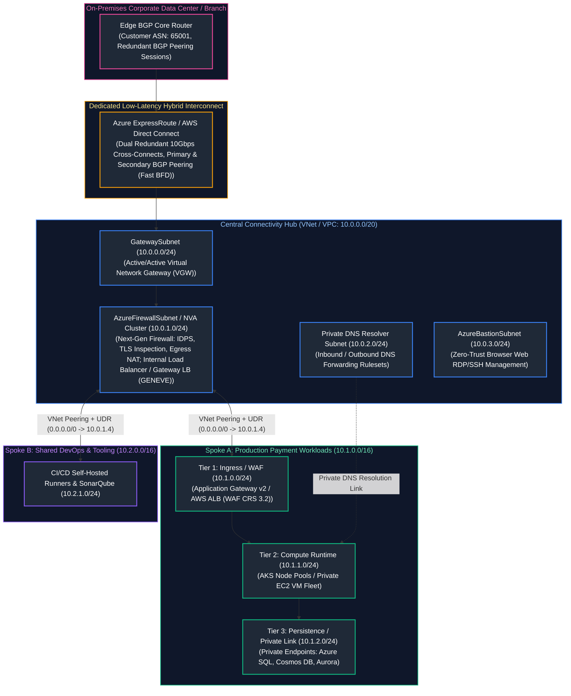

---

## Table of Contents
1. [Enterprise Cloud Network Architecture & CIDR Planning](#1-enterprise-cloud-network-architecture--cidr-planning)
   - [1.1 The Airline Hub Analogy & Why Hub-and-Spoke Dominates](#11-the-airline-hub-analogy--why-hub-and-spoke-dominates)
   - [1.2 Global Non-Overlapping RFC 1918 Address Allocation Strategies](#12-global-non-overlapping-rfc-1918-address-allocation-strategies)
   - [1.3 Multi-Tier Subnet Segmentation (Ingress, App, Data, Management)](#13-multi-tier-subnet-segmentation-ingress-app-data-management)
2. [Software-Defined Networking (SDN) Datapath & Virtualization Mechanics](#2-software-defined-networking-sdn-datapath--virtualization-mechanics)
   - [2.1 Accelerated Networking & SR-IOV Hypervisor Bypass](#21-accelerated-networking--sr-iov-hypervisor-bypass)
   - [2.2 SDN Overlays: VXLAN and NVGRE Packet Encapsulation](#22-sdn-overlays-vxlan-and-nvgre-packet-encapsulation)
3. [Route Tables, Gateways, and Traffic Redirection](#3-route-tables-gateways-and-traffic-redirection)
   - [3.1 Default Cloud System Routes vs. User-Defined Routes (UDRs)](#31-default-cloud-system-routes-vs-user-defined-routes-udrs)
   - [3.2 The Routing Precedence Hierarchy (LPM, UDR, BGP, System)](#32-the-routing-precedence-hierarchy-lpm-udr-bgp-system)
   - [3.3 Managed NAT Gateways & Eliminating SNAT Port Exhaustion](#33-managed-nat-gateways--eliminating-snat-port-exhaustion)
4. [Network Firewalls, Gateway Load Balancers & Perimeter Defense](#4-network-firewalls-gateway-load-balancers--perimeter-defense)
   - [4.1 Next-Generation Firewalls: Azure Firewall Premium vs. AWS Network Firewall](#41-next-generation-firewalls-azure-firewall-premium-vs-aws-network-firewall)
   - [4.2 Gateway Load Balancer (GWLB) & Inline NVA Scaling via GENEVE Encapsulation](#42-gateway-load-balancer-gwlb--inline-nva-scaling-via-geneve-encapsulation)
   - [4.3 Micro-Segmentation: NSG & Security Group Hierarchies](#43-micro-segmentation-nsg--security-group-hierarchies)
5. [Private Link and Private Endpoints](#5-private-link-and-private-endpoints)
   - [5.1 The Death of Public PaaS Endpoints: Private Link Architecture](#51-the-death-of-public-paas-endpoints-private-link-architecture)
   - [5.2 The DNS Resolution Dance: CNAME Flattening & Private DNS Zones](#52-the-dns-resolution-dance-cname-flattening--private-dns-zones)
   - [5.3 Azure Private DNS Resolver & Route 53 Resolver for Hybrid DNS](#53-azure-private-dns-resolver--route-53-resolver-for-hybrid-dns)
6. [Hub-and-Spoke Topology vs. Scaled Transit Fabrics](#6-hub-and-spoke-topology-vs-scaled-transit-fabrics)
   - [6.1 VNet Peering Mechanics & The Non-Transitive Routing Trap](#61-vnet-peering-mechanics--the-non-transitive-routing-trap)
   - [6.2 Scaled Mesh Transit: Azure Virtual WAN vs. AWS Transit Gateway](#62-scaled-mesh-transit-azure-virtual-wan-vs-aws-transit-gateway)
7. [Hybrid Cloud Backbones: ExpressRoute and Direct Connect](#7-hybrid-cloud-backbones-expressroute-and-direct-connect)
   - [7.1 Dedicated Layer 3 Cross-Connects & BGP Dynamic Peering](#71-dedicated-layer-3-cross-connects--bgp-dynamic-peering)
   - [7.2 Automated Active-Passive Failover: ExpressRoute with IPsec VPN Backup](#72-automated-active-passive-failover-expressroute-with-ipsec-vpn-backup)
8. [Global Edge Ingress & Anycast Routing](#8-global-edge-ingress--anycast-routing)
   - [8.1 BGP Anycast Edge Routing (Azure Front Door / CloudFront)](#81-bgp-anycast-edge-routing-azure-front-door--cloudfront)
   - [8.2 Split-TCP Termination & HTTP/3 Performance Acceleration](#82-split-tcp-termination--http3-performance-acceleration)
9. [Automated Network Validation & Routing Audit Script](#9-automated-network-validation--routing-audit-script)
   - [9.1 Complete Production Python CIDR & Route Collision Auditor](#91-complete-production-python-cidr--route-collision-auditor)
10. [Senior Network SRE Troubleshooting Runbooks](#10-senior-network-sre-troubleshooting-runbooks)
    - [10.1 Scenario 1: Asymmetric Routing Black Hole over Hybrid BGP Circuits](#101-scenario-1-asymmetric-routing-black-hole-over-hybrid-bgp-circuits)
    - [10.2 Scenario 2: Private Endpoint DNS Resolution Leak Inside AKS / EKS](#102-scenario-2-private-endpoint-dns-resolution-leak-inside-aks--eks)
    - [10.3 Scenario 3: Ephemeral SNAT Exhaustion on High-Throughput Egress](#103-scenario-3-ephemeral-snat-exhaustion-on-high-throughput-egress)
    - [10.4 Scenario 4: Subnet IP Exhaustion During Sudden Kubernetes Cluster Scaling](#104-scenario-4-subnet-ip-exhaustion-during-sudden-kubernetes-cluster-scaling)
11. [Summary Comparison & Engineering Reference Matrix](#11-summary-comparison--engineering-reference-matrix)
12. [References & Further Reading](#12-references--further-reading)

---

# 1. Enterprise Cloud Network Architecture & CIDR Planning

### 1.1 The Airline Hub Analogy & Why Hub-and-Spoke Dominates

To understand why enterprise cloud networking enforces a **Hub-and-Spoke topology**, consider how commercial airlines organize flights:

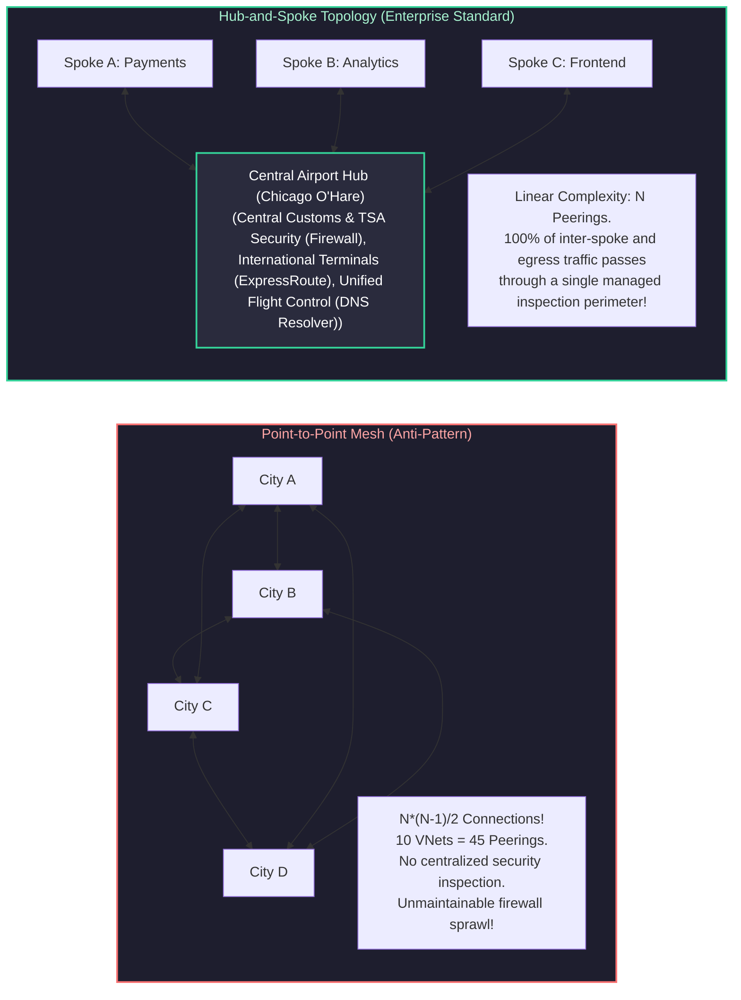

- **Point-to-Point Mesh:** If 50 application VNets establish direct peerings with each other, you must manage $N(N-1)/2 = 1,225$ peerings. Security teams have zero visibility into inter-application traffic, and compliance audits become impossible.
- **Hub-and-Spoke:** Each spoke establishes a single peering to the central Hub. The Hub enforces centralized security inspection, outbound NAT, hybrid on-premises connectivity, and DNS resolution. Managing 50 spokes requires exactly **50 peerings**, with 100% of packets subject to central auditing.

---

### 1.2 Global Non-Overlapping RFC 1918 Address Allocation Strategies

Private IPv4 space (RFC 1918) is strictly limited:
- `10.0.0.0/8` (16,777,216 addresses)
- `172.16.0.0/12` (1,048,576 addresses)
- `192.168.0.0/16` (65,536 addresses)

In large enterprises with on-premises data centers, branch offices, and multi-region cloud deployments, **overlapping CIDRs cause immediate routing collisions**. Overlapping subnets cannot be peered without complex, high-latency 1:1 Source/Destination NAT translation gateways.

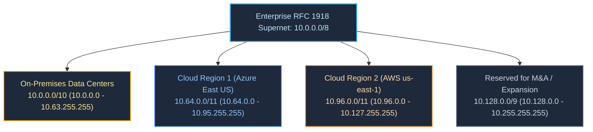

---

### 1.3 Multi-Tier Subnet Segmentation (Ingress, App, Data, Management)

Enterprise spoke VNets follow the standardized **3-Tier Subnet Architecture**:

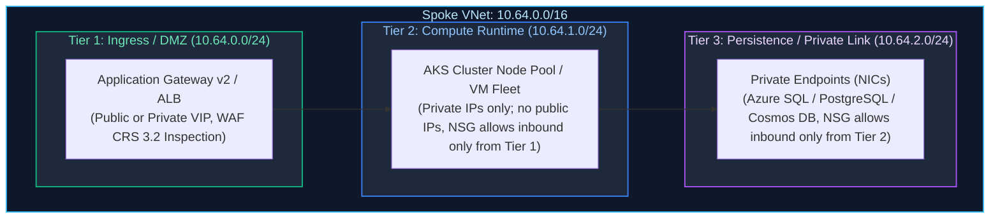

> [!IMPORTANT]
> **Cloud Provider Reserved IP Addresses:** Both Azure and AWS reserve specific IP addresses in every subnet:
> - **Azure reserves 5 IPs per subnet:** `.0` (Network ID), `.1` (Default Gateway), `.2` & `.3` (Azure DNS mapping), `.255` (Network Broadcast).
> - **AWS reserves 5 IPs per subnet:** `.0` (Network ID), `.1` (VPC Router), `.2` (DNS resolver), `.3` (Future use), `.255` (Network Broadcast).
> Therefore, a `/28` subnet (16 total IP addresses) yields only **11 usable host addresses**.

---

# 2. Software-Defined Networking (SDN) Datapath & Virtualization Mechanics

### 2.1 Accelerated Networking & SR-IOV Hypervisor Bypass

Traditional cloud virtualization routes every network packet through the host operating system's software hypervisor bridge, introducing significant jitter, CPU overhead, and microsecond latency penalties:

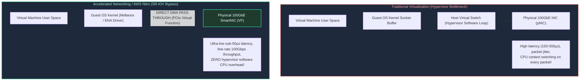

- **SR-IOV (Single Root I/O Virtualization):** Exposes physical PCIe network hardware as hundreds of virtual functions (VFs). The guest OS interacts directly with the SmartNIC hardware via Direct Memory Access (DMA), bypassing the virtualization hypervisor completely.
- **Production Standard:** In Azure, always enable `accelerated_networking_enabled = true`. In AWS, utilize instance types backed by the **AWS Nitro System** with Elastic Network Adapter (ENA).

---

### 2.2 SDN Overlays: VXLAN and NVGRE Packet Encapsulation

Under the hood of Azure Virtual Networks and AWS VPCs lies a physical spine-and-leaf physical IP network. Cloud providers implement **SDN Overlays** using **VXLAN (Virtual Extensible LAN)** or **NVGRE (Network Virtualization using Generic Routing Encapsulation)**:
1. When VM A (`10.1.1.4`) sends a packet to VM B (`10.1.2.8`), the guest kernel constructs a standard Ethernet frame.
2. The physical SmartNIC intercepts the frame, inspects the SDN directory service mapping, and wraps the customer payload inside an outer **UDP packet (port 4789 for VXLAN)** addressed between the physical hypervisor host IPs.
3. The outer packet is routed across the physical data center fabric via standard Layer 3 Equal-Cost Multi-Path (ECMP).
4. The receiving host SmartNIC decapsulates the outer UDP header and deposits the original payload directly into VM B’s memory.

---

# 3. Route Tables, Gateways, and Traffic Redirection

### 3.1 Default Cloud System Routes vs. User-Defined Routes (UDRs)

By default, cloud platforms configure invisible **System Routes** in every subnet:
- Traffic between subnets in the same VNet: Routed directly via `Virtual network`.
- Traffic across peered VNets: Routed directly via `VNet peering`.
- Traffic to `0.0.0.0/0`: Routed directly to `Internet` via transparent cloud SNAT.

To build an enterprise DMZ where all traffic is inspected by a central firewall, network engineers override system routes using **User-Defined Routes (UDRs) / Custom Route Tables**:

```yaml
# Conceptual UDR Routing Rule
AddressPrefix: 0.0.0.0/0
NextHopType: VirtualAppliance
NextHopIPAddress: 10.0.1.4  # Central Azure Firewall Private IP
```

---

### 3.2 The Routing Precedence Hierarchy (LPM, UDR, BGP, System)

When multiple routes exist in a cloud route table, the SDN packet forwarding engine evaluates routes in strict order of precedence:

$$\text{Longest Prefix Match (LPM)} \longrightarrow \text{User-Defined Route (UDR)} \longrightarrow \text{BGP ExpressRoute / DirectConnect} \longrightarrow \text{System Default Route}$$

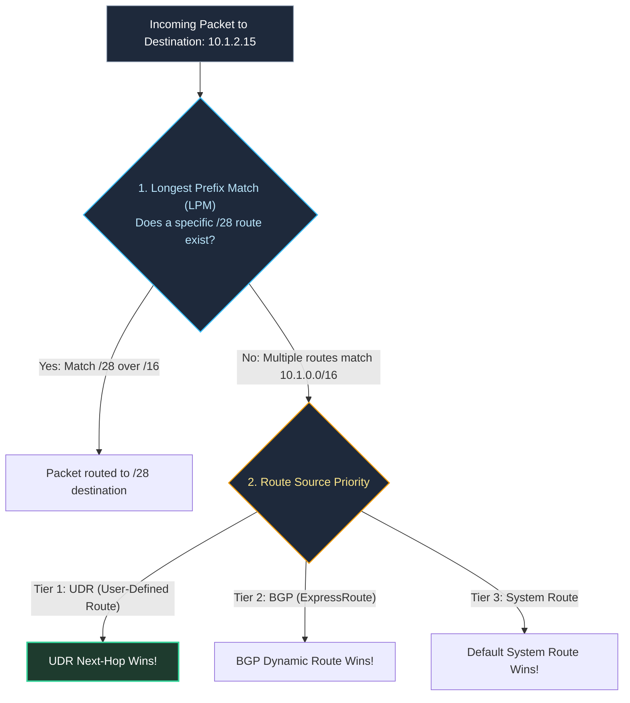

> [!CRITICAL]
> **The Longest Prefix Match (LPM) Rule:** LPM **always trumps route source priority**. If a UDR defines `0.0.0.0/0 -> 10.0.1.4`, but an active BGP route advertises `10.0.0.0/8 -> ExpressRouteGateway`, traffic targeting `10.1.2.15` will follow the BGP route because `/8` is more specific than `/0`! To force inter-VNet traffic through the firewall, you must define explicit, more specific UDRs (e.g. `10.0.0.0/8 -> 10.0.1.4`).

---

### 3.3 Managed NAT Gateways & Eliminating SNAT Port Exhaustion

When private instances initiate outbound connections to public endpoints (e.g., third-party APIs, GitHub, package registries), the cloud performs **Source Network Address Translation (SNAT)**.
- **Default Azure/AWS SNAT (Anti-Pattern):** Allocates a fixed pool of 1,024 ephemeral ports per instance. Under high concurrency, the instance rapidly consumes all ephemeral ports, resulting in silent connection dropouts and 30-second TCP SYN retransmission timeouts.
- **Managed NAT Gateway (Best Practice):** Allocates a dedicated pool of static public IPs. Each public IP provides **64,512 concurrent SNAT ports**. With 16 public IPs attached, a single NAT Gateway provides over **1,000,000 concurrent outbound connections**.

---

# 4. Network Firewalls, Gateway Load Balancers & Perimeter Defense

### 4.1 Next-Generation Firewalls: Azure Firewall Premium vs. AWS Network Firewall

| Capability | Azure Firewall Premium | AWS Network Firewall |
| :--- | :--- | :--- |
| **Inspection Engine** | Microsoft Threat Intelligence & Suricata-based IDPS | Open-source **Suricata** rules engine |
| **TLS Forward-Proxy Inspection** | Built-in TLS termination & re-encryption via Key Vault intermediate CA | Supported via TLS inspection configurations and AWS ACM CA |
| **FQDN Filtering** | Layer 7 application rules with wildcard FQDNs (e.g., `*.github.com`) | Stateful Layer 7 domain list rule groups (HTTP Host & SNI) |
| **High Availability Architecture** | Fully managed active-active autoscaling cluster behind internal VIP | Endpoint deployed per Availability Zone inside a dedicated firewall subnet |
| **Throughput & Scaling** | Autoscales dynamically up to 100 Gbps | Scales elastically up to 100 Gbps per AZ |

---

### 4.2 Gateway Load Balancer (GWLB) & Inline NVA Scaling via GENEVE Encapsulation

When enterprises deploy third-party **Network Virtual Appliances (NVAs)** (e.g., Palo Alto Networks VM-Series, Fortinet FortiGate, Check Point CloudGuard), scaling them horizontally without breaking TCP session symmetry requires **Gateway Load Balancer (GWLB)**:

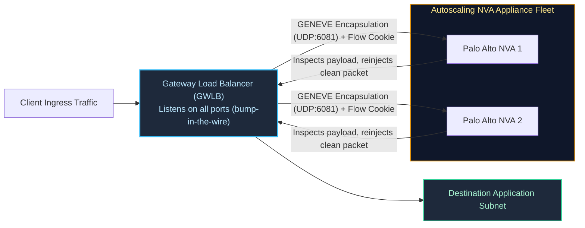

- **GENEVE Protocol (Port 6081):** GWLB wraps customer packets inside a GENEVE header containing a **Flow Cookie**. The NVA inspects the original packet headers, applies Layer 7 threat rules, and returns the packet to GWLB via GENEVE.
- **Session Stickiness:** GWLB guarantees that bidirectional TCP flows are routed to the **exact same physical firewall appliance**, preserving stateful TCP tracking without complex dual-arm SNAT configurations.

---

### 4.3 Micro-Segmentation: NSG & Security Group Hierarchies

Network Security Groups (NSGs) and AWS Security Groups enforce stateful Layer 4 micro-segmentation at the network interface (NIC) boundary:
- **Subnet-Level NSG:** Protects the perimeter of the entire subnet.
- **NIC-Level NSG:** Provides defense-in-depth directly on the individual virtual machine or container network interface.
- **Stateful Rule Processing:** If an outbound rule permits traffic to a remote IP, return inbound traffic is **automatically allowed** regardless of inbound deny rules.

---

# 5. Private Link and Private Endpoints

### 5.1 The Death of Public PaaS Endpoints: Private Link Architecture

Historically, cloud databases and storage accounts exposed public IP addresses accessible via the internet. Even when protected by IP firewall whitelists, traffic was exposed to credential brute-forcing, distributed denial-of-service (DDoS) attacks, and data exfiltration.

**Private Link** completely eliminates public endpoints by projecting a **virtual network interface (NIC) with a private RFC 1918 IP address** directly into your private subnet:

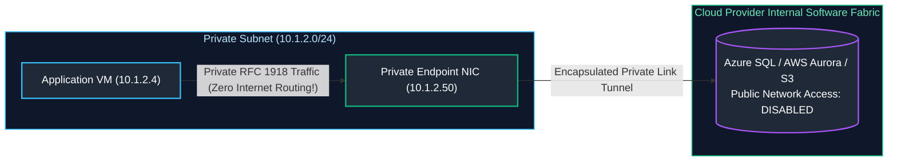

---

### 5.2 The DNS Resolution Dance: CNAME Flattening & Private DNS Zones

When you attach a Private Endpoint to `mydb.database.windows.net`, the cloud DNS updates public DNS to return a canonical name (CNAME) pointing to a private link domain:

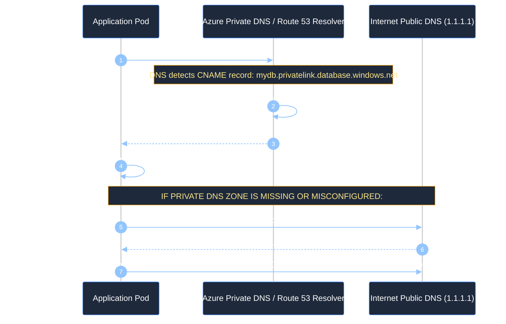

---

### 5.3 Azure Private DNS Resolver & Route 53 Resolver for Hybrid DNS

In hybrid enterprise architectures, on-premises corporate servers must resolve cloud Private Endpoints, and cloud workloads must resolve on-premises Active Directory domains:

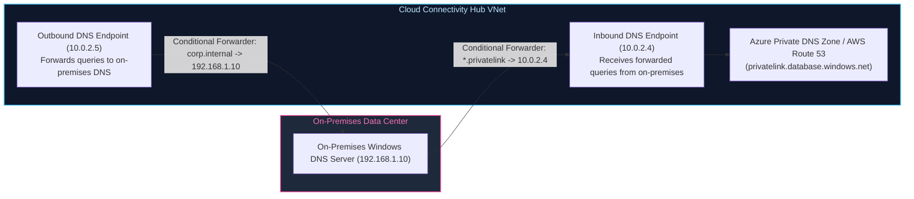

---

# 6. Hub-and-Spoke Topology vs. Scaled Transit Fabrics

### 6.1 VNet Peering Mechanics & The Non-Transitive Routing Trap

Virtual Network Peering connects two VNets over the cloud provider's low-latency fiber backbone. Traffic between peered VNets exhibits **zero gateway latency and line-rate throughput**.

> [!CAUTION]
> **The Non-Transitive Routing Trap:** Cloud VNet peering is **strictly non-transitive**. 
> - If Spoke A is peered to Hub, and Spoke B is peered to Hub, **Spoke A cannot communicate with Spoke B directly through the peering**.
> - To route traffic between Spoke A and Spoke B, traffic must be forwarded through a router or firewall inside the Hub using User-Defined Routes (UDRs) specifying `NextHop: VirtualAppliance`.

---

### 6.2 Scaled Mesh Transit: Azure Virtual WAN vs. AWS Transit Gateway

When enterprise network topologies scale beyond 30 Spokes across multiple geographic regions, managing hundreds of UDRs and peering meshes becomes unmaintainable. Enterprises deploy **Managed Transit Fabrics**:

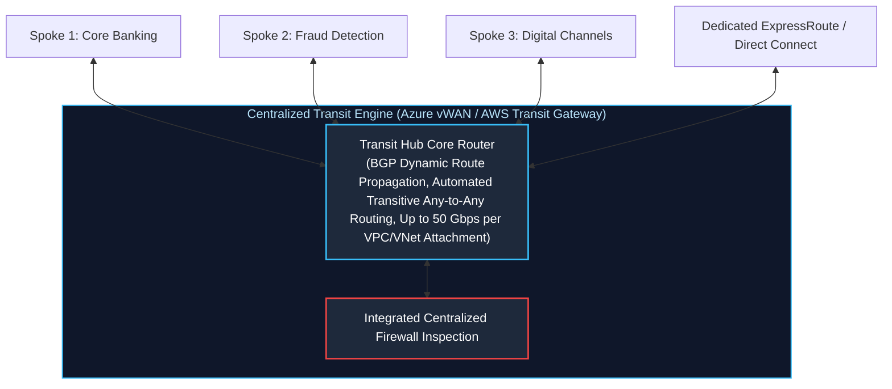

- **Azure Virtual WAN (vWAN):** A Microsoft-managed networking service connecting branch offices, VPNs, ExpressRoute circuits, and VNets into an automated hub-and-spoke mesh. Route propagation is fully automated without manual UDR authoring.
- **AWS Transit Gateway (TGW):** A regional network transit hub connecting thousands of VPCs and on-premises networks over an elastic AWS-managed router supporting BGP dynamic route evaluation.

---

# 7. Hybrid Cloud Backbones: ExpressRoute and Direct Connect

### 7.1 Dedicated Layer 3 Cross-Connects & BGP Dynamic Peering

Enterprise hybrid connectivity requires private, dedicated bandwidth bypassing the public internet:
- **Azure ExpressRoute & AWS Direct Connect:** Dedicated physical cross-connects (1 Gbps, 10 Gbps, or 100 Gbps) established at carrier colocation facilities (Equinix, Megaport, Digital Realty).
- **BGP Dynamic Peering (RFC 4271):** ExpressRoute and Direct Connect exchange routes dynamically using Border Gateway Protocol (BGP):
  - On-premises edge routers advertise local subnets using a private Autonomous System Number (ASN), e.g. `65001`.
  - Cloud gateways advertise virtual network CIDRs using cloud ASNs (Azure: `12076` or custom private ASN; AWS: `64512`).

---

### 7.2 Automated Active-Passive Failover: ExpressRoute with IPsec VPN Backup

To protect against catastrophic fiber cuts or carrier cross-connect failures, enterprises deploy **Site-to-Site IPsec VPN as an automated secondary backup**:

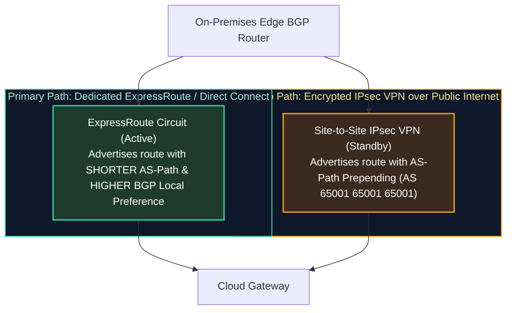

#### How BGP Automatically Governs Failover:
1. **Outbound Traffic (Cloud to On-Prem):** On-premises routers advertise subnets over ExpressRoute with a standard AS-Path, and advertise the same subnets over the VPN circuit with **AS-Path Prepending** (repeating the ASN 3 times). Cloud routers automatically select ExpressRoute because shorter AS-Paths win.
2. **Inbound Traffic (On-Prem to Cloud):** The on-premises edge router assigns a **higher BGP Local Preference (e.g. 200)** to ExpressRoute routes, and a **lower Local Preference (e.g. 100)** to VPN routes.
3. **Sub-Second Failure Detection:** By configuring **Bidirectional Forwarding Detection (BFD)** on the BGP session, link failures are detected in **$< 300\text{ms}$**, triggering instantaneous failover to the backup VPN without user disruption.

---

# 8. Global Edge Ingress & Anycast Routing

### 8.1 BGP Anycast Edge Routing (Azure Front Door / CloudFront)

Traditional DNS-based routing returns the IP address of an application server in a specific data center. If a user is in Singapore and the application is hosted in Virginia, the user's initial TCP handshake must cross the Pacific Ocean over the public internet, suffering massive latency and packet loss.

**BGP Anycast** broadcasts the **exact same public IP address** simultaneously from hundreds of cloud Points of Presence (PoPs) globally:

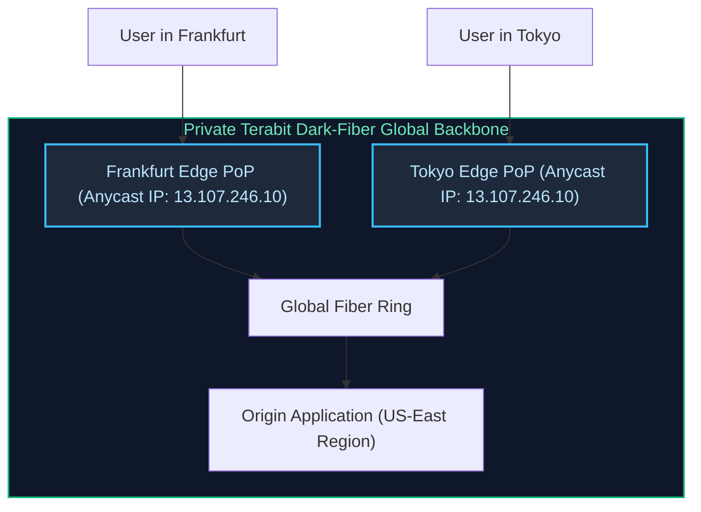

---

### 8.2 Split-TCP Termination & HTTP/3 Performance Acceleration

1. **Split-TCP Termination:** When a user initiates a connection, the TCP 3-way handshake and TLS 1.3 cryptographic negotiation complete with the **local Edge PoP** in $< 10\text{ms}$.
2. **Connection Pooling to Origin:** The Edge PoP maintains warm, pre-established persistent connection pools across the provider's dedicated dark-fiber backbone to the origin application, eliminating cold handshake latency across the globe.

---

# 9. Automated Network Validation & Routing Audit Script

### 9.1 Complete Production Python CIDR & Route Collision Auditor

Below is a production-grade Python utility that audits enterprise cloud network configurations, detects overlapping CIDR blocks, verifies subnet allocation math, and flags routing loops or missing firewall next-hops:

```python
#!/usr/bin/env python3
"""
Enterprise Cloud Network & Routing Architecture Auditor.
Validates RFC 1918 CIDR subnet boundaries, detects overlapping IP ranges,
and audits route table UDR configurations for routing black holes.
"""

from dataclasses import asdict, dataclass
import ipaddress
import json
import logging
import sys
from typing import Any, Dict, List, Optional

logging.basicConfig(
    level=logging.INFO,
    format='{"time":"%(asctime)s","level":"%(levelname)s","message":"%(message)s"}',
    handlers=[logging.StreamHandler(sys.stdout)],
)
logger = logging.getLogger("network_auditor")


@dataclass(frozen=True)
class SubnetAuditFinding:
    severity: str
    finding_type: str
    message: str
    affected_subnets: List[str]


class EnterpriseNetworkAuditor:
    def __init__(self, network_topology: Dict[str, Any]):
        self.topology = network_topology

    def audit_all(self) -> Dict[str, Any]:
        """Runs complete suite of network architecture validation audits."""
        findings: List[SubnetAuditFinding] = []
        findings.extend(self._audit_cidr_overlaps())
        findings.extend(self._audit_route_tables())
        findings.extend(self._audit_subnet_capacity())

        return {
            "network_topology_name": self.topology.get("environment_name", "enterprise-cloud"),
            "audit_status": "FAILED" if any(f.severity == "CRITICAL" for f in findings) else "PASSED",
            "findings_count": len(findings),
            "findings": [asdict(f) for f in findings],
        }

    def _audit_cidr_overlaps(self) -> List[SubnetAuditFinding]:
        findings = []
        networks = []
        for vnet in self.topology.get("vnets", []):
            name = vnet.get("name")
            for prefix in vnet.get("address_prefixes", []):
                try:
                    net_obj = ipaddress.ip_network(prefix)
                    networks.append((name, net_obj))
                except ValueError as err:
                    findings.append(
                        SubnetAuditFinding(
                            severity="CRITICAL",
                            finding_type="INVALID_CIDR_FORMAT",
                            message=f"VNet {name} contains malformed CIDR: {prefix} ({err})",
                            affected_subnets=[prefix],
                        )
                    )

        # Check all pairs for overlap
        for i in range(len(networks)):
            for j in range(i + 1, len(networks)):
                vnet_a, net_a = networks[i]
                vnet_b, net_b = networks[j]
                if net_a.overlaps(net_b):
                    findings.append(
                        SubnetAuditFinding(
                            severity="CRITICAL",
                            finding_type="CIDR_COLLISION_DETECTED",
                            message=f"Routing Collision: VNet '{vnet_a}' ({net_a}) overlaps with VNet '{vnet_b}' ({net_b})! Peering will fail.",
                            affected_subnets=[str(net_a), str(net_b)],
                        )
                    )
        return findings

    def _audit_route_tables(self) -> List[SubnetAuditFinding]:
        findings = []
        for vnet in self.topology.get("vnets", []):
            for subnet in vnet.get("subnets", []):
                routes = subnet.get("routes", [])
                has_default_egress = False
                for r in routes:
                    if r.get("prefix") == "0.0.0.0/0":
                        has_default_egress = True
                        if r.get("next_hop_type") == "VirtualAppliance" and not r.get("next_hop_ip"):
                            findings.append(
                                SubnetAuditFinding(
                                    severity="CRITICAL",
                                    finding_type="INVALID_NEXT_HOP",
                                    message=f"Subnet '{subnet.get('name')}' defines VirtualAppliance next-hop but is missing NextHopIPAddress!",
                                    affected_subnets=[subnet.get("name")],
                                )
                            )
                if subnet.get("requires_inspection", False) and not has_default_egress:
                    findings.append(
                        SubnetAuditFinding(
                            severity="WARNING",
                            finding_type="MISSING_EGRESS_FIREWALL_ROUTE",
                            message=f"Subnet '{subnet.get('name')}' requires security inspection but lacks 0.0.0.0/0 route to central firewall.",
                            affected_subnets=[subnet.get("name")],
                        )
                    )
        return findings

    def _audit_subnet_capacity(self) -> List[SubnetAuditFinding]:
        findings = []
        for vnet in self.topology.get("vnets", []):
            for subnet in vnet.get("subnets", []):
                prefix = subnet.get("prefix", "")
                try:
                    net = ipaddress.ip_network(prefix)
                    # Cloud providers consume 5 reserved addresses
                    usable_ips = max(0, net.num_addresses - 5)
                    if usable_ips < 11:
                        findings.append(
                            SubnetAuditFinding(
                                severity="WARNING",
                                finding_type="SUBNET_CAPACITY_LOW",
                                message=f"Subnet '{subnet.get('name')}' ({prefix}) has only {usable_ips} usable IPs. Risk of IP exhaustion under horizontal autoscaling.",
                                affected_subnets=[prefix],
                            )
                        )
                except ValueError:
                    pass
        return findings


# ============================================================================
# Verification Run
# ============================================================================
if __name__ == "__main__":
    sample_enterprise_topology = {
        "environment_name": "prod-multi-region",
        "vnets": [
            {
                "name": "hub-vnet-eastus",
                "address_prefixes": ["10.0.0.0/20"],
                "subnets": [
                    {
                        "name": "AzureFirewallSubnet",
                        "prefix": "10.0.1.0/26",
                        "routes": [{"prefix": "0.0.0.0/0", "next_hop_type": "Internet"}],
                    }
                ],
            },
            {
                "name": "spoke-payments-eastus",
                "address_prefixes": ["10.1.0.0/16"],
                "subnets": [
                    {
                        "name": "aks-runtime-subnet",
                        "prefix": "10.1.1.0/24",
                        "requires_inspection": True,
                        "routes": [{"prefix": "0.0.0.0/0", "next_hop_type": "VirtualAppliance", "next_hop_ip": "10.0.1.4"}],
                    },
                    {
                        "name": "legacy-micro-subnet",
                        "prefix": "10.1.2.0/28",  # Only 11 usable IPs!
                        "requires_inspection": False,
                        "routes": [],
                    },
                ],
            },
            {
                # OVERLAPPING VNET INTRODUCED FOR AUDIT VERIFICATION
                "name": "rogue-analytics-vnet",
                "address_prefixes": ["10.1.128.0/17"],  # Overlaps with 10.1.0.0/16!
                "subnets": [],
            },
        ],
    }

    auditor = EnterpriseNetworkAuditor(sample_enterprise_topology)
    report = auditor.audit_all()
    print(json.dumps(report, indent=2))
```

---

# 10. Senior Network SRE Troubleshooting Runbooks

### 10.1 Scenario 1: Asymmetric Routing Black Hole over Hybrid BGP Circuits
- **Symptom:** On-premises applications can initiate HTTP connections to cloud microservices, but packets hang indefinitely and connection resets occur. Cloud firewalls record zero matching ingress packets or drop return packets.
- **Root Cause Isolation:**
  1. Inspect BGP routing tables on both the on-premises edge router and the cloud Virtual Network Gateway.
  2. Notice that outbound packets from on-premises travel across the **ExpressRoute circuit**, while return packets from cloud VMs follow an internet-based **IPsec VPN tunnel** because the cloud UDR lacked BGP route propagation flags.
  3. The stateful firewall on the VPN path drops the return SYN-ACK packet because it never witnessed the initial SYN packet (**Stateful Asymmetric Routing Drop**).
- **Remediation Runbook:**
  1. Ensure **BGP AS-Path Prepending** is configured identically across both paths, or assign higher Local Preference on the ExpressRoute circuit.
  2. In Azure Route Tables, enable `DisableBgpRoutePropagation = false` to allow gateway learned routes to populate subnet forwarding tables.
  3. If asymmetric paths are architecturally mandatory, configure firewall rule state-bypass or deploy a central Gateway Load Balancer.

---

### 10.2 Scenario 2: Private Endpoint DNS Resolution Leak Inside AKS / EKS
- **Symptom:** Microservices running in Kubernetes fail to connect to Azure Cosmos DB or AWS RDS with `AccessDeniedException: Public Network Access is disabled`.
- **Root Cause Isolation:**
  1. Execute `nslookup mydb.privatelink.documents.azure.com` inside an application container pod.
  2. The DNS query resolves to a **public IP address (e.g. `20.190.128.5`)** rather than the private endpoint IP (`10.1.2.50`).
  3. The Kubernetes `CoreDNS` configuration is forwarding queries to the upstream public DNS (`168.63.129.16`) without linking the `privatelink.documents.azure.com` Private DNS Zone to the AKS Virtual Network.
- **Resolution:**
  1. Link the Azure Private DNS Zone to the Spoke VNet in Terraform:
     ```hcl
     resource "azure_private_dns_zone_virtual_network_link" "link" {
       name                  = "aks-spoke-link"
       resource_group_name   = "rg-dns"
       private_dns_zone_name = "privatelink.documents.azure.com"
       virtual_network_id    = azure_virtual_network.spoke.id
     }
     ```
  2. Flush CoreDNS cache in the cluster: `kubectl rollout restart deployment/coredns -n kube-system`.

---

### 10.3 Scenario 3: Ephemeral SNAT Exhaustion on High-Throughput Egress
- **Symptom:** E-commerce checkout pods encounter sudden bursts of `ConnectionResetError: [Errno 104]` when making outbound calls to payment gateways. Latency spikes from 50ms to 30,000ms.
- **Diagnostic Commands & Metrics:**
  - In Azure Monitor: Inspect `SNAT Connection Count` and `Failed SNAT Connections` on the Virtual Network.
  - Notice that `Failed SNAT Connections > 0`, confirming port pool starvation.
- **Resolution:**
  1. Deploy an **Azure Managed NAT Gateway** or **AWS NAT Gateway** to the compute subnet.
  2. Attach multiple static public IP addresses to expand the ephemeral port capacity to $64,512 \times N$.
  3. Configure connection keep-alive in application HTTP client connection pools (e.g. `requests.Session()` with HTTP connection reuse) to avoid continuously opening and closing TCP sockets.

---

### 10.4 Scenario 4: Subnet IP Exhaustion During Sudden Kubernetes Cluster Scaling
- **Symptom:** During a Black Friday traffic surge, the Kubernetes Cluster Autoscaler attempts to spin up 50 new worker nodes. Nodes remain stuck in `NotReady` status; pod scheduling fails with `FailedCreatePodSandBox: NetworkPlugin cni failed to set up pod network: no IP addresses available in network`.
- **Root Cause:** The subnet was provisioned with a `/24` prefix (251 usable IPs). With Azure CNI or AWS VPC CNI allocating 30 IPs per node, 8 nodes consumed all available IP addresses in the subnet.
- **Remediation Runbook:**
  1. Transition the Kubernetes cluster to **Azure CNI Overlay** or **AWS Prefix Delegation**, where pods receive IP addresses from a private non-routable overlay CIDR (`10.244.0.0/16`) rather than consuming physical VNet subnet IPs.
  2. Add an auxiliary non-contiguous CIDR block (e.g. `10.200.0.0/16`) to the VNet and provision a dedicated node pool subnet.

---

# 11. Summary Comparison & Engineering Reference Matrix

| Cloud Network Component | Primary Purpose | OSI Layer | Scalability Ceiling | High Availability Standard |
| :--- | :--- | :--- | :--- | :--- |
| **Azure Firewall Premium** | Centralized Layer 3-7 threat inspection & FQDN egress | Layer 3 – 7 | Scales to 100 Gbps | Multi-AZ active-active managed cluster |
| **Azure Virtual WAN / AWS TGW** | Global transit hub routing across hundreds of Spokes | Layer 3 | 50 Gbps per attachment | Fully distributed regional transit fabric |
| **Private Link / Private Endpoint**| Eliminates public IP exposure of cloud PaaS | Layer 4 | Dependent on underlying PaaS | Zone-redundant virtual NIC in private subnet |
| **Managed NAT Gateway** | High-throughput outbound SNAT translation | Layer 4 | 64,512 ports per public IP | Zone-redundant managed egress gateway |
| **Azure Front Door / CloudFront**| BGP Anycast edge CDN, WAF, & split-TCP acceleration | Layer 7 | Global Multi-Terabit Edge | Hundreds of global Points of Presence (PoPs) |
| **Gateway Load Balancer (GWLB)** | Inline bump-in-the-wire NVA scaling via GENEVE | Layer 3 / 4 | Line-rate multi-appliance scaling | Preserves stateful TCP session stickiness |

---

# 12. References & Further Reading

- [Microsoft Azure Virtual Network Reference Architecture](https://learn.microsoft.com/en-us/azure/architecture/reference-architectures/hybrid-networking/hub-spoke) — Official enterprise hub-and-spoke guidelines.
- [AWS Transit Gateway Architecture Guide](https://docs.aws.amazon.com/whitepapers/latest/building-scalable-secure-multi-vpc-network-infrastructure/welcome.html) — Scalable transit fabrics across thousands of VPCs.
- [RFC 1918: Address Allocation for Private Internets](https://datatracker.ietf.org/doc/html/rfc1918) — Standard private IPv4 address reservations.
- [RFC 8926: Geneve: Generic Network Virtualization Encapsulation](https://datatracker.ietf.org/doc/html/rfc8926) — Protocol specification for Gateway Load Balancers.
- [BGP Routing & Path Selection Standards (RFC 4271)](https://datatracker.ietf.org/doc/html/rfc4271) — Border Gateway Protocol mechanics and route selection hierarchy.
