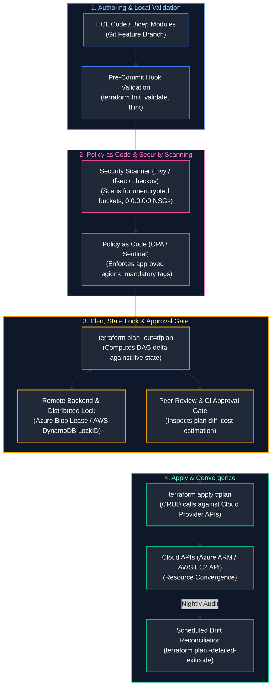

# 06. Infrastructure as Code & Configuration Management

A comprehensive, production-grade guide to declarative Infrastructure as Code (IaC) with HashiCorp Terraform and OpenTofu, HashiCorp Configuration Language (HCL), remote state locking, modular architecture, Azure Bicep, AWS CloudFormation, Ansible configuration automation, Policy as Code with Open Policy Agent (OPA) and Rego, and automated drift reconciliation pipelines tailored for Cloud Engineers, Platform Engineers, and DevSecOps Practitioners.

---

## Architectural Overview: Enterprise IaC Lifecycle & Policy Enforcement Pipeline



---

## Table of Contents
1. [Terraform Internals and HCL Core Mechanics](#1-terraform-internals-and-hcl-core-mechanics)
   - [1.1 Directed Acyclic Graph (DAG) and Execution Stages](#11-directed-acyclic-graph-dag-and-execution-stages)
   - [1.2 Provider Architecture, Resources, and Data Sources](#12-provider-architecture-resources-and-data-sources)
2. [Modular Architecture and Component Reusability](#2-modular-architecture-and-component-reusability)
   - [2.1 Designing Enterprise Reusable Modules](#21-designing-enterprise-reusable-modules)
   - [2.2 Production Hub-and-Spoke Network Module Implementation](#22-production-hub-and-spoke-network-module-implementation)
3. [Remote State, Locking, and Backend Management](#3-remote-state-locking-and-backend-management)
   - [3.1 The State File Contract: Desired vs. Actual vs. Recorded](#31-the-state-file-contract-desired-vs-actual-vs-recorded)
   - [3.2 State Locking Mechanics: Azure Blob Leases vs. AWS DynamoDB](#32-state-locking-mechanics-azure-blob-leases-vs-aws-dynamodb)
   - [3.3 State Surgery: Import, Moved Blocks, and State Removal](#33-state-surgery-import-moved-blocks-and-state-removal)
4. [Environment Separation and Workspace Strategies](#4-environment-separation-and-workspace-strategies)
   - [4.1 Terraform Workspaces vs. Directory-Based Isolation (Terragrunt)](#41-terraform-workspaces-vs-directory-based-isolation-terragrunt)
   - [4.2 Layered Infrastructure and Remote State Data Sources](#12-provider-architecture-resources-and-data-sources)
5. [Drift Detection and Reconciliation](#5-drift-detection-and-reconciliation)
   - [5.1 Out-of-Band Mutations and Refresh Mechanics](#51-out-of-band-mutations-and-refresh-mechanics)
   - [5.2 Automated CI/CD Drift Detection Pipeline](#52-automated-cicd-drift-detection-pipeline)
6. [IaC Testing, Validation, and Security Scanning](#6-iac-testing-validation-and-security-scanning)
   - [6.1 Static Analysis with Checkov, tfsec, and TFLint](#61-static-analysis-with-checkov-tfsec-and-tflint)
   - [6.2 Policy as Code with Open Policy Agent (OPA) and Rego](#62-policy-as-code-with-open-policy-agent-opa-and-rego)
7. [Cloud-Native Declarative IaC: Azure Bicep & CloudFormation](#7-cloud-native-declarative-iac-azure-bicep-cloudformation)
   - [7.1 Azure Bicep Domain-Specific Language (DSL) & ARM Compilation](#71-azure-bicep-domain-specific-language-dsl-arm-compilation)
   - [7.2 AWS CloudFormation Declarative Stacks and Drifts](#7-cloud-native-declarative-iac-azure-bicep-cloudformation)
8. [Configuration Management with Ansible](#8-configuration-management-with-ansible)
   - [8.1 Idempotency, Playbooks, Roles, and Inventories](#81-idempotency-playbooks-roles-and-inventories)
   - [8.2 Production Node Baseline Ansible Playbook](#82-production-node-baseline-ansible-playbook)
9. [Summary Comparison & Engineering Reference Matrix](#9-summary-comparison-engineering-reference-matrix)
10. [References & Further Reading](#10-references-further-reading)

---

# 1. Terraform Internals and HCL Core Mechanics

### 1.1 Directed Acyclic Graph (DAG) and Execution Stages

Terraform is a declarative, graph-based infrastructure orchestration engine. When executing commands, Terraform processes configurations through three core phases:

```text
[Parse HCL] ──> [Build Dependency Graph (DAG)] ──> [Refresh State] ──> [Generate Plan] ──> [Apply DAG Nodes]
```

1. **Graph Construction:** Terraform analyzes implicit references (e.g. `subnet_id = azurerm_subnet.app.id`) and explicit dependencies (`depends_on = [...]`) to construct a **Directed Acyclic Graph (DAG)** of all resources.
2. **Topological Sort:** The scheduler performs a topological sort on the DAG to execute independent resource operations concurrently (governed by `-parallelism=10`) while sequentially chaining dependent nodes.
3. **RPC Provider Plugins:** Terraform core communicates with provider plugins (e.g. `azurerm`, `aws`) via gRPC over local Unix domain sockets, decoupling core logic from cloud SDK implementations.

---

### 1.2 Provider Architecture, Resources, and Data Sources

- **Provider Block:** Defines the target platform, authentication credentials, and feature flags.
- **Resource Block:** Declares an infrastructure component to be created, updated, or destroyed.
- **Data Source Block:** Queries and imports metadata from pre-existing infrastructure outside the current Terraform module's lifecycle.

---

# 2. Modular Architecture and Component Reusability

### 2.1 Designing Enterprise Reusable Modules

Enterprise Terraform modules adhere to strict architectural contracts:
- **Encapsulation:** Never hardcode environment-specific parameters (regions, subnets, subscriptions).
- **SemVer Versioning:** Tag modules using Semantic Versioning in private Git repositories (`source = "git::https://github.com/corp/terraform-azure-vnet.git?ref=v2.1.0"`).
- **Narrow Provider Constraints:** Specify minimum provider versions using optimistic constraints: `~> 3.90`.

---

### 2.2 Production Hub-and-Spoke Network Module Implementation

Below is a complete, production-grade Terraform module provisioning a secured Virtual Network with tiered subnets, Network Security Groups, and service endpoints:

```hcl
# modules/azure_secure_vnet/main.tf
terraform {
  required_version = ">= 1.6.0"
  required_providers {
    azurerm = {
      source  = "hashicorp/azurerm"
      version = "~> 3.95"
    }
  }
}

resource "azurerm_virtual_network" "vnet" {
  name                = var.vnet_name
  location            = var.location
  resource_group_name = var.resource_group_name
  address_space       = [var.vnet_cidr]
  tags                = var.tags
}

resource "azurerm_subnet" "subnets" {
  for_each = var.subnets

  name                 = each.key
  resource_group_name  = var.resource_group_name
  virtual_network_name = azurerm_virtual_network.vnet.name
  address_prefixes     = [each.value.cidr]

  # Enforce private endpoints & service endpoints where specified
  service_endpoints = lookup(each.value, "service_endpoints", [])

  # Delegate subnet to PaaS services if required
  dynamic "delegation" {
    for_each = lookup(each.value, "delegation", null) != null ? [each.value.delegation] : []
    content {
      name = delegation.value.name
      service_delegation {
        name    = delegation.value.service_name
        actions = delegation.value.actions
      }
    }
  }
}

resource "azurerm_network_security_group" "nsg" {
  for_each = var.subnets

  name                = "nsg-${each.key}"
  location            = var.location
  resource_group_name = var.resource_group_name
  tags                = var.tags

  # Default Deny Inbound Rule
  security_rule {
    name                       = "DenyAllInboundDefault"
    priority                   = 4096
    direction                  = "Inbound"
    access                     = "Deny"
    protocol                   = "*"
    source_port_range          = "*"
    destination_port_range     = "*"
    source_address_prefix      = "*"
    destination_address_prefix = "*"
  }
}

resource "azurerm_subnet_network_security_group_association" "nsg_assoc" {
  for_each = var.subnets

  subnet_id                 = azurerm_subnet.subnets[each.key].id
  network_security_group_id = azurerm_network_security_group.nsg[each.key].id
}
```

```hcl
# modules/azure_secure_vnet/variables.tf
variable "resource_group_name" {
  type        = string
  description = "Target Resource Group name."
}

variable "location" {
  type        = string
  description = "Azure Region for deployment."
}

variable "vnet_name" {
  type        = string
  description = "Name of the Virtual Network."
}

variable "vnet_cidr" {
  type        = string
  description = "Root address space CIDR for the VNet."
}

variable "subnets" {
  type = map(object({
    cidr              = string
    service_endpoints = optional(list(string))
    delegation        = optional(object({
      name         = string
      service_name = string
      actions      = list(string)
    }))
  }))
  description = "Map of subnets to create."
}

variable "tags" {
  type        = map(string)
  default     = {}
  description = "Mandatory resource tags."
}
```

---

# 3. Remote State, Locking, and Backend Management

### 3.1 The State File Contract: Desired vs. Actual vs. Recorded

Terraform reconciles three distinct representations of reality during every lifecycle execution:
1. **Desired State:** The declared `.tf` configuration files written by developers.
2. **Recorded State:** The JSON records stored in the `terraform.tfstate` backend file.
3. **Actual State:** The live cloud resources actively running in AWS or Azure.

```text
+-----------------------+     terraform plan     +-----------------------+
| Desired Configuration | <────────────────────> |   Recorded State      |
|     (HCL Files)       |                        | (terraform.tfstate)   |
+-----------------------+                        +-----------------------+
                                                             ▲
                                                             │ terraform refresh
                                                             ▼
                                                 +-----------------------+
                                                 |   Live Infrastructure |
                                                 |   (Cloud REST APIs)   |
                                                 +-----------------------+
```

> [!CAUTION]
> **State File Contains Cleartext Secrets:** The `terraform.tfstate` file stores sensitive attributes (passwords, database connection strings, private TLS keys) in **unencrypted plaintext JSON**. Never store state files in Git. Restrict backend cloud storage access via IAM, enforce customer-managed encryption keys (CMEK), and enable immutable write protection.

---

### 3.2 State Locking Mechanics: Azure Blob Leases vs. AWS DynamoDB

To prevent concurrent applies from corrupting state:
- **Azure Backend:** Acquires an exclusive 60-second **Blob Lease** (`x-ms-lease-action: acquire`) on the `.tfstate` blob.
- **AWS Backend:** Writes an item containing a unique `LockID` md5 hash to an **Amazon DynamoDB** table with conditional writes.
- **Lock Deadlock Resolution:** If a CI job crashes abruptly while holding the lock:
  ```bash
  # Unlock only after confirming no other CI process is actively modifying infrastructure
  terraform force-unlock <LOCK-ID>
  ```

---

### 3.3 State Surgery: Import, Moved Blocks, and State Removal

- **`moved` Blocks:** Refactor module structures without triggering destroy/re-create cycles:
  ```hcl
  moved {
    from = azurerm_subnet.app
    to   = module.networking.azurerm_subnet.subnets["app"]
  }
  ```
- **Declarative `import` Blocks (Terraform 1.5+):**
  ```hcl
  import {
    to = azurerm_resource_group.rg
    id = "/subscriptions/00000000-0000-0000-0000-000000000000/resourceGroups/rg-legacy"
  }
  ```

---

# 4. Environment Separation and Workspace Strategies

### 4.1 Terraform Workspaces vs. Directory-Based Isolation (Terragrunt)

```text
WORKSPACE-BASED ISOLATION:              DIRECTORY-BASED ISOLATION:
repo/                                   repo/
├── main.tf (Shares code)               ├── environments/
└── terraform.tfstate.d/                │   ├── dev/
    ├── dev/terraform.tfstate           │   │   ├── backend.tf (Dev Backend)
    └── prod/terraform.tfstate          │   │   └── main.tf
                                        │   └── prod/
                                        │       ├── backend.tf (Prod Backend - Separate Sub/Account)
                                        │       └── main.tf
```

- **Terraform Workspaces:** Useful for short-lived ephemeral feature testing. **Anti-pattern for enterprise Dev vs. Prod isolation**, because a single misconfigured CLI command (`terraform workspace select prod`) can destroy production, and all workspaces share the same provider authentication credentials.
- **Directory Isolation (Recommended):** Isolate environments into distinct folders with completely separated backend storage accounts and restricted cloud IAM credentials.

---

# 5. Drift Detection and Reconciliation

### 5.1 Out-of-Band Mutations and Refresh Mechanics

Infrastructure drift occurs when operators manually modify cloud resources via the Web Console, CLI, or automated patch systems without updating Terraform code.
- `terraform refresh` (or `terraform plan -refresh-only`) queries live cloud APIs and updates the local state file to mirror real-world changes.

---

### 5.2 Automated CI/CD Drift Detection Pipeline

Below is a production GitHub Actions scheduled workflow running nightly drift detection, posting Slack alerts when mutations are discovered:

```yaml
# .github/workflows/drift_detection.yml
name: "Scheduled Infrastructure Drift Detection"

on:
  schedule:
    - cron: "0 2 * * *" # Runs every night at 2:00 AM UTC
  workflow_dispatch:

permissions:
  id-token: write
  contents: read

jobs:
  detect-drift:
    runs-on: ubuntu-latest
    steps:
      - name: Checkout Code
        uses: actions/checkout@v4

      - name: Authenticate to Azure via OIDC
        uses: azure/login@v2
        with:
          client-id: ${{ secrets.AZURE_CLIENT_ID }}
          tenant-id: ${{ secrets.AZURE_TENANT_ID }}
          subscription-id: ${{ secrets.AZURE_SUBSCRIPTION_ID }}

      - name: Setup Terraform
        uses: hashicorp/setup-terraform@v3
        with:
          terraform_version: "1.7.5"

      - name: Terraform Init
        run: terraform init -backend-config="key=prod.tfstate"

      # -detailed-exitcode returns:
      # 0 = Succeeded, no differences
      # 1 = Error
      # 2 = Succeeded, differences (DRIFT) detected!
      - name: Check Drift
        id: plan
        run: |
          set +e
          terraform plan -detailed-exitcode -no-color -out=drift.tfplan
          EXIT_CODE=$?
          echo "exit_code=${EXIT_CODE}" >> $GITHUB_OUTPUT
          exit 0

      - name: Alert on Detected Drift
        if: steps.plan.outputs.exit_code == '2'
        run: |
          echo "CRITICAL: Out-of-band infrastructure drift detected in Production!"
          # Dispatch incident webhook to PagerDuty or Slack
```

---

# 6. IaC Testing, Validation, and Security Scanning

### 6.1 Static Analysis with Checkov, tfsec, and TFLint

Enterprise CI/CD gates run static security analysis before any `plan` is evaluated:
- **TFLint:** Identifies syntax errors, deprecated syntax, and provider-specific bad practices.
- **Checkov / Trivy:** Scans for CIS benchmark violations, public IP assignments, unencrypted storage, and permissive wildcard IAM policies.

---

### 6.2 Policy as Code with Open Policy Agent (OPA) and Rego

Open Policy Agent (OPA) evaluates JSON-serialized Terraform plan output against declarative Rego rules:

```rego
# policies/enforce_tags.rego
package terraform.security

import future.keywords.in

default allow = false

# Mandatory enterprise tags
required_tags := ["Environment", "Owner", "CostCenter", "ManagedBy"]

# Deny any resource creation missing mandatory tags
deny[msg] {
    resource := input.resource_changes[_]
    resource.change.actions[_] in ["create", "update"]
    
    # Check if resource has tags defined
    tags := resource.change.after.tags
    missing_tags := [tag | tag := required_tags[_]; not tags[tag]]
    count(missing_tags) > 0

    msg := sprintf(
        "Resource '%v' (%v) is missing mandatory tags: %v",
        [resource.address, resource.type, missing_tags]
    )
}

allow {
    count(deny) == 0
}
```

```bash
# Evaluate policy in CI
terraform plan -out=tfplan.binary
terraform show -json tfplan.binary > tfplan.json
opa eval --data policies/enforce_tags.rego --input tfplan.json "data.terraform.security.deny" --fail-defined
```

---

# 7. Cloud-Native Declarative IaC: Azure Bicep & CloudFormation

### 7.1 Azure Bicep Domain-Specific Language (DSL) & ARM Compilation

**Azure Bicep** is Microsoft's clean, transparent domain-specific language compiling directly down to Azure Resource Manager (ARM) JSON templates:
- **Zero State Management:** Bicep has no external `.tfstate` file; the ARM engine queries live Azure fabric state directly.
- **Day-Zero Resource Support:** Supports new Azure features immediately upon API release.

```bicep
// storage_account.bicep
@description('Deployment environment name')
@allowed(['dev', 'staging', 'prod'])
param environmentName string

@description('Primary region location')
param location string = resourceGroup().location

var storageAccountName = 'stcorp${environmentName}${uniqueString(resourceGroup().id)}'

resource storage 'Microsoft.Storage/storageAccounts@2023-01-01' = {
  name: storageAccountName
  location: location
  sku: {
    name: environmentName == 'prod' ? 'Standard_GRS' : 'Standard_LRS'
  }
  kind: 'StorageV2'
  properties: {
    minimumTlsVersion: 'TLS1_2'
    supportsHttpsTrafficOnly: true
    allowBlobPublicAccess: false
    networkAcls: {
      defaultAction: 'Deny'
      bypass: 'AzureServices'
    }
  }
}

output storageId string = storage.id
output primaryBlobEndpoint string = storage.properties.primaryEndpoints.blob
```

---

# 8. Configuration Management with Ansible

### 8.1 Idempotency, Playbooks, Roles, and Inventories

While Terraform provisions base cloud hardware, **Ansible** excels at configuration management, package installs, and operating system hardening:
- **Idempotency Invariant:** Running an Ansible playbook multiple times yields the exact same system state without redundant modifications.
- **Agentless Architecture:** Executes over standard OpenSSH using Python interpreters on the target node.

---

### 8.2 Production Node Baseline Ansible Playbook

```yaml
# playbooks/node_hardening.yml
---
- name: Enterprise Linux CIS Baseline Hardening
  hosts: all
  become: true
  vars:
    required_packages:
      - chrony
      - fail2ban
      - ufw
      - auditd
    sysctl_settings:
      net.ipv4.ip_forward: 0
      net.ipv4.tcp_syncookies: 1
      net.ipv4.conf.all.rp_filter: 1
      fs.file-max: 2097152

  tasks:
    - name: Update apt cache and install security packages
      ansible.builtin.apt:
        name: "{{ required_packages }}"
        state: present
        update_cache: true
        cache_valid_time: 3600

    - name: Configure kernel parameters for CIS compliance
      ansible.posix.sysctl:
        name: "{{ item.key }}"
        value: "{{ item.value }}"
        state: present
        reload: true
      loop: "{{ sysctl_settings | dict2items }}"

    - name: Disable SSH password authentication
      ansible.builtin.lineinfile:
        path: /etc/ssh/sshd_config
        regexp: '^#?PasswordAuthentication'
        line: 'PasswordAuthentication no'
        validate: '/usr/sbin/sshd -t -f %s'
      notify: Restart SSH

    - name: Ensure Chrony time sync is running
      ansible.builtin.systemd:
        name: chrony
        state: started
        enabled: true

  handlers:
    - name: Restart SSH
      ansible.builtin.systemd:
        name: sshd
        state: restarted
```

---

# 9. Summary Comparison & Engineering Reference Matrix

| IaC / Config Tool | Paradigm | State Management | Primary Production Role | Key Operational Hazard |
| :--- | :--- | :--- | :--- | :--- |
| **Terraform / OpenTofu** | Declarative | Remote State (`.tfstate`) with distributed locks | Multi-cloud foundational infrastructure orchestration | State file lock deadlocks, state drift, cleartext secrets |
| **Azure Bicep** | Declarative | Native ARM fabric engine (State-less) | Azure-native landing zones & resource governance | Limited to Azure cloud ecosystem only |
| **AWS CloudFormation**| Declarative | AWS Managed CloudFormation Stacks | AWS-native architecture and service catalog stacks | Slow stack rollback cycles on failure states |
| **Ansible** | Declarative / Task-based | Stateless (Agentless over SSH) | Operating system configuration & fleet package patching | Slow execution across thousands of nodes without AWX |
| **Open Policy Agent** | Declarative (Rego) | In-memory evaluation against JSON data | Policy as Code enforcement in CI pull request gates | Complex Rego syntax debugging |

---

# 10. References & Further Reading

- [Terraform Language Documentation](https://developer.hashicorp.com/terraform/language) — Official syntax, HCL mechanics, and state operations.
- [Open Policy Agent Documentation](https://www.openpolicyagent.org/docs/latest/) — Rego syntax and policy testing framework.
- [Azure Bicep Documentation](https://learn.microsoft.com/en-us/azure/azure-resource-manager/bicep/) — Modular templates and compilation architecture.
- [Ansible Community Documentation](https://docs.ansible.com/ansible/latest/index.html) — Playbooks, roles, and idempotency standards.
- [Checkov Static Analysis](https://www.checkov.io/) — Policy-as-code security scanner for infrastructure.

