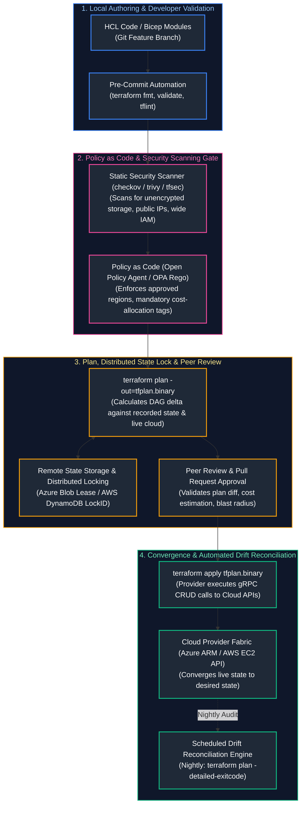
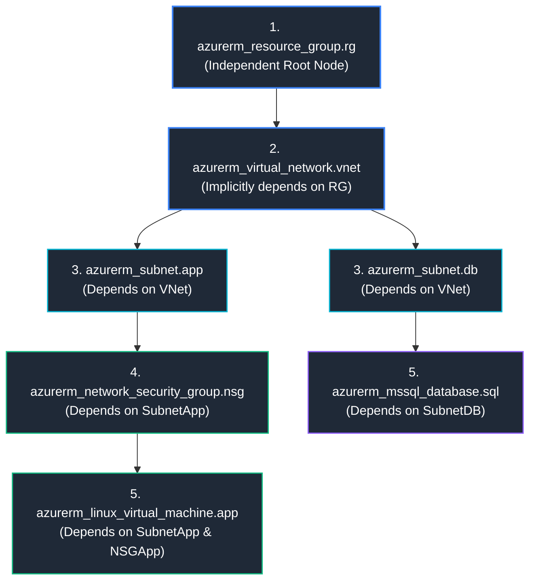
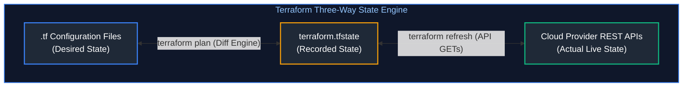
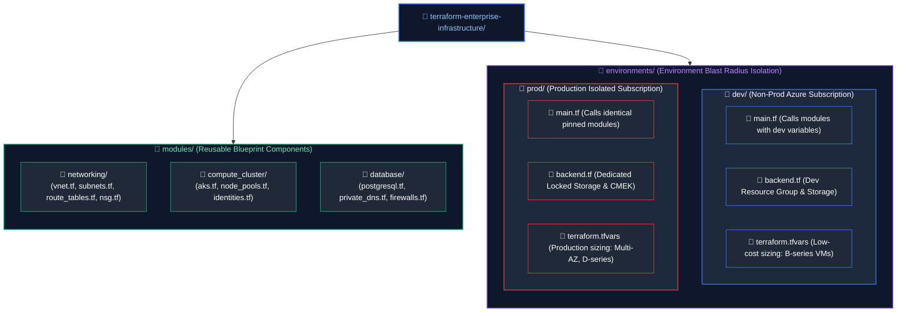

# 06. Infrastructure as Code & Configuration Management

A comprehensive, production-grade guide to declarative Infrastructure as Code (IaC) with HashiCorp Terraform and OpenTofu, HashiCorp Configuration Language (HCL), remote state locking, modular architecture, Azure Bicep, AWS CloudFormation, Ansible configuration automation, Policy as Code with Open Policy Agent (OPA) and Rego, and automated drift reconciliation pipelines tailored for Cloud Engineers, Platform Engineers, and DevSecOps Practitioners.

---

## Architectural Overview: Enterprise IaC Lifecycle & Policy Enforcement Pipeline

Infrastructure as Code (IaC) is the foundational discipline of managing cloud infrastructure using software engineering practices: version control, peer review, static code analysis, automated security scanning, policy gates, and declarative state convergence. In an enterprise cloud landing zone, no human operator creates resources manually in the cloud web console. Every change flows through a deterministic CI/CD release pipeline:



---

## Table of Contents
1. [Declarative vs. Imperative Paradigms & The Idempotency Invariant](#1-declarative-vs-imperative-paradigms--the-idempotency-invariant)
   - [1.1 The Restaurant Analogy & Why Declarative IaC Won](#11-the-restaurant-analogy--why-declarative-iac-won)
   - [1.2 The Idempotency Mathematical Contract](#12-the-idempotency-mathematical-contract)
2. [Terraform & OpenTofu Internals and HCL Mechanics](#2-terraform--opentofu-internals-and-hcl-mechanics)
   - [2.1 Directed Acyclic Graph (DAG) Execution & Cycle Resolution](#21-directed-acyclic-graph-dag-execution--cycle-resolution)
   - [2.2 RPC Provider Plugin Architecture (gRPC over Unix Sockets)](#22-rpc-provider-plugin-architecture-grpc-over-unix-sockets)
   - [2.3 Resource Lifecycle Meta-Arguments (create_before_destroy, prevent_destroy)](#23-resource-lifecycle-meta-arguments-create_before_destroy-prevent_destroy)
3. [Enterprise Modular Architecture & Reusability](#3-enterprise-modular-architecture--reusability)
   - [3.1 Module Composition Contracts & SemVer Versioning](#31-module-composition-contracts--semver-versioning)
   - [3.2 Production Secured Virtual Network Module (HCL Code)](#32-production-secured-virtual-network-module-hcl-code)
4. [Remote State Management, Distributed Locking & State Surgery](#4-remote-state-management-distributed-locking--state-surgery)
   - [4.1 The Three-Way State Reconciliation Model](#41-the-three-way-state-reconciliation-model)
   - [4.2 The Plaintext Secret Hazard in State Files](#42-the-plaintext-secret-hazard-in-state-files)
   - [4.3 Distributed Locking Mechanics: Azure Blob Leases vs. AWS DynamoDB](#43-distributed-locking-mechanics-azure-blob-leases-vs-aws-dynamodb)
   - [4.4 State Surgery: moved Blocks, Declarative import, and State Migration](#44-state-surgery-moved-blocks-declarative-import-and-state-migration)
5. [Environment Isolation & Workspace Blast Radius Containment](#5-environment-isolation--workspace-blast-radius-containment)
   - [5.1 The Workspace Anti-Pattern for Production Isolation](#51-the-workspace-anti-pattern-for-production-isolation)
   - [5.2 Directory-Based Isolation (Terragrunt & Monorepo Architecture)](#52-directory-based-isolation-terragrunt--monorepo-architecture)
6. [Drift Detection, Alerting & Reconciliation Automation](#6-drift-detection-alerting--reconciliation-automation)
   - [6.1 Out-of-Band Mutations & The Detailed Exit Code Pattern](#61-out-of-band-mutations--the-detailed-exit-code-pattern)
   - [6.2 Production Nightly GitHub Actions Drift Reconciliation Workflow](#62-production-nightly-github-actions-drift-reconciliation-workflow)
7. [Shift-Left Security: Static Analysis & Policy as Code](#7-shift-left-security-static-analysis--policy-as-code)
   - [7.1 Static Linters: TFLint, Checkov, and Trivy](#71-static-linters-tflint-checkov-and-trivy)
   - [7.2 Open Policy Agent (OPA) Rego Guardrails](#72-open-policy-agent-opa-rego-guardrails)
8. [Cloud-Native Declarative IaC: Azure Bicep & AWS CloudFormation](#8-cloud-native-declarative-iac-azure-bicep--aws-cloudformation)
   - [8.1 Azure Bicep DSL & Zero-State ARM Engine Compilation](#81-azure-bicep-dsl--zero-state-arm-engine-compilation)
   - [8.2 AWS CloudFormation Stacks & Change Sets](#82-aws-cloudformation-stacks--change-sets)
9. [Configuration Management: Ansible & Immutable Machine Images](#9-configuration-management-ansible--immutable-machine-images)
   - [9.1 Mutable vs. Immutable Infrastructure (Pets vs. Cattle)](#91-mutable-vs-immutable-infrastructure-pets-vs-cattle)
   - [9.2 Production CIS Baseline Hardening Ansible Playbook](#92-production-cis-baseline-hardening-ansible-playbook)
10. [Senior SRE IaC Troubleshooting Runbooks](#10-senior-sre-iac-troubleshooting-runbooks)
11. [Summary Comparison & Engineering Reference Matrix](#11-summary-comparison-engineering-reference-matrix)
12. [References & Further Reading](#12-references-further-reading)

---

# 1. Declarative vs. Imperative Paradigms & The Idempotency Invariant

### 1.1 The Restaurant Analogy & Why Declarative IaC Won

#### The Beginner Intuition: Ordering Breakfast
- **Imperative Approach (Bash scripts, Python CLI scripts, AWS CLI commands):**
  You walk into a restaurant kitchen and tell the chef:
  *"Turn on the gas burner. Grab a 10-inch skillet. Pour 1 tablespoon of butter. Crack two eggs. Whisk for 45 seconds. Flip with a spatula. Slide onto a plate."*
  *What happens if you run the script again?* The chef cooks two *more* eggs! If the stove was already hot or the butter ran out, the script crashes halfway through, leaving dirty pans and raw eggs everywhere.
- **Declarative Approach (Terraform, Bicep, Kubernetes YAML):**
  You sit at the dining table and state your desired end-state:
  *"I want two scrambled eggs on my plate."*
  The engine inspects the current reality (plate is currently empty), computes the delta needed to achieve the target state, cooks the eggs, and places them on the plate. If you tell the engine again *"I want two scrambled eggs on my plate,"* it inspects the table, sees two scrambled eggs already there, and **does nothing**.

---

### 1.2 The Idempotency Mathematical Contract

In systems engineering, an operation is **Idempotent** if applying it multiple times produces the exact same result as applying it once:

$$f(f(x)) = f(x)$$

- In cloud infrastructure, running `terraform apply` once provisions your virtual network, subnets, and databases.
- Running `terraform apply` 5 minutes later without code changes evaluates the cloud environment, discovers zero drift, and reports: `Apply complete! Resources: 0 added, 0 changed, 0 destroyed.`
- It does **not** duplicate resources, spin up redundant billing costs, or throw `ResourceAlreadyExists` exceptions.

---

# 2. Terraform & OpenTofu Internals and HCL Mechanics

### 2.1 Directed Acyclic Graph (DAG) Execution & Cycle Resolution

Terraform does not execute `.tf` configuration files from top to bottom. It reads all files in a directory, extracts resource references, and builds an in-memory **Directed Acyclic Graph (DAG)**:



1. **Topological Sort:** Terraform sorts DAG nodes into execution tiers. Independent branches (e.g. SubnetApp and SubnetDB) are provisioned **concurrently** in parallel worker threads (governed by `-parallelism=10`).
2. **Cycle Detection Error:** If Resource A references Resource B, and Resource B references Resource A, Terraform detects a circular dependency and terminates immediately:
   `Error: Cycle: azurerm_subnet.a, azurerm_subnet.b`

---

### 2.2 RPC Provider Plugin Architecture (gRPC over Unix Sockets)

Terraform Core does not contain any cloud API code! It is a pure graph evaluator and state reconciler written in Go.
- When you execute `terraform init`, Terraform downloads standalone binary plugins called **Providers** (`terraform-provider-azurerm`, `terraform-provider-aws`).
- During execution, Terraform Core launches the provider binaries as independent operating system child processes.
- Core and Provider communicate via **gRPC (Remote Procedure Calls) over local Unix Domain Sockets**:

```mermaid
flowchart LR
    Core["Terraform Core Engine<br/>(Graph evaluation, state diffing)"]
    <-->|"gRPC RPC Calls over Unix Domain Socket"|
    Provider["Azure / AWS Provider Plugin Process<br/>(SDK calls, REST serialization, Auth)"]
    <-->|"HTTPS REST API (ARM / AWS API)"|
    Cloud["Cloud Provider Infrastructure Fabric"]

    style Core fill:#1f2937,stroke:#3b82f6,stroke-width:2px,color:#fff
    style Provider fill:#1f2937,stroke:#10b981,stroke-width:2px,color:#fff
    style Cloud fill:#1f2937,stroke:#f59e0b,stroke-width:2px,color:#fff
```

---

### 2.3 Resource Lifecycle Meta-Arguments (create_before_destroy, prevent_destroy)

The `lifecycle` block gives engineers fine-grained control over how the Terraform engine handles resource updates:

```hcl
resource "azurerm_linux_virtual_machine" "api" {
  name                = "vm-prod-api"
  resource_group_name = azurerm_resource_group.rg.name
  location            = azurerm_resource_group.rg.location
  size                = "Standard_D4s_v5"
  # [Omitted VM properties]

  lifecycle {
    # 1. Zero-Downtime Replacements:
    # Forces Terraform to provision the new VM before destroying the old one
    create_before_destroy = true

    # 2. Accidental Catastrophe Shield:
    # Terraform will throw a fatal error and REFUSE to destroy critical databases
    prevent_destroy = true

    # 3. Ignore Drift on Dynamically Scaled Attributes:
    # Prevents Terraform from resetting VM core counts tuned by external autoscalers
    ignore_changes = [
      tags["LastModifiedBy"],
      size
    ]

    # 4. Trigger Replacement on Upstream Configuration Changes:
    replace_triggered_by = [
      azurerm_key_vault_secret.cert.version
    ]
  }
}
```

---

# 3. Enterprise Modular Architecture & Reusability

### 3.1 Module Composition Contracts & SemVer Versioning

A production Terraform module must be treated as an immutable software library:
- **Encapsulation:** Never hardcode environment names, IP ranges, or subscription IDs.
- **Explicit Inputs (`variables.tf`):** Strong typing (`type = map(object(...))`) with explicit validation blocks.
- **Outputs (`outputs.tf`):** Return IDs, names, and connection attributes needed by consuming layers.
- **Semantic Versioning in Private Git Repos:**
  ```hcl
  module "networking" {
    source = "git::https://github.com/mycorp/terraform-azure-network.git?ref=v2.4.0"
    # [Parameters]
  }
  ```

---

### 3.2 Production Secured Virtual Network Module (HCL Code)

Below is a production-grade, reusable Terraform module provisioning a Virtual Network with dynamic subnets, Network Security Groups, and default-deny inbound protection:

```hcl
# modules/azure_secure_vnet/main.tf
terraform {
  required_version = ">= 1.6.0"
  required_providers {
    azurerm = {
      source  = "hashicorp/azurerm"
      version = "~> 3.95"
    }
  }
}

resource "azurerm_virtual_network" "vnet" {
  name                = var.vnet_name
  location            = var.location
  resource_group_name = var.resource_group_name
  address_space       = [var.vnet_cidr]
  tags                = var.tags
}

resource "azurerm_subnet" "subnets" {
  for_each = var.subnets

  name                 = each.key
  resource_group_name  = var.resource_group_name
  virtual_network_name = azurerm_virtual_network.vnet.name
  address_prefixes     = [each.value.cidr]

  service_endpoints = lookup(each.value, "service_endpoints", [])

  dynamic "delegation" {
    for_each = lookup(each.value, "delegation", null) != null ? [each.value.delegation] : []
    content {
      name = delegation.value.name
      service_delegation {
        name    = delegation.value.service_name
        actions = delegation.value.actions
      }
    }
  }
}

resource "azurerm_network_security_group" "nsg" {
  for_each = var.subnets

  name                = "nsg-${each.key}"
  location            = var.location
  resource_group_name = var.resource_group_name
  tags                = var.tags

  # Zero-Trust Baseline: Catch-all deny inbound rule
  security_rule {
    name                       = "DefaultDenyAllInbound"
    priority                   = 4096
    direction                  = "Inbound"
    access                     = "Deny"
    protocol                   = "*"
    source_port_range          = "*"
    destination_port_range     = "*"
    source_address_prefix      = "*"
    destination_address_prefix = "*"
  }
}

resource "azurerm_subnet_network_security_group_association" "nsg_assoc" {
  for_each = var.subnets

  subnet_id                 = azurerm_subnet.subnets[each.key].id
  network_security_group_id = azurerm_network_security_group.nsg[each.key].id
}
```

```hcl
# modules/azure_secure_vnet/variables.tf
variable "resource_group_name" {
  type        = string
  description = "Target Resource Group name."
}

variable "location" {
  type        = string
  description = "Azure Region for deployment."
}

variable "vnet_name" {
  type        = string
  description = "Name of the Virtual Network."
}

variable "vnet_cidr" {
  type        = string
  description = "Root address space CIDR for the VNet."
}

variable "subnets" {
  type = map(object({
    cidr              = string
    service_endpoints = optional(list(string))
    delegation        = optional(object({
      name         = string
      service_name = string
      actions      = list(string)
    }))
  }))
  description = "Map of subnets to create."
}

variable "tags" {
  type        = map(string)
  default     = {}
  description = "Mandatory enterprise tags."
}
```

---

# 4. Remote State Management, Distributed Locking & State Surgery

### 4.1 The Three-Way State Reconciliation Model

Terraform reconciles three distinct representations of reality:
1. **Desired State:** What you wrote in `.tf` code.
2. **Recorded State:** What is written in the remote `terraform.tfstate` JSON file.
3. **Actual State:** What is actively running in the live cloud data center.



---

### 4.2 The Plaintext Secret Hazard in State Files

> [!CAUTION]
> **Cleartext Secrets in State Files:**
> The `terraform.tfstate` JSON file stores **every single resource attribute in unencrypted plaintext**, including database master passwords, private TLS keys, and API tokens generated by resources like `random_password` or `azurerm_key_vault_secret`.
> - **Never check `.tfstate` into Git!**
> - Restrict backend storage access via least-privilege IAM roles.
> - Enforce Customer-Managed Keys (CMEK) encryption at rest on the storage account.
> - Enable blob versioning and soft-delete to protect against accidental deletion.

---

### 4.3 Distributed Locking Mechanics: Azure Blob Leases vs. AWS DynamoDB

If two engineers or CI pipelines run `terraform apply` concurrently on the same state file, the state file will corrupt, leaving cloud resources orphaned or destroyed.
- **Azure Storage Backend:** Acquires an exclusive 60-second renewable **Blob Lease** (`x-ms-lease-action: acquire`) on the `.tfstate` blob. Any concurrent execution receives `HTTP 412 Precondition Failed` and halts.
- **AWS S3 Backend:** Writes an item containing a `LockID` hash to an **Amazon DynamoDB** table with conditional writes.
- **Breaking a Deadlock:** If a CI pipeline crashes abruptly, the lock remains active. Once verified that no other apply is running:
  `terraform force-unlock <LOCK-ID>`

---

### 4.4 State Surgery: moved Blocks, Declarative import, and State Migration

#### 1. The `moved` Block (Refactoring without Destruction)
When you refactor code (e.g. moving a standalone resource into a reusable module), naive renaming causes Terraform to **destroy the existing live resource and create a new one!**
The `moved` block instructs Terraform to update the address in the state file without touching live infrastructure:

```hcl
moved {
  from = azurerm_subnet.app
  to   = module.networking.azurerm_subnet.subnets["app"]
}
```

#### 2. Declarative `import` Blocks (Terraform 1.5+)
Importing pre-existing cloud resources into Terraform without messy CLI commands:

```hcl
import {
  to = azurerm_resource_group.rg
  id = "/subscriptions/00000000-0000-0000-0000-000000000000/resourceGroups/rg-legacy-prod"
}
```

---

# 5. Environment Isolation & Workspace Blast Radius Containment

### 5.1 The Workspace Anti-Pattern for Production Isolation

| Isolation Dimension | Terraform Workspaces (Anti-Pattern for Environments) | Directory-Based Isolation (Enterprise Standard) |
| :--- | :--- | :--- |
| **State Storage Backend** | Single shared backend bucket. State files stored under `terraform.tfstate.d/<env>/`. | Completely separate, isolated storage accounts (e.g. dev backend vs prod locked backend). |
| **Blast Radius & Access Control** | **Extreme Risk:** CI/CD runners and engineers need read/write credentials to the shared backend. | **Strictly Isolated:** Dev CI runner credentials cannot authenticate to the Prod state backend. |
| **Cloud Account Separation** | Same `.tf` code blocks are typically tied to a single cloud provider subscription/account. | `dev/` targets Dev Subscription; `prod/` targets an entirely isolated Prod Subscription. |
| **Accidental Overwrite Risk**| High: A single forgotten CLI switch (`terraform workspace select prod`) can apply dev code to prod. | Near Zero: Working directory explicitly scopes target state and credentials. |
| **Configuration Variation** | Requires awkward conditional ternary expressions (`count = terraform.workspace == "prod" ? 5 : 1`). | Native, clean environment variable files (`environments/prod/terraform.tfvars`). |
| **Recommended Use Case** | Ephemeral, short-lived feature branch environments within non-production only. | Long-lived environment isolation (Dev, Staging, Production). |

### 5.2 Directory-Based Isolation (Terragrunt & Monorepo Architecture)

#### Production Enterprise Repository Folder Treeview

In enterprise infrastructure engineering, directory-based isolation structures the codebase into reusable modules and environment-specific root orchestration directories:



---

# 6. Drift Detection, Alerting & Reconciliation Automation

### 6.1 Out-of-Band Mutations & The Detailed Exit Code Pattern

Infrastructure drift occurs when operators manually modify resources via the Cloud Web Console during an emergency.
To detect drift automatically in CI/CD without modifying infrastructure, execute:

```bash
terraform plan -detailed-exitcode -no-color
```

The shell exit code indicates the exact state:
- **`0`**: Succeeded, diff is empty (Infrastructure perfectly matches code).
- **`1`**: Terraform execution crashed or threw an error.
- **`2`**: **Succeeded, differences detected (DRIFT DETECTED)!**

---

### 6.2 Production Nightly GitHub Actions Drift Reconciliation Workflow

```yaml
# .github/workflows/nightly_drift_check.yml
name: "Nightly Drift Detection & Alerting"

on:
  schedule:
    - cron: "0 2 * * *" # Runs daily at 2:00 AM UTC
  workflow_dispatch:

permissions:
  id-token: write
  contents: read

jobs:
  drift-audit:
    runs-on: ubuntu-latest
    steps:
      - name: Checkout Code Repository
        uses: actions/checkout@v4

      - name: Authenticate to Cloud via OIDC
        uses: azure/login@v2
        with:
          client-id: ${{ secrets.AZURE_CLIENT_ID }}
          tenant-id: ${{ secrets.AZURE_TENANT_ID }}
          subscription-id: ${{ secrets.AZURE_SUBSCRIPTION_ID }}

      - name: Setup Terraform
        uses: hashicorp/setup-terraform@v3
        with:
          terraform_version: "1.7.5"

      - name: Initialize Backend
        run: terraform init

      - name: Check for Out-of-Band Drift
        id: check_drift
        run: |
          set +e
          terraform plan -detailed-exitcode -no-color -out=drift.tfplan
          EXIT_CODE=$?
          echo "exit_code=${EXIT_CODE}" >> $GITHUB_OUTPUT
          if [ ${EXIT_CODE} -eq 2 ]; then
            echo "DRIFT_FOUND=true" >> $GITHUB_ENV
          fi
          exit 0

      - name: Dispatch PagerDuty Alert on Drift
        if: steps.check_drift.outputs.exit_code == '2'
        run: |
          echo "ALERT: Production infrastructure has drifted from Git source of truth!"
          # Send webhook payload to PagerDuty / Slack API
```

---

# 7. Shift-Left Security: Static Analysis & Policy as Code

### 7.1 Static Linters: TFLint, Checkov, and Trivy

- **TFLint:** Verifies syntax, catches deprecated cloud attributes, and checks provider-specific naming constraints.
- **Checkov / Trivy:** Evaluates code against hundreds of built-in CIS security benchmarks (e.g. checking if storage accounts enforce HTTPS or if RDS databases have public IPs enabled).

---

### 7.2 Open Policy Agent (OPA) Rego Guardrails

Before executing `terraform apply`, serialize the plan to JSON and evaluate it against enterprise security policies written in **Rego**:

```rego
# policies/enforce_production_tags.rego
package terraform.security

import future.keywords.in

default allow = false

# Mandatory cost-allocation and governance tags
required_tags := ["Environment", "Owner", "CostCenter", "DataClassification"]

# Deny resource creation if any mandatory tag is missing
deny[msg] {
    resource := input.resource_changes[_]
    resource.change.actions[_] in ["create", "update"]
    
    tags := resource.change.after.tags
    missing := [tag | tag := required_tags[_]; not tags[tag]]
    count(missing) > 0

    msg := sprintf(
        "VIOLATION: Resource '%v' (%v) is missing mandatory tags: %v",
        [resource.address, resource.type, missing]
    )
}

# Allow deployment only if zero denial rules fired
allow {
    count(deny) == 0
}
```

```bash
# Evaluate OPA Policy in CI pipeline
terraform plan -out=tfplan.binary
terraform show -json tfplan.binary > tfplan.json
opa eval --data policies/enforce_production_tags.rego --input tfplan.json "data.terraform.security.deny" --fail-defined
```

---

# 8. Cloud-Native Declarative IaC: Azure Bicep & AWS CloudFormation

### 8.1 Azure Bicep DSL & Zero-State ARM Engine Compilation

**Azure Bicep** is Microsoft’s transparent domain-specific language compiling directly to Azure Resource Manager (ARM) JSON:
- **No State File:** Bicep has no external state file! The ARM engine queries live Azure infrastructure state directly, eliminating state corruption and locking issues.
- **Immediate Day-0 Support:** Every new Azure API feature is supported in Bicep on the day of release.

```bicep
// storage_account.bicep
@description('Deployment Environment')
@allowed(['dev', 'staging', 'prod'])
param environmentName string

@description('Target Region')
param location string = resourceGroup().location

var storageAccountName = 'stcorp${environmentName}${uniqueString(resourceGroup().id)}'

resource storage 'Microsoft.Storage/storageAccounts@2023-01-01' = {
  name: storageAccountName
  location: location
  sku: {
    name: environmentName == 'prod' ? 'Standard_GRS' : 'Standard_LRS'
  }
  kind: 'StorageV2'
  properties: {
    minimumTlsVersion: 'TLS1_2'
    supportsHttpsTrafficOnly: true
    allowBlobPublicAccess: false
    networkAcls: {
      defaultAction: 'Deny'
      bypass: 'AzureServices'
    }
  }
}

output storageId string = storage.id
```

---

### 8.2 AWS CloudFormation Stacks & Change Sets

AWS CloudFormation provides declarative JSON/YAML templates evaluated natively by the AWS CloudFormation control plane engine:

#### Core Engine Mechanics:
1. **Change Sets:** Preview proposed infrastructure changes (resource additions, in-place updates, or disruptive replacements) before applying them to a live production stack.
2. **Drift Detection:** CloudFormation scans existing provisioned AWS resources and flags out-of-band manual property mutations against the template declaration.
3. **Stack Policies:** IAM-like JSON guardrails preventing accidental deletion or updates to critical production resources (e.g., preventing DROP of production RDS or DynamoDB databases).

```yaml
# templates/production_rds_stack.yaml
AWSTemplateFormatVersion: '2010-09-09'
Description: Production Multi-AZ PostgreSQL Cluster with Drift Protection

Parameters:
  DBInstanceClass:
    Type: String
    Default: db.r6g.xlarge
    Description: Production database compute size
  DBAllocatedStorage:
    Type: Number
    Default: 100
    MinValue: 20
    MaxValue: 10000

Resources:
  ProductionDBSubnetGroup:
    Type: AWS::RDS::DBSubnetGroup
    Properties:
      DBSubnetGroupDescription: Private data tier subnets across 3 AZs
      SubnetIds:
        - !ImportValue ProductionVPC-PrivateSubnetA
        - !ImportValue ProductionVPC-PrivateSubnetB
        - !ImportValue ProductionVPC-PrivateSubnetC

  ProductionPostgresDB:
    Type: AWS::RDS::DBInstance
    DeletionPolicy: Snapshot
    UpdateReplacePolicy: Snapshot
    Properties:
      AllocatedStorage: !Ref DBAllocatedStorage
      DBInstanceClass: !Ref DBInstanceClass
      Engine: postgres
      EngineVersion: '15.4'
      MultiAZ: true
      StorageEncrypted: true
      StorageType: gp3
      DBSubnetGroupName: !Ref ProductionDBSubnetGroup
      PubliclyAccessible: false
      EnablePerformanceInsights: true

Outputs:
  DBEndpointAddress:
    Description: Connection endpoint for applications
    Value: !GetAtt ProductionPostgresDB.Endpoint.Address
    Export:
      Name: !Sub '${AWS::StackName}-EndpointAddress'
```

---

# 9. Configuration Management: Ansible & Immutable Machine Images

### 9.1 Mutable vs. Immutable Infrastructure (Pets vs. Cattle)

- **Mutable Infrastructure (Ansible on live VMs):** Treating servers as "Pets". You deploy a VM and run Ansible playbooks over time to patch software. Over months, servers accumulate configuration drift.
- **Immutable Infrastructure (Packer Golden Images):** Treating servers as "Cattle". You never SSH into or modify a running production VM. You use **HashiCorp Packer** to bake OS patches and code into a hardened VM image (AMI / Azure Managed Image). To deploy updates, you spin up fresh VMs and terminate the old ones.

---

### 9.2 Production CIS Baseline Hardening Ansible Playbook

For bare metal nodes or golden image baking, the following Ansible playbook enforces CIS Level 1 OS hardening idempotently:

```yaml
# playbooks/cis_hardening.yml
---
- name: Enterprise Linux CIS Baseline Hardening
  hosts: all
  become: true
  vars:
    required_packages:
      - chrony
      - fail2ban
      - ufw
      - auditd
    sysctl_rules:
      net.ipv4.ip_forward: 0
      net.ipv4.tcp_syncookies: 1
      net.ipv4.conf.all.rp_filter: 1
      fs.file-max: 2097152

  tasks:
    - name: Ensure required security packages are installed
      ansible.builtin.apt:
        name: "{{ required_packages }}"
        state: present
        update_cache: true
        cache_valid_time: 3600

    - name: Enforce kernel security parameters
      ansible.posix.sysctl:
        name: "{{ item.key }}"
        value: "{{ item.value }}"
        state: present
        reload: true
      loop: "{{ sysctl_rules | dict2items }}"

    - name: Disable SSH password authentication (Enforce Keys Only)
      ansible.builtin.lineinfile:
        path: /etc/ssh/sshd_config
        regexp: '^#?PasswordAuthentication'
        line: 'PasswordAuthentication no'
        validate: '/usr/sbin/sshd -t -f %s'
      notify: Restart SSH Daemon

    - name: Enable and start chrony NTP time synchronization
      ansible.builtin.systemd:
        name: chrony
        state: started
        enabled: true

  handlers:
    - name: Restart SSH Daemon
      ansible.builtin.systemd:
        name: sshd
        state: restarted
```

---

# 10. Senior SRE IaC Troubleshooting Runbooks

### Runbook 1: State Lock Deadlock Recovery
- **Symptom:** `terraform apply` fails immediately with:
  `Error: Error acquiring the state lock: ConditionalCheckFailedException / BlobAlreadyLeased`
- **Runbook:**
  1. Check CI/CD job logs to ensure no active deployment is running.
  2. Copy the `Lock Info: ID: 5b4e8c1...` from the error message.
  3. Execute `terraform force-unlock 5b4e8c1...`.

### Runbook 2: Resolving Cyclical Dependency Errors
- **Symptom:** `Error: Cycle: module.app -> module.network -> module.app`
- **Root Cause:** Two modules reference outputs from each other.
- **Runbook:**
  1. Break the circular dependency by introducing a dedicated data lookup or separating the shared resource (e.g. security group rules) into an independent third module.

---

# 11. Summary Comparison & Engineering Reference Matrix

| IaC / Configuration Tool | Paradigm | State Management | Primary Production Role | Key Operational Failure Mode |
| :--- | :--- | :--- | :--- | :--- |
| **Terraform / OpenTofu** | Declarative | Remote State (`.tfstate`) with distributed locks | Multi-cloud foundational infrastructure orchestration | State lock deadlocks, state drift, cleartext secrets in state. |
| **Azure Bicep** | Declarative | Native ARM fabric engine (State-less) | Azure-native landing zones & governance | Limited exclusively to Microsoft Azure ecosystem. |
| **AWS CloudFormation**| Declarative | AWS Managed Stacks | AWS-native architecture and Service Catalog | Painfully slow rollback cycles on provisioning failure. |
| **Ansible** | Declarative Tasks | Stateless (Agentless over SSH) | OS hardening, package updates, and fleet configuration | Slow execution over thousands of hosts without AWX. |
| **Open Policy Agent** | Declarative (Rego) | In-memory JSON policy evaluation | Guardrails and compliance checks in CI pull request gates | Complex Rego syntax debugging. |

---

# 12. References & Further Reading

- [Terraform Language Documentation](https://developer.hashicorp.com/terraform/language) — Official HCL syntax, mechanics, and state management.
- [Open Policy Agent Rego Documentation](https://www.openpolicyagent.org/docs/latest/) — Declarative policy language reference.
- [Azure Bicep Documentation](https://learn.microsoft.com/en-us/azure/azure-resource-manager/bicep/) — Modular templates and ARM compilation.
- [Ansible Community Documentation](https://docs.ansible.com/ansible/latest/index.html) — Playbooks, roles, and idempotency standards.
- [Checkov Static Analysis](https://www.checkov.io/) — Policy-as-code security scanner for infrastructure.
