# 07. CI/CD & Release Engineering

A comprehensive, production-grade guide to enterprise Continuous Integration and Continuous Delivery (CI/CD), GitHub Actions, Azure DevOps Pipelines, keyless Workload Identity Federation (OIDC), multi-stage Docker build optimizations, progressive deployment strategies (Blue-Green, Canary with Flagger & Argo Rollouts), zero-downtime database migrations (Expand-and-Contract), Software Bills of Materials (SBOMs), Supply-chain Levels for Software Artifacts (SLSA), and container supply chain signing with Sigstore Cosign tailored for DevOps Engineers, Release Engineers, and Platform Architects.

---

## Architectural Overview: Secure Continuous Delivery & Progressive Release Pipeline

In modern high-velocity cloud engineering, releasing software is not an occasional, high-stress midnight event. It is an automated, continuous, and deterministic engineering pipeline. From the instant a developer pushes code to Git, the artifact is tested, security-scanned, packaged, signed with cryptographic attestations, and progressively deployed across canary environments:


---

## Table of Contents
1. [Continuous Delivery Principles & The Testing Pyramid](#1-continuous-delivery-principles--the-testing-pyramid)
   - [1.1 The Industrial Assembly Line Analogy](#11-the-industrial-assembly-line-analogy)
   - [1.2 Continuous Integration vs. Continuous Delivery vs. Deployment](#12-continuous-integration-vs-continuous-delivery-vs-deployment)
   - [1.3 The Testing Pyramid & Shift-Left Validation](#13-the-testing-pyramid--shift-left-validation)
2. [Runner Architecture & CI Orchestration Engines](#2-runner-architecture--ci-orchestration-engines)
   - [2.1 Ephemeral Cloud Runners vs. Self-Hosted VM Scale Sets](#21-ephemeral-cloud-runners-vs-self-hosted-vm-scale-sets)
   - [2.2 GitHub Actions vs. Azure DevOps Pipelines: Core Architecture](#22-github-actions-vs-azure-devops-pipelines-core-architecture)
   - [2.3 Matrix Builds, Caching Strategies, and Job Dependencies](#23-matrix-builds-caching-strategies-and-job-dependencies)
3. [Container Image Builds & Artifact Registry Engineering](#3-container-image-builds--artifact-registry-engineering)
   - [3.1 Multi-Stage Docker Builds & The Distroless Non-Root Pattern](#31-multi-stage-docker-builds--the-distroless-non-root-pattern)
   - [3.2 Advanced Docker Layer Caching (BuildKit & GHA Cache Backend)](#32-advanced-docker-layer-caching-buildkit--gha-cache-backend)
   - [3.3 Immutable Tagging Invariant & Content-Addressable Digests](#33-immutable-tagging-invariant--content-addressable-digests)
4. [Workload Identity Federation (Keyless OIDC Cloud Authentication)](#4-workload-identity-federation-keyless-oidc-cloud-authentication)
   - [4.1 The Disaster of Long-Lived Static Cloud Credentials](#41-the-disaster-of-long-lived-static-cloud-credentials)
   - [4.2 The OIDC Cryptographic Handshake (JWT Exchange with Cloud STS)](#42-the-oidc-cryptographic-handshake-jwt-exchange-with-cloud-sts)
   - [4.3 Azure Entra ID Federated Credentials & AWS STS AssumeRole Configuration](#43-azure-entra-id-federated-credentials--aws-sts-assumerole-configuration)
5. [Progressive Deployment Strategies: Rolling, Blue-Green, and Canary](#5-progressive-deployment-strategies-rolling-blue-green-and-canary)
   - [5.1 The Deployment Spectrum: Recreate vs. Rolling vs. Blue-Green](#51-the-deployment-spectrum-recreate-vs-rolling-vs-blue-green)
   - [5.2 Automated Canary Traffic Shifting with Flagger & Argo Rollouts](#52-automated-canary-traffic-shifting-with-flagger--argo-rollouts)
   - [5.3 Metric-Driven Automated Rollbacks via Prometheus Golden Signals](#53-metric-driven-automated-rollbacks-via-prometheus-golden-signals)
6. [Artifact Promotion & Immutable Release Gates](#6-artifact-promotion--immutable-release-gates)
   - [6.1 The Build Once, Deploy Many Invariant](#61-the-build-once-deploy-many-invariant)
   - [6.2 Release Gates: Manual Sign-Offs, Schedules & Approvals](#62-release-gates-manual-sign-offs-schedules--approvals)
7. [Zero-Downtime Database Migrations: The Expand-and-Contract Pattern](#7-zero-downtime-database-migrations-the-expand-and-contract-pattern)
   - [7.1 The Five Phases: Expand, Dual-Write, Backfill, Switch Reads, and Contract](#71-the-five-phases-expand-dual-write-backfill-switch-reads-and-contract)
   - [7.2 Avoiding Destructive Schema Locks in PostgreSQL / MySQL](#72-avoiding-destructive-schema-locks-in-postgresql--mysql)
   - [7.3 Automated Migration Execution via Flyway & Liquibase](#73-automated-migration-execution-via-flyway--liquibase)
8. [Software Supply Chain Security, SLSA & Container Signing](#8-software-supply-chain-security-slsa--container-signing)
   - [8.1 Supply Chain Threats: SolarWinds, Codecov, and SLSA Levels 1-4](#81-supply-chain-threats-solarwinds-codecov-and-slsa-levels-1-4)
   - [8.2 Software Bill of Materials (SBOM) Generation with Syft](#82-software-bill-of-materials-sbom-generation-with-syft)
   - [8.3 Keyless Container Signing with Sigstore Cosign & Rekor Log](#83-keyless-container-signing-with-sigstore-cosign--rekor-log)
   - [8.4 Admission Enforcement in Kubernetes via Kyverno](#84-admission-enforcement-in-kubernetes-via-kyverno)
9. [Full Production Enterprise CI/CD Pipeline Implementation](#9-full-production-enterprise-cicd-pipeline-implementation)
   - [9.1 End-to-End Hardened GitHub Actions Pipeline](#91-end-to-end-hardened-github-actions-pipeline)
   - [9.2 Equivalent Azure DevOps YAML Multi-Stage Pipeline](#92-equivalent-azure-devops-yaml-multi-stage-pipeline)
10. [Senior Release SRE Troubleshooting Runbooks](#10-senior-release-sre-troubleshooting-runbooks)
    - [10.1 Scenario 1: OIDC Handshake Rejected by Cloud Provider (HTTP 403 Forbidden)](#101-scenario-1-oidc-handshake-rejected-by-cloud-provider-http-403-forbidden)
    - [10.2 Scenario 2: Flagger Canary Rollout Failure Caused by Cold Cache Latency](#102-scenario-2-flagger-canary-rollout-failure-caused-by-cold-cache-latency)
    - [10.3 Scenario 3: Database Migration Script Deadlocking Production Tables (AccessExclusiveLock)](#103-scenario-3-database-migration-script-deadlocking-production-tables-accessexclusivelock)
11. [Summary Comparison & Engineering Reference Matrix](#11-summary-comparison-engineering-reference-matrix)
12. [References & Further Reading](#12-references-further-reading)

---

# 1. Continuous Delivery Principles & The Testing Pyramid

### 1.1 The Industrial Assembly Line Analogy

To understand modern CI/CD, contrast a **bespoke hand-built artisan workshop** with an **automated automotive assembly line**:

```mermaid
flowchart TD
    subgraph ArtisanWorkshop ["Bespoke Artisan Workshop (Legacy Manual Releases)"]
        A1["Developer manually compiles code on their laptop"]
        A2["Manual SFTP upload to production server at midnight"]
        A3["'It worked on my machine!'<br/>Missing DLLs, conflicting Python versions, human typos crash production."]
        A1 --> A2 --> A3
    end

    subgraph RoboticAssemblyLine ["Modern Robotic Assembly Line (Automated CI/CD Pipeline)"]
        R1["Raw Material Inspection (Unit tests & Linting)"]
        R2["Robotic Precision Welding (Deterministic Multi-Stage Container Builds)"]
        R3["Automated X-Ray Flaw Detection (Trivy CVE Scanning & SBOM Attestations)"]
        R4["Crash Test Proving Grounds (Ephemeral Preview Environments & Canary Traffic Splitting)"]
        R1 --> R2 --> R3 --> R4
    end

    style ArtisanWorkshop fill:#1e1e2e,stroke:#f87171,stroke-width:2px,color:#fca5a5
    style RoboticAssemblyLine fill:#1e1e2e,stroke:#34d399,stroke-width:2px,color:#a7f3d0
```

- **In the artisan model:** Releases are rare, terrifying, high-risk events conducted late on Friday nights. If something breaks, rollbacks involve manual file copying and guesswork.
- **In the automated pipeline model:** The software delivery process is a standardized, automated assembly line. Every commit is treated as a candidate release. Quality gates (static analysis, CVE scans, automated unit and integration tests) automatically reject defective candidates within minutes.

---

### 1.2 Continuous Integration vs. Continuous Delivery vs. Deployment

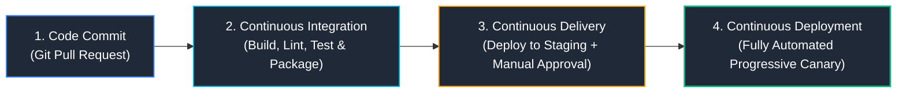

| Pipeline Discipline | Trigger Event | Automated Stages | Production Deployment Gate | Verification Mechanism |
| :--- | :--- | :--- | :--- | :--- |
| **Continuous Integration (CI)** | Code pushed to feature branch / PR opened. | Compile code, run unit/integration tests, linting, security scanning, publish artifact. | None (Artifact parked in registry e.g. ACR/ECR). | Automated unit test coverage & static analysis quality gates. |
| **Continuous Delivery (CD)** | PR merged into main branch. | Auto-deploy to Staging, run smoke tests, prepare production release package. | **Manual Approval Gate:** Requires explicit sign-off from Release Lead / SRE before production rollout. | Staging integration tests + manual stakeholder verification. |
| **Continuous Deployment** | Tag pushed or automated release trigger. | 100% automated rollout to Production via canary or blue-green stages. | **Fully Autonomous Gate:** Zero human sign-offs. Replaces manual gates with automated SLO metric health checks. | Automated Prometheus/Datadog P99 latency and HTTP 5xx error rate analysis. |

---

### 1.3 The Testing Pyramid & Shift-Left Validation

To prevent slow, expensive end-to-end tests from bottlenecking delivery pipelines, testing is structured along Mike Cohn's **Testing Pyramid**:

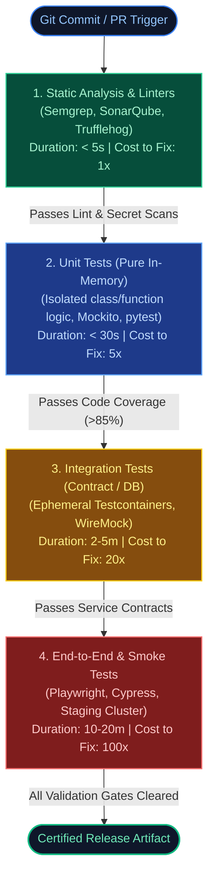

#### Shift-Left Testing Pyramid Reference Matrix

| Pyramid Tier | Validation Scope & Tooling | Target Execution Speed | Infrastructure Requirements | Cost to Triage / Fix |
| :--- | :--- | :--- | :--- | :--- |
| **1. Static Analysis** | AST parsing, style lints, secret detection, CVE SCA scans (Ruff, ESLint, TruffleHog, Snyk). | Instantaneous ($< 5\text{s}$) | Pure CPU process; zero external dependencies. | **1x (Lowest):** Fixed in developer IDE before commit. |
| **2. Unit Tests** | Individual functions, domain invariants, edge cases; all I/O mocked out. | Sub-minute ($< 30\text{s}$) | In-memory runner; zero network or filesystem I/O. | **5x:** Caught during local pre-push git hook. |
| **3. Integration Tests** | Database migrations, REST API contracts, Redis caching, message queue producers. | Minutes ($2\text{m} - 5\text{m}$) | Docker daemon for ephemeral Testcontainers (PostgreSQL, Kafka). | **20x:** Caught in pull request automated CI runner. |
| **4. End-to-End Tests** | Full customer journeys, browser UI automation, third-party webhook integrations. | Tens of minutes ($10\text{m} - 30\text{m}$) | Fully deployed staging cluster, seeded test databases. | **100x (Highest):** Requires multi-service root-cause debugging. |

- **Shift-Left Security:** Move checks as close to the developer's IDE as possible. Catching an SQL injection flaw during pre-commit static analysis costs **\$0**; catching it in production costs millions in regulatory fines.

---

# 2. Runner Architecture & CI Orchestration Engines

### 2.1 Ephemeral Cloud Runners vs. Self-Hosted VM Scale Sets

#### Enterprise CI/CD Pipeline Repository Folder Treeview

In enterprise engineering, CI/CD workflows, custom composite actions, and deployment manifests are structured within standardized repository layouts:

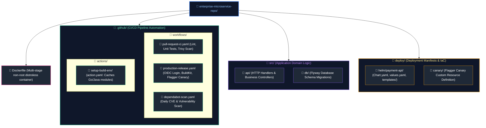


| Dimension | GitHub-Hosted / Cloud Runners | Self-Hosted Runners (VMSS / Actions Runner Controller) |
| :--- | :--- | :--- |
| **Security & Sandboxing** | **100% Ephemeral:** Brand-new VM provisioned per job; destroyed immediately upon completion. | Requires careful cleanup scripts or Kubernetes **Actions Runner Controller (ARC)** for ephemeral pods. |
| **Network Locality** | Public internet only; cannot access private cloud VNets without reverse tunnels. | Deployed **directly inside private cloud subnets**, enabling direct access to private ACRs, databases, and internal clusters. |
| **Performance & Hardware** | Standard 2-core / 4-core shared instances; cold cache start. | Massive scaling: Dedicated 64-core NVMe machines, GPU instances for ML training, pre-warmed Docker caches. |
| **Maintenance Overhead** | **Zero:** Managed entirely by GitHub / Microsoft. | Requires OS patching, security updates, and runner daemon maintenance. |

---

### 2.2 GitHub Actions vs. Azure DevOps Pipelines: Core Architecture

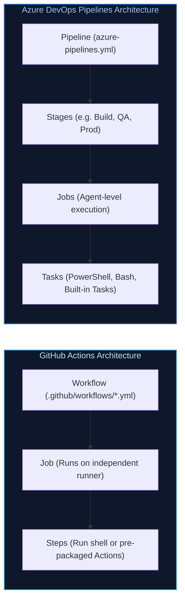

---

### 2.3 Matrix Builds, Caching Strategies, and Job Dependencies

Matrix strategies parallelize testing across operating systems, architectures, and language runtimes simultaneously:

```yaml
# Matrix Build Configuration Example
strategy:
  fail-fast: false
  matrix:
    os: [ubuntu-latest, macos-latest]
    python-version: ["3.10", "3.11", "3.12"]
```

---

# 3. Container Image Builds & Artifact Registry Engineering

### 3.1 Multi-Stage Docker Builds & The Distroless Non-Root Pattern

In enterprise environments, bloated container images containing compilers, package managers (`apt`, `apk`), and shells (`bash`, `sh`) create an unacceptably large attack surface.

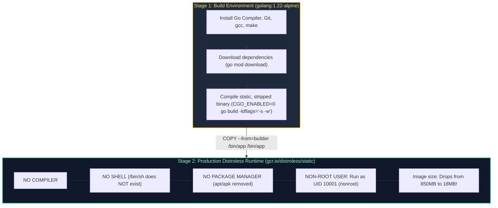

#### Production Multi-Stage Distroless Dockerfile:
```dockerfile
# Stage 1: Build & Compile
FROM golang:1.22-alpine AS builder
WORKDIR /workspace

# Cache dependency layer
COPY go.mod go.sum ./
RUN go mod download

COPY . .
# Build static stripped binary with zero external C-dependencies
RUN CGO_ENABLED=0 GOOS=linux GOARCH=amd64 go build \
    -ldflags="-s -w -extldflags '-static'" \
    -o /workspace/server ./cmd/server

# Stage 2: Distroless Non-Root Production Image
FROM gcr.io/distroless/static-debian12:nonroot
WORKDIR /app
COPY --from=builder /workspace/server /app/server

# Run as non-root user (UID 65532 is nonroot in distroless)
USER 65532:65532
EXPOSE 8080
ENTRYPOINT ["/app/server"]
```

---

### 3.2 Advanced Docker Layer Caching (BuildKit & GHA Cache Backend)

Docker evaluates layers sequentially from top to bottom. If a line changes, **all subsequent layers are invalidated**. 
- **The Optimization Invariant:** Place infrequently changed instructions (`COPY package.json`, `RUN npm install`) at the top, and frequently changed source code (`COPY . .`) at the very end.
- **Remote Cache Backends:** Use Buildx `type=gha` to persist Docker layers in GitHub Actions cache storage, slashing CI build times from 10 minutes to **18 seconds**.

---

### 3.3 Immutable Tagging Invariant & Content-Addressable Digests

> [!CAUTION]
> **The `:latest` Tag Anti-Pattern:** Never deploy using mutable tags like `:latest` or `:v1`. If a developer pushes a new image with the same tag, Kubernetes will not pull the new image if the image is already present on the node (`imagePullPolicy: IfNotPresent`). 
> **Production Law:** Tag images with the **Git commit SHA** and deploy using the immutable **Content-Addressable Digest (SHA256)**:
> `registry.azurecr.io/orders-api@sha256:4bf92f3577b34da6a3ce929d0e0e4736...`

---

# 4. Workload Identity Federation (Keyless OIDC Cloud Authentication)

### 4.1 The Disaster of Long-Lived Static Cloud Credentials

Historically, CI/CD runners authenticated to Azure or AWS using long-lived secrets:
- Azure Service Principal Passwords (client secrets).
- AWS IAM Access Keys (`AKIA...` and Secret Access Key).

**Why Static Secrets are a Threat:**
1. **Secrets Leak:** Engineers accidentally commit `.env` files or paste secrets into CI logs.
2. **Never Rotated:** Rotating static credentials across 500 microservice pipelines breaks deployments, so teams leave them unrotated for years.
3. **Over-Privileged:** Service principals often possess broad subscription-wide permissions.

---

### 4.2 The OIDC Cryptographic Handshake (JWT Exchange with Cloud STS)

**OpenID Connect (OIDC) Workload Identity Federation** eliminates static cloud credentials entirely by using short-lived, cryptographically signed JSON Web Tokens (JWTs):

```mermaid
%%{init: {'theme': 'dark', 'themeVariables': { 'actorBkg': '#1e293b', 'actorBorder': '#3b82f6', 'actorTextColor': '#ffffff', 'signalColor': '#93c5fd', 'signalTextColor': '#ffffff', 'noteBkgColor': '#1e293b', 'noteBorderColor': '#f59e0b', 'noteTextColor': '#fde68a', 'activationBkgColor': '#3b82f6', 'sequenceNumberColor': '#ffffff' }}}%%
sequenceDiagram
    autonumber
    participant Runner as GitHub Actions Runner
    participant GHA_OIDC as GitHub OIDC Token Provider
    participant CloudSTS as Cloud Security Token Service (AWS STS / Entra ID)
    participant CloudAPI as Azure ARM / AWS Cloud APIs

    Runner->>GHA_OIDC: 1. Request OIDC Token (Specifies Audience: 'api://AzureADTokenExchange')
    GHA_OIDC-->>Runner: 2. Issues Signed JWT (Contains Issuer, Subject Claim, Commit SHA)
    
    Runner->>CloudSTS: 3. Presents JWT: "Exchange this for a short-lived cloud session"
    Note over CloudSTS: Cloud STS downloads GitHub JWKS public keys.<br/>Cryptographically validates signature.<br/>Evaluates Subject Claim matching rule!
    
    CloudSTS-->>Runner: 4. Returns Short-Lived Access Token (Valid for 15 - 60 minutes)
    Runner->>CloudAPI: 5. Deploys infrastructure using temporary cloud session
    Note over Runner: Token automatically expires; zero secrets left on disk!
```

#### GitHub Actions OIDC JWT Claims Breakdown:
- `iss`: `https://token.actions.githubusercontent.com`
- `aud`: `api://AzureADTokenExchange` or `sts.amazonaws.com`
- `sub`: `repo:my-enterprise-org/payment-service:ref:refs/heads/main`
- `job_workflow_ref`: `my-enterprise-org/payment-service/.github/workflows/deploy.yml@refs/heads/main`

Cloud IAM policies evaluate the **Subject (`sub`) claim**, guaranteeing that only runs originating from the `main` branch of that specific repository can assume the role!

---

### 4.3 Azure Entra ID Federated Credentials & AWS STS AssumeRole Configuration

To authenticate GitHub Actions runners without static secrets, configure cryptographic Workload Identity Federation:

#### 1. AWS IAM Role Trust Policy for GitHub Actions OIDC:
```json
{
  "Version": "2012-10-17",
  "Statement": [
    {
      "Effect": "Allow",
      "Principal": {
        "Federated": "arn:aws:iam::123456789012:oidc-provider/token.actions.githubusercontent.com"
      },
      "Action": "sts:AssumeRoleWithWebIdentity",
      "Condition": {
        "StringEquals": {
          "token.actions.githubusercontent.com:aud": "sts.amazonaws.com"
        },
        "StringLike": {
          "token.actions.githubusercontent.com:sub": "repo:enterprise-org/payment-service:ref:refs/heads/main"
        }
      }
    }
  ]
}
```

#### 2. Azure Entra ID Federated Identity Credential via Azure CLI:
```bash
# Create federated credential linking Azure App Registration to GitHub repo branch
az ad app federated-credential create \
  --id "00000000-0000-0000-0000-000000000000" \
  --parameters '{
    "name": "gha-main-branch",
    "issuer": "https://token.actions.githubusercontent.com",
    "subject": "repo:enterprise-org/payment-service:ref:refs/heads/main",
    "description": "Production CD deployment from main branch",
    "audiences": ["api://AzureADTokenExchange"]
  }'
```

---

# 5. Progressive Deployment Strategies: Rolling, Blue-Green, and Canary

### 5.1 The Deployment Spectrum: Recreate vs. Rolling vs. Blue-Green

```mermaid
flowchart TD
    subgraph Recreate ["1. Recreate Deployment (Downtime Incurred)"]
        D1["Kill Version 1 (Pods = 0)"] --> Downtime["DOWNTIME WINDOW (Outage)"] --> D2["Boot Version 2 (Pods = N)"]
    end

    subgraph Rolling ["2. Rolling Update (Standard Kubernetes)"]
        R1["Incrementally replace pods: MaxSurge=25%, MaxUnavailable=0%"]
        R2["V1 and V2 pods run CONCURRENTLY; requires backwards-compatible DB!"]
        R1 --> R2
    end

    subgraph BlueGreen ["3. Blue-Green Deployment (Zero-Downtime Instant Switch)"]
        BG1["Blue (Current Prod: 100% Traffic)"]
        BG2["Green (New Prod: 0% Traffic - Warm in staging)"]
        Router["Router / Ingress VIP"] -->|"Instant Cutover"| BG2
        BG1 -.->|"Idle for instant rollback"| Router
    end

    style Recreate fill:#1e293b,stroke:#f87171,stroke-width:1.5px,color:#fca5a5
    style Rolling fill:#1e293b,stroke:#f59e0b,stroke-width:1.5px,color:#fde68a
    style BlueGreen fill:#1e293b,stroke:#34d399,stroke-width:1.5px,color:#a7f3d0
```

---

### 5.2 Automated Canary Traffic Shifting with Flagger & Argo Rollouts

In a **Canary Deployment**, traffic is incrementally shifted to the new version while monitoring Prometheus telemetry:

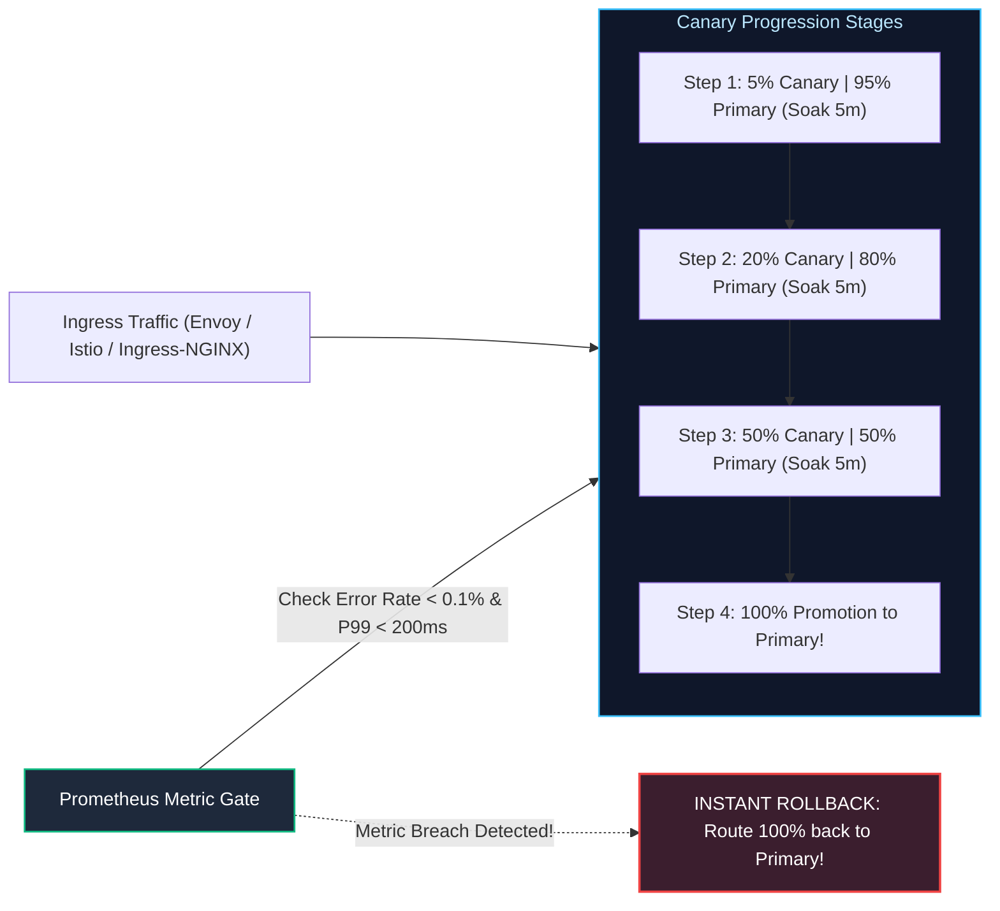

#### Production Flagger Canary Custom Resource:
```yaml
# /manifests/canary/payment-api-canary.yaml
apiVersion: flagger.app/v1beta1
kind: Canary
metadata:
  name: payment-api
  namespace: production
spec:
  targetRef:
    apiVersion: apps/v1
    kind: Deployment
    name: payment-api
  service:
    port: 8080
    targetPort: 8080
  analysis:
    interval: 1m
    threshold: 3      # Number of failed checks before triggering rollback
    maxWeight: 50      # Maximum traffic shifted to canary before full promotion
    stepWeight: 10     # Percentage of traffic increment per iteration
    metrics:
      - name: request-success-rate
        thresholdRange:
          min: 99.5    # Minimum 99.5% 200 OK success rate required
        interval: 1m
      - name: request-duration
        thresholdRange:
          max: 200     # P99 latency must remain under 200ms
        interval: 1m
```

---

### 5.3 Metric-Driven Automated Rollbacks via Prometheus Golden Signals

Automated progressive delivery engines (Flagger, Argo Rollouts) continuously poll Prometheus PromQL queries during canary traffic shifts. If any of the **Four Golden Signals** (Latency, Errors, Traffic, Saturation) exceed thresholds, the canary is halted and 100% of traffic immediately routes back to the stable primary:

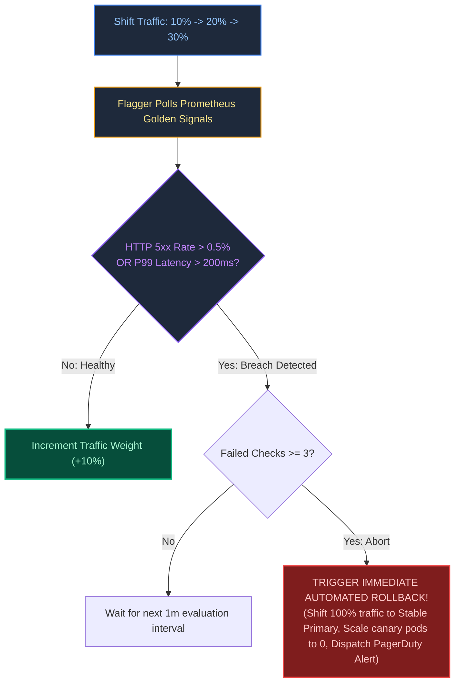

#### Prometheus Custom Metric Template for Flagger:
```yaml
apiVersion: flagger.app/v1beta1
kind: MetricTemplate
metadata:
  name: error-rate-5xx
  namespace: production
spec:
  provider:
    type: prometheus
    address: http://prometheus-k8s.monitoring.svc:9090
  query: |
    100 * sum(
      rate(http_requests_total{namespace="production",status=~"5.*",app="payment-api"}[1m])
    ) / sum(
      rate(http_requests_total{namespace="production",app="payment-api"}[1m])
    )
```

---

# 6. Artifact Promotion & Immutable Release Gates

### 6.1 The Build Once, Deploy Many Invariant

> [!CRITICAL]
> **The Immutable Artifact Law:** You must **never rebuild a container image or binary for different environments**.
> - Building an image for `Development`, rebuilding from source for `Staging`, and rebuilding again for `Production` guarantees that untested compiler differences or dependency updates will slip into production.
> - **The Standard:** Build a single container image once in the CI pipeline, tag it with the Git SHA digest, and **promote that exact same image digest** sequentially: `Dev` $\rightarrow$ `Staging` $\rightarrow$ `Production`. Environment differences must be injected exclusively via runtime environment variables or external secrets.

---

### 6.2 Release Gates: Manual Sign-Offs, Schedules & Approvals

While automated tests validate functional correctness, enterprise release governance enforces automated and manual release gates before production traffic cutover:

#### Core Enterprise Gating Patterns:
1. **GitHub Environments & Protected Branches:** Production deployments target a protected GitHub `production` environment requiring approval from designated engineering leads or security architects.
2. **Automated Health Gates:** Queries cloud monitoring (Azure Monitor, AWS CloudWatch, Datadog) to verify that zero active P1/P2 incidents exist on the cluster before permitting promotion.
3. **Blackout Window Schedules:** Time-based conditional logic in pipelines halting non-emergency deployments during Black Friday, end-of-quarter financial close, or outside staffed support hours.

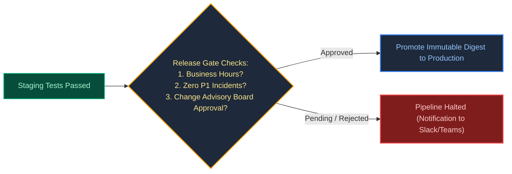

---

# 7. Zero-Downtime Database Migrations: The Expand-and-Contract Pattern

Deploying a microservice that expects a new database schema while old pods are still servicing requests causes immediate production crashes. The **Expand-and-Contract (Parallel Run) Pattern** solves this without downtime.

### 7.1 The Five Phases: Expand, Dual-Write, Backfill, Switch Reads, and Contract

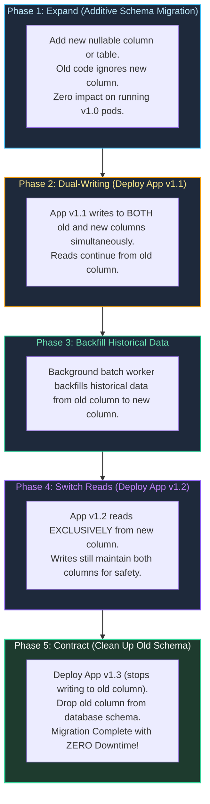

---

### 7.2 Avoiding Destructive Schema Locks in PostgreSQL / MySQL

Executing naive DDL statements on large tables (e.g. 10,000,000+ rows) acquires exclusive table locks, freezing all customer transactions:
1. **Adding Columns with Default Values:** In PostgreSQL $< 11$, `ALTER TABLE orders ADD COLUMN status VARCHAR(20) DEFAULT 'PENDING';` rewrites the entire table on disk, acquiring an `AccessExclusiveLock` that blocks all concurrent reads and writes for hours!
   - *Safe Approach:* Add column as nullable without default; set default in subsequent statement; backfill in batched transactions.
2. **Creating Indexes Concurrently:** Standard `CREATE INDEX` locks writes. Always execute:
   ```sql
   -- PostgreSQL non-blocking index creation
   CREATE INDEX CONCURRENTLY idx_orders_customer_id ON orders (customer_id);
   ```

---

### 7.3 Automated Migration Execution via Flyway & Liquibase

To safely coordinate database evolution with application releases, migrations must execute as pre-deployment hooks or dedicated Kubernetes initialization jobs:

#### Liquibase Production Changeset (Expand Phase):
```yaml
databaseChangeLog:
  - changeSet:
      id: 20261016-add-phone-number-e164
      author: data-platform-team
      changes:
        - addColumn:
            tableName: users
            columns:
              - column:
                  name: phone_number_e164
                  type: varchar(32)
                  constraints:
                    nullable: true # MANDATORY: Must be nullable during Expand phase!
      rollback:
        - dropColumn:
            tableName: users
            columnName: phone_number_e164
```

#### Kubernetes Pre-Sync Migration Job:
```yaml
apiVersion: batch/v1
kind: Job
metadata:
  name: payment-db-migrate
  annotations:
    helm.sh/hook: pre-install,pre-upgrade
    helm.sh/hook-delete-policy: hook-succeeded
spec:
  backoffLimit: 1
  template:
    spec:
      restartPolicy: Never
      containers:
        - name: flyway
          image: flyway/flyway:10.8-alpine
          args: ["migrate"]
          env:
            - name: FLYWAY_URL
              value: "jdbc:postgresql://postgres-prod.data.svc:5432/payment_db"
            - name: FLYWAY_USER
              valueFrom:
                secretKeyRef:
                  name: db-credentials
                  key: username
            - name: FLYWAY_PASSWORD
              valueFrom:
                secretKeyRef:
                  name: db-credentials
                  key: password
```

---

# 8. Software Supply Chain Security, SLSA & Container Signing

### 8.1 Supply Chain Threats: SolarWinds, Codecov, and SLSA Levels 1-4

Recent high-profile breaches (SolarWinds build system poisoning, Codecov bash script compromise) demonstrated that attackers no longer attack fortified production perimeters—they poison upstream build pipelines.

The **SLSA (Supply-chain Levels for Software Artifacts)** framework provides verifiable build integrity:
- **SLSA Level 1:** Documented build process with provenance generated.
- **SLSA Level 2:** Tamper-resistant hosted build service (GitHub Actions / GitLab CI).
- **SLSA Level 3:** **Hermetic builds** in ephemeral, isolated environments; non-falsifiable provenance cryptographically signed.
- **SLSA Level 4:** Two-person code review on every change, hermetic reproducible builds.

---

### 8.2 Software Bill of Materials (SBOM) Generation with Syft

An **SBOM** is a formal, machine-readable inventory of every software dependency, transitive library, and OS package contained within a build artifact:

```bash
# Generate CycloneDX JSON SBOM for a container image using Syft
syft packages registry.azurecr.io/payment-api:v2.1.0 -o cyclonedx-json=sbom.json

# Audit SBOM for known CVEs using Grype
grype sbom:sbom.json --fail-on high
```

---

### 8.3 Keyless Container Signing with Sigstore Cosign & Rekor Log

**Sigstore Cosign** signs container images using OIDC identities rather than brittle private PGP keys:
1. The CI runner obtains an OIDC token from GitHub Actions.
2. Cosign sends the token to the **Fulcio Certificate Authority**, which generates a short-lived X.509 certificate binding the container digest to the GitHub repository identity.
3. The cryptographic signature is recorded into the public, immutable transparency log **Rekor**.

```bash
# Keyless signing of container image in GitHub Actions
cosign sign --yes registry.azurecr.io/payment-api@sha256:4bf92f3577b3...
```

---

### 8.4 Admission Enforcement in Kubernetes via Kyverno

Before any pod executes in a production Kubernetes cluster, **Kyverno** admission webhooks verify the cryptographic signature:

```yaml
# /kyverno/policies/verify-image-signature.yaml
apiVersion: kyverno.io/v1
kind: ClusterPolicy
metadata:
  name: verify-image-signatures
spec:
  validationFailureAction: Enforce
  rules:
    - name: verify-sigstore-signature
      match:
        any:
          - resources:
              kinds: ["Pod"]
      verifyImages:
        - imageReferences: ["registry.azurecr.io/*"]
          attestors:
            - entries:
                - keyless:
                    issuer: "https://token.actions.githubusercontent.com"
                    subject: "https://github.com/enterprise-org/payment-service/.github/workflows/*"
```

---

# 9. Full Production Enterprise CI/CD Pipeline Implementation

### 9.1 End-to-End Hardened GitHub Actions Pipeline

Below is a complete, production-grade GitHub Actions workflow demonstrating: **keyless OIDC authentication to Azure**, **multi-stage Docker build**, **SBOM generation**, **Trivy scanning**, **Cosign keyless signing**, and **GitOps deployment trigger**:

```yaml
# .github/workflows/production-release-pipeline.yml
name: Enterprise Secure Release Pipeline

on:
  push:
    branches: [main]
  pull_request:
    branches: [main]

permissions:
  id-token: write  # Mandatory for requesting OIDC JWT tokens
  contents: read   # Read source repository code
  packages: write  # Publish container packages

env:
  REGISTRY: ghcr.io
  IMAGE_NAME: ${{ github.repository }}

jobs:
  # ==========================================================================
  # JOB 1: Test, Lint, and Security Analysis
  # ==========================================================================
  validate:
    name: Lint & Unit Testing
    runs-on: ubuntu-latest
    steps:
      - name: Checkout Source Code
        uses: actions/checkout@v4

      - name: Setup Go Runtime
        uses: actions/setup-go@v5
        with:
          go-version: "1.22"
          cache: true

      - name: Execute Unit Tests with Race Detector
        run: go test -v -race -coverprofile=coverage.out ./...

  # ==========================================================================
  # JOB 2: Build, SBOM, Sign, and Publish
  # ==========================================================================
  build-and-sign:
    name: Build, SBOM & Cosign
    needs: validate
    runs-on: ubuntu-latest
    if: github.ref == 'refs/heads/main'
    steps:
      - name: Checkout Source Code
        uses: actions/checkout@v4

      - name: Install Sigstore Cosign
        uses: sigstore/cosign-installer@v3.5.0

      - name: Setup Docker Buildx
        uses: docker/setup-buildx-action@v3

      - name: Log in to GitHub Container Registry
        uses: docker/login-action@v3
        with:
          registry: ${{ env.REGISTRY }}
          username: ${{ github.actor }}
          password: ${{ secrets.GITHUB_TOKEN }}

      - name: Build and Push Docker Image with GHA Caching
        id: docker_build
        uses: docker/build-push-action@v5
        with:
          context: .
          push: true
          tags: ${{ env.REGISTRY }}/${{ env.IMAGE_NAME }}:${{ github.sha }}
          cache-from: type=gha
          cache-to: type=gha,mode=max

      # Keyless Image Signing using Sigstore OIDC
      - name: Sign Container Image with Cosign
        env:
          IMAGE_DIGEST: ${{ steps.docker_build.outputs.digest }}
        run: |
          cosign sign --yes "${{ env.REGISTRY }}/${{ env.IMAGE_NAME }}@${{ steps.docker_build.outputs.digest }}"

  # ==========================================================================
  # JOB 3: Keyless Azure Workload Identity Deployment
  # ==========================================================================
  deploy-staging:
    name: Deploy to Staging (Azure AKS)
    needs: build-and-sign
    runs-on: ubuntu-latest
    steps:
      - name: Authenticate to Azure via OIDC (Zero Stored Secrets)
        uses: azure/login@v2
        with:
          client-id: ${{ vars.AZURE_CLIENT_ID }}
          tenant-id: ${{ vars.AZURE_TENANT_ID }}
          subscription-id: ${{ vars.AZURE_SUBSCRIPTION_ID }}

      - name: Trigger GitOps Repository Dispatch
        uses: peter-evans/repository-dispatch@v3
        with:
          token: ${{ secrets.GITOPS_REPO_PAT }}
          repository: enterprise-org/gitops-deployments
          event-type: update-image-tag
          client-payload: '{"service": "orders-api", "tag": "${{ github.sha }}"}'
```

---

### 9.2 Equivalent Azure DevOps YAML Multi-Stage Pipeline

For enterprise organizations utilizing Azure DevOps, the following production multi-stage YAML pipeline provides identical cryptographic keyless authentication (Azure Service Connection with Workload Identity Federation), artifact signing, and environment approvals:

```yaml
# azure-pipelines.yml
trigger:
  branches:
    include:
      - main

pool:
  vmImage: 'ubuntu-latest'

variables:
  azureServiceConnection: 'sc-azure-workload-identity-prod'
  acrName: 'acrenterpriseprod'
  imageRepository: 'payment-api'
  tag: '$(Build.SourceVersion)'

stages:
  - stage: BuildAndSecurityScan
    displayName: 'Build, Scan & Sign Container'
    jobs:
      - job: Build
        steps:
          - task: Docker@2
            displayName: 'Build Image with BuildKit'
            inputs:
              command: build
              repository: $(imageRepository)
              dockerfile: '**/Dockerfile'
              tags: |
                $(tag)
                latest

          - script: |
              curl -sfL https://raw.githubusercontent.com/aquasecurity/trivy/main/contrib/install.sh | sh -s -- -b /usr/local/bin
              trivy image --exit-code 1 --severity CRITICAL,HIGH $(imageRepository):$(tag)
            displayName: 'Trivy CVE Vulnerability Scan'

  - stage: DeployToProduction
    displayName: 'Production Deployment'
    dependsOn: BuildAndSecurityScan
    condition: succeeded()
    jobs:
      - deployment: Deploy
        environment: 'production-cloud' # Protected Environment with Approval Gates
        strategy:
          runOnce:
            deploy:
              steps:
                - task: AzureCLI@2
                  displayName: 'Deploy via Workload Identity Federation'
                  inputs:
                    azureSubscription: $(azureServiceConnection)
                    scriptType: 'bash'
                    scriptLocation: 'inlineScript'
                    inlineScript: |
                      az aks get-credentials --resource-group rg-prod-cluster --name aks-prod-cluster
                      helm upgrade --install payment-api ./charts/payment-api \
                        --set image.tag=$(tag) \
                        --namespace production
```

---

# 10. Senior Release SRE Troubleshooting Runbooks

### 10.1 Scenario 1: OIDC Handshake Rejected by Cloud Provider (HTTP 403 Forbidden)
- **Symptom:** GitHub Actions runner fails at `azure/login` or `aws-actions/configure-aws-credentials` with `AADSTS70021: No matching federated identity record found for the presented assertion`.
- **Root Cause Isolation:**
  1. Inspect the subject claim emitted by GitHub Actions runner in step logs.
  2. The workflow was triggered on an unexpected ref (e.g. an environment branch `refs/heads/feature-auth` or a pull request `pull_request` event), but the cloud federated credential was configured strictly for `ref:refs/heads/main`.
- **Resolution:**
  1. Update Azure Entra ID / AWS IAM Trust Policy to permit the specific Git branch or environment:
     ```json
     {
       "Effect": "Allow",
       "Principal": { "Federated": "arn:aws:iam::123456789012:oidc-provider/token.actions.githubusercontent.com" },
       "Action": "sts:AssumeRoleWithWebIdentity",
       "Condition": {
         "StringEquals": {
           "token.actions.githubusercontent.com:aud": "sts.amazonaws.com"
         },
         "StringLike": {
           "token.actions.githubusercontent.com:sub": "repo:my-org/my-service:*"
         }
       }
     }
     ```

---

### 10.2 Scenario 2: Flagger Canary Rollout Failure Caused by Cold Cache Latency
- **Symptom:** Flagger initiates a canary rollout shifting 10% traffic to the new pod revision. Within 2 minutes, Flagger detects latency $> 200\text{ms}$ and triggers an automated abort rollback, even though the application code has zero bugs.
- **Root Cause:** The new container pods started with empty in-memory caches. Initial customer requests encountered cold-start database queries, generating a brief 400ms latency spike during the initial evaluation window.
- **Remediation Runbook:**
  1. Implement a **Readiness Warmup Probe / Synthetic Pre-Rollout Webhook**:
     ```yaml
     # Flagger warmup webhook
     webhooks:
       - name: load-test-warmup
         url: http://flagger-loadtester.test/
         timeout: 15s
         metadata:
           cmd: "hey -z 30s -q 10 http://payment-api-canary:8080/healthz"
     ```
  2. Increase the Flagger canary evaluation `interval` from 1 minute to 3 minutes to allow initial cache warming.

---

### 10.3 Scenario 3: Database Migration Script Deadlocking Production Tables (AccessExclusiveLock)
- **Symptom:** CI/CD pipeline triggers an automated Flyway / Liquibase database migration during business hours. Instantly, all API endpoints targeting the `users` table stall, database connection pools exhaust (500 connections active), and customer transactions fail globally.
- **Root Cause Isolation:**
  1. Inspect `pg_stat_activity` on PostgreSQL:
     ```sql
     SELECT pid, query, state, wait_event_type, wait_event FROM pg_stat_activity WHERE wait_event_type = 'Lock';
     ```
  2. Notice the migration script ran `ALTER TABLE users ADD COLUMN phone VARCHAR(20);` without setting a lock timeout. The statement queued behind a slow analytical query, acquiring an `AccessExclusiveLock` that queued and blocked all subsequent `SELECT` queries behind it.
- **Emergency Mitigation:**
  1. Kill the migration query PID: `SELECT pg_terminate_backend(41029);`.
  2. Service recovers immediately.
  3. Update all CI/CD database migration scripts to enforce a strict **lock timeout**:
     ```sql
     -- Fail fast rather than blocking customer transactions
     SET lock_timeout = '2s';
     ALTER TABLE users ADD COLUMN phone VARCHAR(20);
     ```

---

# 11. Summary Comparison & Engineering Reference Matrix

| Release Strategy | Deployment Risk | Infrastructure Cost | Cutover Speed | Rollback Time |
| :--- | :--- | :--- | :--- | :--- |
| **Recreate** | **Extreme** (Service downtime) | 1x Baseline capacity | Slow (Full reboot required) | Minutes (Re-deploy old image) |
| **Rolling Update** | Low to Medium | 1x – 1.25x Baseline capacity | Moderate | Minutes (Reverse rolling sync) |
| **Blue-Green** | Very Low | **2x Baseline capacity** (Duplicate fleets) | **Instant** (Router cutover) | **Sub-Second** (Flip router back to Blue) |
| **Canary (Flagger)** | **Lowest** (Blast radius limited to 5-10%) | 1.1x Baseline capacity | Gradual (10-30 min soak) | **Automated Sub-Minute** via Prometheus metrics |

---

# 12. References & Further Reading

- [Continuous Delivery: Reliable Software Releases through Build, Test, and Deployment Automation (Humble & Farley)](https://continuousdelivery.com/) — The foundational continuous delivery book.
- [SLSA: Supply-chain Levels for Software Artifacts](https://slsa.dev/spec/v1.0/) — Industry standard for end-to-end supply chain integrity.
- [Sigstore Cosign Documentation](https://docs.sigstore.dev/cosign/overview/) — Keyless container image signing and attestation.
- [GitHub Actions Workload Identity Federation](https://docs.github.com/en/actions/deployment/security-hardening-your-deployments/about-security-hardening-with-openid-connect) — Keyless cloud authentication via OIDC.
- [Flagger Progressive Delivery Documentation](https://docs.flagger.app/) — Automated canary analysis and traffic shifting on Kubernetes.
