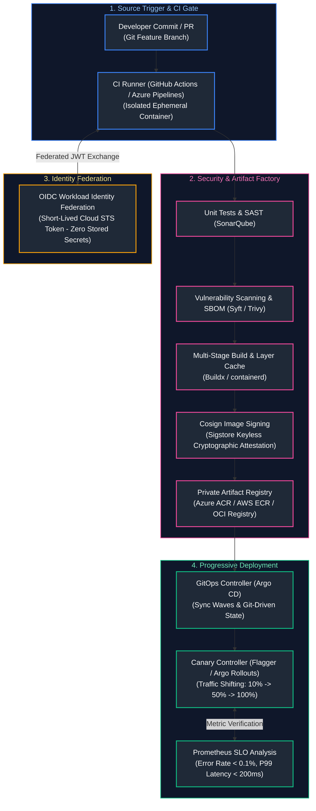
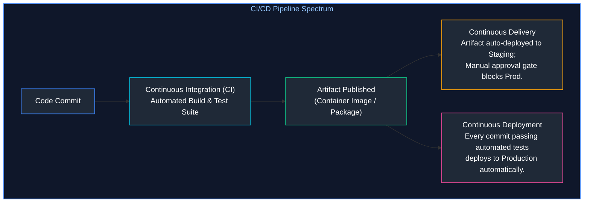
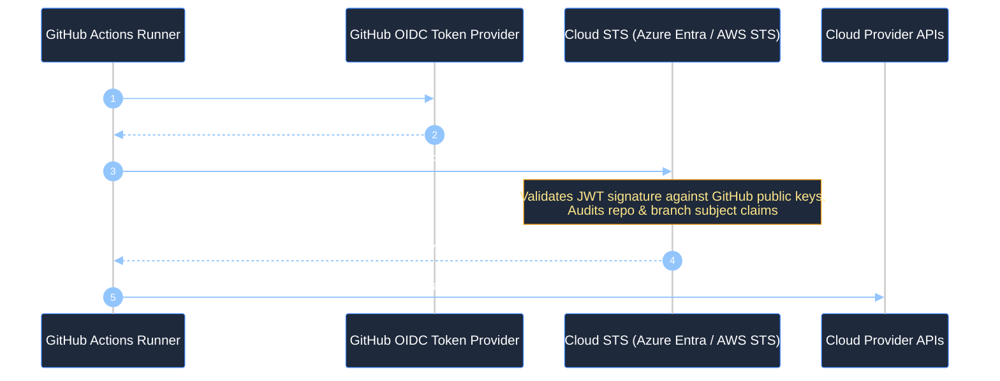
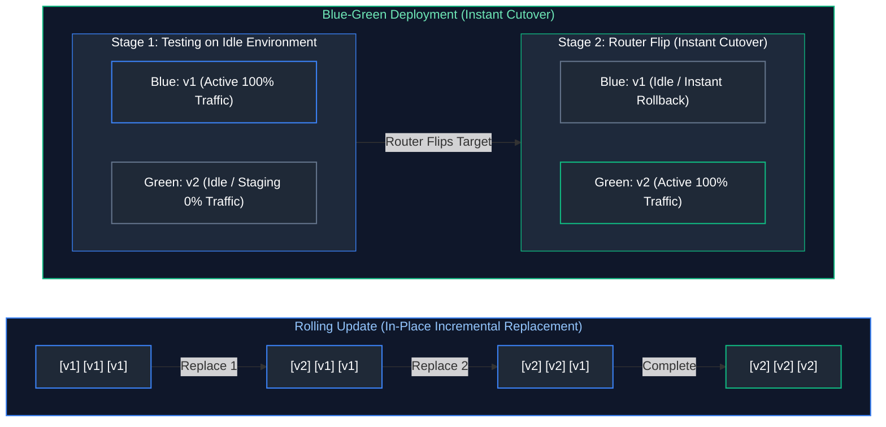
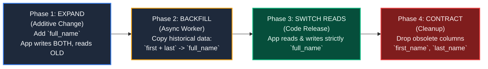

# 07. CI/CD & Release Engineering

A comprehensive, production-grade guide to enterprise Continuous Integration and Continuous Delivery (CI/CD), GitHub Actions, Azure DevOps Pipelines, keyless Workload Identity Federation (OIDC), multi-stage Docker build optimizations, progressive deployment strategies (Blue-Green, Canary with Flagger), zero-downtime database migrations, Software Bills of Materials (SBOMs), and container supply chain signing with Sigstore Cosign tailored for DevOps Engineers, Release Engineers, and Platform Architects.

---

## Architectural Overview: Secure Continuous Delivery & Progressive Release Pipeline



---

## Table of Contents
1. [Continuous Delivery Principles and Pipeline Topologies](#1-continuous-delivery-principles-and-pipeline-topologies)
   - [1.1 Continuous Integration vs. Continuous Delivery vs. Deployment](#11-continuous-integration-vs-continuous-delivery-vs-deployment)
   - [1.2 GitHub Actions vs. Azure DevOps Pipelines: Core Architecture](#12-github-actions-vs-azure-devops-pipelines-core-architecture)
2. [Container Image Builds and Artifact Registries](#2-container-image-builds-and-artifact-registries)
   - [2.1 Multi-Stage Dockerfile Optimization and Layer Caching](#21-multi-stage-dockerfile-optimization-and-layer-caching)
   - [2.2 Immutable Tagging, OCI Standards, and Registry Retention](#22-immutable-tagging-oci-standards-and-registry-retention)
3. [Workload Identity Federation and Keyless Authentication](#3-workload-identity-federation-and-keyless-authentication)
   - [3.1 Eliminating Long-Lived Cloud Credentials in CI/CD](#31-eliminating-long-lived-cloud-credentials-in-cicd)
   - [3.2 GitHub Actions OIDC Authentication to Azure and AWS](#32-github-actions-oidc-authentication-to-azure-and-aws)
4. [Deployment Strategies: Rolling, Blue-Green, and Canary](#4-deployment-strategies-rolling-blue-green-and-canary)
   - [4.1 Rolling Updates vs. Blue-Green Deployments](#41-rolling-updates-vs-blue-green-deployments)
   - [4.2 Progressive Canary Traffic Shifting with Flagger & Argo Rollouts](#42-progressive-canary-traffic-shifting-with-flagger-argo-rollouts)
5. [Artifact Promotion and Environment Gates](#5-artifact-promotion-and-environment-gates)
   - [5.1 Build Once, Deploy Many Invariant](#51-build-once-deploy-many-invariant)
   - [5.2 Manual Approval Gates and Automated Policy Verification](#52-manual-approval-gates-and-automated-policy-verification)
6. [Database Migration Strategies: Expand and Contract](#6-database-migration-strategies-expand-and-contract)
   - [6.1 The Parallel Run / Expand-and-Contract Migration Pattern](#61-the-parallel-run-expand-and-contract-migration-pattern)
   - [6.2 Flyway and Liquibase Automated Pipeline Execution](#62-flyway-and-liquibase-automated-pipeline-execution)
7. [Software Supply Chain Security and SBOMs](#7-software-supply-chain-security-and-sboms)
   - [7.1 Software Bill of Materials (SBOM) Generation with Syft](#71-software-bill-of-materials-sbom-generation-with-syft)
   - [7.2 Cryptographic Container Signing with Sigstore Cosign](#72-cryptographic-container-signing-with-sigstore-cosign)
8. [Production Enterprise CI/CD Pipeline Implementation](#8-production-enterprise-cicd-pipeline-implementation)
   - [8.1 Full Production GitHub Actions Workflow](#81-full-production-github-actions-workflow)
   - [8.2 Production Azure DevOps YAML Pipeline Equivalent](#12-github-actions-vs-azure-devops-pipelines-core-architecture)
9. [Summary Comparison & Engineering Reference Matrix](#9-summary-comparison-engineering-reference-matrix)
10. [References & Further Reading](#10-references-further-reading)

---

# 1. Continuous Delivery Principles and Pipeline Topologies

### 1.1 Continuous Integration vs. Continuous Delivery vs. Deployment



- **Continuous Integration (CI):** Developers merge code frequently to the mainline branch. Automated test suites execute, providing feedback in $<10$ minutes.
- **Continuous Delivery (CD):** Every commit that passes CI generates a deployable, tested production artifact. Deployment to production requires an explicit business approval gate.
- **Continuous Deployment:** Changes passing all automated testing gates deploy immediately to live production without human intervention.

---

### 1.2 GitHub Actions vs. Azure DevOps Pipelines: Core Architecture

| Core Concept | GitHub Actions | Azure DevOps (ADO) Pipelines |
| :--- | :--- | :--- |
| **Pipeline Definition** | `.github/workflows/*.yml` | `azure-pipelines.yml` |
| **Execution Hierarchy** | Workflow $\rightarrow$ Job $\rightarrow$ Step (Action / Run) | Pipeline $\rightarrow$ Stage $\rightarrow$ Job $\rightarrow$ Step (Task / Script) |
| **Runner Infrastructure**| GitHub-Hosted Runners or Self-Hosted Runner scale sets | Microsoft-Hosted Agents or Self-Hosted Virtual Machine Scale Sets |
| **Secret Management** | GitHub Secrets (Encrypted at rest per repo/env) | Azure DevOps Variable Groups & Key Vault integration |
| **Workload Identity** | Native OIDC JWT token exchange | Service Connections with Workload Identity Federation |

---

# 2. Container Image Builds and Artifact Registries

### 2.1 Multi-Stage Dockerfile Optimization and Layer Caching

A poorly constructed Dockerfile results in bloated 2GB+ images containing compilers, build tools, and vulnerability surface area. **Multi-stage builds** isolate the build environment from the minimal runtime scratch image:

```dockerfile
# ==============================================================================
# Stage 1: Build & Compilation Environment
# ==============================================================================
FROM golang:1.22-alpine AS builder

WORKDIR /src

# Leverage Docker layer cache: copy dependency manifests first
COPY go.mod go.sum ./
RUN go mod download

# Copy source code and compile statically linked binary
COPY . .
RUN CGO_ENABLED=0 GOOS=linux GOARCH=amd64 go build \
    -ldflags="-w -s -X main.version=1.4.0" \
    -o /bin/cloud-api ./cmd/server

# ==============================================================================
# Stage 2: Minimal Distroless Production Runtime
# ==============================================================================
FROM gcr.io/distroless/static-debian12:nonroot

WORKDIR /app

# Copy compiled binary from builder stage
COPY --from=builder /bin/cloud-api /app/cloud-api

# Non-root user 65532:65532 predefined in distroless
USER nonroot:nonroot

EXPOSE 8080

ENTRYPOINT ["/app/cloud-api"]
```

- **Layer Ordering Rule:** Place frequently changing instructions (`COPY . .`) at the bottom of the Dockerfile. Place static operations (`COPY go.mod`, `RUN apk add`) at the top to preserve cached layers across runs.

---

### 2.2 Immutable Tagging, OCI Standards, and Registry Retention

> [!CAUTION]
> **Never Deploy the `:latest` Tag in Production:** The `:latest` tag is mutable. Two Kubernetes nodes pulling `:latest` during an autoscaling event can run entirely different versions of application binaries. Always tag container images using immutable identifiers: the Git commit SHA (`v1.4.0-sha-a1b2c3d`) or content-addressable cryptographic digests (`sha256:7f83...`).

---

# 3. Workload Identity Federation and Keyless Authentication

### 3.1 Eliminating Long-Lived Cloud Credentials in CI/CD

Storing long-lived cloud credentials (such as AWS Access Keys or Azure Service Principal client secrets) inside GitHub Secrets introduces catastrophic security risks: secrets can leak in build logs, expire unexpectedly, or be extracted by malicious pull requests.

**Workload Identity Federation (OIDC)** eliminates stored passwords:



---

### 3.2 GitHub Actions OIDC Authentication to Azure and AWS

```yaml
# Authenticating to Azure without secrets
- name: Azure Login via OIDC
  uses: azure/login@v2
  with:
    client-id: ${{ vars.AZURE_CLIENT_ID }}
    tenant-id: ${{ vars.AZURE_TENANT_ID }}
    subscription-id: ${{ vars.AZURE_SUBSCRIPTION_ID }}

# Authenticating to AWS without secrets
- name: Configure AWS Credentials via OIDC
  uses: aws-actions/configure-aws-credentials@v4
  with:
    role-to-assume: arn:aws:iam::123456789012:role/GitHubActionsDeploymentRole
    aws-region: us-east-1
```

---

# 4. Deployment Strategies: Rolling, Blue-Green, and Canary

### 4.1 Rolling Updates vs. Blue-Green Deployments



---

### 4.2 Progressive Canary Traffic Shifting with Flagger & Argo Rollouts

In **Canary Deployments**, a small percentage of real production traffic (e.g. 5%) is routed to the new version while automated metric collectors measure error rates and latency:

```yaml
# canary_release.yaml (Flagger Canary Definition)
apiVersion: flagger.app/v1beta1
kind: Canary
metadata:
  name: cloud-api
  namespace: production
spec:
  targetRef:
    apiVersion: apps/v1
    kind: Deployment
    name: cloud-api
  service:
    port: 8080
  analysis:
    interval: 1m
    threshold: 5
    maxWeight: 50
    stepWeight: 10
    metrics:
      - name: request-success-rate
        thresholdRange:
          min: 99.5
        interval: 1m
      - name: request-duration
        thresholdRange:
          max: 200
        interval: 1m
    webhooks:
      - name: load-test
        url: http://flagger-loadtester.test/
        timeout: 5s
        metadata:
          type: cmd
          cmd: "hey -z 1m -q 10 -c 2 http://cloud-api-canary.production:8080/"
```

---

# 5. Artifact Promotion and Environment Gates

### 5.1 Build Once, Deploy Many Invariant

> [!IMPORTANT]
> **The Immutable Artifact Law:** You must **never** rebuild an application binary or container image when promoting from Dev to Staging to Production. Rebuilding introduces non-deterministic dependency shifts. The exact binary image compiled and tested in Staging must be promoted verbatim to Production, with environment differences injected strictly via external environment variables or Secret stores.

---

### 5.2 Manual Approval Gates and Automated Policy Verification

Enterprise pipelines configure GitHub Environments or Azure DevOps Release Gates enforcing:
1. Two-person peer review sign-off before Production deployment.
2. Deployment windows (e.g. no deployments between 5 PM Friday and 8 AM Monday).
3. Automated integration test pass verification on Staging.

---

# 6. Database Migration Strategies: Expand and Contract

### 6.1 The Parallel Run / Expand-and-Contract Migration Pattern

To deploy database schema updates without downtime, engineers use the **Expand-and-Contract** pattern:



| Phase | Phase Name | Database Schema Operation | Application R/W Semantics | Rollback Safety |
| :---: | :--- | :--- | :--- | :--- |
| **1** | **Expand** | Add new column `full_name` (nullable). | Writes to **BOTH** old and new columns; reads strictly from old. | Completely safe; old code is unaffected. |
| **2** | **Backfill** | None (background data replication). | Batched async jobs populate `full_name` for historical rows. | Safe; non-blocking incremental batches. |
| **3** | **Switch Reads** | Mark new column NOT NULL if applicable. | Application reads and writes **strictly from `full_name`**. | Safe; old columns remain available as backup. |
| **4** | **Contract** | Destructive DDL: `DROP COLUMN first_name, last_name`. | Application has zero references to dropped columns. | Irreversible; executed only after stabilization. |

---

### 6.2 Flyway and Liquibase Automated Pipeline Execution

Automated migration tools track applied SQL revisions via a database metadata table (`flyway_schema_history`):

```sql
-- migrations/V1__create_users_table.sql
CREATE TABLE users (
    id UUID PRIMARY KEY DEFAULT gen_random_uuid(),
    email VARCHAR(255) NOT NULL UNIQUE,
    created_at TIMESTAMP WITH TIME ZONE DEFAULT CURRENT_TIMESTAMP
);
```

```bash
# Execute idempotent migration in CI release gate
flyway -url="jdbc:postgresql://db.internal:5432/proddb" \
       -user="migrator" \
       -password="${MIGRATION_DB_PASSWORD}" \
       -locations="filesystem:./migrations" \
       migrate
```

---

# 7. Software Supply Chain Security and SBOMs

### 7.1 Software Bill of Materials (SBOM) Generation with Syft

An **SBOM** provides a complete nested inventory of every third-party library, package, and licensing agreement included within a container:

```bash
# Generate CycloneDX JSON format SBOM
syft packages docker:myregistry.azurecr.io/cloud-api:v1.4.0 -o cyclonedx-json=sbom.json

# Audit SBOM for known vulnerabilities using Grype
grype sbom:sbom.json --fail-on high
```

---

### 7.2 Cryptographic Container Signing with Sigstore Cosign

**Cosign** provides keyless cryptographic signing of OCI container images by issuing ephemeral certificates via the Fulcio Certificate Authority and logging signatures in the Rekor public transparency log:

```bash
# Sign container image in CI pipeline using GitHub OIDC identity
cosign sign --yes myregistry.azurecr.io/cloud-api:v1.4.0

# Verify image signature before deploying in Kubernetes
cosign verify \
  --certificate-identity "https://github.com/my-org/my-repo/.github/workflows/deploy.yml@refs/heads/main" \
  --certificate-oidc-issuer "https://token.actions.githubusercontent.com" \
  myregistry.azurecr.io/cloud-api:v1.4.0
```

---

# 8. Production Enterprise CI/CD Pipeline Implementation

### 8.1 Full Production GitHub Actions Workflow

Below is an end-to-end production GitHub Actions workflow demonstrating multi-stage testing, OIDC cloud login, Docker layer caching, SBOM generation, image signing, and deployment trigger:

```yaml
# .github/workflows/production_delivery.yml
name: Production Release Pipeline

on:
  push:
    branches:
      - main
    tags:
      - "v*"

permissions:
  id-token: write  # Mandatory for OIDC Workload Identity
  contents: read
  packages: write

env:
  REGISTRY: myregistry.azurecr.io
  IMAGE_NAME: cloud-api

jobs:
  validate-and-test:
    runs-on: ubuntu-latest
    steps:
      - name: Checkout Code
        uses: actions/checkout@v4

      - name: Setup Go
        uses: actions/setup-go@v5
        with:
          go-version: "1.22"
          cache: true

      - name: Run Unit Tests & Coverage
        run: go test -v -race -coverprofile=coverage.out ./...

  build-and-publish:
    needs: validate-and-test
    runs-on: ubuntu-latest
    steps:
      - name: Checkout Code
        uses: actions/checkout@v4

      - name: Setup Docker Buildx
        uses: docker/setup-buildx-action@v3

      - name: Authenticate to Azure via OIDC
        uses: azure/login@v2
        with:
          client-id: ${{ vars.AZURE_CLIENT_ID }}
          tenant-id: ${{ vars.AZURE_TENANT_ID }}
          subscription-id: ${{ vars.AZURE_SUBSCRIPTION_ID }}

      - name: Log in to Azure Container Registry
        run: az acr login --name myregistry

      - name: Install Cosign & Syft
        uses: sigstore/cosign-installer@v3.4.0

      - name: Build and Push Docker Image
        id: docker_build
        uses: docker/build-push-action@v5
        with:
          context: .
          push: true
          tags: ${{ env.REGISTRY }}/${{ env.IMAGE_NAME }}:${{ github.sha }}
          cache-from: type=gha
          cache-to: type=gha,mode=max

      - name: Sign Container Image (Keyless)
        run: |
          cosign sign --yes "${{ env.REGISTRY }}/${{ env.IMAGE_NAME }}:${{ github.sha }}"

  deploy-staging:
    needs: build-and-publish
    runs-on: ubuntu-latest
    environment: staging
    steps:
      - name: Update GitOps Deployment Manifest
        run: |
          echo "Updating Argo CD manifest repo with image tag ${{ github.sha }}"
```

---

# 9. Summary Comparison & Engineering Reference Matrix

| Release Strategy | Infrastructure Cost | Downtime Risk | Rollback Speed | Traffic Control Granularity |
| :--- | :--- | :--- | :--- | :--- |
| **Recreate** | Lowest (No duplicate resources) | High (Downtime during replace) | Slow (Rebuild required) | None (0% or 100%) |
| **Rolling Update** | Low (Small surge capacity $+25\%$) | Low (Zero downtime if graceful) | Moderate (Rolling rollback) | Node-level discrete increments |
| **Blue-Green** | High ($+100\%$ duplicate capacity) | Very Low (Tested prior to cutover) | Instant (Router DNS flip back) | Binary (All traffic to Blue or Green) |
| **Canary (Flagger)**| Moderate ($+10-20\%$ canary pods) | Lowest (Automated SLO aborts) | Instant (Traffic shifted to primary) | Fine-grained (1%, 5%, 10%, 25%, 50%) |

---

# 10. References & Further Reading

- [GitHub Actions Documentation: Workload Identity Federation](https://docs.github.com/en/actions/deployment/security-hardening-your-deployments/about-security-hardening-with-openid-connect) — OIDC integration standards.
- [Sigstore Cosign Documentation](https://docs.sigstore.dev/cosign/overview/) — Container cryptographic verification.
- [Flagger Progressive Delivery Documentation](https://docs.flagger.app/) — Automated Canary releases on Kubernetes.
- [Martin Fowler: Blue-Green Deployments](https://martinfowler.com/bliki/BlueGreenDeployment.html) — Architectural foundations.
- [Open Source Vulnerability (OSV) Database](https://osv.dev/) — Open-source distributed vulnerability registry.

