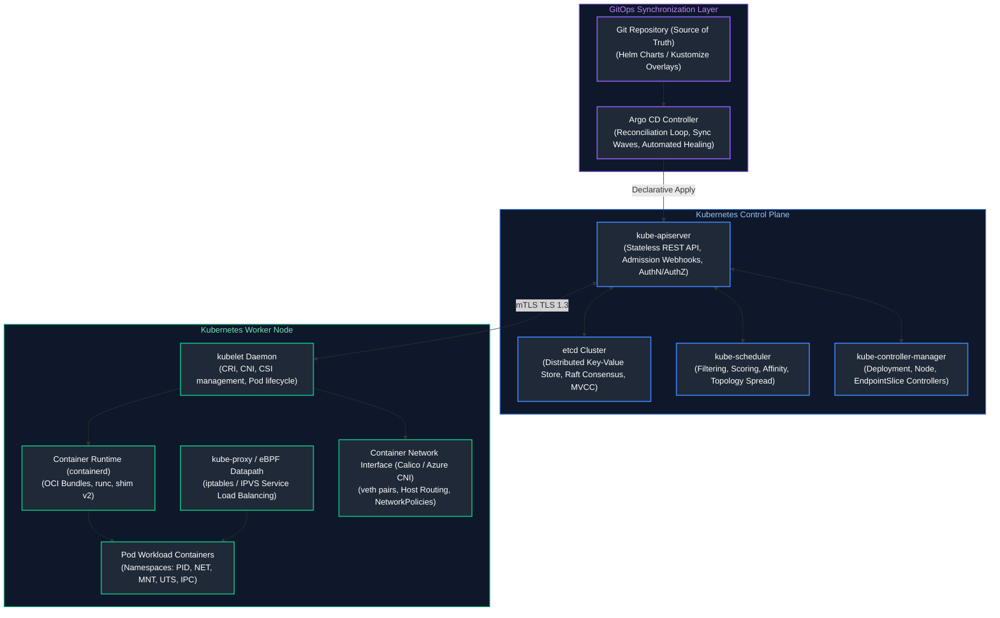
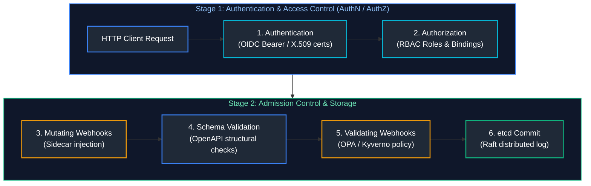
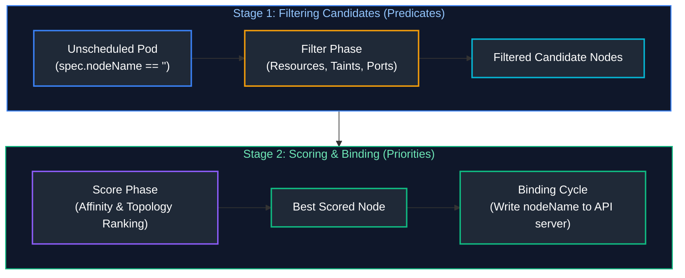
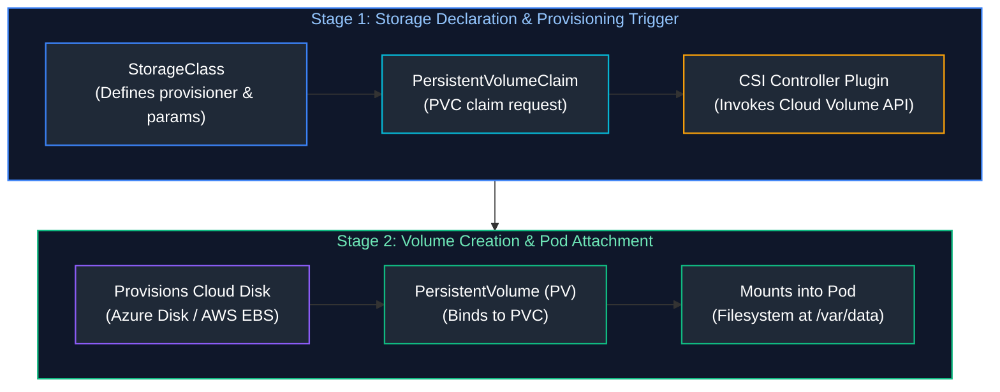
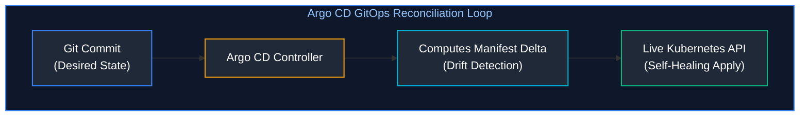
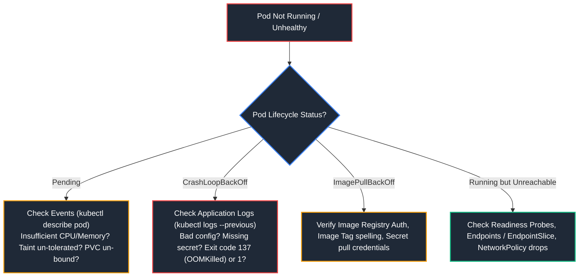

# 08. Containers, Kubernetes & GitOps — Advanced

A comprehensive, production-grade guide to Kubernetes architecture, control plane mechanics, etcd Raft consensus, scheduling algorithms, CNI/CSI/CRI subsystems, auto-scaling with HPA and KEDA, GitOps delivery with Argo CD, StatefulSets, Gateway API, and production cluster troubleshooting playbooks tailored for Senior Kubernetes Engineers, Platform Architects, and Site Reliability Engineers.

---

## Architectural Overview: Kubernetes Control Plane & Node Runtime



---

## Table of Contents
1. [Kubernetes Control Plane and etcd Internals](#1-kubernetes-control-plane-and-etcd-internals)
   - [1.1 API Server Request Processing Pipeline](#11-api-server-request-processing-pipeline)
   - [1.2 etcd Storage Mechanics: Raft Consensus, B-Trees, and Compaction](#12-etcd-storage-mechanics-raft-consensus-b-trees-and-compaction)
2. [Pod Scheduling, Affinity, and Topology Spread](#2-pod-scheduling-affinity-and-topology-spread)
   - [2.1 Two-Phase Scheduling: Filter (Predicates) and Score (Priorities)](#21-two-phase-scheduling-filter-predicates-and-score-priorities)
   - [2.2 Node Affinity, Pod Anti-Affinity, Taints, and Tolerations](#22-node-affinity-pod-anti-affinity-taints-and-tolerations)
   - [2.3 Topology Spread Constraints across Availability Zones](#23-topology-spread-constraints-across-availability-zones)
3. [Autoscaling: HPA, VPA, and KEDA](#3-autoscaling-hpa-vpa-and-keda)
   - [3.1 Horizontal Pod Autoscaler (HPA) Algorithm Mechanics](#31-horizontal-pod-autoscaler-hpa-algorithm-mechanics)
   - [3.2 Event-Driven Autoscaling with KEDA](#32-event-driven-autoscaling-with-keda)
   - [3.3 Cluster Autoscaler vs. Karpenter Rapid Node Provisioning](#33-cluster-autoscaler-vs-karpenter-rapid-node-provisioning)
4. [Kubernetes Networking, CNI, and DNS](#4-kubernetes-networking-cni-and-dns)
   - [4.1 The Fundamental Pod-to-Pod Networking Model](#41-the-fundamental-pod-to-pod-networking-model)
   - [4.2 CNI Plugins: Overlay (Calico/Flannel) vs. Cloud Native (Azure CNI/AWS VPC CNI)](#42-cni-plugins-overlay-calicoflannel-vs-cloud-native-azure-cniaws-vpc-cni)
   - [4.3 Service Datapaths: kube-proxy (iptables / IPVS) vs. eBPF (Cilium)](#43-service-datapaths-kube-proxy-iptables-ipvs-vs-ebpf-cilium)
   - [4.4 Ingress Controllers vs. The Kubernetes Gateway API](#44-ingress-controllers-vs-the-kubernetes-gateway-api)
5. [Storage Subsystem: CSI, Persistent Volumes, and StatefulSets](#5-storage-subsystem-csi-persistent-volumes-and-statefulsets)
   - [5.1 Container Storage Interface (CSI) Dynamic Provisioning](#51-container-storage-interface-csi-dynamic-provisioning)
   - [5.2 StatefulSet Invariants: Deterministic Identity and Ordered Scaling](#52-statefulset-invariants-deterministic-identity-and-ordered-scaling)
6. [Security, RBAC, and Workload Identity](#6-security-rbac-and-workload-identity)
   - [6.1 Role-Based Access Control (RBAC): Roles, ClusterRoles, and Bindings](#61-role-based-access-control-rbac-roles-clusterroles-and-bindings)
   - [6.2 Pod Security Standards (PSS) & Admission Webhooks](#62-pod-security-standards-pss-admission-webhooks)
   - [6.3 Cloud Workload Identity Federation in Kubernetes](#6-security-rbac-and-workload-identity)
7. [GitOps with Argo CD and Progressive Delivery](#7-gitops-with-argo-cd-and-progressive-delivery)
   - [7.1 Reconciliation Loop, Drift Detection, and Auto-Healing](#71-reconciliation-loop-drift-detection-and-auto-healing)
   - [7.2 Production Argo CD ApplicationSet & Sync Waves](#72-production-argo-cd-applicationset-sync-waves)
8. [Kubernetes Troubleshooting Playbook](#8-kubernetes-troubleshooting-playbook)
   - [8.1 Diagnostic Decision Tree for Common Pod Failures](#81-diagnostic-decision-tree-for-common-pod-failures)
   - [8.2 Automated Python Pod Diagnostic and Health Inspection Utility](#82-automated-python-pod-diagnostic-and-health-inspection-utility)
9. [Summary Comparison & Engineering Reference Matrix](#9-summary-comparison-engineering-reference-matrix)
10. [References & Further Reading](#10-references-further-reading)

---

# 1. Kubernetes Control Plane and etcd Internals

### 1.1 API Server Request Processing Pipeline

The `kube-apiserver` is the single point of entry for all cluster mutations. Requests pass through a strictly ordered pipeline:



1. **Authentication (AuthN):** Validates client identity using X.509 client certificates, Bearer OpenID Connect (OIDC) JWT tokens, or Webhook tokens.
2. **Authorization (AuthZ):** Verifies if the authenticated user has permission to perform the requested verb (`get`, `list`, `create`, `update`, `delete`) on the target resource via RBAC.
3. **Mutating Admission Webhooks:** Modifies object specifications before storage (e.g. injecting sidecar proxies like Envoy/Istio, setting default resource requests).
4. **Validating Admission Webhooks:** Validates objects against policy engines (e.g. Kyverno, OPA Gatekeeper). Returns an HTTP 403 Forbidden to reject non-compliant manifests.

---

### 1.2 etcd Storage Mechanics: Raft Consensus, B-Trees, and Compaction

`etcd` is a strongly consistent, distributed key-value store implementing the **Raft consensus algorithm**:
- **Quorum Requirement:** To survive $F$ node failures, an etcd cluster requires $2F + 1$ members. A 3-node cluster tolerates 1 failure; a 5-node cluster tolerates 2 failures.
- **B-Tree & BoltDB:** In-memory B-Tree index maps key names to revisions; data is persisted on disk in a transactional B+ Tree via BoltDB.
- **Multi-Version Concurrency Control (MVCC):** Every write increments a global revision counter. Deleted keys are retained as "tombstones".
- **Compaction & Defragmentation:** Old revisions must be regularly purged via `etcdctl compact` followed by `etcdctl defrag` to reclaim disk space.

> [!CAUTION]
> **etcd Disk Fsync Latency:** etcd performance is bounded by disk write latency (`wal_fsync`). If disk write latency exceeds 10ms, leader elections flap, crashing the control plane. etcd **must** be deployed on ultra-fast local NVMe drives, never on shared network block storage with variable IOPS.

---

# 2. Pod Scheduling, Affinity, and Topology Spread

### 2.1 Two-Phase Scheduling: Filter (Predicates) and Score (Priorities)

The `kube-scheduler` assigns unscheduled pods (`spec.nodeName == ""`) to appropriate nodes across two phases:



1. **Filter Phase (Predicates):** Filters out nodes incapable of hosting the Pod (checks `NodeResourcesFit`, `NodeName`, `NodePorts`, `PodFitsHostPorts`, `TaintToleration`).
2. **Score Phase (Priorities):** Ranks candidate nodes using scoring plugins (`NodeAffinity`, `ImageLocality`, `TaintTolerationPriority`). The node with the highest score is selected.

---

### 2.2 Node Affinity, Pod Anti-Affinity, Taints, and Tolerations

- **Taints and Tolerations:** Repel pods from nodes unless the pod has an explicit toleration (e.g., dedicated GPU nodes).
  ```yaml
  # Node Taint:
  kubectl taint nodes gpu-node-01 dedicated=gpu:NoSchedule
  ```
- **Pod Anti-Affinity:** Prevents co-locating replicas of the same service on the same node:

```yaml
# production_anti_affinity.yaml
apiVersion: apps/v1
kind: Deployment
metadata:
  name: cloud-api
spec:
  replicas: 3
  template:
    metadata:
      labels:
        app: cloud-api
    spec:
      affinity:
        podAntiAffinity:
          requiredDuringSchedulingIgnoredDuringExecution:
            - labelSelector:
                matchExpressions:
                  - key: app
                    operator: In
                    values:
                      - cloud-api
              topologyKey: "kubernetes.io/hostname"
```

---

### 2.3 Topology Spread Constraints across Availability Zones

Ensures pods are distributed evenly across Availability Zones:

```yaml
topologySpreadConstraints:
  - maxSkew: 1
    topologyKey: "topology.kubernetes.io/zone"
    whenUnsatisfiable: DoNotSchedule
    labelSelector:
      matchLabels:
        app: cloud-api
```

---

# 3. Autoscaling: HPA, VPA, and KEDA

### 3.1 Horizontal Pod Autoscaler (HPA) Algorithm Mechanics

The Horizontal Pod Autoscaler controller periodically evaluates metric values against desired targets:

$$\text{Desired Replicas} = \left\lceil \text{Current Replicas} \times \left( \frac{\text{Current Metric Value}}{\text{Desired Metric Value}} \right) \right\rceil$$

---

### 3.2 Event-Driven Autoscaling with KEDA

While HPA scales on internal resource metrics (CPU/Memory), **KEDA (Kubernetes Event-driven Autoscaling)** connects directly to external message brokers (Azure Service Bus, AWS SQS, Kafka, RabbitMQ) to scale pods based on queue length, even scaling **down to zero**:

```yaml
# keda_scaledobject.yaml
apiVersion: keda.sh/v1alpha1
kind: ScaledObject
metadata:
  name: order-processor-scaler
  namespace: default
spec:
  scaleTargetRef:
    name: order-processor
  minReplicaCount: 0
  maxReplicaCount: 50
  cooldownPeriod: 300
  triggers:
    - type: azure-servicebus
      metadata:
        queueName: orders-queue
        messageCount: "10"
      authenticationRef:
        name: keda-trigger-auth
```

---

### 3.3 Cluster Autoscaler vs. Karpenter Rapid Node Provisioning

- **Cluster Autoscaler:** Reacts when pods enter `Pending` state due to insufficient capacity. Provisions nodes by incrementing cloud Auto Scaling Group / VMSS desired instance counts (takes 2-4 minutes).
- **Karpenter:** Directly interfaces with cloud compute APIs (AWS EC2 / Azure Fleet). Analyzes unscheduled pod resource shapes and dynamically launches rightsized instances in $<45$ seconds without pre-configured node groups.

---

# 4. Kubernetes Networking, CNI, and DNS

### 4.1 The Fundamental Pod-to-Pod Networking Model

Kubernetes imposes three strict networking invariants:
1. Every Pod gets its own unique IP address.
2. All Pods can communicate with all other Pods on all nodes without NAT.
3. Agents on a node (kubelet) can communicate with all Pods on that node.

---

### 4.2 CNI Plugins: Overlay (Calico/Flannel) vs. Cloud Native (Azure CNI/AWS VPC CNI)

- **Overlay Networking (Calico / VXLAN / Geneve):** Encapsulates original L3 IP packets inside L4 UDP packets. Pod IPs exist in a virtual private subnet distinct from the underlying cloud VNet. Lower cloud IP consumption, slight CPU encapsulation overhead.
- **Cloud-Native CNI (Azure CNI / AWS VPC CNI):** Pods receive first-class routable IP addresses directly from the cloud VNet/VPC subnet. Eliminates encapsulation latency, allows direct VNet routing, but consumes large blocks of cloud subnet CIDRs.

---

### 4.3 Service Datapaths: kube-proxy (iptables / IPVS) vs. eBPF (Cilium)

- **iptables Mode:** `kube-proxy` generates sequential iptables packet filter chains for every Service. At $>5,000$ services, evaluating thousands of rules per packet introduces significant packet latency.
- **eBPF (Cilium):** Bypasses iptables entirely. Compiles socket filter programs directly into the Linux kernel using BPF maps, providing $O(1)$ constant-time lookup routing regardless of service count.

---

### 4.4 Ingress Controllers vs. The Kubernetes Gateway API

The **Gateway API** replaces legacy Ingress with a role-oriented, expressive traffic routing API:

```yaml
# gateway_api.yaml
apiVersion: gateway.networking.k8s.io/v1
kind: HTTPRoute
metadata:
  name: api-routing
spec:
  parentRefs:
    - name: enterprise-gateway
  rules:
    - matches:
        - path:
            type: PathPrefix
            value: /api/v2
      backendRefs:
        - name: cloud-api-v2
          port: 8080
```

---

# 5. Storage Subsystem: CSI, Persistent Volumes, and StatefulSets

### 5.1 Container Storage Interface (CSI) Dynamic Provisioning



- **Reclaim Policies:** `Delete` (destroys backing disk when PVC is deleted) vs. `Retain` (preserves physical volume for manual recovery).

---

### 5.2 StatefulSet Invariants: Deterministic Identity and Ordered Scaling

Unlike Deployments where pods are fungible and randomly named (`web-7f89d-abc`), **StatefulSets** guarantee:
1. **Stable Network Identity:** Predictable hostnames (`db-0`, `db-1`, `db-2`) resolvable via a headless service (`db-0.db-service.default.svc.cluster.local`).
2. **Dedicated Storage Volumes:** Each pod gets its own dedicated volume via `volumeClaimTemplates` that persists across pod rescheduling.
3. **Ordered Rollouts:** Scaled and updated sequentially from index $N-1$ down to 0.

---

# 6. Security, RBAC, and Workload Identity

### 6.1 Role-Based Access Control (RBAC): Roles, ClusterRoles, and Bindings

```yaml
# rbac_policy.yaml
apiVersion: rbac.authorization.k8s.io/v1
kind: Role
metadata:
  namespace: production
  name: pod-reader
rules:
  - apiGroups: [""]
    resources: ["pods", "pods/log"]
    verbs: ["get", "list", "watch"]
---
apiVersion: rbac.authorization.k8s.io/v1
kind: RoleBinding
metadata:
  name: read-pods-binding
  namespace: production
subjects:
  - kind: ServiceAccount
    name: monitoring-sa
    namespace: production
roleRef:
  kind: Role
  name: pod-reader
  apiGroup: rbac.authorization.k8s.io
```

---

### 6.2 Pod Security Standards (PSS) & Admission Webhooks

Replaces deprecated PodSecurityPolicies with three namespace-level profiles:
- **Privileged:** Unrestricted permissions (intended for system daemons).
- **Baseline:** Minimally restrictive default preventing privilege escalation.
- **Restricted:** Hardened security profile enforcing non-root execution, dropping all Linux capabilities except `NET_BIND_SERVICE`, and disabling host namespaces.

```bash
# Enforce restricted pod security on production namespace
kubectl label --overwrite ns production \
  pod-security.kubernetes.io/enforce=restricted \
  pod-security.kubernetes.io/enforce-version=latest
```

---

# 7. GitOps with Argo CD and Progressive Delivery

### 7.1 Reconciliation Loop, Drift Detection, and Auto-Healing

Argo CD operates as an in-cluster controller continuously reconciling desired Git state against live cluster state:



- **Automated Drift Correction:** If an operator manually edits a deployment (`kubectl scale --replicas=10`), Argo CD detects the divergence and overwrites the live state back to the Git source of truth within seconds.

---

### 7.2 Production Argo CD ApplicationSet & Sync Waves

```yaml
# argocd_applicationset.yaml
apiVersion: argoproj.io/v1alpha1
kind: ApplicationSet
metadata:
  name: microservices
  namespace: argocd
spec:
  generators:
    - git:
        repoURL: https://github.com/my-org/cloud-gitops.git
        revision: HEAD
        directories:
          - path: apps/*
  template:
    metadata:
      name: "{{path.basename}}"
    spec:
      project: default
      source:
        repoURL: https://github.com/my-org/cloud-gitops.git
        targetRevision: HEAD
        path: "{{path}}"
      destination:
        server: https://kubernetes.default.svc
        namespace: "{{path.basename}}"
      syncPolicy:
        automated:
          prune: true
          selfHeal: true
        syncOptions:
          - CreateNamespace=true
```

---

# 8. Kubernetes Troubleshooting Playbook

### 8.1 Diagnostic Decision Tree for Common Pod Failures



---

### 8.2 Automated Python Pod Diagnostic and Health Inspection Utility

Below is a production Python automation script querying the Kubernetes API directly to audit pod crash states, detect OOMKilled events, and generate remediation reports:

```python
#!/usr/bin/env python3
"""
Kubernetes Cluster Health & Crash Diagnostic Engine.
Audits all pods across namespaces, discovers OOMKilled containers,
pending storage bindings, and calculates restarting workloads.
"""

from dataclasses import asdict, dataclass
import json
import logging
import sys
from typing import Dict, List, Optional

logging.basicConfig(
    level=logging.INFO,
    format='{"time":"%(asctime)s","level":"%(levelname)s","message":"%(message)s"}',
    handlers=[logging.StreamHandler(sys.stdout)],
)
logger = logging.getLogger("k8s_diagnostics")


@dataclass(frozen=True)
class PodTriageReport:
    namespace: str
    pod_name: str
    phase: str
    restart_count: int
    last_termination_reason: Optional[str]
    is_oom_killed: bool
    diagnostic_action: str


class KubernetesClusterAuditor:
    @staticmethod
    def audit_pod_spec(pod_raw: Dict) -> PodTriageReport:
        """Evaluates raw pod status JSON for anomalies."""
        ns = pod_raw.get("metadata", {}).get("namespace", "default")
        name = pod_raw.get("metadata", {}).get("name", "unknown")
        status = pod_raw.get("status", {})
        phase = status.get("phase", "Unknown")

        restarts = 0
        last_reason = None
        is_oom = False
        action = "NORMAL"

        container_statuses = status.get("containerStatuses", [])
        for c in container_statuses:
            restarts += c.get("restartCount", 0)
            last_state = c.get("lastState", {})
            terminated = last_state.get("terminated")
            if terminated:
                last_reason = terminated.get("reason")
                if last_reason == "OOMKilled" or terminated.get("exitCode") == 137:
                    is_oom = True
                    action = "INCREASE_MEMORY_LIMIT"

        if phase == "Pending":
            action = "INSPECT_SCHEDULER_EVENTS_AND_PVC"
        elif restarts > 5 and not is_oom:
            action = "INSPECT_LOGS_FOR_UNCAUGHT_EXCEPTIONS"

        return PodTriageReport(
            namespace=ns,
            pod_name=name,
            phase=phase,
            restart_count=restarts,
            last_termination_reason=last_reason,
            is_oom_killed=is_oom,
            diagnostic_action=action,
        )


if __name__ == "__main__":
    sample_pod = {
        "metadata": {"namespace": "production", "name": "payment-api-7b89-z4r8q"},
        "status": {
            "phase": "Running",
            "containerStatuses": [
                {
                    "restartCount": 8,
                    "lastState": {
                        "terminated": {"exitCode": 137, "reason": "OOMKilled"}
                    },
                }
            ],
        },
    }

    auditor = KubernetesClusterAuditor()
    report = auditor.audit_pod_spec(sample_pod)
    print(json.dumps(asdict(report), indent=2))
```

---

# 9. Summary Comparison & Engineering Reference Matrix

| Feature / Subsystem | Architectural Standard | Core Performance Bottleneck | Primary Failure Mode | Diagnostic Command |
| :--- | :--- | :--- | :--- | :--- |
| **Control Plane Store**| etcd (Raft) | Disk write fsync latency ($>10$ms) | Leader election flapping, split-brain | `etcdctl endpoint health`, `etcdctl check perf` |
| **Networking Datapath**| Cilium (eBPF) / Calico | Large iptables chain evaluations | NetworkPolicy blocking probes, MTU drops | `cilium status`, `ip -s link show` |
| **Autoscaling** | KEDA + HPA + Karpenter | Slow node spinup (2-4 min) | Cold start lag, pending pod spikes | `kubectl get scaledobject`, `kubectl get hpa` |
| **GitOps Engine** | Argo CD | High API server query rate | Sync drift storms, out-of-sync loops | `argocd app list`, `kubectl get apps -A` |
| **Stateful Workloads** | StatefulSet + CSI | Cross-AZ disk detachment delay | `Multi-Attach error for volume` | `kubectl describe pvc`, `kubectl get pv` |

---

# 10. References & Further Reading

- [Kubernetes Documentation: Architecture](https://kubernetes.io/docs/concepts/architecture/) — Official architecture and controller reference.
- [etcd Documentation](https://etcd.io/docs/) — Distributed key-value storage and Raft consensus.
- [Argo CD Official Guide](https://argo-cd.readthedocs.io/en/stable/) — GitOps workflow and progressive delivery.
- [KEDA Documentation](https://keda.sh/) — Kubernetes event-driven autoscaling.
- [Brendan Burns: Designing Distributed Systems](https://www.oreilly.com/) — Foundational patterns for containerized applications.

