# 08. Observability, Monitoring, Reliability & SRE Incident Management

A comprehensive, production-grade guide to telemetry standards (OpenTelemetry, Prometheus, Grafana), centralized logging, distributed tracing, SRE core principles, SLI/SLO/SLA mathematical foundations, error budgets, Chaos Engineering, and incident triage runbooks.

---

## Architectural Overview: OpenTelemetry Pipeline & Multi-Tier Observability Fabric

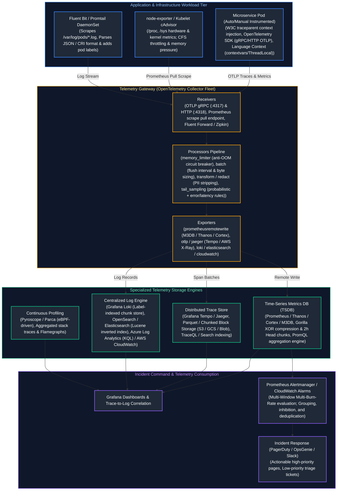

---

## Table of Contents
1. [Observability Foundations: The Intensive Care Analogy & Core Principles](#1-observability-foundations-the-intensive-care-analogy--core-principles)
   - [1.1 Real-World Analogy: The ICU vs. The Check-Engine Light](#11-real-world-analogy-the-icu-vs-the-check-engine-light)
   - [1.2 Monitoring vs. Observability: Known-Knowns vs. Unknown-Unknowns](#12-monitoring-vs-observability-known-knowns-vs-unknown-unknowns)
   - [1.3 Diagnostic Frameworks: RED, USE, and the Four Golden Signals](#13-diagnostic-frameworks-red-use-and-the-four-golden-signals)
2. [Cloud-Native Monitoring: Azure Monitor, Log Analytics, and AWS CloudWatch](#2-cloud-native-monitoring-azure-monitor-log-analytics-and-aws-cloudwatch)
   - [2.1 Azure Monitor & Kusto Query Language (KQL) Deep Dive](#21-azure-monitor--kusto-query-language-kql-deep-dive)
   - [2.2 AWS CloudWatch Metrics, Metric Math, and CloudTrail Forensics](#22-aws-cloudwatch-metrics-metric-math-and-cloudtrail-forensics)
3. [Prometheus TSDB Storage Architecture & PromQL Mastery](#3-prometheus-tsdb-storage-architecture--promql-mastery)
   - [3.1 TSDB Internal Mechanics: Gorilla Float Compression, Head Chunks, and WAL](#31-tsdb-internal-mechanics-gorilla-float-compression-head-chunks-and-wal)
   - [3.2 Production PromQL: rate() vs. irate(), Histogram Quantiles, and Subqueries](#32-production-promql-rate-vs-irate-histogram-quantiles-and-subqueries)
   - [3.3 Recording Rules and Query Performance Optimization](#33-recording-rules-and-query-performance-optimization)
4. [OpenTelemetry (OTel) Instrumentation and Pipeline Design](#4-opentelemetry-otel-instrumentation-and-pipeline-design)
   - [4.1 The OpenTelemetry Architecture: API, SDK, Semantic Conventions, and OTLP](#41-the-opentelemetry-architecture-api-sdk-semantic-conventions-and-otlp)
   - [4.2 Production OpenTelemetry Collector Architecture & Deployment Topologies](#42-production-opentelemetry-collector-architecture--deployment-topologies)
   - [8.3 Tail-Based Sampling vs. Head-Based Sampling](#83-tail-based-sampling-vs-head-based-sampling)
5. [Distributed Tracing and Context Propagation Mechanics](#9-distributed-tracing-and-context-propagation-mechanics)
   - [9.1 W3C Trace Context Specification: traceparent and tracestate Internals](#91-w3c-trace-context-specification-traceparent-and-tracestate-internals)
   - [9.2 Asynchronous Context Propagation Across Message Queues (Kafka / SQS / Service Bus)](#92-asynchronous-context-propagation-across-message-queues-kafka--sqs--service-bus)
6. [Centralized Logging Architecture: Loki vs. OpenSearch](#10-centralized-logging-architecture-loki-vs-opensearch)
   - [10.1 Index-Free Chunk Storage (Loki) vs. Full-Text Inverted Indices (Lucene / OpenSearch)](#101-index-free-chunk-storage-loki-vs-full-text-inverted-indices-lucene--opensearch)
   - [10.2 LogQL Stream Parsing, Metric Extraction, and Log Filtering](#102-logql-stream-parsing-metric-extraction-and-log-filtering)
7. [Alerting Strategy: Multi-Window Multi-Burn-Rate SLO Alerts](#11-alerting-strategy-multi-window-multi-burn-rate-slo-alerts)
   - [11.1 Eradicating Alert Fatigue: Symptoms vs. Causes & Actionability Rules](#111-eradicating-alert-fatigue-symptoms-vs-causes--actionability-rules)
   - [11.2 Burn Rate Mathematics: Protecting Error Budgets Across Time Horizons](#112-burn-rate-mathematics-protecting-error-budgets-across-time-horizons)
   - [11.3 Production Alertmanager Configuration with Multi-Window Rules](#113-production-alertmanager-configuration-with-multi-window-rules)
8. [Telemetry Cardinality Management & Cost Control](#12-telemetry-cardinality-management--cost-control)
   - [12.1 The Mathematics of TSDB Inverted Index Explosion](#121-the-mathematics-of-tsdb-inverted-index-explosion)
   - [12.2 Practical Cardinality Defense: Relabeling Rules and OTel Transforms](#122-practical-cardinality-defense-relabeling-rules-and-otel-transforms)
   - [12.3 Automated Prometheus TSDB Cardinality Auditor Script (Python)](#123-automated-prometheus-tsdb-cardinality-auditor-script-python)
9. [Senior SRE Troubleshooting Runbook: Observability Outages](#13-senior-sre-troubleshooting-runbook-observability-outages)
   - [13.1 Scenario 1: Prometheus Out-Of-Memory (OOM) CrashLoopBackOff](#131-scenario-1-prometheus-out-of-memory-oom-crashloopbackoff)
   - [13.2 Scenario 2: Broken Context Propagation (Disjointed Distributed Traces)](#132-scenario-2-broken-context-propagation-disjointed-distributed-traces)
   - [13.3 Scenario 3: OTel Collector Buffer Saturation & Dropped Telemetry](#133-scenario-3-otel-collector-buffer-saturation--dropped-telemetry)
10. [SRE Principles: The Commercial Aviation & Flight Safety Analogy](#14-sre-principles-the-commercial-aviation--flight-safety-analogy)
   - [14.1 Real-World Analogy: Commercial Flight Operations and NTSB Investigations](#141-real-world-analogy-commercial-flight-operations-and-ntsb-investigations)
   - [14.2 SRE vs. Traditional DevOps vs. Systems Administration](#142-sre-vs-traditional-devops-vs-systems-administration)
11. [SLI, SLO, and Error Budget Mathematical Foundations](#15-sli-slo-and-error-budget-mathematical-foundations)
   - [15.1 Mathematical Formulation of SLIs across Workload Archetypes](#151-mathematical-formulation-of-slis-across-workload-archetypes)
   - [15.2 The Mathematics of "Nines": Downtime Allowances and Architectures](#152-the-mathematics-of-nines-downtime-allowances-and-architectures)
   - [15.3 Error Budget Policies and Automated Deployment Freezes](#153-error-budget-policies-and-automated-deployment-freezes)
12. [Incident Management and On-Call Operations (ICS Framework)](#16-incident-management-and-on-call-operations-ics-framework)
   - [16.1 Incident Command System (ICS) Roles and Separation of Powers](#161-incident-command-system-ics-roles-and-separation-of-powers)
   - [16.2 Enterprise Severity Classification Matrix (SEV-0 through SEV-4)](#162-enterprise-severity-classification-matrix-sev-0-through-sev-4)
   - [16.3 Operational Incident Cadence and Communications Protocol](#163-operational-incident-cadence-and-communications-protocol)
13. [Blameless Postmortems and Root Cause Engineering](#17-blameless-postmortems-and-root-cause-engineering)
   - [17.1 The Myth of Human Error: Sidney Dekker's Safety Engineering](#171-the-myth-of-human-error-sidney-dekkers-safety-engineering)
   - [17.2 The 5-Whys Methodology and Multi-Factor Failure Mechanics](#172-the-5-whys-methodology-and-multi-factor-failure-mechanics)
   - [17.3 Production Enterprise Postmortem Template](#173-production-enterprise-postmortem-template)
14. [Toil Governance and Automation Engineering](#22-toil-governance-and-automation-engineering)
   - [22.1 The 6 Characteristics of Toil](#221-the-6-characteristics-of-toil)
   - [22.2 The 50% Engineering Rule and Runbook Elimination](#222-the-50-engineering-rule-and-runbook-elimination)
15. [Distributed Systems Resilience Patterns](#23-distributed-systems-resilience-patterns)
   - [23.1 The Mathematics of Retries: Full Jitter vs. Decorrelated Jitter](#231-the-mathematics-of-retries-full-jitter-vs-decorrelated-jitter)
   - [23.2 Circuit Breakers: State Machine Transitions and Sliding Windows](#232-circuit-breakers-state-machine-transitions-and-sliding-windows)
   - [23.3 Bulkhead Isolation, Thread Pools, and Tenant Sandboxing](#233-bulkhead-isolation-thread-pools-and-tenant-sandboxing)
   - [23.4 Little's Law, Queuing Delay, and Adaptive Load Shedding](#234-littles-law-queuing-delay-and-adaptive-load-shedding)
16. [Capacity Planning, Stress Testing, and Chaos Engineering](#24-capacity-planning-stress-testing-and-chaos-engineering)
   - [24.1 Load Testing Taxonomies: Stress, Soak, Spike, and Breakpoint](#241-load-testing-taxonomies-stress-soak-spike-and-breakpoint)
   - [24.2 Principles of Chaos Engineering & Blast-Radius Governance](#242-principles-of-chaos-engineering--blast-radius-governance)
   - [24.3 Kubernetes Fault Injection with Chaos Mesh](#243-kubernetes-fault-injection-with-chaos-mesh)
17. [Production Code Implementation: Thread-Safe Resilient Client Engine](#25-production-code-implementation-thread-safe-resilient-client-engine)
   - [25.1 Production Python Circuit Breaker & Decorrelated Jitter Retry Engine](#251-production-python-circuit-breaker--decorrelated-jitter-retry-engine)
18. [Senior SRE Troubleshooting Runbooks: Outage Scenarios](#26-senior-sre-troubleshooting-runbooks-outage-scenarios)
   - [26.1 Scenario 1: Cascading Thundering Herd (Retry Storm Outage)](#261-scenario-1-cascading-thundering-herd-retry-storm-outage)
   - [26.2 Scenario 2: Asynchronous Latent Dependency Starvation](#262-scenario-2-asynchronous-latent-dependency-starvation)
   - [26.3 Scenario 3: Multi-Region Split-Brain & Database Replication Desynchronization](#263-scenario-3-multi-region-split-brain--database-replication-desynchronization)
19. [Summary Comparison & Production Engineering Reference Matrix](#27-summary-comparison--production-engineering-reference-matrix)
20. [References & Further Reading](#28-references--further-reading)
---

# 1. Observability Foundations: The Intensive Care Analogy & Core Principles

### 1.1 Real-World Analogy: The ICU vs. The Check-Engine Light

To understand the profound paradigm shift between traditional monitoring and modern cloud observability, consider the medical difference between a **dashboard warning light** and an **Intensive Care Unit (ICU)**:

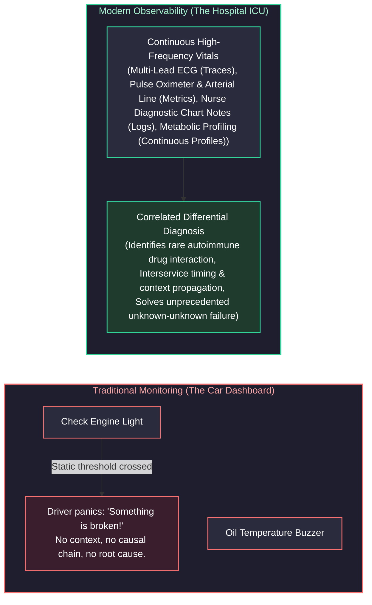

- **Traditional Monitoring (The Check-Engine Light):** A static threshold fires a binary signal. Your car illuminates an orange engine icon. You know *that* something failed, but you have no visibility into *why*. Is the fuel injector clogged? Is an oxygen sensor loose? Is the gas cap untightened? You must pull over, open the hood, and guess. In software, this corresponds to `CPU > 80%` or `Ping Failed`.
- **Modern Observability (The Hospital ICU):** The ICU does not merely beep when a patient’s heart stops. It streams high-resolution, multi-dimensional telemetry: synchronized arterial pressure waveforms, continuous ECG telemetry, end-tidal CO2, and automated laboratory blood gas analysis. When an unprecedented medical anomaly occurs (an "unknown-unknown"), the attending intensivist queries the correlated data in real time: *"Did the blood pressure drop coincide with the administration of antibiotic X, followed by a spike in histamine biomarkers?"* In software, this enables an engineer to diagnose a distributed dead-lock occurring only when customers in region `eu-west-1` with cart size $> 50$ execute a checkout during a specific database failover window—without deploying new code or restarting pods.

---

### 1.2 Monitoring vs. Observability: Known-Knowns vs. Unknown-Unknowns

Observability is fundamentally a property of a system: **a system is observable if you can infer its internal states solely based on its external outputs (telemetry).**

| Dimension | Monitoring | Observability |
| :--- | :--- | :--- |
| **Core Question Answered** | *"Is the system working right now?"* | *"Why is the system behaving this way, and where is the bottleneck?"* |
| **Target Failure Domain** | **Known-Knowns & Known-Unknowns:** Anticipated failure modes (disk full, process dead, database connection pool exhausted). | **Unknown-Unknowns:** Emergent, complex distributed failure modes (cascading retries, slow-loris thread starvation, micro-burst packet loss). |
| **Telemetry Granularity** | Aggregated, low-cardinality counters and gauges averaged over wide time buckets (e.g., 1-minute averages). | High-cardinality, multi-dimensional structured telemetry, distributed trace spans, and eBPF kernel stack profiles. |
| **Human Interaction Model** | Passive dashboard watching and reactive fire-fighting triggered by threshold breaches. | Active hypothesis testing, ad-hoc distributed querying, and trace exemplars tracing across microservice boundaries. |
| **Cost Profile** | Predictable, linear storage overhead based on static infrastructure counts. | Variable; requires dynamic tail-sampling, ingestion batching, and label cardinality governance to prevent runaway costs. |

---

### 1.3 Diagnostic Frameworks: RED, USE, and the Four Golden Signals

When designing production telemetry dashboards and alerting regimes, senior engineers do not arbitrarily place random charts on screens. They structure dashboards around standardized, industry-proven diagnostic paradigms:

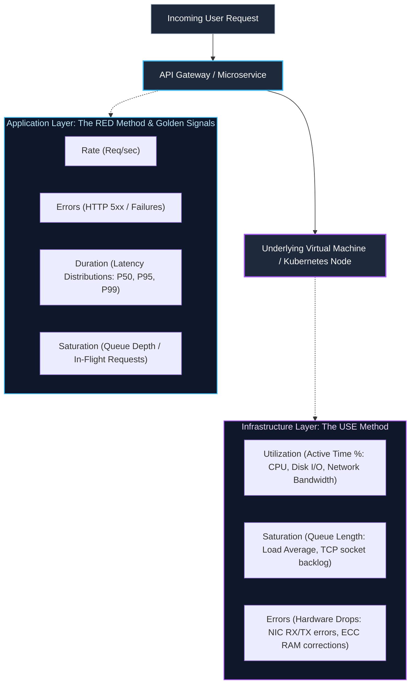

#### 1. Google SRE Four Golden Signals
Google's Site Reliability Engineering methodology identifies four primary metrics that directly capture user pain and operational stability:
1. **Latency:** The time it takes to service a request. Critical rule: **Differentiate success latency from failure latency.** An HTTP 500 failing in 2 milliseconds due to an immediate database connection drop must not mask the fact that successful requests are degrading to 4,000 milliseconds.
2. **Traffic:** A measure of how much demand is placed on your system. Expressed as HTTP requests per second for web services, I/O operations per second for storage engines, or network throughput (Gbps) for streaming pipelines.
3. **Errors:** The rate of requests that fail, either explicitly (HTTP 500, gRPC `INTERNAL`), implicitly (HTTP 200 containing an error payload), or policy-based (HTTP response took longer than the 1,500ms SLO timeout).
4. **Saturation:** A measure of how "full" the system is. Saturation measures the most constrained resource in the system (e.g., memory allocations, database connection pool exhaustion, or CPU run-queue length). As saturation nears 100%, latency climbs non-linearly due to queuing theory.

#### 2. The RED Method (Tom Wilkie)
Tailored specifically for **request-driven architectures** (REST, gRPC, GraphQL APIs):
- **Rate:** The number of requests your service is processing per second.
- **Errors:** The number of incoming requests that are failing per second.
- **Duration:** The amount of time those requests take to complete, visualized as percentiles ($P_{50}, P_{90}, P_{99}$), never simple arithmetic means.

#### 3. The USE Method (Brendan Gregg)
Tailored specifically for **hardware, operating systems, and infrastructure components** (CPUs, disks, network interfaces, memory buses):
- **Utilization:** The average time that the resource was busy performing work (e.g., disk busy % over a 1-second sample).
- **Saturation:** The degree to which the resource has extra work queued that it cannot process immediately (e.g., CPU run-queue `loadavg` exceeding physical core count).
- **Errors:** The count of explicit error events (e.g., network interface packet drops, disk controller CRC read errors, Linux kernel OOM kills).

---

# 2. Cloud-Native Monitoring: Azure Monitor, Log Analytics, and AWS CloudWatch

Enterprise cloud architectures require mastering native telemetry platforms to inspect multi-region services and maintain forensic audit trails.

### 2.1 Azure Monitor & Kusto Query Language (KQL) Deep Dive

Azure Monitor centralizes metrics, distributed application telemetry (Application Insights), and infrastructure logs inside **Log Analytics Workspaces**. Kusto Query Language (KQL) is a read-only, high-performance distributed search engine designed to execute complex aggregations across billions of structured records in seconds.

```kusto
// Production KQL: High-Precision Diagnostic Query
// Computes P50, P95, P99 latency percentiles, error rates, and failure volume
// grouped by API endpoint over the past 4 hours, filtering out internal synthetic health probes.
AppRequests
| where TimeGenerated >= ago(4h)
| where ClientType != "Browser" and UserAgent !has "AlwaysOn" and OperationName !has "healthz"
| summarize 
    TotalRequests = count(),
    FailedRequests = countif(Success == false or toint(ResultCode) >= 500),
    P50_Latency_ms = percentile(DurationMs, 50),
    P95_Latency_ms = percentile(DurationMs, 95),
    P99_Latency_ms = percentile(DurationMs, 99)
    by OperationName, AppRoleName
| extend ErrorRatePercentage = round((todouble(FailedRequests) / todouble(TotalRequests)) * 100.0, 2)
| where TotalRequests >= 500
| order by P99_Latency_ms desc, ErrorRatePercentage desc
| project 
    Microservice = AppRoleName, 
    Endpoint = OperationName, 
    TotalRequests, 
    FailedRequests, 
    ErrorRatePercentage, 
    P50_Latency_ms, 
    P95_Latency_ms, 
    P99_Latency_ms
```

#### Key KQL Operators for SRE Investigations:
- `project-away`: Excludes sensitive or oversized columns without manually enumerating every desired field.
- `make-series`: Generates continuous time-series arrays over specified step intervals (e.g., `step=5m`), automatically backfilling missing gaps with zeroes for regression analysis.
- `arg_max(TimeGenerated, *)`: Efficiently retrieves the most recent state record for each unique resource ID without expensive multi-pass subqueries.

---

### 2.2 AWS CloudWatch Metrics, Metric Math, and CloudTrail Forensics

AWS CloudWatch collects hypervisor-level metrics, API statistics, and container telemetry via CloudWatch Container Insights. 

#### CloudWatch Metric Math
Metric Math allows SREs to query multiple CloudWatch metrics and construct dynamic computational formulas directly inside dashboards and CloudWatch Alarms:

$$\text{ErrorRatePct} = \left(\frac{\text{m2}}{\text{m1}}\right) \times 100$$

Where:
- `m1` = `AWS/ApplicationELB` `RequestCount` (Sum, 1-minute period).
- `m2` = `AWS/ApplicationELB` `HTTPCode_Target_5XX_Count` (Sum, 1-minute period).

```json
{
  "Metrics": [
    {
      "Id": "m1",
      "MetricStat": {
        "Metric": {
          "Namespace": "AWS/ApplicationELB",
          "MetricName": "RequestCount",
          "Dimensions": [{ "Name": "LoadBalancer", "Value": "app/prod-alb/50dc6c495c0c9188" }]
        },
        "Period": 60,
        "Stat": "Sum"
      },
      "ReturnData": false
    },
    {
      "Id": "m2",
      "MetricStat": {
        "Metric": {
          "Namespace": "AWS/ApplicationELB",
          "MetricName": "HTTPCode_Target_5XX_Count",
          "Dimensions": [{ "Name": "LoadBalancer", "Value": "app/prod-alb/50dc6c495c0c9188" }]
        },
        "Period": 60,
        "Stat": "Sum"
      },
      "ReturnData": false
    },
    {
      "Id": "e1",
      "Expression": "(m2 / m1) * 100",
      "Label": "Error Rate Percentage",
      "ReturnData": true
    }
  ]
}
```

#### AWS CloudTrail Audit Forensics
CloudTrail provides an immutable audit trail of every management and data API call executed within an AWS account. During an outage, SREs immediately query CloudTrail to detect unexpected configuration drift, security breaches, or unauthorized credential usage:

```bash
# Query AWS CloudTrail via AWS CLI for unauthorized Security Group modifications in the last 2 hours
aws cloudtrail lookup-events \
  --lookup-attributes AttributeKey=EventName,AttributeValue=AuthorizeSecurityGroupIngress \
  --start-time "$(date -u -v-2H '+%Y-%m-%dT%H:%M:%SZ')" \
  --query "Events[*].{Time:EventTime,User:Username,IP:SourceIPAddress,Details:CloudTrailEvent}" \
  --output table
```

---

# 3. Prometheus TSDB Storage Architecture & PromQL Mastery

Prometheus is the de facto cloud-native metric monitoring system. Understanding its underlying storage engine and query engine is essential for operating high-scale observability clusters.

### 3.1 TSDB Internal Mechanics: Gorilla Float Compression, Head Chunks, and WAL

Prometheus stores time series data on disk in a highly specialized, append-only Time-Series Database (TSDB). A single metric sample consists of a 64-bit integer timestamp (milliseconds) and a 64-bit float value (8 bytes + 8 bytes = 16 bytes uncompressed). Using the **Gorilla compression algorithm** (pioneered by Facebook), Prometheus compresses this down to an average of **1.37 bytes per sample**.

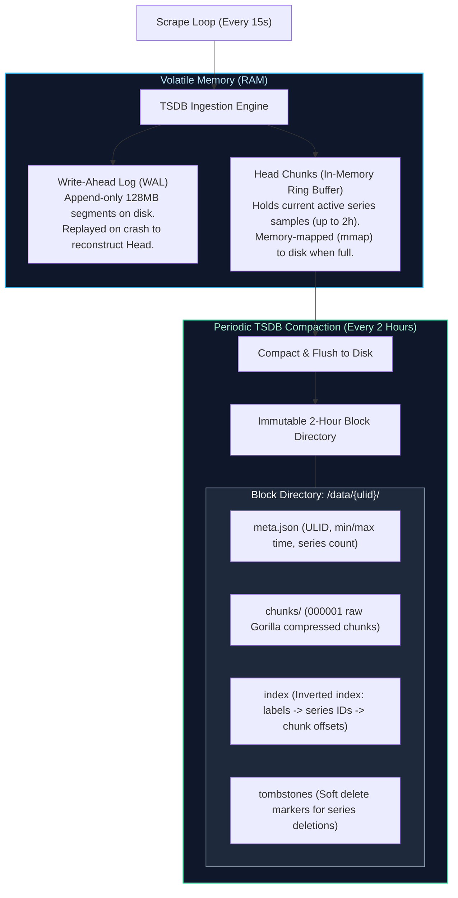

#### How Gorilla Compression Works:
1. **Delta-of-Deltas Timestamp Compression:**
   Timestamps typically arrive at regular scrape intervals (e.g., every 15,000 ms).
   - Let $D = (T_n - T_{n-1})$ be the delta between consecutive timestamps.
   - Let $D' = (T_n - T_{n-1}) - (T_{n-1} - T_{n-2})$ be the delta-of-deltas.
   - If the scrape occurs exactly on time, $D' = 0$. Prometheus stores this single zero using **1 bit (`0`)**.
   - If $D'$ varies slightly (between -63 and 64 ms), it writes 2 bits (`10`) followed by a 7-bit signed integer.
   - Over 95% of timestamps consume between 1 to 2 bits rather than 64 bits.

2. **XOR Floating-Point Compression:**
   Most consecutive metric values (e.g., CPU utilization, memory bytes) change very little between scrapes.
   - Let $V_n$ be the current IEEE 754 64-bit float value.
   - Prometheus calculates $X = V_n \oplus V_{n-1}$ (bitwise XOR).
   - If $V_n == V_{n-1}$, $X = 0$, requiring only a single bit (`0`).
   - If $X \neq 0$, Prometheus stores a `1`, followed by bitflags indicating the number of leading and trailing zeroes in the XOR result, writing only the significant middle bits.

---

### 3.2 Production PromQL: rate() vs. irate(), Histogram Quantiles, and Subqueries

PromQL (Prometheus Query Language) operates on four data types: **Instant Vectors** (a set of time series containing a single sample for each series, all at the same timestamp), **Range Vectors** (a set of time series containing a buffer of samples over time), **Scalars** (floating-point numbers), and **Strings**.

#### 1. The Fundamental Golden Rule: rate() vs. irate()

```mermaid
flowchart TD
    subgraph RateBehavior ["rate(v[5m]): Linear Extrapolation Across Full Range"]
        R1["Calculates delta between first and last sample in the 5-minute window."]
        R2["Smooths out transient micro-spikes."]
        R3["Automatically compensates for counter resets (server restarts)."]
        R4["CRITICAL: Use rate() for ALL alerting rules and capacity planning."]
        R1 --> R2 --> R3 --> R4
    end

    subgraph IrateBehavior ["irate(v[5m]): Instantaneous Rate Across Last 2 Points"]
        I1["Calculates delta strictly between the final TWO samples in the window."]
        I2["Extremely sensitive to micro-bursts and scraper jitter."]
        I3["Completely blind to counter resets that occurred earlier in the window."]
        I4["USE ONLY: High-resolution zoom dashboards. NEVER use for alerting."]
        I1 --> I2 --> I3 --> I4
    end

    style RateBehavior fill:#1e293b,stroke:#34d399,stroke-width:1.5px,color:#a7f3d0
    style IrateBehavior fill:#1e293b,stroke:#f87171,stroke-width:1.5px,color:#fca5a5
```

> [!CRITICAL]
> **Counter Reset Extrapolation:** A Prometheus `counter` is strictly monotonically increasing. When a service crashes or restarts, its counter resets to 0. Both `rate()` and `increase()` inspect adjacent samples. If sample $S_{n+1} < S_n$, the function infers a reset and adds $S_{n+1}$ to the running total. **Never execute `sum(rate(counter[5m]))` inverted as `rate(sum(counter)[5m])`**! Summing before calculating rate hides resets inside the aggregate, resulting in catastrophic negative dips and corrupted metrics.

#### 2. Calculating True Latency Percentiles: histogram_quantile()
Prometheus histograms record observations across configurable bucket boundaries (`le` = less than or equal). 

```promql
# Production PromQL: Calculating P99 Latency per Microservice
histogram_quantile(
  0.99,
  sum by (le, service_name) (
    rate(http_request_duration_seconds_bucket{environment="production"}[5m])
  )
)
```

**How `histogram_quantile` interpolates:**
1. Aggregates the rates across all matching series for each bucket boundary `le`.
2. Identifies the specific bucket interval $[le_{lower}, le_{upper}]$ in which the 99th percentile observation falls.
3. Assumes samples inside that bucket are **uniformly distributed** and performs linear interpolation:

$$\text{Quantile} = le_{lower} + (le_{upper} - le_{lower}) \times \frac{\text{Rank} - \text{Count}_{lower}}{\text{Count}_{upper} - \text{Count}_{lower}}$$

> [!WARNING]
> **Bucket Boundary Calibration:** If your highest bucket boundary is `le="2.0"` (2 seconds) and an outage causes requests to stall at 30 seconds, `histogram_quantile` will report an interpolated value close to 2.0 seconds because it cannot extrapolate beyond the `+Inf` bucket! Always calibrate bucket boundaries to cover worst-case tail latencies.

#### 3. PromQL Subqueries
Subqueries allow calculating instant vector functions over an evaluated range of time:

```promql
# Calculate the maximum 5-minute request rate observed over the past 24 hours, evaluated every 10 minutes
max_over_time(rate(http_requests_total[5m])[24h:10m])
```

---

### 3.3 Recording Rules and Query Performance Optimization

When Grafana dashboards query raw histograms or long time ranges (e.g., 30 days) across high-traffic microservices, Prometheus must read millions of chunks from disk, resulting in query timeouts and CPU starvation. **Recording Rules** precompute expensive PromQL expressions and write the results back into TSDB as new time series.

```yaml
# /etc/prometheus/rules/api_recording_rules.yaml
groups:
  - name: api_latency_rules
    interval: 30s
    rules:
      # Precompute total request rate per service
      - record: job:http_requests:rate5m
        expr: sum by (job, status) (rate(http_requests_total[5m]))

      # Precompute 99th percentile latency across all production pods
      - record: job:http_request_duration_seconds:p99
        expr: >
          histogram_quantile(
            0.99,
            sum by (le, job) (rate(http_request_duration_seconds_bucket{env="prod"}[5m]))
          )
```

Dashboards and alert rules now query `job:http_request_duration_seconds:p99` directly in **sub-millisecond time**, reducing TSDB query load by up to 98%.

---

# 4. OpenTelemetry (OTel) Instrumentation and Pipeline Design

OpenTelemetry is an open-source, vendor-neutral CNCF project providing a unified specification, APIs, SDKs, and collection tooling for traces, metrics, and logs.

### 4.1 The OpenTelemetry Architecture: API, SDK, Semantic Conventions, and OTLP

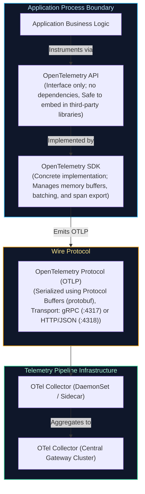

1. **OTel API:** Defines the tracer, meter, and logger interfaces. Library authors (e.g., an HTTP client or database driver) depend *only* on the API. If no SDK is configured by the hosting application, the API defaults to a zero-overhead No-Op implementation.
2. **OTel SDK:** The operational implementation registered by the application entrypoint. It configures exporters, resource detectors (retrieving pod name, node name, AWS EC2 instance ID), Samplers, and SpanProcessors (`BatchSpanProcessor`).
3. **Semantic Conventions:** Standardized key-value naming schemas across languages. Ensures HTTP status code is always `http.response.status_code`, database statement is `db.statement`, and exception type is `exception.type`, preventing fragmented querying across multilingual engineering teams.
4. **OTLP (OpenTelemetry Protocol):** High-throughput, binary-serialized wire format using Google Protocol Buffers. Operates natively over **gRPC (port 4317)** with gzip/snappy compression, or **HTTP/Protobuf (port 4318)**.

---

### 4.2 Production OpenTelemetry Collector Architecture & Deployment Topologies

The OpenTelemetry Collector consists of four pluggable components executed in strict sequence:
$$\text{Receivers} \longrightarrow \text{Processors} \longrightarrow \text{Exporters} \quad (\text{governed by Extensions})$$

```yaml
# /etc/otelcol/config.yaml - Production High-Throughput Gateway Configuration
receivers:
  otlp:
    protocols:
      grpc:
        endpoint: 0.0.0.0:4317
        max_concurrent_streams: 1024
      http:
        endpoint: 0.0.0.0:4318

  prometheus:
    config:
      scrape_configs:
        - job_name: "otel-collector-internal"
          scrape_interval: 15s
          static_configs:
            - targets: ["0.0.0.0:8888"]

processors:

# 5. memory_limiter: MUST ALWAYS be placed first in the pipeline to prevent OOM panics

memory_limiter:
    check_interval: 1s
    limit_percentage: 80
    spike_limit_percentage: 20

# 6. k8sattributes: Enriches telemetry with Kubernetes pod, namespace, and container labels

k8sattributes:
    auth_type: "serviceAccount"
    passthrough: false
    extract:
      metadata:
        - k8s.pod.name
        - k8s.pod.uid
        - k8s.deployment.name
        - k8s.namespace.name
        - k8s.node.name

# 7. transform: Redacts sensitive PII headers and masks credentials

transform:
    error_mode: ignore
    trace_statements:
      - context: span
        statements:
          - delete_key(attributes, "http.request.header.authorization")
          - delete_key(attributes, "http.request.header.cookie")
          - set(attributes["user.id"], "REDACTED") where attributes["user.id"] != nil

# 8. batch: Aggregates telemetry before transmitting across the network

batch:
    send_batch_size: 8192
    timeout: 2s
    send_batch_max_size: 16384

exporters:
  prometheusremotewrite:
    endpoint: "http://thanos-receive.monitoring.svc.cluster.local:19291/api/v1/receive"
    tls:
      insecure: true

  otlp/tempo:
    endpoint: "tempo-distributor.monitoring.svc.cluster.local:4317"
    tls:
      insecure: true

  otlp/loki:
    endpoint: "loki-gateway.monitoring.svc.cluster.local:3100"
    tls:
      insecure: true

extensions:
  health_check:
    endpoint: 0.0.0.0:13133
  zpages:
    endpoint: 0.0.0.0:55679

service:
  extensions: [health_check, zpages]
  pipelines:
    traces:
      receivers: [otlp]
      processors: [memory_limiter, k8sattributes, transform, batch]
      exporters: [otlp/tempo]
    metrics:
      receivers: [otlp, prometheus]
      processors: [memory_limiter, k8sattributes, batch]
      exporters: [prometheusremotewrite]
    logs:
      receivers: [otlp]
      processors: [memory_limiter, k8sattributes, transform, batch]
      exporters: [otlp/loki]
  telemetry:
    logs:
      level: "info"
    metrics:
      address: "0.0.0.0:8888"
```

---

### 8.3 Tail-Based Sampling vs. Head-Based Sampling

In massive-scale cloud architectures processing millions of requests per second, retaining 100% of distributed trace spans is financially prohibitive and technically unfeasible.

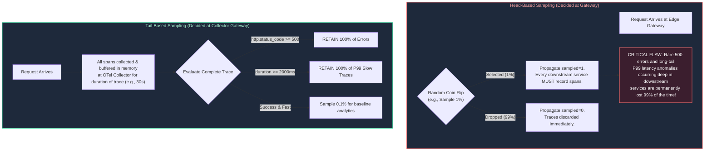

#### Tail-Based Sampling Configuration Example:
```yaml
# OpenTelemetry Collector Tail-Sampling Processor Configuration
processors:
  tail_sampling:
    decision_wait: 10s
    num_traces: 50000
    expected_new_traces_per_sec: 2000
    policies:
      # Policy 1: Always retain traces that encountered an error status
      - name: drop-errors-policy
        type: status_code
        status_code: { status_codes: [ERROR] }

      # Policy 2: Always retain traces exceeding the P99 latency SLA threshold (1500ms)
      - name: latency-sla-policy
        type: latency
        latency: { threshold_ms: 1500 }

      # Policy 3: Keep 1% of successful baseline traffic for historical performance comparisons
      - name: probabilistic-sample
        type: probabilistic
        probabilistic: { sampling_percentage: 1.0 }
```

---

# 9. Distributed Tracing and Context Propagation Mechanics

Distributed tracing tracks the execution flow of a transaction as it hops across microservices, asynchronous queues, and database engines.

### 9.1 W3C Trace Context Specification: traceparent and tracestate Internals

To correlate spans across disparate network services, distributed tracing relies on the standardized **W3C Trace Context** HTTP header:

```http
traceparent: 00-4bf92f3577b34da6a3ce929d0e0e4736-00f067aa0ba902b7-01
```

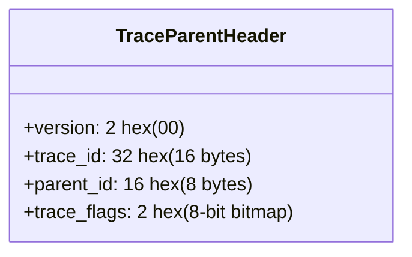

#### Detailed Byte-Level Breakdown:
1. **Version (`00`):** 1 byte (2 hex characters). Denotes specification version `00`.
2. **Trace ID (`4bf92f3577b34da6a3ce929d0e0e4736`):** 16 bytes (32 hex characters). A cryptographically random identifier generated at the ingress edge. Shared identically by every microservice participating in the transaction call graph.
3. **Parent ID / Span ID (`00f067aa0ba902b7`):** 8 bytes (16 hex characters). Identifies the caller's specific execution sub-span. When Service A invokes Service B, Service B reads this ID as its `parent_id` and mints a brand-new `span_id` for its own execution.
4. **Trace Flags (`01`):** 1 byte (8-bit bitmap).
   - Bit `0` (`01`): **Recorded / Sampled flag**. If `1`, the caller has sampled this trace, instructing downstream services that they should record spans.
   - Remaining 7 bits are reserved for future specification evolution.

#### `tracestate` Header:
Carries opaque, vendor-specific routing and filtering metadata across vendor boundaries:
```http
tracestate: congo=t61rcWkgMzE,rojo=00f067a
```

---

### 9.2 Asynchronous Context Propagation Across Message Queues (Kafka / SQS / Service Bus)

When microservices communicate synchronously via HTTP/gRPC, context propagation is trivial (headers are forwarded automatically by SDK interceptors). However, when crossing **asynchronous message brokers** (Apache Kafka, AWS SQS, Azure Service Bus), trace context is frequently broken if engineers do not explicitly inject headers into message metadata records.

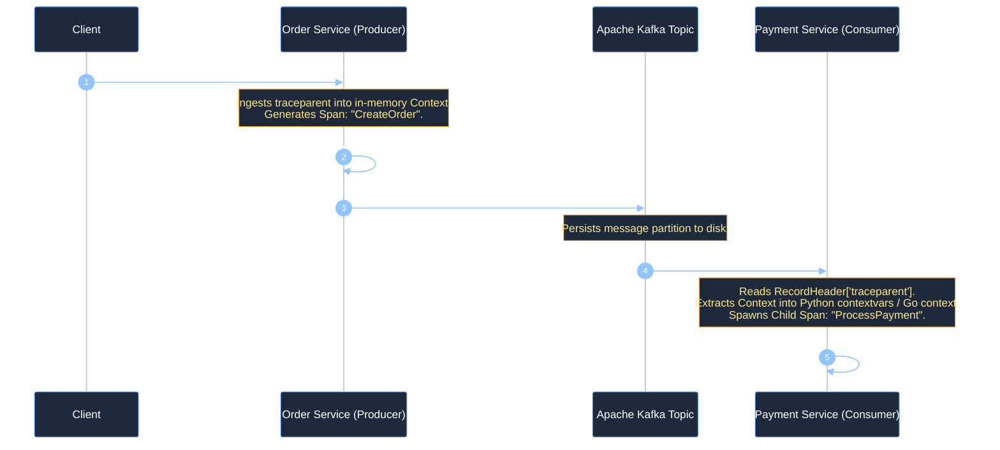

#### Production Python Context Extraction & Injection Example (Kafka):

```python
"""
Distributed Context Propagation across Apache Kafka using OpenTelemetry.
Demonstrates injecting W3C traceparent into Kafka Producer headers and
extracting it inside a Kafka Consumer to maintain seamless end-to-end tracing.
"""

from typing import Dict, List, Tuple
from opentelemetry import trace
from opentelemetry.trace.propagation.tracecontext import TraceContextTextMapPropagator

tracer = trace.get_tracer("order_processor", "1.0.0")
propagator = TraceContextTextMapPropagator()

class KafkaHeaderCarrier:
    """Carrier adapter to translate between OTel propagation and Kafka header tuples."""

    def __init__(self, headers: Dict[str, str]):
        self.headers = headers

    def get(self, key: str) -> List[str]:
        val = self.headers.get(key)
        return [val] if val else []

    def set(self, key: str, value: str):
        self.headers[key] = value

def produce_order_event(order_id: str) -> Tuple[bytes, List[Tuple[str, bytes]]]:
    """Producer: Injects the current active trace context into Kafka message headers."""
    with tracer.start_as_current_span("produce_order_kafka") as span:
        span.set_attribute("order.id", order_id)

        # Carrier dictionary to hold injected W3C headers
        carrier: Dict[str, str] = {}
        propagator.inject(carrier)

        # Convert to Kafka header format: List of (key, bytes_val) tuples
        kafka_headers = [(k, v.encode("utf-8")) for k, v in carrier.items()]
        payload = f'{{"order_id": "{order_id}", "status": "PENDING"}}'.encode("utf-8")
        
        return payload, kafka_headers

def consume_order_event(payload: bytes, kafka_headers: List[Tuple[str, bytes]]):
    """Consumer: Extracts traceparent from Kafka headers and continues the distributed trace."""
    # Convert Kafka header tuples back to dictionary
    carrier_dict = {k: v.decode("utf-8") for k, v in kafka_headers}

    # Extract parent context
    extracted_context = propagator.extract(carrier_dict)

    # Spawn child span explicitly parented to the extracted trace context
    with tracer.start_as_current_span("consume_order_kafka", context=extracted_context) as span:
        span.set_attribute("messaging.system", "kafka")
        span.set_attribute("messaging.destination", "orders-topic")
        # Process order payment logic here...
```

---

# 10. Centralized Logging Architecture: Loki vs. OpenSearch

Operating enterprise log platforms requires balancing search index latency against terabyte-scale infrastructure storage costs.

### 10.1 Index-Free Chunk Storage (Loki) vs. Full-Text Inverted Indices (Lucene / OpenSearch)

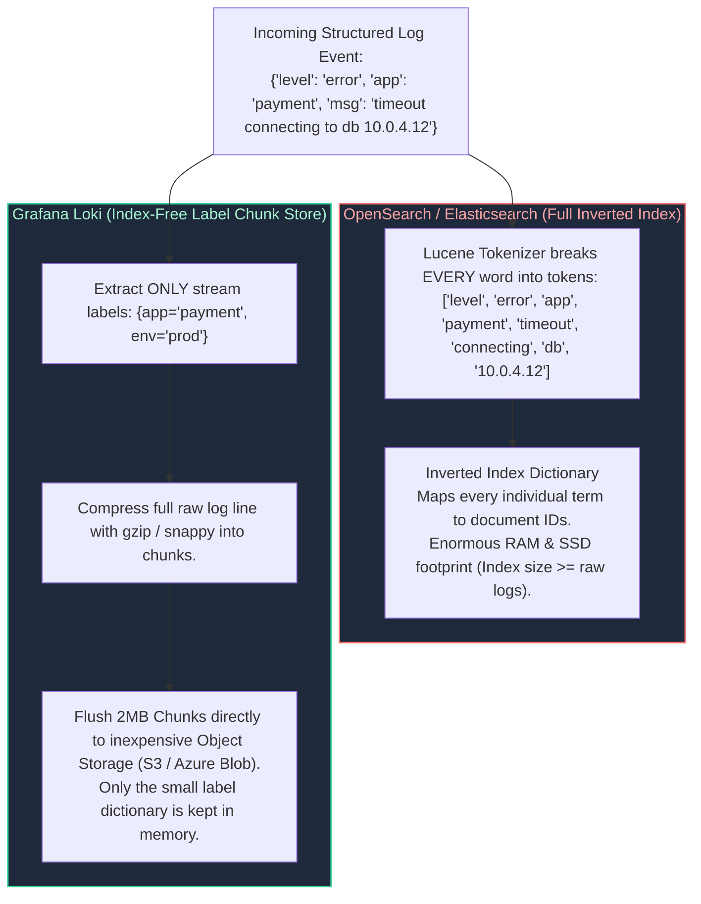

| Architectural Attribute | Grafana Loki | OpenSearch / Elasticsearch |
| :--- | :--- | :--- |
| **Indexing Philosophy** | **Metadata Indexing Only:** Indexes exclusively static stream labels (e.g., `namespace`, `app`, `cluster`). Raw log messages are never indexed. | **Full-Text Inverted Indexing:** Indexes every single alphanumeric word across every field via Apache Lucene. |
| **Search Speed** | Fast for targeted streams; slower for broad, un-labeled needle-in-haystack queries (requires brute-force chunk grepping via parallel LogQL workers). | Sub-second searches across petabytes of text regardless of query specificity. |
| **Storage & RAM Overhead** | Extremely lightweight. Chunks are compressed (gzip/snappy) and stored in S3/Azure Blob. Index memory footprint is $< 5\%$ of log volume. | Heavy. Requires massive JVM heap memory (32GB per data node) and fast NVMe SSD storage. Index size often equals or exceeds raw log volume. |
| **Operational Complexity** | Low. Stateless microservice architecture (ingester, distributor, querier). | High. Complex index lifecycle management (ILM), primary/replica shards, shard balancing, and JVM garbage collection tuning. |

---

### 10.2 LogQL Stream Parsing, Metric Extraction, and Log Filtering

LogQL (Loki Query Language) enables SREs to parse unstructured logs, extract dynamic JSON fields at query time, and synthesize Prometheus-compatible metrics directly from raw log lines:

```logql
# Production LogQL: Extract JSON fields, filter 5xx errors, and calculate 5-minute request rate
sum by (http_path) (
  rate(
    {namespace="production", app="payment-gateway"} 
      | json 
      | http_status >= 500 
      | unwrap duration_ms [5m]
  )
)
```

#### Key LogQL Operators:
- Line Filter Expressions: `|= "error"` (contains), `!= "debug"` (does not contain), `|~ "timeout|connection reset"` (regex match).
- Pipeline Parsers: `| json` (extracts all JSON keys into dynamic attributes), `| logfmt` (parses key=value format), `| pattern "<ip> - - [<time>] \"<method> <uri>\" <status>"` (high-speed regex alternative).
- Label Formatting: `| label_format env="prod-%s"` dynamically rewrites or cleans labels.

---

# 11. Alerting Strategy: Multi-Window Multi-Burn-Rate SLO Alerts

The primary goal of an SRE alerting system is to alert humans **only when user-facing value is actively degrading** and immediate human intervention can prevent a catastrophic outage.

### 11.1 Eradicating Alert Fatigue: Symptoms vs. Causes & Actionability Rules

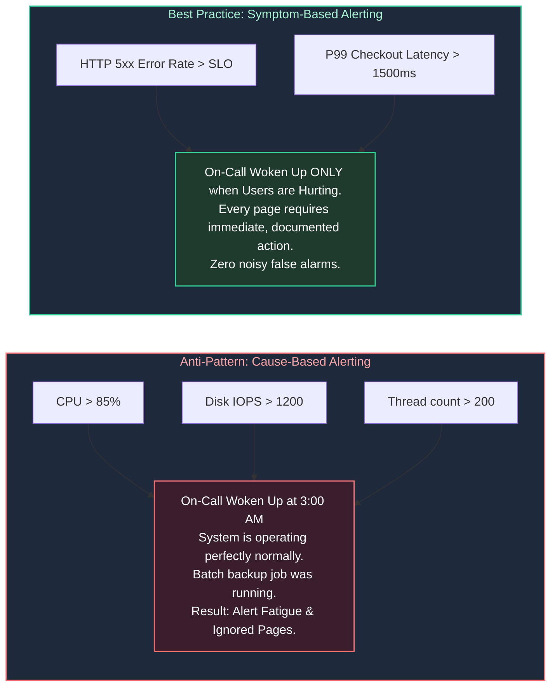

#### The Golden Rules of Alert Actionability:
1. **Every Page Must Be Actionable:** If an engineer receives a page, there must be a clear, unambiguous playbook or runbook procedure to mitigate the issue. If an engineer looks at an alert, determines nothing can or should be done, and silences it, **that alert must be deleted immediately.**
2. **Alert on Symptoms, Not Causes:** Do not page on high CPU, high memory, or pod restarts. Page because user error rate exceeds the SLO budget. Use cause metrics on Grafana dashboards for diagnostic drill-down *after* the page arrives.
3. **Prefer Tickets for Slow Burns:** If an issue will not consume the entire monthly error budget within 24 to 48 hours, do not wake up an engineer. File an automated high-priority ticket for the next business morning.

---

### 11.2 Burn Rate Mathematics: Protecting Error Budgets Across Time Horizons

A Service Level Objective (SLO) defines the target reliability percentage over a rolling compliance window (e.g., $99.9\%$ availability over 30 days). The **Error Budget** is the allowable failure margin:
$$\text{Error Budget} = 100\% - 99.9\% = 0.1\% \quad (0.001)$$

**Burn Rate** is the rate at which your system is consuming its allocated error budget:
- **Burn Rate 1.0:** You will consume exactly 100% of your error budget in the 30-day window (steady state).
- **Burn Rate 14.4:** You will consume **2% of your monthly budget in 1 hour**, or 100% of your budget in 50 hours.
- **Burn Rate 6.0:** You will consume **5% of your monthly budget in 6 hours**, or 100% of your budget in 120 hours.

#### Why Single-Window Alerts Fail:
- If you alert on a 1-hour burn rate window, a brief 5-minute transient network glitch will trigger a page that resolves before the engineer even logs into their laptop.
- If you alert on a 36-hour long window, the alert takes several hours to reset *after* the incident is fully mitigated, masking subsequent outages.

#### The SRE Solution: Multi-Window Multi-Burn-Rate Alerts
Google SRE mandates firing an alert **only when both a long window AND a short window simultaneously exceed the burn-rate threshold**:
- **Long Window:** Confirms that a significant fraction of the error budget has indeed been consumed.
- **Short Window:** Confirms that the failure is **still actively ongoing right now**, preventing false alarms from self-healing spikes.

| Severity / Tier | Burn Rate | % Budget Consumed | Long Window | Short Window | Action Taken |
| :--- | :---: | :---: | :---: | :---: | :--- |
| **Page (SEV-1 Critical)** | **14.4x** | 2% in 1 hour | 1 hour | 2 minutes | PagerDuty wake-up; immediate triage |
| **Page (SEV-2 Urgent)** | **6.0x** | 5% in 6 hours | 6 hours | 15 minutes | PagerDuty notification to primary on-call |
| **Ticket (SEV-3 Medium)** | **3.0x** | 10% in 3 days | 3 days | 1 hour | Automated Jira/ServiceNow ticket |
| **Ticket (SEV-4 Low)** | **1.0x** | 10% in 3 days | 3 days | 6 hours | Business hours review in weekly triage |

---

### 11.3 Production Alertmanager Configuration with Multi-Window Rules

Below is a complete, production-grade Prometheus alerting rule file implementing dual-window multi-burn-rate logic for a $99.9\%$ SLO service:

```yaml
# /etc/prometheus/rules/slo_burn_rate_alerts.yaml
groups:
  - name: production-slo-burn-rate-alerts
    rules:
      # ======================================================================
      # SEV-1: Critical Fast Burn (14.4x) - Consumes 2% of budget in 1 hour
      # Long window: 1h, Short window: 2m
      # Target SLO: 99.9% -> Budget = 0.001 -> Threshold = 14.4 * 0.001 = 0.0144
      # ======================================================================
      - alert: ApiFastBurnRateCritical
        expr: >
          (
            sum(rate(http_requests_total{job="checkout-api", status=~"5.."}[1h]))
            /
            sum(rate(http_requests_total{job="checkout-api"}[1h]))
          ) > (14.4 * 0.001)
          and
          (
            sum(rate(http_requests_total{job="checkout-api", status=~"5.."}[2m]))
            /
            sum(rate(http_requests_total{job="checkout-api"}[2m]))
          ) > (14.4 * 0.001)
        for: 2m
        labels:
          severity: critical
          tier: platform
          page: "true"
        annotations:
          summary: "Emergency: High error budget burn rate (14.4x) on checkout-api"
          description: "checkout-api error rate is actively burning 2% of monthly budget per hour across both 1h and 2m windows."
          runbook_url: "https://wiki.corp.internal/runbooks/checkout-api-burn-rate"

      # ======================================================================
      # SEV-2: Urgent Medium Burn (6.0x) - Consumes 5% of budget in 6 hours
      # Long window: 6h, Short window: 15m
      # Threshold = 6.0 * 0.001 = 0.006
      # ======================================================================
      - alert: ApiSlowBurnRateUrgent
        expr: >
          (
            sum(rate(http_requests_total{job="checkout-api", status=~"5.."}[6h]))
            /
            sum(rate(http_requests_total{job="checkout-api"}[6h]))
          ) > (6.0 * 0.001)
          and
          (
            sum(rate(http_requests_total{job="checkout-api", status=~"5.."}[15m]))
            /
            sum(rate(http_requests_total{job="checkout-api"}[15m]))
          ) > (6.0 * 0.001)
        for: 5m
        labels:
          severity: urgent
          tier: platform
          page: "true"
        annotations:
          summary: "Warning: Elevated error budget burn rate (6x) on checkout-api"
          description: "checkout-api has sustained a 6x burn rate over 6h and 15m windows, consuming 5% of monthly error budget."
          runbook_url: "https://wiki.corp.internal/runbooks/checkout-api-burn-rate"
```

---

# 12. Telemetry Cardinality Management & Cost Control

Cardinality management is the single most critical operational challenge when scaling Prometheus and cloud time-series systems.

### 12.1 The Mathematics of TSDB Inverted Index Explosion

In a time-series database, **Cardinality** refers to the total number of unique time series generated by the Cartesian product of all label values:

$$\text{Total Series} = \prod_{i=1}^{N} |L_i| = |L_{\text{metric}}| \times |L_{\text{env}}| \times |L_{\text{service}}| \times |L_{\text{customer\_id}}|$$

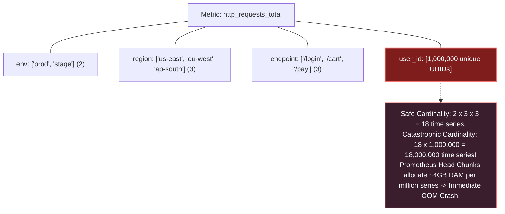

When an engineer accidentally attaches an unbounded label (e.g., `user_id`, `email`, `order_uuid`, or raw URL with query parameters `/api/v1?session=123`), each unique string allocates an entry in the Prometheus in-memory inverted index posting list. TSDB memory consumption spikes exponentially, compaction stalls, and the Prometheus container triggers an Out-Of-Memory (OOM) crash loop.

---

### 12.2 Practical Cardinality Defense: Relabeling Rules and OTel Transforms

To protect Prometheus clusters from accidental label explosions, SREs enforce **relabel configs** during scrape or pipeline transformation.

#### 1. Dropping High-Cardinality Labels at Scrape Time:
```yaml
# Prometheus scrape configuration dropping high-cardinality labels before ingestion
scrape_configs:
  - job_name: "kubernetes-service-endpoints"
    metric_relabel_configs:
      # Strip user_id, email, and session_token labels
      - regex: "(user_id|email|session_token|auth_header)"
        action: labeldrop

      # Normalize dynamic URL paths to fixed patterns
      - source_labels: [__name__, path]
        regex: "http_requests_total;/users/[0-9a-fA-F-]+"
        target_label: path
        replacement: "/users/{id}"
        action: replace
```

---

### 12.3 Automated Prometheus TSDB Cardinality Auditor Script (Python)

The following production Python tool queries the Prometheus TSDB admin API (`/api/v1/status/tsdb`), analyzes the top cardinality-consuming metrics and label names, flags high-risk series, and outputs a formatted diagnostic report:

```python
#!/usr/bin/env python3
"""
Prometheus TSDB Cardinality & Memory Hazard Auditor.
Connects to Prometheus /api/v1/status/tsdb to evaluate Head Chunk index allocations,
detect label cardinality explosions, and output actionable mitigation guidance.
"""

from dataclasses import asdict, dataclass
import json
import logging
import sys
import urllib.error
import urllib.parse
import urllib.request
from typing import Any, Dict, List

logging.basicConfig(
    level=logging.INFO,
    format='{"timestamp":"%(asctime)s","level":"%(levelname)s","logger":"%(name)s","message":"%(message)s"}',
    handlers=[logging.StreamHandler(sys.stdout)],
)
logger = logging.getLogger("cardinality_auditor")

@dataclass(frozen=True)
class MetricSeriesStat:
    metric_name: str
    series_count: int
    risk_level: str
    action_required: str

@dataclass(frozen=True)
class LabelCardinalityStat:
    label_name: str
    value_count: int
    hazard_status: str

class PrometheusCardinalityAuditor:
    def __init__(self, prometheus_base_url: str = "http://localhost:9090", timeout_sec: int = 10):
        self.base_url = prometheus_base_url.rstrip("/")
        self.timeout = timeout_sec

    def fetch_tsdb_status(self) -> Dict[str, Any]:
        """Queries Prometheus TSDB Head status endpoint."""
        url = f"{self.base_url}/api/v1/status/tsdb"
        logger.info("Executing TSDB status interrogation against: %s", url)
        
        req = urllib.request.Request(
            url, 
            headers={"Accept": "application/json", "User-Agent": "PrometheusAuditor/2.0"}
        )
        try:
            with urllib.request.urlopen(req, timeout=self.timeout) as resp:
                payload = json.loads(resp.read().decode("utf-8"))
                if payload.get("status") != "success":
                    raise ValueError(f"Prometheus API returned error: {payload.get('error')}")
                return payload.get("data", {})
        except (urllib.error.URLError, TimeoutError) as err:
            logger.warning("Live Prometheus unreachable (%s). Yielding simulated cluster data.", err)
            return self._generate_simulated_tsdb_data()

    def audit_head_chunk_cardinality(self) -> Dict[str, Any]:
        """Analyzes metric series counts and identifies label explosion threats."""
        tsdb_data = self.fetch_tsdb_status()
        
        raw_series_counts = tsdb_data.get("seriesCountByMetricName", [])
        raw_label_counts = tsdb_data.get("labelValueCountByLabelName", [])

        metric_results: List[MetricSeriesStat] = []
        for item in raw_series_counts[:15]:
            name = item.get("name", "unknown")
            count = item.get("value", 0)
            
            if count > 100_000:
                risk = "CRITICAL_EXPLOSION"
                action = "Drop metric immediately or apply metric_relabel_configs"
            elif count > 25_000:
                risk = "HIGH_CARDINALITY"
                action = "Audit label usage; precompute via recording rules"
            elif count > 5_000:
                risk = "MODERATE"
                action = "Monitor growth rate"
            else:
                risk = "HEALTHY"
                action = "None"

            metric_results.append(
                MetricSeriesStat(
                    metric_name=name,
                    series_count=count,
                    risk_level=risk,
                    action_required=action
                )
            )

        label_results: List[LabelCardinalityStat] = []
        for item in raw_label_counts[:10]:
            label = item.get("name", "unknown")
            val_count = item.get("value", 0)
            status = "DANGEROUS_UNBOUNDED" if val_count > 10_000 else "NORMAL"
            label_results.append(
                LabelCardinalityStat(label_name=label, value_count=val_count, hazard_status=status)
            )

        return {
            "summary": {
                "total_head_series": tsdb_data.get("headStats", {}).get("numSeries", 0),
                "total_head_chunks": tsdb_data.get("headStats", {}).get("numHeadChunks", 0),
                "evaluation_status": "COMPLETED",
            },
            "top_metric_cardinality": [asdict(m) for m in metric_results],
            "top_label_cardinality": [asdict(l) for l in label_results],
        }

    def _generate_simulated_tsdb_data(self) -> Dict[str, Any]:
        """Simulates Prometheus TSDB payload for offline evaluation and unit testing."""
        return {
            "headStats": {"numSeries": 845200, "numHeadChunks": 1250000},
            "seriesCountByMetricName": [
                {"name": "badly_instrumented_customer_requests_total", "value": 312000},
                {"name": "http_request_duration_seconds_bucket", "value": 142000},
                {"name": "jvm_memory_bytes_used", "value": 18400},
                {"name": "container_cpu_usage_seconds_total", "value": 9200},
            ],
            "labelValueCountByLabelName": [
                {"name": "user_id_uuid", "value": 310500},
                {"name": "pod", "value": 420},
                {"name": "namespace", "value": 18},
                {"name": "le", "value": 14},
            ],
        }

if __name__ == "__main__":
    auditor = PrometheusCardinalityAuditor()
    report = auditor.audit_head_chunk_cardinality()
    print(json.dumps(report, indent=2))
```

---

# 13. Senior SRE Troubleshooting Runbook: Observability Outages

### 13.1 Scenario 1: Prometheus Out-Of-Memory (OOM) CrashLoopBackOff
- **Root Cause:** A developer deployed code adding a dynamic UUID label (e.g., `cart_id`) to a Prometheus counter. The TSDB in-memory Head chunk exploded beyond the container's memory limit (e.g., 16GiB), triggering the Linux kernel OOM-killer. On pod restart, Prometheus replays the WAL from disk, attempts to rebuild the oversized memory index, and immediately crashes again.
- **Immediate Mitigation Runbook:**
  1. Temporarily increase the Kubernetes pod memory limit to allow Prometheus to finish the WAL replay:
     ```bash
     kubectl set resources deployment/prometheus-server -n monitoring --limits=memory=32Gi
     ```
  2. If memory cannot be increased, disable WAL replay and quarantine corrupted TSDB blocks:
     ```bash
     kubectl exec -it deployment/prometheus-server -n monitoring -- sh
     # Inside container:
     mv /data/wal /data/wal.bak
     exit
     kubectl rollout restart deployment/prometheus-server -n monitoring
     ```
  3. Deploy an urgent Prometheus `metric_relabel_configs` to drop the offending label at the scrape gateway before data hits the Head chunks.

---

### 13.2 Scenario 2: Broken Context Propagation (Disjointed Distributed Traces)
- **Root Cause:** In Jaeger/Tempo, a complete transaction is visualized as three disconnected, orphan single-span traces rather than a unified distributed waterfall.
- **Root Cause Isolation:**
  1. Verify the HTTP ingress controller (NGINX / Envoy) is configured to preserve W3C headers:
     ```yaml
     # Envoy / Ingress-NGINX configuration
     use-forwarded-headers: "true"
     enable-opentelemetry: "true"
     ```
  2. Inspect inter-service HTTP client code. In Go/Python/Java, engineers frequently create new background threads or contexts using `context.Background()` instead of passing the existing request `ctx`, severing the in-process span lineage.
  3. Inspect message broker consumers (Kafka/RabbitMQ). Ensure consumers read the `traceparent` byte array from message headers and call `propagator.extract()` prior to starting business logic spans.

---

### 13.3 Scenario 3: OTel Collector Buffer Saturation & Dropped Telemetry
- **Root Cause:** Downstream trace storage (Tempo or Elastic) experienced network degradation. The OTel Collector's internal export queues filled to capacity (`send_batch_max_size`), causing the `memory_limiter` processor to drop incoming telemetry.
- **Diagnostic Commands & Metrics:**
  - `otelcol_processor_dropped_spans`: Non-zero rate indicates collector dropping spans due to memory pressure or buffer saturation.
  - `otelcol_exporter_enqueue_failed_spans`: Indicates downstream storage backend backpressure.
- **Resolution:**
  1. Scale the OpenTelemetry Collector horizontally (`kubectl scale deployment/otel-collector --replicas=10`).
  2. Configure persistent file-storage queue buffering on exporters to preserve telemetry during backend downtime:
     ```yaml
     exporters:
       otlp/tempo:
         endpoint: "tempo:4317"
         sending_queue:
           enabled: true
           num_consumers: 16
           queue_size: 10000
           storage: file_storage
     ```

---

# 14. SRE Principles: The Commercial Aviation & Flight Safety Analogy

### 14.1 Real-World Analogy: Commercial Flight Operations and NTSB Investigations

Site Reliability Engineering is fundamentally the application of **software engineering practices to operations problems**, pioneered by Benjamin Treynor Sloss at Google. To grasp why SRE enforces rigorous Error Budget governance and blamelessness, examine the safety engineering of modern **commercial aviation**:

```mermaid
flowchart TD
    subgraph TraditionalAviation ["Fragile Aviation (Early 20th Century)"]
        F1["Aircraft Crashes"] --> F2["Blame Pilot: 'Pilot Error / Carelessness'"]
        F2 --> F3["Fire Pilot or Reprimand Crew"]
        F3 --> F4["Same cockpit ergonomic flaw causes identical crash 6 months later!"]
    end

    subgraph ModernSRE_Aviation ["Modern Aviation & SRE (NTSB / CRM Model)"]
        A1["Incident / Near-Miss Occurs"] --> A2["Cockpit Voice & Flight Data Recorders Analyzed (Telemetry)"]
        A2 --> A3["Crew Resource Management (CRM): Psychological Safety to Challenge Authority"]
        A3 --> A4["Systemic Investigation: Why did the altimeter display confuse the pilot?"]
        A4 --> A5["Architectural Redesign: Triple-redundant fly-by-wire & automated ground-proximity warnings"]
    end

    style TraditionalAviation fill:#1e1e2e,stroke:#f87171,stroke-width:2px,color:#fca5a5
    style ModernSRE_Aviation fill:#1e1e2e,stroke:#34d399,stroke-width:2px,color:#a7f3d0
    style F1 fill:#2a2b3d,stroke:#f87171,stroke-width:1.5px,color:#fff
    style F2 fill:#2a2b3d,stroke:#f87171,stroke-width:1.5px,color:#fff
    style F3 fill:#2a2b3d,stroke:#f87171,stroke-width:1.5px,color:#fff
    style F4 fill:#3b1e2e,stroke:#f87171,stroke-width:1.5px,color:#fff
    style A1 fill:#2a2b3d,stroke:#34d399,stroke-width:1.5px,color:#fff
    style A2 fill:#2a2b3d,stroke:#34d399,stroke-width:1.5px,color:#fff
    style A3 fill:#2a2b3d,stroke:#34d399,stroke-width:1.5px,color:#fff
    style A4 fill:#2a2b3d,stroke:#34d399,stroke-width:1.5px,color:#fff
    style A5 fill:#1e3b2e,stroke:#34d399,stroke-width:1.5px,color:#fff
```

- **In fragile systems:** When a failure happens, leadership seeks a human scapegoat ("Engineer X ran `DROP TABLE`" or "Pilot pulled the wrong yoke"). The engineer is disciplined. However, because the underlying system allowed a single human mistake to destroy production, the exact same outage repeats when another engineer makes an identical keystroke.
- **In modern SRE and aviation:** Humans are assumed to be fallible, tired, and prone to cognitive bias. Systems must be engineered so that **no single human action can trigger catastrophic failure**. If an aircraft stalls, the aerodynamic stick-shaker vibrates the control column and overrides erroneous pilot inputs. If an engineer attempts to drop a database, automated IAM permission boundaries, multi-party authorization, and read-only proxies intercept and reject the execution.

---

### 14.2 SRE vs. Traditional DevOps vs. Systems Administration

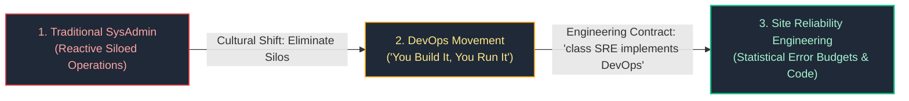

| Dimension | Traditional SysAdmin | DevOps | Site Reliability Engineering (SRE) |
| :--- | :--- | :--- | :--- |
| **Primary Goal** | Maximize uptime by preventing changes. | Accelerate software delivery velocity through collaboration. | Balance release velocity against reliability using Error Budgets. |
| **Role Definition** | Dedicated operations team managing hardware and OS. | Cultural philosophy and practice; often lacks formal engineering spec. | Explicit engineering role: Software developers writing infrastructure code. |
| **Failure Management** | Blame-oriented root-cause tracking; manual disaster recovery. | Continuous feedback, automated testing in deployment pipelines. | Blameless postmortems, 5-Whys, chaos engineering, and automated self-healing. |
| **Operational Work (Toil)** | Accepted as inevitable daily routine (manual patching, ticket queues). | Reduced through automation scripts and CI/CD pipelines. | Strictly capped at **$\le 50\%$**; remaining $\ge 50\%$ mandated for engineering. |

---

# 15. SLI, SLO, and Error Budget Mathematical Foundations

Reliability is not an emotional state; it is an exact statistical probability agreed upon between product management, engineering, and business stakeholders.

### 15.1 Mathematical Formulation of SLIs across Workload Archetypes

A **Service Level Indicator (SLI)** is a quantifiable, empirical metric measuring service performance:

$$\text{SLI} = \frac{\sum \text{Successful Events satisfying Good Criterion}}{\sum \text{Total Valid Events}} \times 100\%$$

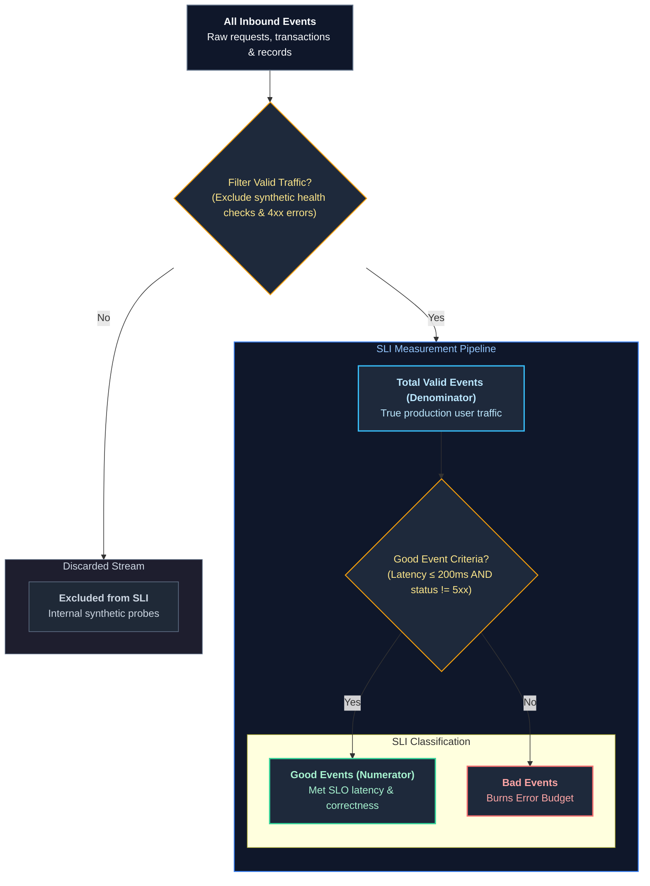

#### SLI Archetype Formulations:
1. **Request-Driven APIs (REST / gRPC):**
   $$\text{SLI}_{\text{Availability}} = \frac{\text{Count of HTTP requests returning status } < 500}{\text{Total HTTP requests excluding client } 4xx} \times 100\%$$
   $$\text{SLI}_{\text{Latency}} = \frac{\text{Count of valid HTTP requests completed in } \le 250\text{ms}}{\text{Total valid HTTP requests}} \times 100\%$$
2. **Storage and Database Engines:**
   $$\text{SLI}_{\text{Durability}} = \frac{\text{Records read successfully without data corruption or loss}}{\text{Total records requested}} \times 100\%$$
3. **Data Pipelines & Asynchronous Event Streaming:**
   $$\text{SLI}_{\text{Freshness}} = \frac{\text{Processing Batches where } (T_{\text{ingestion}} - T_{\text{generation}}) \le 10\text{ minutes}}{\text{Total Batches Processed}} \times 100\%$$
   $$\text{SLI}_{\text{Completeness}} = \frac{\text{Records successfully transformed and committed to Lakehouse}}{\text{Total raw records ingested from Kafka}} \times 100\%$$

---

### 15.2 The Mathematics of "Nines": Downtime Allowances and Architectures

The **Service Level Objective (SLO)** is the target percentage of reliability over a rolling temporal window (standard: **rolling 30 days**):
$$\text{Error Budget} = 100\% - \text{SLO}$$

Every extra "Nine" represents a **10x reduction** in allowable downtime, requiring an exponential increase in architectural complexity and capital expenditure:

| "Nines" | Availability % | Error Budget % | Allowed Downtime / Day | Allowed Downtime / Month (30d) | Allowed Downtime / Year (365d) | Architectural Implementation Required |
| :---: | :---: | :---: | :---: | :---: | :---: | :--- |
| **1 Nine** | $90.0\%$ | $10.0\%$ | 2.4 hours | 72.0 hours | 36.5 days | Single shared VM, manual cold backups, business-hours recovery. |
| **2 Nines** | $99.0\%$ | $1.0\%$ | 14.4 minutes | 7.2 hours | 3.65 days | Single VM with automated disk snapshots, manual DNS failover. |
| **3 Nines** | $99.9\%$ | $0.1\%$ | 1.44 minutes | 43.2 minutes | 8.76 hours | Multi-AZ load-balanced stateless tier, automated RDS read-replica promotion. |
| **3.5 Nines**| $99.95\%$| $0.05\%$ | 43.2 seconds | 21.6 minutes | 4.38 hours | Multi-AZ active-active, automated health checks, zero-downtime rolling deploys. |
| **4 Nines** | $99.99\%$ | $0.01\%$ | 8.64 seconds | 4.32 minutes | 52.6 minutes | Multi-Region Active-Passive with automated route failover; automated circuit breakers. |
| **5 Nines** | $99.999\%$| $0.001\%$| 0.86 seconds | 25.9 seconds | 5.26 minutes | Multi-Region Active-Active, consensus clustering (Spanner/CockroachDB), hitless canary mesh. |

> [!WARNING]
> **The Myth of 100% Reliability:** Setting an SLO to 100% is economically irrational and architecturally destructive. If your users access your service via 4G/5G cellular networks or home Wi-Fi that inherently exhibits $99.0\%$ to $99.5\%$ availability, engineering your backend to $99.999\%$ delivers **zero perceptible benefit to the end user** while consuming millions in cloud infrastructure and halting product innovation.

---

### 15.3 Error Budget Policies and Automated Deployment Freezes

An Error Budget is not just a mathematical curiosity; it is a **binding contract** governing engineering releases:

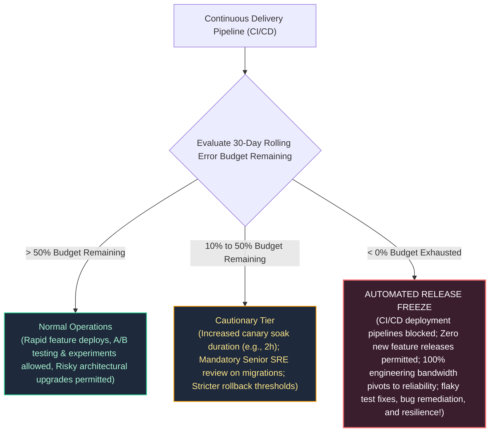

---

# 16. Incident Management and On-Call Operations (ICS Framework)

During high-severity outages, unstructured engineering chaos (multiple developers simultaneously running ad-hoc commands, arguing in Slack channels, interrupting triage) dramatically increases **Mean Time to Recovery (MTTR)**. Modern SRE adapts the **Incident Command System (ICS)**, originally created by fire departments and FEMA.

### 16.1 Incident Command System (ICS) Roles and Separation of Powers

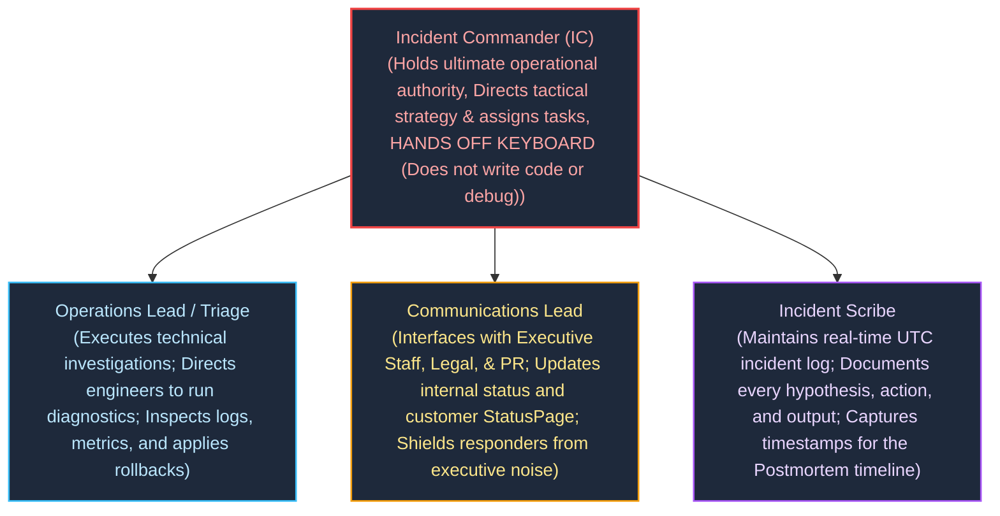

#### Absolute Rule of the Incident Commander:
**The Incident Commander does NOT touch a terminal.** The moment an IC begins reading logs or debugging a database query, they develop tunnel vision, lose situational awareness of the broader outage, and fail to coordinate cross-team responders.

---

### 16.2 Enterprise Severity Classification Matrix (SEV-0 through SEV-4)

| Severity Level | Business & Customer Impact | Triage SLA | War Room Cadence | Stakeholder Escalation |
| :---: | :--- | :---: | :---: | :--- |
| **SEV-0** | **Catastrophic Company-Wide Outage:** Complete revenue stall; data loss; regulatory breach; major public press coverage. | $\le 2$ min | Dedicated video bridge; 24/7 continuous until resolved | Immediate C-Suite (CEO, CTO), Board, General Counsel, PR |
| **SEV-1** | **Critical Production Outage:** Core business flow completely down for $> 20\%$ of users (e.g. checkout broken). No workaround. | $\le 5$ min | Mandatory virtual war room; audio/video bridge active | VP of Engineering, Product Directors; updates every 30 mins |
| **SEV-2** | **Major Service Degradation:** High latency, secondary service offline (e.g. search recommendations down; checkout works). | $\le 15$ min | Dedicated Slack incident channel; on-call video optional | Engineering Directors; status updates every 60 mins |
| **SEV-3** | **Moderate / Non-Critical Impact:** Low traffic service failing; workaround exists; internal tooling broken. | $\le 1$ hour | Handled asynchronously via Slack incident channel | Engineering Manager review during business hours |
| **SEV-4** | **Minor / Cosmetic Bug:** Typos, minor admin portal styling flaw, non-customer impacting metric glitch. | Next Sprint | Standard Jira ticket in backlog | Handled via routine sprint planning |

---

### 16.3 Operational Incident Cadence and Communications Protocol

During a live SEV-1 incident, the Incident Commander establishes strict communication discipline:
1. **Timeboxed Status Checks:** *"Team, we are testing hypothesis A (rolling back deployment v2.14). Ops Lead, you have 7 minutes to execute and verify SLI recovery. Scribe, note the time. We regroup at 14:22 UTC."*
2. **Explicit Task Assignment:** Tasks are assigned to **named individuals**, never to the room. *"Dave, check the database connection pool depth. Sarah, inspect ingress 5xx error distribution. Acknowledge."*
3. **Internal vs. External Status Broadcasting:** 
   - **Internal Status:** Sent every 30 minutes to leadership: `Status: Investigating | Impact: Checkout failing for EU users | Action: Rolling back v2.14 | Next Update: 15:00 UTC`.
   - **External Status (StatusPage):** Concise, customer-centric, and non-defensive: *"We are investigating elevated error rates affecting European checkouts. Our engineering team is actively applying mitigations."*

---

# 17. Blameless Postmortems and Root Cause Engineering

A postmortem is the structured process of analyzing an incident to discover systemic weaknesses and prevent future occurrences.

### 17.1 The Myth of Human Error: Sidney Dekker's Safety Engineering

In modern safety science (pioneered by Sidney Dekker and adapted by Google SRE):
- **Old View:** "Human error is the cause of accidents. To make systems safe, we must punish, retrain, or replace the humans."
- **New View (SRE):** **"Human error is not the cause of failure; human error is the symptom of a deeply flawed system architecture."**

If an engineer runs an unindexed query on a production database that causes a global lockup, **the engineer is blameless**. The architectural system is at fault because:
1. Production databases allowed unconstrained interactive analytical queries.
2. No query timeout proxy intercepted queries exceeding 5 seconds.
3. Read-replicas were not segregated from analytical traffic.
4. Database credentials lacked least-privilege scoping.

---

### 17.2 The 5-Whys Methodology and Multi-Factor Failure Mechanics

Complex systems do not fail due to a single root cause; they fail due to a **confluence of contributing factors**:

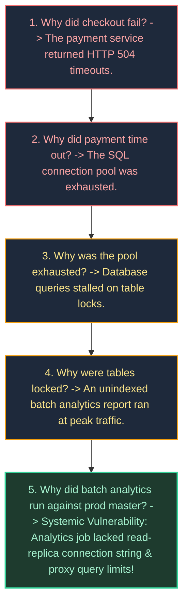

---

### 17.3 Production Enterprise Postmortem Template

```markdown
# Incident Postmortem: [SEV-1] EU Checkout Outage due to Database Lock Contention

**Date:** 2026-10-14  
**Authors:** Senior Staff SRE, Lead Payment Architect  
**Status:** Complete / Action Items In Progress  
**Incident Commander:** @sre-oncall-lead  

# 18. Chronological Timeline (UTC)

- **14:02** - Automated billing analytics job `daily-tax-calc` launched on production master database.
- **14:05** - Database connection pool reaches 100% saturation (500/500 connections in `active` state).
- **14:06** - Multi-burn-rate alert `ApiFastBurnRateCritical` fires (14.4x burn rate detected over 1h/2m windows).
- **14:08** - Primary on-call SRE paged; declares SEV-1; establishes Zoom Incident Bridge and Slack channel `#inc-20261014-eu-checkout`.
- **14:12** - IC assigns Ops Lead to inspect database telemetry; Scribe begins logging.
- **14:18** - Ops Lead identifies `daily-tax-calc` executing table-scanning query holding exclusive locks.
- **14:24** - IC authorizes terminating the rogue query process PID `44102`.
- **14:26** - Query killed; database connection pool immediately drops from 500 to 45 connections.
- **14:32** - Checkout SLI recovers to 99.95% availability.
- **14:48** - Monitoring period concludes with zero error recurrence; IC downgrades and resolves incident.

# 19. Contributing Factors & Systemic Root Causes

1. **Configuration Vulnerability:** The `daily-tax-calc` cron job was erroneously pointed to `db-primary.prod` rather than the read-only replica cluster `db-ro.prod`.
2. **Missing Architectural Safeguards:** The production database lacked a `statement_timeout` guardrail, allowing an unindexed reporting query to hold row locks indefinitely.
3. **Blast Radius Isolation Failure:** Analytical workloads and transactional OLTP workloads shared the exact same database connection pool without bulkhead partitioning.

# 20. What Went Well vs. What Went Poorly vs. Where We Got Lucky

- **What Went Well:** The multi-burn-rate alert paged on-call within 4 minutes of user impact; Incident Command hierarchy maintained clear coordination without executive interference.
- **What Went Poorly:** Terminating the query took 18 minutes because database admin credentials were not readily accessible in the emergency password vault.
- **Where We Got Lucky:** The incident occurred during mid-afternoon in Europe after peak morning traffic; had this occurred during Black Friday, revenue loss would have been 10x higher.

# 21. Corrective Action Items (Tracking via Jira)

| Action Item | Category | Owner | Priority | Target Due Date |
| :--- | :--- | :--- | :---: | :--- |
| Enforce global `statement_timeout = 5000ms` on all OLTP database clusters via Terraform. | **Prevent** | Data Platform | P0 | 2026-10-21 |
| Physically segregate analytics users to read-replicas by removing write/primary IAM permissions. | **Prevent** | Infosec | P0 | 2026-10-25 |
| Implement PgBouncer bulkhead connection pools separating payment traffic from background workers. | **Mitigate**| Checkout Team | P1 | 2026-11-05 |
| Add synthetic blackbox probe testing automated checkout transactions every 30 seconds. | **Detect** | SRE Team | P1 | 2026-10-28 |
```

---

# 22. Toil Governance and Automation Engineering

### 22.1 The 6 Characteristics of Toil

Google SRE rigorously separates **Operational Toil** from legitimate engineering work. Toil is work that possesses the following six traits:
1. **Manual:** Typing commands by hand into terminals, clicking buttons in web consoles.
2. **Repetitive:** Performed repeatedly over time (e.g. weekly database index re-indexing, manual certificate renewals).
3. **Automatable:** Could be executed by software or an automated script with zero cognitive loss.
4. **Tactical:** Reactive and short-term; produces no permanent systemic improvement.
5. **Devoid of Enduring Value:** Once complete, the service is in the exact same state as before; no architectural durability was created.
6. **O(n) Scaling with Traffic:** As user volume doubles, the number of manual hours required scales linearly.

---

### 22.2 The 50% Engineering Rule and Runbook Elimination

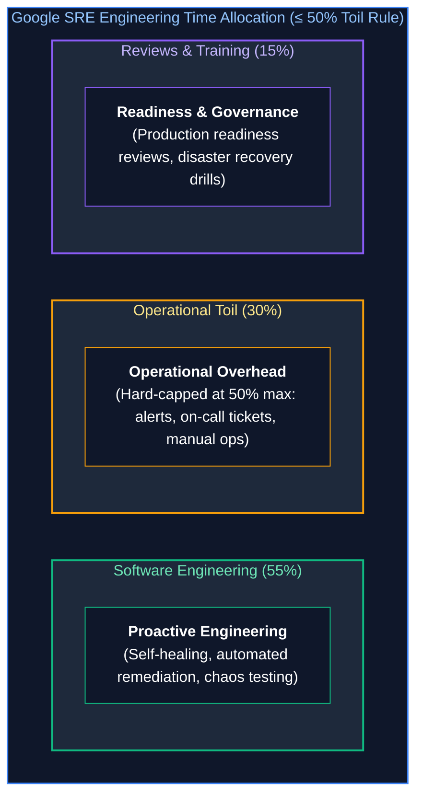

> [!CRITICAL]
> **The SRE 50% Rule:** If an SRE team spends **$> 50\%$ of their time on operational toil**, the team is broken. The excess toil must be immediately redirected back to the product engineering team that wrote the software. This economic feedback loop forces product development teams to design self-healing, automated software rather than dumping operational debt onto operations teams.

---

# 23. Distributed Systems Resilience Patterns

Modern distributed architectures must be designed under the assumption that **networks partition, cloud nodes crash, and downstream dependencies periodically degrade**.

### 23.1 The Mathematics of Retries: Full Jitter vs. Decorrelated Jitter

When a backend service suffers a transient glitch, hundreds of upstream microservice instances attempt immediate retries. Without randomization, these retries synchronize into destructive **thundering herds** (periodic waves of massive traffic spikes that crash the backend repeatedly).

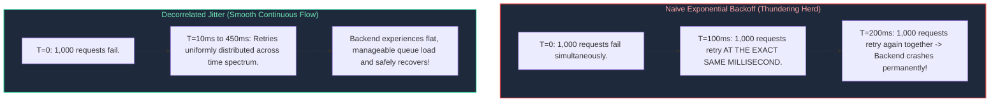

#### Mathematical Formulas for Retry Jitter (AWS Research):
1. **Full Jitter:**
   $$\text{Sleep} = \text{random\_between}(0, \, \min(\text{cap}, \, \text{base} \times 2^{\text{attempt}}))$$
2. **Decorrelated Jitter:**
   Calculates sleep time based on the previous sleep interval, ensuring maximum decorrelation and zero wave synchronization:
   $$\text{Sleep}_i = \min(\text{cap}, \, \text{random\_between}(\text{base}, \, \text{Sleep}_{i-1} \times 3))$$

---

### 23.2 Circuit Breakers: State Machine Transitions and Sliding Windows

A **Circuit Breaker** wraps dangerous remote network calls, tracking error rates inside a rolling time window. When downstream failure crosses a threshold, the circuit trips open, immediately failing subsequent requests locally and protecting thread pools from saturation.

```mermaid
stateDiagram-v2
    classDef closedState fill:#1e293b,stroke:#10b981,stroke-width:2px,color:#ffffff
    classDef openState fill:#1e293b,stroke:#ef4444,stroke-width:2px,color:#ffffff
    classDef halfOpenState fill:#1e293b,stroke:#f59e0b,stroke-width:2px,color:#ffffff

    [*] --> CLOSED

    CLOSED --> OPEN: Failure Rate > 50% in 10s Window (Min 20 requests)
    note right of CLOSED
        Normal Traffic Flow.
        Remote network calls executed.
        Sliding window records success/failure.
    end note

    OPEN --> HALF_OPEN: Reset Timeout Elapsed (e.g., 30s)
    note right of OPEN
        Tripped State!
        Calls FAIL-FAST LOCALLY.
        Zero network calls issued.
        Executes fallback cache logic.
    end note

    HALF_OPEN --> CLOSED: Canary Probe Succeeds (e.g., 3 consecutive successes)
    HALF_OPEN --> OPEN: Canary Probe Fails (Single failure trips back)
    note right of HALF_OPEN
        Canary Trial State.
        Allows limited test traffic through.
        Evaluates dependency health.
    end note

    class CLOSED closedState
    class OPEN openState
    class HALF_OPEN halfOpenState
```

---

### 23.3 Bulkhead Isolation, Thread Pools, and Tenant Sandboxing

Adapted from maritime engineering (where a ship's hull is divided into watertight compartments so a single leak does not sink the vessel):
- **Thread Pool Bulkheads:** Separate thread pools for each external dependency. If the recommendation engine stalls, its thread pool fills up, but the checkout and payment thread pools remain 100% operational.
- **Tenant Isolation (Noisy Neighbor Protection):** VIP enterprise customers are assigned dedicated compute pools, while free-tier users share a rate-limited pool, preventing a single free-tier script from starving paying customers.

---

### 23.4 Little's Law, Queuing Delay, and Adaptive Load Shedding

In queuing theory, **Little's Law** states that the average number of concurrent requests ($L$) in a stable system equals the long-term average arrival rate ($\lambda$) multiplied by the average time a request spends in the system ($W$):

$$L = \lambda \times W$$

```mermaid
flowchart LR
    Arrival["Arrival Rate: lambda = 1,000 req/s"] --> System["Processing Latency: W = 0.05s (50ms)"]
    System --> Concurrency["Concurrency: L = 1000 * 0.05 = 50 in-flight requests"]

    Concurrency -.->|"Downstream DB slows to 2.0s"| Explosion["L = 1,000 * 2.0 = 2,000 concurrent requests!<br/>Server thread pool (max 200) saturates.<br/>Memory exhausts -> Linux OOM Crash!"]

    style Concurrency fill:#1e293b,stroke:#34d399,stroke-width:1.5px,color:#a7f3d0
    style Explosion fill:#3b1e2e,stroke:#ef4444,stroke-width:2px,color:#fff
```

#### Adaptive Load Shedding:
When latency climbs and concurrency threatens to exceed physical capacity, servers must **shed load immediately**. Rejecting incoming requests at the perimeter with an instant `HTTP 503 Service Unavailable` takes **$< 1\text{ms}$** of CPU time, allowing the server to process remaining in-flight transactions without crashing.

---

# 24. Capacity Planning, Stress Testing, and Chaos Engineering

### 24.1 Load Testing Taxonomies: Stress, Soak, Spike, and Breakpoint

| Test Type | Traffic Profile | Duration | Operational Objective |
| :--- | :--- | :--- | :--- |
| **Stress Testing** | Step-function increase above baseline peak (e.g., 150% normal capacity). | 1 to 2 hours | Verify that auto-scaling triggers properly and graceful degradation engages. |
| **Soak Testing** | Sustained moderate-to-high load (e.g., 80% capacity). | 24 to 72 hours | Expose subtle memory leaks, file descriptor leaks, database connection pool leaks, and disk log saturation. |
| **Spike Testing** | Instantaneous 10x surge delivered in $< 10$ seconds. | 10 to 15 minutes | Test perimeter rate-limiters, cloud CDN cache warming, and cold-start autoscaling lag. |
| **Breakpoint Testing** | Continuous traffic increase without ceiling until total failure. | Until crash | Empirically determine the exact architectural breaking point and identify the weakest link (e.g., database IOPS, NAT gateway SNAT). |

---

### 24.2 Principles of Chaos Engineering & Blast-Radius Governance

Chaos Engineering is **not** breaking things randomly in production. It is the disciplined experimentation on distributed software to verify safety hypotheses under turbulent failure conditions:
1. **Hypothesis Formulation:** *"Hypothesize that terminating one Availability Zone's database replica will cause zero HTTP 5xx errors to end users and failover will complete within 3 seconds."*
2. **Blast Radius Minimization:** Begin experiments in staging; advance to canary production with $1\%$ of real user traffic; ensure automated emergency stop switches are wired to abort immediately if SLO burn rates exceed thresholds.
3. **Automated Rollback:** If the hypothesis is disproven, the chaos injection tool must instantly terminate the experiment and restore baseline topology.

---

### 24.3 Kubernetes Fault Injection with Chaos Mesh

Below is a production `ChaosMesh` manifest introducing simulated cross-AZ network latency and packet drops targeting an e-commerce payment microservice:

```yaml
# /manifests/chaos/network_partition_experiment.yaml
apiVersion: chaos-mesh.org/v1alpha1
kind: NetworkChaos
metadata:
  name: payment-service-cross-az-partition
  namespace: production
spec:
  action: delay
  mode: fixed
  value: "3"  # Injects fault into 3 specific pod replicas
  selector:
    namespaces:
      - production
    labelSelectors:
      app: payment-gateway
      tier: backend
  delay:
    latency: "350ms"
    jitter: "50ms"
    correlation: "25"
  loss:
    loss: "5"  # 5% packet loss
    correlation: "10"
  duration: "10m"
  scheduler:
    cron: "0 14 * * 2"  # Run every Tuesday at 14:00 UTC during active business hours
  direction: to
  target:
    selector:
      namespaces:
        - production
      labelSelectors:
        app: postgresql-cluster
```

---

# 25. Production Code Implementation: Thread-Safe Resilient Client Engine

### 25.1 Production Python Circuit Breaker & Decorrelated Jitter Retry Engine

Below is a complete, thread-safe, production-ready Python client implementing the complete SRE resilience suite: **Circuit Breaker state machine**, **sliding-window failure tracking**, **exponential backoff with decorrelated jitter**, and **fallback handling**, requiring zero third-party packages:

```python
#!/usr/bin/env python3
"""
Production SRE Resilience Client: Thread-Safe Circuit Breaker & Decorrelated Jitter.
Protects distributed callers from cascading dependency failures, implements
fail-fast semantics, and provides graceful fallback degradation.
"""

from dataclasses import dataclass
from enum import Enum
import logging
import random
import sys
import threading
import time
from typing import Any, Callable, Dict, List, Optional

logging.basicConfig(
    level=logging.INFO,
    format='{"timestamp":"%(asctime)s","level":"%(levelname)s","thread":"%(threadName)s","message":"%(message)s"}',
    handlers=[logging.StreamHandler(sys.stdout)],
)
logger = logging.getLogger("resilience_engine")

class CircuitState(Enum):
    CLOSED = "CLOSED"
    OPEN = "OPEN"
    HALF_OPEN = "HALF_OPEN"

class CircuitBreakerOpenException(Exception):
    """Raised when call is rejected locally because Circuit Breaker is OPEN."""
    pass

@dataclass
class CallExecutionRecord:
    timestamp: float
    success: bool

class ThreadSafeCircuitBreaker:
    """
    Sliding-window, thread-safe circuit breaker implementation.
    Tracks failure rates over a moving time window and manages state transitions.
    """

    def __init__(
        self,
        failure_rate_threshold: float = 0.5,  # Trip if >= 50% calls fail
        min_requests_threshold: int = 10,       # Minimum calls in window before evaluating
        evaluation_window_sec: float = 10.0,   # Rolling time window
        recovery_sleep_sec: float = 15.0,      # Cooldown time in OPEN before probing
        half_open_success_threshold: int = 3,  # Consecutive successes needed to close
    ):
        self.failure_threshold = failure_rate_threshold
        self.min_requests = min_requests_threshold
        self.window_sec = evaluation_window_sec
        self.recovery_sleep = recovery_sleep_sec
        self.half_open_threshold = half_open_success_threshold

        self.state = CircuitState.CLOSED
        self.lock = threading.Lock()
        self.history: List[CallExecutionRecord] = []
        self.last_state_change = time.time()
        self.consecutive_half_open_successes = 0

    def _purge_expired_history(self, now: float):
        """Removes records older than the evaluation window."""
        cutoff = now - self.window_sec
        self.history = [rec for rec in self.history if rec.timestamp >= cutoff]

    def can_execute(self) -> bool:
        """Determines if a request is permitted to execute or should fail-fast."""
        with self.lock:
            now = time.time()
            if self.state == CircuitState.OPEN:
                if now - self.last_state_change >= self.recovery_sleep:
                    logger.info("CircuitBreaker: Cooldown elapsed. Transitioning from OPEN to HALF_OPEN (Canary Mode).")
                    self.state = CircuitState.HALF_OPEN
                    self.last_state_change = now
                    self.consecutive_half_open_successes = 0
                    return True
                return False

            if self.state == CircuitState.HALF_OPEN:
                # In half-open, allow single concurrent probes
                return True

            return True

    def record_result(self, success: bool):
        """Records call outcome and evaluates state transition triggers."""
        with self.lock:
            now = time.time()
            self._purge_expired_history(now)
            self.history.append(CallExecutionRecord(timestamp=now, success=success))

            if self.state == CircuitState.HALF_OPEN:
                if success:
                    self.consecutive_half_open_successes += 1
                    logger.info(
                        "CircuitBreaker [HALF_OPEN]: Probe SUCCESS (%d/%d)",
                        self.consecutive_half_open_successes,
                        self.half_open_threshold,
                    )
                    if self.consecutive_half_open_successes >= self.half_open_threshold:
                        logger.info("CircuitBreaker: Canary verification passed. Resetting to CLOSED state.")
                        self.state = CircuitState.CLOSED
                        self.last_state_change = now
                        self.history.clear()
                else:
                    logger.error("CircuitBreaker [HALF_OPEN]: Probe FAILED! Tripping back to OPEN state.")
                    self.state = CircuitState.OPEN
                    self.last_state_change = now
                    self.consecutive_half_open_successes = 0
                return

            if self.state == CircuitState.CLOSED:
                if len(self.history) >= self.min_requests:
                    failures = sum(1 for rec in self.history if not rec.success)
                    failure_rate = failures / len(self.history)
                    if failure_rate >= self.failure_threshold:
                        logger.critical(
                            "CircuitBreaker: Failure rate %.2f%% exceeded threshold %.2f%%. TRIPPING TO OPEN!",
                            failure_rate * 100,
                            self.failure_threshold * 100,
                        )
                        self.state = CircuitState.OPEN
                        self.last_state_change = now

class ResilientExecutionEngine:
    """Coordinates Circuit Breaker, Jittered Retries, and Fallback execution."""

    def __init__(
        self,
        circuit_breaker: ThreadSafeCircuitBreaker,
        base_backoff_sec: float = 0.1,
        max_backoff_sec: float = 2.0,
        max_retries: int = 3,
    ):
        self.cb = circuit_breaker
        self.base_backoff = base_backoff_sec
        self.max_backoff = max_backoff_sec
        self.max_retries = max_retries

    def execute(
        self,
        action: Callable[[], Any],
        fallback: Optional[Callable[[], Any]] = None,
    ) -> Any:
        """Executes action with full resilience protection."""
        if not self.cb.can_execute():
            if fallback:
                logger.warning("Circuit OPEN. Diverting execution to fallback handler.")
                return fallback()
            raise CircuitBreakerOpenException("Circuit breaker is currently OPEN. Call rejected locally.")

        current_sleep = self.base_backoff
        for attempt in range(self.max_retries + 1):
            try:
                result = action()
                self.cb.record_result(success=True)
                return result
            except Exception as err:
                logger.warning("Execution attempt %d failed: %s", attempt + 1, err)
                if attempt == self.max_retries:
                    self.cb.record_result(success=False)
                    if fallback:
                        logger.warning("All %d retries exhausted. Invoking fallback.", self.max_retries)
                        return fallback()
                    raise

                # Decorrelated Jitter Calculation: sleep = min(cap, random_between(base, sleep * 3))
                current_sleep = min(
                    self.max_backoff,
                    random.uniform(self.base_backoff, current_sleep * 3),
                )
                logger.info("Applying Decorrelated Jitter: Sleeping %.3fs before retry...", current_sleep)
                time.sleep(current_sleep)

# ============================================================================
# Verification & Demonstration Run
# ============================================================================
if __name__ == "__main__":
    breaker = ThreadSafeCircuitBreaker(
        failure_rate_threshold=0.5,
        min_requests_threshold=4,
        recovery_sleep_sec=3.0,
        half_open_success_threshold=2,
    )
    engine = ResilientExecutionEngine(circuit_breaker=breaker, max_retries=2)

    # Flaky remote dependency mock
    call_counter = 0

    def simulated_remote_call():
        global call_counter
        call_counter += 1
        # Fail first 10 requests, then recover
        if call_counter <= 8:
            raise ConnectionRefusedError(f"Remote backend connection timeout (call #{call_counter})")
        return {"status": "SUCCESS", "payload": f"Data retrieved on call #{call_counter}"}

    def degraded_cache_fallback():
        return {"status": "DEGRADED", "payload": "Stale cached response from local memory"}

    print("--- Starting Resilient Call Simulation ---")
    for i in range(12):
        try:
            resp = engine.execute(simulated_remote_call, fallback=degraded_cache_fallback)
            print(f"Iteration {i+1}: Result -> {resp}")
        except Exception as ex:
            print(f"Iteration {i+1}: Caught Exception -> {ex}")
        time.sleep(0.5)

    print("\n--- Sleeping 3.5s to trigger Circuit Breaker HALF_OPEN Canary Mode ---")
    time.sleep(3.5)

    for i in range(13, 17):
        resp = engine.execute(simulated_remote_call, fallback=degraded_cache_fallback)
        print(f"Iteration {i}: Result -> {resp}")
        time.sleep(0.5)
```

---

# 26. Senior SRE Troubleshooting Runbooks: Outage Scenarios

### 26.1 Scenario 1: Cascading Thundering Herd (Retry Storm Outage)
- **Symptom:** A downstream microservice (`payment-db`) experiences an 8-second temporary network partition. After connectivity recovers, the database CPU immediately locks at 100%, query latency explodes to 30,000ms, and it repeatedly crashes in a self-inflicted death spiral.
- **Root Cause:** Thousands of upstream web client instances executed naive retries without jitter, bombarding the recovering database with 20x normal traffic.
- **Immediate Mitigation Runbook:**
  1. **Sever Ingress Traffic at Perimeter:** Temporarily rate-limit or shed 75% of incoming traffic at the API Gateway using Envoy / NGINX rate-limiting filters to give the database breathing room.
  2. **Flush Client Connection Backlog:** Restart upstream client pods in staggered batches to purge queued requests.
  3. **Enable Decorrelated Jitter in Configuration:** Hot-reload client configuration to activate jittered retry backoffs before reopening traffic gates.

---

### 26.2 Scenario 2: Asynchronous Latent Dependency Starvation
- **Symptom:** The user-facing storefront API degrades to 15,000ms latency. Database CPU and memory are completely healthy (< 20%). Thread count across storefront pods hits the maximum container thread pool limit (e.g. 500 threads).
- **Root Cause Isolation:**
  1. Inspect distributed trace waterfall in Tempo/Jaeger. Notice that all slow storefront spans are blocked waiting on an external third-party marketing tracking API.
  2. The marketing endpoint has no configured socket timeout, causing HTTP client threads to hang indefinitely in `READ` state.
- **Mitigation:**
  1. Trip the Circuit Breaker manually or deploy a feature flag disabling the marketing API call.
  2. Enforce global client socket timeouts: `connect_timeout = 500ms`, `read_timeout = 1000ms`.
  3. Isolate third-party calls into a dedicated bulkhead thread pool so that even if the tracker hangs, zero storefront threads are blocked.

---

### 26.3 Scenario 3: Multi-Region Split-Brain & Database Replication Desynchronization
- **Symptom:** Transcontinental fiber cut disconnects `us-east-1` from `us-west-2`. Both regions believe the other has died. Both regions promote local read-replicas to active master, accepting conflicting writes (split-brain).
- **Root Cause:** Quorum mechanism was misconfigured without an odd-numbered witness tie-breaker node in a third independent region.
- **Mitigation Runbook:**
  1. **Immediately Demote One Region:** Designate `us-east-1` as the single authoritative master; instantly switch `us-west-2` database into `READ-ONLY` mode to halt incoming write divergences.
  2. **Isolate Divergent Data:** Dump all transaction write logs executed in `us-west-2` during the split-brain window into quarantine tables for manual reconciliation scripts.
  3. **Re-establish Asynchronous Replication:** Re-seed `us-west-2` from the authoritative `us-east-1` snapshot and restore consensus with a cloud witness in `us-central-1`.

---

# 27. Summary Comparison & Production Engineering Reference Matrix

| Feature / Dimension | Prometheus TSDB | OpenTelemetry Collector | Grafana Loki | OpenSearch / Lucene |
| :--- | :--- | :--- | :--- | :--- |
| **Primary Telemetry Type** | Metrics (Counters, Gauges, Histograms) | Telemetry Gateway (Traces, Metrics, Logs) | Centralized Logs | Centralized Logs & Full-Text Search |
| **Storage Engine** | Gorilla TSDB with 2h Head chunks | Stateless (Buffers in RAM / local disk) | Chunked Block Storage (S3 / Blob) | Lucene Inverted Indices & Shards |
| **Query Language** | PromQL | N/A (Telemetry routing & transformation) | LogQL | OpenSearch Query DSL / SQL |
| **Cardinality Sensitivity** | **EXTREMELY HIGH:** Unbounded labels crash TSDB | **MODERATE:** Processors filter/redact labels | **LOW:** Index only stream labels | **LOW:** Inverted index handles arbitrary terms |
| **Memory Footprint** | ~2–4GB RAM per million active series | Lightweight (~250MB–1GB per pod) | Lightweight (~500MB per ingester pod) | Heavy (Requires 32GB JVM heaps) |
| **Best Used For** | Real-time SLO monitoring & alerting | Vendor-neutral ingest pipeline & filtering | High-throughput cloud-native logging | Complex security forensic log analysis |

---

On October 14, 2026, from 14:02 UTC to 14:48 UTC (duration: 46 minutes), the EU Checkout API experienced an availability collapse, dropping from a baseline of 99.98% to 12.4%. An estimated 14,200 customer transactions failed, resulting in approximately $340,000 in uncaptured revenue. No customer data corruption or data loss occurred.

---

| Resilience & SRE Concept | Core Mechanism | Operational Trade-Off | Primary Failure Mode Mitigated |
| :--- | :--- | :--- | :--- |
| **Error Budget** | Mathematical contract balancing speed vs. reliability | Halts new feature releases when budget is exhausted | Chronic production instability and technical debt accumulation |
| **Incident Command (ICS)** | Strict role hierarchy (IC, Ops, Comms, Scribe) | Requires operational training and executive discipline | Chaos, duplicate effort, and prolonged MTTR during SEV-1 outages |
| **Blameless Postmortem** | 5-Whys and systemic contributing factor analysis | Requires high organizational psychological safety | Repeat outages caused by unaddressed architectural flaws |
| **Circuit Breakers** | Fast-fail state machine with local fallback | Degrades feature experience during dependency downtime | Cascading thread pool and resource exhaustion |
| **Decorrelated Jitter** | Exponential retry backoff with randomized intervals | Adds slight client delay during transient recovery | Destructive thundering herds and retry storms |
| **Bulkheads** | Physical and logical resource partitioning | Reduced resource sharing efficiency | Noisy neighbor saturation taking down unrelated subsystems |
| **Chaos Engineering** | Controlled fault injection in production | Requires strict blast-radius guardrails | Latent failure modes manifesting during real emergencies |

---

# 28. References & Further Reading

- [Google SRE Book: Monitoring Distributed Systems](https://sre.google/sre-book/monitoring-distributed-systems/) — Foundational theory, symptoms vs. causes, and the 4 Golden Signals.
- [Google SRE Workbook: Alerting on SLOs](https://sre.google/workbook/alerting-on-slos/) — Mathematical proof and formulation of multi-window multi-burn-rate alerting.
- [OpenTelemetry Official Specification](https://opentelemetry.io/docs/specs/otel/) — API, SDK, semantic conventions, and OTLP protocol standards.
- [Gorilla: A Fast, Scalable, In-Memory Time Series Database (Pelkonen et al., Facebook)](https://www.vldb.org/pvldb/vol8/p1816-pelkonen.pdf) — Delta-of-deltas timestamp and XOR float compression algorithms.
- [Prometheus Storage Architecture](https://prometheus.io/docs/prometheus/latest/storage/) — TSDB Head chunk, WAL, and compaction internals.
- [Grafana Loki Architecture & Design](https://grafana.com/docs/loki/latest/fundamentals/architecture/) — Label-indexed chunk storage design.
- [W3C Trace Context Specification](https://www.w3.org/TR/trace-context/) — Standardized `traceparent` and `tracestate` header wire protocols.

- [Site Reliability Engineering: How Google Runs Production Systems (Beyer, Jones, Petoff, Murphy)](https://sre.google/sre-book/table-of-contents/) — Foundational philosophy, Error Budgets, and ICS management.
- [The Site Reliability Workbook (Google SRE Team)](https://sre.google/workbook/table-of-contents/) — Practical implementation of SLOs, alerting, and on-call rotations.
- [AWS Architecture Blog: Exponential Backoff And Jitter (Marc Brooker)](https://aws.amazon.com/blogs/architecture/exponential-backoff-and-jitter/) — Mathematical modeling and simulations of backoff algorithms.
- [The Field Guide to Understanding 'Human Error' (Sidney Dekker)](https://www.routledge.com/The-Field-Guide-to-Understanding-Human-Error/Dekker/p/book/9781472439055) — Foundations of safety science and blameless engineering culture.
- [Release It! Second Edition (Michael T. Nygard)](https://pragprog.com/titles/mnee2/release-it-second-edition/) — Architectural stability patterns: Circuit Breakers, Bulkheads, and Timeouts.
- [Chaos Mesh Documentation](https://chaos-mesh.org/docs/) — Cloud-native fault injection and resilience testing on Kubernetes.