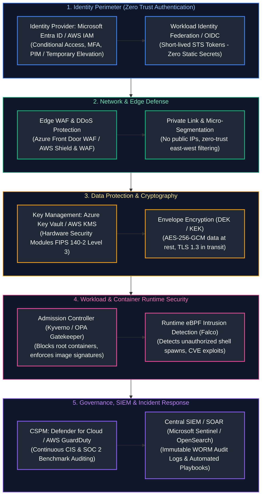
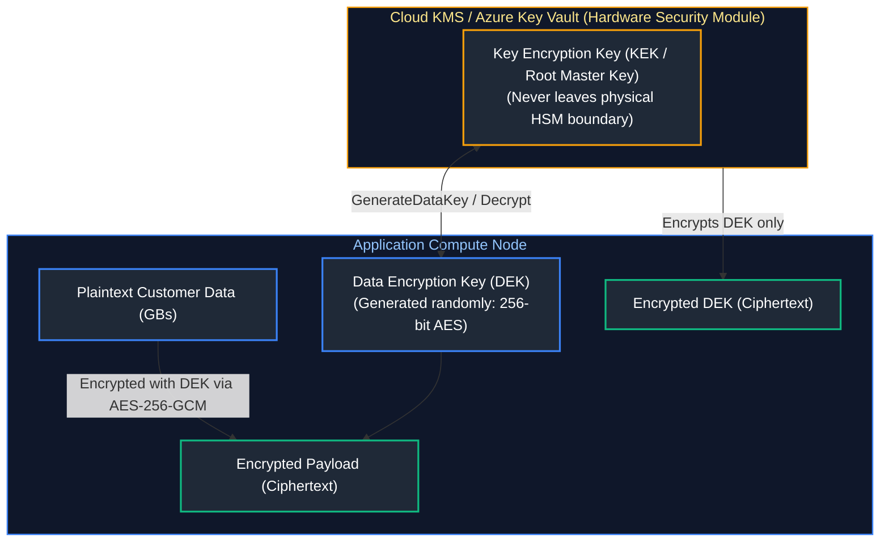

# 09. Cloud Security, IAM & DevSecOps

A comprehensive, production-grade guide to cloud identity and access management, Microsoft Entra ID vs. AWS IAM, envelope encryption mechanics, KMS key management, Zero Trust architecture, Cloud Security Posture Management (CSPM), Web Application Firewalls (WAF), container runtime security with Falco, and compliance governance tailored for Cloud Security Engineers, DevSecOps Specialists, and Enterprise Architects.

---

## Architectural Overview: Multi-Layered Zero Trust Cloud Security Architecture



---

## Table of Contents
1. [Identity Foundations: Entra ID vs. AWS IAM](#1-identity-foundations-entra-id-vs-aws-iam)
   - [1.1 Azure RBAC Scope Inheritance vs. AWS IAM Policy Evaluation Logic](#11-azure-rbac-scope-inheritance-vs-aws-iam-policy-evaluation-logic)
   - [1.2 The Principle of Least Privilege and Just-In-Time (JIT) Elevation](#12-the-principle-of-least-privilege-and-just-in-time-jit-elevation)
2. [Service Principals, Managed Identities, and OIDC](#2-service-principals-managed-identities-and-oidc)
   - [2.1 System-Assigned vs. User-Assigned Managed Identities](#21-system-assigned-vs-user-assigned-managed-identities)
   - [2.2 Eliminating Static Keys via Workload Identity Federation](#22-eliminating-static-keys-via-workload-identity-federation)
3. [Key Management, Envelope Encryption, and KMS](#3-key-management-envelope-encryption-and-kms)
   - [3.1 Cryptographic Architecture: DEK (Data Key) vs. KEK (Key Encryption Key)](#31-cryptographic-architecture-dek-data-key-vs-kek-key-encryption-key)
   - [3.2 Hardware Security Modules (HSM) and Automated Key Rotation](#32-hardware-security-modules-hsm-and-automated-key-rotation)
4. [Cloud Perimeter Security: WAF and DDoS Protection](#4-cloud-perimeter-security-waf-and-ddos-protection)
   - [4.1 Web Application Firewall (WAF) Rule Mechanics: OWASP Core Rule Set](#41-web-application-firewall-waf-rule-mechanics-owasp-core-rule-set)
   - [4.2 Layer 3/4 DDoS Mitigation: Azure DDoS Protection vs. AWS Shield](#42-layer-34-ddos-mitigation-azure-ddos-protection-vs-aws-shield)
5. [Policy as Code and Cloud Governance](#5-policy-as-code-and-cloud-governance)
   - [5.1 Azure Policy Architecture: Definitions, Initiatives, and Remediations](#51-azure-policy-architecture-definitions-initiatives-and-remediations)
   - [5.2 AWS Config and Service Control Policy Guardrails](#2-service-principals-managed-identities-and-oidc)
6. [Container and Kubernetes Runtime Security](#6-container-and-kubernetes-runtime-security)
   - [6.1 Kernel-Level Intrusion Detection with Falco & eBPF](#61-kernel-level-intrusion-detection-with-falco-ebpf)
   - [6.2 Vulnerability Scanning and Software Supply Chain Gates](#62-vulnerability-scanning-and-software-supply-chain-gates)
7. [Threat Detection, CSPM, and Incident Response](#7-threat-detection-cspm-and-incident-response)
   - [7.1 Microsoft Defender for Cloud vs. Amazon GuardDuty](#71-microsoft-defender-for-cloud-vs-amazon-guardduty)
   - [7.2 Immutable Audit Logging and SIEM Analytics](#12-the-principle-of-least-privilege-and-just-in-time-jit-elevation)
8. [Automated Cloud Security Audit and Misconfiguration Scanner](#8-automated-cloud-security-audit-and-misconfiguration-scanner)
   - [8.1 Security Baseline Inspection Engine](#81-security-baseline-inspection-engine)
   - [8.2 Automated Python IAM and Storage Security Auditor](#82-automated-python-iam-and-storage-security-auditor)
9. [Summary Comparison & Engineering Reference Matrix](#9-summary-comparison-engineering-reference-matrix)
10. [References & Further Reading](#10-references-further-reading)

---

# 1. Identity Foundations: Entra ID vs. AWS IAM

### 1.1 Azure RBAC Scope Inheritance vs. AWS IAM Policy Evaluation Logic

Identity architecture diverges significantly between Azure and AWS:

```text
AZURE RBAC INHERITANCE:
[Management Group] ──(Inherits)──> [Subscription] ──(Inherits)──> [Resource Group] ──(Inherits)──> [Resource]
Rule: Allow grants are additive; Deny assignments strictly override all Allows.

AWS IAM EVALUATION FLOW:
Explicit Deny? ──[YES]──> DENY
       │
      [NO]
       ▼
Explicit Allow in Identity/Resource/SCP? ──[YES]──> ALLOW
       │
      [NO]
       ▼
Default Deny ──────────> DENY
```

- **Azure Role-Based Access Control (RBAC):** Assigns a **Security Principal** (User, Group, Service Principal, Managed Identity) a **Role Definition** (e.g. `Contributor`, `Reader`, or Custom JSON Role) at a specific **Scope**. All children at that scope inherit the role.
- **AWS IAM Policy Evaluation:** AWS evaluates JSON policy documents (Identity-based, Resource-based, Permissions Boundaries, and Organizations SCPs). The golden evaluation invariant: **an Explicit Deny always overrides any Allow**.

---

### 1.2 The Principle of Least Privilege and Just-In-Time (JIT) Elevation

> [!CAUTION]
> **Privilege Escalation Risks:** Restrict permissions like `iam:PassRole`, `iam:CreatePolicyVersion`, and `Microsoft.Authorization/roleAssignments/write`. Compromised credentials with role assignment permissions can elevate themselves to full cloud administrator privileges within seconds.

Standing administrative privileges ("permanent Owner access") represent a severe compromise vector:
- **Privileged Identity Management (PIM):** Eliminates standing admin rights. Engineers are granted **Eligible** assignments. To perform maintenance, they must elevate privileges Just-In-Time (JIT) by providing multi-factor authentication (MFA), a ticket justification, and peer approval. Privileges expire automatically after 4-8 hours.

---

# 2. Service Principals, Managed Identities, and OIDC

### 2.1 System-Assigned vs. User-Assigned Managed Identities

Traditional application architectures store database connection strings and cloud API keys in application config files. **Managed Identities** solve this by provisioning an automatically managed identity in Entra ID tied directly to the cloud resource's lifecycle:

| Feature | System-Assigned Managed Identity | User-Assigned Managed Identity |
| :--- | :--- | :--- |
| **Lifecycle** | Tied directly to the host resource (VM, AKS, Function). Deleted automatically if the host is deleted. | Standalone cloud resource with independent lifecycle. Shared across multiple VMs or pods. |
| **Quantity** | Exactly 1 per resource. | Multiple user-assigned identities can be attached. |
| **Common Use Case** | Dedicated single-purpose workloads (e.g. a microservice VM accessing its own database). | Clustered fleet workloads (e.g. 50 autoscaled worker nodes needing uniform access). |

---

### 2.2 Eliminating Static Keys via Workload Identity Federation

> [!IMPORTANT]
> **Eliminating Long-Lived Credentials:** Never issue permanent access keys or service account credentials for CI/CD runners or workload identities. Always adopt OIDC Workload Identity Federation (GitHub Actions / Kubernetes Workload Identity) for short-lived, cryptographically signed STS tokens.

Workload Identity Federation allows workloads running outside Azure (e.g. GitHub Actions, Kubernetes pods, AWS workloads) to securely authenticate to Azure APIs without storing client secrets:

```bash
# Associate a Kubernetes ServiceAccount in AKS with an Azure Managed Identity
az identity federated-credential create \
  --name "aks-workload-federation" \
  --identity-name "id-payment-api" \
  --resource-group "rg-security-prod" \
  --issuer "https://eastus.oic.prod-aks.azure.com/00000000" \
  --subject "system:serviceaccount:production:payment-sa" \
  --audience "api://AzureADTokenExchange"
```

---

# 3. Key Management, Envelope Encryption, and KMS

### 3.1 Cryptographic Architecture: DEK (Data Key) vs. KEK (Key Encryption Key)

Encrypting multi-gigabyte files directly using asymmetric keys in a centralized cloud Key Management Service (KMS) is computationally expensive and introduces network bottlenecks. Production systems use **Envelope Encryption**:



1. The client requests a Data Encryption Key from KMS via `GenerateDataKey`.
2. KMS returns a plaintext DEK and a ciphertext DEK (encrypted by the KEK).
3. The client encrypts data locally using the plaintext DEK via AES-256-GCM.
4. The client **erases the plaintext DEK from memory** and stores the encrypted DEK alongside the ciphertext payload.

---

### 3.2 Hardware Security Modules (HSM) and Automated Key Rotation

- **FIPS 140-2 Level 3 HSMs:** Cryptographic operations execute inside tamper-evident, physical hardware modules. Even cloud provider administrators cannot view key material.
- **Automated Rotation:** Cloud KMS rotates KEKs annually. Older versions remain available to decrypt existing historical ciphertexts, while all new write operations use the newest key revision.

---

# 4. Cloud Perimeter Security: WAF and DDoS Protection

### 4.1 Web Application Firewall (WAF) Rule Mechanics: OWASP Core Rule Set

A Cloud WAF inspects HTTP/HTTPS traffic at Layer 7 before reaching application pods:
- **OWASP Top 10 Protections:** SQL Injection (SQLi), Cross-Site Scripting (XSS), Local File Inclusion (LFI), Remote Code Execution (RCE).
- **Custom Rate-Limiting Rules:** Mitigates credential stuffing by blocking client IPs exceeding 100 requests per minute to `/api/v1/auth/login`.

---

### 4.2 Layer 3/4 DDoS Mitigation: Azure DDoS Protection vs. AWS Shield

- **AWS Shield Standard & Azure DDoS Infrastructure:** Always-on automated packet filtering protecting cloud edge routers from SYN floods and UDP reflection attacks.
- **Advanced Protection (Azure DDoS Network Protection / AWS Shield Advanced):** Provides dedicated DDoS incident response teams, automated per-VNet adaptive traffic profiling, and financial cost protection (credit reimbursements for auto-scaled resources during attacks).

---

# 5. Policy as Code and Cloud Governance

### 5.1 Azure Policy Architecture: Definitions, Initiatives, and Remediations

Azure Policy enforces compliance guardrails across subscriptions:
- **Policy Definition:** JSON file declaring evaluation logic (`if` resource type is storage account and `httpsTrafficOnly` is false, `then` `deny`).
- **Initiative (Policy Set):** Collection of definitions grouped for regulatory baselines (e.g., CIS Azure Benchmark, PCI-DSS, HIPAA).
- **Remediation Task:** Uses managed identity to retroactively correct non-compliant existing resources.

```json
{
  "properties": {
    "displayName": "Deny Unencrypted Storage Accounts",
    "policyRule": {
      "if": {
        "allOf": [
          {
            "field": "type",
            "equals": "Microsoft.Storage/storageAccounts"
          },
          {
            "field": "Microsoft.Storage/storageAccounts/supportsHttpsTrafficOnly",
            "equals": "false"
          }
        ]
      },
      "then": {
        "effect": "deny"
      }
    }
  }
}
```

---

# 6. Container and Kubernetes Runtime Security

### 6.1 Kernel-Level Intrusion Detection with Falco & eBPF

Static image scanning cannot protect against zero-day exploits occurring in running containers. **Falco** hooks directly into the Linux kernel using **extended Berkeley Packet Filter (eBPF)** probes to detect suspicious runtime syscalls:

```yaml
# /etc/falco/rules.d/custom_rules.yaml
- rule: Terminal Shell Spawned Inside Production Container
  desc: Detects interactive shell execution inside container
  condition: >
    spawned_process and container and
    proc.name in (bash, sh, zsh, ksh) and
    k8s.ns.name = "production"
  output: >
    CRITICAL: Shell spawned in prod container (user=%user.name container_id=%container.id
    image=%container.image.repository command=%proc.cmdline)
  priority: CRITICAL
```

---

### 6.2 Vulnerability Scanning and Software Supply Chain Gates

Enforce cryptographic container verification at admission control:
- Image must be scanned by **Trivy** with zero `CRITICAL` CVEs.
- Image must possess a valid **Cosign** signature verified against corporate Root CA.

---

# 7. Threat Detection, CSPM, and Incident Response

### 7.1 Microsoft Defender for Cloud vs. Amazon GuardDuty

- **Cloud Security Posture Management (CSPM):** Continuously compares live cloud infrastructure configurations against compliance frameworks (CIS, SOC 2 Type II, ISO 27001), scoring security hygiene via a Secure Score.
- **Cloud Workload Protection (CWPP):** Uses machine learning and threat intelligence feeds to detect active attacks:
  - **Amazon GuardDuty:** Analyzes VPC Flow Logs, DNS logs, and CloudTrail management events to identify compromised EC2 instances communicating with known crypto-mining pools.
  - **Defender for Cloud:** Integrated threat detection across virtual machines, storage accounts (malicious blob uploads), and Kubernetes API servers.

---

# 8. Automated Cloud Security Audit and Misconfiguration Scanner

### 8.1 Security Baseline Inspection Engine

Automating security audits ensures misconfigurations are flagged before adversaries exploit them.

---

### 8.2 Automated Python IAM and Storage Security Auditor

Below is a production Python script auditing cloud security hygiene: identifying storage buckets with public access enabled, finding wildcards in IAM policies, and verifying minimum TLS version constraints:

```python
#!/usr/bin/env python3
"""
Cloud Security & IAM Least-Privilege Baseline Scanner.
Audits simulated storage resources and IAM permission policies,
detecting wildcard permissions (*), disabled encryption, and public access.
"""

from dataclasses import asdict, dataclass
import json
import logging
import sys
from typing import Dict, List, Optional

logging.basicConfig(
    level=logging.INFO,
    format='{"time":"%(asctime)s","level":"%(levelname)s","message":"%(message)s"}',
    handlers=[logging.StreamHandler(sys.stdout)],
)
logger = logging.getLogger("cloud_security_audit")


@dataclass(frozen=True)
class SecurityFinding:
    resource_id: str
    severity: str
    rule_name: str
    description: str
    remediation: str


class CloudSecurityAuditor:
    def audit_storage_account(self, storage_spec: Dict) -> List[SecurityFinding]:
        """Audits storage accounts for public access and encryption compliance."""
        findings = []
        name = storage_spec.get("name", "unknown")

        if storage_spec.get("allow_blob_public_access", False):
            findings.append(
                SecurityFinding(
                    resource_id=name,
                    severity="HIGH",
                    rule_name="STORAGE_PUBLIC_ACCESS_ENABLED",
                    description="Storage account permits public anonymous blob access.",
                    remediation="Disable allowBlobPublicAccess in storage account configuration.",
                )
            )

        if storage_spec.get("minimum_tls_version") != "TLS1_2":
            findings.append(
                SecurityFinding(
                    resource_id=name,
                    severity="MEDIUM",
                    rule_name="INSECURE_TLS_VERSION",
                    description="Storage account permits legacy TLS versions below TLS 1.2.",
                    remediation="Enforce minimumTlsVersion to TLS1_2.",
                )
            )

        return findings

    def audit_iam_policy(self, policy_spec: Dict) -> List[SecurityFinding]:
        """Audits IAM policies for over-privileged wildcard statements."""
        findings = []
        policy_name = policy_spec.get("name", "unknown")
        statements = policy_spec.get("statements", [])

        for idx, stmt in enumerate(statements):
            effect = stmt.get("effect", "")
            actions = stmt.get("actions", [])
            resources = stmt.get("resources", [])

            if effect == "Allow":
                if "*" in actions and "*" in resources:
                    findings.append(
                        SecurityFinding(
                            resource_id=f"{policy_name}:statement[{idx}]",
                            severity="CRITICAL",
                            rule_name="IAM_UNRESTRICTED_ADMIN_WILDCARD",
                            description="Policy grants unrestricted administrative access (Action:* on Resource:*).",
                            remediation="Scope permissions down to specific verbs and target resource ARNs.",
                        )
                    )
        return findings


if __name__ == "__main__":
    auditor = CloudSecurityAuditor()

    sample_storage = {
        "name": "stprodcustomerdata",
        "allow_blob_public_access": True,
        "minimum_tls_version": "TLS1_0",
    }

    sample_iam = {
        "name": "OverPrivilegedAppRole",
        "statements": [
            {"effect": "Allow", "actions": ["*"], "resources": ["*"]}
        ],
    }

    all_findings = []
    all_findings.extend(auditor.audit_storage_account(sample_storage))
    all_findings.extend(auditor.audit_iam_policy(sample_iam))

    report = {
        "status": "NON_COMPLIANT" if all_findings else "COMPLIANT",
        "total_findings": len(all_findings),
        "findings": [asdict(f) for f in all_findings],
    }
    print(json.dumps(report, indent=2))
```

---

# 9. Summary Comparison & Engineering Reference Matrix

| Security Subsystem | Azure Native Service | AWS Native Service | Core Security Objective | Key Attack Vector Mitigated |
| :--- | :--- | :--- | :--- | :--- |
| **Identity Provider** | Microsoft Entra ID | AWS IAM | Centralized authN & least-privilege RBAC | Credential stuffing, privilege escalation |
| **KMS & Secrets** | Azure Key Vault | AWS KMS & Secrets Manager | FIPS 140-2 Level 3 HSM envelope encryption | Data exposure on stolen backup media |
| **Posture Management** | Defender for Cloud | Amazon GuardDuty & Inspector | Continuous CIS baseline & CVE audit | Silent misconfiguration drift |
| **Edge Web Defense** | Azure WAF | AWS WAF | Layer 7 HTTP payload filtering | OWASP Top 10 (SQLi, XSS, RCE) |
| **Runtime Security** | Defender for Containers | GuardDuty EKS / Amazon Inspector | Syscall-level container anomaly detection | Zero-day escapes, reverse shells |

---

# 10. References & Further Reading

- [CIS Benchmarks](https://www.cisecurity.org/cis-benchmarks/) — Center for Internet Security Cloud Hardening Foundations.
- [NIST SP 800-207: Zero Trust Architecture](https://csrc.nist.gov/publications/detail/sp/800-207/final) — Standard Zero Trust guidelines.
- [OWASP Top 10 Web Application Security Risks](https://owasp.org/www-project-top-ten/) — Web vulnerability taxonomy.
- [Falco: Cloud-Native Runtime Security](https://falco.org/docs/) — eBPF Linux kernel intrusion detection documentation.
- [Sigstore Security Framework](https://www.sigstore.dev/) — Cryptographic software supply chain signing standards.

