# 10. Observability, Monitoring & Logging

A comprehensive, production-grade guide to full-stack cloud observability, metric collection with Prometheus TSDB, distributed tracing with OpenTelemetry and Jaeger, high-throughput centralized logging with Loki and OpenSearch, diagnostic frameworks (4 Golden Signals, RED, USE), multi-window multi-burn-rate SLO alerting, and telemetry cardinality management tailored for Site Reliability Engineers and Distributed Systems Architects.

---

## Architectural Overview: OpenTelemetry Pipeline & Multi-Tier Observability Fabric

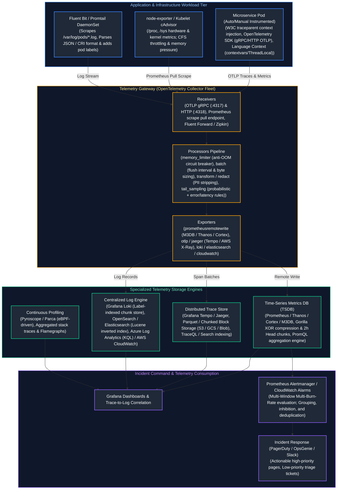

---

## Table of Contents
1. [Observability Foundations: The Intensive Care Analogy & Core Principles](#1-observability-foundations-the-intensive-care-analogy--core-principles)
   - [1.1 Real-World Analogy: The ICU vs. The Check-Engine Light](#11-real-world-analogy-the-icu-vs-the-check-engine-light)
   - [1.2 Monitoring vs. Observability: Known-Knowns vs. Unknown-Unknowns](#12-monitoring-vs-observability-known-knowns-vs-unknown-unknowns)
   - [1.3 Diagnostic Frameworks: RED, USE, and the Four Golden Signals](#13-diagnostic-frameworks-red-use-and-the-four-golden-signals)
2. [Cloud-Native Monitoring: Azure Monitor, Log Analytics, and AWS CloudWatch](#2-cloud-native-monitoring-azure-monitor-log-analytics-and-aws-cloudwatch)
   - [2.1 Azure Monitor & Kusto Query Language (KQL) Deep Dive](#21-azure-monitor--kusto-query-language-kql-deep-dive)
   - [2.2 AWS CloudWatch Metrics, Metric Math, and CloudTrail Forensics](#22-aws-cloudwatch-metrics-metric-math-and-cloudtrail-forensics)
3. [Prometheus TSDB Storage Architecture & PromQL Mastery](#3-prometheus-tsdb-storage-architecture--promql-mastery)
   - [3.1 TSDB Internal Mechanics: Gorilla Float Compression, Head Chunks, and WAL](#31-tsdb-internal-mechanics-gorilla-float-compression-head-chunks-and-wal)
   - [3.2 Production PromQL: rate() vs. irate(), Histogram Quantiles, and Subqueries](#32-production-promql-rate-vs-irate-histogram-quantiles-and-subqueries)
   - [3.3 Recording Rules and Query Performance Optimization](#33-recording-rules-and-query-performance-optimization)
4. [OpenTelemetry (OTel) Instrumentation and Pipeline Design](#4-opentelemetry-otel-instrumentation-and-pipeline-design)
   - [4.1 The OpenTelemetry Architecture: API, SDK, Semantic Conventions, and OTLP](#41-the-opentelemetry-architecture-api-sdk-semantic-conventions-and-otlp)
   - [4.2 Production OpenTelemetry Collector Architecture & Deployment Topologies](#42-production-opentelemetry-collector-architecture--deployment-topologies)
   - [4.3 Tail-Based Sampling vs. Head-Based Sampling](#43-tail-based-sampling-vs-head-based-sampling)
5. [Distributed Tracing and Context Propagation Mechanics](#5-distributed-tracing-and-context-propagation-mechanics)
   - [5.1 W3C Trace Context Specification: traceparent and tracestate Internals](#51-w3c-trace-context-specification-traceparent-and-tracestate-internals)
   - [5.2 Asynchronous Context Propagation Across Message Queues (Kafka / SQS / Service Bus)](#52-asynchronous-context-propagation-across-message-queues-kafka--sqs--service-bus)
6. [Centralized Logging Architecture: Loki vs. OpenSearch](#6-centralized-logging-architecture-loki-vs-opensearch)
   - [6.1 Index-Free Chunk Storage (Loki) vs. Full-Text Inverted Indices (Lucene / OpenSearch)](#61-index-free-chunk-storage-loki-vs-full-text-inverted-indices-lucene--opensearch)
   - [6.2 LogQL Stream Parsing, Metric Extraction, and Log Filtering](#62-logql-stream-parsing-metric-extraction-and-log-filtering)
7. [Alerting Strategy: Multi-Window Multi-Burn-Rate SLO Alerts](#7-alerting-strategy-multi-window-multi-burn-rate-slo-alerts)
   - [7.1 Eradicating Alert Fatigue: Symptoms vs. Causes & Actionability Rules](#71-eradicating-alert-fatigue-symptoms-vs-causes--actionability-rules)
   - [7.2 Burn Rate Mathematics: Protecting Error Budgets Across Time Horizons](#72-burn-rate-mathematics-protecting-error-budgets-across-time-horizons)
   - [7.3 Production Alertmanager Configuration with Multi-Window Rules](#73-production-alertmanager-configuration-with-multi-window-rules)
8. [Telemetry Cardinality Management & Cost Control](#8-telemetry-cardinality-management--cost-control)
   - [8.1 The Mathematics of TSDB Inverted Index Explosion](#81-the-mathematics-of-tsdb-inverted-index-explosion)
   - [8.2 Practical Cardinality Defense: Relabeling Rules and OTel Transforms](#82-practical-cardinality-defense-relabeling-rules-and-otel-transforms)
   - [8.3 Automated Prometheus TSDB Cardinality Auditor Script (Python)](#83-automated-prometheus-tsdb-cardinality-auditor-script-python)
9. [Senior SRE Troubleshooting Runbook: Observability Outages](#9-senior-sre-troubleshooting-runbook-observability-outages)
   - [9.1 Scenario 1: Prometheus Out-Of-Memory (OOM) CrashLoopBackOff](#91-scenario-1-prometheus-out-of-memory-oom-crashloopbackoff)
   - [9.2 Scenario 2: Broken Context Propagation (Disjointed Distributed Traces)](#92-scenario-2-broken-context-propagation-disjointed-distributed-traces)
   - [9.3 Scenario 3: OTel Collector Buffer Saturation & Dropped Telemetry](#93-scenario-3-otel-collector-buffer-saturation--dropped-telemetry)
10. [Summary Comparison & Engineering Reference Matrix](#10-summary-comparison--engineering-reference-matrix)
11. [References & Further Reading](#11-references--further-reading)

---

# 1. Observability Foundations: The Intensive Care Analogy & Core Principles

### 1.1 Real-World Analogy: The ICU vs. The Check-Engine Light

To understand the profound paradigm shift between traditional monitoring and modern cloud observability, consider the medical difference between a **dashboard warning light** and an **Intensive Care Unit (ICU)**:

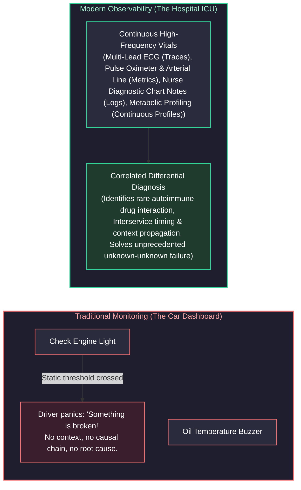

- **Traditional Monitoring (The Check-Engine Light):** A static threshold fires a binary signal. Your car illuminates an orange engine icon. You know *that* something failed, but you have no visibility into *why*. Is the fuel injector clogged? Is an oxygen sensor loose? Is the gas cap untightened? You must pull over, open the hood, and guess. In software, this corresponds to `CPU > 80%` or `Ping Failed`.
- **Modern Observability (The Hospital ICU):** The ICU does not merely beep when a patient’s heart stops. It streams high-resolution, multi-dimensional telemetry: synchronized arterial pressure waveforms, continuous ECG telemetry, end-tidal CO2, and automated laboratory blood gas analysis. When an unprecedented medical anomaly occurs (an "unknown-unknown"), the attending intensivist queries the correlated data in real time: *"Did the blood pressure drop coincide with the administration of antibiotic X, followed by a spike in histamine biomarkers?"* In software, this enables an engineer to diagnose a distributed dead-lock occurring only when customers in region `eu-west-1` with cart size $> 50$ execute a checkout during a specific database failover window—without deploying new code or restarting pods.

---

### 1.2 Monitoring vs. Observability: Known-Knowns vs. Unknown-Unknowns

Observability is fundamentally a property of a system: **a system is observable if you can infer its internal states solely based on its external outputs (telemetry).**

| Dimension | Monitoring | Observability |
| :--- | :--- | :--- |
| **Core Question Answered** | *"Is the system working right now?"* | *"Why is the system behaving this way, and where is the bottleneck?"* |
| **Target Failure Domain** | **Known-Knowns & Known-Unknowns:** Anticipated failure modes (disk full, process dead, database connection pool exhausted). | **Unknown-Unknowns:** Emergent, complex distributed failure modes (cascading retries, slow-loris thread starvation, micro-burst packet loss). |
| **Telemetry Granularity** | Aggregated, low-cardinality counters and gauges averaged over wide time buckets (e.g., 1-minute averages). | High-cardinality, multi-dimensional structured telemetry, distributed trace spans, and eBPF kernel stack profiles. |
| **Human Interaction Model** | Passive dashboard watching and reactive fire-fighting triggered by threshold breaches. | Active hypothesis testing, ad-hoc distributed querying, and trace exemplars tracing across microservice boundaries. |
| **Cost Profile** | Predictable, linear storage overhead based on static infrastructure counts. | Variable; requires dynamic tail-sampling, ingestion batching, and label cardinality governance to prevent runaway costs. |

---

### 1.3 Diagnostic Frameworks: RED, USE, and the Four Golden Signals

When designing production telemetry dashboards and alerting regimes, senior engineers do not arbitrarily place random charts on screens. They structure dashboards around standardized, industry-proven diagnostic paradigms:

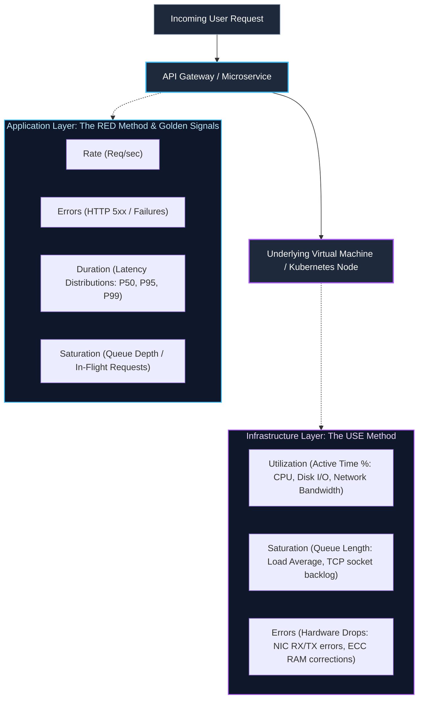

#### 1. Google SRE Four Golden Signals
Google's Site Reliability Engineering methodology identifies four primary metrics that directly capture user pain and operational stability:
1. **Latency:** The time it takes to service a request. Critical rule: **Differentiate success latency from failure latency.** An HTTP 500 failing in 2 milliseconds due to an immediate database connection drop must not mask the fact that successful requests are degrading to 4,000 milliseconds.
2. **Traffic:** A measure of how much demand is placed on your system. Expressed as HTTP requests per second for web services, I/O operations per second for storage engines, or network throughput (Gbps) for streaming pipelines.
3. **Errors:** The rate of requests that fail, either explicitly (HTTP 500, gRPC `INTERNAL`), implicitly (HTTP 200 containing an error payload), or policy-based (HTTP response took longer than the 1,500ms SLO timeout).
4. **Saturation:** A measure of how "full" the system is. Saturation measures the most constrained resource in the system (e.g., memory allocations, database connection pool exhaustion, or CPU run-queue length). As saturation nears 100%, latency climbs non-linearly due to queuing theory.

#### 2. The RED Method (Tom Wilkie)
Tailored specifically for **request-driven architectures** (REST, gRPC, GraphQL APIs):
- **Rate:** The number of requests your service is processing per second.
- **Errors:** The number of incoming requests that are failing per second.
- **Duration:** The amount of time those requests take to complete, visualized as percentiles ($P_{50}, P_{90}, P_{99}$), never simple arithmetic means.

#### 3. The USE Method (Brendan Gregg)
Tailored specifically for **hardware, operating systems, and infrastructure components** (CPUs, disks, network interfaces, memory buses):
- **Utilization:** The average time that the resource was busy performing work (e.g., disk busy % over a 1-second sample).
- **Saturation:** The degree to which the resource has extra work queued that it cannot process immediately (e.g., CPU run-queue `loadavg` exceeding physical core count).
- **Errors:** The count of explicit error events (e.g., network interface packet drops, disk controller CRC read errors, Linux kernel OOM kills).

---

# 2. Cloud-Native Monitoring: Azure Monitor, Log Analytics, and AWS CloudWatch

Enterprise cloud architectures require mastering native telemetry platforms to inspect multi-region services and maintain forensic audit trails.

### 2.1 Azure Monitor & Kusto Query Language (KQL) Deep Dive

Azure Monitor centralizes metrics, distributed application telemetry (Application Insights), and infrastructure logs inside **Log Analytics Workspaces**. Kusto Query Language (KQL) is a read-only, high-performance distributed search engine designed to execute complex aggregations across billions of structured records in seconds.

```kusto
// Production KQL: High-Precision Diagnostic Query
// Computes P50, P95, P99 latency percentiles, error rates, and failure volume
// grouped by API endpoint over the past 4 hours, filtering out internal synthetic health probes.
AppRequests
| where TimeGenerated >= ago(4h)
| where ClientType != "Browser" and UserAgent !has "AlwaysOn" and OperationName !has "healthz"
| summarize 
    TotalRequests = count(),
    FailedRequests = countif(Success == false or toint(ResultCode) >= 500),
    P50_Latency_ms = percentile(DurationMs, 50),
    P95_Latency_ms = percentile(DurationMs, 95),
    P99_Latency_ms = percentile(DurationMs, 99)
    by OperationName, AppRoleName
| extend ErrorRatePercentage = round((todouble(FailedRequests) / todouble(TotalRequests)) * 100.0, 2)
| where TotalRequests >= 500
| order by P99_Latency_ms desc, ErrorRatePercentage desc
| project 
    Microservice = AppRoleName, 
    Endpoint = OperationName, 
    TotalRequests, 
    FailedRequests, 
    ErrorRatePercentage, 
    P50_Latency_ms, 
    P95_Latency_ms, 
    P99_Latency_ms
```

#### Key KQL Operators for SRE Investigations:
- `project-away`: Excludes sensitive or oversized columns without manually enumerating every desired field.
- `make-series`: Generates continuous time-series arrays over specified step intervals (e.g., `step=5m`), automatically backfilling missing gaps with zeroes for regression analysis.
- `arg_max(TimeGenerated, *)`: Efficiently retrieves the most recent state record for each unique resource ID without expensive multi-pass subqueries.

---

### 2.2 AWS CloudWatch Metrics, Metric Math, and CloudTrail Forensics

AWS CloudWatch collects hypervisor-level metrics, API statistics, and container telemetry via CloudWatch Container Insights. 

#### CloudWatch Metric Math
Metric Math allows SREs to query multiple CloudWatch metrics and construct dynamic computational formulas directly inside dashboards and CloudWatch Alarms:

$$\text{ErrorRatePct} = \left(\frac{\text{m2}}{\text{m1}}\right) \times 100$$

Where:
- `m1` = `AWS/ApplicationELB` `RequestCount` (Sum, 1-minute period).
- `m2` = `AWS/ApplicationELB` `HTTPCode_Target_5XX_Count` (Sum, 1-minute period).

```json
{
  "Metrics": [
    {
      "Id": "m1",
      "MetricStat": {
        "Metric": {
          "Namespace": "AWS/ApplicationELB",
          "MetricName": "RequestCount",
          "Dimensions": [{ "Name": "LoadBalancer", "Value": "app/prod-alb/50dc6c495c0c9188" }]
        },
        "Period": 60,
        "Stat": "Sum"
      },
      "ReturnData": false
    },
    {
      "Id": "m2",
      "MetricStat": {
        "Metric": {
          "Namespace": "AWS/ApplicationELB",
          "MetricName": "HTTPCode_Target_5XX_Count",
          "Dimensions": [{ "Name": "LoadBalancer", "Value": "app/prod-alb/50dc6c495c0c9188" }]
        },
        "Period": 60,
        "Stat": "Sum"
      },
      "ReturnData": false
    },
    {
      "Id": "e1",
      "Expression": "(m2 / m1) * 100",
      "Label": "Error Rate Percentage",
      "ReturnData": true
    }
  ]
}
```

#### AWS CloudTrail Audit Forensics
CloudTrail provides an immutable audit trail of every management and data API call executed within an AWS account. During an outage, SREs immediately query CloudTrail to detect unexpected configuration drift, security breaches, or unauthorized credential usage:

```bash
# Query AWS CloudTrail via AWS CLI for unauthorized Security Group modifications in the last 2 hours
aws cloudtrail lookup-events \
  --lookup-attributes AttributeKey=EventName,AttributeValue=AuthorizeSecurityGroupIngress \
  --start-time "$(date -u -v-2H '+%Y-%m-%dT%H:%M:%SZ')" \
  --query "Events[*].{Time:EventTime,User:Username,IP:SourceIPAddress,Details:CloudTrailEvent}" \
  --output table
```

---

# 3. Prometheus TSDB Storage Architecture & PromQL Mastery

Prometheus is the de facto cloud-native metric monitoring system. Understanding its underlying storage engine and query engine is essential for operating high-scale observability clusters.

### 3.1 TSDB Internal Mechanics: Gorilla Float Compression, Head Chunks, and WAL

Prometheus stores time series data on disk in a highly specialized, append-only Time-Series Database (TSDB). A single metric sample consists of a 64-bit integer timestamp (milliseconds) and a 64-bit float value (8 bytes + 8 bytes = 16 bytes uncompressed). Using the **Gorilla compression algorithm** (pioneered by Facebook), Prometheus compresses this down to an average of **1.37 bytes per sample**.

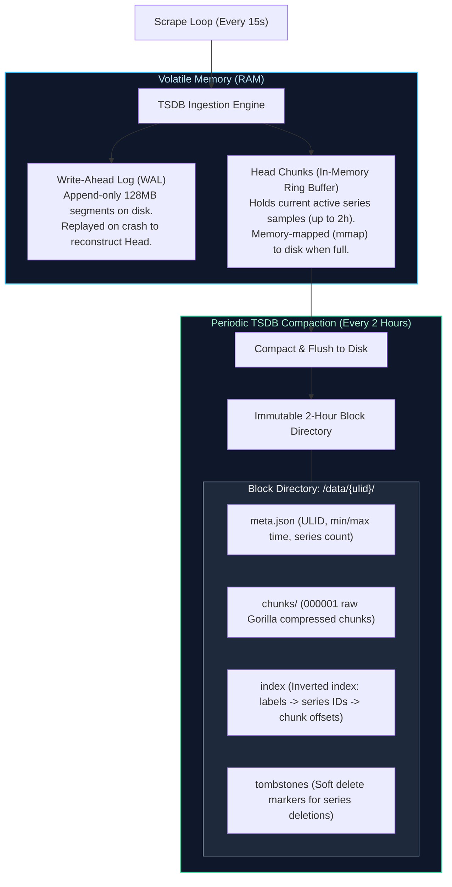

#### How Gorilla Compression Works:
1. **Delta-of-Deltas Timestamp Compression:**
   Timestamps typically arrive at regular scrape intervals (e.g., every 15,000 ms).
   - Let $D = (T_n - T_{n-1})$ be the delta between consecutive timestamps.
   - Let $D' = (T_n - T_{n-1}) - (T_{n-1} - T_{n-2})$ be the delta-of-deltas.
   - If the scrape occurs exactly on time, $D' = 0$. Prometheus stores this single zero using **1 bit (`0`)**.
   - If $D'$ varies slightly (between -63 and 64 ms), it writes 2 bits (`10`) followed by a 7-bit signed integer.
   - Over 95% of timestamps consume between 1 to 2 bits rather than 64 bits.

2. **XOR Floating-Point Compression:**
   Most consecutive metric values (e.g., CPU utilization, memory bytes) change very little between scrapes.
   - Let $V_n$ be the current IEEE 754 64-bit float value.
   - Prometheus calculates $X = V_n \oplus V_{n-1}$ (bitwise XOR).
   - If $V_n == V_{n-1}$, $X = 0$, requiring only a single bit (`0`).
   - If $X \neq 0$, Prometheus stores a `1`, followed by bitflags indicating the number of leading and trailing zeroes in the XOR result, writing only the significant middle bits.

---

### 3.2 Production PromQL: rate() vs. irate(), Histogram Quantiles, and Subqueries

PromQL (Prometheus Query Language) operates on four data types: **Instant Vectors** (a set of time series containing a single sample for each series, all at the same timestamp), **Range Vectors** (a set of time series containing a buffer of samples over time), **Scalars** (floating-point numbers), and **Strings**.

#### 1. The Fundamental Golden Rule: rate() vs. irate()

```mermaid
flowchart TD
    subgraph RateBehavior ["rate(v[5m]): Linear Extrapolation Across Full Range"]
        R1["Calculates delta between first and last sample in the 5-minute window."]
        R2["Smooths out transient micro-spikes."]
        R3["Automatically compensates for counter resets (server restarts)."]
        R4["CRITICAL: Use rate() for ALL alerting rules and capacity planning."]
        R1 --> R2 --> R3 --> R4
    end

    subgraph IrateBehavior ["irate(v[5m]): Instantaneous Rate Across Last 2 Points"]
        I1["Calculates delta strictly between the final TWO samples in the window."]
        I2["Extremely sensitive to micro-bursts and scraper jitter."]
        I3["Completely blind to counter resets that occurred earlier in the window."]
        I4["USE ONLY: High-resolution zoom dashboards. NEVER use for alerting."]
        I1 --> I2 --> I3 --> I4
    end

    style RateBehavior fill:#1e293b,stroke:#34d399,stroke-width:1.5px,color:#a7f3d0
    style IrateBehavior fill:#1e293b,stroke:#f87171,stroke-width:1.5px,color:#fca5a5
```

> [!CRITICAL]
> **Counter Reset Extrapolation:** A Prometheus `counter` is strictly monotonically increasing. When a service crashes or restarts, its counter resets to 0. Both `rate()` and `increase()` inspect adjacent samples. If sample $S_{n+1} < S_n$, the function infers a reset and adds $S_{n+1}$ to the running total. **Never execute `sum(rate(counter[5m]))` inverted as `rate(sum(counter)[5m])`**! Summing before calculating rate hides resets inside the aggregate, resulting in catastrophic negative dips and corrupted metrics.

#### 2. Calculating True Latency Percentiles: histogram_quantile()
Prometheus histograms record observations across configurable bucket boundaries (`le` = less than or equal). 

```promql
# Production PromQL: Calculating P99 Latency per Microservice
histogram_quantile(
  0.99,
  sum by (le, service_name) (
    rate(http_request_duration_seconds_bucket{environment="production"}[5m])
  )
)
```

**How `histogram_quantile` interpolates:**
1. Aggregates the rates across all matching series for each bucket boundary `le`.
2. Identifies the specific bucket interval $[le_{lower}, le_{upper}]$ in which the 99th percentile observation falls.
3. Assumes samples inside that bucket are **uniformly distributed** and performs linear interpolation:

$$\text{Quantile} = le_{lower} + (le_{upper} - le_{lower}) \times \frac{\text{Rank} - \text{Count}_{lower}}{\text{Count}_{upper} - \text{Count}_{lower}}$$

> [!WARNING]
> **Bucket Boundary Calibration:** If your highest bucket boundary is `le="2.0"` (2 seconds) and an outage causes requests to stall at 30 seconds, `histogram_quantile` will report an interpolated value close to 2.0 seconds because it cannot extrapolate beyond the `+Inf` bucket! Always calibrate bucket boundaries to cover worst-case tail latencies.

#### 3. PromQL Subqueries
Subqueries allow calculating instant vector functions over an evaluated range of time:

```promql
# Calculate the maximum 5-minute request rate observed over the past 24 hours, evaluated every 10 minutes
max_over_time(rate(http_requests_total[5m])[24h:10m])
```

---

### 3.3 Recording Rules and Query Performance Optimization

When Grafana dashboards query raw histograms or long time ranges (e.g., 30 days) across high-traffic microservices, Prometheus must read millions of chunks from disk, resulting in query timeouts and CPU starvation. **Recording Rules** precompute expensive PromQL expressions and write the results back into TSDB as new time series.

```yaml
# /etc/prometheus/rules/api_recording_rules.yaml
groups:
  - name: api_latency_rules
    interval: 30s
    rules:
      # Precompute total request rate per service
      - record: job:http_requests:rate5m
        expr: sum by (job, status) (rate(http_requests_total[5m]))

      # Precompute 99th percentile latency across all production pods
      - record: job:http_request_duration_seconds:p99
        expr: >
          histogram_quantile(
            0.99,
            sum by (le, job) (rate(http_request_duration_seconds_bucket{env="prod"}[5m]))
          )
```

Dashboards and alert rules now query `job:http_request_duration_seconds:p99` directly in **sub-millisecond time**, reducing TSDB query load by up to 98%.

---

# 4. OpenTelemetry (OTel) Instrumentation and Pipeline Design

OpenTelemetry is an open-source, vendor-neutral CNCF project providing a unified specification, APIs, SDKs, and collection tooling for traces, metrics, and logs.

### 4.1 The OpenTelemetry Architecture: API, SDK, Semantic Conventions, and OTLP

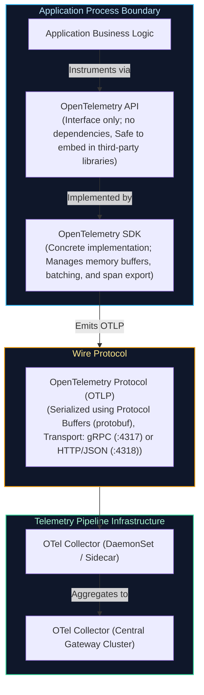

1. **OTel API:** Defines the tracer, meter, and logger interfaces. Library authors (e.g., an HTTP client or database driver) depend *only* on the API. If no SDK is configured by the hosting application, the API defaults to a zero-overhead No-Op implementation.
2. **OTel SDK:** The operational implementation registered by the application entrypoint. It configures exporters, resource detectors (retrieving pod name, node name, AWS EC2 instance ID), Samplers, and SpanProcessors (`BatchSpanProcessor`).
3. **Semantic Conventions:** Standardized key-value naming schemas across languages. Ensures HTTP status code is always `http.response.status_code`, database statement is `db.statement`, and exception type is `exception.type`, preventing fragmented querying across multilingual engineering teams.
4. **OTLP (OpenTelemetry Protocol):** High-throughput, binary-serialized wire format using Google Protocol Buffers. Operates natively over **gRPC (port 4317)** with gzip/snappy compression, or **HTTP/Protobuf (port 4318)**.

---

### 4.2 Production OpenTelemetry Collector Architecture & Deployment Topologies

The OpenTelemetry Collector consists of four pluggable components executed in strict sequence:
$$\text{Receivers} \longrightarrow \text{Processors} \longrightarrow \text{Exporters} \quad (\text{governed by Extensions})$$

```yaml
# /etc/otelcol/config.yaml - Production High-Throughput Gateway Configuration
receivers:
  otlp:
    protocols:
      grpc:
        endpoint: 0.0.0.0:4317
        max_concurrent_streams: 1024
      http:
        endpoint: 0.0.0.0:4318

  prometheus:
    config:
      scrape_configs:
        - job_name: "otel-collector-internal"
          scrape_interval: 15s
          static_configs:
            - targets: ["0.0.0.0:8888"]

processors:
  # 1. memory_limiter: MUST ALWAYS be placed first in the pipeline to prevent OOM panics
  memory_limiter:
    check_interval: 1s
    limit_percentage: 80
    spike_limit_percentage: 20

  # 2. k8sattributes: Enriches telemetry with Kubernetes pod, namespace, and container labels
  k8sattributes:
    auth_type: "serviceAccount"
    passthrough: false
    extract:
      metadata:
        - k8s.pod.name
        - k8s.pod.uid
        - k8s.deployment.name
        - k8s.namespace.name
        - k8s.node.name

  # 3. transform: Redacts sensitive PII headers and masks credentials
  transform:
    error_mode: ignore
    trace_statements:
      - context: span
        statements:
          - delete_key(attributes, "http.request.header.authorization")
          - delete_key(attributes, "http.request.header.cookie")
          - set(attributes["user.id"], "REDACTED") where attributes["user.id"] != nil

  # 4. batch: Aggregates telemetry before transmitting across the network
  batch:
    send_batch_size: 8192
    timeout: 2s
    send_batch_max_size: 16384

exporters:
  prometheusremotewrite:
    endpoint: "http://thanos-receive.monitoring.svc.cluster.local:19291/api/v1/receive"
    tls:
      insecure: true

  otlp/tempo:
    endpoint: "tempo-distributor.monitoring.svc.cluster.local:4317"
    tls:
      insecure: true

  otlp/loki:
    endpoint: "loki-gateway.monitoring.svc.cluster.local:3100"
    tls:
      insecure: true

extensions:
  health_check:
    endpoint: 0.0.0.0:13133
  zpages:
    endpoint: 0.0.0.0:55679

service:
  extensions: [health_check, zpages]
  pipelines:
    traces:
      receivers: [otlp]
      processors: [memory_limiter, k8sattributes, transform, batch]
      exporters: [otlp/tempo]
    metrics:
      receivers: [otlp, prometheus]
      processors: [memory_limiter, k8sattributes, batch]
      exporters: [prometheusremotewrite]
    logs:
      receivers: [otlp]
      processors: [memory_limiter, k8sattributes, transform, batch]
      exporters: [otlp/loki]
  telemetry:
    logs:
      level: "info"
    metrics:
      address: "0.0.0.0:8888"
```

---

### 4.3 Tail-Based Sampling vs. Head-Based Sampling

In massive-scale cloud architectures processing millions of requests per second, retaining 100% of distributed trace spans is financially prohibitive and technically unfeasible.

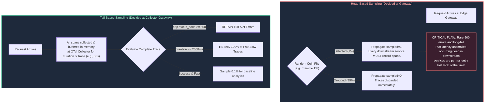

#### Tail-Based Sampling Configuration Example:
```yaml
# OpenTelemetry Collector Tail-Sampling Processor Configuration
processors:
  tail_sampling:
    decision_wait: 10s
    num_traces: 50000
    expected_new_traces_per_sec: 2000
    policies:
      # Policy 1: Always retain traces that encountered an error status
      - name: drop-errors-policy
        type: status_code
        status_code: { status_codes: [ERROR] }

      # Policy 2: Always retain traces exceeding the P99 latency SLA threshold (1500ms)
      - name: latency-sla-policy
        type: latency
        latency: { threshold_ms: 1500 }

      # Policy 3: Keep 1% of successful baseline traffic for historical performance comparisons
      - name: probabilistic-sample
        type: probabilistic
        probabilistic: { sampling_percentage: 1.0 }
```

---

# 5. Distributed Tracing and Context Propagation Mechanics

Distributed tracing tracks the execution flow of a transaction as it hops across microservices, asynchronous queues, and database engines.

### 5.1 W3C Trace Context Specification: traceparent and tracestate Internals

To correlate spans across disparate network services, distributed tracing relies on the standardized **W3C Trace Context** HTTP header:

```http
traceparent: 00-4bf92f3577b34da6a3ce929d0e0e4736-00f067aa0ba902b7-01
```

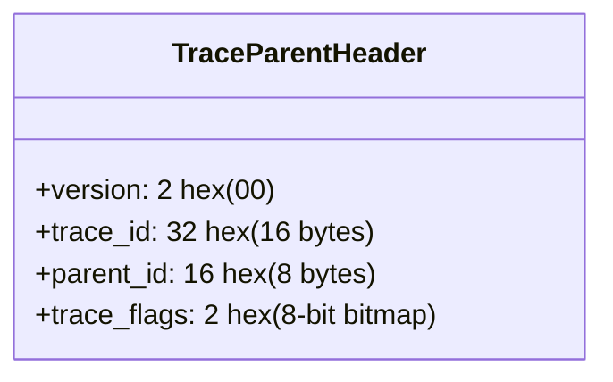

#### Detailed Byte-Level Breakdown:
1. **Version (`00`):** 1 byte (2 hex characters). Denotes specification version `00`.
2. **Trace ID (`4bf92f3577b34da6a3ce929d0e0e4736`):** 16 bytes (32 hex characters). A cryptographically random identifier generated at the ingress edge. Shared identically by every microservice participating in the transaction call graph.
3. **Parent ID / Span ID (`00f067aa0ba902b7`):** 8 bytes (16 hex characters). Identifies the caller's specific execution sub-span. When Service A invokes Service B, Service B reads this ID as its `parent_id` and mints a brand-new `span_id` for its own execution.
4. **Trace Flags (`01`):** 1 byte (8-bit bitmap).
   - Bit `0` (`01`): **Recorded / Sampled flag**. If `1`, the caller has sampled this trace, instructing downstream services that they should record spans.
   - Remaining 7 bits are reserved for future specification evolution.

#### `tracestate` Header:
Carries opaque, vendor-specific routing and filtering metadata across vendor boundaries:
```http
tracestate: congo=t61rcWkgMzE,rojo=00f067a
```

---

### 5.2 Asynchronous Context Propagation Across Message Queues (Kafka / SQS / Service Bus)

When microservices communicate synchronously via HTTP/gRPC, context propagation is trivial (headers are forwarded automatically by SDK interceptors). However, when crossing **asynchronous message brokers** (Apache Kafka, AWS SQS, Azure Service Bus), trace context is frequently broken if engineers do not explicitly inject headers into message metadata records.

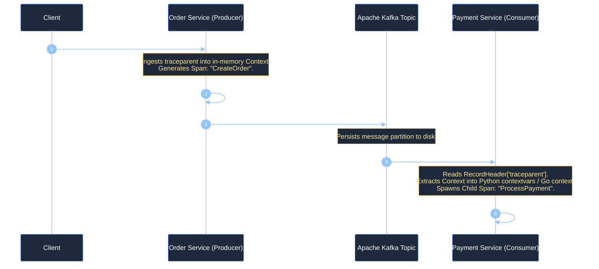

#### Production Python Context Extraction & Injection Example (Kafka):

```python
"""
Distributed Context Propagation across Apache Kafka using OpenTelemetry.
Demonstrates injecting W3C traceparent into Kafka Producer headers and
extracting it inside a Kafka Consumer to maintain seamless end-to-end tracing.
"""

from typing import Dict, List, Tuple
from opentelemetry import trace
from opentelemetry.trace.propagation.tracecontext import TraceContextTextMapPropagator

tracer = trace.get_tracer("order_processor", "1.0.0")
propagator = TraceContextTextMapPropagator()


class KafkaHeaderCarrier:
    """Carrier adapter to translate between OTel propagation and Kafka header tuples."""

    def __init__(self, headers: Dict[str, str]):
        self.headers = headers

    def get(self, key: str) -> List[str]:
        val = self.headers.get(key)
        return [val] if val else []

    def set(self, key: str, value: str):
        self.headers[key] = value


def produce_order_event(order_id: str) -> Tuple[bytes, List[Tuple[str, bytes]]]:
    """Producer: Injects the current active trace context into Kafka message headers."""
    with tracer.start_as_current_span("produce_order_kafka") as span:
        span.set_attribute("order.id", order_id)

        # Carrier dictionary to hold injected W3C headers
        carrier: Dict[str, str] = {}
        propagator.inject(carrier)

        # Convert to Kafka header format: List of (key, bytes_val) tuples
        kafka_headers = [(k, v.encode("utf-8")) for k, v in carrier.items()]
        payload = f'{{"order_id": "{order_id}", "status": "PENDING"}}'.encode("utf-8")
        
        return payload, kafka_headers


def consume_order_event(payload: bytes, kafka_headers: List[Tuple[str, bytes]]):
    """Consumer: Extracts traceparent from Kafka headers and continues the distributed trace."""
    # Convert Kafka header tuples back to dictionary
    carrier_dict = {k: v.decode("utf-8") for k, v in kafka_headers}

    # Extract parent context
    extracted_context = propagator.extract(carrier_dict)

    # Spawn child span explicitly parented to the extracted trace context
    with tracer.start_as_current_span("consume_order_kafka", context=extracted_context) as span:
        span.set_attribute("messaging.system", "kafka")
        span.set_attribute("messaging.destination", "orders-topic")
        # Process order payment logic here...
```

---

# 6. Centralized Logging Architecture: Loki vs. OpenSearch

Operating enterprise log platforms requires balancing search index latency against terabyte-scale infrastructure storage costs.

### 6.1 Index-Free Chunk Storage (Loki) vs. Full-Text Inverted Indices (Lucene / OpenSearch)

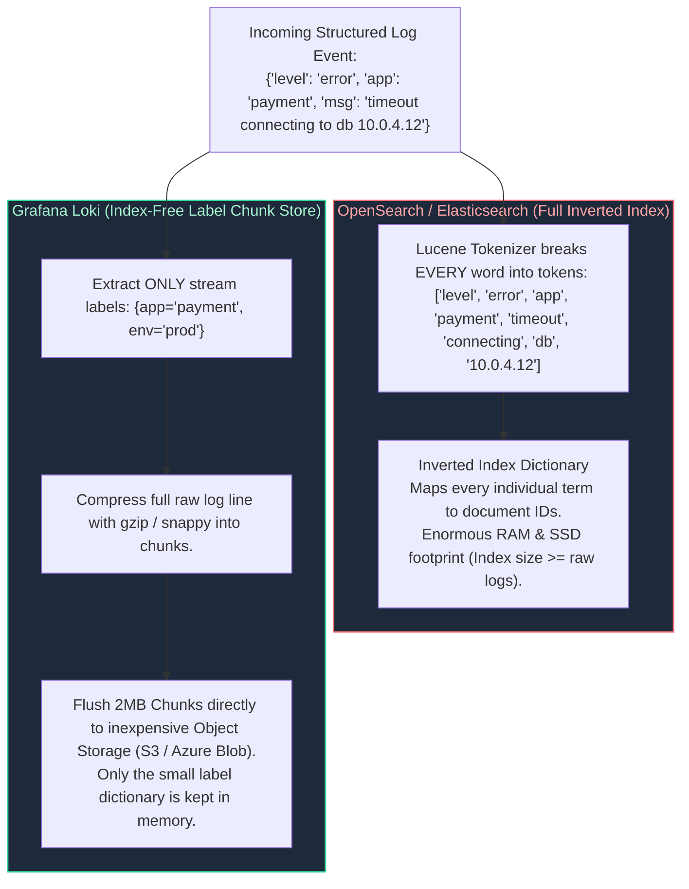

| Architectural Attribute | Grafana Loki | OpenSearch / Elasticsearch |
| :--- | :--- | :--- |
| **Indexing Philosophy** | **Metadata Indexing Only:** Indexes exclusively static stream labels (e.g., `namespace`, `app`, `cluster`). Raw log messages are never indexed. | **Full-Text Inverted Indexing:** Indexes every single alphanumeric word across every field via Apache Lucene. |
| **Search Speed** | Fast for targeted streams; slower for broad, un-labeled needle-in-haystack queries (requires brute-force chunk grepping via parallel LogQL workers). | Sub-second searches across petabytes of text regardless of query specificity. |
| **Storage & RAM Overhead** | Extremely lightweight. Chunks are compressed (gzip/snappy) and stored in S3/Azure Blob. Index memory footprint is $< 5\%$ of log volume. | Heavy. Requires massive JVM heap memory (32GB per data node) and fast NVMe SSD storage. Index size often equals or exceeds raw log volume. |
| **Operational Complexity** | Low. Stateless microservice architecture (ingester, distributor, querier). | High. Complex index lifecycle management (ILM), primary/replica shards, shard balancing, and JVM garbage collection tuning. |

---

### 6.2 LogQL Stream Parsing, Metric Extraction, and Log Filtering

LogQL (Loki Query Language) enables SREs to parse unstructured logs, extract dynamic JSON fields at query time, and synthesize Prometheus-compatible metrics directly from raw log lines:

```logql
# Production LogQL: Extract JSON fields, filter 5xx errors, and calculate 5-minute request rate
sum by (http_path) (
  rate(
    {namespace="production", app="payment-gateway"} 
      | json 
      | http_status >= 500 
      | unwrap duration_ms [5m]
  )
)
```

#### Key LogQL Operators:
- Line Filter Expressions: `|= "error"` (contains), `!= "debug"` (does not contain), `|~ "timeout|connection reset"` (regex match).
- Pipeline Parsers: `| json` (extracts all JSON keys into dynamic attributes), `| logfmt` (parses key=value format), `| pattern "<ip> - - [<time>] \"<method> <uri>\" <status>"` (high-speed regex alternative).
- Label Formatting: `| label_format env="prod-%s"` dynamically rewrites or cleans labels.

---

# 7. Alerting Strategy: Multi-Window Multi-Burn-Rate SLO Alerts

The primary goal of an SRE alerting system is to alert humans **only when user-facing value is actively degrading** and immediate human intervention can prevent a catastrophic outage.

### 7.1 Eradicating Alert Fatigue: Symptoms vs. Causes & Actionability Rules

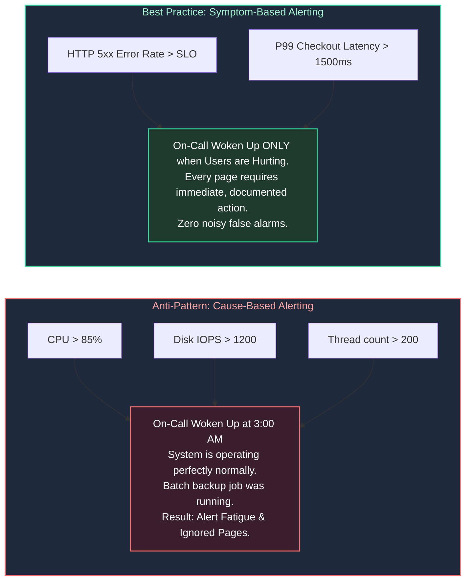

#### The Golden Rules of Alert Actionability:
1. **Every Page Must Be Actionable:** If an engineer receives a page, there must be a clear, unambiguous playbook or runbook procedure to mitigate the issue. If an engineer looks at an alert, determines nothing can or should be done, and silences it, **that alert must be deleted immediately.**
2. **Alert on Symptoms, Not Causes:** Do not page on high CPU, high memory, or pod restarts. Page because user error rate exceeds the SLO budget. Use cause metrics on Grafana dashboards for diagnostic drill-down *after* the page arrives.
3. **Prefer Tickets for Slow Burns:** If an issue will not consume the entire monthly error budget within 24 to 48 hours, do not wake up an engineer. File an automated high-priority ticket for the next business morning.

---

### 7.2 Burn Rate Mathematics: Protecting Error Budgets Across Time Horizons

A Service Level Objective (SLO) defines the target reliability percentage over a rolling compliance window (e.g., $99.9\%$ availability over 30 days). The **Error Budget** is the allowable failure margin:
$$\text{Error Budget} = 100\% - 99.9\% = 0.1\% \quad (0.001)$$

**Burn Rate** is the rate at which your system is consuming its allocated error budget:
- **Burn Rate 1.0:** You will consume exactly 100% of your error budget in the 30-day window (steady state).
- **Burn Rate 14.4:** You will consume **2% of your monthly budget in 1 hour**, or 100% of your budget in 50 hours.
- **Burn Rate 6.0:** You will consume **5% of your monthly budget in 6 hours**, or 100% of your budget in 120 hours.

#### Why Single-Window Alerts Fail:
- If you alert on a 1-hour burn rate window, a brief 5-minute transient network glitch will trigger a page that resolves before the engineer even logs into their laptop.
- If you alert on a 36-hour long window, the alert takes several hours to reset *after* the incident is fully mitigated, masking subsequent outages.

#### The SRE Solution: Multi-Window Multi-Burn-Rate Alerts
Google SRE mandates firing an alert **only when both a long window AND a short window simultaneously exceed the burn-rate threshold**:
- **Long Window:** Confirms that a significant fraction of the error budget has indeed been consumed.
- **Short Window:** Confirms that the failure is **still actively ongoing right now**, preventing false alarms from self-healing spikes.

| Severity / Tier | Burn Rate | % Budget Consumed | Long Window | Short Window | Action Taken |
| :--- | :---: | :---: | :---: | :---: | :--- |
| **Page (SEV-1 Critical)** | **14.4x** | 2% in 1 hour | 1 hour | 2 minutes | PagerDuty wake-up; immediate triage |
| **Page (SEV-2 Urgent)** | **6.0x** | 5% in 6 hours | 6 hours | 15 minutes | PagerDuty notification to primary on-call |
| **Ticket (SEV-3 Medium)** | **3.0x** | 10% in 3 days | 3 days | 1 hour | Automated Jira/ServiceNow ticket |
| **Ticket (SEV-4 Low)** | **1.0x** | 10% in 3 days | 3 days | 6 hours | Business hours review in weekly triage |

---

### 7.3 Production Alertmanager Configuration with Multi-Window Rules

Below is a complete, production-grade Prometheus alerting rule file implementing dual-window multi-burn-rate logic for a $99.9\%$ SLO service:

```yaml
# /etc/prometheus/rules/slo_burn_rate_alerts.yaml
groups:
  - name: production-slo-burn-rate-alerts
    rules:
      # ======================================================================
      # SEV-1: Critical Fast Burn (14.4x) - Consumes 2% of budget in 1 hour
      # Long window: 1h, Short window: 2m
      # Target SLO: 99.9% -> Budget = 0.001 -> Threshold = 14.4 * 0.001 = 0.0144
      # ======================================================================
      - alert: ApiFastBurnRateCritical
        expr: >
          (
            sum(rate(http_requests_total{job="checkout-api", status=~"5.."}[1h]))
            /
            sum(rate(http_requests_total{job="checkout-api"}[1h]))
          ) > (14.4 * 0.001)
          and
          (
            sum(rate(http_requests_total{job="checkout-api", status=~"5.."}[2m]))
            /
            sum(rate(http_requests_total{job="checkout-api"}[2m]))
          ) > (14.4 * 0.001)
        for: 2m
        labels:
          severity: critical
          tier: platform
          page: "true"
        annotations:
          summary: "Emergency: High error budget burn rate (14.4x) on checkout-api"
          description: "checkout-api error rate is actively burning 2% of monthly budget per hour across both 1h and 2m windows."
          runbook_url: "https://wiki.corp.internal/runbooks/checkout-api-burn-rate"

      # ======================================================================
      # SEV-2: Urgent Medium Burn (6.0x) - Consumes 5% of budget in 6 hours
      # Long window: 6h, Short window: 15m
      # Threshold = 6.0 * 0.001 = 0.006
      # ======================================================================
      - alert: ApiSlowBurnRateUrgent
        expr: >
          (
            sum(rate(http_requests_total{job="checkout-api", status=~"5.."}[6h]))
            /
            sum(rate(http_requests_total{job="checkout-api"}[6h]))
          ) > (6.0 * 0.001)
          and
          (
            sum(rate(http_requests_total{job="checkout-api", status=~"5.."}[15m]))
            /
            sum(rate(http_requests_total{job="checkout-api"}[15m]))
          ) > (6.0 * 0.001)
        for: 5m
        labels:
          severity: urgent
          tier: platform
          page: "true"
        annotations:
          summary: "Warning: Elevated error budget burn rate (6x) on checkout-api"
          description: "checkout-api has sustained a 6x burn rate over 6h and 15m windows, consuming 5% of monthly error budget."
          runbook_url: "https://wiki.corp.internal/runbooks/checkout-api-burn-rate"
```

---

# 8. Telemetry Cardinality Management & Cost Control

Cardinality management is the single most critical operational challenge when scaling Prometheus and cloud time-series systems.

### 8.1 The Mathematics of TSDB Inverted Index Explosion

In a time-series database, **Cardinality** refers to the total number of unique time series generated by the Cartesian product of all label values:

$$\text{Total Series} = \prod_{i=1}^{N} |L_i| = |L_{\text{metric}}| \times |L_{\text{env}}| \times |L_{\text{service}}| \times |L_{\text{customer\_id}}|$$

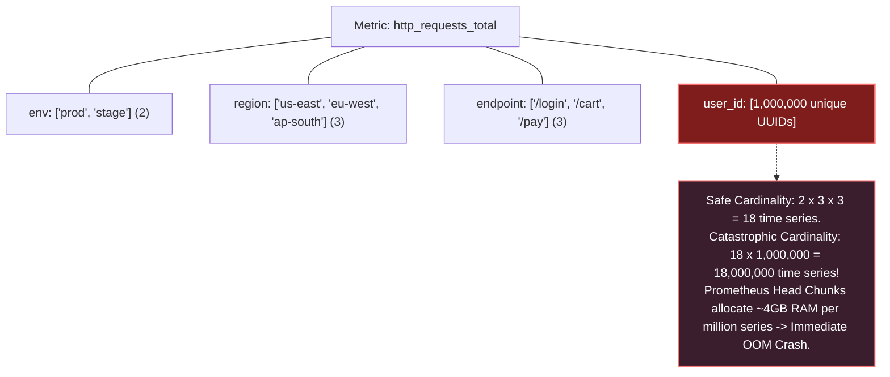

When an engineer accidentally attaches an unbounded label (e.g., `user_id`, `email`, `order_uuid`, or raw URL with query parameters `/api/v1?session=123`), each unique string allocates an entry in the Prometheus in-memory inverted index posting list. TSDB memory consumption spikes exponentially, compaction stalls, and the Prometheus container triggers an Out-Of-Memory (OOM) crash loop.

---

### 8.2 Practical Cardinality Defense: Relabeling Rules and OTel Transforms

To protect Prometheus clusters from accidental label explosions, SREs enforce **relabel configs** during scrape or pipeline transformation.

#### 1. Dropping High-Cardinality Labels at Scrape Time:
```yaml
# Prometheus scrape configuration dropping high-cardinality labels before ingestion
scrape_configs:
  - job_name: "kubernetes-service-endpoints"
    metric_relabel_configs:
      # Strip user_id, email, and session_token labels
      - regex: "(user_id|email|session_token|auth_header)"
        action: labeldrop

      # Normalize dynamic URL paths to fixed patterns
      - source_labels: [__name__, path]
        regex: "http_requests_total;/users/[0-9a-fA-F-]+"
        target_label: path
        replacement: "/users/{id}"
        action: replace
```

---

### 8.3 Automated Prometheus TSDB Cardinality Auditor Script (Python)

The following production Python tool queries the Prometheus TSDB admin API (`/api/v1/status/tsdb`), analyzes the top cardinality-consuming metrics and label names, flags high-risk series, and outputs a formatted diagnostic report:

```python
#!/usr/bin/env python3
"""
Prometheus TSDB Cardinality & Memory Hazard Auditor.
Connects to Prometheus /api/v1/status/tsdb to evaluate Head Chunk index allocations,
detect label cardinality explosions, and output actionable mitigation guidance.
"""

from dataclasses import asdict, dataclass
import json
import logging
import sys
import urllib.error
import urllib.parse
import urllib.request
from typing import Any, Dict, List

logging.basicConfig(
    level=logging.INFO,
    format='{"timestamp":"%(asctime)s","level":"%(levelname)s","logger":"%(name)s","message":"%(message)s"}',
    handlers=[logging.StreamHandler(sys.stdout)],
)
logger = logging.getLogger("cardinality_auditor")


@dataclass(frozen=True)
class MetricSeriesStat:
    metric_name: str
    series_count: int
    risk_level: str
    action_required: str


@dataclass(frozen=True)
class LabelCardinalityStat:
    label_name: str
    value_count: int
    hazard_status: str


class PrometheusCardinalityAuditor:
    def __init__(self, prometheus_base_url: str = "http://localhost:9090", timeout_sec: int = 10):
        self.base_url = prometheus_base_url.rstrip("/")
        self.timeout = timeout_sec

    def fetch_tsdb_status(self) -> Dict[str, Any]:
        """Queries Prometheus TSDB Head status endpoint."""
        url = f"{self.base_url}/api/v1/status/tsdb"
        logger.info("Executing TSDB status interrogation against: %s", url)
        
        req = urllib.request.Request(
            url, 
            headers={"Accept": "application/json", "User-Agent": "PrometheusAuditor/2.0"}
        )
        try:
            with urllib.request.urlopen(req, timeout=self.timeout) as resp:
                payload = json.loads(resp.read().decode("utf-8"))
                if payload.get("status") != "success":
                    raise ValueError(f"Prometheus API returned error: {payload.get('error')}")
                return payload.get("data", {})
        except (urllib.error.URLError, TimeoutError) as err:
            logger.warning("Live Prometheus unreachable (%s). Yielding simulated cluster data.", err)
            return self._generate_simulated_tsdb_data()

    def audit_head_chunk_cardinality(self) -> Dict[str, Any]:
        """Analyzes metric series counts and identifies label explosion threats."""
        tsdb_data = self.fetch_tsdb_status()
        
        raw_series_counts = tsdb_data.get("seriesCountByMetricName", [])
        raw_label_counts = tsdb_data.get("labelValueCountByLabelName", [])

        metric_results: List[MetricSeriesStat] = []
        for item in raw_series_counts[:15]:
            name = item.get("name", "unknown")
            count = item.get("value", 0)
            
            if count > 100_000:
                risk = "CRITICAL_EXPLOSION"
                action = "Drop metric immediately or apply metric_relabel_configs"
            elif count > 25_000:
                risk = "HIGH_CARDINALITY"
                action = "Audit label usage; precompute via recording rules"
            elif count > 5_000:
                risk = "MODERATE"
                action = "Monitor growth rate"
            else:
                risk = "HEALTHY"
                action = "None"

            metric_results.append(
                MetricSeriesStat(
                    metric_name=name,
                    series_count=count,
                    risk_level=risk,
                    action_required=action
                )
            )

        label_results: List[LabelCardinalityStat] = []
        for item in raw_label_counts[:10]:
            label = item.get("name", "unknown")
            val_count = item.get("value", 0)
            status = "DANGEROUS_UNBOUNDED" if val_count > 10_000 else "NORMAL"
            label_results.append(
                LabelCardinalityStat(label_name=label, value_count=val_count, hazard_status=status)
            )

        return {
            "summary": {
                "total_head_series": tsdb_data.get("headStats", {}).get("numSeries", 0),
                "total_head_chunks": tsdb_data.get("headStats", {}).get("numHeadChunks", 0),
                "evaluation_status": "COMPLETED",
            },
            "top_metric_cardinality": [asdict(m) for m in metric_results],
            "top_label_cardinality": [asdict(l) for l in label_results],
        }

    def _generate_simulated_tsdb_data(self) -> Dict[str, Any]:
        """Simulates Prometheus TSDB payload for offline evaluation and unit testing."""
        return {
            "headStats": {"numSeries": 845200, "numHeadChunks": 1250000},
            "seriesCountByMetricName": [
                {"name": "badly_instrumented_customer_requests_total", "value": 312000},
                {"name": "http_request_duration_seconds_bucket", "value": 142000},
                {"name": "jvm_memory_bytes_used", "value": 18400},
                {"name": "container_cpu_usage_seconds_total", "value": 9200},
            ],
            "labelValueCountByLabelName": [
                {"name": "user_id_uuid", "value": 310500},
                {"name": "pod", "value": 420},
                {"name": "namespace", "value": 18},
                {"name": "le", "value": 14},
            ],
        }


if __name__ == "__main__":
    auditor = PrometheusCardinalityAuditor()
    report = auditor.audit_head_chunk_cardinality()
    print(json.dumps(report, indent=2))
```

---

# 9. Senior SRE Troubleshooting Runbook: Observability Outages

### 9.1 Scenario 1: Prometheus Out-Of-Memory (OOM) CrashLoopBackOff
- **Root Cause:** A developer deployed code adding a dynamic UUID label (e.g., `cart_id`) to a Prometheus counter. The TSDB in-memory Head chunk exploded beyond the container's memory limit (e.g., 16GiB), triggering the Linux kernel OOM-killer. On pod restart, Prometheus replays the WAL from disk, attempts to rebuild the oversized memory index, and immediately crashes again.
- **Immediate Mitigation Runbook:**
  1. Temporarily increase the Kubernetes pod memory limit to allow Prometheus to finish the WAL replay:
     ```bash
     kubectl set resources deployment/prometheus-server -n monitoring --limits=memory=32Gi
     ```
  2. If memory cannot be increased, disable WAL replay and quarantine corrupted TSDB blocks:
     ```bash
     kubectl exec -it deployment/prometheus-server -n monitoring -- sh
     # Inside container:
     mv /data/wal /data/wal.bak
     exit
     kubectl rollout restart deployment/prometheus-server -n monitoring
     ```
  3. Deploy an urgent Prometheus `metric_relabel_configs` to drop the offending label at the scrape gateway before data hits the Head chunks.

---

### 9.2 Scenario 2: Broken Context Propagation (Disjointed Distributed Traces)
- **Root Cause:** In Jaeger/Tempo, a complete transaction is visualized as three disconnected, orphan single-span traces rather than a unified distributed waterfall.
- **Root Cause Isolation:**
  1. Verify the HTTP ingress controller (NGINX / Envoy) is configured to preserve W3C headers:
     ```yaml
     # Envoy / Ingress-NGINX configuration
     use-forwarded-headers: "true"
     enable-opentelemetry: "true"
     ```
  2. Inspect inter-service HTTP client code. In Go/Python/Java, engineers frequently create new background threads or contexts using `context.Background()` instead of passing the existing request `ctx`, severing the in-process span lineage.
  3. Inspect message broker consumers (Kafka/RabbitMQ). Ensure consumers read the `traceparent` byte array from message headers and call `propagator.extract()` prior to starting business logic spans.

---

### 9.3 Scenario 3: OTel Collector Buffer Saturation & Dropped Telemetry
- **Root Cause:** Downstream trace storage (Tempo or Elastic) experienced network degradation. The OTel Collector's internal export queues filled to capacity (`send_batch_max_size`), causing the `memory_limiter` processor to drop incoming telemetry.
- **Diagnostic Commands & Metrics:**
  - `otelcol_processor_dropped_spans`: Non-zero rate indicates collector dropping spans due to memory pressure or buffer saturation.
  - `otelcol_exporter_enqueue_failed_spans`: Indicates downstream storage backend backpressure.
- **Resolution:**
  1. Scale the OpenTelemetry Collector horizontally (`kubectl scale deployment/otel-collector --replicas=10`).
  2. Configure persistent file-storage queue buffering on exporters to preserve telemetry during backend downtime:
     ```yaml
     exporters:
       otlp/tempo:
         endpoint: "tempo:4317"
         sending_queue:
           enabled: true
           num_consumers: 16
           queue_size: 10000
           storage: file_storage
     ```

---

# 10. Summary Comparison & Engineering Reference Matrix

| Feature / Dimension | Prometheus TSDB | OpenTelemetry Collector | Grafana Loki | OpenSearch / Lucene |
| :--- | :--- | :--- | :--- | :--- |
| **Primary Telemetry Type** | Metrics (Counters, Gauges, Histograms) | Telemetry Gateway (Traces, Metrics, Logs) | Centralized Logs | Centralized Logs & Full-Text Search |
| **Storage Engine** | Gorilla TSDB with 2h Head chunks | Stateless (Buffers in RAM / local disk) | Chunked Block Storage (S3 / Blob) | Lucene Inverted Indices & Shards |
| **Query Language** | PromQL | N/A (Telemetry routing & transformation) | LogQL | OpenSearch Query DSL / SQL |
| **Cardinality Sensitivity** | **EXTREMELY HIGH:** Unbounded labels crash TSDB | **MODERATE:** Processors filter/redact labels | **LOW:** Index only stream labels | **LOW:** Inverted index handles arbitrary terms |
| **Memory Footprint** | ~2–4GB RAM per million active series | Lightweight (~250MB–1GB per pod) | Lightweight (~500MB per ingester pod) | Heavy (Requires 32GB JVM heaps) |
| **Best Used For** | Real-time SLO monitoring & alerting | Vendor-neutral ingest pipeline & filtering | High-throughput cloud-native logging | Complex security forensic log analysis |

---

# 11. References & Further Reading

- [Google SRE Book: Monitoring Distributed Systems](https://sre.google/sre-book/monitoring-distributed-systems/) — Foundational theory, symptoms vs. causes, and the 4 Golden Signals.
- [Google SRE Workbook: Alerting on SLOs](https://sre.google/workbook/alerting-on-slos/) — Mathematical proof and formulation of multi-window multi-burn-rate alerting.
- [OpenTelemetry Official Specification](https://opentelemetry.io/docs/specs/otel/) — API, SDK, semantic conventions, and OTLP protocol standards.
- [Gorilla: A Fast, Scalable, In-Memory Time Series Database (Pelkonen et al., Facebook)](https://www.vldb.org/pvldb/vol8/p1816-pelkonen.pdf) — Delta-of-deltas timestamp and XOR float compression algorithms.
- [Prometheus Storage Architecture](https://prometheus.io/docs/prometheus/latest/storage/) — TSDB Head chunk, WAL, and compaction internals.
- [Grafana Loki Architecture & Design](https://grafana.com/docs/loki/latest/fundamentals/architecture/) — Label-indexed chunk storage design.
- [W3C Trace Context Specification](https://www.w3.org/TR/trace-context/) — Standardized `traceparent` and `tracestate` header wire protocols.
