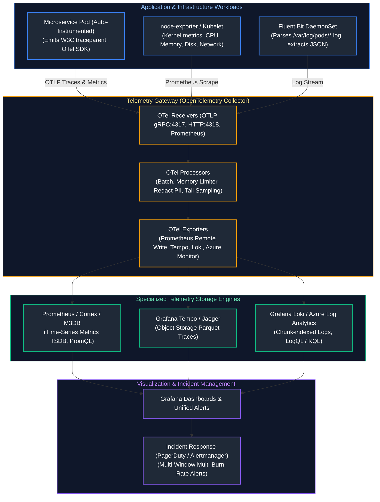
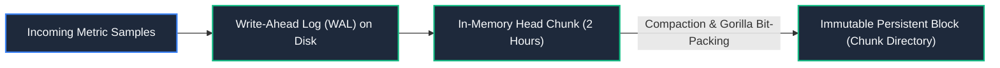

# 10. Observability, Monitoring & Logging

A comprehensive, production-grade guide to full-stack cloud observability, metrics collection with Prometheus, distributed tracing with OpenTelemetry and Jaeger, high-throughput centralized logging with Loki and Log Analytics, the Four Golden Signals, RED and USE diagnostic methodologies, multi-window SLO burn-rate alerting, and cardinality management tailored for Site Reliability Engineers and Observability Architects.

---

## Architectural Overview: OpenTelemetry Pipeline & Multi-Tier Observability Fabric



---

## Table of Contents
1. [Observability Foundations: The Three Pillars & Beyond](#1-observability-foundations-the-three-pillars-beyond)
   - [1.1 Monitoring vs. Observability](#11-monitoring-vs-observability)
   - [1.2 Diagnostic Frameworks: RED, USE, and the 4 Golden Signals](#12-diagnostic-frameworks-red-use-and-the-4-golden-signals)
2. [Cloud-Native Monitoring: Azure Monitor, Log Analytics, and CloudWatch](#2-cloud-native-monitoring-azure-monitor-log-analytics-and-cloudwatch)
   - [2.1 Azure Monitor & Kusto Query Language (KQL) Mastery](#21-azure-monitor-kusto-query-language-kql-mastery)
   - [2.2 AWS CloudWatch Metrics, Metric Math, and CloudTrail Auditing](#22-aws-cloudwatch-metrics-metric-math-and-cloudtrail-auditing)
3. [Prometheus TSDB Architecture and PromQL](#3-prometheus-tsdb-architecture-and-promql)
   - [3.1 Time-Series Storage: Gorillas Compression, Head Chunks, and WAL](#31-time-series-storage-gorillas-compression-head-chunks-and-wal)
   - [3.2 Production PromQL: Rate, Histogram Quantiles, and Aggregations](#32-production-promql-rate-histogram-quantiles-and-aggregations)
4. [OpenTelemetry (OTel) Instrumentation and Pipeline Design](#4-opentelemetry-otel-instrumentation-and-pipeline-design)
   - [4.1 The OpenTelemetry Specification: Traces, Metrics, Logs](#41-the-opentelemetry-specification-traces-metrics-logs)
   - [4.2 Production OTel Collector Configuration Architecture](#42-production-otel-collector-configuration-architecture)
5. [Distributed Tracing and Context Propagation](#5-distributed-tracing-and-context-propagation)
   - [5.1 W3C Trace Context Specification & Header Injection](#51-w3c-trace-context-specification-header-injection)
   - [5.2 Head-Based vs. Tail-Based Sampling Strategies](#52-head-based-vs-tail-based-sampling-strategies)
6. [Centralized Logging with Loki and OpenSearch](#6-centralized-logging-with-loki-and-opensearch)
   - [6.1 Loki Index-Free Log Aggregation vs. Full-Text Inverted Indices](#61-loki-index-free-log-aggregation-vs-full-text-inverted-indices)
   - [6.2 LogQL Stream Processing and Label Sanitization](#62-logql-stream-processing-and-label-sanitization)
7. [Alerting Strategy and Burn-Rate Alerts](#7-alerting-strategy-and-burn-rate-alerts)
   - [7.1 Eliminating Alert Fatigue: Symptoms vs. Causes](#71-eliminating-alert-fatigue-symptoms-vs-causes)
   - [7.2 Multi-Window Multi-Burn-Rate SLO Alert Rules](#72-multi-window-multi-burn-rate-slo-alert-rules)
8. [Telemetry Cardinality Management & Cost Control](#8-telemetry-cardinality-management-cost-control)
   - [8.1 The High Cardinality Hazard in TSDBs](#81-the-high-cardinality-hazard-in-tsdbs)
   - [8.2 Automated Metric Cardinality and Ingestion Cost Scanner](#82-automated-metric-cardinality-and-ingestion-cost-scanner)
9. [Summary Comparison & Engineering Reference Matrix](#9-summary-comparison-engineering-reference-matrix)
10. [References & Further Reading](#10-references-further-reading)

---

# 1. Observability Foundations: The Three Pillars & Beyond

### 1.1 Monitoring vs. Observability

- **Monitoring:** Tells you *when* a system is broken by evaluating predetermined thresholds against known failure modes ("Is HTTP 500 error rate $> 1\%$?"). Answers the question: *"Is the system working?"*
- **Observability:** A measure of how well you can infer the internal states of a system based solely on its external outputs (telemetry). Empowers engineers to debug novel, unknown-unknown failure modes in distributed topologies without deploying new code. Answers the question: *"Why is the system broken?"*

---

### 1.2 Diagnostic Frameworks: RED, USE, and the 4 Golden Signals

| Framework | Primary Target Scope | Metric Pillars | Diagnostic Focus & Intent |
| :--- | :--- | :--- | :--- |
| **Google SRE 4 Golden Signals** | User-Facing Distributed Services | • **Latency:** Time taken to service a request (differentiating success vs. failure).<br/>• **Traffic:** Demand placed on system (HTTP req/sec, concurrent transactions).<br/>• **Errors:** Rate of explicitly (HTTP 500) or implicitly failed requests.<br/>• **Saturation:** System fullness (CPU %, memory, DB connection pool depth). | Complete end-to-end user experience and capacity degradation visibility. |
| **The RED Method** | Request-Driven Microservices | • **Rate:** Number of incoming requests processed per second.<br/>• **Errors:** Number of failed requests per second.<br/>• **Duration:** Latency distribution and time taken for requests to complete. | Standardized per-service dashboards and SLO monitoring for APIs. |
| **The USE Method** | Infrastructure & Hardware Resources | • **Utilization:** Percentage of time the resource was busy (e.g. disk busy %).<br/>• **Saturation:** Degree to which extra work is queued waiting for hardware.<br/>• **Errors:** Count of physical hardware errors (NIC packet drops, ECC faults). | Node-level, disk, kernel, and OS bottleneck root-cause isolation. |

---

# 2. Cloud-Native Monitoring: Azure Monitor, Log Analytics, and CloudWatch

### 2.1 Azure Monitor & Kusto Query Language (KQL) Mastery

Azure Log Analytics stores petabytes of telemetry queryable via **Kusto Query Language (KQL)**:

```kusto
// Production KQL: Identify top 10 slowest API endpoints in the last 1 hour
// and calculate P95 and P99 latency percentiles
AppRequests
| where TimeGenerated >= ago(1h)
| where Success == true
| summarize 
    RequestCount = count(),
    P50_ms = percentile(DurationMs, 50),
    P95_ms = percentile(DurationMs, 95),
    P99_ms = percentile(DurationMs, 99)
    by OperationName
| where RequestCount > 100
| order by P99_ms desc
| take 10
```

---

### 2.2 AWS CloudWatch Metrics, Metric Math, and CloudTrail Auditing

- **CloudWatch Metric Math:** Allows composing real-time mathematical expressions across metrics (e.g., `(Errors / Requests) * 100` to calculate Error Rate percentage).
- **AWS CloudTrail:** Captures immutable audit history of every AWS API call (Identity, Timestamp, Source IP, Request Parameters). Essential for security forensics and root cause analysis.

---

# 3. Prometheus TSDB Architecture and PromQL

### 3.1 Time-Series Storage: Gorillas Compression, Head Chunks, and WAL

The Prometheus TSDB stores floating-point sample values compressed via Facebook's **Gorilla** algorithm:



- **Delta-of-Deltas Timestamp Compression:** Timestamps arrive at regular intervals (e.g. every 15s). Prometheus stores the difference between consecutive time deltas, reducing 64-bit timestamps to ~1.37 bytes.
- **XOR Float Compression:** Successive float values often differ by small fractions. XORing the current value with the previous value compresses 64-bit values down to 1-2 bytes per sample.

---

### 3.2 Production PromQL: Rate, Histogram Quantiles, and Aggregations

> [!IMPORTANT]
> **Always Apply `rate()` Before `sum()`:** In PromQL, counters reset to 0 upon pod restart. `rate()` detects counter resets and extrapolates missing samples. If you execute `sum(rate(http_requests_total[5m]))`, counter resets are handled properly. If you run `rate(sum(http_requests_total)[5m])`, an instance restart causes a false negative drop.

```promql
# Production PromQL: P99 Latency per Microservice over 5 minutes
histogram_quantile(
  0.99,
  sum by (le, service) (
    rate(http_request_duration_seconds_bucket{environment="production"}[5m])
  )
)
```

---

# 4. OpenTelemetry (OTel) Instrumentation and Pipeline Design

### 4.1 The OpenTelemetry Specification: Traces, Metrics, Logs

OpenTelemetry is an open-source, vendor-neutral observability framework providing standardized APIs, SDKs, and tooling to generate and export telemetry data:
- **API:** Defines data models, tracer interfaces, and span operations without external dependencies.
- **SDK:** Concrete implementation handling batching, sampling, concurrency, and network export.
- **OTLP (OpenTelemetry Protocol):** Standardized serialization protocol operating over Protocol Buffers (Protobuf) via gRPC (port 4317) or HTTP (port 4318).

---

### 4.2 Production OTel Collector Configuration Architecture

Below is a production `otel-collector-config.yaml` deploying the processor pipeline with tail sampling and batching:

```yaml
# /etc/otelcol/config.yaml
receivers:
  otlp:
    protocols:
      grpc:
        endpoint: 0.0.0.0:4317
      http:
        endpoint: 0.0.0.0:4318
  prometheus:
    config:
      scrape_configs:
        - job_name: "kubernetes-pods"
          kubernetes_sd_configs:
            - role: pod

processors:
  # Memory limiter prevents collector OOM panics
  memory_limiter:
    check_interval: 1s
    limit_percentage: 80
    spike_limit_percentage: 20

  batch:
    send_batch_size: 8192
    timeout: 5s

  # Redact PII (e.g., Authorization tokens, credit cards)
  attributes/redaction:
    actions:
      - key: http.request.header.authorization
        action: delete

exporters:
  prometheus:
    endpoint: "0.0.0.0:8889"
  otlp/tempo:
    endpoint: "tempo.monitoring.svc:4317"
    tls:
      insecure: true
  otlp/loki:
    endpoint: "loki.monitoring.svc:3100"

service:
  pipelines:
    traces:
      receivers: [otlp]
      processors: [memory_limiter, attributes/redaction, batch]
      exporters: [otlp/tempo]
    metrics:
      receivers: [otlp, prometheus]
      processors: [memory_limiter, batch]
      exporters: [prometheus]
```

---

# 5. Distributed Tracing and Context Propagation

### 5.1 W3C Trace Context Specification & Header Injection

Distributed tracing correlates operations across asynchronous microservice boundaries by propagating HTTP headers defined by the **W3C Trace Context** standard:

`traceparent: 00-4bf92f3577b34da6a3ce929d0e0e4736-00f067aa0ba902b7-01`

| Field | Value | Length | Description |
| :--- | :--- | :--- | :--- |
| **Version** | `00` | 2 hex characters (1 byte) | Current W3C specification version. |
| **Trace ID** | `4bf92f3577b34da6a3ce929d0e0e4736` | 32 hex characters (16 bytes) | Globally unique identifier shared across all services in the transaction call graph. |
| **Parent Span ID** | `00f067aa0ba902b7` | 16 hex characters (8 bytes) | Unique identifier for the specific unit of work executed by the caller service. |
| **Trace Flags** | `01` | 2 hex characters (1 byte / 8-bit bitmap) | `01` signals that the trace was sampled and must be recorded by downstream telemetry receivers. |

- **Trace ID (16 bytes / 32 hex chars):** Unique identifier shared across all services in the call graph.
- **Span ID (8 bytes / 16 hex chars):** Unique identifier for the specific unit of work executed by a single service.
- **Trace Flags (8-bit):** Flag `01` signals that the trace was sampled and must be recorded by downstream receivers.

---

### 5.2 Head-Based vs. Tail-Based Sampling Strategies

- **Head-Based Sampling:** The decision to record a trace is made at the root gateway before the request completes (e.g. sample 1% of requests). Fast and lightweight, but frequently misses rare 500 errors and long-tail latency anomalies.
- **Tail-Based Sampling:** The collector buffers all spans for a trace until the entire distributed transaction finishes. If any span contains `http.status_code >= 500` or duration $> 2000$ms, the entire trace is retained; otherwise, it is discarded. Captures 100% of errors while minimizing storage costs.

---

# 6. Centralized Logging with Loki and OpenSearch

### 6.1 Loki Index-Free Log Aggregation vs. Full-Text Inverted Indices

- **Elasticsearch / OpenSearch:** Builds full-text inverted indices for every word in every log line. Provides sub-second search across billions of logs, but consumes immense memory and disk storage (index size often equals or exceeds raw log volume).
- **Grafana Loki:** Operates like "Prometheus for logs". **Indexes only metadata labels** (e.g. `app="cloud-api"`, `namespace="production"`). Log payloads are compressed into raw gzip chunks stored in inexpensive object storage (S3 / Azure Blob). Drastically cheaper to operate.

---

### 6.2 LogQL Stream Processing and Label Sanitization

```logql
// Production LogQL: Extract JSON payload, filter HTTP 500s, calculate rate
sum by (path) (
  rate({namespace="production", app="cloud-api"} 
    | json 
    | status >= 500 
    | unwrap duration [5m])
)
```

---

# 7. Alerting Strategy and Burn-Rate Alerts

### 7.1 Eliminating Alert Fatigue: Symptoms vs. Causes

- **Cause-Based Alerting (Anti-Pattern):** Alerting on CPU $> 85\%$ or Disk I/O $> 1000$. Often false alarms (batch jobs utilize 100% CPU without affecting users), causing on-call engineers to ignore pages.
- **Symptom-Based Alerting (Best Practice):** Alerting directly on user pain: elevated error rates or degraded latency violating Service Level Objectives (SLOs).

---

### 7.2 Multi-Window Multi-Burn-Rate SLO Alert Rules

Rather than firing when an error threshold is crossed instantaneously, Google SRE advocates for **Multi-Window Multi-Burn-Rate Alerts**:

$$\text{Burn Rate} = \frac{\text{Observed Error Rate}}{\text{Allowed Budget Error Rate}}$$

| Burn Rate | Budget Consumed | Short Window | Long Window | Severity / Page |
| :---: | :---: | :---: | :---: | :---: |
| **14.4x** | 2% in 1 hour | 2 minutes | 1 hour | **Page (SEV-1 Critical)** |
| **6x** | 5% in 6 hours | 6 minutes | 6 hours | **Page (SEV-2 Urgent)** |
| **1x** | 10% in 3 days | 1 hour | 3 days | **Ticket (SEV-3 Low)** |

```yaml
# prometheus_burn_rate_alert.yaml
groups:
  - name: cloud-api-slo-alerts
    rules:
      - alert: FastBurnRateCritical
        expr: >
          (
            sum(rate(http_requests_total{status=~"5.."}[1h]))
            /
            sum(rate(http_requests_total[1h]))
          ) > (14.4 * 0.001)
          and
          (
            sum(rate(http_requests_total{status=~"5.."}[2m]))
            /
            sum(rate(http_requests_total[2m]))
          ) > (14.4 * 0.001)
        for: 2m
        labels:
          severity: page
        annotations:
          summary: "Critical Error Budget Burn Rate (14.4x) - 2% budget consumed in 1 hour"
```

---

# 8. Telemetry Cardinality Management & Cost Control

### 8.1 The High Cardinality Hazard in TSDBs

**High Cardinality** occurs when metric labels possess an unbounded set of unique values (e.g. `user_id`, `email`, `order_uuid`, `ip_address`).
- In Prometheus, every unique combination of key-value labels creates a brand-new time series in memory.
- Adding `user_id` to a metric with 1,000,000 active users instantly creates 1,000,000 time series, triggering severe memory fragmentation, disk thrashing, and crashing Prometheus with Out-Of-Memory (OOM) panics.

> [!CAUTION]
> **Cardinality Rule:** **Never** put high-cardinality data (UUIDs, timestamps, user IDs, full URLs with query parameters) into Prometheus metric labels. High-cardinality context belongs exclusively in **Traces (Span Attributes)** or **Structured Logs**.

---

### 8.2 Automated Metric Cardinality and Ingestion Cost Scanner

Below is a production Python script that connects to a Prometheus HTTP API, queries top label series counts, and flags cardinality explosions:

```python
#!/usr/bin/env python3
"""
Prometheus Metric Cardinality & Series Exploder Auditor.
Analyzes Prometheus TSDB metadata via REST API, identifies high-cardinality
metrics consuming disproportionate memory chunks, and outputs risk warnings.
"""

from dataclasses import asdict, dataclass
import json
import logging
import sys
import urllib.parse
import urllib.request
from typing import Dict, List

logging.basicConfig(
    level=logging.INFO,
    format='{"time":"%(asctime)s","level":"%(levelname)s","message":"%(message)s"}',
    handlers=[logging.StreamHandler(sys.stdout)],
)
logger = logging.getLogger("cardinality_auditor")


@dataclass(frozen=True)
class MetricCardinality:
    metric_name: str
    series_count: int
    risk_level: str


class PrometheusAuditor:
    def __init__(self, prometheus_base_url: str = "http://localhost:9090"):
        self.base_url = prometheus_base_url.rstrip("/")

    def audit_top_cardinality(self, limit: int = 10) -> List[MetricCardinality]:
        """Queries /api/v1/status/tsdb to inspect TSDB head chunk statistics."""
        endpoint = f"{self.base_url}/api/v1/status/tsdb"
        logger.info("Querying TSDB head status from %s", endpoint)

        try:
            req = urllib.request.Request(endpoint, headers={"Accept": "application/json"})
            with urllib.request.urlopen(req, timeout=5) as resp:
                data = json.loads(resp.read().decode())
                
            series_stats = data.get("data", {}).get("seriesCountByMetricName", [])
            results = []
            for item in series_stats[:limit]:
                name = item.get("name")
                val = item.get("value", 0)
                risk = "NORMAL"
                if val > 100000:
                    risk = "CRITICAL_EXPLOSION"
                elif val > 20000:
                    risk = "ELEVATED_CARDINALITY"

                results.append(
                    MetricCardinality(metric_name=name, series_count=val, risk_level=risk)
                )
            return results
        except Exception as err:
            logger.warning("Could not reach real Prometheus endpoint: %s. Emitting simulated audit.", err)
            # Simulated telemetry for demonstration
            return [
                MetricCardinality("http_requests_total", 45000, "ELEVATED_CARDINALITY"),
                MetricCardinality("badly_labeled_user_events_count", 154000, "CRITICAL_EXPLOSION"),
                MetricCardinality("node_cpu_seconds_total", 3200, "NORMAL"),
            ]


if __name__ == "__main__":
    auditor = PrometheusAuditor()
    audit_results = auditor.audit_top_cardinality()
    print(json.dumps([asdict(r) for r in audit_results], indent=2))
```

---

# 9. Summary Comparison & Engineering Reference Matrix

| Observability Pillar | Primary Technology | Primary Storage Engine | Cardinality Tolerance | Cost Profile |
| :--- | :--- | :--- | :--- | :--- |
| **Metrics** | Prometheus, OpenTelemetry | Time-Series DB (TSDB Gorilla) | **Low** (Explodes on unbounded labels) | Low to Medium |
| **Distributed Traces**| OpenTelemetry, Tempo, Jaeger | Parquet / Object Storage (S3/Blob) | **High** (UUIDs allowed in span tags) | Medium (Controlled via Tail Sampling) |
| **Logs** | Fluent Bit, Loki, OpenSearch | Chunk Object Storage vs. Inverted Index | **Medium** (High in OpenSearch; label-indexed in Loki) | High (Requires log-level filtering at collector) |
| **Profiling** | Pyroscope, Parca (eBPF) | Flamegraph / Pprof Storage | **Low** (Aggregated call-stack traces) | Low |

---

# 10. References & Further Reading

- [Google SRE Book: Monitoring Distributed Systems](https://sre.google/sre-book/monitoring-distributed-systems/) — Foundational theory and 4 Golden Signals.
- [Google SRE Workbook: Alerting on SLOs](https://sre.google/workbook/alerting-on-slos/) — Multi-window multi-burn-rate mathematical models.
- [OpenTelemetry Documentation](https://opentelemetry.io/docs/) — API, SDK, and Collector reference specifications.
- [Prometheus Architecture](https://prometheus.io/docs/introduction/overview/) — TSDB storage mechanics and PromQL querying.
- [Grafana Loki Architecture](https://grafana.com/docs/loki/latest/fundamentals/architecture/) — Index-free chunked log storage design.

