# 11. Reliability, Resilience & Incident Management

A comprehensive, production-grade guide to Site Reliability Engineering (SRE), Service Level Objectives (SLOs), Service Level Indicators (SLIs), Error Budgets, distributed resilience patterns (exponential backoff with decorrelated jitter, circuit breakers, bulkheads, load shedding), incident command protocols (ICS), blameless postmortems, toil governance, and chaos engineering tailored for Staff SREs, Reliability Architects, and Engineering Leaders.

---

## Architectural Overview: SRE Reliability Loop & Incident Lifecycle

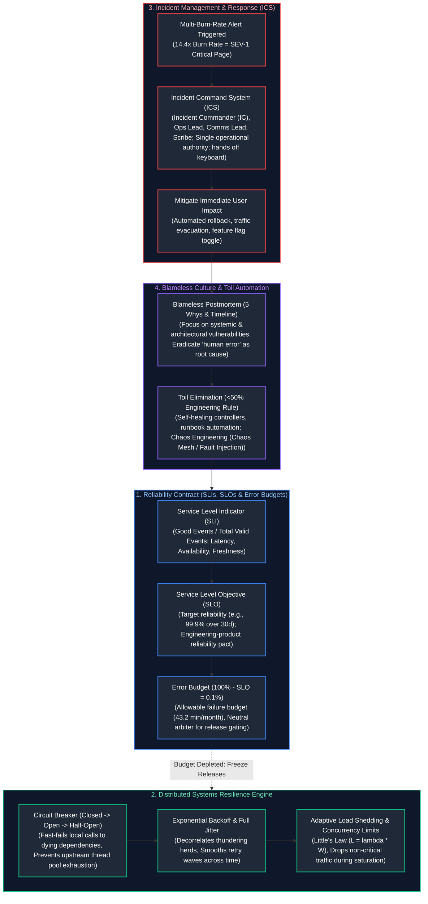

---

## Table of Contents
1. [SRE Principles: The Commercial Aviation & Flight Safety Analogy](#1-sre-principles-the-commercial-aviation--flight-safety-analogy)
   - [1.1 Real-World Analogy: Commercial Flight Operations and NTSB Investigations](#11-real-world-analogy-commercial-flight-operations-and-ntsb-investigations)
   - [1.2 SRE vs. Traditional DevOps vs. Systems Administration](#12-sre-vs-traditional-devops-vs-systems-administration)
2. [SLI, SLO, and Error Budget Mathematical Foundations](#2-sli-slo-and-error-budget-mathematical-foundations)
   - [2.1 Mathematical Formulation of SLIs across Workload Archetypes](#21-mathematical-formulation-of-slis-across-workload-archetypes)
   - [2.2 The Mathematics of "Nines": Downtime Allowances and Architectures](#22-the-mathematics-of-nines-downtime-allowances-and-architectures)
   - [2.3 Error Budget Policies and Automated Deployment Freezes](#23-error-budget-policies-and-automated-deployment-freezes)
3. [Incident Management and On-Call Operations (ICS Framework)](#3-incident-management-and-on-call-operations-ics-framework)
   - [3.1 Incident Command System (ICS) Roles and Separation of Powers](#31-incident-command-system-ics-roles-and-separation-of-powers)
   - [3.2 Enterprise Severity Classification Matrix (SEV-0 through SEV-4)](#32-enterprise-severity-classification-matrix-sev-0-through-sev-4)
   - [3.3 Operational Incident Cadence and Communications Protocol](#33-operational-incident-cadence-and-communications-protocol)
4. [Blameless Postmortems and Root Cause Engineering](#4-blameless-postmortems-and-root-cause-engineering)
   - [4.1 The Myth of Human Error: Sidney Dekker's Safety Engineering](#41-the-myth-of-human-error-sidney-dekkers-safety-engineering)
   - [4.2 The 5-Whys Methodology and Multi-Factor Failure Mechanics](#42-the-5-whys-methodology-and-multi-factor-failure-mechanics)
   - [4.3 Production Enterprise Postmortem Template](#43-production-enterprise-postmortem-template)
5. [Toil Governance and Automation Engineering](#5-toil-governance-and-automation-engineering)
   - [5.1 The 6 Characteristics of Toil](#51-the-6-characteristics-of-toil)
   - [5.2 The 50% Engineering Rule and Runbook Elimination](#52-the-50-engineering-rule-and-runbook-elimination)
6. [Distributed Systems Resilience Patterns](#6-distributed-systems-resilience-patterns)
   - [6.1 The Mathematics of Retries: Full Jitter vs. Decorrelated Jitter](#61-the-mathematics-of-retries-full-jitter-vs-decorrelated-jitter)
   - [6.2 Circuit Breakers: State Machine Transitions and Sliding Windows](#62-circuit-breakers-state-machine-transitions-and-sliding-windows)
   - [6.3 Bulkhead Isolation, Thread Pools, and Tenant Sandboxing](#63-bulkhead-isolation-thread-pools-and-tenant-sandboxing)
   - [6.4 Little's Law, Queuing Delay, and Adaptive Load Shedding](#64-littles-law-queuing-delay-and-adaptive-load-shedding)
7. [Capacity Planning, Stress Testing, and Chaos Engineering](#7-capacity-planning-stress-testing-and-chaos-engineering)
   - [7.1 Load Testing Taxonomies: Stress, Soak, Spike, and Breakpoint](#71-load-testing-taxonomies-stress-soak-spike-and-breakpoint)
   - [7.2 Principles of Chaos Engineering & Blast-Radius Governance](#72-principles-of-chaos-engineering--blast-radius-governance)
   - [7.3 Kubernetes Fault Injection with Chaos Mesh](#73-kubernetes-fault-injection-with-chaos-mesh)
8. [Production Code Implementation: Thread-Safe Resilient Client Engine](#8-production-code-implementation-thread-safe-resilient-client-engine)
   - [8.1 Production Python Circuit Breaker & Decorrelated Jitter Retry Engine](#81-production-python-circuit-breaker--decorrelated-jitter-retry-engine)
9. [Senior SRE Troubleshooting Runbooks: Outage Scenarios](#9-senior-sre-troubleshooting-runbooks-outage-scenarios)
   - [9.1 Scenario 1: Cascading Thundering Herd (Retry Storm Outage)](#91-scenario-1-cascading-thundering-herd-retry-storm-outage)
   - [9.2 Scenario 2: Asynchronous Latent Dependency Starvation](#92-scenario-2-asynchronous-latent-dependency-starvation)
   - [9.3 Scenario 3: Multi-Region Split-Brain & Database Replication Desynchronization](#93-scenario-3-multi-region-split-brain--database-replication-desynchronization)
10. [Summary Comparison & Engineering Reference Matrix](#10-summary-comparison--engineering-reference-matrix)
11. [References & Further Reading](#11-references--further-reading)

---

# 1. SRE Principles: The Commercial Aviation & Flight Safety Analogy

### 1.1 Real-World Analogy: Commercial Flight Operations and NTSB Investigations

Site Reliability Engineering is fundamentally the application of **software engineering practices to operations problems**, pioneered by Benjamin Treynor Sloss at Google. To grasp why SRE enforces rigorous Error Budget governance and blamelessness, examine the safety engineering of modern **commercial aviation**:

```mermaid
flowchart TD
    subgraph TraditionalAviation ["Fragile Aviation (Early 20th Century)"]
        F1["Aircraft Crashes"] --> F2["Blame Pilot: 'Pilot Error / Carelessness'"]
        F2 --> F3["Fire Pilot or Reprimand Crew"]
        F3 --> F4["Same cockpit ergonomic flaw causes identical crash 6 months later!"]
    end

    subgraph ModernSRE_Aviation ["Modern Aviation & SRE (NTSB / CRM Model)"]
        A1["Incident / Near-Miss Occurs"] --> A2["Cockpit Voice & Flight Data Recorders Analyzed (Telemetry)"]
        A2 --> A3["Crew Resource Management (CRM): Psychological Safety to Challenge Authority"]
        A3 --> A4["Systemic Investigation: Why did the altimeter display confuse the pilot?"]
        A4 --> A5["Architectural Redesign: Triple-redundant fly-by-wire & automated ground-proximity warnings"]
    end

    style TraditionalAviation fill:#1e1e2e,stroke:#f87171,stroke-width:2px,color:#fca5a5
    style ModernSRE_Aviation fill:#1e1e2e,stroke:#34d399,stroke-width:2px,color:#a7f3d0
    style F1 fill:#2a2b3d,stroke:#f87171,stroke-width:1.5px,color:#fff
    style F2 fill:#2a2b3d,stroke:#f87171,stroke-width:1.5px,color:#fff
    style F3 fill:#2a2b3d,stroke:#f87171,stroke-width:1.5px,color:#fff
    style F4 fill:#3b1e2e,stroke:#f87171,stroke-width:1.5px,color:#fff
    style A1 fill:#2a2b3d,stroke:#34d399,stroke-width:1.5px,color:#fff
    style A2 fill:#2a2b3d,stroke:#34d399,stroke-width:1.5px,color:#fff
    style A3 fill:#2a2b3d,stroke:#34d399,stroke-width:1.5px,color:#fff
    style A4 fill:#2a2b3d,stroke:#34d399,stroke-width:1.5px,color:#fff
    style A5 fill:#1e3b2e,stroke:#34d399,stroke-width:1.5px,color:#fff
```

- **In fragile systems:** When a failure happens, leadership seeks a human scapegoat ("Engineer X ran `DROP TABLE`" or "Pilot pulled the wrong yoke"). The engineer is disciplined. However, because the underlying system allowed a single human mistake to destroy production, the exact same outage repeats when another engineer makes an identical keystroke.
- **In modern SRE and aviation:** Humans are assumed to be fallible, tired, and prone to cognitive bias. Systems must be engineered so that **no single human action can trigger catastrophic failure**. If an aircraft stalls, the aerodynamic stick-shaker vibrates the control column and overrides erroneous pilot inputs. If an engineer attempts to drop a database, automated IAM permission boundaries, multi-party authorization, and read-only proxies intercept and reject the execution.

---

### 1.2 SRE vs. Traditional DevOps vs. Systems Administration

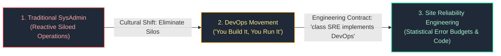

| Dimension | Traditional SysAdmin | DevOps | Site Reliability Engineering (SRE) |
| :--- | :--- | :--- | :--- |
| **Primary Goal** | Maximize uptime by preventing changes. | Accelerate software delivery velocity through collaboration. | Balance release velocity against reliability using Error Budgets. |
| **Role Definition** | Dedicated operations team managing hardware and OS. | Cultural philosophy and practice; often lacks formal engineering spec. | Explicit engineering role: Software developers writing infrastructure code. |
| **Failure Management** | Blame-oriented root-cause tracking; manual disaster recovery. | Continuous feedback, automated testing in deployment pipelines. | Blameless postmortems, 5-Whys, chaos engineering, and automated self-healing. |
| **Operational Work (Toil)** | Accepted as inevitable daily routine (manual patching, ticket queues). | Reduced through automation scripts and CI/CD pipelines. | Strictly capped at **$\le 50\%$**; remaining $\ge 50\%$ mandated for engineering. |

---

# 2. SLI, SLO, and Error Budget Mathematical Foundations

Reliability is not an emotional state; it is an exact statistical probability agreed upon between product management, engineering, and business stakeholders.

### 2.1 Mathematical Formulation of SLIs across Workload Archetypes

A **Service Level Indicator (SLI)** is a quantifiable, empirical metric measuring service performance:

$$\text{SLI} = \frac{\sum \text{Successful Events satisfying Good Criterion}}{\sum \text{Total Valid Events}} \times 100\%$$

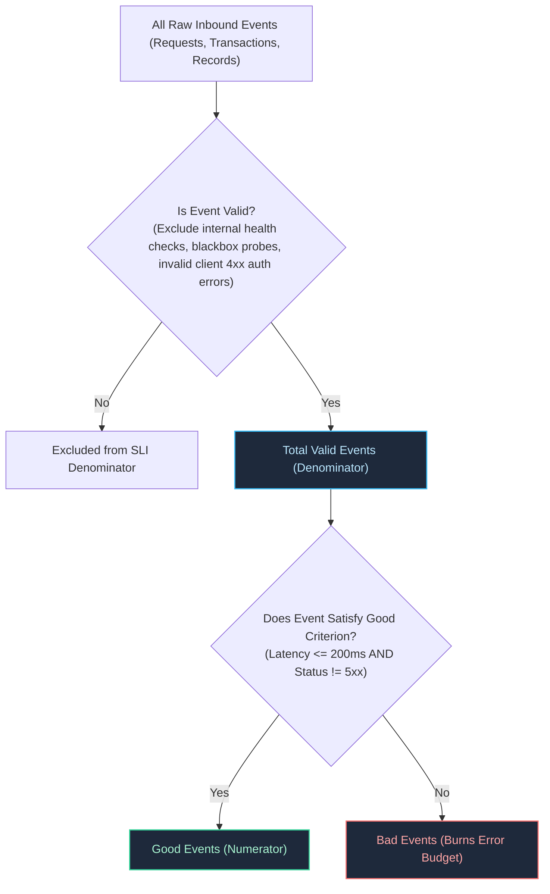

#### SLI Archetype Formulations:
1. **Request-Driven APIs (REST / gRPC):**
   $$\text{SLI}_{\text{Availability}} = \frac{\text{Count of HTTP requests returning status } < 500}{\text{Total HTTP requests excluding client } 4xx} \times 100\%$$
   $$\text{SLI}_{\text{Latency}} = \frac{\text{Count of valid HTTP requests completed in } \le 250\text{ms}}{\text{Total valid HTTP requests}} \times 100\%$$
2. **Storage and Database Engines:**
   $$\text{SLI}_{\text{Durability}} = \frac{\text{Records read successfully without data corruption or loss}}{\text{Total records requested}} \times 100\%$$
3. **Data Pipelines & Asynchronous Event Streaming:**
   $$\text{SLI}_{\text{Freshness}} = \frac{\text{Processing Batches where } (T_{\text{ingestion}} - T_{\text{generation}}) \le 10\text{ minutes}}{\text{Total Batches Processed}} \times 100\%$$
   $$\text{SLI}_{\text{Completeness}} = \frac{\text{Records successfully transformed and committed to Lakehouse}}{\text{Total raw records ingested from Kafka}} \times 100\%$$

---

### 2.2 The Mathematics of "Nines": Downtime Allowances and Architectures

The **Service Level Objective (SLO)** is the target percentage of reliability over a rolling temporal window (standard: **rolling 30 days**):
$$\text{Error Budget} = 100\% - \text{SLO}$$

Every extra "Nine" represents a **10x reduction** in allowable downtime, requiring an exponential increase in architectural complexity and capital expenditure:

| "Nines" | Availability % | Error Budget % | Allowed Downtime / Day | Allowed Downtime / Month (30d) | Allowed Downtime / Year (365d) | Architectural Implementation Required |
| :---: | :---: | :---: | :---: | :---: | :---: | :--- |
| **1 Nine** | $90.0\%$ | $10.0\%$ | 2.4 hours | 72.0 hours | 36.5 days | Single shared VM, manual cold backups, business-hours recovery. |
| **2 Nines** | $99.0\%$ | $1.0\%$ | 14.4 minutes | 7.2 hours | 3.65 days | Single VM with automated disk snapshots, manual DNS failover. |
| **3 Nines** | $99.9\%$ | $0.1\%$ | 1.44 minutes | 43.2 minutes | 8.76 hours | Multi-AZ load-balanced stateless tier, automated RDS read-replica promotion. |
| **3.5 Nines**| $99.95\%$| $0.05\%$ | 43.2 seconds | 21.6 minutes | 4.38 hours | Multi-AZ active-active, automated health checks, zero-downtime rolling deploys. |
| **4 Nines** | $99.99\%$ | $0.01\%$ | 8.64 seconds | 4.32 minutes | 52.6 minutes | Multi-Region Active-Passive with automated route failover; automated circuit breakers. |
| **5 Nines** | $99.999\%$| $0.001\%$| 0.86 seconds | 25.9 seconds | 5.26 minutes | Multi-Region Active-Active, consensus clustering (Spanner/CockroachDB), hitless canary mesh. |

> [!WARNING]
> **The Myth of 100% Reliability:** Setting an SLO to 100% is economically irrational and architecturally destructive. If your users access your service via 4G/5G cellular networks or home Wi-Fi that inherently exhibits $99.0\%$ to $99.5\%$ availability, engineering your backend to $99.999\%$ delivers **zero perceptible benefit to the end user** while consuming millions in cloud infrastructure and halting product innovation.

---

### 2.3 Error Budget Policies and Automated Deployment Freezes

An Error Budget is not just a mathematical curiosity; it is a **binding contract** governing engineering releases:

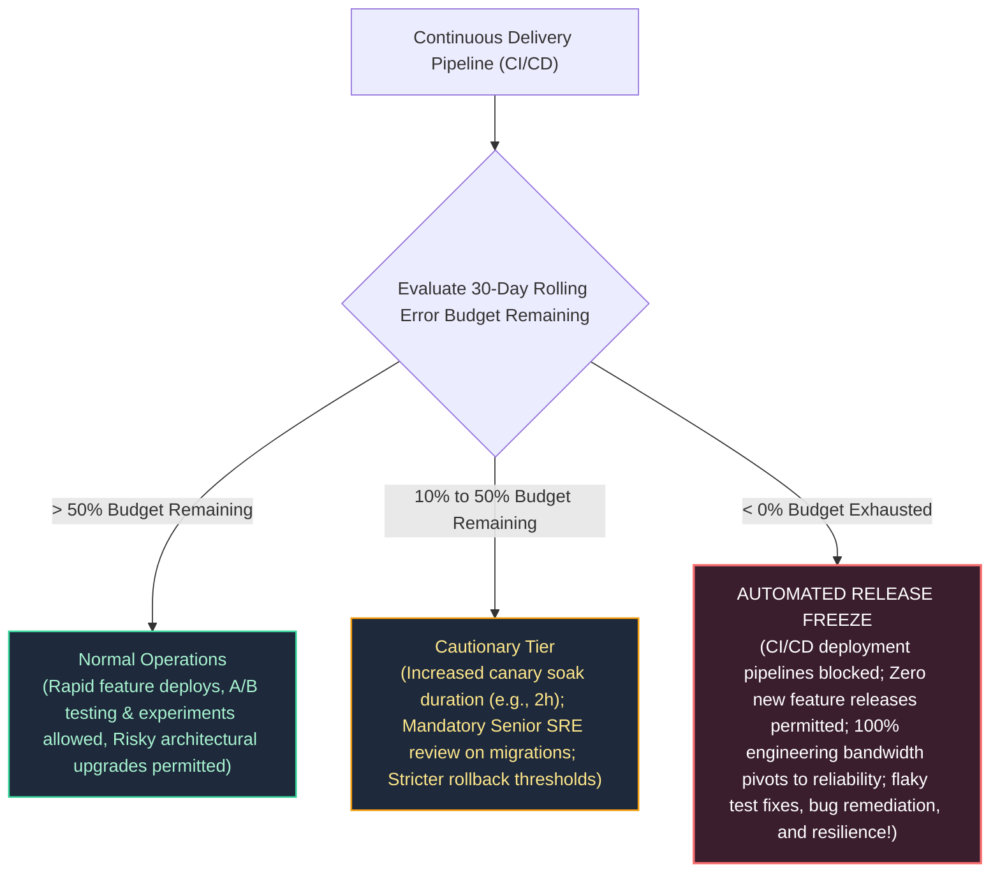

---

# 3. Incident Management and On-Call Operations (ICS Framework)

During high-severity outages, unstructured engineering chaos (multiple developers simultaneously running ad-hoc commands, arguing in Slack channels, interrupting triage) dramatically increases **Mean Time to Recovery (MTTR)**. Modern SRE adapts the **Incident Command System (ICS)**, originally created by fire departments and FEMA.

### 3.1 Incident Command System (ICS) Roles and Separation of Powers

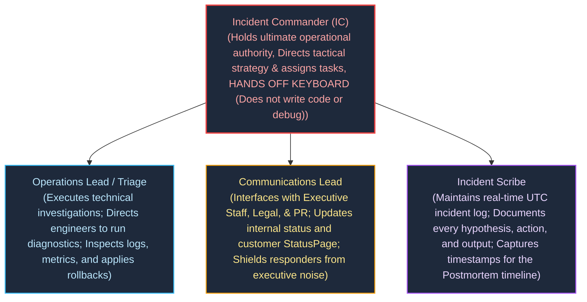

#### Absolute Rule of the Incident Commander:
**The Incident Commander does NOT touch a terminal.** The moment an IC begins reading logs or debugging a database query, they develop tunnel vision, lose situational awareness of the broader outage, and fail to coordinate cross-team responders.

---

### 3.2 Enterprise Severity Classification Matrix (SEV-0 through SEV-4)

| Severity Level | Business & Customer Impact | Triage SLA | War Room Cadence | Stakeholder Escalation |
| :---: | :--- | :---: | :---: | :--- |
| **SEV-0** | **Catastrophic Company-Wide Outage:** Complete revenue stall; data loss; regulatory breach; major public press coverage. | $\le 2$ min | Dedicated video bridge; 24/7 continuous until resolved | Immediate C-Suite (CEO, CTO), Board, General Counsel, PR |
| **SEV-1** | **Critical Production Outage:** Core business flow completely down for $> 20\%$ of users (e.g. checkout broken). No workaround. | $\le 5$ min | Mandatory virtual war room; audio/video bridge active | VP of Engineering, Product Directors; updates every 30 mins |
| **SEV-2** | **Major Service Degradation:** High latency, secondary service offline (e.g. search recommendations down; checkout works). | $\le 15$ min | Dedicated Slack incident channel; on-call video optional | Engineering Directors; status updates every 60 mins |
| **SEV-3** | **Moderate / Non-Critical Impact:** Low traffic service failing; workaround exists; internal tooling broken. | $\le 1$ hour | Handled asynchronously via Slack incident channel | Engineering Manager review during business hours |
| **SEV-4** | **Minor / Cosmetic Bug:** Typos, minor admin portal styling flaw, non-customer impacting metric glitch. | Next Sprint | Standard Jira ticket in backlog | Handled via routine sprint planning |

---

### 3.3 Operational Incident Cadence and Communications Protocol

During a live SEV-1 incident, the Incident Commander establishes strict communication discipline:
1. **Timeboxed Status Checks:** *"Team, we are testing hypothesis A (rolling back deployment v2.14). Ops Lead, you have 7 minutes to execute and verify SLI recovery. Scribe, note the time. We regroup at 14:22 UTC."*
2. **Explicit Task Assignment:** Tasks are assigned to **named individuals**, never to the room. *"Dave, check the database connection pool depth. Sarah, inspect ingress 5xx error distribution. Acknowledge."*
3. **Internal vs. External Status Broadcasting:** 
   - **Internal Status:** Sent every 30 minutes to leadership: `Status: Investigating | Impact: Checkout failing for EU users | Action: Rolling back v2.14 | Next Update: 15:00 UTC`.
   - **External Status (StatusPage):** Concise, customer-centric, and non-defensive: *"We are investigating elevated error rates affecting European checkouts. Our engineering team is actively applying mitigations."*

---

# 4. Blameless Postmortems and Root Cause Engineering

A postmortem is the structured process of analyzing an incident to discover systemic weaknesses and prevent future occurrences.

### 4.1 The Myth of Human Error: Sidney Dekker's Safety Engineering

In modern safety science (pioneered by Sidney Dekker and adapted by Google SRE):
- **Old View:** "Human error is the cause of accidents. To make systems safe, we must punish, retrain, or replace the humans."
- **New View (SRE):** **"Human error is not the cause of failure; human error is the symptom of a deeply flawed system architecture."**

If an engineer runs an unindexed query on a production database that causes a global lockup, **the engineer is blameless**. The architectural system is at fault because:
1. Production databases allowed unconstrained interactive analytical queries.
2. No query timeout proxy intercepted queries exceeding 5 seconds.
3. Read-replicas were not segregated from analytical traffic.
4. Database credentials lacked least-privilege scoping.

---

### 4.2 The 5-Whys Methodology and Multi-Factor Failure Mechanics

Complex systems do not fail due to a single root cause; they fail due to a **confluence of contributing factors**:

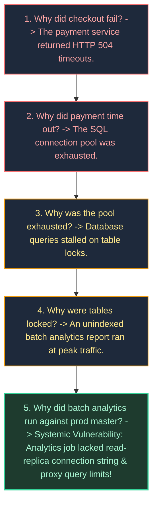

---

### 4.3 Production Enterprise Postmortem Template

```markdown
# Incident Postmortem: [SEV-1] EU Checkout Outage due to Database Lock Contention

**Date:** 2026-10-14  
**Authors:** Senior Staff SRE, Lead Payment Architect  
**Status:** Complete / Action Items In Progress  
**Incident Commander:** @sre-oncall-lead  

---

## 1. Executive Summary & Impact
On October 14, 2026, from 14:02 UTC to 14:48 UTC (duration: 46 minutes), the EU Checkout API experienced an availability collapse, dropping from a baseline of 99.98% to 12.4%. An estimated 14,200 customer transactions failed, resulting in approximately $340,000 in uncaptured revenue. No customer data corruption or data loss occurred.

---

## 2. Chronological Timeline (UTC)
- **14:02** - Automated billing analytics job `daily-tax-calc` launched on production master database.
- **14:05** - Database connection pool reaches 100% saturation (500/500 connections in `active` state).
- **14:06** - Multi-burn-rate alert `ApiFastBurnRateCritical` fires (14.4x burn rate detected over 1h/2m windows).
- **14:08** - Primary on-call SRE paged; declares SEV-1; establishes Zoom Incident Bridge and Slack channel `#inc-20261014-eu-checkout`.
- **14:12** - IC assigns Ops Lead to inspect database telemetry; Scribe begins logging.
- **14:18** - Ops Lead identifies `daily-tax-calc` executing table-scanning query holding exclusive locks.
- **14:24** - IC authorizes terminating the rogue query process PID `44102`.
- **14:26** - Query killed; database connection pool immediately drops from 500 to 45 connections.
- **14:32** - Checkout SLI recovers to 99.95% availability.
- **14:48** - Monitoring period concludes with zero error recurrence; IC downgrades and resolves incident.

---

## 3. Contributing Factors & Systemic Root Causes
1. **Configuration Vulnerability:** The `daily-tax-calc` cron job was erroneously pointed to `db-primary.prod` rather than the read-only replica cluster `db-ro.prod`.
2. **Missing Architectural Safeguards:** The production database lacked a `statement_timeout` guardrail, allowing an unindexed reporting query to hold row locks indefinitely.
3. **Blast Radius Isolation Failure:** Analytical workloads and transactional OLTP workloads shared the exact same database connection pool without bulkhead partitioning.

---

## 4. What Went Well vs. What Went Poorly vs. Where We Got Lucky
- **What Went Well:** The multi-burn-rate alert paged on-call within 4 minutes of user impact; Incident Command hierarchy maintained clear coordination without executive interference.
- **What Went Poorly:** Terminating the query took 18 minutes because database admin credentials were not readily accessible in the emergency password vault.
- **Where We Got Lucky:** The incident occurred during mid-afternoon in Europe after peak morning traffic; had this occurred during Black Friday, revenue loss would have been 10x higher.

---

## 5. Corrective Action Items (Tracking via Jira)

| Action Item | Category | Owner | Priority | Target Due Date |
| :--- | :--- | :--- | :---: | :--- |
| Enforce global `statement_timeout = 5000ms` on all OLTP database clusters via Terraform. | **Prevent** | Data Platform | P0 | 2026-10-21 |
| Physically segregate analytics users to read-replicas by removing write/primary IAM permissions. | **Prevent** | Infosec | P0 | 2026-10-25 |
| Implement PgBouncer bulkhead connection pools separating payment traffic from background workers. | **Mitigate**| Checkout Team | P1 | 2026-11-05 |
| Add synthetic blackbox probe testing automated checkout transactions every 30 seconds. | **Detect** | SRE Team | P1 | 2026-10-28 |
```

---

# 5. Toil Governance and Automation Engineering

### 5.1 The 6 Characteristics of Toil

Google SRE rigorously separates **Operational Toil** from legitimate engineering work. Toil is work that possesses the following six traits:
1. **Manual:** Typing commands by hand into terminals, clicking buttons in web consoles.
2. **Repetitive:** Performed repeatedly over time (e.g. weekly database index re-indexing, manual certificate renewals).
3. **Automatable:** Could be executed by software or an automated script with zero cognitive loss.
4. **Tactical:** Reactive and short-term; produces no permanent systemic improvement.
5. **Devoid of Enduring Value:** Once complete, the service is in the exact same state as before; no architectural durability was created.
6. **O(n) Scaling with Traffic:** As user volume doubles, the number of manual hours required scales linearly.

---

### 5.2 The 50% Engineering Rule and Runbook Elimination

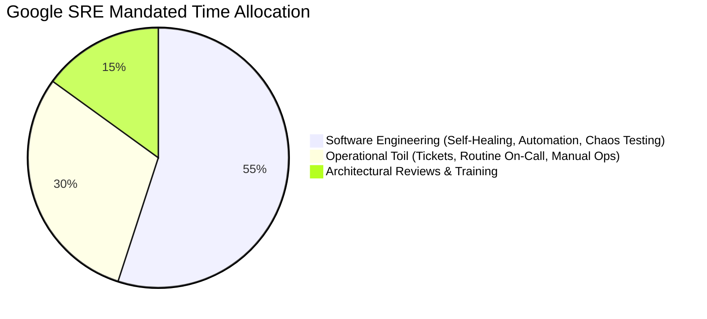

> [!CRITICAL]
> **The SRE 50% Rule:** If an SRE team spends **$> 50\%$ of their time on operational toil**, the team is broken. The excess toil must be immediately redirected back to the product engineering team that wrote the software. This economic feedback loop forces product development teams to design self-healing, automated software rather than dumping operational debt onto operations teams.

---

# 6. Distributed Systems Resilience Patterns

Modern distributed architectures must be designed under the assumption that **networks partition, cloud nodes crash, and downstream dependencies periodically degrade**.

### 6.1 The Mathematics of Retries: Full Jitter vs. Decorrelated Jitter

When a backend service suffers a transient glitch, hundreds of upstream microservice instances attempt immediate retries. Without randomization, these retries synchronize into destructive **thundering herds** (periodic waves of massive traffic spikes that crash the backend repeatedly).

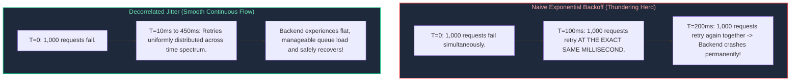

#### Mathematical Formulas for Retry Jitter (AWS Research):
1. **Full Jitter:**
   $$\text{Sleep} = \text{random\_between}(0, \, \min(\text{cap}, \, \text{base} \times 2^{\text{attempt}}))$$
2. **Decorrelated Jitter:**
   Calculates sleep time based on the previous sleep interval, ensuring maximum decorrelation and zero wave synchronization:
   $$\text{Sleep}_i = \min(\text{cap}, \, \text{random\_between}(\text{base}, \, \text{Sleep}_{i-1} \times 3))$$

---

### 6.2 Circuit Breakers: State Machine Transitions and Sliding Windows

A **Circuit Breaker** wraps dangerous remote network calls, tracking error rates inside a rolling time window. When downstream failure crosses a threshold, the circuit trips open, immediately failing subsequent requests locally and protecting thread pools from saturation.

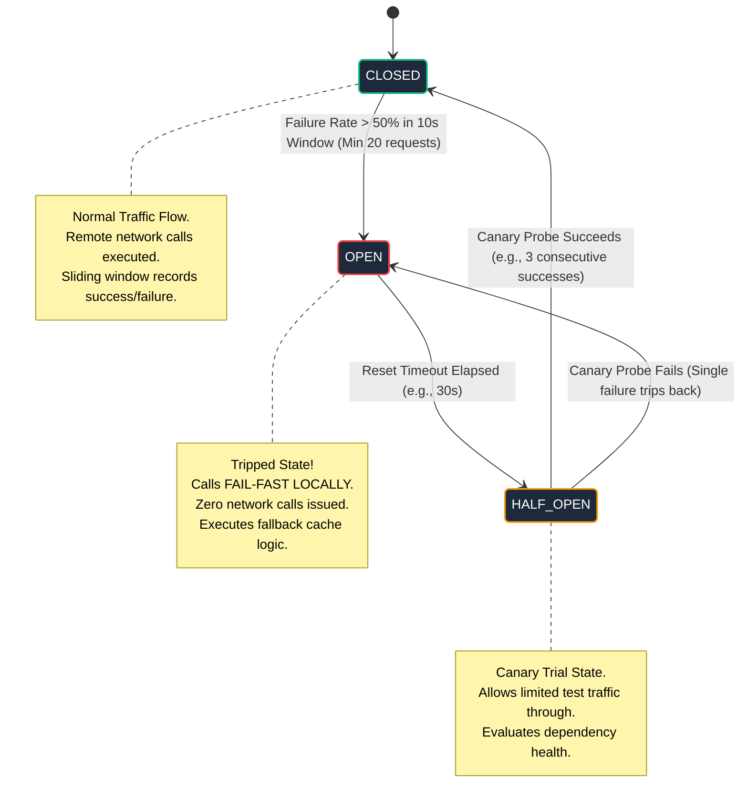

---

### 6.3 Bulkhead Isolation, Thread Pools, and Tenant Sandboxing

Adapted from maritime engineering (where a ship's hull is divided into watertight compartments so a single leak does not sink the vessel):
- **Thread Pool Bulkheads:** Separate thread pools for each external dependency. If the recommendation engine stalls, its thread pool fills up, but the checkout and payment thread pools remain 100% operational.
- **Tenant Isolation (Noisy Neighbor Protection):** VIP enterprise customers are assigned dedicated compute pools, while free-tier users share a rate-limited pool, preventing a single free-tier script from starving paying customers.

---

### 6.4 Little's Law, Queuing Delay, and Adaptive Load Shedding

In queuing theory, **Little's Law** states that the average number of concurrent requests ($L$) in a stable system equals the long-term average arrival rate ($\lambda$) multiplied by the average time a request spends in the system ($W$):

$$L = \lambda \times W$$

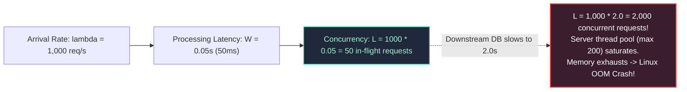

#### Adaptive Load Shedding:
When latency climbs and concurrency threatens to exceed physical capacity, servers must **shed load immediately**. Rejecting incoming requests at the perimeter with an instant `HTTP 503 Service Unavailable` takes **$< 1\text{ms}$** of CPU time, allowing the server to process remaining in-flight transactions without crashing.

---

# 7. Capacity Planning, Stress Testing, and Chaos Engineering

### 7.1 Load Testing Taxonomies: Stress, Soak, Spike, and Breakpoint

| Test Type | Traffic Profile | Duration | Operational Objective |
| :--- | :--- | :--- | :--- |
| **Stress Testing** | Step-function increase above baseline peak (e.g., 150% normal capacity). | 1 to 2 hours | Verify that auto-scaling triggers properly and graceful degradation engages. |
| **Soak Testing** | Sustained moderate-to-high load (e.g., 80% capacity). | 24 to 72 hours | Expose subtle memory leaks, file descriptor leaks, database connection pool leaks, and disk log saturation. |
| **Spike Testing** | Instantaneous 10x surge delivered in $< 10$ seconds. | 10 to 15 minutes | Test perimeter rate-limiters, cloud CDN cache warming, and cold-start autoscaling lag. |
| **Breakpoint Testing** | Continuous traffic increase without ceiling until total failure. | Until crash | Empirically determine the exact architectural breaking point and identify the weakest link (e.g., database IOPS, NAT gateway SNAT). |

---

### 7.2 Principles of Chaos Engineering & Blast-Radius Governance

Chaos Engineering is **not** breaking things randomly in production. It is the disciplined experimentation on distributed software to verify safety hypotheses under turbulent failure conditions:
1. **Hypothesis Formulation:** *"Hypothesize that terminating one Availability Zone's database replica will cause zero HTTP 5xx errors to end users and failover will complete within 3 seconds."*
2. **Blast Radius Minimization:** Begin experiments in staging; advance to canary production with $1\%$ of real user traffic; ensure automated emergency stop switches are wired to abort immediately if SLO burn rates exceed thresholds.
3. **Automated Rollback:** If the hypothesis is disproven, the chaos injection tool must instantly terminate the experiment and restore baseline topology.

---

### 7.3 Kubernetes Fault Injection with Chaos Mesh

Below is a production `ChaosMesh` manifest introducing simulated cross-AZ network latency and packet drops targeting an e-commerce payment microservice:

```yaml
# /manifests/chaos/network_partition_experiment.yaml
apiVersion: chaos-mesh.org/v1alpha1
kind: NetworkChaos
metadata:
  name: payment-service-cross-az-partition
  namespace: production
spec:
  action: delay
  mode: fixed
  value: "3"  # Injects fault into 3 specific pod replicas
  selector:
    namespaces:
      - production
    labelSelectors:
      app: payment-gateway
      tier: backend
  delay:
    latency: "350ms"
    jitter: "50ms"
    correlation: "25"
  loss:
    loss: "5"  # 5% packet loss
    correlation: "10"
  duration: "10m"
  scheduler:
    cron: "0 14 * * 2"  # Run every Tuesday at 14:00 UTC during active business hours
  direction: to
  target:
    selector:
      namespaces:
        - production
      labelSelectors:
        app: postgresql-cluster
```

---

# 8. Production Code Implementation: Thread-Safe Resilient Client Engine

### 8.1 Production Python Circuit Breaker & Decorrelated Jitter Retry Engine

Below is a complete, thread-safe, production-ready Python client implementing the complete SRE resilience suite: **Circuit Breaker state machine**, **sliding-window failure tracking**, **exponential backoff with decorrelated jitter**, and **fallback handling**, requiring zero third-party packages:

```python
#!/usr/bin/env python3
"""
Production SRE Resilience Client: Thread-Safe Circuit Breaker & Decorrelated Jitter.
Protects distributed callers from cascading dependency failures, implements
fail-fast semantics, and provides graceful fallback degradation.
"""

from dataclasses import dataclass
from enum import Enum
import logging
import random
import sys
import threading
import time
from typing import Any, Callable, Dict, List, Optional

logging.basicConfig(
    level=logging.INFO,
    format='{"timestamp":"%(asctime)s","level":"%(levelname)s","thread":"%(threadName)s","message":"%(message)s"}',
    handlers=[logging.StreamHandler(sys.stdout)],
)
logger = logging.getLogger("resilience_engine")


class CircuitState(Enum):
    CLOSED = "CLOSED"
    OPEN = "OPEN"
    HALF_OPEN = "HALF_OPEN"


class CircuitBreakerOpenException(Exception):
    """Raised when call is rejected locally because Circuit Breaker is OPEN."""
    pass


@dataclass
class CallExecutionRecord:
    timestamp: float
    success: bool


class ThreadSafeCircuitBreaker:
    """
    Sliding-window, thread-safe circuit breaker implementation.
    Tracks failure rates over a moving time window and manages state transitions.
    """

    def __init__(
        self,
        failure_rate_threshold: float = 0.5,  # Trip if >= 50% calls fail
        min_requests_threshold: int = 10,       # Minimum calls in window before evaluating
        evaluation_window_sec: float = 10.0,   # Rolling time window
        recovery_sleep_sec: float = 15.0,      # Cooldown time in OPEN before probing
        half_open_success_threshold: int = 3,  # Consecutive successes needed to close
    ):
        self.failure_threshold = failure_rate_threshold
        self.min_requests = min_requests_threshold
        self.window_sec = evaluation_window_sec
        self.recovery_sleep = recovery_sleep_sec
        self.half_open_threshold = half_open_success_threshold

        self.state = CircuitState.CLOSED
        self.lock = threading.Lock()
        self.history: List[CallExecutionRecord] = []
        self.last_state_change = time.time()
        self.consecutive_half_open_successes = 0

    def _purge_expired_history(self, now: float):
        """Removes records older than the evaluation window."""
        cutoff = now - self.window_sec
        self.history = [rec for rec in self.history if rec.timestamp >= cutoff]

    def can_execute(self) -> bool:
        """Determines if a request is permitted to execute or should fail-fast."""
        with self.lock:
            now = time.time()
            if self.state == CircuitState.OPEN:
                if now - self.last_state_change >= self.recovery_sleep:
                    logger.info("CircuitBreaker: Cooldown elapsed. Transitioning from OPEN to HALF_OPEN (Canary Mode).")
                    self.state = CircuitState.HALF_OPEN
                    self.last_state_change = now
                    self.consecutive_half_open_successes = 0
                    return True
                return False

            if self.state == CircuitState.HALF_OPEN:
                # In half-open, allow single concurrent probes
                return True

            return True

    def record_result(self, success: bool):
        """Records call outcome and evaluates state transition triggers."""
        with self.lock:
            now = time.time()
            self._purge_expired_history(now)
            self.history.append(CallExecutionRecord(timestamp=now, success=success))

            if self.state == CircuitState.HALF_OPEN:
                if success:
                    self.consecutive_half_open_successes += 1
                    logger.info(
                        "CircuitBreaker [HALF_OPEN]: Probe SUCCESS (%d/%d)",
                        self.consecutive_half_open_successes,
                        self.half_open_threshold,
                    )
                    if self.consecutive_half_open_successes >= self.half_open_threshold:
                        logger.info("CircuitBreaker: Canary verification passed. Resetting to CLOSED state.")
                        self.state = CircuitState.CLOSED
                        self.last_state_change = now
                        self.history.clear()
                else:
                    logger.error("CircuitBreaker [HALF_OPEN]: Probe FAILED! Tripping back to OPEN state.")
                    self.state = CircuitState.OPEN
                    self.last_state_change = now
                    self.consecutive_half_open_successes = 0
                return

            if self.state == CircuitState.CLOSED:
                if len(self.history) >= self.min_requests:
                    failures = sum(1 for rec in self.history if not rec.success)
                    failure_rate = failures / len(self.history)
                    if failure_rate >= self.failure_threshold:
                        logger.critical(
                            "CircuitBreaker: Failure rate %.2f%% exceeded threshold %.2f%%. TRIPPING TO OPEN!",
                            failure_rate * 100,
                            self.failure_threshold * 100,
                        )
                        self.state = CircuitState.OPEN
                        self.last_state_change = now


class ResilientExecutionEngine:
    """Coordinates Circuit Breaker, Jittered Retries, and Fallback execution."""

    def __init__(
        self,
        circuit_breaker: ThreadSafeCircuitBreaker,
        base_backoff_sec: float = 0.1,
        max_backoff_sec: float = 2.0,
        max_retries: int = 3,
    ):
        self.cb = circuit_breaker
        self.base_backoff = base_backoff_sec
        self.max_backoff = max_backoff_sec
        self.max_retries = max_retries

    def execute(
        self,
        action: Callable[[], Any],
        fallback: Optional[Callable[[], Any]] = None,
    ) -> Any:
        """Executes action with full resilience protection."""
        if not self.cb.can_execute():
            if fallback:
                logger.warning("Circuit OPEN. Diverting execution to fallback handler.")
                return fallback()
            raise CircuitBreakerOpenException("Circuit breaker is currently OPEN. Call rejected locally.")

        current_sleep = self.base_backoff
        for attempt in range(self.max_retries + 1):
            try:
                result = action()
                self.cb.record_result(success=True)
                return result
            except Exception as err:
                logger.warning("Execution attempt %d failed: %s", attempt + 1, err)
                if attempt == self.max_retries:
                    self.cb.record_result(success=False)
                    if fallback:
                        logger.warning("All %d retries exhausted. Invoking fallback.", self.max_retries)
                        return fallback()
                    raise

                # Decorrelated Jitter Calculation: sleep = min(cap, random_between(base, sleep * 3))
                current_sleep = min(
                    self.max_backoff,
                    random.uniform(self.base_backoff, current_sleep * 3),
                )
                logger.info("Applying Decorrelated Jitter: Sleeping %.3fs before retry...", current_sleep)
                time.sleep(current_sleep)


# ============================================================================
# Verification & Demonstration Run
# ============================================================================
if __name__ == "__main__":
    breaker = ThreadSafeCircuitBreaker(
        failure_rate_threshold=0.5,
        min_requests_threshold=4,
        recovery_sleep_sec=3.0,
        half_open_success_threshold=2,
    )
    engine = ResilientExecutionEngine(circuit_breaker=breaker, max_retries=2)

    # Flaky remote dependency mock
    call_counter = 0

    def simulated_remote_call():
        global call_counter
        call_counter += 1
        # Fail first 10 requests, then recover
        if call_counter <= 8:
            raise ConnectionRefusedError(f"Remote backend connection timeout (call #{call_counter})")
        return {"status": "SUCCESS", "payload": f"Data retrieved on call #{call_counter}"}

    def degraded_cache_fallback():
        return {"status": "DEGRADED", "payload": "Stale cached response from local memory"}

    print("--- Starting Resilient Call Simulation ---")
    for i in range(12):
        try:
            resp = engine.execute(simulated_remote_call, fallback=degraded_cache_fallback)
            print(f"Iteration {i+1}: Result -> {resp}")
        except Exception as ex:
            print(f"Iteration {i+1}: Caught Exception -> {ex}")
        time.sleep(0.5)

    print("\n--- Sleeping 3.5s to trigger Circuit Breaker HALF_OPEN Canary Mode ---")
    time.sleep(3.5)

    for i in range(13, 17):
        resp = engine.execute(simulated_remote_call, fallback=degraded_cache_fallback)
        print(f"Iteration {i}: Result -> {resp}")
        time.sleep(0.5)
```

---

# 9. Senior SRE Troubleshooting Runbooks: Outage Scenarios

### 9.1 Scenario 1: Cascading Thundering Herd (Retry Storm Outage)
- **Symptom:** A downstream microservice (`payment-db`) experiences an 8-second temporary network partition. After connectivity recovers, the database CPU immediately locks at 100%, query latency explodes to 30,000ms, and it repeatedly crashes in a self-inflicted death spiral.
- **Root Cause:** Thousands of upstream web client instances executed naive retries without jitter, bombarding the recovering database with 20x normal traffic.
- **Immediate Mitigation Runbook:**
  1. **Sever Ingress Traffic at Perimeter:** Temporarily rate-limit or shed 75% of incoming traffic at the API Gateway using Envoy / NGINX rate-limiting filters to give the database breathing room.
  2. **Flush Client Connection Backlog:** Restart upstream client pods in staggered batches to purge queued requests.
  3. **Enable Decorrelated Jitter in Configuration:** Hot-reload client configuration to activate jittered retry backoffs before reopening traffic gates.

---

### 9.2 Scenario 2: Asynchronous Latent Dependency Starvation
- **Symptom:** The user-facing storefront API degrades to 15,000ms latency. Database CPU and memory are completely healthy (< 20%). Thread count across storefront pods hits the maximum container thread pool limit (e.g. 500 threads).
- **Root Cause Isolation:**
  1. Inspect distributed trace waterfall in Tempo/Jaeger. Notice that all slow storefront spans are blocked waiting on an external third-party marketing tracking API.
  2. The marketing endpoint has no configured socket timeout, causing HTTP client threads to hang indefinitely in `READ` state.
- **Mitigation:**
  1. Trip the Circuit Breaker manually or deploy a feature flag disabling the marketing API call.
  2. Enforce global client socket timeouts: `connect_timeout = 500ms`, `read_timeout = 1000ms`.
  3. Isolate third-party calls into a dedicated bulkhead thread pool so that even if the tracker hangs, zero storefront threads are blocked.

---

### 9.3 Scenario 3: Multi-Region Split-Brain & Database Replication Desynchronization
- **Symptom:** Transcontinental fiber cut disconnects `us-east-1` from `us-west-2`. Both regions believe the other has died. Both regions promote local read-replicas to active master, accepting conflicting writes (split-brain).
- **Root Cause:** Quorum mechanism was misconfigured without an odd-numbered witness tie-breaker node in a third independent region.
- **Mitigation Runbook:**
  1. **Immediately Demote One Region:** Designate `us-east-1` as the single authoritative master; instantly switch `us-west-2` database into `READ-ONLY` mode to halt incoming write divergences.
  2. **Isolate Divergent Data:** Dump all transaction write logs executed in `us-west-2` during the split-brain window into quarantine tables for manual reconciliation scripts.
  3. **Re-establish Asynchronous Replication:** Re-seed `us-west-2` from the authoritative `us-east-1` snapshot and restore consensus with a cloud witness in `us-central-1`.

---

# 10. Summary Comparison & Engineering Reference Matrix

| Resilience & SRE Concept | Core Mechanism | Operational Trade-Off | Primary Failure Mode Mitigated |
| :--- | :--- | :--- | :--- |
| **Error Budget** | Mathematical contract balancing speed vs. reliability | Halts new feature releases when budget is exhausted | Chronic production instability and technical debt accumulation |
| **Incident Command (ICS)** | Strict role hierarchy (IC, Ops, Comms, Scribe) | Requires operational training and executive discipline | Chaos, duplicate effort, and prolonged MTTR during SEV-1 outages |
| **Blameless Postmortem** | 5-Whys and systemic contributing factor analysis | Requires high organizational psychological safety | Repeat outages caused by unaddressed architectural flaws |
| **Circuit Breakers** | Fast-fail state machine with local fallback | Degrades feature experience during dependency downtime | Cascading thread pool and resource exhaustion |
| **Decorrelated Jitter** | Exponential retry backoff with randomized intervals | Adds slight client delay during transient recovery | Destructive thundering herds and retry storms |
| **Bulkheads** | Physical and logical resource partitioning | Reduced resource sharing efficiency | Noisy neighbor saturation taking down unrelated subsystems |
| **Chaos Engineering** | Controlled fault injection in production | Requires strict blast-radius guardrails | Latent failure modes manifesting during real emergencies |

---

# 11. References & Further Reading

- [Site Reliability Engineering: How Google Runs Production Systems (Beyer, Jones, Petoff, Murphy)](https://sre.google/sre-book/table-of-contents/) — Foundational philosophy, Error Budgets, and ICS management.
- [The Site Reliability Workbook (Google SRE Team)](https://sre.google/workbook/table-of-contents/) — Practical implementation of SLOs, alerting, and on-call rotations.
- [AWS Architecture Blog: Exponential Backoff And Jitter (Marc Brooker)](https://aws.amazon.com/blogs/architecture/exponential-backoff-and-jitter/) — Mathematical modeling and simulations of backoff algorithms.
- [The Field Guide to Understanding 'Human Error' (Sidney Dekker)](https://www.routledge.com/The-Field-Guide-to-Understanding-Human-Error/Dekker/p/book/9781472439055) — Foundations of safety science and blameless engineering culture.
- [Release It! Second Edition (Michael T. Nygard)](https://pragprog.com/titles/mnee2/release-it-second-edition/) — Architectural stability patterns: Circuit Breakers, Bulkheads, and Timeouts.
- [Chaos Mesh Documentation](https://chaos-mesh.org/docs/) — Cloud-native fault injection and resilience testing on Kubernetes.
